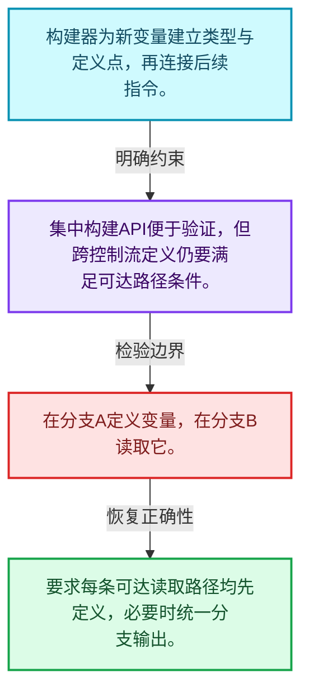
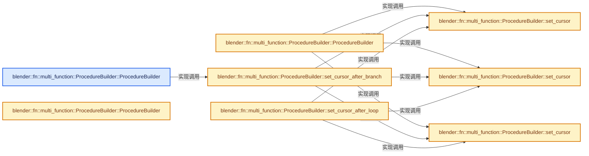
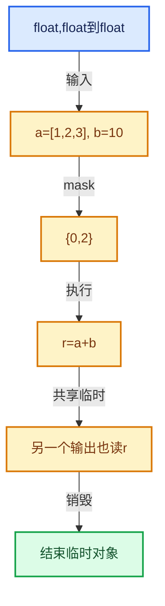

# 07-08 ProcedureBuilder

[方向导航](README.md) · [总目录](../README.md) · [实现索引](../%E7%AC%A6%E5%8F%B7%E4%BE%9D%E8%B5%96%E4%B8%8E%E5%AE%9E%E7%8E%B0%E7%B4%A2%E5%BC%95.md)

## 从问题到实现

构建API怎样防止生成不合法过程？

构建期检查与执行期检查各有职责，变量定义和类型必须在控制流上有效。

**数据模型**

构建器为新变量建立类型与定义点，再连接后续指令。

**设计取舍**

集中构建API便于验证，但跨控制流定义仍要满足可达路径条件。

**最小反例**

在分支A定义变量，在分支B读取它。

**推导**

要求每条可达读取路径均先定义，必要时统一分支输出。

## 阅读地图与执行推演








图中的数值推演是本方向的教学模型；实际函数之间的调用边与概念分析边分别标注，不能把概念关系当作运行时调度顺序。

## 完整源码单元与就地讲解

中文讲解直接放在相关代码旁，复杂机制在代码下展开。原文折叠区保留基准行号；不需要在行号表和函数之间来回查找。类布局可分段展示，函数实现不按固定行数切开。

### 类型布局、声明与编译条件 · FN_multi_function_procedure_builder.hh L1—L90

<a id="t-ae3c81f2a593"></a>

`ProcedureBuilder`在这里声明的数据成员：

- `Procedure procedure_`
- `Vector<InstructionCursor> cursors_`
- `void set_cursor`
- `void set_cursor`
- `void set_cursor`
- `void set_cursor_after_branch`
- `void set_cursor_after_loop`
- `void add_destruct`
- `void add_destruct`
- `ReturnInstruction add_return`
- `Branch add_branch`
- `Loop add_loop`
- `void add_loop_continue`
- `void add_loop_break`
- `CallInstruction add_call_with_no_variables`
- `CallInstruction add_call_with_all_variables`
- `Vector<Variable *> add_call`
- `void add_parameter`
- `Variable add_parameter`
- `Variable add_input_parameter`
- `void add_output_parameter`
- `void link_to_cursors`

<a id="t-1d9eca1c4b51"></a>

<a id="t-90c7514f1d42"></a>

<a id="t-3744a90b8f5f"></a>

<a id="t-49016a2e2c2e"></a>

<!-- annotated:672dfda4380bf8 -->

```cpp
/* SPDX-FileCopyrightText: 2023 Blender Authors
 *
 * SPDX-License-Identifier: GPL-2.0-or-later */

#pragma once

/** \file
 * \ingroup fn
 */

#include "FN_multi_function_procedure.hh"

namespace blender::fn::multi_function {

/**
 * Utility class to build a #Procedure.
 */
class ProcedureBuilder {
 private:
  /** Procedure that is being build. */
  Procedure *procedure_ = nullptr;
  /** Cursors where the next instruction should be inserted. */
  Vector<InstructionCursor> cursors_;

 public:
  struct Branch;
  struct Loop;

  ProcedureBuilder(Procedure &procedure,
                   InstructionCursor initial_cursor = InstructionCursor::ForEntry());

  ProcedureBuilder(Span<ProcedureBuilder *> builders);

  ProcedureBuilder(Branch &branch);

  void set_cursor(const InstructionCursor &cursor);
  void set_cursor(Span<InstructionCursor> cursors);
  void set_cursor(Span<ProcedureBuilder *> builders);
  void set_cursor_after_branch(Branch &branch);
  void set_cursor_after_loop(Loop &loop);

  void add_destruct(Variable &variable);
  void add_destruct(Span<Variable *> variables);

  ReturnInstruction &add_return();

  Branch add_branch(Variable &condition);

  Loop add_loop();
  void add_loop_continue(Loop &loop);
  void add_loop_break(Loop &loop);

  CallInstruction &add_call_with_no_variables(const MultiFunction &fn);
  CallInstruction &add_call_with_all_variables(const MultiFunction &fn,
                                               Span<Variable *> param_variables);

  Vector<Variable *> add_call(const MultiFunction &fn,
                              Span<Variable *> input_and_mutable_variables = {});

  template<int OutputN>
  std::array<Variable *, OutputN> add_call(const MultiFunction &fn,
                                           Span<Variable *> input_and_mutable_variables = {});

  void add_parameter(ParamType::InterfaceType interface_type, Variable &variable);
  Variable &add_parameter(ParamType param_type, std::string name = "");

  Variable &add_input_parameter(DataType data_type, std::string name = "");
  template<typename T> Variable &add_single_input_parameter(std::string name = "");
  template<typename T> Variable &add_single_mutable_parameter(std::string name = "");

  void add_output_parameter(Variable &variable);

 private:
  void link_to_cursors(Instruction *instruction);
};

struct ProcedureBuilder::Branch {
  ProcedureBuilder branch_true;
  ProcedureBuilder branch_false;
};

struct ProcedureBuilder::Loop {
  Instruction *begin = nullptr;
  DummyInstruction *end = nullptr;
};

/* --------------------------------------------------------------------
 * ProcedureBuilder inline methods.
 */

```

<details>
<summary>核对原始源码：source/blender/functions/FN_multi_function_procedure_builder.hh · L1—L90</summary>

<!-- original:672dfda4380bf8:source/blender/functions/FN_multi_function_procedure_builder.hh:1:90 -->

```cpp
/* SPDX-FileCopyrightText: 2023 Blender Authors
 *
 * SPDX-License-Identifier: GPL-2.0-or-later */

#pragma once

/** \file
 * \ingroup fn
 */

#include "FN_multi_function_procedure.hh"

namespace blender::fn::multi_function {

/**
 * Utility class to build a #Procedure.
 */
class ProcedureBuilder {
 private:
  /** Procedure that is being build. */
  Procedure *procedure_ = nullptr;
  /** Cursors where the next instruction should be inserted. */
  Vector<InstructionCursor> cursors_;

 public:
  struct Branch;
  struct Loop;

  ProcedureBuilder(Procedure &procedure,
                   InstructionCursor initial_cursor = InstructionCursor::ForEntry());

  ProcedureBuilder(Span<ProcedureBuilder *> builders);

  ProcedureBuilder(Branch &branch);

  void set_cursor(const InstructionCursor &cursor);
  void set_cursor(Span<InstructionCursor> cursors);
  void set_cursor(Span<ProcedureBuilder *> builders);
  void set_cursor_after_branch(Branch &branch);
  void set_cursor_after_loop(Loop &loop);

  void add_destruct(Variable &variable);
  void add_destruct(Span<Variable *> variables);

  ReturnInstruction &add_return();

  Branch add_branch(Variable &condition);

  Loop add_loop();
  void add_loop_continue(Loop &loop);
  void add_loop_break(Loop &loop);

  CallInstruction &add_call_with_no_variables(const MultiFunction &fn);
  CallInstruction &add_call_with_all_variables(const MultiFunction &fn,
                                               Span<Variable *> param_variables);

  Vector<Variable *> add_call(const MultiFunction &fn,
                              Span<Variable *> input_and_mutable_variables = {});

  template<int OutputN>
  std::array<Variable *, OutputN> add_call(const MultiFunction &fn,
                                           Span<Variable *> input_and_mutable_variables = {});

  void add_parameter(ParamType::InterfaceType interface_type, Variable &variable);
  Variable &add_parameter(ParamType param_type, std::string name = "");

  Variable &add_input_parameter(DataType data_type, std::string name = "");
  template<typename T> Variable &add_single_input_parameter(std::string name = "");
  template<typename T> Variable &add_single_mutable_parameter(std::string name = "");

  void add_output_parameter(Variable &variable);

 private:
  void link_to_cursors(Instruction *instruction);
};

struct ProcedureBuilder::Branch {
  ProcedureBuilder branch_true;
  ProcedureBuilder branch_false;
};

struct ProcedureBuilder::Loop {
  Instruction *begin = nullptr;
  DummyInstruction *end = nullptr;
};

/* --------------------------------------------------------------------
 * ProcedureBuilder inline methods.
 */

```

</details>

<a id="f-c652f41f16257fcb"></a>

### `blender::fn::multi_function::ProcedureBuilder::ProcedureBuilder`

实现位置：[source/blender/functions/FN_multi_function_procedure_builder.hh](../../../../../source/blender/functions/FN_multi_function_procedure_builder.hh) · L91—L95。

接口参数：

- `Branch &branch`

**教学注释版**

<!-- annotated:598a116053b263 -->

```cpp
inline ProcedureBuilder::ProcedureBuilder(Branch &branch)
    : ProcedureBuilder(*branch.branch_true.procedure_)
{
  this->set_cursor_after_branch(branch);
}
```

<details>
<summary>核对原始源码：source/blender/functions/FN_multi_function_procedure_builder.hh · L91—L95</summary>

<!-- original:598a116053b263:source/blender/functions/FN_multi_function_procedure_builder.hh:91:95 -->

```cpp
inline ProcedureBuilder::ProcedureBuilder(Branch &branch)
    : ProcedureBuilder(*branch.branch_true.procedure_)
{
  this->set_cursor_after_branch(branch);
}
```

</details>

**继续追踪实现**

- `this->set_cursor_after_branch` → [blender::fn::multi_function::ProcedureBuilder::set_cursor_after_branch · L118](08-ProcedureBuilder.md#f-eefbfd9221023dd2)。

<!-- annotated:f76755e8884e22 -->

```cpp

```

<details>
<summary>核对原始源码：source/blender/functions/FN_multi_function_procedure_builder.hh · L96—L96</summary>

<!-- original:f76755e8884e22:source/blender/functions/FN_multi_function_procedure_builder.hh:96:96 -->

```cpp

```

</details>

<a id="f-432df97aad990fd7"></a>

### `blender::fn::multi_function::ProcedureBuilder::ProcedureBuilder`

实现位置：[source/blender/functions/FN_multi_function_procedure_builder.hh](../../../../../source/blender/functions/FN_multi_function_procedure_builder.hh) · L97—L100。

接口参数：

- `Procedure &procedure`
- `InstructionCursor initial_cursor`

**教学注释版**

<!-- annotated:8ffe17f62fdf95 -->

```cpp
inline ProcedureBuilder::ProcedureBuilder(Procedure &procedure, InstructionCursor initial_cursor)
    : procedure_(&procedure), cursors_({initial_cursor})
{
}
```

<details>
<summary>核对原始源码：source/blender/functions/FN_multi_function_procedure_builder.hh · L97—L100</summary>

<!-- original:8ffe17f62fdf95:source/blender/functions/FN_multi_function_procedure_builder.hh:97:100 -->

```cpp
inline ProcedureBuilder::ProcedureBuilder(Procedure &procedure, InstructionCursor initial_cursor)
    : procedure_(&procedure), cursors_({initial_cursor})
{
}
```

</details>

**继续追踪实现**

本实现没有需要继续展开的显式调用；检查返回表达式、对象转换和调用者前置条件。

<!-- annotated:87583c8747daf1 -->

```cpp

```

<details>
<summary>核对原始源码：source/blender/functions/FN_multi_function_procedure_builder.hh · L101—L101</summary>

<!-- original:87583c8747daf1:source/blender/functions/FN_multi_function_procedure_builder.hh:101:101 -->

```cpp

```

</details>

<a id="f-826744efcd60f022"></a>

### `blender::fn::multi_function::ProcedureBuilder::ProcedureBuilder`

实现位置：[source/blender/functions/FN_multi_function_procedure_builder.hh](../../../../../source/blender/functions/FN_multi_function_procedure_builder.hh) · L102—L106。

接口参数：

- `Span<ProcedureBuilder *> builders`

**教学注释版**

<!-- annotated:1d3191d1142ef9 -->

```cpp
inline ProcedureBuilder::ProcedureBuilder(Span<ProcedureBuilder *> builders)
    : ProcedureBuilder(*builders[0]->procedure_)
{
  this->set_cursor(builders);
}
```

<details>
<summary>核对原始源码：source/blender/functions/FN_multi_function_procedure_builder.hh · L102—L106</summary>

<!-- original:1d3191d1142ef9:source/blender/functions/FN_multi_function_procedure_builder.hh:102:106 -->

```cpp
inline ProcedureBuilder::ProcedureBuilder(Span<ProcedureBuilder *> builders)
    : ProcedureBuilder(*builders[0]->procedure_)
{
  this->set_cursor(builders);
}
```

</details>

**继续追踪实现**

- `this->set_cursor` → [blender::fn::multi_function::ProcedureBuilder::set_cursor · L108](08-ProcedureBuilder.md#f-b9755671c677ac38)；[blender::fn::multi_function::ProcedureBuilder::set_cursor · L113](08-ProcedureBuilder.md#f-40a0e136958bde62)；[blender::fn::multi_function::ProcedureBuilder::set_cursor · L128](08-ProcedureBuilder.md#f-eb8e98a76af6be9a)。同名重载需按实参类型选择。

<!-- annotated:07393f73f9698d -->

```cpp

```

<details>
<summary>核对原始源码：source/blender/functions/FN_multi_function_procedure_builder.hh · L107—L107</summary>

<!-- original:07393f73f9698d:source/blender/functions/FN_multi_function_procedure_builder.hh:107:107 -->

```cpp

```

</details>

<a id="f-b9755671c677ac38"></a>

### `blender::fn::multi_function::ProcedureBuilder::set_cursor`

实现位置：[source/blender/functions/FN_multi_function_procedure_builder.hh](../../../../../source/blender/functions/FN_multi_function_procedure_builder.hh) · L108—L111。

接口参数：

- `const InstructionCursor &cursor`

**教学注释版**

<!-- annotated:f11e2faeadd6d5 -->

```cpp
inline void ProcedureBuilder::set_cursor(const InstructionCursor &cursor)
{
  cursors_ = {cursor};
}
```

<details>
<summary>核对原始源码：source/blender/functions/FN_multi_function_procedure_builder.hh · L108—L111</summary>

<!-- original:f11e2faeadd6d5:source/blender/functions/FN_multi_function_procedure_builder.hh:108:111 -->

```cpp
inline void ProcedureBuilder::set_cursor(const InstructionCursor &cursor)
{
  cursors_ = {cursor};
}
```

</details>

**沿实际写入检查状态**

- `cursors_ = {cursor};`

**继续追踪实现**

本实现没有需要继续展开的显式调用；检查返回表达式、对象转换和调用者前置条件。

<!-- annotated:e6683ba128e729 -->

```cpp

```

<details>
<summary>核对原始源码：source/blender/functions/FN_multi_function_procedure_builder.hh · L112—L112</summary>

<!-- original:e6683ba128e729:source/blender/functions/FN_multi_function_procedure_builder.hh:112:112 -->

```cpp

```

</details>

<a id="f-40a0e136958bde62"></a>

### `blender::fn::multi_function::ProcedureBuilder::set_cursor`

实现位置：[source/blender/functions/FN_multi_function_procedure_builder.hh](../../../../../source/blender/functions/FN_multi_function_procedure_builder.hh) · L113—L116。

接口参数：

- `Span<InstructionCursor> cursors`

**教学注释版**

<!-- annotated:7aee86d32f999b -->

```cpp
inline void ProcedureBuilder::set_cursor(Span<InstructionCursor> cursors)
{
  cursors_ = cursors;
}
```

<details>
<summary>核对原始源码：source/blender/functions/FN_multi_function_procedure_builder.hh · L113—L116</summary>

<!-- original:7aee86d32f999b:source/blender/functions/FN_multi_function_procedure_builder.hh:113:116 -->

```cpp
inline void ProcedureBuilder::set_cursor(Span<InstructionCursor> cursors)
{
  cursors_ = cursors;
}
```

</details>

**沿实际写入检查状态**

- `cursors_ = cursors;`

**继续追踪实现**

本实现没有需要继续展开的显式调用；检查返回表达式、对象转换和调用者前置条件。

<!-- annotated:e806c195c702ab -->

```cpp

```

<details>
<summary>核对原始源码：source/blender/functions/FN_multi_function_procedure_builder.hh · L117—L117</summary>

<!-- original:e806c195c702ab:source/blender/functions/FN_multi_function_procedure_builder.hh:117:117 -->

```cpp

```

</details>

<a id="f-eefbfd9221023dd2"></a>

### `blender::fn::multi_function::ProcedureBuilder::set_cursor_after_branch`

实现位置：[source/blender/functions/FN_multi_function_procedure_builder.hh](../../../../../source/blender/functions/FN_multi_function_procedure_builder.hh) · L118—L121。

接口参数：

- `Branch &branch`

**教学注释版**

<!-- annotated:a3af0bb0a70939 -->

```cpp
inline void ProcedureBuilder::set_cursor_after_branch(Branch &branch)
{
  this->set_cursor({&branch.branch_false, &branch.branch_true});
}
```

<details>
<summary>核对原始源码：source/blender/functions/FN_multi_function_procedure_builder.hh · L118—L121</summary>

<!-- original:a3af0bb0a70939:source/blender/functions/FN_multi_function_procedure_builder.hh:118:121 -->

```cpp
inline void ProcedureBuilder::set_cursor_after_branch(Branch &branch)
{
  this->set_cursor({&branch.branch_false, &branch.branch_true});
}
```

</details>

**继续追踪实现**

- `this->set_cursor` → [blender::fn::multi_function::ProcedureBuilder::set_cursor · L108](08-ProcedureBuilder.md#f-b9755671c677ac38)；[blender::fn::multi_function::ProcedureBuilder::set_cursor · L113](08-ProcedureBuilder.md#f-40a0e136958bde62)；[blender::fn::multi_function::ProcedureBuilder::set_cursor · L128](08-ProcedureBuilder.md#f-eb8e98a76af6be9a)。同名重载需按实参类型选择。

<!-- annotated:0a9f37a8f1d9a6 -->

```cpp

```

<details>
<summary>核对原始源码：source/blender/functions/FN_multi_function_procedure_builder.hh · L122—L122</summary>

<!-- original:0a9f37a8f1d9a6:source/blender/functions/FN_multi_function_procedure_builder.hh:122:122 -->

```cpp

```

</details>

<a id="f-0f723fcbc534d4cb"></a>

### `blender::fn::multi_function::ProcedureBuilder::set_cursor_after_loop`

实现位置：[source/blender/functions/FN_multi_function_procedure_builder.hh](../../../../../source/blender/functions/FN_multi_function_procedure_builder.hh) · L123—L126。

接口参数：

- `Loop &loop`

**教学注释版**

<!-- annotated:c08d7df58808c2 -->

```cpp
inline void ProcedureBuilder::set_cursor_after_loop(Loop &loop)
{
  this->set_cursor(InstructionCursor{*loop.end});
}
```

<details>
<summary>核对原始源码：source/blender/functions/FN_multi_function_procedure_builder.hh · L123—L126</summary>

<!-- original:c08d7df58808c2:source/blender/functions/FN_multi_function_procedure_builder.hh:123:126 -->

```cpp
inline void ProcedureBuilder::set_cursor_after_loop(Loop &loop)
{
  this->set_cursor(InstructionCursor{*loop.end});
}
```

</details>

**继续追踪实现**

- `this->set_cursor` → [blender::fn::multi_function::ProcedureBuilder::set_cursor · L108](08-ProcedureBuilder.md#f-b9755671c677ac38)；[blender::fn::multi_function::ProcedureBuilder::set_cursor · L113](08-ProcedureBuilder.md#f-40a0e136958bde62)；[blender::fn::multi_function::ProcedureBuilder::set_cursor · L128](08-ProcedureBuilder.md#f-eb8e98a76af6be9a)。同名重载需按实参类型选择。

<!-- annotated:4edcb0a6279203 -->

```cpp

```

<details>
<summary>核对原始源码：source/blender/functions/FN_multi_function_procedure_builder.hh · L127—L127</summary>

<!-- original:4edcb0a6279203:source/blender/functions/FN_multi_function_procedure_builder.hh:127:127 -->

```cpp

```

</details>

<a id="f-eb8e98a76af6be9a"></a>

### `blender::fn::multi_function::ProcedureBuilder::set_cursor`

实现位置：[source/blender/functions/FN_multi_function_procedure_builder.hh](../../../../../source/blender/functions/FN_multi_function_procedure_builder.hh) · L128—L134。

接口参数：

- `Span<ProcedureBuilder *> builders`

**教学注释版**

<!-- annotated:e589112e0ae44e -->

```cpp
inline void ProcedureBuilder::set_cursor(Span<ProcedureBuilder *> builders)
{
  // [讲解] cursors_.clear：销毁所有有效元素，把size变为0，但保留原分配或内嵌容量。
  cursors_.clear();
  for (ProcedureBuilder *builder : builders) {
    // [讲解] cursors_.extend：将一段来源元素加入尾部。
    cursors_.extend(builder->cursors_);
  }
}
```

<details>
<summary>核对原始源码：source/blender/functions/FN_multi_function_procedure_builder.hh · L128—L134</summary>

<!-- original:e589112e0ae44e:source/blender/functions/FN_multi_function_procedure_builder.hh:128:134 -->

```cpp
inline void ProcedureBuilder::set_cursor(Span<ProcedureBuilder *> builders)
{
  cursors_.clear();
  for (ProcedureBuilder *builder : builders) {
    cursors_.extend(builder->cursors_);
  }
}
```

</details>

**继续追踪实现**

- `cursors_.clear` → [blender::Vector::clear · L468](../01-%E5%9F%BA%E7%A1%80%E5%AE%B9%E5%99%A8%E4%B8%8E%E7%8E%B0%E4%BB%A3CPP/10-Vector%E6%89%A9%E5%AE%B9%E4%B8%8E%E5%A2%9E%E9%95%BF.md#f-d051bebff5275a43)。
- `cursors_.extend` → [blender::Vector::extend · L595](../01-%E5%9F%BA%E7%A1%80%E5%AE%B9%E5%99%A8%E4%B8%8E%E7%8E%B0%E4%BB%A3CPP/11-Vector%E6%8F%92%E5%85%A5%E5%88%A0%E9%99%A4%E4%B8%8E%E9%87%8D%E6%8E%92.md#f-fe6fcb7d09beded9)；[blender::Vector::extend · L599](../01-%E5%9F%BA%E7%A1%80%E5%AE%B9%E5%99%A8%E4%B8%8E%E7%8E%B0%E4%BB%A3CPP/11-Vector%E6%8F%92%E5%85%A5%E5%88%A0%E9%99%A4%E4%B8%8E%E9%87%8D%E6%8E%92.md#f-40095c219019e2f9)；[blender::Vector::extend · L613](../01-%E5%9F%BA%E7%A1%80%E5%AE%B9%E5%99%A8%E4%B8%8E%E7%8E%B0%E4%BB%A3CPP/11-Vector%E6%8F%92%E5%85%A5%E5%88%A0%E9%99%A4%E4%B8%8E%E9%87%8D%E6%8E%92.md#f-4d2e556cd7412fe4)；[blender::Vector::extend · L650](../01-%E5%9F%BA%E7%A1%80%E5%AE%B9%E5%99%A8%E4%B8%8E%E7%8E%B0%E4%BB%A3CPP/11-Vector%E6%8F%92%E5%85%A5%E5%88%A0%E9%99%A4%E4%B8%8E%E9%87%8D%E6%8E%92.md#f-ae44ad8b3f05b082)。同名重载需按实参类型选择。

<!-- annotated:1627c0620ee225 -->

```cpp

```

<details>
<summary>核对原始源码：source/blender/functions/FN_multi_function_procedure_builder.hh · L135—L135</summary>

<!-- original:1627c0620ee225:source/blender/functions/FN_multi_function_procedure_builder.hh:135:135 -->

```cpp

```

</details>

<a id="f-d05603fe7febe6f5"></a>

### `blender::fn::multi_function::ProcedureBuilder::add_call`

实现位置：[source/blender/functions/FN_multi_function_procedure_builder.hh](../../../../../source/blender/functions/FN_multi_function_procedure_builder.hh) · L136—L146。

接口参数：

- `const MultiFunction &fn`
- `Span<Variable *> input_and_mutable_variables`

**教学注释版**

<!-- annotated:fe5eefc5c5f18d -->

```cpp
template<int OutputN>
inline std::array<Variable *, OutputN> ProcedureBuilder::add_call(
    const MultiFunction &fn, Span<Variable *> input_and_mutable_variables)
{
  Vector<Variable *> output_variables = this->add_call(fn, input_and_mutable_variables);
  // [讲解] output_variables.size：用end_减begin_得到活元素数量。
  BLI_assert(output_variables.size() == OutputN);

  std::array<Variable *, OutputN> output_array;
  // [讲解] output_variables.data：提供当前存储或有效范围的地址。
  initialized_copy_n(output_variables.data(), OutputN, output_array.data());
  return output_array;
}
```

<details>
<summary>核对原始源码：source/blender/functions/FN_multi_function_procedure_builder.hh · L136—L146</summary>

<!-- original:fe5eefc5c5f18d:source/blender/functions/FN_multi_function_procedure_builder.hh:136:146 -->

```cpp
template<int OutputN>
inline std::array<Variable *, OutputN> ProcedureBuilder::add_call(
    const MultiFunction &fn, Span<Variable *> input_and_mutable_variables)
{
  Vector<Variable *> output_variables = this->add_call(fn, input_and_mutable_variables);
  BLI_assert(output_variables.size() == OutputN);

  std::array<Variable *, OutputN> output_array;
  initialized_copy_n(output_variables.data(), OutputN, output_array.data());
  return output_array;
}
```

</details>

**结果出口**

- `return output_array;`

**继续追踪实现**

- `this->add_call` → [blender::fn::multi_function::ProcedureBuilder::add_call · L136](08-ProcedureBuilder.md#f-d05603fe7febe6f5)。
- `BLI_assert` → [BLI_assert · L48](../01-%E5%9F%BA%E7%A1%80%E5%AE%B9%E5%99%A8%E4%B8%8E%E7%8E%B0%E4%BB%A3CPP/%E4%BE%9D%E8%B5%96-BLI_assert-cc98e8.md#m-57a88495704d)；[BLI_assert · L63](../01-%E5%9F%BA%E7%A1%80%E5%AE%B9%E5%99%A8%E4%B8%8E%E7%8E%B0%E4%BB%A3CPP/%E4%BE%9D%E8%B5%96-BLI_assert-cc98e8.md#m-d07050020cb5)。宏定义由构建条件选择。
- `output_variables.size` → [blender::Vector::size · L780](../01-%E5%9F%BA%E7%A1%80%E5%AE%B9%E5%99%A8%E4%B8%8E%E7%8E%B0%E4%BB%A3CPP/11-Vector%E6%8F%92%E5%85%A5%E5%88%A0%E9%99%A4%E4%B8%8E%E9%87%8D%E6%8E%92.md#f-714773731767349c)。
- `initialized_copy_n` → [blender::initialized_copy_n · L48](../01-%E5%9F%BA%E7%A1%80%E5%AE%B9%E5%99%A8%E4%B8%8E%E7%8E%B0%E4%BB%A3CPP/01-%E5%AF%B9%E8%B1%A1%E7%94%9F%E5%91%BD%E5%91%A8%E6%9C%9F%E4%B8%8E%E5%80%BC%E7%B1%BB%E5%88%AB.md#f-7e8b9229298df6c5)。
- `output_variables.data` → [blender::Vector::data · L954](../01-%E5%9F%BA%E7%A1%80%E5%AE%B9%E5%99%A8%E4%B8%8E%E7%8E%B0%E4%BB%A3CPP/12-Vector%E5%BC%82%E5%B8%B8%E5%AE%89%E5%85%A8%E4%B8%8E%E8%BE%B9%E7%95%8C.md#f-6e441591404715bc)；[blender::Vector::data · L962](../01-%E5%9F%BA%E7%A1%80%E5%AE%B9%E5%99%A8%E4%B8%8E%E7%8E%B0%E4%BB%A3CPP/12-Vector%E5%BC%82%E5%B8%B8%E5%AE%89%E5%85%A8%E4%B8%8E%E8%BE%B9%E7%95%8C.md#f-4bc78d4954c1021a)。同名重载需按实参类型选择。
- `output_array.data` → [外部契约](https://eel.is/c++draft/)：这个边界按实际表达式及所属类型核对参数、返回值、寿命与失败行为。这里提供接口入口，不声称已解释该第三方版本的内部实现。

<!-- annotated:4621bfdf425e20 -->

```cpp

```

<details>
<summary>核对原始源码：source/blender/functions/FN_multi_function_procedure_builder.hh · L147—L147</summary>

<!-- original:4621bfdf425e20:source/blender/functions/FN_multi_function_procedure_builder.hh:147:147 -->

```cpp

```

</details>

<a id="f-b1c9a8ed216921da"></a>

### `blender::fn::multi_function::ProcedureBuilder::add_parameter`

实现位置：[source/blender/functions/FN_multi_function_procedure_builder.hh](../../../../../source/blender/functions/FN_multi_function_procedure_builder.hh) · L148—L152。

接口参数：

- `ParamType::InterfaceType interface_type`
- `Variable &variable`

**教学注释版**

<!-- annotated:681375c66949d6 -->

```cpp
inline void ProcedureBuilder::add_parameter(ParamType::InterfaceType interface_type,
                                            Variable &variable)
{
  procedure_->add_parameter(interface_type, variable);
}
```

<details>
<summary>核对原始源码：source/blender/functions/FN_multi_function_procedure_builder.hh · L148—L152</summary>

<!-- original:681375c66949d6:source/blender/functions/FN_multi_function_procedure_builder.hh:148:152 -->

```cpp
inline void ProcedureBuilder::add_parameter(ParamType::InterfaceType interface_type,
                                            Variable &variable)
{
  procedure_->add_parameter(interface_type, variable);
}
```

</details>

**继续追踪实现**

- `procedure_->add_parameter` → [blender::fn::multi_function::Procedure::add_parameter · L235](07-Procedure%E6%8C%87%E4%BB%A4%E4%B8%8E%E6%8E%A7%E5%88%B6%E6%B5%81.md#f-45d1ce9e49f129ba)。

<!-- annotated:657eece5ddb241 -->

```cpp

```

<details>
<summary>核对原始源码：source/blender/functions/FN_multi_function_procedure_builder.hh · L153—L153</summary>

<!-- original:657eece5ddb241:source/blender/functions/FN_multi_function_procedure_builder.hh:153:153 -->

```cpp

```

</details>

<a id="f-1873f8729c16d818"></a>

### `blender::fn::multi_function::ProcedureBuilder::add_parameter`

实现位置：[source/blender/functions/FN_multi_function_procedure_builder.hh](../../../../../source/blender/functions/FN_multi_function_procedure_builder.hh) · L154—L159。

接口参数：

- `ParamType param_type`
- `std::string name`

**教学注释版**

<!-- annotated:c6a877ff0225bd -->

```cpp
inline Variable &ProcedureBuilder::add_parameter(ParamType param_type, std::string name)
{
  // [讲解] std::move：把表达式转换成可供移动重载选择的值类别；不保证真的移动，不结束源对象寿命，对const值可能选择复制。
  Variable &variable = procedure_->new_variable(param_type.data_type(), std::move(name));
  this->add_parameter(param_type.interface_type(), variable);
  return variable;
}
```

<details>
<summary>核对原始源码：source/blender/functions/FN_multi_function_procedure_builder.hh · L154—L159</summary>

<!-- original:c6a877ff0225bd:source/blender/functions/FN_multi_function_procedure_builder.hh:154:159 -->

```cpp
inline Variable &ProcedureBuilder::add_parameter(ParamType param_type, std::string name)
{
  Variable &variable = procedure_->new_variable(param_type.data_type(), std::move(name));
  this->add_parameter(param_type.interface_type(), variable);
  return variable;
}
```

</details>

**结果出口**

- `return variable;`

**继续追踪实现**

- `procedure_->new_variable` → [blender::fn::multi_function::Procedure::new_variable · L182](07-Procedure%E6%8C%87%E4%BB%A4%E4%B8%8E%E6%8E%A7%E5%88%B6%E6%B5%81.md#f-97792d1ab76460f6)。
- `param_type.data_type` → [blender::fn::multi_function::ParamType::data_type · L113](03-%E5%8F%82%E6%95%B0%E7%B1%BB%E5%9E%8B%E4%B8%8E%E8%A7%92%E8%89%B2.md#f-b29743877463338d)。
- `std::move` → [外部契约](https://eel.is/c++draft/utility.forward)：把表达式转换成可供移动重载选择的值类别；不保证真的移动，不结束源对象寿命，对const值可能选择复制。
- `this->add_parameter` → [blender::fn::multi_function::ProcedureBuilder::add_parameter · L148](08-ProcedureBuilder.md#f-b1c9a8ed216921da)；[blender::fn::multi_function::ProcedureBuilder::add_parameter · L154](08-ProcedureBuilder.md#f-1873f8729c16d818)。同名重载需按实参类型选择。
- `param_type.interface_type` → [blender::fn::multi_function::ParamType::interface_type · L118](03-%E5%8F%82%E6%95%B0%E7%B1%BB%E5%9E%8B%E4%B8%8E%E8%A7%92%E8%89%B2.md#f-a506dc82cef792f5)。

<!-- annotated:1562489baf090d -->

```cpp

```

<details>
<summary>核对原始源码：source/blender/functions/FN_multi_function_procedure_builder.hh · L160—L160</summary>

<!-- original:1562489baf090d:source/blender/functions/FN_multi_function_procedure_builder.hh:160:160 -->

```cpp

```

</details>

<a id="f-917446224552beb4"></a>

### `blender::fn::multi_function::ProcedureBuilder::add_input_parameter`

实现位置：[source/blender/functions/FN_multi_function_procedure_builder.hh](../../../../../source/blender/functions/FN_multi_function_procedure_builder.hh) · L161—L164。

接口参数：

- `DataType data_type`
- `std::string name`

**教学注释版**

<!-- annotated:be50db82bd0738 -->

```cpp
inline Variable &ProcedureBuilder::add_input_parameter(DataType data_type, std::string name)
{
  // [讲解] std::move：把表达式转换成可供移动重载选择的值类别；不保证真的移动，不结束源对象寿命，对const值可能选择复制。
  return this->add_parameter(ParamType(ParamType::Input, data_type), std::move(name));
}
```

<details>
<summary>核对原始源码：source/blender/functions/FN_multi_function_procedure_builder.hh · L161—L164</summary>

<!-- original:be50db82bd0738:source/blender/functions/FN_multi_function_procedure_builder.hh:161:164 -->

```cpp
inline Variable &ProcedureBuilder::add_input_parameter(DataType data_type, std::string name)
{
  return this->add_parameter(ParamType(ParamType::Input, data_type), std::move(name));
}
```

</details>

**结果出口**

- `return this->add_parameter(ParamType(ParamType::Input, data_type), std::move(name));`

**继续追踪实现**

- `this->add_parameter` → [blender::fn::multi_function::ProcedureBuilder::add_parameter · L148](08-ProcedureBuilder.md#f-b1c9a8ed216921da)；[blender::fn::multi_function::ProcedureBuilder::add_parameter · L154](08-ProcedureBuilder.md#f-1873f8729c16d818)。同名重载需按实参类型选择。
- `ParamType` → [blender::fn::multi_function::ParamType::ParamType · L78](03-%E5%8F%82%E6%95%B0%E7%B1%BB%E5%9E%8B%E4%B8%8E%E8%A7%92%E8%89%B2.md#f-0e2fe2ba44d205ba)。
- `std::move` → [外部契约](https://eel.is/c++draft/utility.forward)：把表达式转换成可供移动重载选择的值类别；不保证真的移动，不结束源对象寿命，对const值可能选择复制。

<!-- annotated:3314288f3a937d -->

```cpp

```

<details>
<summary>核对原始源码：source/blender/functions/FN_multi_function_procedure_builder.hh · L165—L165</summary>

<!-- original:3314288f3a937d:source/blender/functions/FN_multi_function_procedure_builder.hh:165:165 -->

```cpp

```

</details>

<a id="f-335418406fb31f7a"></a>

### `blender::fn::multi_function::ProcedureBuilder::add_single_input_parameter`

实现位置：[source/blender/functions/FN_multi_function_procedure_builder.hh](../../../../../source/blender/functions/FN_multi_function_procedure_builder.hh) · L166—L170。

接口参数：

- `std::string name`

**教学注释版**

<!-- annotated:f24edde68b6f9e -->

```cpp
template<typename T>
inline Variable &ProcedureBuilder::add_single_input_parameter(std::string name)
{
  // [讲解] std::move：把表达式转换成可供移动重载选择的值类别；不保证真的移动，不结束源对象寿命，对const值可能选择复制。
  return this->add_parameter(ParamType::ForSingleInput(CPPType::get<T>()), std::move(name));
}
```

<details>
<summary>核对原始源码：source/blender/functions/FN_multi_function_procedure_builder.hh · L166—L170</summary>

<!-- original:f24edde68b6f9e:source/blender/functions/FN_multi_function_procedure_builder.hh:166:170 -->

```cpp
template<typename T>
inline Variable &ProcedureBuilder::add_single_input_parameter(std::string name)
{
  return this->add_parameter(ParamType::ForSingleInput(CPPType::get<T>()), std::move(name));
}
```

</details>

**结果出口**

- `return this->add_parameter(ParamType::ForSingleInput(CPPType::get<T>()), std::move(name));`

**继续追踪实现**

- `this->add_parameter` → [blender::fn::multi_function::ProcedureBuilder::add_parameter · L148](08-ProcedureBuilder.md#f-b1c9a8ed216921da)；[blender::fn::multi_function::ProcedureBuilder::add_parameter · L154](08-ProcedureBuilder.md#f-1873f8729c16d818)。同名重载需按实参类型选择。
- `ParamType::ForSingleInput` → [blender::fn::multi_function::ParamType::ForSingleInput · L83](03-%E5%8F%82%E6%95%B0%E7%B1%BB%E5%9E%8B%E4%B8%8E%E8%A7%92%E8%89%B2.md#f-86d08054eca0c13f)。
- `CPPType::get<T>` → [blender::CPPType::get · L481](../03-%E5%86%85%E5%AD%98%E5%88%86%E9%85%8D%E4%B8%8E%E8%BF%90%E8%A1%8C%E6%97%B6%E7%B1%BB%E5%9E%8B/08-CPPType%E6%9E%84%E9%80%A0%E4%B8%8E%E6%9E%90%E6%9E%84.md#f-0cc10a3783d6abdb)。
- `std::move` → [外部契约](https://eel.is/c++draft/utility.forward)：把表达式转换成可供移动重载选择的值类别；不保证真的移动，不结束源对象寿命，对const值可能选择复制。

<!-- annotated:71f53ca2f21c4a -->

```cpp

```

<details>
<summary>核对原始源码：source/blender/functions/FN_multi_function_procedure_builder.hh · L171—L171</summary>

<!-- original:71f53ca2f21c4a:source/blender/functions/FN_multi_function_procedure_builder.hh:171:171 -->

```cpp

```

</details>

<a id="f-f9268cbd5254c3e8"></a>

### `blender::fn::multi_function::ProcedureBuilder::add_single_mutable_parameter`

实现位置：[source/blender/functions/FN_multi_function_procedure_builder.hh](../../../../../source/blender/functions/FN_multi_function_procedure_builder.hh) · L172—L176。

接口参数：

- `std::string name`

**教学注释版**

<!-- annotated:741b5b7195f90e -->

```cpp
template<typename T>
inline Variable &ProcedureBuilder::add_single_mutable_parameter(std::string name)
{
  // [讲解] std::move：把表达式转换成可供移动重载选择的值类别；不保证真的移动，不结束源对象寿命，对const值可能选择复制。
  return this->add_parameter(ParamType::ForMutableSingle(CPPType::get<T>()), std::move(name));
}
```

<details>
<summary>核对原始源码：source/blender/functions/FN_multi_function_procedure_builder.hh · L172—L176</summary>

<!-- original:741b5b7195f90e:source/blender/functions/FN_multi_function_procedure_builder.hh:172:176 -->

```cpp
template<typename T>
inline Variable &ProcedureBuilder::add_single_mutable_parameter(std::string name)
{
  return this->add_parameter(ParamType::ForMutableSingle(CPPType::get<T>()), std::move(name));
}
```

</details>

**结果出口**

- `return this->add_parameter(ParamType::ForMutableSingle(CPPType::get<T>()), std::move(name));`

**继续追踪实现**

- `this->add_parameter` → [blender::fn::multi_function::ProcedureBuilder::add_parameter · L148](08-ProcedureBuilder.md#f-b1c9a8ed216921da)；[blender::fn::multi_function::ProcedureBuilder::add_parameter · L154](08-ProcedureBuilder.md#f-1873f8729c16d818)。同名重载需按实参类型选择。
- `ParamType::ForMutableSingle` → [blender::fn::multi_function::ParamType::ForMutableSingle · L103](03-%E5%8F%82%E6%95%B0%E7%B1%BB%E5%9E%8B%E4%B8%8E%E8%A7%92%E8%89%B2.md#f-93ebc0161bf4482c)。
- `CPPType::get<T>` → [blender::CPPType::get · L481](../03-%E5%86%85%E5%AD%98%E5%88%86%E9%85%8D%E4%B8%8E%E8%BF%90%E8%A1%8C%E6%97%B6%E7%B1%BB%E5%9E%8B/08-CPPType%E6%9E%84%E9%80%A0%E4%B8%8E%E6%9E%90%E6%9E%84.md#f-0cc10a3783d6abdb)。
- `std::move` → [外部契约](https://eel.is/c++draft/utility.forward)：把表达式转换成可供移动重载选择的值类别；不保证真的移动，不结束源对象寿命，对const值可能选择复制。

<!-- annotated:311f30532bbd94 -->

```cpp

```

<details>
<summary>核对原始源码：source/blender/functions/FN_multi_function_procedure_builder.hh · L177—L177</summary>

<!-- original:311f30532bbd94:source/blender/functions/FN_multi_function_procedure_builder.hh:177:177 -->

```cpp

```

</details>

<a id="f-66c3601d3b521f6b"></a>

### `blender::fn::multi_function::ProcedureBuilder::add_output_parameter`

实现位置：[source/blender/functions/FN_multi_function_procedure_builder.hh](../../../../../source/blender/functions/FN_multi_function_procedure_builder.hh) · L178—L181。

接口参数：

- `Variable &variable`

**教学注释版**

<!-- annotated:c5a80aecb753a6 -->

```cpp
inline void ProcedureBuilder::add_output_parameter(Variable &variable)
{
  this->add_parameter(ParamType::Output, variable);
}
```

<details>
<summary>核对原始源码：source/blender/functions/FN_multi_function_procedure_builder.hh · L178—L181</summary>

<!-- original:c5a80aecb753a6:source/blender/functions/FN_multi_function_procedure_builder.hh:178:181 -->

```cpp
inline void ProcedureBuilder::add_output_parameter(Variable &variable)
{
  this->add_parameter(ParamType::Output, variable);
}
```

</details>

**继续追踪实现**

- `this->add_parameter` → [blender::fn::multi_function::ProcedureBuilder::add_parameter · L148](08-ProcedureBuilder.md#f-b1c9a8ed216921da)；[blender::fn::multi_function::ProcedureBuilder::add_parameter · L154](08-ProcedureBuilder.md#f-1873f8729c16d818)。同名重载需按实参类型选择。

<!-- annotated:e8b30730405e32 -->

```cpp

```

<details>
<summary>核对原始源码：source/blender/functions/FN_multi_function_procedure_builder.hh · L182—L182</summary>

<!-- original:e8b30730405e32:source/blender/functions/FN_multi_function_procedure_builder.hh:182:182 -->

```cpp

```

</details>

<a id="f-f99c51d41dc9aa4a"></a>

### `blender::fn::multi_function::ProcedureBuilder::link_to_cursors`

实现位置：[source/blender/functions/FN_multi_function_procedure_builder.hh](../../../../../source/blender/functions/FN_multi_function_procedure_builder.hh) · L183—L188。

接口参数：

- `Instruction *instruction`

**教学注释版**

<!-- annotated:88b756495ab031 -->

```cpp
inline void ProcedureBuilder::link_to_cursors(Instruction *instruction)
{
  for (InstructionCursor &cursor : cursors_) {
    cursor.set_next(*procedure_, instruction);
  }
}
```

<details>
<summary>核对原始源码：source/blender/functions/FN_multi_function_procedure_builder.hh · L183—L188</summary>

<!-- original:88b756495ab031:source/blender/functions/FN_multi_function_procedure_builder.hh:183:188 -->

```cpp
inline void ProcedureBuilder::link_to_cursors(Instruction *instruction)
{
  for (InstructionCursor &cursor : cursors_) {
    cursor.set_next(*procedure_, instruction);
  }
}
```

</details>

**继续追踪实现**

- `cursor.set_next` → [调用协议](../%E6%A8%A1%E6%9D%BF%E5%AE%8F%E4%B8%8E%E5%8A%A8%E6%80%81%E5%88%86%E6%B4%BE%E5%8D%8F%E8%AE%AE.md)：接收对象类型依赖auto、返回值或模板实例；不按同名猜测目标。调用位置L186。

### 类型布局、声明与编译条件 · FN_multi_function_procedure_builder.hh L189—L190

<!-- annotated:6ee4fa4d9fbc41 -->

```cpp

}  // namespace blender::fn::multi_function
```

<details>
<summary>核对原始源码：source/blender/functions/FN_multi_function_procedure_builder.hh · L189—L190</summary>

<!-- original:6ee4fa4d9fbc41:source/blender/functions/FN_multi_function_procedure_builder.hh:189:190 -->

```cpp

}  // namespace blender::fn::multi_function
```

</details>

### 类型布局、声明与编译条件 · multi_function_procedure_builder.cc L1—L12

<!-- annotated:4e5cb0703a4657 -->

```cpp
/* SPDX-FileCopyrightText: 2023 Blender Authors
 *
 * SPDX-License-Identifier: GPL-2.0-or-later */

/** \file
 * \ingroup fn
 */

#include "FN_multi_function_procedure_builder.hh"

namespace blender::fn::multi_function {

```

<details>
<summary>核对原始源码：source/blender/functions/intern/multi_function_procedure_builder.cc · L1—L12</summary>

<!-- original:4e5cb0703a4657:source/blender/functions/intern/multi_function_procedure_builder.cc:1:12 -->

```cpp
/* SPDX-FileCopyrightText: 2023 Blender Authors
 *
 * SPDX-License-Identifier: GPL-2.0-or-later */

/** \file
 * \ingroup fn
 */

#include "FN_multi_function_procedure_builder.hh"

namespace blender::fn::multi_function {

```

</details>

<a id="f-f8a8929a8bf369a7"></a>

### `blender::fn::multi_function::ProcedureBuilder::add_destruct`

实现位置：[source/blender/functions/intern/multi_function_procedure_builder.cc](../../../../../source/blender/functions/intern/multi_function_procedure_builder.cc) · L13—L19。

接口参数：

- `Variable &variable`

**教学注释版**

<!-- annotated:897e94feca6a2e -->

```cpp
void ProcedureBuilder::add_destruct(Variable &variable)
{
  DestructInstruction &instruction = procedure_->new_destruct_instruction();
  instruction.set_variable(&variable);
  this->link_to_cursors(&instruction);
  cursors_ = {InstructionCursor{instruction}};
}
```

<details>
<summary>核对原始源码：source/blender/functions/intern/multi_function_procedure_builder.cc · L13—L19</summary>

<!-- original:897e94feca6a2e:source/blender/functions/intern/multi_function_procedure_builder.cc:13:19 -->

```cpp
void ProcedureBuilder::add_destruct(Variable &variable)
{
  DestructInstruction &instruction = procedure_->new_destruct_instruction();
  instruction.set_variable(&variable);
  this->link_to_cursors(&instruction);
  cursors_ = {InstructionCursor{instruction}};
}
```

</details>

**沿实际写入检查状态**

- `cursors_ = {InstructionCursor{instruction}};`

**继续追踪实现**

- `procedure_->new_destruct_instruction` → [调用协议](../%E6%A8%A1%E6%9D%BF%E5%AE%8F%E4%B8%8E%E5%8A%A8%E6%80%81%E5%88%86%E6%B4%BE%E5%8D%8F%E8%AE%AE.md)：接收对象类型依赖auto、返回值或模板实例；不按同名猜测目标。调用位置L15。
- `instruction.set_variable` → [blender::fn::multi_function::DestructInstruction::set_variable · L149](07-Procedure%E6%8C%87%E4%BB%A4%E4%B8%8E%E6%8E%A7%E5%88%B6%E6%B5%81.md#f-17147ce4e430fa02)。
- `this->link_to_cursors` → [blender::fn::multi_function::ProcedureBuilder::link_to_cursors · L183](08-ProcedureBuilder.md#f-f99c51d41dc9aa4a)。

<!-- annotated:29a94db486204a -->

```cpp

```

<details>
<summary>核对原始源码：source/blender/functions/intern/multi_function_procedure_builder.cc · L20—L20</summary>

<!-- original:29a94db486204a:source/blender/functions/intern/multi_function_procedure_builder.cc:20:20 -->

```cpp

```

</details>

<a id="f-79f7df17b8367301"></a>

### `blender::fn::multi_function::ProcedureBuilder::add_destruct`

实现位置：[source/blender/functions/intern/multi_function_procedure_builder.cc](../../../../../source/blender/functions/intern/multi_function_procedure_builder.cc) · L21—L26。

接口参数：

- `Span<Variable *> variables`

**教学注释版**

<!-- annotated:2fe8facf49f1e7 -->

```cpp
void ProcedureBuilder::add_destruct(Span<Variable *> variables)
{
  for (Variable *variable : variables) {
    this->add_destruct(*variable);
  }
}
```

<details>
<summary>核对原始源码：source/blender/functions/intern/multi_function_procedure_builder.cc · L21—L26</summary>

<!-- original:2fe8facf49f1e7:source/blender/functions/intern/multi_function_procedure_builder.cc:21:26 -->

```cpp
void ProcedureBuilder::add_destruct(Span<Variable *> variables)
{
  for (Variable *variable : variables) {
    this->add_destruct(*variable);
  }
}
```

</details>

**继续追踪实现**

- `this->add_destruct` → [blender::fn::multi_function::ProcedureBuilder::add_destruct · L13](08-ProcedureBuilder.md#f-f8a8929a8bf369a7)；[blender::fn::multi_function::ProcedureBuilder::add_destruct · L21](08-ProcedureBuilder.md#f-79f7df17b8367301)。同名重载需按实参类型选择。

<!-- annotated:626d3c2c8d7012 -->

```cpp

```

<details>
<summary>核对原始源码：source/blender/functions/intern/multi_function_procedure_builder.cc · L27—L27</summary>

<!-- original:626d3c2c8d7012:source/blender/functions/intern/multi_function_procedure_builder.cc:27:27 -->

```cpp

```

</details>

<a id="f-bca07ac75a9be8d0"></a>

### `blender::fn::multi_function::ProcedureBuilder::add_return`

实现位置：[source/blender/functions/intern/multi_function_procedure_builder.cc](../../../../../source/blender/functions/intern/multi_function_procedure_builder.cc) · L28—L34。

**教学注释版**

<!-- annotated:38553c406b49f5 -->

```cpp
ReturnInstruction &ProcedureBuilder::add_return()
{
  ReturnInstruction &instruction = procedure_->new_return_instruction();
  this->link_to_cursors(&instruction);
  cursors_ = {};
  return instruction;
}
```

<details>
<summary>核对原始源码：source/blender/functions/intern/multi_function_procedure_builder.cc · L28—L34</summary>

<!-- original:38553c406b49f5:source/blender/functions/intern/multi_function_procedure_builder.cc:28:34 -->

```cpp
ReturnInstruction &ProcedureBuilder::add_return()
{
  ReturnInstruction &instruction = procedure_->new_return_instruction();
  this->link_to_cursors(&instruction);
  cursors_ = {};
  return instruction;
}
```

</details>

**沿实际写入检查状态**

- `cursors_ = {};`

**结果出口**

- `return instruction;`

**继续追踪实现**

- `procedure_->new_return_instruction` → [调用协议](../%E6%A8%A1%E6%9D%BF%E5%AE%8F%E4%B8%8E%E5%8A%A8%E6%80%81%E5%88%86%E6%B4%BE%E5%8D%8F%E8%AE%AE.md)：接收对象类型依赖auto、返回值或模板实例；不按同名猜测目标。调用位置L30。
- `this->link_to_cursors` → [blender::fn::multi_function::ProcedureBuilder::link_to_cursors · L183](08-ProcedureBuilder.md#f-f99c51d41dc9aa4a)。

<!-- annotated:eb3bb45f7ed050 -->

```cpp

```

<details>
<summary>核对原始源码：source/blender/functions/intern/multi_function_procedure_builder.cc · L35—L35</summary>

<!-- original:eb3bb45f7ed050:source/blender/functions/intern/multi_function_procedure_builder.cc:35:35 -->

```cpp

```

</details>

<a id="f-90e421f5f2bbc8d1"></a>

### `blender::fn::multi_function::ProcedureBuilder::add_call_with_no_variables`

实现位置：[source/blender/functions/intern/multi_function_procedure_builder.cc](../../../../../source/blender/functions/intern/multi_function_procedure_builder.cc) · L36—L42。

接口参数：

- `const MultiFunction &fn`

**教学注释版**

<!-- annotated:0276a82335609c -->

```cpp
CallInstruction &ProcedureBuilder::add_call_with_no_variables(const MultiFunction &fn)
{
  CallInstruction &instruction = procedure_->new_call_instruction(fn);
  this->link_to_cursors(&instruction);
  cursors_ = {InstructionCursor{instruction}};
  return instruction;
}
```

<details>
<summary>核对原始源码：source/blender/functions/intern/multi_function_procedure_builder.cc · L36—L42</summary>

<!-- original:0276a82335609c:source/blender/functions/intern/multi_function_procedure_builder.cc:36:42 -->

```cpp
CallInstruction &ProcedureBuilder::add_call_with_no_variables(const MultiFunction &fn)
{
  CallInstruction &instruction = procedure_->new_call_instruction(fn);
  this->link_to_cursors(&instruction);
  cursors_ = {InstructionCursor{instruction}};
  return instruction;
}
```

</details>

**沿实际写入检查状态**

- `cursors_ = {InstructionCursor{instruction}};`

**结果出口**

- `return instruction;`

**继续追踪实现**

- `procedure_->new_call_instruction` → [调用协议](../%E6%A8%A1%E6%9D%BF%E5%AE%8F%E4%B8%8E%E5%8A%A8%E6%80%81%E5%88%86%E6%B4%BE%E5%8D%8F%E8%AE%AE.md)：接收对象类型依赖auto、返回值或模板实例；不按同名猜测目标。调用位置L38。
- `this->link_to_cursors` → [blender::fn::multi_function::ProcedureBuilder::link_to_cursors · L183](08-ProcedureBuilder.md#f-f99c51d41dc9aa4a)。

<!-- annotated:1ed36485d3994e -->

```cpp

```

<details>
<summary>核对原始源码：source/blender/functions/intern/multi_function_procedure_builder.cc · L43—L43</summary>

<!-- original:1ed36485d3994e:source/blender/functions/intern/multi_function_procedure_builder.cc:43:43 -->

```cpp

```

</details>

<a id="f-76c448c2d866e629"></a>

### `blender::fn::multi_function::ProcedureBuilder::add_call_with_all_variables`

实现位置：[source/blender/functions/intern/multi_function_procedure_builder.cc](../../../../../source/blender/functions/intern/multi_function_procedure_builder.cc) · L44—L50。

接口参数：

- `const MultiFunction &fn`
- `Span<Variable *> param_variables`

**教学注释版**

<!-- annotated:68d79c462c3696 -->

```cpp
CallInstruction &ProcedureBuilder::add_call_with_all_variables(const MultiFunction &fn,
                                                               Span<Variable *> param_variables)
{
  CallInstruction &instruction = this->add_call_with_no_variables(fn);
  instruction.set_params(param_variables);
  return instruction;
}
```

<details>
<summary>核对原始源码：source/blender/functions/intern/multi_function_procedure_builder.cc · L44—L50</summary>

<!-- original:68d79c462c3696:source/blender/functions/intern/multi_function_procedure_builder.cc:44:50 -->

```cpp
CallInstruction &ProcedureBuilder::add_call_with_all_variables(const MultiFunction &fn,
                                                               Span<Variable *> param_variables)
{
  CallInstruction &instruction = this->add_call_with_no_variables(fn);
  instruction.set_params(param_variables);
  return instruction;
}
```

</details>

**结果出口**

- `return instruction;`

**继续追踪实现**

- `this->add_call_with_no_variables` → [blender::fn::multi_function::ProcedureBuilder::add_call_with_no_variables · L36](08-ProcedureBuilder.md#f-90e421f5f2bbc8d1)。
- `instruction.set_params` → [blender::fn::multi_function::CallInstruction::set_params · L108](07-Procedure%E6%8C%87%E4%BB%A4%E4%B8%8E%E6%8E%A7%E5%88%B6%E6%B5%81.md#f-919a8b42ee8a34c8)。

<!-- annotated:43db3367ffbe17 -->

```cpp

```

<details>
<summary>核对原始源码：source/blender/functions/intern/multi_function_procedure_builder.cc · L51—L51</summary>

<!-- original:43db3367ffbe17:source/blender/functions/intern/multi_function_procedure_builder.cc:51:51 -->

```cpp

```

</details>

<a id="f-032ccba1a50f8de7"></a>

### `blender::fn::multi_function::ProcedureBuilder::add_call`

实现位置：[source/blender/functions/intern/multi_function_procedure_builder.cc](../../../../../source/blender/functions/intern/multi_function_procedure_builder.cc) · L52—L79。

接口参数：

- `const MultiFunction &fn`
- `Span<Variable *> input_and_mutable_variables`

**教学注释版**

<!-- annotated:9392cc15800be6 -->

```cpp
Vector<Variable *> ProcedureBuilder::add_call(const MultiFunction &fn,
                                              Span<Variable *> input_and_mutable_variables)
{
  Vector<Variable *> output_variables;
  CallInstruction &instruction = this->add_call_with_no_variables(fn);
  for (const int param_index : fn.param_indices()) {
    const ParamType param_type = fn.param_type(param_index);
    switch (param_type.interface_type()) {
      case ParamType::Input:
      case ParamType::Mutable: {
        // [讲解] input_and_mutable_variables.first：按视图边界访问元素。
        Variable *variable = input_and_mutable_variables.first();
        instruction.set_param_variable(param_index, variable);
        // [讲解] input_and_mutable_variables.drop_front：从两端裁去或选取一定数量元素形成新视图。
        input_and_mutable_variables = input_and_mutable_variables.drop_front(1);
        break;
      }
      case ParamType::Output: {
        Variable &variable = procedure_->new_variable(param_type.data_type(),
                                                      fn.param_name(param_index));
        instruction.set_param_variable(param_index, &variable);
        // [讲解] output_variables.append：在尾部建立新元素，必要时先扩大存储。
        output_variables.append(&variable);
        break;
      }
    }
  }
  /* All passed in variables should have been dropped in the loop above. */
  // [讲解] input_and_mutable_variables.is_empty：查询视图长度或生成对应有效索引区间。
  BLI_assert(input_and_mutable_variables.is_empty());
  return output_variables;
}
```

<details>
<summary>核对原始源码：source/blender/functions/intern/multi_function_procedure_builder.cc · L52—L79</summary>

<!-- original:9392cc15800be6:source/blender/functions/intern/multi_function_procedure_builder.cc:52:79 -->

```cpp
Vector<Variable *> ProcedureBuilder::add_call(const MultiFunction &fn,
                                              Span<Variable *> input_and_mutable_variables)
{
  Vector<Variable *> output_variables;
  CallInstruction &instruction = this->add_call_with_no_variables(fn);
  for (const int param_index : fn.param_indices()) {
    const ParamType param_type = fn.param_type(param_index);
    switch (param_type.interface_type()) {
      case ParamType::Input:
      case ParamType::Mutable: {
        Variable *variable = input_and_mutable_variables.first();
        instruction.set_param_variable(param_index, variable);
        input_and_mutable_variables = input_and_mutable_variables.drop_front(1);
        break;
      }
      case ParamType::Output: {
        Variable &variable = procedure_->new_variable(param_type.data_type(),
                                                      fn.param_name(param_index));
        instruction.set_param_variable(param_index, &variable);
        output_variables.append(&variable);
        break;
      }
    }
  }
  /* All passed in variables should have been dropped in the loop above. */
  BLI_assert(input_and_mutable_variables.is_empty());
  return output_variables;
}
```

</details>

**沿实际写入检查状态**

- `input_and_mutable_variables = input_and_mutable_variables.drop_front(1);`

**结果出口**

- `return output_variables;`

**继续追踪实现**

- `this->add_call_with_no_variables` → [blender::fn::multi_function::ProcedureBuilder::add_call_with_no_variables · L36](08-ProcedureBuilder.md#f-90e421f5f2bbc8d1)。
- `fn.param_indices` → [blender::fn::multi_function::MultiFunction::param_indices · L67](01-%E6%89%B9%E9%87%8F%E8%AE%A1%E7%AE%97%E6%A8%A1%E5%9E%8B.md#f-e06e9cd4be7e3ea1)。
- `fn.param_type` → [blender::fn::multi_function::MultiFunction::param_type · L72](01-%E6%89%B9%E9%87%8F%E8%AE%A1%E7%AE%97%E6%A8%A1%E5%9E%8B.md#f-b713a5aeabff53fa)。
- `param_type.interface_type` → [blender::fn::multi_function::ParamType::interface_type · L118](03-%E5%8F%82%E6%95%B0%E7%B1%BB%E5%9E%8B%E4%B8%8E%E8%A7%92%E8%89%B2.md#f-a506dc82cef792f5)。
- `input_and_mutable_variables.first` → [blender::Span::first · L319](../01-%E5%9F%BA%E7%A1%80%E5%AE%B9%E5%99%A8%E4%B8%8E%E7%8E%B0%E4%BB%A3CPP/05-Span%E5%8F%AA%E8%AF%BB%E8%BF%9E%E7%BB%AD%E8%A7%86%E5%9B%BE.md#f-d8c9bcc3e9757248)。
- `instruction.set_param_variable` → [blender::fn::multi_function::CallInstruction::set_param_variable · L93](07-Procedure%E6%8C%87%E4%BB%A4%E4%B8%8E%E6%8E%A7%E5%88%B6%E6%B5%81.md#f-89bde933df565760)。
- `input_and_mutable_variables.drop_front` → [blender::Span::drop_front · L175](../01-%E5%9F%BA%E7%A1%80%E5%AE%B9%E5%99%A8%E4%B8%8E%E7%8E%B0%E4%BB%A3CPP/05-Span%E5%8F%AA%E8%AF%BB%E8%BF%9E%E7%BB%AD%E8%A7%86%E5%9B%BE.md#f-932897accbde3413)。
- `procedure_->new_variable` → [调用协议](../%E6%A8%A1%E6%9D%BF%E5%AE%8F%E4%B8%8E%E5%8A%A8%E6%80%81%E5%88%86%E6%B4%BE%E5%8D%8F%E8%AE%AE.md)：接收对象类型依赖auto、返回值或模板实例；不按同名猜测目标。调用位置L68。
- `param_type.data_type` → [blender::fn::multi_function::ParamType::data_type · L113](03-%E5%8F%82%E6%95%B0%E7%B1%BB%E5%9E%8B%E4%B8%8E%E8%A7%92%E8%89%B2.md#f-b29743877463338d)。
- `fn.param_name` → [blender::fn::multi_function::MultiFunction::param_name · L77](01-%E6%89%B9%E9%87%8F%E8%AE%A1%E7%AE%97%E6%A8%A1%E5%9E%8B.md#f-c803cd8bd675fedc)。
- `output_variables.append` → [blender::Vector::append · L498](../01-%E5%9F%BA%E7%A1%80%E5%AE%B9%E5%99%A8%E4%B8%8E%E7%8E%B0%E4%BB%A3CPP/11-Vector%E6%8F%92%E5%85%A5%E5%88%A0%E9%99%A4%E4%B8%8E%E9%87%8D%E6%8E%92.md#f-5bde268a69e443ec)；[blender::Vector::append · L502](../01-%E5%9F%BA%E7%A1%80%E5%AE%B9%E5%99%A8%E4%B8%8E%E7%8E%B0%E4%BB%A3CPP/11-Vector%E6%8F%92%E5%85%A5%E5%88%A0%E9%99%A4%E4%B8%8E%E9%87%8D%E6%8E%92.md#f-591e0b15e6308532)。同名重载需按实参类型选择。
- `BLI_assert` → [BLI_assert · L48](../01-%E5%9F%BA%E7%A1%80%E5%AE%B9%E5%99%A8%E4%B8%8E%E7%8E%B0%E4%BB%A3CPP/%E4%BE%9D%E8%B5%96-BLI_assert-cc98e8.md#m-57a88495704d)；[BLI_assert · L63](../01-%E5%9F%BA%E7%A1%80%E5%AE%B9%E5%99%A8%E4%B8%8E%E7%8E%B0%E4%BB%A3CPP/%E4%BE%9D%E8%B5%96-BLI_assert-cc98e8.md#m-d07050020cb5)。宏定义由构建条件选择。
- `input_and_mutable_variables.is_empty` → [blender::Span::is_empty · L264](../01-%E5%9F%BA%E7%A1%80%E5%AE%B9%E5%99%A8%E4%B8%8E%E7%8E%B0%E4%BB%A3CPP/05-Span%E5%8F%AA%E8%AF%BB%E8%BF%9E%E7%BB%AD%E8%A7%86%E5%9B%BE.md#f-8cc1d7ba8feb50e6)。

<!-- annotated:765f60733f1919 -->

```cpp

```

<details>
<summary>核对原始源码：source/blender/functions/intern/multi_function_procedure_builder.cc · L80—L80</summary>

<!-- original:765f60733f1919:source/blender/functions/intern/multi_function_procedure_builder.cc:80:80 -->

```cpp

```

</details>

<a id="f-fbbc81a45e354fc5"></a>

### `blender::fn::multi_function::ProcedureBuilder::add_branch`

实现位置：[source/blender/functions/intern/multi_function_procedure_builder.cc](../../../../../source/blender/functions/intern/multi_function_procedure_builder.cc) · L81—L93。

接口参数：

- `Variable &condition`

**教学注释版**

<!-- annotated:33428f22f0408c -->

```cpp
ProcedureBuilder::Branch ProcedureBuilder::add_branch(Variable &condition)
{
  BranchInstruction &instruction = procedure_->new_branch_instruction();
  instruction.set_condition(&condition);
  this->link_to_cursors(&instruction);
  /* Clear cursors because this builder ends here. */
  cursors_.clear();

  Branch branch{*procedure_, *procedure_};
  branch.branch_true.set_cursor(InstructionCursor{instruction, true});
  branch.branch_false.set_cursor(InstructionCursor{instruction, false});
  return branch;
}
```

<details>
<summary>核对原始源码：source/blender/functions/intern/multi_function_procedure_builder.cc · L81—L93</summary>

<!-- original:33428f22f0408c:source/blender/functions/intern/multi_function_procedure_builder.cc:81:93 -->

```cpp
ProcedureBuilder::Branch ProcedureBuilder::add_branch(Variable &condition)
{
  BranchInstruction &instruction = procedure_->new_branch_instruction();
  instruction.set_condition(&condition);
  this->link_to_cursors(&instruction);
  /* Clear cursors because this builder ends here. */
  cursors_.clear();

  Branch branch{*procedure_, *procedure_};
  branch.branch_true.set_cursor(InstructionCursor{instruction, true});
  branch.branch_false.set_cursor(InstructionCursor{instruction, false});
  return branch;
}
```

</details>

**结果出口**

- `return branch;`

**继续追踪实现**

- `procedure_->new_branch_instruction` → [调用协议](../%E6%A8%A1%E6%9D%BF%E5%AE%8F%E4%B8%8E%E5%8A%A8%E6%80%81%E5%88%86%E6%B4%BE%E5%8D%8F%E8%AE%AE.md)：接收对象类型依赖auto、返回值或模板实例；不按同名猜测目标。调用位置L83。
- `instruction.set_condition` → [blender::fn::multi_function::BranchInstruction::set_condition · L116](07-Procedure%E6%8C%87%E4%BB%A4%E4%B8%8E%E6%8E%A7%E5%88%B6%E6%B5%81.md#f-7ce39dd7f04480f4)。
- `this->link_to_cursors` → [blender::fn::multi_function::ProcedureBuilder::link_to_cursors · L183](08-ProcedureBuilder.md#f-f99c51d41dc9aa4a)。
- `cursors_.clear` → [调用协议](../%E6%A8%A1%E6%9D%BF%E5%AE%8F%E4%B8%8E%E5%8A%A8%E6%80%81%E5%88%86%E6%B4%BE%E5%8D%8F%E8%AE%AE.md)：接收对象类型依赖auto、返回值或模板实例；不按同名猜测目标。调用位置L87。
- `branch.branch_true.set_cursor` → [调用协议](../%E6%A8%A1%E6%9D%BF%E5%AE%8F%E4%B8%8E%E5%8A%A8%E6%80%81%E5%88%86%E6%B4%BE%E5%8D%8F%E8%AE%AE.md)：接收对象类型依赖auto、返回值或模板实例；不按同名猜测目标。调用位置L90。
- `branch.branch_false.set_cursor` → [调用协议](../%E6%A8%A1%E6%9D%BF%E5%AE%8F%E4%B8%8E%E5%8A%A8%E6%80%81%E5%88%86%E6%B4%BE%E5%8D%8F%E8%AE%AE.md)：接收对象类型依赖auto、返回值或模板实例；不按同名猜测目标。调用位置L91。

<!-- annotated:f8391de25e51b2 -->

```cpp

```

<details>
<summary>核对原始源码：source/blender/functions/intern/multi_function_procedure_builder.cc · L94—L94</summary>

<!-- original:f8391de25e51b2:source/blender/functions/intern/multi_function_procedure_builder.cc:94:94 -->

```cpp

```

</details>

<a id="f-eb7cfc064c96c3e0"></a>

### `blender::fn::multi_function::ProcedureBuilder::add_loop`

实现位置：[source/blender/functions/intern/multi_function_procedure_builder.cc](../../../../../source/blender/functions/intern/multi_function_procedure_builder.cc) · L95—L107。

**教学注释版**

<!-- annotated:80a571c670662e -->

```cpp
ProcedureBuilder::Loop ProcedureBuilder::add_loop()
{
  DummyInstruction &loop_begin = procedure_->new_dummy_instruction();
  DummyInstruction &loop_end = procedure_->new_dummy_instruction();
  this->link_to_cursors(&loop_begin);
  cursors_ = {InstructionCursor{loop_begin}};

  Loop loop;
  loop.begin = &loop_begin;
  loop.end = &loop_end;

  return loop;
}
```

<details>
<summary>核对原始源码：source/blender/functions/intern/multi_function_procedure_builder.cc · L95—L107</summary>

<!-- original:80a571c670662e:source/blender/functions/intern/multi_function_procedure_builder.cc:95:107 -->

```cpp
ProcedureBuilder::Loop ProcedureBuilder::add_loop()
{
  DummyInstruction &loop_begin = procedure_->new_dummy_instruction();
  DummyInstruction &loop_end = procedure_->new_dummy_instruction();
  this->link_to_cursors(&loop_begin);
  cursors_ = {InstructionCursor{loop_begin}};

  Loop loop;
  loop.begin = &loop_begin;
  loop.end = &loop_end;

  return loop;
}
```

</details>

**沿实际写入检查状态**

- `cursors_ = {InstructionCursor{loop_begin}};`
- `loop.begin = &loop_begin;`
- `loop.end = &loop_end;`

**结果出口**

- `return loop;`

**继续追踪实现**

- `procedure_->new_dummy_instruction` → [调用协议](../%E6%A8%A1%E6%9D%BF%E5%AE%8F%E4%B8%8E%E5%8A%A8%E6%80%81%E5%88%86%E6%B4%BE%E5%8D%8F%E8%AE%AE.md)：接收对象类型依赖auto、返回值或模板实例；不按同名猜测目标。调用位置L97。
- `this->link_to_cursors` → [blender::fn::multi_function::ProcedureBuilder::link_to_cursors · L183](08-ProcedureBuilder.md#f-f99c51d41dc9aa4a)。

<!-- annotated:bf8169d0b2b8d3 -->

```cpp

```

<details>
<summary>核对原始源码：source/blender/functions/intern/multi_function_procedure_builder.cc · L108—L108</summary>

<!-- original:bf8169d0b2b8d3:source/blender/functions/intern/multi_function_procedure_builder.cc:108:108 -->

```cpp

```

</details>

<a id="f-d841187fccf34d6d"></a>

### `blender::fn::multi_function::ProcedureBuilder::add_loop_continue`

实现位置：[source/blender/functions/intern/multi_function_procedure_builder.cc](../../../../../source/blender/functions/intern/multi_function_procedure_builder.cc) · L109—L114。

接口参数：

- `Loop &loop`

**教学注释版**

<!-- annotated:ae229223e06984 -->

```cpp
void ProcedureBuilder::add_loop_continue(Loop &loop)
{
  this->link_to_cursors(loop.begin);
  /* Clear cursors because this builder ends here. */
  cursors_.clear();
}
```

<details>
<summary>核对原始源码：source/blender/functions/intern/multi_function_procedure_builder.cc · L109—L114</summary>

<!-- original:ae229223e06984:source/blender/functions/intern/multi_function_procedure_builder.cc:109:114 -->

```cpp
void ProcedureBuilder::add_loop_continue(Loop &loop)
{
  this->link_to_cursors(loop.begin);
  /* Clear cursors because this builder ends here. */
  cursors_.clear();
}
```

</details>

**继续追踪实现**

- `this->link_to_cursors` → [blender::fn::multi_function::ProcedureBuilder::link_to_cursors · L183](08-ProcedureBuilder.md#f-f99c51d41dc9aa4a)。
- `cursors_.clear` → [调用协议](../%E6%A8%A1%E6%9D%BF%E5%AE%8F%E4%B8%8E%E5%8A%A8%E6%80%81%E5%88%86%E6%B4%BE%E5%8D%8F%E8%AE%AE.md)：接收对象类型依赖auto、返回值或模板实例；不按同名猜测目标。调用位置L113。

<!-- annotated:2ae46e1fdeddef -->

```cpp

```

<details>
<summary>核对原始源码：source/blender/functions/intern/multi_function_procedure_builder.cc · L115—L115</summary>

<!-- original:2ae46e1fdeddef:source/blender/functions/intern/multi_function_procedure_builder.cc:115:115 -->

```cpp

```

</details>

<a id="f-3c30b61905e8e76f"></a>

### `blender::fn::multi_function::ProcedureBuilder::add_loop_break`

实现位置：[source/blender/functions/intern/multi_function_procedure_builder.cc](../../../../../source/blender/functions/intern/multi_function_procedure_builder.cc) · L116—L121。

接口参数：

- `Loop &loop`

**教学注释版**

<!-- annotated:7a296000b7dbbf -->

```cpp
void ProcedureBuilder::add_loop_break(Loop &loop)
{
  this->link_to_cursors(loop.end);
  /* Clear cursors because this builder ends here. */
  cursors_.clear();
}
```

<details>
<summary>核对原始源码：source/blender/functions/intern/multi_function_procedure_builder.cc · L116—L121</summary>

<!-- original:7a296000b7dbbf:source/blender/functions/intern/multi_function_procedure_builder.cc:116:121 -->

```cpp
void ProcedureBuilder::add_loop_break(Loop &loop)
{
  this->link_to_cursors(loop.end);
  /* Clear cursors because this builder ends here. */
  cursors_.clear();
}
```

</details>

**继续追踪实现**

- `this->link_to_cursors` → [blender::fn::multi_function::ProcedureBuilder::link_to_cursors · L183](08-ProcedureBuilder.md#f-f99c51d41dc9aa4a)。
- `cursors_.clear` → [调用协议](../%E6%A8%A1%E6%9D%BF%E5%AE%8F%E4%B8%8E%E5%8A%A8%E6%80%81%E5%88%86%E6%B4%BE%E5%8D%8F%E8%AE%AE.md)：接收对象类型依赖auto、返回值或模板实例；不按同名猜测目标。调用位置L120。

### 类型布局、声明与编译条件 · multi_function_procedure_builder.cc L122—L123

<!-- annotated:036fc53c303cd0 -->

```cpp

}  // namespace blender::fn::multi_function
```

<details>
<summary>核对原始源码：source/blender/functions/intern/multi_function_procedure_builder.cc · L122—L123</summary>

<!-- original:036fc53c303cd0:source/blender/functions/intern/multi_function_procedure_builder.cc:122:123 -->

```cpp

}  // namespace blender::fn::multi_function
```

</details>

## 语法与相关类型

### 模板 template

模板把类型或常量作为生成实现的参数。读声明时先列出类型参数、非类型参数和默认值，再看使用者实际实例化了什么。模板声明本身不意味着每种T都支持其全部成员。

把T替换为int、string、只能移动的类型，分别检查每个被调用操作是否成立。

### 依赖名称 typename

typename既可引入类型模板参数，也可告诉编译器某个依赖名称是类型。它不创建运行时对象；解析期确认语法类别与实例化期检查具体类型是不同阶段。

区分typename T::value_type和T::size()，前者标记类型，后者是表达式。

### 只读限定 const

const约束当前访问路径可做的修改。const指针、指向const的指针、const视图对象、const元素是不同位置的限定；其他别名可能仍可修改原对象。

分别写T* const、const T*与const T* const，并画出不可修改的层次。

### 移动转换 std::move

std::move把表达式转换为可供移动重载选择的值类别，实际资源转移发生在被选中的构造或赋值中。对const对象move可能仍调用复制，对视图move也不会获得底层数据所有权。

记录移动构造调用次数，不用变量名或std::move的出现次数替代测量。

### 异常边界 try与catch

try定义异常传播的局部边界。失败路径需要销毁已经成功构造的部分并释放相应存储；未构造的对象不能被析构。

在第k次构造失败，列出已经存在的对象集合与待释放缓冲。

### 内部断言 assert

断言表达开发者预期成立的内部契约，发布构建可能关闭。它不能替代对不可信输入的完整错误处理，也不保证后续操作被运行时保护。

对每条断言构造违反条件的输入，区分调用者错误与应向用户报告的错误。

## 实现练习与验证

构造共享中间结果的两个输出，避免重复生成同一计算。

参考推理：要求每条可达读取路径均先定义，必要时统一分支输出。

签名与参数类型一致；指令读取前变量已定义；存储复用发生在最后使用和析构之后。

## 历史、跨库比较与证据

与std::function逐次调用和简单字节码解释器比较：批量接口可把动态分派放到循环外，Procedure额外表达变量寿命和控制流。

[历史提交索引](../%E5%8E%86%E5%8F%B2%E6%8F%90%E4%BA%A4%E4%B8%8E%E8%AE%BE%E8%AE%A1%E6%BC%94%E5%8C%96%E7%B4%A2%E5%BC%95.md) · [源码基准](../%E6%BA%90%E7%A0%81%E7%89%88%E6%9C%AC%E4%B8%8E%E8%A6%86%E7%9B%96%E7%B4%A2%E5%BC%95.md) · [验收报告](../%E9%AA%8C%E6%94%B6%E6%8A%A5%E5%91%8A.md)
