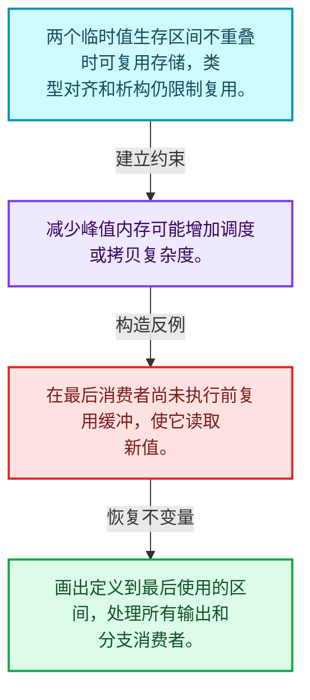
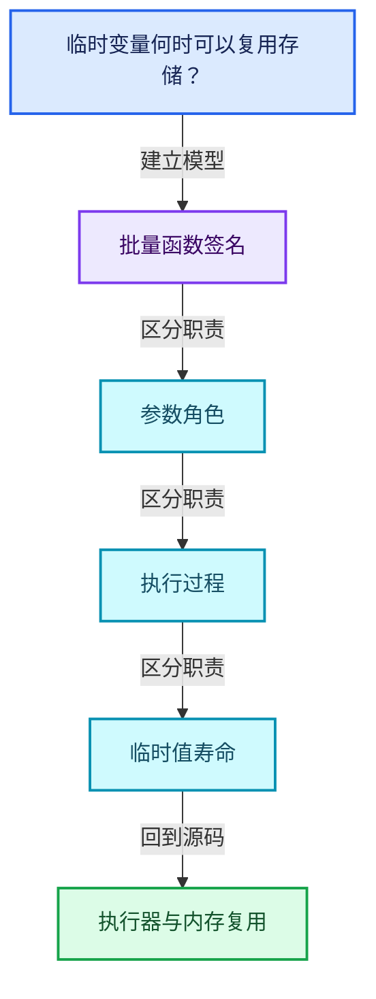
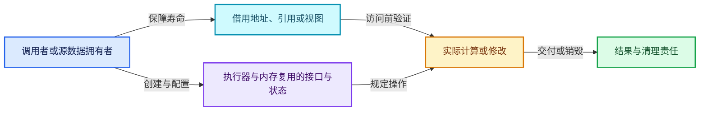
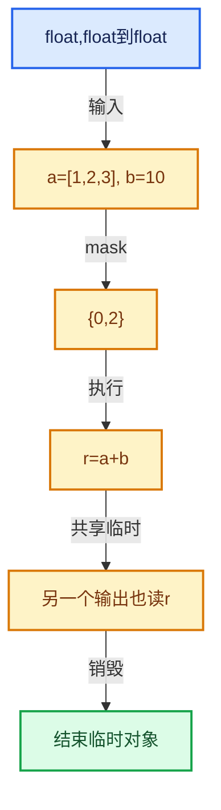

# 07-09 执行器与内存复用

[方向导航](README.md) · [总目录](../README.md) · [覆盖索引](../%E6%BA%90%E7%A0%81%E7%89%88%E6%9C%AC%E4%B8%8E%E8%A6%86%E7%9B%96%E7%B4%A2%E5%BC%95.md)

> 阅读顺序：问题与数据模型 → 语法与类型 → 源码逐行 → 调用线索 → 历史与取舍 → 推演和练习。

- 基准 HEAD：`cbda6b96c26c0dee3c3b5cbb93960c4ac06a6b30`。
- 记录日期：2026-10-14。
- 教学示例状态：正文中的推演不是本机性能实测；已运行练习见验收报告。

## 一、从问题到设计

临时变量何时可以复用存储？

最后使用、元素有效范围和类型对齐限制复用；结束一个值寿命后才能在相同存储建立另一个值。

本篇把语法、数据语义和系统取舍连接起来。把调用准备与元素循环分开，把值依赖与对象生存区间同时显式化。

### 本篇独立模型与设计推理

两个临时值生存区间不重叠时可复用存储，类型对齐和析构仍限制复用。

设计取舍：减少峰值内存可能增加调度或拷贝复杂度。

最小反例：在最后消费者尚未执行前复用缓冲，使它读取新值。

推导与处理：画出定义到最后使用的区间，处理所有输出和分支消费者。



### 源码范围与相邻篇章

| 文件 | 本篇逐行范围 | 基准SHA-256 |
|---|---|---|
| [source/blender/functions/FN_multi_function_procedure_executor.hh](../../../../../source/blender/functions/FN_multi_function_procedure_executor.hh) | L1—L30 | `4091ed9ea707b60ee46f45ff393ca379be47e5919894f084b0c48a8fd8265425` |
| [source/blender/functions/intern/multi_function_procedure_executor.cc](../../../../../source/blender/functions/intern/multi_function_procedure_executor.cc) | L1—L1256 | `faaaa08f7f897e14e7dc87b80007aa88b253703b09ba7c5d3194f1443ae89102` |

同一主讲文件可能分多篇覆盖；超出本篇范围的符号通过覆盖索引定位。空行与纯注释保留在源码摘录中，逐行表解释有效语句与语法边界；许可证头统一保留。

前篇：[ProcedureBuilder](08-ProcedureBuilder.md).

后篇：[优化注册与实战](10-%E4%BC%98%E5%8C%96%E6%B3%A8%E5%86%8C%E4%B8%8E%E5%AE%9E%E6%88%98.md).

## 二、类型、数据与阅读地图



这是概念依赖图，边表示阅读关系，不声称是运行时调用顺序。

### 直接编译依赖


箭头只表示头文件包含关系；完整调用线索见后面的符号定位表。

## 三、关键词、语法与类型角色

### 模板 template

模板把类型或常量作为生成实现的参数。读声明时先列出类型参数、非类型参数和默认值，再看使用者实际实例化了什么。模板声明本身不意味着每种T都支持其全部成员。

具体检查：把T替换为int、string、只能移动的类型，分别检查每个被调用操作是否成立。

### 依赖名称 typename

typename既可引入类型模板参数，也可告诉编译器某个依赖名称是类型。它不创建运行时对象；解析期确认语法类别与实例化期检查具体类型是不同阶段。

具体检查：区分typename T::value_type和T::size()，前者标记类型，后者是表达式。

### 常量求值 constexpr

constexpr声明允许相应实体参与常量求值，但constexpr函数仍可以在运行时执行。是否常量求值由调用场景和表达式合法性共同决定。

具体检查：比较constexpr变量初始化和从运行时输入调用同一函数。

### 只读限定 const

const约束当前访问路径可做的修改。const指针、指向const的指针、const视图对象、const元素是不同位置的限定；其他别名可能仍可修改原对象。

具体检查：分别写T* const、const T*与const T* const，并画出不可修改的层次。

### 移动转换 std::move

std::move把表达式转换为可供移动重载选择的值类别，实际资源转移发生在被选中的构造或赋值中。对const对象move可能仍调用复制，对视图move也不会获得底层数据所有权。

具体检查：记录移动构造调用次数，不用变量名或std::move的出现次数替代测量。

### 完美转发 std::forward

std::forward在转发引用模板中恢复调用者原来的值类别。它依赖推导出的模板实参；无条件move会改变左值调用者的语义。

具体检查：对同一接口分别传入左值、临时对象和const左值，记录实际重载。

### 异常边界 try与catch

try定义异常传播的局部边界。失败路径需要销毁已经成功构造的部分并释放相应存储；未构造的对象不能被析构。

具体检查：在第k次构造失败，列出已经存在的对象集合与待释放缓冲。

### 显式静态转换 static_cast

static_cast表达编译期允许的转换，不会自动验证运行时真实类型、指针寿命或索引边界。由void指针恢复T指针时，调用者仍须保证实际存储中确有合法T对象。

具体检查：标出转换前后的类型以及正确性依据来自哪里。

### 运行时多态 virtual

虚调用根据实际动态类型选择实现；经基类指针销毁对象时通常需要相应虚析构契约。每元素虚调用和循环外一次分派有不同开销。

具体检查：找出虚接口的实现类和调用频率，再讨论是否值得去虚拟化。

### 覆写检查 override

override要求函数确实覆盖基类虚函数，可捕获参数类型和const限定不匹配。它不改变基类规定的生命周期或线程约束。

具体检查：故意改变一个参数或const，观察编译器如何拒绝误写的新函数。

### 对齐 alignof

alignof得到类型要求的地址对齐。分配足够字节后仍需把地址对齐到相应边界，内嵌缓冲也一样。

具体检查：对齐a为2的幂时可推导向上取整，但仍要考虑溢出与边界。

### 对象表示 sizeof

sizeof给出对象表示大小，不是其引用的所有堆内存总量。sizeof视图很小并不说明底层数组很小。

具体检查：分别统计容器对象、容量字节和元素拥有的间接资源。

### 构造与new表达式

普通new可能分配并构造；placement new在给定地址构造，存储由其他机制提供。失败回滚应区分两类责任。

具体检查：追踪地址来自哪里、构造何时成功、由谁析构、由谁释放。

### 内部断言 assert

断言表达开发者预期成立的内部契约，发布构建可能关闭。它不能替代对不可信输入的完整错误处理，也不保证后续操作被运行时保护。

具体检查：对每条断言构造违反条件的输入，区分调用者错误与应向用户报告的错误。

### 独占拥有 unique_ptr

unique_ptr通过移动转移拥有关系，默认删除策略必须与资源来源匹配。get返回借用指针，release交出责任而不销毁。

具体检查：区分move、get、release和reset后谁负责销毁。

### 类型别名 using

类型别名为已有类型建立名字，不创建运行期对象。它常把模板内部使用的类型统一暴露给泛型调用者。

具体检查：展开别名直到基础类型，区分类型别名和变量声明。

### 枚举与状态模型 enum

枚举把有限状态命名；enum class避免许多隐式整数转换。状态机正确性还依赖允许的转移，不能只看有哪些枚举项。

具体检查：列出每个状态的进入条件和离开条件，检查终止状态是否仍可能被调度。

## 四、真实源码与逐行讲解

源码块保持原行内容，原始行号由小节标题及逐行表给出。表中的调用定位是静态阅读辅助；重载、模板实例化、宏展开和虚调用需结合完整声明，不能仅凭词法出现证明动态调用。

### FN_multi_function_procedure_executor.hh：L1—L30

<!-- source:source/blender/functions/FN_multi_function_procedure_executor.hh:1:30 -->

```cpp
/* SPDX-FileCopyrightText: 2023 Blender Authors
 *
 * SPDX-License-Identifier: GPL-2.0-or-later */

#pragma once

/** \file
 * \ingroup fn
 */

#include "FN_multi_function_procedure.hh"

namespace blender::fn::multi_function {

/** A multi-function that executes a procedure internally. */
class ProcedureExecutor : public MultiFunction {
 private:
  Signature signature_;
  const Procedure &procedure_;

 public:
  ProcedureExecutor(const Procedure &procedure);

  void call(const IndexMask &mask, Params params, Context context) const override;

 private:
  ExecutionHints get_execution_hints() const override;
};

}  // namespace blender::fn::multi_function
```

| 原始行 | 语义、约束与检查 |
|---|---|
| L5 | 防止同一头文件在一个翻译单元中重复展开；不控制多个源文件之间的链接或对象寿命。 |
| L11 | 引入编译依赖 "FN_multi_function_procedure.hh"；这是声明可见性关系，不表示运行时一定调用该文件的所有接口。 |
| L13 | 把后续声明放入 blender::fn::multi_function 命名空间，影响名称查找和符号归属，不创建运行时对象。 |
| L16 | 声明或定义类型 `class ProcedureExecutor : public MultiFunction`。结合继承、访问权限和成员布局确认接口与拥有关系；前向声明本身没有完整对象布局。 |
| L17 | 切换成员访问权限为 private；它是编译期接口边界，不是线程同步或内存保护。 |
| L18 | 声明成员、局部对象或完成语句 `Signature signature_`。若为指针或引用，它本身不说明拥有；若为值对象，其构造析构由所在作用域或外层对象管理。 |
| L19 | 声明成员、局部对象或完成语句 `const Procedure &procedure_`。若为指针或引用，它本身不说明拥有；若为值对象，其构造析构由所在作用域或外层对象管理。 |
| L21 | 切换成员访问权限为 public；它是编译期接口边界，不是线程同步或内存保护。 |
| L22 | 出现调用或函数声明 `ProcedureExecutor`，对应表达式为 `ProcedureExecutor(const Procedure &procedure);`。参数求值、返回类型与重载需结合前后完整语句；静态文本引用不能证明动态目标。 |
| L24 | 声明接口 `void call(const IndexMask &mask, Params params, Context context) const override`，本行没有对应函数体；返回类型、参数限定和const/noexcept共同组成调用契约，实际行为需继续定位实现。 |
| L26 | 切换成员访问权限为 private；它是编译期接口边界，不是线程同步或内存保护。 |
| L27 | 声明接口 `ExecutionHints get_execution_hints() const override`，本行没有对应函数体；返回类型、参数限定和const/noexcept共同组成调用契约，实际行为需继续定位实现。 |
| L28 | 结束当前语法单元。局部自动对象在离开其作用域时按规则销毁；这不等于所有被引用的外部数据也被释放。 |
| L30 | 结束当前语法单元。局部自动对象在离开其作用域时按规则销毁；这不等于所有被引用的外部数据也被释放。 |

### multi_function_procedure_executor.cc：L1—L48

<!-- source:source/blender/functions/intern/multi_function_procedure_executor.cc:1:48 -->

```cpp
/* SPDX-FileCopyrightText: 2023 Blender Authors
 *
 * SPDX-License-Identifier: GPL-2.0-or-later */

/** \file
 * \ingroup fn
 */

#include "FN_multi_function_procedure_executor.hh"

#include "BLI_stack.hh"

namespace blender::fn::multi_function {

ProcedureExecutor::ProcedureExecutor(const Procedure &procedure) : procedure_(procedure)
{
  SignatureBuilder builder("Procedure Executor", signature_);

  for (const ConstParameter &param : procedure.params()) {
    builder.add("Parameter", ParamType(param.type, param.variable->data_type()));
  }

  this->set_signature(&signature_);
}

using IndicesSplitVectors = std::array<Vector<int64_t>, 2>;

namespace {
enum class ValueType {
  GVArray = 0,
  Span = 1,
  GVVectorArray = 2,
  GVectorArray = 3,
  OneSingle = 4,
  OneVector = 5,
};
constexpr int tot_variable_value_types = 6;
}  // namespace

/**
 * During evaluation, a variable may be stored in various different forms, depending on what
 * instructions do with the variables.
 */
struct VariableValue {
  ValueType type;

  VariableValue(ValueType type) : type(type) {}
};
```

| 原始行 | 语义、约束与检查 |
|---|---|
| L9 | 引入编译依赖 "FN_multi_function_procedure_executor.hh"；这是声明可见性关系，不表示运行时一定调用该文件的所有接口。 |
| L11 | 引入编译依赖 "BLI_stack.hh"；这是声明可见性关系，不表示运行时一定调用该文件的所有接口。 |
| L13 | 把后续声明放入 blender::fn::multi_function 命名空间，影响名称查找和符号归属，不创建运行时对象。 |
| L15 | 出现调用或函数声明 `ProcedureExecutor::ProcedureExecutor`，对应表达式为 `ProcedureExecutor::ProcedureExecutor(const Procedure &procedure) : procedure_(procedure)`。参数求值、返回类型与重载需结合前后完整语句；静态文本引用不能证明动态目标。 |
| L16 | 连接上一行的声明或控制结构与其语句块；后续行在这个作用域中执行或声明。 |
| L17 | 出现调用或函数声明 `builder`，对应表达式为 `SignatureBuilder builder("Procedure Executor", signature_);`。参数求值、返回类型与重载需结合前后完整语句；静态文本引用不能证明动态目标。 |
| L19 | 按 `for (const ConstParameter &param : procedure.params())` 指定的范围或条件重复执行。对照循环变量与真实元素编号；循环内调用成本乘以实际迭代次数。 |
| L20 | 出现调用或函数声明 `add`，对应表达式为 `builder.add("Parameter", ParamType(param.type, param.variable->data_type()));`。参数求值、返回类型与重载需结合前后完整语句；静态文本引用不能证明动态目标。 |
| L21 | 结束当前语法单元。局部自动对象在离开其作用域时按规则销毁；这不等于所有被引用的外部数据也被释放。 |
| L23 | 出现调用或函数声明 `set_signature`，对应表达式为 `this->set_signature(&signature_);`。参数求值、返回类型与重载需结合前后完整语句；静态文本引用不能证明动态目标。 |
| L24 | 结束当前语法单元。局部自动对象在离开其作用域时按规则销毁；这不等于所有被引用的外部数据也被释放。 |
| L26 | 定义类型别名 `using IndicesSplitVectors = std::array<Vector<int64_t>, 2>`，为模板接口或内部实现统一命名；本行不分配该类型对象。 |
| L28 | 把后续声明放入  命名空间，影响名称查找和符号归属，不创建运行时对象。 |
| L29 | 声明或定义类型 `enum class ValueType`。结合继承、访问权限和成员布局确认接口与拥有关系；前向声明本身没有完整对象布局。 |
| L30 | 把右侧 `0,` 用于初始化或更新左侧 `GVArray`。声明初始化与已有对象赋值应按上下文区分；有资源的类型会调用相应特殊成员。 |
| L31 | 把右侧 `1,` 用于初始化或更新左侧 `Span`。声明初始化与已有对象赋值应按上下文区分；有资源的类型会调用相应特殊成员。 |
| L32 | 把右侧 `2,` 用于初始化或更新左侧 `GVVectorArray`。声明初始化与已有对象赋值应按上下文区分；有资源的类型会调用相应特殊成员。 |
| L33 | 把右侧 `3,` 用于初始化或更新左侧 `GVectorArray`。声明初始化与已有对象赋值应按上下文区分；有资源的类型会调用相应特殊成员。 |
| L34 | 把右侧 `4,` 用于初始化或更新左侧 `OneSingle`。声明初始化与已有对象赋值应按上下文区分；有资源的类型会调用相应特殊成员。 |
| L35 | 把右侧 `5,` 用于初始化或更新左侧 `OneVector`。声明初始化与已有对象赋值应按上下文区分；有资源的类型会调用相应特殊成员。 |
| L36 | 结束当前语法单元。局部自动对象在离开其作用域时按规则销毁；这不等于所有被引用的外部数据也被释放。 |
| L37 | 把右侧 `6` 用于初始化或更新左侧 `constexpr int tot_variable_value_types`。声明初始化与已有对象赋值应按上下文区分；有资源的类型会调用相应特殊成员。 |
| L38 | 结束当前语法单元。局部自动对象在离开其作用域时按规则销毁；这不等于所有被引用的外部数据也被释放。 |
| L44 | 声明或定义类型 `struct VariableValue`。结合继承、访问权限和成员布局确认接口与拥有关系；前向声明本身没有完整对象布局。 |
| L45 | 声明成员、局部对象或完成语句 `ValueType type`。若为指针或引用，它本身不说明拥有；若为值对象，其构造析构由所在作用域或外层对象管理。 |
| L47 | 出现调用或函数声明 `VariableValue`，对应表达式为 `VariableValue(ValueType type) : type(type) {}`。参数求值、返回类型与重载需结合前后完整语句；静态文本引用不能证明动态目标。 |
| L48 | 结束当前语法单元。局部自动对象在离开其作用域时按规则销毁；这不等于所有被引用的外部数据也被释放。 |

### multi_function_procedure_executor.cc：L49—L97

<!-- source:source/blender/functions/intern/multi_function_procedure_executor.cc:49:97 -->

```cpp

/* This variable is the unmodified virtual array from the caller. */
struct VariableValue_GVArray : public VariableValue {
  static constexpr ValueType static_type = ValueType::GVArray;
  const GVArray &data;

  VariableValue_GVArray(const GVArray &data) : VariableValue(static_type), data(data)
  {
    BLI_assert(data);
  }
};

/* This variable has a different value for every index. Some values may be uninitialized. The span
 * may be owned by the caller. */
struct VariableValue_Span : public VariableValue {
  static constexpr ValueType static_type = ValueType::Span;
  void *data;
  bool owned;

  VariableValue_Span(void *data, bool owned) : VariableValue(static_type), data(data), owned(owned)
  {
  }
};

/* This variable is the unmodified virtual vector array from the caller. */
struct VariableValue_GVVectorArray : public VariableValue {
  static constexpr ValueType static_type = ValueType::GVVectorArray;
  const GVVectorArray &data;

  VariableValue_GVVectorArray(const GVVectorArray &data) : VariableValue(static_type), data(data)
  {
  }
};

/* This variable has a different vector for every index. */
struct VariableValue_GVectorArray : public VariableValue {
  static constexpr ValueType static_type = ValueType::GVectorArray;
  GVectorArray &data;
  bool owned;

  VariableValue_GVectorArray(GVectorArray &data, bool owned)
      : VariableValue(static_type), data(data), owned(owned)
  {
  }
};

/* This variable has the same value for every index. */
struct VariableValue_OneSingle : public VariableValue {
  static constexpr ValueType static_type = ValueType::OneSingle;
```

| 原始行 | 语义、约束与检查 |
|---|---|
| L51 | 声明或定义类型 `struct VariableValue_GVArray : public VariableValue`。结合继承、访问权限和成员布局确认接口与拥有关系；前向声明本身没有完整对象布局。 |
| L52 | 把右侧 `ValueType::GVArray` 用于初始化或更新左侧 `static constexpr ValueType static_type`。声明初始化与已有对象赋值应按上下文区分；有资源的类型会调用相应特殊成员。 |
| L53 | 声明成员、局部对象或完成语句 `const GVArray &data`。若为指针或引用，它本身不说明拥有；若为值对象，其构造析构由所在作用域或外层对象管理。 |
| L55 | 出现调用或函数声明 `VariableValue_GVArray`，对应表达式为 `VariableValue_GVArray(const GVArray &data) : VariableValue(static_type), data(data)`。参数求值、返回类型与重载需结合前后完整语句；静态文本引用不能证明动态目标。 |
| L56 | 连接上一行的声明或控制结构与其语句块；后续行在这个作用域中执行或声明。 |
| L57 | 断言约束 `BLI_assert(data);`。条件是后续访问的内部前置条件；发布构建可能不执行，不能把断言当作输入修复。 |
| L58 | 结束当前语法单元。局部自动对象在离开其作用域时按规则销毁；这不等于所有被引用的外部数据也被释放。 |
| L59 | 结束当前语法单元。局部自动对象在离开其作用域时按规则销毁；这不等于所有被引用的外部数据也被释放。 |
| L63 | 声明或定义类型 `struct VariableValue_Span : public VariableValue`。结合继承、访问权限和成员布局确认接口与拥有关系；前向声明本身没有完整对象布局。 |
| L64 | 把右侧 `ValueType::Span` 用于初始化或更新左侧 `static constexpr ValueType static_type`。声明初始化与已有对象赋值应按上下文区分；有资源的类型会调用相应特殊成员。 |
| L65 | 声明成员、局部对象或完成语句 `void *data`。若为指针或引用，它本身不说明拥有；若为值对象，其构造析构由所在作用域或外层对象管理。 |
| L66 | 声明成员、局部对象或完成语句 `bool owned`。若为指针或引用，它本身不说明拥有；若为值对象，其构造析构由所在作用域或外层对象管理。 |
| L68 | 出现调用或函数声明 `VariableValue_Span`，对应表达式为 `VariableValue_Span(void *data, bool owned) : VariableValue(static_type), data(data), owned(owned)`。参数求值、返回类型与重载需结合前后完整语句；静态文本引用不能证明动态目标。 |
| L69 | 连接上一行的声明或控制结构与其语句块；后续行在这个作用域中执行或声明。 |
| L70 | 结束当前语法单元。局部自动对象在离开其作用域时按规则销毁；这不等于所有被引用的外部数据也被释放。 |
| L71 | 结束当前语法单元。局部自动对象在离开其作用域时按规则销毁；这不等于所有被引用的外部数据也被释放。 |
| L74 | 声明或定义类型 `struct VariableValue_GVVectorArray : public VariableValue`。结合继承、访问权限和成员布局确认接口与拥有关系；前向声明本身没有完整对象布局。 |
| L75 | 把右侧 `ValueType::GVVectorArray` 用于初始化或更新左侧 `static constexpr ValueType static_type`。声明初始化与已有对象赋值应按上下文区分；有资源的类型会调用相应特殊成员。 |
| L76 | 声明成员、局部对象或完成语句 `const GVVectorArray &data`。若为指针或引用，它本身不说明拥有；若为值对象，其构造析构由所在作用域或外层对象管理。 |
| L78 | 出现调用或函数声明 `VariableValue_GVVectorArray`，对应表达式为 `VariableValue_GVVectorArray(const GVVectorArray &data) : VariableValue(static_type), data(data)`。参数求值、返回类型与重载需结合前后完整语句；静态文本引用不能证明动态目标。 |
| L79 | 连接上一行的声明或控制结构与其语句块；后续行在这个作用域中执行或声明。 |
| L80 | 结束当前语法单元。局部自动对象在离开其作用域时按规则销毁；这不等于所有被引用的外部数据也被释放。 |
| L81 | 结束当前语法单元。局部自动对象在离开其作用域时按规则销毁；这不等于所有被引用的外部数据也被释放。 |
| L84 | 声明或定义类型 `struct VariableValue_GVectorArray : public VariableValue`。结合继承、访问权限和成员布局确认接口与拥有关系；前向声明本身没有完整对象布局。 |
| L85 | 把右侧 `ValueType::GVectorArray` 用于初始化或更新左侧 `static constexpr ValueType static_type`。声明初始化与已有对象赋值应按上下文区分；有资源的类型会调用相应特殊成员。 |
| L86 | 声明成员、局部对象或完成语句 `GVectorArray &data`。若为指针或引用，它本身不说明拥有；若为值对象，其构造析构由所在作用域或外层对象管理。 |
| L87 | 声明成员、局部对象或完成语句 `bool owned`。若为指针或引用，它本身不说明拥有；若为值对象，其构造析构由所在作用域或外层对象管理。 |
| L89 | 出现调用或函数声明 `VariableValue_GVectorArray`，对应表达式为 `VariableValue_GVectorArray(GVectorArray &data, bool owned)`。参数求值、返回类型与重载需结合前后完整语句；静态文本引用不能证明动态目标。 |
| L90 | 出现调用或函数声明 `VariableValue`，对应表达式为 `: VariableValue(static_type), data(data), owned(owned)`。参数求值、返回类型与重载需结合前后完整语句；静态文本引用不能证明动态目标。 |
| L91 | 连接上一行的声明或控制结构与其语句块；后续行在这个作用域中执行或声明。 |
| L92 | 结束当前语法单元。局部自动对象在离开其作用域时按规则销毁；这不等于所有被引用的外部数据也被释放。 |
| L93 | 结束当前语法单元。局部自动对象在离开其作用域时按规则销毁；这不等于所有被引用的外部数据也被释放。 |
| L96 | 声明或定义类型 `struct VariableValue_OneSingle : public VariableValue`。结合继承、访问权限和成员布局确认接口与拥有关系；前向声明本身没有完整对象布局。 |
| L97 | 把右侧 `ValueType::OneSingle` 用于初始化或更新左侧 `static constexpr ValueType static_type`。声明初始化与已有对象赋值应按上下文区分；有资源的类型会调用相应特殊成员。 |

### multi_function_procedure_executor.cc：L98—L146

<!-- source:source/blender/functions/intern/multi_function_procedure_executor.cc:98:146 -->

```cpp
  void *data;
  bool is_initialized = false;

  VariableValue_OneSingle(void *data) : VariableValue(static_type), data(data) {}
};

/* This variable has the same vector for every index. */
struct VariableValue_OneVector : public VariableValue {
  static constexpr ValueType static_type = ValueType::OneVector;
  GVectorArray &data;

  VariableValue_OneVector(GVectorArray &data) : VariableValue(static_type), data(data) {}
};

static_assert(std::is_trivially_destructible_v<VariableValue_GVArray>);
static_assert(std::is_trivially_destructible_v<VariableValue_Span>);
static_assert(std::is_trivially_destructible_v<VariableValue_GVVectorArray>);
static_assert(std::is_trivially_destructible_v<VariableValue_GVectorArray>);
static_assert(std::is_trivially_destructible_v<VariableValue_OneSingle>);
static_assert(std::is_trivially_destructible_v<VariableValue_OneVector>);

class VariableState;

/**
 * The #ValueAllocator is responsible for providing memory for variables and their values. It also
 * manages the reuse of buffers to improve performance.
 */
class ValueAllocator : NonCopyable, NonMovable {
 private:
  /**
   * Allocate with 64 byte alignment for better reusability of buffers and improved cache
   * performance.
   */
  static constexpr int min_alignment = 64;

  /** All buffers in the free-lists below have been allocated with this allocator. */
  LinearAllocator<> &linear_allocator_;

  /**
   * Use stacks so that the most recently used buffers are reused first. This improves cache
   * efficiency.
   */
  std::array<Stack<VariableValue *>, tot_variable_value_types> variable_value_free_lists_;

  /**
   * The integer key is the size of one element (e.g. 4 for an integer buffer). All buffers are
   * aligned to #min_alignment bytes.
   */
  Stack<void *> small_span_buffers_free_list_;
```

| 原始行 | 语义、约束与检查 |
|---|---|
| L98 | 声明成员、局部对象或完成语句 `void *data`。若为指针或引用，它本身不说明拥有；若为值对象，其构造析构由所在作用域或外层对象管理。 |
| L99 | 把右侧 `false` 用于初始化或更新左侧 `bool is_initialized`。声明初始化与已有对象赋值应按上下文区分；有资源的类型会调用相应特殊成员。 |
| L101 | 出现调用或函数声明 `VariableValue_OneSingle`，对应表达式为 `VariableValue_OneSingle(void *data) : VariableValue(static_type), data(data) {}`。参数求值、返回类型与重载需结合前后完整语句；静态文本引用不能证明动态目标。 |
| L102 | 结束当前语法单元。局部自动对象在离开其作用域时按规则销毁；这不等于所有被引用的外部数据也被释放。 |
| L105 | 声明或定义类型 `struct VariableValue_OneVector : public VariableValue`。结合继承、访问权限和成员布局确认接口与拥有关系；前向声明本身没有完整对象布局。 |
| L106 | 把右侧 `ValueType::OneVector` 用于初始化或更新左侧 `static constexpr ValueType static_type`。声明初始化与已有对象赋值应按上下文区分；有资源的类型会调用相应特殊成员。 |
| L107 | 声明成员、局部对象或完成语句 `GVectorArray &data`。若为指针或引用，它本身不说明拥有；若为值对象，其构造析构由所在作用域或外层对象管理。 |
| L109 | 出现调用或函数声明 `VariableValue_OneVector`，对应表达式为 `VariableValue_OneVector(GVectorArray &data) : VariableValue(static_type), data(data) {}`。参数求值、返回类型与重载需结合前后完整语句；静态文本引用不能证明动态目标。 |
| L110 | 结束当前语法单元。局部自动对象在离开其作用域时按规则销毁；这不等于所有被引用的外部数据也被释放。 |
| L112 | 在编译期检查 `static_assert(std::is_trivially_destructible_v<VariableValue_GVArray>);`；条件失败导致编译错误，不存在运行时错误恢复路径。 |
| L113 | 在编译期检查 `static_assert(std::is_trivially_destructible_v<VariableValue_Span>);`；条件失败导致编译错误，不存在运行时错误恢复路径。 |
| L114 | 在编译期检查 `static_assert(std::is_trivially_destructible_v<VariableValue_GVVectorArray>);`；条件失败导致编译错误，不存在运行时错误恢复路径。 |
| L115 | 在编译期检查 `static_assert(std::is_trivially_destructible_v<VariableValue_GVectorArray>);`；条件失败导致编译错误，不存在运行时错误恢复路径。 |
| L116 | 在编译期检查 `static_assert(std::is_trivially_destructible_v<VariableValue_OneSingle>);`；条件失败导致编译错误，不存在运行时错误恢复路径。 |
| L117 | 在编译期检查 `static_assert(std::is_trivially_destructible_v<VariableValue_OneVector>);`；条件失败导致编译错误，不存在运行时错误恢复路径。 |
| L119 | 声明或定义类型 `class VariableState`。结合继承、访问权限和成员布局确认接口与拥有关系；前向声明本身没有完整对象布局。 |
| L125 | 声明或定义类型 `class ValueAllocator : NonCopyable, NonMovable`。结合继承、访问权限和成员布局确认接口与拥有关系；前向声明本身没有完整对象布局。 |
| L126 | 切换成员访问权限为 private；它是编译期接口边界，不是线程同步或内存保护。 |
| L131 | 把右侧 `64` 用于初始化或更新左侧 `static constexpr int min_alignment`。声明初始化与已有对象赋值应按上下文区分；有资源的类型会调用相应特殊成员。 |
| L134 | 声明成员、局部对象或完成语句 `LinearAllocator<> &linear_allocator_`。若为指针或引用，它本身不说明拥有；若为值对象，其构造析构由所在作用域或外层对象管理。 |
| L140 | 声明成员、局部对象或完成语句 `std::array<Stack<VariableValue *>, tot_variable_value_types> variable_value_free_lists_`。若为指针或引用，它本身不说明拥有；若为值对象，其构造析构由所在作用域或外层对象管理。 |
| L146 | 声明成员、局部对象或完成语句 `Stack<void *> small_span_buffers_free_list_`。若为指针或引用，它本身不说明拥有；若为值对象，其构造析构由所在作用域或外层对象管理。 |

### multi_function_procedure_executor.cc：L147—L200

<!-- source:source/blender/functions/intern/multi_function_procedure_executor.cc:147:200 -->

```cpp
  Map<int, Stack<void *>> span_buffers_free_lists_;

  /** Cache buffers for single values of different types. */
  static constexpr int small_value_max_size = 16;
  static constexpr int small_value_max_alignment = 8;
  Stack<void *> small_single_value_free_list_;
  Map<const CPPType *, Stack<void *>> single_value_free_lists_;

 public:
  ValueAllocator(LinearAllocator<> &linear_allocator) : linear_allocator_(linear_allocator) {}

  VariableValue_GVArray *obtain_GVArray(const GVArray &varray)
  {
    return this->obtain<VariableValue_GVArray>(varray);
  }

  VariableValue_GVVectorArray *obtain_GVVectorArray(const GVVectorArray &varray)
  {
    return this->obtain<VariableValue_GVVectorArray>(varray);
  }

  VariableValue_Span *obtain_Span_not_owned(void *buffer)
  {
    return this->obtain<VariableValue_Span>(buffer, false);
  }

  VariableValue_Span *obtain_Span(const CPPType &type, int size)
  {
    void *buffer = nullptr;

    const int64_t element_size = type.size;
    const int64_t alignment = type.alignment;

    if (alignment > min_alignment) {
      /* In this rare case we fall back to not reusing existing buffers. */
      buffer = linear_allocator_.allocate(element_size * size, alignment);
    }
    else {
      Stack<void *> *stack = type.can_exist_in_buffer(small_value_max_size,
                                                      small_value_max_alignment) ?
                                 &small_span_buffers_free_list_ :
                                 span_buffers_free_lists_.lookup_ptr(element_size);
      if (stack == nullptr || stack->is_empty()) {
        buffer = linear_allocator_.allocate(
            std::max<int64_t>(element_size, small_value_max_size) * size, min_alignment);
      }
      else {
        /* Reuse existing buffer. */
        buffer = stack->pop();
      }
    }

    return this->obtain<VariableValue_Span>(buffer, true);
  }
```

本段语义重点：

- `std::max`：取较大值，在容量计算中常用于同时满足请求量和增长策略。

| 原始行 | 语义、约束与检查 |
|---|---|
| L147 | 声明成员、局部对象或完成语句 `Map<int, Stack<void *>> span_buffers_free_lists_`。若为指针或引用，它本身不说明拥有；若为值对象，其构造析构由所在作用域或外层对象管理。 |
| L150 | 把右侧 `16` 用于初始化或更新左侧 `static constexpr int small_value_max_size`。声明初始化与已有对象赋值应按上下文区分；有资源的类型会调用相应特殊成员。 |
| L151 | 把右侧 `8` 用于初始化或更新左侧 `static constexpr int small_value_max_alignment`。声明初始化与已有对象赋值应按上下文区分；有资源的类型会调用相应特殊成员。 |
| L152 | 声明成员、局部对象或完成语句 `Stack<void *> small_single_value_free_list_`。若为指针或引用，它本身不说明拥有；若为值对象，其构造析构由所在作用域或外层对象管理。 |
| L153 | 声明成员、局部对象或完成语句 `Map<const CPPType *, Stack<void *>> single_value_free_lists_`。若为指针或引用，它本身不说明拥有；若为值对象，其构造析构由所在作用域或外层对象管理。 |
| L155 | 切换成员访问权限为 public；它是编译期接口边界，不是线程同步或内存保护。 |
| L156 | 出现调用或函数声明 `ValueAllocator`，对应表达式为 `ValueAllocator(LinearAllocator<> &linear_allocator) : linear_allocator_(linear_allocator) {}`。参数求值、返回类型与重载需结合前后完整语句；静态文本引用不能证明动态目标。 |
| L158 | 出现调用或函数声明 `obtain_GVArray`，对应表达式为 `VariableValue_GVArray *obtain_GVArray(const GVArray &varray)`。参数求值、返回类型与重载需结合前后完整语句；静态文本引用不能证明动态目标。 |
| L159 | 连接上一行的声明或控制结构与其语句块；后续行在这个作用域中执行或声明。 |
| L160 | 返回表达式 `this->obtain<VariableValue_GVArray>(varray)`。 |
| L161 | 结束当前语法单元。局部自动对象在离开其作用域时按规则销毁；这不等于所有被引用的外部数据也被释放。 |
| L163 | 出现调用或函数声明 `obtain_GVVectorArray`，对应表达式为 `VariableValue_GVVectorArray *obtain_GVVectorArray(const GVVectorArray &varray)`。参数求值、返回类型与重载需结合前后完整语句；静态文本引用不能证明动态目标。 |
| L164 | 连接上一行的声明或控制结构与其语句块；后续行在这个作用域中执行或声明。 |
| L165 | 返回表达式 `this->obtain<VariableValue_GVVectorArray>(varray)`。 |
| L166 | 结束当前语法单元。局部自动对象在离开其作用域时按规则销毁；这不等于所有被引用的外部数据也被释放。 |
| L168 | 出现调用或函数声明 `obtain_Span_not_owned`，对应表达式为 `VariableValue_Span *obtain_Span_not_owned(void *buffer)`。参数求值、返回类型与重载需结合前后完整语句；静态文本引用不能证明动态目标。 |
| L169 | 连接上一行的声明或控制结构与其语句块；后续行在这个作用域中执行或声明。 |
| L170 | 返回表达式 `this->obtain<VariableValue_Span>(buffer, false)`。 |
| L171 | 结束当前语法单元。局部自动对象在离开其作用域时按规则销毁；这不等于所有被引用的外部数据也被释放。 |
| L173 | 出现调用或函数声明 `obtain_Span`，对应表达式为 `VariableValue_Span *obtain_Span(const CPPType &type, int size)`。参数求值、返回类型与重载需结合前后完整语句；静态文本引用不能证明动态目标。 |
| L174 | 连接上一行的声明或控制结构与其语句块；后续行在这个作用域中执行或声明。 |
| L175 | 把右侧 `nullptr` 用于初始化或更新左侧 `void *buffer`。声明初始化与已有对象赋值应按上下文区分；有资源的类型会调用相应特殊成员。 |
| L177 | 把右侧 `type.size` 用于初始化或更新左侧 `const int64_t element_size`。声明初始化与已有对象赋值应按上下文区分；有资源的类型会调用相应特殊成员。 |
| L178 | 把右侧 `type.alignment` 用于初始化或更新左侧 `const int64_t alignment`。声明初始化与已有对象赋值应按上下文区分；有资源的类型会调用相应特殊成员。 |
| L180 | 判断 `alignment > min_alignment`，成立时进入本分支，否则继续后续路径。 |
| L182 | 把右侧 `linear_allocator_.allocate(element_size * size, alignment)` 用于初始化或更新左侧 `buffer`。声明初始化与已有对象赋值应按上下文区分；有资源的类型会调用相应特殊成员。 |
| L183 | 结束当前语法单元。局部自动对象在离开其作用域时按规则销毁；这不等于所有被引用的外部数据也被释放。 |
| L184 | 处理前一条件不成立的互补路径。比较两条路径最后是否恢复同一不变量，以及是否产生不同的资源责任。 |
| L185 | 把右侧 `type.can_exist_in_buffer(small_value_max_size,` 用于初始化或更新左侧 `Stack<void *> *stack`。声明初始化与已有对象赋值应按上下文区分；有资源的类型会调用相应特殊成员。 |
| L186 | 本行是连续声明或表达式的一部分：`small_value_max_alignment) ?`。与本段前后行合读；逗号、括号和限定符决定它属于参数、初始化列表还是实际计算。 |
| L187 | 本行是连续声明或表达式的一部分：`&small_span_buffers_free_list_ :`。与本段前后行合读；逗号、括号和限定符决定它属于参数、初始化列表还是实际计算。 |
| L188 | 出现调用或函数声明 `lookup_ptr`，对应表达式为 `span_buffers_free_lists_.lookup_ptr(element_size);`。参数求值、返回类型与重载需结合前后完整语句；静态文本引用不能证明动态目标。 |
| L189 | 判断 `stack == nullptr &#124;&#124; stack->is_empty()`，成立时进入本分支，否则继续后续路径。这里区分空地址与可用地址，但非空本身仍不能证明对象存活。 |
| L190 | 把右侧 `linear_allocator_.allocate(` 用于初始化或更新左侧 `buffer`。声明初始化与已有对象赋值应按上下文区分；有资源的类型会调用相应特殊成员。 |
| L191 | 本行使用 `std::max`：取较大值，在容量计算中常用于同时满足请求量和增长策略。 |
| L192 | 结束当前语法单元。局部自动对象在离开其作用域时按规则销毁；这不等于所有被引用的外部数据也被释放。 |
| L193 | 处理前一条件不成立的互补路径。比较两条路径最后是否恢复同一不变量，以及是否产生不同的资源责任。 |
| L195 | 把右侧 `stack->pop()` 用于初始化或更新左侧 `buffer`。声明初始化与已有对象赋值应按上下文区分；有资源的类型会调用相应特殊成员。 |
| L196 | 结束当前语法单元。局部自动对象在离开其作用域时按规则销毁；这不等于所有被引用的外部数据也被释放。 |
| L197 | 结束当前语法单元。局部自动对象在离开其作用域时按规则销毁；这不等于所有被引用的外部数据也被释放。 |
| L199 | 返回表达式 `this->obtain<VariableValue_Span>(buffer, true)`。 |
| L200 | 结束当前语法单元。局部自动对象在离开其作用域时按规则销毁；这不等于所有被引用的外部数据也被释放。 |

### multi_function_procedure_executor.cc：L201—L235

<!-- source:source/blender/functions/intern/multi_function_procedure_executor.cc:201:235 -->

```cpp

  VariableValue_GVectorArray *obtain_GVectorArray_not_owned(GVectorArray &data)
  {
    return this->obtain<VariableValue_GVectorArray>(data, false);
  }

  VariableValue_GVectorArray *obtain_GVectorArray(const CPPType &type, int size)
  {
    GVectorArray *vector_array = new GVectorArray(type, size);
    return this->obtain<VariableValue_GVectorArray>(*vector_array, true);
  }

  VariableValue_OneSingle *obtain_OneSingle(const CPPType &type)
  {
    const bool is_small = type.can_exist_in_buffer(small_value_max_size,
                                                   small_value_max_alignment);
    Stack<void *> &stack = is_small ? small_single_value_free_list_ :
                                      single_value_free_lists_.lookup_or_add_default(&type);
    void *buffer;
    if (stack.is_empty()) {
      buffer = linear_allocator_.allocate(
          std::max<int>(small_value_max_size, type.size),
          std::max<int>(small_value_max_alignment, type.alignment));
    }
    else {
      buffer = stack.pop();
    }
    return this->obtain<VariableValue_OneSingle>(buffer);
  }

  VariableValue_OneVector *obtain_OneVector(const CPPType &type)
  {
    GVectorArray *vector_array = new GVectorArray(type, 1);
    return this->obtain<VariableValue_OneVector>(*vector_array);
  }
```

本段语义重点：

- `std::max`：取较大值，在容量计算中常用于同时满足请求量和增长策略。

| 原始行 | 语义、约束与检查 |
|---|---|
| L202 | 出现调用或函数声明 `obtain_GVectorArray_not_owned`，对应表达式为 `VariableValue_GVectorArray *obtain_GVectorArray_not_owned(GVectorArray &data)`。参数求值、返回类型与重载需结合前后完整语句；静态文本引用不能证明动态目标。 |
| L203 | 连接上一行的声明或控制结构与其语句块；后续行在这个作用域中执行或声明。 |
| L204 | 返回表达式 `this->obtain<VariableValue_GVectorArray>(data, false)`。 |
| L205 | 结束当前语法单元。局部自动对象在离开其作用域时按规则销毁；这不等于所有被引用的外部数据也被释放。 |
| L207 | 出现调用或函数声明 `obtain_GVectorArray`，对应表达式为 `VariableValue_GVectorArray *obtain_GVectorArray(const CPPType &type, int size)`。参数求值、返回类型与重载需结合前后完整语句；静态文本引用不能证明动态目标。 |
| L208 | 连接上一行的声明或控制结构与其语句块；后续行在这个作用域中执行或声明。 |
| L209 | 把右侧 `new GVectorArray(type, size)` 用于初始化或更新左侧 `GVectorArray *vector_array`。声明初始化与已有对象赋值应按上下文区分；有资源的类型会调用相应特殊成员。 |
| L210 | 返回表达式 `this->obtain<VariableValue_GVectorArray>(*vector_array, true)`。结合函数声明检查返回值是否借用原存储，借用值不会自动延长其寿命。 |
| L211 | 结束当前语法单元。局部自动对象在离开其作用域时按规则销毁；这不等于所有被引用的外部数据也被释放。 |
| L213 | 出现调用或函数声明 `obtain_OneSingle`，对应表达式为 `VariableValue_OneSingle *obtain_OneSingle(const CPPType &type)`。参数求值、返回类型与重载需结合前后完整语句；静态文本引用不能证明动态目标。 |
| L214 | 连接上一行的声明或控制结构与其语句块；后续行在这个作用域中执行或声明。 |
| L215 | 把右侧 `type.can_exist_in_buffer(small_value_max_size,` 用于初始化或更新左侧 `const bool is_small`。声明初始化与已有对象赋值应按上下文区分；有资源的类型会调用相应特殊成员。 |
| L216 | 声明成员、局部对象或完成语句 `small_value_max_alignment)`。若为指针或引用，它本身不说明拥有；若为值对象，其构造析构由所在作用域或外层对象管理。 |
| L217 | 把右侧 `is_small ? small_single_value_free_list_ :` 用于初始化或更新左侧 `Stack<void *> &stack`。声明初始化与已有对象赋值应按上下文区分；有资源的类型会调用相应特殊成员。 |
| L218 | 出现调用或函数声明 `lookup_or_add_default`，对应表达式为 `single_value_free_lists_.lookup_or_add_default(&type);`。参数求值、返回类型与重载需结合前后完整语句；静态文本引用不能证明动态目标。 |
| L219 | 声明成员、局部对象或完成语句 `void *buffer`。若为指针或引用，它本身不说明拥有；若为值对象，其构造析构由所在作用域或外层对象管理。 |
| L220 | 判断 `stack.is_empty()`，成立时进入本分支，否则继续后续路径。 |
| L221 | 把右侧 `linear_allocator_.allocate(` 用于初始化或更新左侧 `buffer`。声明初始化与已有对象赋值应按上下文区分；有资源的类型会调用相应特殊成员。 |
| L222 | 本行使用 `std::max`：取较大值，在容量计算中常用于同时满足请求量和增长策略。 |
| L223 | 本行使用 `std::max`：取较大值，在容量计算中常用于同时满足请求量和增长策略。 |
| L224 | 结束当前语法单元。局部自动对象在离开其作用域时按规则销毁；这不等于所有被引用的外部数据也被释放。 |
| L225 | 处理前一条件不成立的互补路径。比较两条路径最后是否恢复同一不变量，以及是否产生不同的资源责任。 |
| L226 | 把右侧 `stack.pop()` 用于初始化或更新左侧 `buffer`。声明初始化与已有对象赋值应按上下文区分；有资源的类型会调用相应特殊成员。 |
| L227 | 结束当前语法单元。局部自动对象在离开其作用域时按规则销毁；这不等于所有被引用的外部数据也被释放。 |
| L228 | 返回表达式 `this->obtain<VariableValue_OneSingle>(buffer)`。 |
| L229 | 结束当前语法单元。局部自动对象在离开其作用域时按规则销毁；这不等于所有被引用的外部数据也被释放。 |
| L231 | 出现调用或函数声明 `obtain_OneVector`，对应表达式为 `VariableValue_OneVector *obtain_OneVector(const CPPType &type)`。参数求值、返回类型与重载需结合前后完整语句；静态文本引用不能证明动态目标。 |
| L232 | 连接上一行的声明或控制结构与其语句块；后续行在这个作用域中执行或声明。 |
| L233 | 把右侧 `new GVectorArray(type, 1)` 用于初始化或更新左侧 `GVectorArray *vector_array`。声明初始化与已有对象赋值应按上下文区分；有资源的类型会调用相应特殊成员。 |
| L234 | 返回表达式 `this->obtain<VariableValue_OneVector>(*vector_array)`。结合函数声明检查返回值是否借用原存储，借用值不会自动延长其寿命。 |
| L235 | 结束当前语法单元。局部自动对象在离开其作用域时按规则销毁；这不等于所有被引用的外部数据也被释放。 |

### multi_function_procedure_executor.cc：L236—L291

<!-- source:source/blender/functions/intern/multi_function_procedure_executor.cc:236:291 -->

```cpp

  void release_value(VariableValue *value, const DataType &data_type)
  {
    switch (value->type) {
      case ValueType::GVArray: {
        break;
      }
      case ValueType::Span: {
        auto *value_typed = static_cast<VariableValue_Span *>(value);
        if (value_typed->owned) {
          const CPPType &type = data_type.single_type();
          /* Assumes all values in the buffer are uninitialized already. */
          Stack<void *> &buffers = type.can_exist_in_buffer(small_value_max_size,
                                                            small_value_max_alignment) ?
                                       small_span_buffers_free_list_ :
                                       span_buffers_free_lists_.lookup_or_add_default(type.size);
          buffers.push(value_typed->data);
        }
        break;
      }
      case ValueType::GVVectorArray: {
        break;
      }
      case ValueType::GVectorArray: {
        auto *value_typed = static_cast<VariableValue_GVectorArray *>(value);
        if (value_typed->owned) {
          delete &value_typed->data;
        }
        break;
      }
      case ValueType::OneSingle: {
        auto *value_typed = static_cast<VariableValue_OneSingle *>(value);
        const CPPType &type = data_type.single_type();
        if (value_typed->is_initialized) {
          type.destruct(value_typed->data);
        }
        const bool is_small = type.can_exist_in_buffer(small_value_max_size,
                                                       small_value_max_alignment);
        if (is_small) {
          small_single_value_free_list_.push(value_typed->data);
        }
        else {
          single_value_free_lists_.lookup_or_add_default(&type).push(value_typed->data);
        }
        break;
      }
      case ValueType::OneVector: {
        auto *value_typed = static_cast<VariableValue_OneVector *>(value);
        delete &value_typed->data;
        break;
      }
    }

    Stack<VariableValue *> &stack = variable_value_free_lists_[int(value->type)];
    stack.push(value);
  }
```

本段语义重点：

- 分支证据 `value_typed->owned)`：分别推演条件成立与不成立，核对相同出口处的状态。
- 分支证据 `value_typed->owned)`：分别推演条件成立与不成立，核对相同出口处的状态。

| 原始行 | 语义、约束与检查 |
|---|---|
| L237 | 出现调用或函数声明 `release_value`，对应表达式为 `void release_value(VariableValue *value, const DataType &data_type)`。参数求值、返回类型与重载需结合前后完整语句；静态文本引用不能证明动态目标。 |
| L238 | 连接上一行的声明或控制结构与其语句块；后续行在这个作用域中执行或声明。 |
| L239 | 按 switch (value->type) 选择状态处理路径；每个case的break、return或贯穿行为决定下一步。 |
| L240 | 进入枚举或判别值对应分支 case ValueType::GVArray: {；结合状态定义和后续更新判断允许的转移。 |
| L241 | 离开最近的循环或switch；不是离开整个函数，后续清理和提交代码可能仍会执行。 |
| L242 | 结束当前语法单元。局部自动对象在离开其作用域时按规则销毁；这不等于所有被引用的外部数据也被释放。 |
| L243 | 进入枚举或判别值对应分支 case ValueType::Span: {；结合状态定义和后续更新判断允许的转移。 |
| L244 | 把右侧 `static_cast<VariableValue_Span *>(value)` 用于初始化或更新左侧 `auto *value_typed`。声明初始化与已有对象赋值应按上下文区分；有资源的类型会调用相应特殊成员。 |
| L245 | 判断 `value_typed->owned`，成立时进入本分支，否则继续后续路径。 |
| L246 | 把右侧 `data_type.single_type()` 用于初始化或更新左侧 `const CPPType &type`。声明初始化与已有对象赋值应按上下文区分；有资源的类型会调用相应特殊成员。 |
| L248 | 把右侧 `type.can_exist_in_buffer(small_value_max_size,` 用于初始化或更新左侧 `Stack<void *> &buffers`。声明初始化与已有对象赋值应按上下文区分；有资源的类型会调用相应特殊成员。 |
| L249 | 本行是连续声明或表达式的一部分：`small_value_max_alignment) ?`。与本段前后行合读；逗号、括号和限定符决定它属于参数、初始化列表还是实际计算。 |
| L250 | 本行是连续声明或表达式的一部分：`small_span_buffers_free_list_ :`。与本段前后行合读；逗号、括号和限定符决定它属于参数、初始化列表还是实际计算。 |
| L251 | 出现调用或函数声明 `lookup_or_add_default`，对应表达式为 `span_buffers_free_lists_.lookup_or_add_default(type.size);`。参数求值、返回类型与重载需结合前后完整语句；静态文本引用不能证明动态目标。 |
| L252 | 出现调用或函数声明 `push`，对应表达式为 `buffers.push(value_typed->data);`。参数求值、返回类型与重载需结合前后完整语句；静态文本引用不能证明动态目标。 |
| L253 | 结束当前语法单元。局部自动对象在离开其作用域时按规则销毁；这不等于所有被引用的外部数据也被释放。 |
| L254 | 离开最近的循环或switch；不是离开整个函数，后续清理和提交代码可能仍会执行。 |
| L255 | 结束当前语法单元。局部自动对象在离开其作用域时按规则销毁；这不等于所有被引用的外部数据也被释放。 |
| L256 | 进入枚举或判别值对应分支 case ValueType::GVVectorArray: {；结合状态定义和后续更新判断允许的转移。 |
| L257 | 离开最近的循环或switch；不是离开整个函数，后续清理和提交代码可能仍会执行。 |
| L258 | 结束当前语法单元。局部自动对象在离开其作用域时按规则销毁；这不等于所有被引用的外部数据也被释放。 |
| L259 | 进入枚举或判别值对应分支 case ValueType::GVectorArray: {；结合状态定义和后续更新判断允许的转移。 |
| L260 | 把右侧 `static_cast<VariableValue_GVectorArray *>(value)` 用于初始化或更新左侧 `auto *value_typed`。声明初始化与已有对象赋值应按上下文区分；有资源的类型会调用相应特殊成员。 |
| L261 | 判断 `value_typed->owned`，成立时进入本分支，否则继续后续路径。 |
| L262 | 声明成员、局部对象或完成语句 `delete &value_typed->data`。若为指针或引用，它本身不说明拥有；若为值对象，其构造析构由所在作用域或外层对象管理。 |
| L263 | 结束当前语法单元。局部自动对象在离开其作用域时按规则销毁；这不等于所有被引用的外部数据也被释放。 |
| L264 | 离开最近的循环或switch；不是离开整个函数，后续清理和提交代码可能仍会执行。 |
| L265 | 结束当前语法单元。局部自动对象在离开其作用域时按规则销毁；这不等于所有被引用的外部数据也被释放。 |
| L266 | 进入枚举或判别值对应分支 case ValueType::OneSingle: {；结合状态定义和后续更新判断允许的转移。 |
| L267 | 把右侧 `static_cast<VariableValue_OneSingle *>(value)` 用于初始化或更新左侧 `auto *value_typed`。声明初始化与已有对象赋值应按上下文区分；有资源的类型会调用相应特殊成员。 |
| L268 | 把右侧 `data_type.single_type()` 用于初始化或更新左侧 `const CPPType &type`。声明初始化与已有对象赋值应按上下文区分；有资源的类型会调用相应特殊成员。 |
| L269 | 判断 `value_typed->is_initialized`，成立时进入本分支，否则继续后续路径。 |
| L270 | 出现调用或函数声明 `destruct`，对应表达式为 `type.destruct(value_typed->data);`。参数求值、返回类型与重载需结合前后完整语句；静态文本引用不能证明动态目标。 |
| L271 | 结束当前语法单元。局部自动对象在离开其作用域时按规则销毁；这不等于所有被引用的外部数据也被释放。 |
| L272 | 把右侧 `type.can_exist_in_buffer(small_value_max_size,` 用于初始化或更新左侧 `const bool is_small`。声明初始化与已有对象赋值应按上下文区分；有资源的类型会调用相应特殊成员。 |
| L273 | 声明成员、局部对象或完成语句 `small_value_max_alignment)`。若为指针或引用，它本身不说明拥有；若为值对象，其构造析构由所在作用域或外层对象管理。 |
| L274 | 判断 `is_small`，成立时进入本分支，否则继续后续路径。 |
| L275 | 出现调用或函数声明 `push`，对应表达式为 `small_single_value_free_list_.push(value_typed->data);`。参数求值、返回类型与重载需结合前后完整语句；静态文本引用不能证明动态目标。 |
| L276 | 结束当前语法单元。局部自动对象在离开其作用域时按规则销毁；这不等于所有被引用的外部数据也被释放。 |
| L277 | 处理前一条件不成立的互补路径。比较两条路径最后是否恢复同一不变量，以及是否产生不同的资源责任。 |
| L278 | 出现调用或函数声明 `lookup_or_add_default`，对应表达式为 `single_value_free_lists_.lookup_or_add_default(&type).push(value_typed->data);`。参数求值、返回类型与重载需结合前后完整语句；静态文本引用不能证明动态目标。 |
| L279 | 结束当前语法单元。局部自动对象在离开其作用域时按规则销毁；这不等于所有被引用的外部数据也被释放。 |
| L280 | 离开最近的循环或switch；不是离开整个函数，后续清理和提交代码可能仍会执行。 |
| L281 | 结束当前语法单元。局部自动对象在离开其作用域时按规则销毁；这不等于所有被引用的外部数据也被释放。 |
| L282 | 进入枚举或判别值对应分支 case ValueType::OneVector: {；结合状态定义和后续更新判断允许的转移。 |
| L283 | 把右侧 `static_cast<VariableValue_OneVector *>(value)` 用于初始化或更新左侧 `auto *value_typed`。声明初始化与已有对象赋值应按上下文区分；有资源的类型会调用相应特殊成员。 |
| L284 | 声明成员、局部对象或完成语句 `delete &value_typed->data`。若为指针或引用，它本身不说明拥有；若为值对象，其构造析构由所在作用域或外层对象管理。 |
| L285 | 离开最近的循环或switch；不是离开整个函数，后续清理和提交代码可能仍会执行。 |
| L286 | 结束当前语法单元。局部自动对象在离开其作用域时按规则销毁；这不等于所有被引用的外部数据也被释放。 |
| L287 | 结束当前语法单元。局部自动对象在离开其作用域时按规则销毁；这不等于所有被引用的外部数据也被释放。 |
| L289 | 把右侧 `variable_value_free_lists_[int(value->type)]` 用于初始化或更新左侧 `Stack<VariableValue *> &stack`。声明初始化与已有对象赋值应按上下文区分；有资源的类型会调用相应特殊成员。 |
| L290 | 出现调用或函数声明 `push`，对应表达式为 `stack.push(value);`。参数求值、返回类型与重载需结合前后完整语句；静态文本引用不能证明动态目标。 |
| L291 | 结束当前语法单元。局部自动对象在离开其作用域时按规则销毁；这不等于所有被引用的外部数据也被释放。 |

### multi_function_procedure_executor.cc：L292—L347

<!-- source:source/blender/functions/intern/multi_function_procedure_executor.cc:292:347 -->

```cpp

 private:
  template<typename T, typename... Args> T *obtain(Args &&...args)
  {
    static_assert(std::is_base_of_v<VariableValue, T>);
    Stack<VariableValue *> &stack = variable_value_free_lists_[int(T::static_type)];
    if (stack.is_empty()) {
      void *buffer = linear_allocator_.allocate(sizeof(T), alignof(T));
      return new (buffer) T(std::forward<Args>(args)...);
    }
    return new (stack.pop()) T(std::forward<Args>(args)...);
  }
};

/**
 * This class keeps track of a single variable during evaluation.
 */
class VariableState : NonCopyable, NonMovable {
 public:
  /** The current value of the variable. The storage format may change over time. */
  VariableValue *value_ = nullptr;
  /** Number of indices that are currently initialized in this variable. */
  int tot_initialized_ = 0;
  /* This a non-owning pointer to either span buffer or #GVectorArray or null. */
  void *caller_provided_storage_ = nullptr;

  void destruct_value(ValueAllocator &value_allocator, const DataType &data_type)
  {
    value_allocator.release_value(value_, data_type);
    value_ = nullptr;
  }

  /* True if this contains only one value for all indices, i.e. the value for all indices is
   * the same. */
  bool is_one() const
  {
    if (value_ == nullptr) {
      return true;
    }
    switch (value_->type) {
      case ValueType::GVArray:
        return this->value_as<VariableValue_GVArray>()->data.is_single();
      case ValueType::Span:
        return tot_initialized_ == 0;
      case ValueType::GVVectorArray:
        return this->value_as<VariableValue_GVVectorArray>()->data.is_single_vector();
      case ValueType::GVectorArray:
        return tot_initialized_ == 0;
      case ValueType::OneSingle:
        return true;
      case ValueType::OneVector:
        return true;
    }
    BLI_assert_unreachable();
    return false;
  }
```

本段语义重点：

- 分支证据 `stack.is_empty())`：分别推演条件成立与不成立，核对相同出口处的状态。
- 分支证据 `value_ == nullptr)`：分别推演条件成立与不成立，核对相同出口处的状态。

| 原始行 | 语义、约束与检查 |
|---|---|
| L293 | 切换成员访问权限为 private；它是编译期接口边界，不是线程同步或内存保护。 |
| L294 | 声明模板参数 `template<typename T, typename... Args> T *obtain(Args &&...args)`。类型参数决定生成操作的类型，非类型参数可决定内嵌容量或编译期分支。 |
| L295 | 连接上一行的声明或控制结构与其语句块；后续行在这个作用域中执行或声明。 |
| L296 | 在编译期检查 `static_assert(std::is_base_of_v<VariableValue, T>);`；条件失败导致编译错误，不存在运行时错误恢复路径。 |
| L297 | 把右侧 `variable_value_free_lists_[int(T::static_type)]` 用于初始化或更新左侧 `Stack<VariableValue *> &stack`。声明初始化与已有对象赋值应按上下文区分；有资源的类型会调用相应特殊成员。 |
| L298 | 判断 `stack.is_empty()`，成立时进入本分支，否则继续后续路径。 |
| L299 | 把右侧 `linear_allocator_.allocate(sizeof(T), alignof(T))` 用于初始化或更新左侧 `void *buffer`。声明初始化与已有对象赋值应按上下文区分；有资源的类型会调用相应特殊成员。 |
| L300 | 返回表达式 `new (buffer) T(std::forward<Args>(args)...)`。结合函数声明检查返回值是否借用原存储，借用值不会自动延长其寿命。 |
| L301 | 结束当前语法单元。局部自动对象在离开其作用域时按规则销毁；这不等于所有被引用的外部数据也被释放。 |
| L302 | 返回表达式 `new (stack.pop()) T(std::forward<Args>(args)...)`。 |
| L303 | 结束当前语法单元。局部自动对象在离开其作用域时按规则销毁；这不等于所有被引用的外部数据也被释放。 |
| L304 | 结束当前语法单元。局部自动对象在离开其作用域时按规则销毁；这不等于所有被引用的外部数据也被释放。 |
| L309 | 声明或定义类型 `class VariableState : NonCopyable, NonMovable`。结合继承、访问权限和成员布局确认接口与拥有关系；前向声明本身没有完整对象布局。 |
| L310 | 切换成员访问权限为 public；它是编译期接口边界，不是线程同步或内存保护。 |
| L312 | 把右侧 `nullptr` 用于初始化或更新左侧 `VariableValue *value_`。声明初始化与已有对象赋值应按上下文区分；有资源的类型会调用相应特殊成员。 |
| L314 | 把右侧 `0` 用于初始化或更新左侧 `int tot_initialized_`。声明初始化与已有对象赋值应按上下文区分；有资源的类型会调用相应特殊成员。 |
| L316 | 把右侧 `nullptr` 用于初始化或更新左侧 `void *caller_provided_storage_`。声明初始化与已有对象赋值应按上下文区分；有资源的类型会调用相应特殊成员。 |
| L318 | 出现调用或函数声明 `destruct_value`，对应表达式为 `void destruct_value(ValueAllocator &value_allocator, const DataType &data_type)`。参数求值、返回类型与重载需结合前后完整语句；静态文本引用不能证明动态目标。 |
| L319 | 连接上一行的声明或控制结构与其语句块；后续行在这个作用域中执行或声明。 |
| L320 | 出现调用或函数声明 `release_value`，对应表达式为 `value_allocator.release_value(value_, data_type);`。参数求值、返回类型与重载需结合前后完整语句；静态文本引用不能证明动态目标。 |
| L321 | 把右侧 `nullptr` 用于初始化或更新左侧 `value_`。声明初始化与已有对象赋值应按上下文区分；有资源的类型会调用相应特殊成员。 |
| L322 | 结束当前语法单元。局部自动对象在离开其作用域时按规则销毁；这不等于所有被引用的外部数据也被释放。 |
| L326 | 出现调用或函数声明 `is_one`，对应表达式为 `bool is_one() const`。参数求值、返回类型与重载需结合前后完整语句；静态文本引用不能证明动态目标。 |
| L327 | 连接上一行的声明或控制结构与其语句块；后续行在这个作用域中执行或声明。 |
| L328 | 判断 `value_ == nullptr`，成立时进入本分支，否则继续后续路径。这里区分空地址与可用地址，但非空本身仍不能证明对象存活。 |
| L329 | 返回表达式 `true`。这是本路径的布尔结果，具体成功、存在或状态含义由函数接口规定。 |
| L330 | 结束当前语法单元。局部自动对象在离开其作用域时按规则销毁；这不等于所有被引用的外部数据也被释放。 |
| L331 | 按 switch (value_->type) 选择状态处理路径；每个case的break、return或贯穿行为决定下一步。 |
| L332 | 进入枚举或判别值对应分支 case ValueType::GVArray:；结合状态定义和后续更新判断允许的转移。 |
| L333 | 返回表达式 `this->value_as<VariableValue_GVArray>()->data.is_single()`。 |
| L334 | 进入枚举或判别值对应分支 case ValueType::Span:；结合状态定义和后续更新判断允许的转移。 |
| L335 | 返回表达式 `tot_initialized_ == 0`。 |
| L336 | 进入枚举或判别值对应分支 case ValueType::GVVectorArray:；结合状态定义和后续更新判断允许的转移。 |
| L337 | 返回表达式 `this->value_as<VariableValue_GVVectorArray>()->data.is_single_vector()`。 |
| L338 | 进入枚举或判别值对应分支 case ValueType::GVectorArray:；结合状态定义和后续更新判断允许的转移。 |
| L339 | 返回表达式 `tot_initialized_ == 0`。 |
| L340 | 进入枚举或判别值对应分支 case ValueType::OneSingle:；结合状态定义和后续更新判断允许的转移。 |
| L341 | 返回表达式 `true`。这是本路径的布尔结果，具体成功、存在或状态含义由函数接口规定。 |
| L342 | 进入枚举或判别值对应分支 case ValueType::OneVector:；结合状态定义和后续更新判断允许的转移。 |
| L343 | 返回表达式 `true`。这是本路径的布尔结果，具体成功、存在或状态含义由函数接口规定。 |
| L344 | 结束当前语法单元。局部自动对象在离开其作用域时按规则销毁；这不等于所有被引用的外部数据也被释放。 |
| L345 | 断言约束 `BLI_assert_unreachable();`。条件是后续访问的内部前置条件；发布构建可能不执行，不能把断言当作输入修复。 |
| L346 | 返回表达式 `false`。这是本路径的布尔结果，具体成功、存在或状态含义由函数接口规定。 |
| L347 | 结束当前语法单元。局部自动对象在离开其作用域时按规则销毁；这不等于所有被引用的外部数据也被释放。 |

### multi_function_procedure_executor.cc：L348—L397

<!-- source:source/blender/functions/intern/multi_function_procedure_executor.cc:348:397 -->

```cpp

  bool is_fully_initialized(const IndexMask &full_mask)
  {
    return tot_initialized_ == full_mask.size();
  }

  bool is_fully_uninitialized(const IndexMask &full_mask)
  {
    UNUSED_VARS(full_mask);
    return tot_initialized_ == 0;
  }

  void add_as_input(ParamsBuilder &params, const IndexMask &mask, const DataType &data_type) const
  {
    /* Sanity check to make sure that enough values are initialized. */
    BLI_assert(mask.size() <= tot_initialized_);
    BLI_assert(value_ != nullptr);

    switch (value_->type) {
      case ValueType::GVArray: {
        params.add_readonly_single_input(this->value_as<VariableValue_GVArray>()->data);
        break;
      }
      case ValueType::Span: {
        const void *data = this->value_as<VariableValue_Span>()->data;
        const GSpan span{data_type.single_type(), data, mask.min_array_size()};
        params.add_readonly_single_input(span);
        break;
      }
      case ValueType::GVVectorArray: {
        params.add_readonly_vector_input(this->value_as<VariableValue_GVVectorArray>()->data);
        break;
      }
      case ValueType::GVectorArray: {
        params.add_readonly_vector_input(this->value_as<VariableValue_GVectorArray>()->data);
        break;
      }
      case ValueType::OneSingle: {
        const auto *value_typed = this->value_as<VariableValue_OneSingle>();
        BLI_assert(value_typed->is_initialized);
        const GPointer gpointer{data_type.single_type(), value_typed->data};
        params.add_readonly_single_input(gpointer);
        break;
      }
      case ValueType::OneVector: {
        params.add_readonly_vector_input(this->value_as<VariableValue_OneVector>()->data[0]);
        break;
      }
    }
  }
```

| 原始行 | 语义、约束与检查 |
|---|---|
| L349 | 出现调用或函数声明 `is_fully_initialized`，对应表达式为 `bool is_fully_initialized(const IndexMask &full_mask)`。参数求值、返回类型与重载需结合前后完整语句；静态文本引用不能证明动态目标。 |
| L350 | 连接上一行的声明或控制结构与其语句块；后续行在这个作用域中执行或声明。 |
| L351 | 返回表达式 `tot_initialized_ == full_mask.size()`。 |
| L352 | 结束当前语法单元。局部自动对象在离开其作用域时按规则销毁；这不等于所有被引用的外部数据也被释放。 |
| L354 | 出现调用或函数声明 `is_fully_uninitialized`，对应表达式为 `bool is_fully_uninitialized(const IndexMask &full_mask)`。参数求值、返回类型与重载需结合前后完整语句；静态文本引用不能证明动态目标。 |
| L355 | 连接上一行的声明或控制结构与其语句块；后续行在这个作用域中执行或声明。 |
| L356 | 出现调用或函数声明 `UNUSED_VARS`，对应表达式为 `UNUSED_VARS(full_mask);`。参数求值、返回类型与重载需结合前后完整语句；静态文本引用不能证明动态目标。 |
| L357 | 返回表达式 `tot_initialized_ == 0`。 |
| L358 | 结束当前语法单元。局部自动对象在离开其作用域时按规则销毁；这不等于所有被引用的外部数据也被释放。 |
| L360 | 出现调用或函数声明 `add_as_input`，对应表达式为 `void add_as_input(ParamsBuilder &params, const IndexMask &mask, const DataType &data_type) const`。参数求值、返回类型与重载需结合前后完整语句；静态文本引用不能证明动态目标。 |
| L361 | 连接上一行的声明或控制结构与其语句块；后续行在这个作用域中执行或声明。 |
| L363 | 断言约束 `BLI_assert(mask.size() <= tot_initialized_);`。条件是后续访问的内部前置条件；发布构建可能不执行，不能把断言当作输入修复。 |
| L364 | 断言约束 `BLI_assert(value_ != nullptr);`。条件是后续访问的内部前置条件；发布构建可能不执行，不能把断言当作输入修复。 |
| L366 | 按 switch (value_->type) 选择状态处理路径；每个case的break、return或贯穿行为决定下一步。 |
| L367 | 进入枚举或判别值对应分支 case ValueType::GVArray: {；结合状态定义和后续更新判断允许的转移。 |
| L368 | 出现调用或函数声明 `add_readonly_single_input`，对应表达式为 `params.add_readonly_single_input(this->value_as<VariableValue_GVArray>()->data);`。参数求值、返回类型与重载需结合前后完整语句；静态文本引用不能证明动态目标。 |
| L369 | 离开最近的循环或switch；不是离开整个函数，后续清理和提交代码可能仍会执行。 |
| L370 | 结束当前语法单元。局部自动对象在离开其作用域时按规则销毁；这不等于所有被引用的外部数据也被释放。 |
| L371 | 进入枚举或判别值对应分支 case ValueType::Span: {；结合状态定义和后续更新判断允许的转移。 |
| L372 | 把右侧 `this->value_as<VariableValue_Span>()->data` 用于初始化或更新左侧 `const void *data`。声明初始化与已有对象赋值应按上下文区分；有资源的类型会调用相应特殊成员。 |
| L373 | 声明接口 `const GSpan span{data_type.single_type(), data, mask.min_array_size()}`，本行没有对应函数体；返回类型、参数限定和const/noexcept共同组成调用契约，实际行为需继续定位实现。 |
| L374 | 出现调用或函数声明 `add_readonly_single_input`，对应表达式为 `params.add_readonly_single_input(span);`。参数求值、返回类型与重载需结合前后完整语句；静态文本引用不能证明动态目标。 |
| L375 | 离开最近的循环或switch；不是离开整个函数，后续清理和提交代码可能仍会执行。 |
| L376 | 结束当前语法单元。局部自动对象在离开其作用域时按规则销毁；这不等于所有被引用的外部数据也被释放。 |
| L377 | 进入枚举或判别值对应分支 case ValueType::GVVectorArray: {；结合状态定义和后续更新判断允许的转移。 |
| L378 | 出现调用或函数声明 `add_readonly_vector_input`，对应表达式为 `params.add_readonly_vector_input(this->value_as<VariableValue_GVVectorArray>()->data);`。参数求值、返回类型与重载需结合前后完整语句；静态文本引用不能证明动态目标。 |
| L379 | 离开最近的循环或switch；不是离开整个函数，后续清理和提交代码可能仍会执行。 |
| L380 | 结束当前语法单元。局部自动对象在离开其作用域时按规则销毁；这不等于所有被引用的外部数据也被释放。 |
| L381 | 进入枚举或判别值对应分支 case ValueType::GVectorArray: {；结合状态定义和后续更新判断允许的转移。 |
| L382 | 出现调用或函数声明 `add_readonly_vector_input`，对应表达式为 `params.add_readonly_vector_input(this->value_as<VariableValue_GVectorArray>()->data);`。参数求值、返回类型与重载需结合前后完整语句；静态文本引用不能证明动态目标。 |
| L383 | 离开最近的循环或switch；不是离开整个函数，后续清理和提交代码可能仍会执行。 |
| L384 | 结束当前语法单元。局部自动对象在离开其作用域时按规则销毁；这不等于所有被引用的外部数据也被释放。 |
| L385 | 进入枚举或判别值对应分支 case ValueType::OneSingle: {；结合状态定义和后续更新判断允许的转移。 |
| L386 | 把右侧 `this->value_as<VariableValue_OneSingle>()` 用于初始化或更新左侧 `const auto *value_typed`。声明初始化与已有对象赋值应按上下文区分；有资源的类型会调用相应特殊成员。 |
| L387 | 断言约束 `BLI_assert(value_typed->is_initialized);`。条件是后续访问的内部前置条件；发布构建可能不执行，不能把断言当作输入修复。 |
| L388 | 声明接口 `const GPointer gpointer{data_type.single_type(), value_typed->data}`，本行没有对应函数体；返回类型、参数限定和const/noexcept共同组成调用契约，实际行为需继续定位实现。 |
| L389 | 出现调用或函数声明 `add_readonly_single_input`，对应表达式为 `params.add_readonly_single_input(gpointer);`。参数求值、返回类型与重载需结合前后完整语句；静态文本引用不能证明动态目标。 |
| L390 | 离开最近的循环或switch；不是离开整个函数，后续清理和提交代码可能仍会执行。 |
| L391 | 结束当前语法单元。局部自动对象在离开其作用域时按规则销毁；这不等于所有被引用的外部数据也被释放。 |
| L392 | 进入枚举或判别值对应分支 case ValueType::OneVector: {；结合状态定义和后续更新判断允许的转移。 |
| L393 | 出现调用或函数声明 `add_readonly_vector_input`，对应表达式为 `params.add_readonly_vector_input(this->value_as<VariableValue_OneVector>()->data[0]);`。参数求值、返回类型与重载需结合前后完整语句；静态文本引用不能证明动态目标。 |
| L394 | 离开最近的循环或switch；不是离开整个函数，后续清理和提交代码可能仍会执行。 |
| L395 | 结束当前语法单元。局部自动对象在离开其作用域时按规则销毁；这不等于所有被引用的外部数据也被释放。 |
| L396 | 结束当前语法单元。局部自动对象在离开其作用域时按规则销毁；这不等于所有被引用的外部数据也被释放。 |
| L397 | 结束当前语法单元。局部自动对象在离开其作用域时按规则销毁；这不等于所有被引用的外部数据也被释放。 |

### multi_function_procedure_executor.cc：L398—L470

<!-- source:source/blender/functions/intern/multi_function_procedure_executor.cc:398:470 -->

```cpp

  void ensure_is_mutable(const IndexMask &full_mask,
                         const DataType &data_type,
                         ValueAllocator &value_allocator)
  {
    if (value_ != nullptr && ELEM(value_->type, ValueType::Span, ValueType::GVectorArray)) {
      return;
    }

    const int array_size = full_mask.min_array_size();

    switch (data_type.category()) {
      case DataType::Single: {
        const CPPType &type = data_type.single_type();
        VariableValue_Span *new_value = nullptr;
        if (caller_provided_storage_ == nullptr) {
          new_value = value_allocator.obtain_Span(type, array_size);
        }
        else {
          /* Reuse the storage provided caller when possible. */
          new_value = value_allocator.obtain_Span_not_owned(caller_provided_storage_);
        }
        if (value_ != nullptr) {
          if (value_->type == ValueType::GVArray) {
            /* Fill new buffer with data from virtual array. */
            this->value_as<VariableValue_GVArray>()->data.materialize_to_uninitialized(
                full_mask, new_value->data);
          }
          else if (value_->type == ValueType::OneSingle) {
            auto *old_value_typed_ = this->value_as<VariableValue_OneSingle>();
            if (old_value_typed_->is_initialized) {
              /* Fill the buffer with a single value. */
              type.fill_construct_indices(old_value_typed_->data, new_value->data, full_mask);
            }
          }
          else {
            BLI_assert_unreachable();
          }
          value_allocator.release_value(value_, data_type);
        }
        value_ = new_value;
        break;
      }
      case DataType::Vector: {
        const CPPType &type = data_type.vector_base_type();
        VariableValue_GVectorArray *new_value = nullptr;
        if (caller_provided_storage_ == nullptr) {
          new_value = value_allocator.obtain_GVectorArray(type, array_size);
        }
        else {
          new_value = value_allocator.obtain_GVectorArray_not_owned(
              *static_cast<GVectorArray *>(caller_provided_storage_));
        }
        if (value_ != nullptr) {
          if (value_->type == ValueType::GVVectorArray) {
            /* Fill new vector array with data from virtual vector array. */
            new_value->data.extend(full_mask, this->value_as<VariableValue_GVVectorArray>()->data);
          }
          else if (value_->type == ValueType::OneVector) {
            /* Fill all indices with the same value. */
            const GSpan vector = this->value_as<VariableValue_OneVector>()->data[0];
            new_value->data.extend(full_mask, GVVectorArray_For_SingleGSpan{vector, array_size});
          }
          else {
            BLI_assert_unreachable();
          }
          value_allocator.release_value(value_, data_type);
        }
        value_ = new_value;
        break;
      }
    }
  }
```

本段语义重点：

- `is_mutable`：检查可变访问所需的独占状态，不等价于任意线程可同时修改。

| 原始行 | 语义、约束与检查 |
|---|---|
| L399 | 出现调用或函数声明 `ensure_is_mutable`，对应表达式为 `void ensure_is_mutable(const IndexMask &full_mask,`。参数求值、返回类型与重载需结合前后完整语句；静态文本引用不能证明动态目标。 |
| L400 | 本行是连续声明或表达式的一部分：`const DataType &data_type,`。与本段前后行合读；逗号、括号和限定符决定它属于参数、初始化列表还是实际计算。 |
| L401 | 本行是连续声明或表达式的一部分：`ValueAllocator &value_allocator)`。与本段前后行合读；逗号、括号和限定符决定它属于参数、初始化列表还是实际计算。 |
| L402 | 连接上一行的声明或控制结构与其语句块；后续行在这个作用域中执行或声明。 |
| L403 | 判断 `value_ != nullptr && ELEM(value_->type, ValueType::Span, ValueType::GVectorArray)`，成立时进入本分支，否则继续后续路径。这里区分空地址与可用地址，但非空本身仍不能证明对象存活。 |
| L404 | 结束当前函数，本路径不再执行后续语句；局部对象按作用域规则清理。 |
| L405 | 结束当前语法单元。局部自动对象在离开其作用域时按规则销毁；这不等于所有被引用的外部数据也被释放。 |
| L407 | 把右侧 `full_mask.min_array_size()` 用于初始化或更新左侧 `const int array_size`。声明初始化与已有对象赋值应按上下文区分；有资源的类型会调用相应特殊成员。 |
| L409 | 按 switch (data_type.category()) 选择状态处理路径；每个case的break、return或贯穿行为决定下一步。 |
| L410 | 进入枚举或判别值对应分支 case DataType::Single: {；结合状态定义和后续更新判断允许的转移。 |
| L411 | 把右侧 `data_type.single_type()` 用于初始化或更新左侧 `const CPPType &type`。声明初始化与已有对象赋值应按上下文区分；有资源的类型会调用相应特殊成员。 |
| L412 | 把右侧 `nullptr` 用于初始化或更新左侧 `VariableValue_Span *new_value`。声明初始化与已有对象赋值应按上下文区分；有资源的类型会调用相应特殊成员。 |
| L413 | 判断 `caller_provided_storage_ == nullptr`，成立时进入本分支，否则继续后续路径。这里区分空地址与可用地址，但非空本身仍不能证明对象存活。 |
| L414 | 把右侧 `value_allocator.obtain_Span(type, array_size)` 用于初始化或更新左侧 `new_value`。声明初始化与已有对象赋值应按上下文区分；有资源的类型会调用相应特殊成员。 |
| L415 | 结束当前语法单元。局部自动对象在离开其作用域时按规则销毁；这不等于所有被引用的外部数据也被释放。 |
| L416 | 处理前一条件不成立的互补路径。比较两条路径最后是否恢复同一不变量，以及是否产生不同的资源责任。 |
| L418 | 把右侧 `value_allocator.obtain_Span_not_owned(caller_provided_storage_)` 用于初始化或更新左侧 `new_value`。声明初始化与已有对象赋值应按上下文区分；有资源的类型会调用相应特殊成员。 |
| L419 | 结束当前语法单元。局部自动对象在离开其作用域时按规则销毁；这不等于所有被引用的外部数据也被释放。 |
| L420 | 判断 `value_ != nullptr`，成立时进入本分支，否则继续后续路径。这里区分空地址与可用地址，但非空本身仍不能证明对象存活。 |
| L421 | 判断 `value_->type == ValueType::GVArray`，成立时进入本分支，否则继续后续路径。 |
| L423 | 出现调用或函数声明 `value_as`，对应表达式为 `this->value_as<VariableValue_GVArray>()->data.materialize_to_uninitialized(`。参数求值、返回类型与重载需结合前后完整语句；静态文本引用不能证明动态目标。 |
| L424 | 声明成员、局部对象或完成语句 `full_mask, new_value->data)`。若为指针或引用，它本身不说明拥有；若为值对象，其构造析构由所在作用域或外层对象管理。 |
| L425 | 结束当前语法单元。局部自动对象在离开其作用域时按规则销毁；这不等于所有被引用的外部数据也被释放。 |
| L426 | 判断 `value_->type == ValueType::OneSingle`，成立时进入本分支，否则继续后续路径。 |
| L427 | 把右侧 `this->value_as<VariableValue_OneSingle>()` 用于初始化或更新左侧 `auto *old_value_typed_`。声明初始化与已有对象赋值应按上下文区分；有资源的类型会调用相应特殊成员。 |
| L428 | 判断 `old_value_typed_->is_initialized`，成立时进入本分支，否则继续后续路径。 |
| L430 | 出现调用或函数声明 `fill_construct_indices`，对应表达式为 `type.fill_construct_indices(old_value_typed_->data, new_value->data, full_mask);`。参数求值、返回类型与重载需结合前后完整语句；静态文本引用不能证明动态目标。 |
| L431 | 结束当前语法单元。局部自动对象在离开其作用域时按规则销毁；这不等于所有被引用的外部数据也被释放。 |
| L432 | 结束当前语法单元。局部自动对象在离开其作用域时按规则销毁；这不等于所有被引用的外部数据也被释放。 |
| L433 | 处理前一条件不成立的互补路径。比较两条路径最后是否恢复同一不变量，以及是否产生不同的资源责任。 |
| L434 | 断言约束 `BLI_assert_unreachable();`。条件是后续访问的内部前置条件；发布构建可能不执行，不能把断言当作输入修复。 |
| L435 | 结束当前语法单元。局部自动对象在离开其作用域时按规则销毁；这不等于所有被引用的外部数据也被释放。 |
| L436 | 出现调用或函数声明 `release_value`，对应表达式为 `value_allocator.release_value(value_, data_type);`。参数求值、返回类型与重载需结合前后完整语句；静态文本引用不能证明动态目标。 |
| L437 | 结束当前语法单元。局部自动对象在离开其作用域时按规则销毁；这不等于所有被引用的外部数据也被释放。 |
| L438 | 把右侧 `new_value` 用于初始化或更新左侧 `value_`。声明初始化与已有对象赋值应按上下文区分；有资源的类型会调用相应特殊成员。 |
| L439 | 离开最近的循环或switch；不是离开整个函数，后续清理和提交代码可能仍会执行。 |
| L440 | 结束当前语法单元。局部自动对象在离开其作用域时按规则销毁；这不等于所有被引用的外部数据也被释放。 |
| L441 | 进入枚举或判别值对应分支 case DataType::Vector: {；结合状态定义和后续更新判断允许的转移。 |
| L442 | 把右侧 `data_type.vector_base_type()` 用于初始化或更新左侧 `const CPPType &type`。声明初始化与已有对象赋值应按上下文区分；有资源的类型会调用相应特殊成员。 |
| L443 | 把右侧 `nullptr` 用于初始化或更新左侧 `VariableValue_GVectorArray *new_value`。声明初始化与已有对象赋值应按上下文区分；有资源的类型会调用相应特殊成员。 |
| L444 | 判断 `caller_provided_storage_ == nullptr`，成立时进入本分支，否则继续后续路径。这里区分空地址与可用地址，但非空本身仍不能证明对象存活。 |
| L445 | 把右侧 `value_allocator.obtain_GVectorArray(type, array_size)` 用于初始化或更新左侧 `new_value`。声明初始化与已有对象赋值应按上下文区分；有资源的类型会调用相应特殊成员。 |
| L446 | 结束当前语法单元。局部自动对象在离开其作用域时按规则销毁；这不等于所有被引用的外部数据也被释放。 |
| L447 | 处理前一条件不成立的互补路径。比较两条路径最后是否恢复同一不变量，以及是否产生不同的资源责任。 |
| L448 | 把右侧 `value_allocator.obtain_GVectorArray_not_owned(` 用于初始化或更新左侧 `new_value`。声明初始化与已有对象赋值应按上下文区分；有资源的类型会调用相应特殊成员。 |
| L449 | 出现调用或函数声明 `static_cast`，对应表达式为 `*static_cast<GVectorArray *>(caller_provided_storage_));`。参数求值、返回类型与重载需结合前后完整语句；静态文本引用不能证明动态目标。 |
| L450 | 结束当前语法单元。局部自动对象在离开其作用域时按规则销毁；这不等于所有被引用的外部数据也被释放。 |
| L451 | 判断 `value_ != nullptr`，成立时进入本分支，否则继续后续路径。这里区分空地址与可用地址，但非空本身仍不能证明对象存活。 |
| L452 | 判断 `value_->type == ValueType::GVVectorArray`，成立时进入本分支，否则继续后续路径。 |
| L454 | 出现调用或函数声明 `extend`，对应表达式为 `new_value->data.extend(full_mask, this->value_as<VariableValue_GVVectorArray>()->data);`。参数求值、返回类型与重载需结合前后完整语句；静态文本引用不能证明动态目标。 |
| L455 | 结束当前语法单元。局部自动对象在离开其作用域时按规则销毁；这不等于所有被引用的外部数据也被释放。 |
| L456 | 判断 `value_->type == ValueType::OneVector`，成立时进入本分支，否则继续后续路径。 |
| L458 | 把右侧 `this->value_as<VariableValue_OneVector>()->data[0]` 用于初始化或更新左侧 `const GSpan vector`。声明初始化与已有对象赋值应按上下文区分；有资源的类型会调用相应特殊成员。 |
| L459 | 出现调用或函数声明 `extend`，对应表达式为 `new_value->data.extend(full_mask, GVVectorArray_For_SingleGSpan{vector, array_size});`。参数求值、返回类型与重载需结合前后完整语句；静态文本引用不能证明动态目标。 |
| L460 | 结束当前语法单元。局部自动对象在离开其作用域时按规则销毁；这不等于所有被引用的外部数据也被释放。 |
| L461 | 处理前一条件不成立的互补路径。比较两条路径最后是否恢复同一不变量，以及是否产生不同的资源责任。 |
| L462 | 断言约束 `BLI_assert_unreachable();`。条件是后续访问的内部前置条件；发布构建可能不执行，不能把断言当作输入修复。 |
| L463 | 结束当前语法单元。局部自动对象在离开其作用域时按规则销毁；这不等于所有被引用的外部数据也被释放。 |
| L464 | 出现调用或函数声明 `release_value`，对应表达式为 `value_allocator.release_value(value_, data_type);`。参数求值、返回类型与重载需结合前后完整语句；静态文本引用不能证明动态目标。 |
| L465 | 结束当前语法单元。局部自动对象在离开其作用域时按规则销毁；这不等于所有被引用的外部数据也被释放。 |
| L466 | 把右侧 `new_value` 用于初始化或更新左侧 `value_`。声明初始化与已有对象赋值应按上下文区分；有资源的类型会调用相应特殊成员。 |
| L467 | 离开最近的循环或switch；不是离开整个函数，后续清理和提交代码可能仍会执行。 |
| L468 | 结束当前语法单元。局部自动对象在离开其作用域时按规则销毁；这不等于所有被引用的外部数据也被释放。 |
| L469 | 结束当前语法单元。局部自动对象在离开其作用域时按规则销毁；这不等于所有被引用的外部数据也被释放。 |
| L470 | 结束当前语法单元。局部自动对象在离开其作用域时按规则销毁；这不等于所有被引用的外部数据也被释放。 |

### multi_function_procedure_executor.cc：L471—L503

<!-- source:source/blender/functions/intern/multi_function_procedure_executor.cc:471:503 -->

```cpp

  void add_as_mutable(ParamsBuilder &params,
                      const IndexMask &mask,
                      const IndexMask &full_mask,
                      const DataType &data_type,
                      ValueAllocator &value_allocator)
  {
    /* Sanity check to make sure that enough values are initialized. */
    BLI_assert(mask.size() <= tot_initialized_);

    this->ensure_is_mutable(full_mask, data_type, value_allocator);
    BLI_assert(value_ != nullptr);

    switch (value_->type) {
      case ValueType::Span: {
        void *data = this->value_as<VariableValue_Span>()->data;
        const GMutableSpan span{data_type.single_type(), data, mask.min_array_size()};
        params.add_single_mutable(span);
        break;
      }
      case ValueType::GVectorArray: {
        params.add_vector_mutable(this->value_as<VariableValue_GVectorArray>()->data);
        break;
      }
      case ValueType::GVArray:
      case ValueType::GVVectorArray:
      case ValueType::OneSingle:
      case ValueType::OneVector: {
        BLI_assert_unreachable();
        break;
      }
    }
  }
```

本段语义重点：

- `is_mutable`：检查可变访问所需的独占状态，不等价于任意线程可同时修改。

| 原始行 | 语义、约束与检查 |
|---|---|
| L472 | 出现调用或函数声明 `add_as_mutable`，对应表达式为 `void add_as_mutable(ParamsBuilder &params,`。参数求值、返回类型与重载需结合前后完整语句；静态文本引用不能证明动态目标。 |
| L473 | 本行是连续声明或表达式的一部分：`const IndexMask &mask,`。与本段前后行合读；逗号、括号和限定符决定它属于参数、初始化列表还是实际计算。 |
| L474 | 本行是连续声明或表达式的一部分：`const IndexMask &full_mask,`。与本段前后行合读；逗号、括号和限定符决定它属于参数、初始化列表还是实际计算。 |
| L475 | 本行是连续声明或表达式的一部分：`const DataType &data_type,`。与本段前后行合读；逗号、括号和限定符决定它属于参数、初始化列表还是实际计算。 |
| L476 | 本行是连续声明或表达式的一部分：`ValueAllocator &value_allocator)`。与本段前后行合读；逗号、括号和限定符决定它属于参数、初始化列表还是实际计算。 |
| L477 | 连接上一行的声明或控制结构与其语句块；后续行在这个作用域中执行或声明。 |
| L479 | 断言约束 `BLI_assert(mask.size() <= tot_initialized_);`。条件是后续访问的内部前置条件；发布构建可能不执行，不能把断言当作输入修复。 |
| L481 | 出现调用或函数声明 `ensure_is_mutable`，对应表达式为 `this->ensure_is_mutable(full_mask, data_type, value_allocator);`。参数求值、返回类型与重载需结合前后完整语句；静态文本引用不能证明动态目标。 |
| L482 | 断言约束 `BLI_assert(value_ != nullptr);`。条件是后续访问的内部前置条件；发布构建可能不执行，不能把断言当作输入修复。 |
| L484 | 按 switch (value_->type) 选择状态处理路径；每个case的break、return或贯穿行为决定下一步。 |
| L485 | 进入枚举或判别值对应分支 case ValueType::Span: {；结合状态定义和后续更新判断允许的转移。 |
| L486 | 把右侧 `this->value_as<VariableValue_Span>()->data` 用于初始化或更新左侧 `void *data`。声明初始化与已有对象赋值应按上下文区分；有资源的类型会调用相应特殊成员。 |
| L487 | 声明接口 `const GMutableSpan span{data_type.single_type(), data, mask.min_array_size()}`，本行没有对应函数体；返回类型、参数限定和const/noexcept共同组成调用契约，实际行为需继续定位实现。 |
| L488 | 出现调用或函数声明 `add_single_mutable`，对应表达式为 `params.add_single_mutable(span);`。参数求值、返回类型与重载需结合前后完整语句；静态文本引用不能证明动态目标。 |
| L489 | 离开最近的循环或switch；不是离开整个函数，后续清理和提交代码可能仍会执行。 |
| L490 | 结束当前语法单元。局部自动对象在离开其作用域时按规则销毁；这不等于所有被引用的外部数据也被释放。 |
| L491 | 进入枚举或判别值对应分支 case ValueType::GVectorArray: {；结合状态定义和后续更新判断允许的转移。 |
| L492 | 出现调用或函数声明 `add_vector_mutable`，对应表达式为 `params.add_vector_mutable(this->value_as<VariableValue_GVectorArray>()->data);`。参数求值、返回类型与重载需结合前后完整语句；静态文本引用不能证明动态目标。 |
| L493 | 离开最近的循环或switch；不是离开整个函数，后续清理和提交代码可能仍会执行。 |
| L494 | 结束当前语法单元。局部自动对象在离开其作用域时按规则销毁；这不等于所有被引用的外部数据也被释放。 |
| L495 | 进入枚举或判别值对应分支 case ValueType::GVArray:；结合状态定义和后续更新判断允许的转移。 |
| L496 | 进入枚举或判别值对应分支 case ValueType::GVVectorArray:；结合状态定义和后续更新判断允许的转移。 |
| L497 | 进入枚举或判别值对应分支 case ValueType::OneSingle:；结合状态定义和后续更新判断允许的转移。 |
| L498 | 进入枚举或判别值对应分支 case ValueType::OneVector: {；结合状态定义和后续更新判断允许的转移。 |
| L499 | 断言约束 `BLI_assert_unreachable();`。条件是后续访问的内部前置条件；发布构建可能不执行，不能把断言当作输入修复。 |
| L500 | 离开最近的循环或switch；不是离开整个函数，后续清理和提交代码可能仍会执行。 |
| L501 | 结束当前语法单元。局部自动对象在离开其作用域时按规则销毁；这不等于所有被引用的外部数据也被释放。 |
| L502 | 结束当前语法单元。局部自动对象在离开其作用域时按规则销毁；这不等于所有被引用的外部数据也被释放。 |
| L503 | 结束当前语法单元。局部自动对象在离开其作用域时按规则销毁；这不等于所有被引用的外部数据也被释放。 |

### multi_function_procedure_executor.cc：L504—L537

<!-- source:source/blender/functions/intern/multi_function_procedure_executor.cc:504:537 -->

```cpp

  void add_as_output(ParamsBuilder &params,
                     const IndexMask &mask,
                     const IndexMask &full_mask,
                     const DataType &data_type,
                     ValueAllocator &value_allocator)
  {
    /* Sanity check to make sure that enough values are not initialized. */
    BLI_assert(mask.size() <= full_mask.size() - tot_initialized_);
    this->ensure_is_mutable(full_mask, data_type, value_allocator);
    BLI_assert(value_ != nullptr);

    switch (value_->type) {
      case ValueType::Span: {
        void *data = this->value_as<VariableValue_Span>()->data;
        const GMutableSpan span{data_type.single_type(), data, mask.min_array_size()};
        params.add_uninitialized_single_output(span);
        break;
      }
      case ValueType::GVectorArray: {
        params.add_vector_output(this->value_as<VariableValue_GVectorArray>()->data);
        break;
      }
      case ValueType::GVArray:
      case ValueType::GVVectorArray:
      case ValueType::OneSingle:
      case ValueType::OneVector: {
        BLI_assert_unreachable();
        break;
      }
    }

    tot_initialized_ += mask.size();
  }
```

本段语义重点：

- `is_mutable`：检查可变访问所需的独占状态，不等价于任意线程可同时修改。

| 原始行 | 语义、约束与检查 |
|---|---|
| L505 | 出现调用或函数声明 `add_as_output`，对应表达式为 `void add_as_output(ParamsBuilder &params,`。参数求值、返回类型与重载需结合前后完整语句；静态文本引用不能证明动态目标。 |
| L506 | 本行是连续声明或表达式的一部分：`const IndexMask &mask,`。与本段前后行合读；逗号、括号和限定符决定它属于参数、初始化列表还是实际计算。 |
| L507 | 本行是连续声明或表达式的一部分：`const IndexMask &full_mask,`。与本段前后行合读；逗号、括号和限定符决定它属于参数、初始化列表还是实际计算。 |
| L508 | 本行是连续声明或表达式的一部分：`const DataType &data_type,`。与本段前后行合读；逗号、括号和限定符决定它属于参数、初始化列表还是实际计算。 |
| L509 | 本行是连续声明或表达式的一部分：`ValueAllocator &value_allocator)`。与本段前后行合读；逗号、括号和限定符决定它属于参数、初始化列表还是实际计算。 |
| L510 | 连接上一行的声明或控制结构与其语句块；后续行在这个作用域中执行或声明。 |
| L512 | 断言约束 `BLI_assert(mask.size() <= full_mask.size() - tot_initialized_);`。条件是后续访问的内部前置条件；发布构建可能不执行，不能把断言当作输入修复。 |
| L513 | 出现调用或函数声明 `ensure_is_mutable`，对应表达式为 `this->ensure_is_mutable(full_mask, data_type, value_allocator);`。参数求值、返回类型与重载需结合前后完整语句；静态文本引用不能证明动态目标。 |
| L514 | 断言约束 `BLI_assert(value_ != nullptr);`。条件是后续访问的内部前置条件；发布构建可能不执行，不能把断言当作输入修复。 |
| L516 | 按 switch (value_->type) 选择状态处理路径；每个case的break、return或贯穿行为决定下一步。 |
| L517 | 进入枚举或判别值对应分支 case ValueType::Span: {；结合状态定义和后续更新判断允许的转移。 |
| L518 | 把右侧 `this->value_as<VariableValue_Span>()->data` 用于初始化或更新左侧 `void *data`。声明初始化与已有对象赋值应按上下文区分；有资源的类型会调用相应特殊成员。 |
| L519 | 声明接口 `const GMutableSpan span{data_type.single_type(), data, mask.min_array_size()}`，本行没有对应函数体；返回类型、参数限定和const/noexcept共同组成调用契约，实际行为需继续定位实现。 |
| L520 | 出现调用或函数声明 `add_uninitialized_single_output`，对应表达式为 `params.add_uninitialized_single_output(span);`。参数求值、返回类型与重载需结合前后完整语句；静态文本引用不能证明动态目标。 |
| L521 | 离开最近的循环或switch；不是离开整个函数，后续清理和提交代码可能仍会执行。 |
| L522 | 结束当前语法单元。局部自动对象在离开其作用域时按规则销毁；这不等于所有被引用的外部数据也被释放。 |
| L523 | 进入枚举或判别值对应分支 case ValueType::GVectorArray: {；结合状态定义和后续更新判断允许的转移。 |
| L524 | 出现调用或函数声明 `add_vector_output`，对应表达式为 `params.add_vector_output(this->value_as<VariableValue_GVectorArray>()->data);`。参数求值、返回类型与重载需结合前后完整语句；静态文本引用不能证明动态目标。 |
| L525 | 离开最近的循环或switch；不是离开整个函数，后续清理和提交代码可能仍会执行。 |
| L526 | 结束当前语法单元。局部自动对象在离开其作用域时按规则销毁；这不等于所有被引用的外部数据也被释放。 |
| L527 | 进入枚举或判别值对应分支 case ValueType::GVArray:；结合状态定义和后续更新判断允许的转移。 |
| L528 | 进入枚举或判别值对应分支 case ValueType::GVVectorArray:；结合状态定义和后续更新判断允许的转移。 |
| L529 | 进入枚举或判别值对应分支 case ValueType::OneSingle:；结合状态定义和后续更新判断允许的转移。 |
| L530 | 进入枚举或判别值对应分支 case ValueType::OneVector: {；结合状态定义和后续更新判断允许的转移。 |
| L531 | 断言约束 `BLI_assert_unreachable();`。条件是后续访问的内部前置条件；发布构建可能不执行，不能把断言当作输入修复。 |
| L532 | 离开最近的循环或switch；不是离开整个函数，后续清理和提交代码可能仍会执行。 |
| L533 | 结束当前语法单元。局部自动对象在离开其作用域时按规则销毁；这不等于所有被引用的外部数据也被释放。 |
| L534 | 结束当前语法单元。局部自动对象在离开其作用域时按规则销毁；这不等于所有被引用的外部数据也被释放。 |
| L536 | 复合更新 `tot_initialized_ += mask.size()`：读取左侧现有值，与右侧按`+=`对应操作组合后写回。检查数值边界、位掩码或共享状态保护；它不是新对象的构造。 |
| L537 | 结束当前语法单元。局部自动对象在离开其作用域时按规则销毁；这不等于所有被引用的外部数据也被释放。 |

### multi_function_procedure_executor.cc：L538—L570

<!-- source:source/blender/functions/intern/multi_function_procedure_executor.cc:538:570 -->

```cpp

  void add_as_input__one(ParamsBuilder &params, const DataType &data_type) const
  {
    BLI_assert(this->is_one());
    BLI_assert(value_ != nullptr);

    switch (value_->type) {
      case ValueType::GVArray: {
        params.add_readonly_single_input(this->value_as<VariableValue_GVArray>()->data);
        break;
      }
      case ValueType::GVVectorArray: {
        params.add_readonly_vector_input(this->value_as<VariableValue_GVVectorArray>()->data);
        break;
      }
      case ValueType::OneSingle: {
        const auto *value_typed = this->value_as<VariableValue_OneSingle>();
        BLI_assert(value_typed->is_initialized);
        GPointer ptr{data_type.single_type(), value_typed->data};
        params.add_readonly_single_input(ptr);
        break;
      }
      case ValueType::OneVector: {
        params.add_readonly_vector_input(this->value_as<VariableValue_OneVector>()->data);
        break;
      }
      case ValueType::Span:
      case ValueType::GVectorArray: {
        BLI_assert_unreachable();
        break;
      }
    }
  }
```

| 原始行 | 语义、约束与检查 |
|---|---|
| L539 | 出现调用或函数声明 `add_as_input__one`，对应表达式为 `void add_as_input__one(ParamsBuilder &params, const DataType &data_type) const`。参数求值、返回类型与重载需结合前后完整语句；静态文本引用不能证明动态目标。 |
| L540 | 连接上一行的声明或控制结构与其语句块；后续行在这个作用域中执行或声明。 |
| L541 | 断言约束 `BLI_assert(this->is_one());`。条件是后续访问的内部前置条件；发布构建可能不执行，不能把断言当作输入修复。 |
| L542 | 断言约束 `BLI_assert(value_ != nullptr);`。条件是后续访问的内部前置条件；发布构建可能不执行，不能把断言当作输入修复。 |
| L544 | 按 switch (value_->type) 选择状态处理路径；每个case的break、return或贯穿行为决定下一步。 |
| L545 | 进入枚举或判别值对应分支 case ValueType::GVArray: {；结合状态定义和后续更新判断允许的转移。 |
| L546 | 出现调用或函数声明 `add_readonly_single_input`，对应表达式为 `params.add_readonly_single_input(this->value_as<VariableValue_GVArray>()->data);`。参数求值、返回类型与重载需结合前后完整语句；静态文本引用不能证明动态目标。 |
| L547 | 离开最近的循环或switch；不是离开整个函数，后续清理和提交代码可能仍会执行。 |
| L548 | 结束当前语法单元。局部自动对象在离开其作用域时按规则销毁；这不等于所有被引用的外部数据也被释放。 |
| L549 | 进入枚举或判别值对应分支 case ValueType::GVVectorArray: {；结合状态定义和后续更新判断允许的转移。 |
| L550 | 出现调用或函数声明 `add_readonly_vector_input`，对应表达式为 `params.add_readonly_vector_input(this->value_as<VariableValue_GVVectorArray>()->data);`。参数求值、返回类型与重载需结合前后完整语句；静态文本引用不能证明动态目标。 |
| L551 | 离开最近的循环或switch；不是离开整个函数，后续清理和提交代码可能仍会执行。 |
| L552 | 结束当前语法单元。局部自动对象在离开其作用域时按规则销毁；这不等于所有被引用的外部数据也被释放。 |
| L553 | 进入枚举或判别值对应分支 case ValueType::OneSingle: {；结合状态定义和后续更新判断允许的转移。 |
| L554 | 把右侧 `this->value_as<VariableValue_OneSingle>()` 用于初始化或更新左侧 `const auto *value_typed`。声明初始化与已有对象赋值应按上下文区分；有资源的类型会调用相应特殊成员。 |
| L555 | 断言约束 `BLI_assert(value_typed->is_initialized);`。条件是后续访问的内部前置条件；发布构建可能不执行，不能把断言当作输入修复。 |
| L556 | 出现调用或函数声明 `single_type`，对应表达式为 `GPointer ptr{data_type.single_type(), value_typed->data};`。参数求值、返回类型与重载需结合前后完整语句；静态文本引用不能证明动态目标。 |
| L557 | 出现调用或函数声明 `add_readonly_single_input`，对应表达式为 `params.add_readonly_single_input(ptr);`。参数求值、返回类型与重载需结合前后完整语句；静态文本引用不能证明动态目标。 |
| L558 | 离开最近的循环或switch；不是离开整个函数，后续清理和提交代码可能仍会执行。 |
| L559 | 结束当前语法单元。局部自动对象在离开其作用域时按规则销毁；这不等于所有被引用的外部数据也被释放。 |
| L560 | 进入枚举或判别值对应分支 case ValueType::OneVector: {；结合状态定义和后续更新判断允许的转移。 |
| L561 | 出现调用或函数声明 `add_readonly_vector_input`，对应表达式为 `params.add_readonly_vector_input(this->value_as<VariableValue_OneVector>()->data);`。参数求值、返回类型与重载需结合前后完整语句；静态文本引用不能证明动态目标。 |
| L562 | 离开最近的循环或switch；不是离开整个函数，后续清理和提交代码可能仍会执行。 |
| L563 | 结束当前语法单元。局部自动对象在离开其作用域时按规则销毁；这不等于所有被引用的外部数据也被释放。 |
| L564 | 进入枚举或判别值对应分支 case ValueType::Span:；结合状态定义和后续更新判断允许的转移。 |
| L565 | 进入枚举或判别值对应分支 case ValueType::GVectorArray: {；结合状态定义和后续更新判断允许的转移。 |
| L566 | 断言约束 `BLI_assert_unreachable();`。条件是后续访问的内部前置条件；发布构建可能不执行，不能把断言当作输入修复。 |
| L567 | 离开最近的循环或switch；不是离开整个函数，后续清理和提交代码可能仍会执行。 |
| L568 | 结束当前语法单元。局部自动对象在离开其作用域时按规则销毁；这不等于所有被引用的外部数据也被释放。 |
| L569 | 结束当前语法单元。局部自动对象在离开其作用域时按规则销毁；这不等于所有被引用的外部数据也被释放。 |
| L570 | 结束当前语法单元。局部自动对象在离开其作用域时按规则销毁；这不等于所有被引用的外部数据也被释放。 |

### multi_function_procedure_executor.cc：L571—L623

<!-- source:source/blender/functions/intern/multi_function_procedure_executor.cc:571:623 -->

```cpp

  void ensure_is_mutable__one(const DataType &data_type, ValueAllocator &value_allocator)
  {
    BLI_assert(this->is_one());
    if (value_ != nullptr && ELEM(value_->type, ValueType::OneSingle, ValueType::OneVector)) {
      return;
    }

    switch (data_type.category()) {
      case DataType::Single: {
        const CPPType &type = data_type.single_type();
        VariableValue_OneSingle *new_value = value_allocator.obtain_OneSingle(type);
        if (value_ != nullptr) {
          if (value_->type == ValueType::GVArray) {
            this->value_as<VariableValue_GVArray>()->data.get_internal_single_to_uninitialized(
                new_value->data);
            new_value->is_initialized = true;
          }
          else if (value_->type == ValueType::Span) {
            BLI_assert(tot_initialized_ == 0);
            /* Nothing to do, the single value is uninitialized already. */
          }
          else {
            BLI_assert_unreachable();
          }
          value_allocator.release_value(value_, data_type);
        }
        value_ = new_value;
        break;
      }
      case DataType::Vector: {
        const CPPType &type = data_type.vector_base_type();
        VariableValue_OneVector *new_value = value_allocator.obtain_OneVector(type);
        if (value_ != nullptr) {
          if (value_->type == ValueType::GVVectorArray) {
            const GVVectorArray &old_vector_array =
                this->value_as<VariableValue_GVVectorArray>()->data;
            new_value->data.extend(IndexRange(1), old_vector_array);
          }
          else if (value_->type == ValueType::GVectorArray) {
            BLI_assert(tot_initialized_ == 0);
            /* Nothing to do. */
          }
          else {
            BLI_assert_unreachable();
          }
          value_allocator.release_value(value_, data_type);
        }
        value_ = new_value;
        break;
      }
    }
  }
```

本段语义重点：

- `is_mutable`：检查可变访问所需的独占状态，不等价于任意线程可同时修改。

| 原始行 | 语义、约束与检查 |
|---|---|
| L572 | 出现调用或函数声明 `ensure_is_mutable__one`，对应表达式为 `void ensure_is_mutable__one(const DataType &data_type, ValueAllocator &value_allocator)`。参数求值、返回类型与重载需结合前后完整语句；静态文本引用不能证明动态目标。 |
| L573 | 连接上一行的声明或控制结构与其语句块；后续行在这个作用域中执行或声明。 |
| L574 | 断言约束 `BLI_assert(this->is_one());`。条件是后续访问的内部前置条件；发布构建可能不执行，不能把断言当作输入修复。 |
| L575 | 判断 `value_ != nullptr && ELEM(value_->type, ValueType::OneSingle, ValueType::OneVector)`，成立时进入本分支，否则继续后续路径。这里区分空地址与可用地址，但非空本身仍不能证明对象存活。 |
| L576 | 结束当前函数，本路径不再执行后续语句；局部对象按作用域规则清理。 |
| L577 | 结束当前语法单元。局部自动对象在离开其作用域时按规则销毁；这不等于所有被引用的外部数据也被释放。 |
| L579 | 按 switch (data_type.category()) 选择状态处理路径；每个case的break、return或贯穿行为决定下一步。 |
| L580 | 进入枚举或判别值对应分支 case DataType::Single: {；结合状态定义和后续更新判断允许的转移。 |
| L581 | 把右侧 `data_type.single_type()` 用于初始化或更新左侧 `const CPPType &type`。声明初始化与已有对象赋值应按上下文区分；有资源的类型会调用相应特殊成员。 |
| L582 | 把右侧 `value_allocator.obtain_OneSingle(type)` 用于初始化或更新左侧 `VariableValue_OneSingle *new_value`。声明初始化与已有对象赋值应按上下文区分；有资源的类型会调用相应特殊成员。 |
| L583 | 判断 `value_ != nullptr`，成立时进入本分支，否则继续后续路径。这里区分空地址与可用地址，但非空本身仍不能证明对象存活。 |
| L584 | 判断 `value_->type == ValueType::GVArray`，成立时进入本分支，否则继续后续路径。 |
| L585 | 出现调用或函数声明 `value_as`，对应表达式为 `this->value_as<VariableValue_GVArray>()->data.get_internal_single_to_uninitialized(`。参数求值、返回类型与重载需结合前后完整语句；静态文本引用不能证明动态目标。 |
| L586 | 声明成员、局部对象或完成语句 `new_value->data)`。若为指针或引用，它本身不说明拥有；若为值对象，其构造析构由所在作用域或外层对象管理。 |
| L587 | 把右侧 `true` 用于初始化或更新左侧 `new_value->is_initialized`。声明初始化与已有对象赋值应按上下文区分；有资源的类型会调用相应特殊成员。 |
| L588 | 结束当前语法单元。局部自动对象在离开其作用域时按规则销毁；这不等于所有被引用的外部数据也被释放。 |
| L589 | 判断 `value_->type == ValueType::Span`，成立时进入本分支，否则继续后续路径。 |
| L590 | 断言约束 `BLI_assert(tot_initialized_ == 0);`。条件是后续访问的内部前置条件；发布构建可能不执行，不能把断言当作输入修复。 |
| L592 | 结束当前语法单元。局部自动对象在离开其作用域时按规则销毁；这不等于所有被引用的外部数据也被释放。 |
| L593 | 处理前一条件不成立的互补路径。比较两条路径最后是否恢复同一不变量，以及是否产生不同的资源责任。 |
| L594 | 断言约束 `BLI_assert_unreachable();`。条件是后续访问的内部前置条件；发布构建可能不执行，不能把断言当作输入修复。 |
| L595 | 结束当前语法单元。局部自动对象在离开其作用域时按规则销毁；这不等于所有被引用的外部数据也被释放。 |
| L596 | 出现调用或函数声明 `release_value`，对应表达式为 `value_allocator.release_value(value_, data_type);`。参数求值、返回类型与重载需结合前后完整语句；静态文本引用不能证明动态目标。 |
| L597 | 结束当前语法单元。局部自动对象在离开其作用域时按规则销毁；这不等于所有被引用的外部数据也被释放。 |
| L598 | 把右侧 `new_value` 用于初始化或更新左侧 `value_`。声明初始化与已有对象赋值应按上下文区分；有资源的类型会调用相应特殊成员。 |
| L599 | 离开最近的循环或switch；不是离开整个函数，后续清理和提交代码可能仍会执行。 |
| L600 | 结束当前语法单元。局部自动对象在离开其作用域时按规则销毁；这不等于所有被引用的外部数据也被释放。 |
| L601 | 进入枚举或判别值对应分支 case DataType::Vector: {；结合状态定义和后续更新判断允许的转移。 |
| L602 | 把右侧 `data_type.vector_base_type()` 用于初始化或更新左侧 `const CPPType &type`。声明初始化与已有对象赋值应按上下文区分；有资源的类型会调用相应特殊成员。 |
| L603 | 把右侧 `value_allocator.obtain_OneVector(type)` 用于初始化或更新左侧 `VariableValue_OneVector *new_value`。声明初始化与已有对象赋值应按上下文区分；有资源的类型会调用相应特殊成员。 |
| L604 | 判断 `value_ != nullptr`，成立时进入本分支，否则继续后续路径。这里区分空地址与可用地址，但非空本身仍不能证明对象存活。 |
| L605 | 判断 `value_->type == ValueType::GVVectorArray`，成立时进入本分支，否则继续后续路径。 |
| L606 | 把右侧 `` 用于初始化或更新左侧 `const GVVectorArray &old_vector_array`。声明初始化与已有对象赋值应按上下文区分；有资源的类型会调用相应特殊成员。 |
| L607 | 出现调用或函数声明 `value_as`，对应表达式为 `this->value_as<VariableValue_GVVectorArray>()->data;`。参数求值、返回类型与重载需结合前后完整语句；静态文本引用不能证明动态目标。 |
| L608 | 出现调用或函数声明 `extend`，对应表达式为 `new_value->data.extend(IndexRange(1), old_vector_array);`。参数求值、返回类型与重载需结合前后完整语句；静态文本引用不能证明动态目标。 |
| L609 | 结束当前语法单元。局部自动对象在离开其作用域时按规则销毁；这不等于所有被引用的外部数据也被释放。 |
| L610 | 判断 `value_->type == ValueType::GVectorArray`，成立时进入本分支，否则继续后续路径。 |
| L611 | 断言约束 `BLI_assert(tot_initialized_ == 0);`。条件是后续访问的内部前置条件；发布构建可能不执行，不能把断言当作输入修复。 |
| L613 | 结束当前语法单元。局部自动对象在离开其作用域时按规则销毁；这不等于所有被引用的外部数据也被释放。 |
| L614 | 处理前一条件不成立的互补路径。比较两条路径最后是否恢复同一不变量，以及是否产生不同的资源责任。 |
| L615 | 断言约束 `BLI_assert_unreachable();`。条件是后续访问的内部前置条件；发布构建可能不执行，不能把断言当作输入修复。 |
| L616 | 结束当前语法单元。局部自动对象在离开其作用域时按规则销毁；这不等于所有被引用的外部数据也被释放。 |
| L617 | 出现调用或函数声明 `release_value`，对应表达式为 `value_allocator.release_value(value_, data_type);`。参数求值、返回类型与重载需结合前后完整语句；静态文本引用不能证明动态目标。 |
| L618 | 结束当前语法单元。局部自动对象在离开其作用域时按规则销毁；这不等于所有被引用的外部数据也被释放。 |
| L619 | 把右侧 `new_value` 用于初始化或更新左侧 `value_`。声明初始化与已有对象赋值应按上下文区分；有资源的类型会调用相应特殊成员。 |
| L620 | 离开最近的循环或switch；不是离开整个函数，后续清理和提交代码可能仍会执行。 |
| L621 | 结束当前语法单元。局部自动对象在离开其作用域时按规则销毁；这不等于所有被引用的外部数据也被释放。 |
| L622 | 结束当前语法单元。局部自动对象在离开其作用域时按规则销毁；这不等于所有被引用的外部数据也被释放。 |
| L623 | 结束当前语法单元。局部自动对象在离开其作用域时按规则销毁；这不等于所有被引用的外部数据也被释放。 |

### multi_function_procedure_executor.cc：L624—L689

<!-- source:source/blender/functions/intern/multi_function_procedure_executor.cc:624:689 -->

```cpp

  void add_as_mutable__one(ParamsBuilder &params,
                           const DataType &data_type,
                           ValueAllocator &value_allocator)
  {
    BLI_assert(this->is_one());
    this->ensure_is_mutable__one(data_type, value_allocator);
    BLI_assert(value_ != nullptr);

    switch (value_->type) {
      case ValueType::OneSingle: {
        auto *value_typed = this->value_as<VariableValue_OneSingle>();
        BLI_assert(value_typed->is_initialized);
        params.add_single_mutable(GMutableSpan{data_type.single_type(), value_typed->data, 1});
        break;
      }
      case ValueType::OneVector: {
        params.add_vector_mutable(this->value_as<VariableValue_OneVector>()->data);
        break;
      }
      case ValueType::GVArray:
      case ValueType::Span:
      case ValueType::GVVectorArray:
      case ValueType::GVectorArray: {
        BLI_assert_unreachable();
        break;
      }
    }
  }

  void add_as_output__one(ParamsBuilder &params,
                          const IndexMask &mask,
                          const DataType &data_type,
                          ValueAllocator &value_allocator)
  {
    BLI_assert(this->is_one());
    this->ensure_is_mutable__one(data_type, value_allocator);
    BLI_assert(value_ != nullptr);

    switch (value_->type) {
      case ValueType::OneSingle: {
        auto *value_typed = this->value_as<VariableValue_OneSingle>();
        BLI_assert(!value_typed->is_initialized);
        params.add_uninitialized_single_output(
            GMutableSpan{data_type.single_type(), value_typed->data, 1});
        /* It becomes initialized when the multi-function is called. */
        value_typed->is_initialized = true;
        break;
      }
      case ValueType::OneVector: {
        auto *value_typed = this->value_as<VariableValue_OneVector>();
        BLI_assert(value_typed->data[0].is_empty());
        params.add_vector_output(value_typed->data);
        break;
      }
      case ValueType::GVArray:
      case ValueType::Span:
      case ValueType::GVVectorArray:
      case ValueType::GVectorArray: {
        BLI_assert_unreachable();
        break;
      }
    }

    tot_initialized_ += mask.size();
  }
```

本段语义重点：

- `is_mutable`：检查可变访问所需的独占状态，不等价于任意线程可同时修改。

| 原始行 | 语义、约束与检查 |
|---|---|
| L625 | 出现调用或函数声明 `add_as_mutable__one`，对应表达式为 `void add_as_mutable__one(ParamsBuilder &params,`。参数求值、返回类型与重载需结合前后完整语句；静态文本引用不能证明动态目标。 |
| L626 | 本行是连续声明或表达式的一部分：`const DataType &data_type,`。与本段前后行合读；逗号、括号和限定符决定它属于参数、初始化列表还是实际计算。 |
| L627 | 本行是连续声明或表达式的一部分：`ValueAllocator &value_allocator)`。与本段前后行合读；逗号、括号和限定符决定它属于参数、初始化列表还是实际计算。 |
| L628 | 连接上一行的声明或控制结构与其语句块；后续行在这个作用域中执行或声明。 |
| L629 | 断言约束 `BLI_assert(this->is_one());`。条件是后续访问的内部前置条件；发布构建可能不执行，不能把断言当作输入修复。 |
| L630 | 出现调用或函数声明 `ensure_is_mutable__one`，对应表达式为 `this->ensure_is_mutable__one(data_type, value_allocator);`。参数求值、返回类型与重载需结合前后完整语句；静态文本引用不能证明动态目标。 |
| L631 | 断言约束 `BLI_assert(value_ != nullptr);`。条件是后续访问的内部前置条件；发布构建可能不执行，不能把断言当作输入修复。 |
| L633 | 按 switch (value_->type) 选择状态处理路径；每个case的break、return或贯穿行为决定下一步。 |
| L634 | 进入枚举或判别值对应分支 case ValueType::OneSingle: {；结合状态定义和后续更新判断允许的转移。 |
| L635 | 把右侧 `this->value_as<VariableValue_OneSingle>()` 用于初始化或更新左侧 `auto *value_typed`。声明初始化与已有对象赋值应按上下文区分；有资源的类型会调用相应特殊成员。 |
| L636 | 断言约束 `BLI_assert(value_typed->is_initialized);`。条件是后续访问的内部前置条件；发布构建可能不执行，不能把断言当作输入修复。 |
| L637 | 出现调用或函数声明 `add_single_mutable`，对应表达式为 `params.add_single_mutable(GMutableSpan{data_type.single_type(), value_typed->data, 1});`。参数求值、返回类型与重载需结合前后完整语句；静态文本引用不能证明动态目标。 |
| L638 | 离开最近的循环或switch；不是离开整个函数，后续清理和提交代码可能仍会执行。 |
| L639 | 结束当前语法单元。局部自动对象在离开其作用域时按规则销毁；这不等于所有被引用的外部数据也被释放。 |
| L640 | 进入枚举或判别值对应分支 case ValueType::OneVector: {；结合状态定义和后续更新判断允许的转移。 |
| L641 | 出现调用或函数声明 `add_vector_mutable`，对应表达式为 `params.add_vector_mutable(this->value_as<VariableValue_OneVector>()->data);`。参数求值、返回类型与重载需结合前后完整语句；静态文本引用不能证明动态目标。 |
| L642 | 离开最近的循环或switch；不是离开整个函数，后续清理和提交代码可能仍会执行。 |
| L643 | 结束当前语法单元。局部自动对象在离开其作用域时按规则销毁；这不等于所有被引用的外部数据也被释放。 |
| L644 | 进入枚举或判别值对应分支 case ValueType::GVArray:；结合状态定义和后续更新判断允许的转移。 |
| L645 | 进入枚举或判别值对应分支 case ValueType::Span:；结合状态定义和后续更新判断允许的转移。 |
| L646 | 进入枚举或判别值对应分支 case ValueType::GVVectorArray:；结合状态定义和后续更新判断允许的转移。 |
| L647 | 进入枚举或判别值对应分支 case ValueType::GVectorArray: {；结合状态定义和后续更新判断允许的转移。 |
| L648 | 断言约束 `BLI_assert_unreachable();`。条件是后续访问的内部前置条件；发布构建可能不执行，不能把断言当作输入修复。 |
| L649 | 离开最近的循环或switch；不是离开整个函数，后续清理和提交代码可能仍会执行。 |
| L650 | 结束当前语法单元。局部自动对象在离开其作用域时按规则销毁；这不等于所有被引用的外部数据也被释放。 |
| L651 | 结束当前语法单元。局部自动对象在离开其作用域时按规则销毁；这不等于所有被引用的外部数据也被释放。 |
| L652 | 结束当前语法单元。局部自动对象在离开其作用域时按规则销毁；这不等于所有被引用的外部数据也被释放。 |
| L654 | 出现调用或函数声明 `add_as_output__one`，对应表达式为 `void add_as_output__one(ParamsBuilder &params,`。参数求值、返回类型与重载需结合前后完整语句；静态文本引用不能证明动态目标。 |
| L655 | 本行是连续声明或表达式的一部分：`const IndexMask &mask,`。与本段前后行合读；逗号、括号和限定符决定它属于参数、初始化列表还是实际计算。 |
| L656 | 本行是连续声明或表达式的一部分：`const DataType &data_type,`。与本段前后行合读；逗号、括号和限定符决定它属于参数、初始化列表还是实际计算。 |
| L657 | 本行是连续声明或表达式的一部分：`ValueAllocator &value_allocator)`。与本段前后行合读；逗号、括号和限定符决定它属于参数、初始化列表还是实际计算。 |
| L658 | 连接上一行的声明或控制结构与其语句块；后续行在这个作用域中执行或声明。 |
| L659 | 断言约束 `BLI_assert(this->is_one());`。条件是后续访问的内部前置条件；发布构建可能不执行，不能把断言当作输入修复。 |
| L660 | 出现调用或函数声明 `ensure_is_mutable__one`，对应表达式为 `this->ensure_is_mutable__one(data_type, value_allocator);`。参数求值、返回类型与重载需结合前后完整语句；静态文本引用不能证明动态目标。 |
| L661 | 断言约束 `BLI_assert(value_ != nullptr);`。条件是后续访问的内部前置条件；发布构建可能不执行，不能把断言当作输入修复。 |
| L663 | 按 switch (value_->type) 选择状态处理路径；每个case的break、return或贯穿行为决定下一步。 |
| L664 | 进入枚举或判别值对应分支 case ValueType::OneSingle: {；结合状态定义和后续更新判断允许的转移。 |
| L665 | 把右侧 `this->value_as<VariableValue_OneSingle>()` 用于初始化或更新左侧 `auto *value_typed`。声明初始化与已有对象赋值应按上下文区分；有资源的类型会调用相应特殊成员。 |
| L666 | 断言约束 `BLI_assert(!value_typed->is_initialized);`。条件是后续访问的内部前置条件；发布构建可能不执行，不能把断言当作输入修复。 |
| L667 | 出现调用或函数声明 `add_uninitialized_single_output`，对应表达式为 `params.add_uninitialized_single_output(`。参数求值、返回类型与重载需结合前后完整语句；静态文本引用不能证明动态目标。 |
| L668 | 出现调用或函数声明 `single_type`，对应表达式为 `GMutableSpan{data_type.single_type(), value_typed->data, 1});`。参数求值、返回类型与重载需结合前后完整语句；静态文本引用不能证明动态目标。 |
| L670 | 把右侧 `true` 用于初始化或更新左侧 `value_typed->is_initialized`。声明初始化与已有对象赋值应按上下文区分；有资源的类型会调用相应特殊成员。 |
| L671 | 离开最近的循环或switch；不是离开整个函数，后续清理和提交代码可能仍会执行。 |
| L672 | 结束当前语法单元。局部自动对象在离开其作用域时按规则销毁；这不等于所有被引用的外部数据也被释放。 |
| L673 | 进入枚举或判别值对应分支 case ValueType::OneVector: {；结合状态定义和后续更新判断允许的转移。 |
| L674 | 把右侧 `this->value_as<VariableValue_OneVector>()` 用于初始化或更新左侧 `auto *value_typed`。声明初始化与已有对象赋值应按上下文区分；有资源的类型会调用相应特殊成员。 |
| L675 | 断言约束 `BLI_assert(value_typed->data[0].is_empty());`。条件是后续访问的内部前置条件；发布构建可能不执行，不能把断言当作输入修复。 |
| L676 | 出现调用或函数声明 `add_vector_output`，对应表达式为 `params.add_vector_output(value_typed->data);`。参数求值、返回类型与重载需结合前后完整语句；静态文本引用不能证明动态目标。 |
| L677 | 离开最近的循环或switch；不是离开整个函数，后续清理和提交代码可能仍会执行。 |
| L678 | 结束当前语法单元。局部自动对象在离开其作用域时按规则销毁；这不等于所有被引用的外部数据也被释放。 |
| L679 | 进入枚举或判别值对应分支 case ValueType::GVArray:；结合状态定义和后续更新判断允许的转移。 |
| L680 | 进入枚举或判别值对应分支 case ValueType::Span:；结合状态定义和后续更新判断允许的转移。 |
| L681 | 进入枚举或判别值对应分支 case ValueType::GVVectorArray:；结合状态定义和后续更新判断允许的转移。 |
| L682 | 进入枚举或判别值对应分支 case ValueType::GVectorArray: {；结合状态定义和后续更新判断允许的转移。 |
| L683 | 断言约束 `BLI_assert_unreachable();`。条件是后续访问的内部前置条件；发布构建可能不执行，不能把断言当作输入修复。 |
| L684 | 离开最近的循环或switch；不是离开整个函数，后续清理和提交代码可能仍会执行。 |
| L685 | 结束当前语法单元。局部自动对象在离开其作用域时按规则销毁；这不等于所有被引用的外部数据也被释放。 |
| L686 | 结束当前语法单元。局部自动对象在离开其作用域时按规则销毁；这不等于所有被引用的外部数据也被释放。 |
| L688 | 复合更新 `tot_initialized_ += mask.size()`：读取左侧现有值，与右侧按`+=`对应操作组合后写回。检查数值边界、位掩码或共享状态保护；它不是新对象的构造。 |
| L689 | 结束当前语法单元。局部自动对象在离开其作用域时按规则销毁；这不等于所有被引用的外部数据也被释放。 |

### multi_function_procedure_executor.cc：L690—L764

<!-- source:source/blender/functions/intern/multi_function_procedure_executor.cc:690:764 -->

```cpp

  /**
   * Destruct the masked elements in this variable.
   * \return True when all elements of this variable are initialized and the variable state can be
   *  released.
   */
  bool destruct(const IndexMask &mask,
                const IndexMask &full_mask,
                const DataType &data_type,
                ValueAllocator &value_allocator)
  {
    BLI_assert(value_ != nullptr);
    int new_tot_initialized = tot_initialized_ - mask.size();

    /* Sanity check to make sure that enough indices can be destructed. */
    BLI_assert(new_tot_initialized >= 0);

    switch (value_->type) {
      case ValueType::GVArray: {
        if (mask.size() < full_mask.size()) {
          /* Not all elements are destructed. Since we can't work on the original array, we have to
           * create a copy first. */
          this->ensure_is_mutable(full_mask, data_type, value_allocator);
          BLI_assert(value_->type == ValueType::Span);
          const CPPType &type = data_type.single_type();
          type.destruct_indices(this->value_as<VariableValue_Span>()->data, mask);
        }
        break;
      }
      case ValueType::Span: {
        const CPPType &type = data_type.single_type();
        type.destruct_indices(this->value_as<VariableValue_Span>()->data, mask);
        break;
      }
      case ValueType::GVVectorArray: {
        if (mask.size() < full_mask.size()) {
          /* Not all elements are cleared. Since we can't work on the original vector array, we
           * have to create a copy first. A possible future optimization is to create the partial
           * copy directly. */
          this->ensure_is_mutable(full_mask, data_type, value_allocator);
          BLI_assert(value_->type == ValueType::GVectorArray);
          this->value_as<VariableValue_GVectorArray>()->data.clear(mask);
        }
        break;
      }
      case ValueType::GVectorArray: {
        this->value_as<VariableValue_GVectorArray>()->data.clear(mask);
        break;
      }
      case ValueType::OneSingle: {
        auto *value_typed = this->value_as<VariableValue_OneSingle>();
        BLI_assert(value_typed->is_initialized);
        UNUSED_VARS_NDEBUG(value_typed);
        if (mask.size() == tot_initialized_) {
          const CPPType &type = data_type.single_type();
          type.destruct(value_typed->data);
          value_typed->is_initialized = false;
        }
        break;
      }
      case ValueType::OneVector: {
        auto *value_typed = this->value_as<VariableValue_OneVector>();
        if (mask.size() == tot_initialized_) {
          value_typed->data.clear(IndexRange(1));
        }
        break;
      }
    }

    tot_initialized_ = new_tot_initialized;

    const bool should_self_destruct = new_tot_initialized == 0 &&
                                      caller_provided_storage_ == nullptr;
    return should_self_destruct;
  }
```

本段语义重点：

- `is_mutable`：检查可变访问所需的独占状态，不等价于任意线程可同时修改。

| 原始行 | 语义、约束与检查 |
|---|---|
| L696 | 出现调用或函数声明 `destruct`，对应表达式为 `bool destruct(const IndexMask &mask,`。参数求值、返回类型与重载需结合前后完整语句；静态文本引用不能证明动态目标。 |
| L697 | 本行是连续声明或表达式的一部分：`const IndexMask &full_mask,`。与本段前后行合读；逗号、括号和限定符决定它属于参数、初始化列表还是实际计算。 |
| L698 | 本行是连续声明或表达式的一部分：`const DataType &data_type,`。与本段前后行合读；逗号、括号和限定符决定它属于参数、初始化列表还是实际计算。 |
| L699 | 本行是连续声明或表达式的一部分：`ValueAllocator &value_allocator)`。与本段前后行合读；逗号、括号和限定符决定它属于参数、初始化列表还是实际计算。 |
| L700 | 连接上一行的声明或控制结构与其语句块；后续行在这个作用域中执行或声明。 |
| L701 | 断言约束 `BLI_assert(value_ != nullptr);`。条件是后续访问的内部前置条件；发布构建可能不执行，不能把断言当作输入修复。 |
| L702 | 把右侧 `tot_initialized_ - mask.size()` 用于初始化或更新左侧 `int new_tot_initialized`。声明初始化与已有对象赋值应按上下文区分；有资源的类型会调用相应特殊成员。 |
| L705 | 断言约束 `BLI_assert(new_tot_initialized >= 0);`。条件是后续访问的内部前置条件；发布构建可能不执行，不能把断言当作输入修复。 |
| L707 | 按 switch (value_->type) 选择状态处理路径；每个case的break、return或贯穿行为决定下一步。 |
| L708 | 进入枚举或判别值对应分支 case ValueType::GVArray: {；结合状态定义和后续更新判断允许的转移。 |
| L709 | 判断 `mask.size() < full_mask.size()`，成立时进入本分支，否则继续后续路径。该边界影响可访问元素或可用容量，两者要按各变量的定义区分。 |
| L712 | 出现调用或函数声明 `ensure_is_mutable`，对应表达式为 `this->ensure_is_mutable(full_mask, data_type, value_allocator);`。参数求值、返回类型与重载需结合前后完整语句；静态文本引用不能证明动态目标。 |
| L713 | 断言约束 `BLI_assert(value_->type == ValueType::Span);`。条件是后续访问的内部前置条件；发布构建可能不执行，不能把断言当作输入修复。 |
| L714 | 把右侧 `data_type.single_type()` 用于初始化或更新左侧 `const CPPType &type`。声明初始化与已有对象赋值应按上下文区分；有资源的类型会调用相应特殊成员。 |
| L715 | 出现调用或函数声明 `destruct_indices`，对应表达式为 `type.destruct_indices(this->value_as<VariableValue_Span>()->data, mask);`。参数求值、返回类型与重载需结合前后完整语句；静态文本引用不能证明动态目标。 |
| L716 | 结束当前语法单元。局部自动对象在离开其作用域时按规则销毁；这不等于所有被引用的外部数据也被释放。 |
| L717 | 离开最近的循环或switch；不是离开整个函数，后续清理和提交代码可能仍会执行。 |
| L718 | 结束当前语法单元。局部自动对象在离开其作用域时按规则销毁；这不等于所有被引用的外部数据也被释放。 |
| L719 | 进入枚举或判别值对应分支 case ValueType::Span: {；结合状态定义和后续更新判断允许的转移。 |
| L720 | 把右侧 `data_type.single_type()` 用于初始化或更新左侧 `const CPPType &type`。声明初始化与已有对象赋值应按上下文区分；有资源的类型会调用相应特殊成员。 |
| L721 | 出现调用或函数声明 `destruct_indices`，对应表达式为 `type.destruct_indices(this->value_as<VariableValue_Span>()->data, mask);`。参数求值、返回类型与重载需结合前后完整语句；静态文本引用不能证明动态目标。 |
| L722 | 离开最近的循环或switch；不是离开整个函数，后续清理和提交代码可能仍会执行。 |
| L723 | 结束当前语法单元。局部自动对象在离开其作用域时按规则销毁；这不等于所有被引用的外部数据也被释放。 |
| L724 | 进入枚举或判别值对应分支 case ValueType::GVVectorArray: {；结合状态定义和后续更新判断允许的转移。 |
| L725 | 判断 `mask.size() < full_mask.size()`，成立时进入本分支，否则继续后续路径。该边界影响可访问元素或可用容量，两者要按各变量的定义区分。 |
| L729 | 出现调用或函数声明 `ensure_is_mutable`，对应表达式为 `this->ensure_is_mutable(full_mask, data_type, value_allocator);`。参数求值、返回类型与重载需结合前后完整语句；静态文本引用不能证明动态目标。 |
| L730 | 断言约束 `BLI_assert(value_->type == ValueType::GVectorArray);`。条件是后续访问的内部前置条件；发布构建可能不执行，不能把断言当作输入修复。 |
| L731 | 出现调用或函数声明 `value_as`，对应表达式为 `this->value_as<VariableValue_GVectorArray>()->data.clear(mask);`。参数求值、返回类型与重载需结合前后完整语句；静态文本引用不能证明动态目标。 |
| L732 | 结束当前语法单元。局部自动对象在离开其作用域时按规则销毁；这不等于所有被引用的外部数据也被释放。 |
| L733 | 离开最近的循环或switch；不是离开整个函数，后续清理和提交代码可能仍会执行。 |
| L734 | 结束当前语法单元。局部自动对象在离开其作用域时按规则销毁；这不等于所有被引用的外部数据也被释放。 |
| L735 | 进入枚举或判别值对应分支 case ValueType::GVectorArray: {；结合状态定义和后续更新判断允许的转移。 |
| L736 | 出现调用或函数声明 `value_as`，对应表达式为 `this->value_as<VariableValue_GVectorArray>()->data.clear(mask);`。参数求值、返回类型与重载需结合前后完整语句；静态文本引用不能证明动态目标。 |
| L737 | 离开最近的循环或switch；不是离开整个函数，后续清理和提交代码可能仍会执行。 |
| L738 | 结束当前语法单元。局部自动对象在离开其作用域时按规则销毁；这不等于所有被引用的外部数据也被释放。 |
| L739 | 进入枚举或判别值对应分支 case ValueType::OneSingle: {；结合状态定义和后续更新判断允许的转移。 |
| L740 | 把右侧 `this->value_as<VariableValue_OneSingle>()` 用于初始化或更新左侧 `auto *value_typed`。声明初始化与已有对象赋值应按上下文区分；有资源的类型会调用相应特殊成员。 |
| L741 | 断言约束 `BLI_assert(value_typed->is_initialized);`。条件是后续访问的内部前置条件；发布构建可能不执行，不能把断言当作输入修复。 |
| L742 | 出现调用或函数声明 `UNUSED_VARS_NDEBUG`，对应表达式为 `UNUSED_VARS_NDEBUG(value_typed);`。参数求值、返回类型与重载需结合前后完整语句；静态文本引用不能证明动态目标。 |
| L743 | 判断 `mask.size() == tot_initialized_`，成立时进入本分支，否则继续后续路径。该边界影响可访问元素或可用容量，两者要按各变量的定义区分。 |
| L744 | 把右侧 `data_type.single_type()` 用于初始化或更新左侧 `const CPPType &type`。声明初始化与已有对象赋值应按上下文区分；有资源的类型会调用相应特殊成员。 |
| L745 | 出现调用或函数声明 `destruct`，对应表达式为 `type.destruct(value_typed->data);`。参数求值、返回类型与重载需结合前后完整语句；静态文本引用不能证明动态目标。 |
| L746 | 把右侧 `false` 用于初始化或更新左侧 `value_typed->is_initialized`。声明初始化与已有对象赋值应按上下文区分；有资源的类型会调用相应特殊成员。 |
| L747 | 结束当前语法单元。局部自动对象在离开其作用域时按规则销毁；这不等于所有被引用的外部数据也被释放。 |
| L748 | 离开最近的循环或switch；不是离开整个函数，后续清理和提交代码可能仍会执行。 |
| L749 | 结束当前语法单元。局部自动对象在离开其作用域时按规则销毁；这不等于所有被引用的外部数据也被释放。 |
| L750 | 进入枚举或判别值对应分支 case ValueType::OneVector: {；结合状态定义和后续更新判断允许的转移。 |
| L751 | 把右侧 `this->value_as<VariableValue_OneVector>()` 用于初始化或更新左侧 `auto *value_typed`。声明初始化与已有对象赋值应按上下文区分；有资源的类型会调用相应特殊成员。 |
| L752 | 判断 `mask.size() == tot_initialized_`，成立时进入本分支，否则继续后续路径。该边界影响可访问元素或可用容量，两者要按各变量的定义区分。 |
| L753 | 出现调用或函数声明 `clear`，对应表达式为 `value_typed->data.clear(IndexRange(1));`。参数求值、返回类型与重载需结合前后完整语句；静态文本引用不能证明动态目标。 |
| L754 | 结束当前语法单元。局部自动对象在离开其作用域时按规则销毁；这不等于所有被引用的外部数据也被释放。 |
| L755 | 离开最近的循环或switch；不是离开整个函数，后续清理和提交代码可能仍会执行。 |
| L756 | 结束当前语法单元。局部自动对象在离开其作用域时按规则销毁；这不等于所有被引用的外部数据也被释放。 |
| L757 | 结束当前语法单元。局部自动对象在离开其作用域时按规则销毁；这不等于所有被引用的外部数据也被释放。 |
| L759 | 把右侧 `new_tot_initialized` 用于初始化或更新左侧 `tot_initialized_`。声明初始化与已有对象赋值应按上下文区分；有资源的类型会调用相应特殊成员。 |
| L761 | 把右侧 `new_tot_initialized == 0 &&` 用于初始化或更新左侧 `const bool should_self_destruct`。声明初始化与已有对象赋值应按上下文区分；有资源的类型会调用相应特殊成员。 |
| L762 | 声明成员、局部对象或完成语句 `caller_provided_storage_ == nullptr`。若为指针或引用，它本身不说明拥有；若为值对象，其构造析构由所在作用域或外层对象管理。 |
| L763 | 返回表达式 `should_self_destruct`。 |
| L764 | 结束当前语法单元。局部自动对象在离开其作用域时按规则销毁；这不等于所有被引用的外部数据也被释放。 |

### multi_function_procedure_executor.cc：L765—L814

<!-- source:source/blender/functions/intern/multi_function_procedure_executor.cc:765:814 -->

```cpp

  void indices_split(const IndexMask &mask, IndicesSplitVectors &r_indices)
  {
    BLI_assert(mask.size() <= tot_initialized_);
    BLI_assert(value_ != nullptr);

    switch (value_->type) {
      case ValueType::GVArray: {
        const VArray<bool> varray = this->value_as<VariableValue_GVArray>()->data.typed<bool>();
        mask.foreach_index([&](const int64_t i) { r_indices[varray[i]].append(i); });
        break;
      }
      case ValueType::Span: {
        const Span<bool> span(
            static_cast<const bool *>(this->value_as<VariableValue_Span>()->data),
            mask.min_array_size());
        mask.foreach_index([&](const int64_t i) { r_indices[span[i]].append(i); });
        break;
      }
      case ValueType::OneSingle: {
        auto *value_typed = this->value_as<VariableValue_OneSingle>();
        BLI_assert(value_typed->is_initialized);
        const bool condition = *static_cast<const bool *>(value_typed->data);
        Vector<int64_t> &indices = r_indices[condition];
        indices.reserve(indices.size() + mask.size());
        mask.foreach_index_optimized<int64_t>([&](const int64_t i) { indices.append(i); });
        break;
      }
      case ValueType::GVVectorArray:
      case ValueType::GVectorArray:
      case ValueType::OneVector: {
        BLI_assert_unreachable();
        break;
      }
    }
  }

  template<typename T> T *value_as()
  {
    BLI_assert(value_ != nullptr);
    BLI_assert(value_->type == T::static_type);
    return static_cast<T *>(value_);
  }

  template<typename T> const T *value_as() const
  {
    BLI_assert(value_ != nullptr);
    BLI_assert(value_->type == T::static_type);
    return static_cast<T *>(value_);
  }
```

| 原始行 | 语义、约束与检查 |
|---|---|
| L766 | 出现调用或函数声明 `indices_split`，对应表达式为 `void indices_split(const IndexMask &mask, IndicesSplitVectors &r_indices)`。参数求值、返回类型与重载需结合前后完整语句；静态文本引用不能证明动态目标。 |
| L767 | 连接上一行的声明或控制结构与其语句块；后续行在这个作用域中执行或声明。 |
| L768 | 断言约束 `BLI_assert(mask.size() <= tot_initialized_);`。条件是后续访问的内部前置条件；发布构建可能不执行，不能把断言当作输入修复。 |
| L769 | 断言约束 `BLI_assert(value_ != nullptr);`。条件是后续访问的内部前置条件；发布构建可能不执行，不能把断言当作输入修复。 |
| L771 | 按 switch (value_->type) 选择状态处理路径；每个case的break、return或贯穿行为决定下一步。 |
| L772 | 进入枚举或判别值对应分支 case ValueType::GVArray: {；结合状态定义和后续更新判断允许的转移。 |
| L773 | 把右侧 `this->value_as<VariableValue_GVArray>()->data.typed<bool>()` 用于初始化或更新左侧 `const VArray<bool> varray`。声明初始化与已有对象赋值应按上下文区分；有资源的类型会调用相应特殊成员。 |
| L774 | 出现调用或函数声明 `foreach_index`，对应表达式为 `mask.foreach_index([&](const int64_t i) { r_indices[varray[i]].append(i); });`。参数求值、返回类型与重载需结合前后完整语句；静态文本引用不能证明动态目标。 |
| L775 | 离开最近的循环或switch；不是离开整个函数，后续清理和提交代码可能仍会执行。 |
| L776 | 结束当前语法单元。局部自动对象在离开其作用域时按规则销毁；这不等于所有被引用的外部数据也被释放。 |
| L777 | 进入枚举或判别值对应分支 case ValueType::Span: {；结合状态定义和后续更新判断允许的转移。 |
| L778 | 出现调用或函数声明 `span`，对应表达式为 `const Span<bool> span(`。参数求值、返回类型与重载需结合前后完整语句；静态文本引用不能证明动态目标。 |
| L779 | 出现调用或函数声明 `static_cast`，对应表达式为 `static_cast<const bool *>(this->value_as<VariableValue_Span>()->data),`。参数求值、返回类型与重载需结合前后完整语句；静态文本引用不能证明动态目标。 |
| L780 | 出现调用或函数声明 `min_array_size`，对应表达式为 `mask.min_array_size());`。参数求值、返回类型与重载需结合前后完整语句；静态文本引用不能证明动态目标。 |
| L781 | 出现调用或函数声明 `foreach_index`，对应表达式为 `mask.foreach_index([&](const int64_t i) { r_indices[span[i]].append(i); });`。参数求值、返回类型与重载需结合前后完整语句；静态文本引用不能证明动态目标。 |
| L782 | 离开最近的循环或switch；不是离开整个函数，后续清理和提交代码可能仍会执行。 |
| L783 | 结束当前语法单元。局部自动对象在离开其作用域时按规则销毁；这不等于所有被引用的外部数据也被释放。 |
| L784 | 进入枚举或判别值对应分支 case ValueType::OneSingle: {；结合状态定义和后续更新判断允许的转移。 |
| L785 | 把右侧 `this->value_as<VariableValue_OneSingle>()` 用于初始化或更新左侧 `auto *value_typed`。声明初始化与已有对象赋值应按上下文区分；有资源的类型会调用相应特殊成员。 |
| L786 | 断言约束 `BLI_assert(value_typed->is_initialized);`。条件是后续访问的内部前置条件；发布构建可能不执行，不能把断言当作输入修复。 |
| L787 | 把右侧 `*static_cast<const bool *>(value_typed->data)` 用于初始化或更新左侧 `const bool condition`。声明初始化与已有对象赋值应按上下文区分；有资源的类型会调用相应特殊成员。 |
| L788 | 把右侧 `r_indices[condition]` 用于初始化或更新左侧 `Vector<int64_t> &indices`。声明初始化与已有对象赋值应按上下文区分；有资源的类型会调用相应特殊成员。 |
| L789 | 出现调用或函数声明 `reserve`，对应表达式为 `indices.reserve(indices.size() + mask.size());`。参数求值、返回类型与重载需结合前后完整语句；静态文本引用不能证明动态目标。 |
| L790 | 出现调用或函数声明 `foreach_index_optimized`，对应表达式为 `mask.foreach_index_optimized<int64_t>([&](const int64_t i) { indices.append(i); });`。参数求值、返回类型与重载需结合前后完整语句；静态文本引用不能证明动态目标。 |
| L791 | 离开最近的循环或switch；不是离开整个函数，后续清理和提交代码可能仍会执行。 |
| L792 | 结束当前语法单元。局部自动对象在离开其作用域时按规则销毁；这不等于所有被引用的外部数据也被释放。 |
| L793 | 进入枚举或判别值对应分支 case ValueType::GVVectorArray:；结合状态定义和后续更新判断允许的转移。 |
| L794 | 进入枚举或判别值对应分支 case ValueType::GVectorArray:；结合状态定义和后续更新判断允许的转移。 |
| L795 | 进入枚举或判别值对应分支 case ValueType::OneVector: {；结合状态定义和后续更新判断允许的转移。 |
| L796 | 断言约束 `BLI_assert_unreachable();`。条件是后续访问的内部前置条件；发布构建可能不执行，不能把断言当作输入修复。 |
| L797 | 离开最近的循环或switch；不是离开整个函数，后续清理和提交代码可能仍会执行。 |
| L798 | 结束当前语法单元。局部自动对象在离开其作用域时按规则销毁；这不等于所有被引用的外部数据也被释放。 |
| L799 | 结束当前语法单元。局部自动对象在离开其作用域时按规则销毁；这不等于所有被引用的外部数据也被释放。 |
| L800 | 结束当前语法单元。局部自动对象在离开其作用域时按规则销毁；这不等于所有被引用的外部数据也被释放。 |
| L802 | 声明模板参数 `template<typename T> T *value_as()`。类型参数决定生成操作的类型，非类型参数可决定内嵌容量或编译期分支。 |
| L803 | 连接上一行的声明或控制结构与其语句块；后续行在这个作用域中执行或声明。 |
| L804 | 断言约束 `BLI_assert(value_ != nullptr);`。条件是后续访问的内部前置条件；发布构建可能不执行，不能把断言当作输入修复。 |
| L805 | 断言约束 `BLI_assert(value_->type == T::static_type);`。条件是后续访问的内部前置条件；发布构建可能不执行，不能把断言当作输入修复。 |
| L806 | 返回表达式 `static_cast<T *>(value_)`。 |
| L807 | 结束当前语法单元。局部自动对象在离开其作用域时按规则销毁；这不等于所有被引用的外部数据也被释放。 |
| L809 | 声明模板参数 `template<typename T> const T *value_as() const`。类型参数决定生成操作的类型，非类型参数可决定内嵌容量或编译期分支。 |
| L810 | 连接上一行的声明或控制结构与其语句块；后续行在这个作用域中执行或声明。 |
| L811 | 断言约束 `BLI_assert(value_ != nullptr);`。条件是后续访问的内部前置条件；发布构建可能不执行，不能把断言当作输入修复。 |
| L812 | 断言约束 `BLI_assert(value_->type == T::static_type);`。条件是后续访问的内部前置条件；发布构建可能不执行，不能把断言当作输入修复。 |
| L813 | 返回表达式 `static_cast<T *>(value_)`。 |
| L814 | 结束当前语法单元。局部自动对象在离开其作用域时按规则销毁；这不等于所有被引用的外部数据也被释放。 |

### multi_function_procedure_executor.cc：L815—L856

<!-- source:source/blender/functions/intern/multi_function_procedure_executor.cc:815:856 -->

```cpp
};

/** Keeps track of the states of all variables during evaluation. */
class VariableStates {
 private:
  ValueAllocator value_allocator_;
  const Procedure &procedure_;
  /** The state of every variable, indexed by #Variable::index_in_procedure(). */
  Array<VariableState> variable_states_;
  const IndexMask &full_mask_;

 public:
  VariableStates(LinearAllocator<> &linear_allocator,
                 const Procedure &procedure,
                 const IndexMask &full_mask)
      : value_allocator_(linear_allocator),
        procedure_(procedure),
        variable_states_(procedure.variables().size()),
        full_mask_(full_mask)
  {
  }

  ~VariableStates()
  {
    for (const int variable_i : procedure_.variables().index_range()) {
      VariableState &state = variable_states_[variable_i];
      if (state.value_ != nullptr) {
        const Variable *variable = procedure_.variables()[variable_i];
        state.destruct_value(value_allocator_, variable->data_type());
      }
    }
  }

  ValueAllocator &value_allocator()
  {
    return value_allocator_;
  }

  const IndexMask &full_mask() const
  {
    return full_mask_;
  }
```

本段语义重点：

- 分支证据 `state.value_ != nullptr)`：分别推演条件成立与不成立，核对相同出口处的状态。

| 原始行 | 语义、约束与检查 |
|---|---|
| L815 | 结束当前语法单元。局部自动对象在离开其作用域时按规则销毁；这不等于所有被引用的外部数据也被释放。 |
| L818 | 声明或定义类型 `class VariableStates`。结合继承、访问权限和成员布局确认接口与拥有关系；前向声明本身没有完整对象布局。 |
| L819 | 切换成员访问权限为 private；它是编译期接口边界，不是线程同步或内存保护。 |
| L820 | 声明成员、局部对象或完成语句 `ValueAllocator value_allocator_`。若为指针或引用，它本身不说明拥有；若为值对象，其构造析构由所在作用域或外层对象管理。 |
| L821 | 声明成员、局部对象或完成语句 `const Procedure &procedure_`。若为指针或引用，它本身不说明拥有；若为值对象，其构造析构由所在作用域或外层对象管理。 |
| L823 | 声明成员、局部对象或完成语句 `Array<VariableState> variable_states_`。若为指针或引用，它本身不说明拥有；若为值对象，其构造析构由所在作用域或外层对象管理。 |
| L824 | 声明成员、局部对象或完成语句 `const IndexMask &full_mask_`。若为指针或引用，它本身不说明拥有；若为值对象，其构造析构由所在作用域或外层对象管理。 |
| L826 | 切换成员访问权限为 public；它是编译期接口边界，不是线程同步或内存保护。 |
| L827 | 出现调用或函数声明 `VariableStates`，对应表达式为 `VariableStates(LinearAllocator<> &linear_allocator,`。参数求值、返回类型与重载需结合前后完整语句；静态文本引用不能证明动态目标。 |
| L828 | 本行是连续声明或表达式的一部分：`const Procedure &procedure,`。与本段前后行合读；逗号、括号和限定符决定它属于参数、初始化列表还是实际计算。 |
| L829 | 本行是连续声明或表达式的一部分：`const IndexMask &full_mask)`。与本段前后行合读；逗号、括号和限定符决定它属于参数、初始化列表还是实际计算。 |
| L830 | 出现调用或函数声明 `value_allocator_`，对应表达式为 `: value_allocator_(linear_allocator),`。参数求值、返回类型与重载需结合前后完整语句；静态文本引用不能证明动态目标。 |
| L831 | 出现调用或函数声明 `procedure_`，对应表达式为 `procedure_(procedure),`。参数求值、返回类型与重载需结合前后完整语句；静态文本引用不能证明动态目标。 |
| L832 | 出现调用或函数声明 `variable_states_`，对应表达式为 `variable_states_(procedure.variables().size()),`。参数求值、返回类型与重载需结合前后完整语句；静态文本引用不能证明动态目标。 |
| L833 | 出现调用或函数声明 `full_mask_`，对应表达式为 `full_mask_(full_mask)`。参数求值、返回类型与重载需结合前后完整语句；静态文本引用不能证明动态目标。 |
| L834 | 连接上一行的声明或控制结构与其语句块；后续行在这个作用域中执行或声明。 |
| L835 | 结束当前语法单元。局部自动对象在离开其作用域时按规则销毁；这不等于所有被引用的外部数据也被释放。 |
| L837 | 涉及析构接口或显式析构：`~VariableStates()`。检查目标对象已成功构造，且资源不会在另一条清理路径再次销毁。 |
| L838 | 连接上一行的声明或控制结构与其语句块；后续行在这个作用域中执行或声明。 |
| L839 | 按 `for (const int variable_i : procedure_.variables().index_range())` 指定的范围或条件重复执行。对照循环变量与真实元素编号；循环内调用成本乘以实际迭代次数。 |
| L840 | 把右侧 `variable_states_[variable_i]` 用于初始化或更新左侧 `VariableState &state`。声明初始化与已有对象赋值应按上下文区分；有资源的类型会调用相应特殊成员。 |
| L841 | 判断 `state.value_ != nullptr`，成立时进入本分支，否则继续后续路径。这里区分空地址与可用地址，但非空本身仍不能证明对象存活。 |
| L842 | 把右侧 `procedure_.variables()[variable_i]` 用于初始化或更新左侧 `const Variable *variable`。声明初始化与已有对象赋值应按上下文区分；有资源的类型会调用相应特殊成员。 |
| L843 | 出现调用或函数声明 `destruct_value`，对应表达式为 `state.destruct_value(value_allocator_, variable->data_type());`。参数求值、返回类型与重载需结合前后完整语句；静态文本引用不能证明动态目标。 |
| L844 | 结束当前语法单元。局部自动对象在离开其作用域时按规则销毁；这不等于所有被引用的外部数据也被释放。 |
| L845 | 结束当前语法单元。局部自动对象在离开其作用域时按规则销毁；这不等于所有被引用的外部数据也被释放。 |
| L846 | 结束当前语法单元。局部自动对象在离开其作用域时按规则销毁；这不等于所有被引用的外部数据也被释放。 |
| L848 | 出现调用或函数声明 `value_allocator`，对应表达式为 `ValueAllocator &value_allocator()`。参数求值、返回类型与重载需结合前后完整语句；静态文本引用不能证明动态目标。 |
| L849 | 连接上一行的声明或控制结构与其语句块；后续行在这个作用域中执行或声明。 |
| L850 | 返回表达式 `value_allocator_`。 |
| L851 | 结束当前语法单元。局部自动对象在离开其作用域时按规则销毁；这不等于所有被引用的外部数据也被释放。 |
| L853 | 出现调用或函数声明 `full_mask`，对应表达式为 `const IndexMask &full_mask() const`。参数求值、返回类型与重载需结合前后完整语句；静态文本引用不能证明动态目标。 |
| L854 | 连接上一行的声明或控制结构与其语句块；后续行在这个作用域中执行或声明。 |
| L855 | 返回表达式 `full_mask_`。 |
| L856 | 结束当前语法单元。局部自动对象在离开其作用域时按规则销毁；这不等于所有被引用的外部数据也被释放。 |

### multi_function_procedure_executor.cc：L857—L911

<!-- source:source/blender/functions/intern/multi_function_procedure_executor.cc:857:911 -->

```cpp

  void add_initial_variable_states(const ProcedureExecutor &fn,
                                   const Procedure &procedure,
                                   Params &params)
  {
    for (const int param_index : fn.param_indices()) {
      ParamType param_type = fn.param_type(param_index);
      const Variable *variable = procedure.params()[param_index].variable;

      auto add_state = [&](VariableValue *value,
                           bool input_is_initialized,
                           void *caller_provided_storage = nullptr) {
        const int tot_initialized = input_is_initialized ? full_mask_.size() : 0;
        const int variable_i = variable->index_in_procedure();
        VariableState &variable_state = variable_states_[variable_i];
        BLI_assert(variable_state.value_ == nullptr);
        variable_state.value_ = value;
        variable_state.tot_initialized_ = tot_initialized;
        variable_state.caller_provided_storage_ = caller_provided_storage;
      };

      switch (param_type.category()) {
        case ParamCategory::SingleInput: {
          const GVArray &data = params.readonly_single_input(param_index);
          add_state(value_allocator_.obtain_GVArray(data), true);
          break;
        }
        case ParamCategory::VectorInput: {
          const GVVectorArray &data = params.readonly_vector_input(param_index);
          add_state(value_allocator_.obtain_GVVectorArray(data), true);
          break;
        }
        case ParamCategory::SingleOutput: {
          GMutableSpan data = params.uninitialized_single_output(param_index);
          add_state(value_allocator_.obtain_Span_not_owned(data.data()), false, data.data());
          break;
        }
        case ParamCategory::VectorOutput: {
          GVectorArray &data = params.vector_output(param_index);
          add_state(value_allocator_.obtain_GVectorArray_not_owned(data), false, &data);
          break;
        }
        case ParamCategory::SingleMutable: {
          GMutableSpan data = params.single_mutable(param_index);
          add_state(value_allocator_.obtain_Span_not_owned(data.data()), true, data.data());
          break;
        }
        case ParamCategory::VectorMutable: {
          GVectorArray &data = params.vector_mutable(param_index);
          add_state(value_allocator_.obtain_GVectorArray_not_owned(data), true, &data);
          break;
        }
      }
    }
  }
```

| 原始行 | 语义、约束与检查 |
|---|---|
| L858 | 出现调用或函数声明 `add_initial_variable_states`，对应表达式为 `void add_initial_variable_states(const ProcedureExecutor &fn,`。参数求值、返回类型与重载需结合前后完整语句；静态文本引用不能证明动态目标。 |
| L859 | 本行是连续声明或表达式的一部分：`const Procedure &procedure,`。与本段前后行合读；逗号、括号和限定符决定它属于参数、初始化列表还是实际计算。 |
| L860 | 本行是连续声明或表达式的一部分：`Params &params)`。与本段前后行合读；逗号、括号和限定符决定它属于参数、初始化列表还是实际计算。 |
| L861 | 连接上一行的声明或控制结构与其语句块；后续行在这个作用域中执行或声明。 |
| L862 | 按 `for (const int param_index : fn.param_indices())` 指定的范围或条件重复执行。对照循环变量与真实元素编号；循环内调用成本乘以实际迭代次数。 |
| L863 | 把右侧 `fn.param_type(param_index)` 用于初始化或更新左侧 `ParamType param_type`。声明初始化与已有对象赋值应按上下文区分；有资源的类型会调用相应特殊成员。 |
| L864 | 把右侧 `procedure.params()[param_index].variable` 用于初始化或更新左侧 `const Variable *variable`。声明初始化与已有对象赋值应按上下文区分；有资源的类型会调用相应特殊成员。 |
| L866 | 把右侧 `[&](VariableValue *value,` 用于初始化或更新左侧 `auto add_state`。声明初始化与已有对象赋值应按上下文区分；有资源的类型会调用相应特殊成员。 |
| L867 | 本行是连续声明或表达式的一部分：`bool input_is_initialized,`。与本段前后行合读；逗号、括号和限定符决定它属于参数、初始化列表还是实际计算。 |
| L868 | 把右侧 `nullptr) {` 用于初始化或更新左侧 `void *caller_provided_storage`。声明初始化与已有对象赋值应按上下文区分；有资源的类型会调用相应特殊成员。 |
| L869 | 把右侧 `input_is_initialized ? full_mask_.size() : 0` 用于初始化或更新左侧 `const int tot_initialized`。声明初始化与已有对象赋值应按上下文区分；有资源的类型会调用相应特殊成员。 |
| L870 | 把右侧 `variable->index_in_procedure()` 用于初始化或更新左侧 `const int variable_i`。声明初始化与已有对象赋值应按上下文区分；有资源的类型会调用相应特殊成员。 |
| L871 | 把右侧 `variable_states_[variable_i]` 用于初始化或更新左侧 `VariableState &variable_state`。声明初始化与已有对象赋值应按上下文区分；有资源的类型会调用相应特殊成员。 |
| L872 | 断言约束 `BLI_assert(variable_state.value_ == nullptr);`。条件是后续访问的内部前置条件；发布构建可能不执行，不能把断言当作输入修复。 |
| L873 | 把右侧 `value` 用于初始化或更新左侧 `variable_state.value_`。声明初始化与已有对象赋值应按上下文区分；有资源的类型会调用相应特殊成员。 |
| L874 | 把右侧 `tot_initialized` 用于初始化或更新左侧 `variable_state.tot_initialized_`。声明初始化与已有对象赋值应按上下文区分；有资源的类型会调用相应特殊成员。 |
| L875 | 把右侧 `caller_provided_storage` 用于初始化或更新左侧 `variable_state.caller_provided_storage_`。声明初始化与已有对象赋值应按上下文区分；有资源的类型会调用相应特殊成员。 |
| L876 | 结束当前语法单元。局部自动对象在离开其作用域时按规则销毁；这不等于所有被引用的外部数据也被释放。 |
| L878 | 按 switch (param_type.category()) 选择状态处理路径；每个case的break、return或贯穿行为决定下一步。 |
| L879 | 进入枚举或判别值对应分支 case ParamCategory::SingleInput: {；结合状态定义和后续更新判断允许的转移。 |
| L880 | 把右侧 `params.readonly_single_input(param_index)` 用于初始化或更新左侧 `const GVArray &data`。声明初始化与已有对象赋值应按上下文区分；有资源的类型会调用相应特殊成员。 |
| L881 | 出现调用或函数声明 `add_state`，对应表达式为 `add_state(value_allocator_.obtain_GVArray(data), true);`。参数求值、返回类型与重载需结合前后完整语句；静态文本引用不能证明动态目标。 |
| L882 | 离开最近的循环或switch；不是离开整个函数，后续清理和提交代码可能仍会执行。 |
| L883 | 结束当前语法单元。局部自动对象在离开其作用域时按规则销毁；这不等于所有被引用的外部数据也被释放。 |
| L884 | 进入枚举或判别值对应分支 case ParamCategory::VectorInput: {；结合状态定义和后续更新判断允许的转移。 |
| L885 | 把右侧 `params.readonly_vector_input(param_index)` 用于初始化或更新左侧 `const GVVectorArray &data`。声明初始化与已有对象赋值应按上下文区分；有资源的类型会调用相应特殊成员。 |
| L886 | 出现调用或函数声明 `add_state`，对应表达式为 `add_state(value_allocator_.obtain_GVVectorArray(data), true);`。参数求值、返回类型与重载需结合前后完整语句；静态文本引用不能证明动态目标。 |
| L887 | 离开最近的循环或switch；不是离开整个函数，后续清理和提交代码可能仍会执行。 |
| L888 | 结束当前语法单元。局部自动对象在离开其作用域时按规则销毁；这不等于所有被引用的外部数据也被释放。 |
| L889 | 进入枚举或判别值对应分支 case ParamCategory::SingleOutput: {；结合状态定义和后续更新判断允许的转移。 |
| L890 | 把右侧 `params.uninitialized_single_output(param_index)` 用于初始化或更新左侧 `GMutableSpan data`。声明初始化与已有对象赋值应按上下文区分；有资源的类型会调用相应特殊成员。 |
| L891 | 出现调用或函数声明 `add_state`，对应表达式为 `add_state(value_allocator_.obtain_Span_not_owned(data.data()), false, data.data());`。参数求值、返回类型与重载需结合前后完整语句；静态文本引用不能证明动态目标。 |
| L892 | 离开最近的循环或switch；不是离开整个函数，后续清理和提交代码可能仍会执行。 |
| L893 | 结束当前语法单元。局部自动对象在离开其作用域时按规则销毁；这不等于所有被引用的外部数据也被释放。 |
| L894 | 进入枚举或判别值对应分支 case ParamCategory::VectorOutput: {；结合状态定义和后续更新判断允许的转移。 |
| L895 | 把右侧 `params.vector_output(param_index)` 用于初始化或更新左侧 `GVectorArray &data`。声明初始化与已有对象赋值应按上下文区分；有资源的类型会调用相应特殊成员。 |
| L896 | 出现调用或函数声明 `add_state`，对应表达式为 `add_state(value_allocator_.obtain_GVectorArray_not_owned(data), false, &data);`。参数求值、返回类型与重载需结合前后完整语句；静态文本引用不能证明动态目标。 |
| L897 | 离开最近的循环或switch；不是离开整个函数，后续清理和提交代码可能仍会执行。 |
| L898 | 结束当前语法单元。局部自动对象在离开其作用域时按规则销毁；这不等于所有被引用的外部数据也被释放。 |
| L899 | 进入枚举或判别值对应分支 case ParamCategory::SingleMutable: {；结合状态定义和后续更新判断允许的转移。 |
| L900 | 把右侧 `params.single_mutable(param_index)` 用于初始化或更新左侧 `GMutableSpan data`。声明初始化与已有对象赋值应按上下文区分；有资源的类型会调用相应特殊成员。 |
| L901 | 出现调用或函数声明 `add_state`，对应表达式为 `add_state(value_allocator_.obtain_Span_not_owned(data.data()), true, data.data());`。参数求值、返回类型与重载需结合前后完整语句；静态文本引用不能证明动态目标。 |
| L902 | 离开最近的循环或switch；不是离开整个函数，后续清理和提交代码可能仍会执行。 |
| L903 | 结束当前语法单元。局部自动对象在离开其作用域时按规则销毁；这不等于所有被引用的外部数据也被释放。 |
| L904 | 进入枚举或判别值对应分支 case ParamCategory::VectorMutable: {；结合状态定义和后续更新判断允许的转移。 |
| L905 | 把右侧 `params.vector_mutable(param_index)` 用于初始化或更新左侧 `GVectorArray &data`。声明初始化与已有对象赋值应按上下文区分；有资源的类型会调用相应特殊成员。 |
| L906 | 出现调用或函数声明 `add_state`，对应表达式为 `add_state(value_allocator_.obtain_GVectorArray_not_owned(data), true, &data);`。参数求值、返回类型与重载需结合前后完整语句；静态文本引用不能证明动态目标。 |
| L907 | 离开最近的循环或switch；不是离开整个函数，后续清理和提交代码可能仍会执行。 |
| L908 | 结束当前语法单元。局部自动对象在离开其作用域时按规则销毁；这不等于所有被引用的外部数据也被释放。 |
| L909 | 结束当前语法单元。局部自动对象在离开其作用域时按规则销毁；这不等于所有被引用的外部数据也被释放。 |
| L910 | 结束当前语法单元。局部自动对象在离开其作用域时按规则销毁；这不等于所有被引用的外部数据也被释放。 |
| L911 | 结束当前语法单元。局部自动对象在离开其作用域时按规则销毁；这不等于所有被引用的外部数据也被释放。 |

### multi_function_procedure_executor.cc：L912—L955

<!-- source:source/blender/functions/intern/multi_function_procedure_executor.cc:912:955 -->

```cpp

  void add_as_param(VariableState &variable_state,
                    ParamsBuilder &params,
                    const ParamType &param_type,
                    const IndexMask &mask)
  {
    const DataType data_type = param_type.data_type();
    switch (param_type.interface_type()) {
      case ParamType::Input: {
        variable_state.add_as_input(params, mask, data_type);
        break;
      }
      case ParamType::Mutable: {
        variable_state.add_as_mutable(params, mask, full_mask_, data_type, value_allocator_);
        break;
      }
      case ParamType::Output: {
        variable_state.add_as_output(params, mask, full_mask_, data_type, value_allocator_);
        break;
      }
    }
  }

  void add_as_param__one(VariableState &variable_state,
                         ParamsBuilder &params,
                         const ParamType &param_type,
                         const IndexMask &mask)
  {
    const DataType data_type = param_type.data_type();
    switch (param_type.interface_type()) {
      case ParamType::Input: {
        variable_state.add_as_input__one(params, data_type);
        break;
      }
      case ParamType::Mutable: {
        variable_state.add_as_mutable__one(params, data_type, value_allocator_);
        break;
      }
      case ParamType::Output: {
        variable_state.add_as_output__one(params, mask, data_type, value_allocator_);
        break;
      }
    }
  }
```

| 原始行 | 语义、约束与检查 |
|---|---|
| L913 | 出现调用或函数声明 `add_as_param`，对应表达式为 `void add_as_param(VariableState &variable_state,`。参数求值、返回类型与重载需结合前后完整语句；静态文本引用不能证明动态目标。 |
| L914 | 本行是连续声明或表达式的一部分：`ParamsBuilder &params,`。与本段前后行合读；逗号、括号和限定符决定它属于参数、初始化列表还是实际计算。 |
| L915 | 本行是连续声明或表达式的一部分：`const ParamType &param_type,`。与本段前后行合读；逗号、括号和限定符决定它属于参数、初始化列表还是实际计算。 |
| L916 | 本行是连续声明或表达式的一部分：`const IndexMask &mask)`。与本段前后行合读；逗号、括号和限定符决定它属于参数、初始化列表还是实际计算。 |
| L917 | 连接上一行的声明或控制结构与其语句块；后续行在这个作用域中执行或声明。 |
| L918 | 把右侧 `param_type.data_type()` 用于初始化或更新左侧 `const DataType data_type`。声明初始化与已有对象赋值应按上下文区分；有资源的类型会调用相应特殊成员。 |
| L919 | 按 switch (param_type.interface_type()) 选择状态处理路径；每个case的break、return或贯穿行为决定下一步。 |
| L920 | 进入枚举或判别值对应分支 case ParamType::Input: {；结合状态定义和后续更新判断允许的转移。 |
| L921 | 出现调用或函数声明 `add_as_input`，对应表达式为 `variable_state.add_as_input(params, mask, data_type);`。参数求值、返回类型与重载需结合前后完整语句；静态文本引用不能证明动态目标。 |
| L922 | 离开最近的循环或switch；不是离开整个函数，后续清理和提交代码可能仍会执行。 |
| L923 | 结束当前语法单元。局部自动对象在离开其作用域时按规则销毁；这不等于所有被引用的外部数据也被释放。 |
| L924 | 进入枚举或判别值对应分支 case ParamType::Mutable: {；结合状态定义和后续更新判断允许的转移。 |
| L925 | 出现调用或函数声明 `add_as_mutable`，对应表达式为 `variable_state.add_as_mutable(params, mask, full_mask_, data_type, value_allocator_);`。参数求值、返回类型与重载需结合前后完整语句；静态文本引用不能证明动态目标。 |
| L926 | 离开最近的循环或switch；不是离开整个函数，后续清理和提交代码可能仍会执行。 |
| L927 | 结束当前语法单元。局部自动对象在离开其作用域时按规则销毁；这不等于所有被引用的外部数据也被释放。 |
| L928 | 进入枚举或判别值对应分支 case ParamType::Output: {；结合状态定义和后续更新判断允许的转移。 |
| L929 | 出现调用或函数声明 `add_as_output`，对应表达式为 `variable_state.add_as_output(params, mask, full_mask_, data_type, value_allocator_);`。参数求值、返回类型与重载需结合前后完整语句；静态文本引用不能证明动态目标。 |
| L930 | 离开最近的循环或switch；不是离开整个函数，后续清理和提交代码可能仍会执行。 |
| L931 | 结束当前语法单元。局部自动对象在离开其作用域时按规则销毁；这不等于所有被引用的外部数据也被释放。 |
| L932 | 结束当前语法单元。局部自动对象在离开其作用域时按规则销毁；这不等于所有被引用的外部数据也被释放。 |
| L933 | 结束当前语法单元。局部自动对象在离开其作用域时按规则销毁；这不等于所有被引用的外部数据也被释放。 |
| L935 | 出现调用或函数声明 `add_as_param__one`，对应表达式为 `void add_as_param__one(VariableState &variable_state,`。参数求值、返回类型与重载需结合前后完整语句；静态文本引用不能证明动态目标。 |
| L936 | 本行是连续声明或表达式的一部分：`ParamsBuilder &params,`。与本段前后行合读；逗号、括号和限定符决定它属于参数、初始化列表还是实际计算。 |
| L937 | 本行是连续声明或表达式的一部分：`const ParamType &param_type,`。与本段前后行合读；逗号、括号和限定符决定它属于参数、初始化列表还是实际计算。 |
| L938 | 本行是连续声明或表达式的一部分：`const IndexMask &mask)`。与本段前后行合读；逗号、括号和限定符决定它属于参数、初始化列表还是实际计算。 |
| L939 | 连接上一行的声明或控制结构与其语句块；后续行在这个作用域中执行或声明。 |
| L940 | 把右侧 `param_type.data_type()` 用于初始化或更新左侧 `const DataType data_type`。声明初始化与已有对象赋值应按上下文区分；有资源的类型会调用相应特殊成员。 |
| L941 | 按 switch (param_type.interface_type()) 选择状态处理路径；每个case的break、return或贯穿行为决定下一步。 |
| L942 | 进入枚举或判别值对应分支 case ParamType::Input: {；结合状态定义和后续更新判断允许的转移。 |
| L943 | 出现调用或函数声明 `add_as_input__one`，对应表达式为 `variable_state.add_as_input__one(params, data_type);`。参数求值、返回类型与重载需结合前后完整语句；静态文本引用不能证明动态目标。 |
| L944 | 离开最近的循环或switch；不是离开整个函数，后续清理和提交代码可能仍会执行。 |
| L945 | 结束当前语法单元。局部自动对象在离开其作用域时按规则销毁；这不等于所有被引用的外部数据也被释放。 |
| L946 | 进入枚举或判别值对应分支 case ParamType::Mutable: {；结合状态定义和后续更新判断允许的转移。 |
| L947 | 出现调用或函数声明 `add_as_mutable__one`，对应表达式为 `variable_state.add_as_mutable__one(params, data_type, value_allocator_);`。参数求值、返回类型与重载需结合前后完整语句；静态文本引用不能证明动态目标。 |
| L948 | 离开最近的循环或switch；不是离开整个函数，后续清理和提交代码可能仍会执行。 |
| L949 | 结束当前语法单元。局部自动对象在离开其作用域时按规则销毁；这不等于所有被引用的外部数据也被释放。 |
| L950 | 进入枚举或判别值对应分支 case ParamType::Output: {；结合状态定义和后续更新判断允许的转移。 |
| L951 | 出现调用或函数声明 `add_as_output__one`，对应表达式为 `variable_state.add_as_output__one(params, mask, data_type, value_allocator_);`。参数求值、返回类型与重载需结合前后完整语句；静态文本引用不能证明动态目标。 |
| L952 | 离开最近的循环或switch；不是离开整个函数，后续清理和提交代码可能仍会执行。 |
| L953 | 结束当前语法单元。局部自动对象在离开其作用域时按规则销毁；这不等于所有被引用的外部数据也被释放。 |
| L954 | 结束当前语法单元。局部自动对象在离开其作用域时按规则销毁；这不等于所有被引用的外部数据也被释放。 |
| L955 | 结束当前语法单元。局部自动对象在离开其作用域时按规则销毁；这不等于所有被引用的外部数据也被释放。 |

### multi_function_procedure_executor.cc：L956—L1003

<!-- source:source/blender/functions/intern/multi_function_procedure_executor.cc:956:1003 -->

```cpp

  void destruct(const Variable &variable, const IndexMask &mask)
  {
    VariableState &variable_state = this->get_variable_state(variable);
    if (variable_state.destruct(mask, full_mask_, variable.data_type(), value_allocator_)) {
      variable_state.destruct_value(value_allocator_, variable.data_type());
    }
  }

  VariableState &get_variable_state(const Variable &variable)
  {
    const int variable_i = variable.index_in_procedure();
    VariableState &variable_state = variable_states_[variable_i];
    return variable_state;
  }
};

static bool evaluate_as_one(Span<VariableState *> param_variable_states,
                            const IndexMask &mask,
                            const IndexMask &full_mask)
{
  if (mask.size() < full_mask.size()) {
    return false;
  }
  for (VariableState *state : param_variable_states) {
    if (state != nullptr && state->value_ != nullptr && !state->is_one()) {
      return false;
    }
  }
  return true;
}

static void gather_parameter_variable_states(const MultiFunction &fn,
                                             const CallInstruction &instruction,
                                             VariableStates &variable_states,
                                             MutableSpan<VariableState *> r_param_variable_states)
{
  for (const int param_index : fn.param_indices()) {
    const Variable *variable = instruction.params()[param_index];
    if (variable == nullptr) {
      r_param_variable_states[param_index] = nullptr;
    }
    else {
      VariableState &variable_state = variable_states.get_variable_state(*variable);
      r_param_variable_states[param_index] = &variable_state;
    }
  }
}
```

本段语义重点：

- 分支证据 `variable_state.destruct(mask, full_mask_, variable.data_type(), value_allocator_))`：分别推演条件成立与不成立，核对相同出口处的状态。
- 分支证据 `mask.size() < full_mask.size())`：分别推演条件成立与不成立，核对相同出口处的状态。

| 原始行 | 语义、约束与检查 |
|---|---|
| L957 | 出现调用或函数声明 `destruct`，对应表达式为 `void destruct(const Variable &variable, const IndexMask &mask)`。参数求值、返回类型与重载需结合前后完整语句；静态文本引用不能证明动态目标。 |
| L958 | 连接上一行的声明或控制结构与其语句块；后续行在这个作用域中执行或声明。 |
| L959 | 把右侧 `this->get_variable_state(variable)` 用于初始化或更新左侧 `VariableState &variable_state`。声明初始化与已有对象赋值应按上下文区分；有资源的类型会调用相应特殊成员。 |
| L960 | 判断 `variable_state.destruct(mask, full_mask_, variable.data_type(), value_allocator_)`，成立时进入本分支，否则继续后续路径。 |
| L961 | 出现调用或函数声明 `destruct_value`，对应表达式为 `variable_state.destruct_value(value_allocator_, variable.data_type());`。参数求值、返回类型与重载需结合前后完整语句；静态文本引用不能证明动态目标。 |
| L962 | 结束当前语法单元。局部自动对象在离开其作用域时按规则销毁；这不等于所有被引用的外部数据也被释放。 |
| L963 | 结束当前语法单元。局部自动对象在离开其作用域时按规则销毁；这不等于所有被引用的外部数据也被释放。 |
| L965 | 出现调用或函数声明 `get_variable_state`，对应表达式为 `VariableState &get_variable_state(const Variable &variable)`。参数求值、返回类型与重载需结合前后完整语句；静态文本引用不能证明动态目标。 |
| L966 | 连接上一行的声明或控制结构与其语句块；后续行在这个作用域中执行或声明。 |
| L967 | 把右侧 `variable.index_in_procedure()` 用于初始化或更新左侧 `const int variable_i`。声明初始化与已有对象赋值应按上下文区分；有资源的类型会调用相应特殊成员。 |
| L968 | 把右侧 `variable_states_[variable_i]` 用于初始化或更新左侧 `VariableState &variable_state`。声明初始化与已有对象赋值应按上下文区分；有资源的类型会调用相应特殊成员。 |
| L969 | 返回表达式 `variable_state`。结合函数声明检查返回值是否借用原存储，借用值不会自动延长其寿命。 |
| L970 | 结束当前语法单元。局部自动对象在离开其作用域时按规则销毁；这不等于所有被引用的外部数据也被释放。 |
| L971 | 结束当前语法单元。局部自动对象在离开其作用域时按规则销毁；这不等于所有被引用的外部数据也被释放。 |
| L973 | 出现调用或函数声明 `evaluate_as_one`，对应表达式为 `static bool evaluate_as_one(Span<VariableState *> param_variable_states,`。参数求值、返回类型与重载需结合前后完整语句；静态文本引用不能证明动态目标。 |
| L974 | 本行是连续声明或表达式的一部分：`const IndexMask &mask,`。与本段前后行合读；逗号、括号和限定符决定它属于参数、初始化列表还是实际计算。 |
| L975 | 本行是连续声明或表达式的一部分：`const IndexMask &full_mask)`。与本段前后行合读；逗号、括号和限定符决定它属于参数、初始化列表还是实际计算。 |
| L976 | 连接上一行的声明或控制结构与其语句块；后续行在这个作用域中执行或声明。 |
| L977 | 判断 `mask.size() < full_mask.size()`，成立时进入本分支，否则继续后续路径。该边界影响可访问元素或可用容量，两者要按各变量的定义区分。 |
| L978 | 返回表达式 `false`。这是本路径的布尔结果，具体成功、存在或状态含义由函数接口规定。 |
| L979 | 结束当前语法单元。局部自动对象在离开其作用域时按规则销毁；这不等于所有被引用的外部数据也被释放。 |
| L980 | 按 `for (VariableState *state : param_variable_states)` 指定的范围或条件重复执行。对照循环变量与真实元素编号；循环内调用成本乘以实际迭代次数。 |
| L981 | 判断 `state != nullptr && state->value_ != nullptr && !state->is_one()`，成立时进入本分支，否则继续后续路径。这里区分空地址与可用地址，但非空本身仍不能证明对象存活。 |
| L982 | 返回表达式 `false`。这是本路径的布尔结果，具体成功、存在或状态含义由函数接口规定。 |
| L983 | 结束当前语法单元。局部自动对象在离开其作用域时按规则销毁；这不等于所有被引用的外部数据也被释放。 |
| L984 | 结束当前语法单元。局部自动对象在离开其作用域时按规则销毁；这不等于所有被引用的外部数据也被释放。 |
| L985 | 返回表达式 `true`。这是本路径的布尔结果，具体成功、存在或状态含义由函数接口规定。 |
| L986 | 结束当前语法单元。局部自动对象在离开其作用域时按规则销毁；这不等于所有被引用的外部数据也被释放。 |
| L988 | 出现调用或函数声明 `gather_parameter_variable_states`，对应表达式为 `static void gather_parameter_variable_states(const MultiFunction &fn,`。参数求值、返回类型与重载需结合前后完整语句；静态文本引用不能证明动态目标。 |
| L989 | 本行是连续声明或表达式的一部分：`const CallInstruction &instruction,`。与本段前后行合读；逗号、括号和限定符决定它属于参数、初始化列表还是实际计算。 |
| L990 | 本行是连续声明或表达式的一部分：`VariableStates &variable_states,`。与本段前后行合读；逗号、括号和限定符决定它属于参数、初始化列表还是实际计算。 |
| L991 | 本行是连续声明或表达式的一部分：`MutableSpan<VariableState *> r_param_variable_states)`。与本段前后行合读；逗号、括号和限定符决定它属于参数、初始化列表还是实际计算。 |
| L992 | 连接上一行的声明或控制结构与其语句块；后续行在这个作用域中执行或声明。 |
| L993 | 按 `for (const int param_index : fn.param_indices())` 指定的范围或条件重复执行。对照循环变量与真实元素编号；循环内调用成本乘以实际迭代次数。 |
| L994 | 把右侧 `instruction.params()[param_index]` 用于初始化或更新左侧 `const Variable *variable`。声明初始化与已有对象赋值应按上下文区分；有资源的类型会调用相应特殊成员。 |
| L995 | 判断 `variable == nullptr`，成立时进入本分支，否则继续后续路径。这里区分空地址与可用地址，但非空本身仍不能证明对象存活。 |
| L996 | 把右侧 `nullptr` 用于初始化或更新左侧 `r_param_variable_states[param_index]`。声明初始化与已有对象赋值应按上下文区分；有资源的类型会调用相应特殊成员。 |
| L997 | 结束当前语法单元。局部自动对象在离开其作用域时按规则销毁；这不等于所有被引用的外部数据也被释放。 |
| L998 | 处理前一条件不成立的互补路径。比较两条路径最后是否恢复同一不变量，以及是否产生不同的资源责任。 |
| L999 | 把右侧 `variable_states.get_variable_state(*variable)` 用于初始化或更新左侧 `VariableState &variable_state`。声明初始化与已有对象赋值应按上下文区分；有资源的类型会调用相应特殊成员。 |
| L1000 | 把右侧 `&variable_state` 用于初始化或更新左侧 `r_param_variable_states[param_index]`。声明初始化与已有对象赋值应按上下文区分；有资源的类型会调用相应特殊成员。 |
| L1001 | 结束当前语法单元。局部自动对象在离开其作用域时按规则销毁；这不等于所有被引用的外部数据也被释放。 |
| L1002 | 结束当前语法单元。局部自动对象在离开其作用域时按规则销毁；这不等于所有被引用的外部数据也被释放。 |
| L1003 | 结束当前语法单元。局部自动对象在离开其作用域时按规则销毁；这不等于所有被引用的外部数据也被释放。 |

### multi_function_procedure_executor.cc：L1004—L1039

<!-- source:source/blender/functions/intern/multi_function_procedure_executor.cc:1004:1039 -->

```cpp

static void fill_params__one(const MultiFunction &fn,
                             const IndexMask &mask,
                             ParamsBuilder &params,
                             VariableStates &variable_states,
                             const Span<VariableState *> param_variable_states)
{
  for (const int param_index : fn.param_indices()) {
    const ParamType param_type = fn.param_type(param_index);
    VariableState *variable_state = param_variable_states[param_index];
    if (variable_state == nullptr) {
      params.add_ignored_single_output();
    }
    else {
      variable_states.add_as_param__one(*variable_state, params, param_type, mask);
    }
  }
}

static void fill_params(const MultiFunction &fn,
                        const IndexMask &mask,
                        ParamsBuilder &params,
                        VariableStates &variable_states,
                        const Span<VariableState *> param_variable_states)
{
  for (const int param_index : fn.param_indices()) {
    const ParamType param_type = fn.param_type(param_index);
    VariableState *variable_state = param_variable_states[param_index];
    if (variable_state == nullptr) {
      params.add_ignored_single_output();
    }
    else {
      variable_states.add_as_param(*variable_state, params, param_type, mask);
    }
  }
}
```

本段语义重点：

- 分支证据 `variable_state == nullptr)`：分别推演条件成立与不成立，核对相同出口处的状态。
- 分支证据 `variable_state == nullptr)`：分别推演条件成立与不成立，核对相同出口处的状态。

| 原始行 | 语义、约束与检查 |
|---|---|
| L1005 | 出现调用或函数声明 `fill_params__one`，对应表达式为 `static void fill_params__one(const MultiFunction &fn,`。参数求值、返回类型与重载需结合前后完整语句；静态文本引用不能证明动态目标。 |
| L1006 | 本行是连续声明或表达式的一部分：`const IndexMask &mask,`。与本段前后行合读；逗号、括号和限定符决定它属于参数、初始化列表还是实际计算。 |
| L1007 | 本行是连续声明或表达式的一部分：`ParamsBuilder &params,`。与本段前后行合读；逗号、括号和限定符决定它属于参数、初始化列表还是实际计算。 |
| L1008 | 本行是连续声明或表达式的一部分：`VariableStates &variable_states,`。与本段前后行合读；逗号、括号和限定符决定它属于参数、初始化列表还是实际计算。 |
| L1009 | 本行是连续声明或表达式的一部分：`const Span<VariableState *> param_variable_states)`。与本段前后行合读；逗号、括号和限定符决定它属于参数、初始化列表还是实际计算。 |
| L1010 | 连接上一行的声明或控制结构与其语句块；后续行在这个作用域中执行或声明。 |
| L1011 | 按 `for (const int param_index : fn.param_indices())` 指定的范围或条件重复执行。对照循环变量与真实元素编号；循环内调用成本乘以实际迭代次数。 |
| L1012 | 把右侧 `fn.param_type(param_index)` 用于初始化或更新左侧 `const ParamType param_type`。声明初始化与已有对象赋值应按上下文区分；有资源的类型会调用相应特殊成员。 |
| L1013 | 把右侧 `param_variable_states[param_index]` 用于初始化或更新左侧 `VariableState *variable_state`。声明初始化与已有对象赋值应按上下文区分；有资源的类型会调用相应特殊成员。 |
| L1014 | 判断 `variable_state == nullptr`，成立时进入本分支，否则继续后续路径。这里区分空地址与可用地址，但非空本身仍不能证明对象存活。 |
| L1015 | 出现调用或函数声明 `add_ignored_single_output`，对应表达式为 `params.add_ignored_single_output();`。参数求值、返回类型与重载需结合前后完整语句；静态文本引用不能证明动态目标。 |
| L1016 | 结束当前语法单元。局部自动对象在离开其作用域时按规则销毁；这不等于所有被引用的外部数据也被释放。 |
| L1017 | 处理前一条件不成立的互补路径。比较两条路径最后是否恢复同一不变量，以及是否产生不同的资源责任。 |
| L1018 | 出现调用或函数声明 `add_as_param__one`，对应表达式为 `variable_states.add_as_param__one(*variable_state, params, param_type, mask);`。参数求值、返回类型与重载需结合前后完整语句；静态文本引用不能证明动态目标。 |
| L1019 | 结束当前语法单元。局部自动对象在离开其作用域时按规则销毁；这不等于所有被引用的外部数据也被释放。 |
| L1020 | 结束当前语法单元。局部自动对象在离开其作用域时按规则销毁；这不等于所有被引用的外部数据也被释放。 |
| L1021 | 结束当前语法单元。局部自动对象在离开其作用域时按规则销毁；这不等于所有被引用的外部数据也被释放。 |
| L1023 | 出现调用或函数声明 `fill_params`，对应表达式为 `static void fill_params(const MultiFunction &fn,`。参数求值、返回类型与重载需结合前后完整语句；静态文本引用不能证明动态目标。 |
| L1024 | 本行是连续声明或表达式的一部分：`const IndexMask &mask,`。与本段前后行合读；逗号、括号和限定符决定它属于参数、初始化列表还是实际计算。 |
| L1025 | 本行是连续声明或表达式的一部分：`ParamsBuilder &params,`。与本段前后行合读；逗号、括号和限定符决定它属于参数、初始化列表还是实际计算。 |
| L1026 | 本行是连续声明或表达式的一部分：`VariableStates &variable_states,`。与本段前后行合读；逗号、括号和限定符决定它属于参数、初始化列表还是实际计算。 |
| L1027 | 本行是连续声明或表达式的一部分：`const Span<VariableState *> param_variable_states)`。与本段前后行合读；逗号、括号和限定符决定它属于参数、初始化列表还是实际计算。 |
| L1028 | 连接上一行的声明或控制结构与其语句块；后续行在这个作用域中执行或声明。 |
| L1029 | 按 `for (const int param_index : fn.param_indices())` 指定的范围或条件重复执行。对照循环变量与真实元素编号；循环内调用成本乘以实际迭代次数。 |
| L1030 | 把右侧 `fn.param_type(param_index)` 用于初始化或更新左侧 `const ParamType param_type`。声明初始化与已有对象赋值应按上下文区分；有资源的类型会调用相应特殊成员。 |
| L1031 | 把右侧 `param_variable_states[param_index]` 用于初始化或更新左侧 `VariableState *variable_state`。声明初始化与已有对象赋值应按上下文区分；有资源的类型会调用相应特殊成员。 |
| L1032 | 判断 `variable_state == nullptr`，成立时进入本分支，否则继续后续路径。这里区分空地址与可用地址，但非空本身仍不能证明对象存活。 |
| L1033 | 出现调用或函数声明 `add_ignored_single_output`，对应表达式为 `params.add_ignored_single_output();`。参数求值、返回类型与重载需结合前后完整语句；静态文本引用不能证明动态目标。 |
| L1034 | 结束当前语法单元。局部自动对象在离开其作用域时按规则销毁；这不等于所有被引用的外部数据也被释放。 |
| L1035 | 处理前一条件不成立的互补路径。比较两条路径最后是否恢复同一不变量，以及是否产生不同的资源责任。 |
| L1036 | 出现调用或函数声明 `add_as_param`，对应表达式为 `variable_states.add_as_param(*variable_state, params, param_type, mask);`。参数求值、返回类型与重载需结合前后完整语句；静态文本引用不能证明动态目标。 |
| L1037 | 结束当前语法单元。局部自动对象在离开其作用域时按规则销毁；这不等于所有被引用的外部数据也被释放。 |
| L1038 | 结束当前语法单元。局部自动对象在离开其作用域时按规则销毁；这不等于所有被引用的外部数据也被释放。 |
| L1039 | 结束当前语法单元。局部自动对象在离开其作用域时按规则销毁；这不等于所有被引用的外部数据也被释放。 |

### multi_function_procedure_executor.cc：L1040—L1089

<!-- source:source/blender/functions/intern/multi_function_procedure_executor.cc:1040:1089 -->

```cpp

static void execute_call_instruction(const CallInstruction &instruction,
                                     const IndexMask &mask,
                                     VariableStates &variable_states,
                                     const Context &context)
{
  const MultiFunction &fn = instruction.fn();

  Vector<VariableState *> param_variable_states;
  param_variable_states.resize(fn.param_amount());
  gather_parameter_variable_states(fn, instruction, variable_states, param_variable_states);

  /* If all inputs to the function are constant, it's enough to call the function only once instead
   * of for every index. */
  if (evaluate_as_one(param_variable_states, mask, variable_states.full_mask())) {
    static const IndexMask one_mask(1);
    ParamsBuilder params(fn, &one_mask);
    fill_params__one(fn, mask, params, variable_states, param_variable_states);

    try {
      fn.call(one_mask, params, context);
    }
    catch (...) {
      /* Multi-functions must not throw exceptions. */
      BLI_assert_unreachable();
    }
  }
  else {
    ParamsBuilder params(fn, &mask);
    fill_params(fn, mask, params, variable_states, param_variable_states);

    try {
      fn.call_auto(mask, params, context);
    }
    catch (...) {
      /* Multi-functions must not throw exceptions. */
      BLI_assert_unreachable();
    }
  }
}

/** An index mask, that might own the indices if necessary. */
struct InstructionIndices {
  std::unique_ptr<IndexMaskMemory> memory;
  IndexMask referenced_indices;

  const IndexMask &mask() const
  {
    return this->referenced_indices;
  }
```

本段语义重点：

- 分支证据 `evaluate_as_one(param_variable_states, mask, variable_states.full_mask()))`：分别推演条件成立与不成立，核对相同出口处的状态。

| 原始行 | 语义、约束与检查 |
|---|---|
| L1041 | 出现调用或函数声明 `execute_call_instruction`，对应表达式为 `static void execute_call_instruction(const CallInstruction &instruction,`。参数求值、返回类型与重载需结合前后完整语句；静态文本引用不能证明动态目标。 |
| L1042 | 本行是连续声明或表达式的一部分：`const IndexMask &mask,`。与本段前后行合读；逗号、括号和限定符决定它属于参数、初始化列表还是实际计算。 |
| L1043 | 本行是连续声明或表达式的一部分：`VariableStates &variable_states,`。与本段前后行合读；逗号、括号和限定符决定它属于参数、初始化列表还是实际计算。 |
| L1044 | 本行是连续声明或表达式的一部分：`const Context &context)`。与本段前后行合读；逗号、括号和限定符决定它属于参数、初始化列表还是实际计算。 |
| L1045 | 连接上一行的声明或控制结构与其语句块；后续行在这个作用域中执行或声明。 |
| L1046 | 把右侧 `instruction.fn()` 用于初始化或更新左侧 `const MultiFunction &fn`。声明初始化与已有对象赋值应按上下文区分；有资源的类型会调用相应特殊成员。 |
| L1048 | 声明成员、局部对象或完成语句 `Vector<VariableState *> param_variable_states`。若为指针或引用，它本身不说明拥有；若为值对象，其构造析构由所在作用域或外层对象管理。 |
| L1049 | 出现调用或函数声明 `resize`，对应表达式为 `param_variable_states.resize(fn.param_amount());`。参数求值、返回类型与重载需结合前后完整语句；静态文本引用不能证明动态目标。 |
| L1050 | 出现调用或函数声明 `gather_parameter_variable_states`，对应表达式为 `gather_parameter_variable_states(fn, instruction, variable_states, param_variable_states);`。参数求值、返回类型与重载需结合前后完整语句；静态文本引用不能证明动态目标。 |
| L1054 | 判断 `evaluate_as_one(param_variable_states, mask, variable_states.full_mask())`，成立时进入本分支，否则继续后续路径。 |
| L1055 | 声明接口 `static const IndexMask one_mask(1)`，本行没有对应函数体；返回类型、参数限定和const/noexcept共同组成调用契约，实际行为需继续定位实现。 |
| L1056 | 出现调用或函数声明 `params`，对应表达式为 `ParamsBuilder params(fn, &one_mask);`。参数求值、返回类型与重载需结合前后完整语句；静态文本引用不能证明动态目标。 |
| L1057 | 出现调用或函数声明 `fill_params__one`，对应表达式为 `fill_params__one(fn, mask, params, variable_states, param_variable_states);`。参数求值、返回类型与重载需结合前后完整语句；静态文本引用不能证明动态目标。 |
| L1059 | 开始可能抛异常的操作区间；下面catch负责局部回滚，需精确区分已经构造和尚未构造对象。 |
| L1060 | 出现调用或函数声明 `call`，对应表达式为 `fn.call(one_mask, params, context);`。参数求值、返回类型与重载需结合前后完整语句；静态文本引用不能证明动态目标。 |
| L1061 | 结束当前语法单元。局部自动对象在离开其作用域时按规则销毁；这不等于所有被引用的外部数据也被释放。 |
| L1062 | 进入异常清理路径；随后应释放本路径新取得的资源，同时遵守源对象已经发生的状态变化。 |
| L1064 | 断言约束 `BLI_assert_unreachable();`。条件是后续访问的内部前置条件；发布构建可能不执行，不能把断言当作输入修复。 |
| L1065 | 结束当前语法单元。局部自动对象在离开其作用域时按规则销毁；这不等于所有被引用的外部数据也被释放。 |
| L1066 | 结束当前语法单元。局部自动对象在离开其作用域时按规则销毁；这不等于所有被引用的外部数据也被释放。 |
| L1067 | 处理前一条件不成立的互补路径。比较两条路径最后是否恢复同一不变量，以及是否产生不同的资源责任。 |
| L1068 | 出现调用或函数声明 `params`，对应表达式为 `ParamsBuilder params(fn, &mask);`。参数求值、返回类型与重载需结合前后完整语句；静态文本引用不能证明动态目标。 |
| L1069 | 出现调用或函数声明 `fill_params`，对应表达式为 `fill_params(fn, mask, params, variable_states, param_variable_states);`。参数求值、返回类型与重载需结合前后完整语句；静态文本引用不能证明动态目标。 |
| L1071 | 开始可能抛异常的操作区间；下面catch负责局部回滚，需精确区分已经构造和尚未构造对象。 |
| L1072 | 出现调用或函数声明 `call_auto`，对应表达式为 `fn.call_auto(mask, params, context);`。参数求值、返回类型与重载需结合前后完整语句；静态文本引用不能证明动态目标。 |
| L1073 | 结束当前语法单元。局部自动对象在离开其作用域时按规则销毁；这不等于所有被引用的外部数据也被释放。 |
| L1074 | 进入异常清理路径；随后应释放本路径新取得的资源，同时遵守源对象已经发生的状态变化。 |
| L1076 | 断言约束 `BLI_assert_unreachable();`。条件是后续访问的内部前置条件；发布构建可能不执行，不能把断言当作输入修复。 |
| L1077 | 结束当前语法单元。局部自动对象在离开其作用域时按规则销毁；这不等于所有被引用的外部数据也被释放。 |
| L1078 | 结束当前语法单元。局部自动对象在离开其作用域时按规则销毁；这不等于所有被引用的外部数据也被释放。 |
| L1079 | 结束当前语法单元。局部自动对象在离开其作用域时按规则销毁；这不等于所有被引用的外部数据也被释放。 |
| L1082 | 声明或定义类型 `struct InstructionIndices`。结合继承、访问权限和成员布局确认接口与拥有关系；前向声明本身没有完整对象布局。 |
| L1083 | 声明成员、局部对象或完成语句 `std::unique_ptr<IndexMaskMemory> memory`。若为指针或引用，它本身不说明拥有；若为值对象，其构造析构由所在作用域或外层对象管理。 |
| L1084 | 声明成员、局部对象或完成语句 `IndexMask referenced_indices`。若为指针或引用，它本身不说明拥有；若为值对象，其构造析构由所在作用域或外层对象管理。 |
| L1086 | 出现调用或函数声明 `mask`，对应表达式为 `const IndexMask &mask() const`。参数求值、返回类型与重载需结合前后完整语句；静态文本引用不能证明动态目标。 |
| L1087 | 连接上一行的声明或控制结构与其语句块；后续行在这个作用域中执行或声明。 |
| L1088 | 返回表达式 `this->referenced_indices`。 |
| L1089 | 结束当前语法单元。局部自动对象在离开其作用域时按规则销毁；这不等于所有被引用的外部数据也被释放。 |

### multi_function_procedure_executor.cc：L1090—L1140

<!-- source:source/blender/functions/intern/multi_function_procedure_executor.cc:1090:1140 -->

```cpp
};

/** Contains information about the next instruction that should be executed. */
struct NextInstructionInfo {
  const Instruction *instruction = nullptr;
  InstructionIndices indices;

  const IndexMask &mask() const
  {
    return this->indices.mask();
  }

  operator bool() const
  {
    return this->instruction != nullptr;
  }
};

/**
 * Keeps track of the next instruction for all indices and decides in which order instructions are
 * evaluated.
 */
class InstructionScheduler {
 private:
  Stack<NextInstructionInfo> next_instructions_;

 public:
  InstructionScheduler() = default;

  void add_referenced_indices(const Instruction &instruction, const IndexMask &mask)
  {
    if (mask.is_empty()) {
      return;
    }
    InstructionIndices new_indices;
    new_indices.referenced_indices = mask;
    next_instructions_.push({&instruction, std::move(new_indices)});
  }

  void add_owned_indices(const Instruction &instruction, Vector<int64_t> indices)
  {
    if (indices.is_empty()) {
      return;
    }

    InstructionIndices new_indices;
    new_indices.memory = std::make_unique<IndexMaskMemory>();
    new_indices.referenced_indices = IndexMask::from_indices<int64_t>(indices,
                                                                      *new_indices.memory);
    next_instructions_.push({&instruction, std::move(new_indices)});
  }
```

本段语义重点：

- 分支证据 `mask.is_empty())`：分别推演条件成立与不成立，核对相同出口处的状态。
- 分支证据 `indices.is_empty())`：分别推演条件成立与不成立，核对相同出口处的状态。

| 原始行 | 语义、约束与检查 |
|---|---|
| L1090 | 结束当前语法单元。局部自动对象在离开其作用域时按规则销毁；这不等于所有被引用的外部数据也被释放。 |
| L1093 | 声明或定义类型 `struct NextInstructionInfo`。结合继承、访问权限和成员布局确认接口与拥有关系；前向声明本身没有完整对象布局。 |
| L1094 | 把右侧 `nullptr` 用于初始化或更新左侧 `const Instruction *instruction`。声明初始化与已有对象赋值应按上下文区分；有资源的类型会调用相应特殊成员。 |
| L1095 | 声明成员、局部对象或完成语句 `InstructionIndices indices`。若为指针或引用，它本身不说明拥有；若为值对象，其构造析构由所在作用域或外层对象管理。 |
| L1097 | 出现调用或函数声明 `mask`，对应表达式为 `const IndexMask &mask() const`。参数求值、返回类型与重载需结合前后完整语句；静态文本引用不能证明动态目标。 |
| L1098 | 连接上一行的声明或控制结构与其语句块；后续行在这个作用域中执行或声明。 |
| L1099 | 返回表达式 `this->indices.mask()`。 |
| L1100 | 结束当前语法单元。局部自动对象在离开其作用域时按规则销毁；这不等于所有被引用的外部数据也被释放。 |
| L1102 | 运算符重载声明、定义或显式调用：`operator bool() const`。结合参数和返回类型判断是赋值、索引、比较还是转换；operator=声明中的等号不是在给名为operator的变量赋值。 |
| L1103 | 连接上一行的声明或控制结构与其语句块；后续行在这个作用域中执行或声明。 |
| L1104 | 返回表达式 `this->instruction != nullptr`。 |
| L1105 | 结束当前语法单元。局部自动对象在离开其作用域时按规则销毁；这不等于所有被引用的外部数据也被释放。 |
| L1106 | 结束当前语法单元。局部自动对象在离开其作用域时按规则销毁；这不等于所有被引用的外部数据也被释放。 |
| L1112 | 声明或定义类型 `class InstructionScheduler`。结合继承、访问权限和成员布局确认接口与拥有关系；前向声明本身没有完整对象布局。 |
| L1113 | 切换成员访问权限为 private；它是编译期接口边界，不是线程同步或内存保护。 |
| L1114 | 声明成员、局部对象或完成语句 `Stack<NextInstructionInfo> next_instructions_`。若为指针或引用，它本身不说明拥有；若为值对象，其构造析构由所在作用域或外层对象管理。 |
| L1116 | 切换成员访问权限为 public；它是编译期接口边界，不是线程同步或内存保护。 |
| L1117 | 显式采用编译器生成的特殊成员行为：`InstructionScheduler() = default;`。成员和基类的性质决定该操作是否可用、是否被删除及异常约定，不表示运行时给对象赋值为default。 |
| L1119 | 出现调用或函数声明 `add_referenced_indices`，对应表达式为 `void add_referenced_indices(const Instruction &instruction, const IndexMask &mask)`。参数求值、返回类型与重载需结合前后完整语句；静态文本引用不能证明动态目标。 |
| L1120 | 连接上一行的声明或控制结构与其语句块；后续行在这个作用域中执行或声明。 |
| L1121 | 判断 `mask.is_empty()`，成立时进入本分支，否则继续后续路径。 |
| L1122 | 结束当前函数，本路径不再执行后续语句；局部对象按作用域规则清理。 |
| L1123 | 结束当前语法单元。局部自动对象在离开其作用域时按规则销毁；这不等于所有被引用的外部数据也被释放。 |
| L1124 | 声明成员、局部对象或完成语句 `InstructionIndices new_indices`。若为指针或引用，它本身不说明拥有；若为值对象，其构造析构由所在作用域或外层对象管理。 |
| L1125 | 把右侧 `mask` 用于初始化或更新左侧 `new_indices.referenced_indices`。声明初始化与已有对象赋值应按上下文区分；有资源的类型会调用相应特殊成员。 |
| L1126 | 出现调用或函数声明 `push`，对应表达式为 `next_instructions_.push({&instruction, std::move(new_indices)});`。参数求值、返回类型与重载需结合前后完整语句；静态文本引用不能证明动态目标。 |
| L1127 | 结束当前语法单元。局部自动对象在离开其作用域时按规则销毁；这不等于所有被引用的外部数据也被释放。 |
| L1129 | 出现调用或函数声明 `add_owned_indices`，对应表达式为 `void add_owned_indices(const Instruction &instruction, Vector<int64_t> indices)`。参数求值、返回类型与重载需结合前后完整语句；静态文本引用不能证明动态目标。 |
| L1130 | 连接上一行的声明或控制结构与其语句块；后续行在这个作用域中执行或声明。 |
| L1131 | 判断 `indices.is_empty()`，成立时进入本分支，否则继续后续路径。 |
| L1132 | 结束当前函数，本路径不再执行后续语句；局部对象按作用域规则清理。 |
| L1133 | 结束当前语法单元。局部自动对象在离开其作用域时按规则销毁；这不等于所有被引用的外部数据也被释放。 |
| L1135 | 声明成员、局部对象或完成语句 `InstructionIndices new_indices`。若为指针或引用，它本身不说明拥有；若为值对象，其构造析构由所在作用域或外层对象管理。 |
| L1136 | 把右侧 `std::make_unique<IndexMaskMemory>()` 用于初始化或更新左侧 `new_indices.memory`。声明初始化与已有对象赋值应按上下文区分；有资源的类型会调用相应特殊成员。 |
| L1137 | 把右侧 `IndexMask::from_indices<int64_t>(indices,` 用于初始化或更新左侧 `new_indices.referenced_indices`。声明初始化与已有对象赋值应按上下文区分；有资源的类型会调用相应特殊成员。 |
| L1138 | 声明成员、局部对象或完成语句 `*new_indices.memory)`。若为指针或引用，它本身不说明拥有；若为值对象，其构造析构由所在作用域或外层对象管理。 |
| L1139 | 出现调用或函数声明 `push`，对应表达式为 `next_instructions_.push({&instruction, std::move(new_indices)});`。参数求值、返回类型与重载需结合前后完整语句；静态文本引用不能证明动态目标。 |
| L1140 | 结束当前语法单元。局部自动对象在离开其作用域时按规则销毁；这不等于所有被引用的外部数据也被释放。 |

### multi_function_procedure_executor.cc：L1141—L1246

<!-- source:source/blender/functions/intern/multi_function_procedure_executor.cc:1141:1246 -->

```cpp

  bool is_done() const
  {
    return next_instructions_.is_empty();
  }

  const NextInstructionInfo &peek() const
  {
    BLI_assert(!this->is_done());
    return next_instructions_.peek();
  }

  void update_instruction_pointer(const Instruction &instruction)
  {
    next_instructions_.peek().instruction = &instruction;
  }

  NextInstructionInfo pop()
  {
    return next_instructions_.pop();
  }
};

void ProcedureExecutor::call(const IndexMask &full_mask, Params params, Context context) const
{
  BLI_assert(procedure_.validate());

  AlignedBuffer<512, 64> local_buffer;
  LinearAllocator<> linear_allocator;
  linear_allocator.provide_buffer(local_buffer);

  VariableStates variable_states{linear_allocator, procedure_, full_mask};
  variable_states.add_initial_variable_states(*this, procedure_, params);

  InstructionScheduler scheduler;
  scheduler.add_referenced_indices(*procedure_.entry(), full_mask);

  /* Loop until all indices got to a return instruction. */
  while (!scheduler.is_done()) {
    const NextInstructionInfo &instr_info = scheduler.peek();
    const Instruction &instruction = *instr_info.instruction;
    switch (instruction.type()) {
      case InstructionType::Call: {
        const CallInstruction &call_instruction = static_cast<const CallInstruction &>(
            instruction);
        execute_call_instruction(call_instruction, instr_info.mask(), variable_states, context);
        scheduler.update_instruction_pointer(*call_instruction.next());
        break;
      }
      case InstructionType::Branch: {
        const BranchInstruction &branch_instruction = static_cast<const BranchInstruction &>(
            instruction);
        const Variable *condition_var = branch_instruction.condition();
        VariableState &variable_state = variable_states.get_variable_state(*condition_var);

        IndicesSplitVectors new_indices;
        variable_state.indices_split(instr_info.mask(), new_indices);
        scheduler.pop();
        scheduler.add_owned_indices(*branch_instruction.branch_false(), new_indices[false]);
        scheduler.add_owned_indices(*branch_instruction.branch_true(), new_indices[true]);
        break;
      }
      case InstructionType::Destruct: {
        const DestructInstruction &destruct_instruction = static_cast<const DestructInstruction &>(
            instruction);
        const Variable *variable = destruct_instruction.variable();
        variable_states.destruct(*variable, instr_info.mask());
        scheduler.update_instruction_pointer(*destruct_instruction.next());
        break;
      }
      case InstructionType::Dummy: {
        const DummyInstruction &dummy_instruction = static_cast<const DummyInstruction &>(
            instruction);
        scheduler.update_instruction_pointer(*dummy_instruction.next());
        break;
      }
      case InstructionType::Return: {
        /* Don't insert the indices back into the scheduler. */
        scheduler.pop();
        break;
      }
    }
  }

  for (const int param_index : this->param_indices()) {
    const ParamType param_type = this->param_type(param_index);
    const Variable *variable = procedure_.params()[param_index].variable;
    VariableState &variable_state = variable_states.get_variable_state(*variable);
    switch (param_type.interface_type()) {
      case ParamType::Input: {
        /* Input variables must be destructed in the end. */
        BLI_assert(variable_state.is_fully_uninitialized(full_mask));
        break;
      }
      case ParamType::Mutable:
      case ParamType::Output: {
        /* Mutable and output variables must be initialized in the end. */
        BLI_assert(variable_state.is_fully_initialized(full_mask));
        /* Make sure that the data is in the memory provided by the caller. */
        variable_state.ensure_is_mutable(
            full_mask, param_type.data_type(), variable_states.value_allocator());
        break;
      }
    }
  }
}
```

本段语义重点：

- `is_mutable`：检查可变访问所需的独占状态，不等价于任意线程可同时修改。

| 原始行 | 语义、约束与检查 |
|---|---|
| L1142 | 出现调用或函数声明 `is_done`，对应表达式为 `bool is_done() const`。参数求值、返回类型与重载需结合前后完整语句；静态文本引用不能证明动态目标。 |
| L1143 | 连接上一行的声明或控制结构与其语句块；后续行在这个作用域中执行或声明。 |
| L1144 | 返回表达式 `next_instructions_.is_empty()`。 |
| L1145 | 结束当前语法单元。局部自动对象在离开其作用域时按规则销毁；这不等于所有被引用的外部数据也被释放。 |
| L1147 | 出现调用或函数声明 `peek`，对应表达式为 `const NextInstructionInfo &peek() const`。参数求值、返回类型与重载需结合前后完整语句；静态文本引用不能证明动态目标。 |
| L1148 | 连接上一行的声明或控制结构与其语句块；后续行在这个作用域中执行或声明。 |
| L1149 | 断言约束 `BLI_assert(!this->is_done());`。条件是后续访问的内部前置条件；发布构建可能不执行，不能把断言当作输入修复。 |
| L1150 | 返回表达式 `next_instructions_.peek()`。 |
| L1151 | 结束当前语法单元。局部自动对象在离开其作用域时按规则销毁；这不等于所有被引用的外部数据也被释放。 |
| L1153 | 出现调用或函数声明 `update_instruction_pointer`，对应表达式为 `void update_instruction_pointer(const Instruction &instruction)`。参数求值、返回类型与重载需结合前后完整语句；静态文本引用不能证明动态目标。 |
| L1154 | 连接上一行的声明或控制结构与其语句块；后续行在这个作用域中执行或声明。 |
| L1155 | 把右侧 `&instruction` 用于初始化或更新左侧 `next_instructions_.peek().instruction`。声明初始化与已有对象赋值应按上下文区分；有资源的类型会调用相应特殊成员。 |
| L1156 | 结束当前语法单元。局部自动对象在离开其作用域时按规则销毁；这不等于所有被引用的外部数据也被释放。 |
| L1158 | 出现调用或函数声明 `pop`，对应表达式为 `NextInstructionInfo pop()`。参数求值、返回类型与重载需结合前后完整语句；静态文本引用不能证明动态目标。 |
| L1159 | 连接上一行的声明或控制结构与其语句块；后续行在这个作用域中执行或声明。 |
| L1160 | 返回表达式 `next_instructions_.pop()`。 |
| L1161 | 结束当前语法单元。局部自动对象在离开其作用域时按规则销毁；这不等于所有被引用的外部数据也被释放。 |
| L1162 | 结束当前语法单元。局部自动对象在离开其作用域时按规则销毁；这不等于所有被引用的外部数据也被释放。 |
| L1164 | 出现调用或函数声明 `ProcedureExecutor::call`，对应表达式为 `void ProcedureExecutor::call(const IndexMask &full_mask, Params params, Context context) const`。参数求值、返回类型与重载需结合前后完整语句；静态文本引用不能证明动态目标。 |
| L1165 | 连接上一行的声明或控制结构与其语句块；后续行在这个作用域中执行或声明。 |
| L1166 | 断言约束 `BLI_assert(procedure_.validate());`。条件是后续访问的内部前置条件；发布构建可能不执行，不能把断言当作输入修复。 |
| L1168 | 声明成员、局部对象或完成语句 `AlignedBuffer<512, 64> local_buffer`。若为指针或引用，它本身不说明拥有；若为值对象，其构造析构由所在作用域或外层对象管理。 |
| L1169 | 声明成员、局部对象或完成语句 `LinearAllocator<> linear_allocator`。若为指针或引用，它本身不说明拥有；若为值对象，其构造析构由所在作用域或外层对象管理。 |
| L1170 | 出现调用或函数声明 `provide_buffer`，对应表达式为 `linear_allocator.provide_buffer(local_buffer);`。参数求值、返回类型与重载需结合前后完整语句；静态文本引用不能证明动态目标。 |
| L1172 | 声明成员、局部对象或完成语句 `VariableStates variable_states{linear_allocator, procedure_, full_mask}`。若为指针或引用，它本身不说明拥有；若为值对象，其构造析构由所在作用域或外层对象管理。 |
| L1173 | 出现调用或函数声明 `add_initial_variable_states`，对应表达式为 `variable_states.add_initial_variable_states(*this, procedure_, params);`。参数求值、返回类型与重载需结合前后完整语句；静态文本引用不能证明动态目标。 |
| L1175 | 声明成员、局部对象或完成语句 `InstructionScheduler scheduler`。若为指针或引用，它本身不说明拥有；若为值对象，其构造析构由所在作用域或外层对象管理。 |
| L1176 | 出现调用或函数声明 `add_referenced_indices`，对应表达式为 `scheduler.add_referenced_indices(*procedure_.entry(), full_mask);`。参数求值、返回类型与重载需结合前后完整语句；静态文本引用不能证明动态目标。 |
| L1179 | 按 `while (!scheduler.is_done())` 指定的范围或条件重复执行。对照循环变量与真实元素编号；循环内调用成本乘以实际迭代次数。 |
| L1180 | 把右侧 `scheduler.peek()` 用于初始化或更新左侧 `const NextInstructionInfo &instr_info`。声明初始化与已有对象赋值应按上下文区分；有资源的类型会调用相应特殊成员。 |
| L1181 | 把右侧 `*instr_info.instruction` 用于初始化或更新左侧 `const Instruction &instruction`。声明初始化与已有对象赋值应按上下文区分；有资源的类型会调用相应特殊成员。 |
| L1182 | 按 switch (instruction.type()) 选择状态处理路径；每个case的break、return或贯穿行为决定下一步。 |
| L1183 | 进入枚举或判别值对应分支 case InstructionType::Call: {；结合状态定义和后续更新判断允许的转移。 |
| L1184 | 把右侧 `static_cast<const CallInstruction &>(` 用于初始化或更新左侧 `const CallInstruction &call_instruction`。声明初始化与已有对象赋值应按上下文区分；有资源的类型会调用相应特殊成员。 |
| L1185 | 声明成员、局部对象或完成语句 `instruction)`。若为指针或引用，它本身不说明拥有；若为值对象，其构造析构由所在作用域或外层对象管理。 |
| L1186 | 出现调用或函数声明 `execute_call_instruction`，对应表达式为 `execute_call_instruction(call_instruction, instr_info.mask(), variable_states, context);`。参数求值、返回类型与重载需结合前后完整语句；静态文本引用不能证明动态目标。 |
| L1187 | 出现调用或函数声明 `update_instruction_pointer`，对应表达式为 `scheduler.update_instruction_pointer(*call_instruction.next());`。参数求值、返回类型与重载需结合前后完整语句；静态文本引用不能证明动态目标。 |
| L1188 | 离开最近的循环或switch；不是离开整个函数，后续清理和提交代码可能仍会执行。 |
| L1189 | 结束当前语法单元。局部自动对象在离开其作用域时按规则销毁；这不等于所有被引用的外部数据也被释放。 |
| L1190 | 进入枚举或判别值对应分支 case InstructionType::Branch: {；结合状态定义和后续更新判断允许的转移。 |
| L1191 | 把右侧 `static_cast<const BranchInstruction &>(` 用于初始化或更新左侧 `const BranchInstruction &branch_instruction`。声明初始化与已有对象赋值应按上下文区分；有资源的类型会调用相应特殊成员。 |
| L1192 | 声明成员、局部对象或完成语句 `instruction)`。若为指针或引用，它本身不说明拥有；若为值对象，其构造析构由所在作用域或外层对象管理。 |
| L1193 | 把右侧 `branch_instruction.condition()` 用于初始化或更新左侧 `const Variable *condition_var`。声明初始化与已有对象赋值应按上下文区分；有资源的类型会调用相应特殊成员。 |
| L1194 | 把右侧 `variable_states.get_variable_state(*condition_var)` 用于初始化或更新左侧 `VariableState &variable_state`。声明初始化与已有对象赋值应按上下文区分；有资源的类型会调用相应特殊成员。 |
| L1196 | 声明成员、局部对象或完成语句 `IndicesSplitVectors new_indices`。若为指针或引用，它本身不说明拥有；若为值对象，其构造析构由所在作用域或外层对象管理。 |
| L1197 | 出现调用或函数声明 `indices_split`，对应表达式为 `variable_state.indices_split(instr_info.mask(), new_indices);`。参数求值、返回类型与重载需结合前后完整语句；静态文本引用不能证明动态目标。 |
| L1198 | 出现调用或函数声明 `pop`，对应表达式为 `scheduler.pop();`。参数求值、返回类型与重载需结合前后完整语句；静态文本引用不能证明动态目标。 |
| L1199 | 出现调用或函数声明 `add_owned_indices`，对应表达式为 `scheduler.add_owned_indices(*branch_instruction.branch_false(), new_indices[false]);`。参数求值、返回类型与重载需结合前后完整语句；静态文本引用不能证明动态目标。 |
| L1200 | 出现调用或函数声明 `add_owned_indices`，对应表达式为 `scheduler.add_owned_indices(*branch_instruction.branch_true(), new_indices[true]);`。参数求值、返回类型与重载需结合前后完整语句；静态文本引用不能证明动态目标。 |
| L1201 | 离开最近的循环或switch；不是离开整个函数，后续清理和提交代码可能仍会执行。 |
| L1202 | 结束当前语法单元。局部自动对象在离开其作用域时按规则销毁；这不等于所有被引用的外部数据也被释放。 |
| L1203 | 进入枚举或判别值对应分支 case InstructionType::Destruct: {；结合状态定义和后续更新判断允许的转移。 |
| L1204 | 把右侧 `static_cast<const DestructInstruction &>(` 用于初始化或更新左侧 `const DestructInstruction &destruct_instruction`。声明初始化与已有对象赋值应按上下文区分；有资源的类型会调用相应特殊成员。 |
| L1205 | 声明成员、局部对象或完成语句 `instruction)`。若为指针或引用，它本身不说明拥有；若为值对象，其构造析构由所在作用域或外层对象管理。 |
| L1206 | 把右侧 `destruct_instruction.variable()` 用于初始化或更新左侧 `const Variable *variable`。声明初始化与已有对象赋值应按上下文区分；有资源的类型会调用相应特殊成员。 |
| L1207 | 出现调用或函数声明 `destruct`，对应表达式为 `variable_states.destruct(*variable, instr_info.mask());`。参数求值、返回类型与重载需结合前后完整语句；静态文本引用不能证明动态目标。 |
| L1208 | 出现调用或函数声明 `update_instruction_pointer`，对应表达式为 `scheduler.update_instruction_pointer(*destruct_instruction.next());`。参数求值、返回类型与重载需结合前后完整语句；静态文本引用不能证明动态目标。 |
| L1209 | 离开最近的循环或switch；不是离开整个函数，后续清理和提交代码可能仍会执行。 |
| L1210 | 结束当前语法单元。局部自动对象在离开其作用域时按规则销毁；这不等于所有被引用的外部数据也被释放。 |
| L1211 | 进入枚举或判别值对应分支 case InstructionType::Dummy: {；结合状态定义和后续更新判断允许的转移。 |
| L1212 | 把右侧 `static_cast<const DummyInstruction &>(` 用于初始化或更新左侧 `const DummyInstruction &dummy_instruction`。声明初始化与已有对象赋值应按上下文区分；有资源的类型会调用相应特殊成员。 |
| L1213 | 声明成员、局部对象或完成语句 `instruction)`。若为指针或引用，它本身不说明拥有；若为值对象，其构造析构由所在作用域或外层对象管理。 |
| L1214 | 出现调用或函数声明 `update_instruction_pointer`，对应表达式为 `scheduler.update_instruction_pointer(*dummy_instruction.next());`。参数求值、返回类型与重载需结合前后完整语句；静态文本引用不能证明动态目标。 |
| L1215 | 离开最近的循环或switch；不是离开整个函数，后续清理和提交代码可能仍会执行。 |
| L1216 | 结束当前语法单元。局部自动对象在离开其作用域时按规则销毁；这不等于所有被引用的外部数据也被释放。 |
| L1217 | 进入枚举或判别值对应分支 case InstructionType::Return: {；结合状态定义和后续更新判断允许的转移。 |
| L1219 | 出现调用或函数声明 `pop`，对应表达式为 `scheduler.pop();`。参数求值、返回类型与重载需结合前后完整语句；静态文本引用不能证明动态目标。 |
| L1220 | 离开最近的循环或switch；不是离开整个函数，后续清理和提交代码可能仍会执行。 |
| L1221 | 结束当前语法单元。局部自动对象在离开其作用域时按规则销毁；这不等于所有被引用的外部数据也被释放。 |
| L1222 | 结束当前语法单元。局部自动对象在离开其作用域时按规则销毁；这不等于所有被引用的外部数据也被释放。 |
| L1223 | 结束当前语法单元。局部自动对象在离开其作用域时按规则销毁；这不等于所有被引用的外部数据也被释放。 |
| L1225 | 按 `for (const int param_index : this->param_indices())` 指定的范围或条件重复执行。对照循环变量与真实元素编号；循环内调用成本乘以实际迭代次数。 |
| L1226 | 把右侧 `this->param_type(param_index)` 用于初始化或更新左侧 `const ParamType param_type`。声明初始化与已有对象赋值应按上下文区分；有资源的类型会调用相应特殊成员。 |
| L1227 | 把右侧 `procedure_.params()[param_index].variable` 用于初始化或更新左侧 `const Variable *variable`。声明初始化与已有对象赋值应按上下文区分；有资源的类型会调用相应特殊成员。 |
| L1228 | 把右侧 `variable_states.get_variable_state(*variable)` 用于初始化或更新左侧 `VariableState &variable_state`。声明初始化与已有对象赋值应按上下文区分；有资源的类型会调用相应特殊成员。 |
| L1229 | 按 switch (param_type.interface_type()) 选择状态处理路径；每个case的break、return或贯穿行为决定下一步。 |
| L1230 | 进入枚举或判别值对应分支 case ParamType::Input: {；结合状态定义和后续更新判断允许的转移。 |
| L1232 | 断言约束 `BLI_assert(variable_state.is_fully_uninitialized(full_mask));`。条件是后续访问的内部前置条件；发布构建可能不执行，不能把断言当作输入修复。 |
| L1233 | 离开最近的循环或switch；不是离开整个函数，后续清理和提交代码可能仍会执行。 |
| L1234 | 结束当前语法单元。局部自动对象在离开其作用域时按规则销毁；这不等于所有被引用的外部数据也被释放。 |
| L1235 | 进入枚举或判别值对应分支 case ParamType::Mutable:；结合状态定义和后续更新判断允许的转移。 |
| L1236 | 进入枚举或判别值对应分支 case ParamType::Output: {；结合状态定义和后续更新判断允许的转移。 |
| L1238 | 断言约束 `BLI_assert(variable_state.is_fully_initialized(full_mask));`。条件是后续访问的内部前置条件；发布构建可能不执行，不能把断言当作输入修复。 |
| L1240 | 出现调用或函数声明 `ensure_is_mutable`，对应表达式为 `variable_state.ensure_is_mutable(`。参数求值、返回类型与重载需结合前后完整语句；静态文本引用不能证明动态目标。 |
| L1241 | 出现调用或函数声明 `data_type`，对应表达式为 `full_mask, param_type.data_type(), variable_states.value_allocator());`。参数求值、返回类型与重载需结合前后完整语句；静态文本引用不能证明动态目标。 |
| L1242 | 离开最近的循环或switch；不是离开整个函数，后续清理和提交代码可能仍会执行。 |
| L1243 | 结束当前语法单元。局部自动对象在离开其作用域时按规则销毁；这不等于所有被引用的外部数据也被释放。 |
| L1244 | 结束当前语法单元。局部自动对象在离开其作用域时按规则销毁；这不等于所有被引用的外部数据也被释放。 |
| L1245 | 结束当前语法单元。局部自动对象在离开其作用域时按规则销毁；这不等于所有被引用的外部数据也被释放。 |
| L1246 | 结束当前语法单元。局部自动对象在离开其作用域时按规则销毁；这不等于所有被引用的外部数据也被释放。 |

### multi_function_procedure_executor.cc：L1247—L1256

<!-- source:source/blender/functions/intern/multi_function_procedure_executor.cc:1247:1256 -->

```cpp

MultiFunction::ExecutionHints ProcedureExecutor::get_execution_hints() const
{
  ExecutionHints hints;
  hints.allocates_array = true;
  hints.min_grain_size = 10000;
  return hints;
}

}  // namespace blender::fn::multi_function
```

| 原始行 | 语义、约束与检查 |
|---|---|
| L1248 | 出现调用或函数声明 `ProcedureExecutor::get_execution_hints`，对应表达式为 `MultiFunction::ExecutionHints ProcedureExecutor::get_execution_hints() const`。参数求值、返回类型与重载需结合前后完整语句；静态文本引用不能证明动态目标。 |
| L1249 | 连接上一行的声明或控制结构与其语句块；后续行在这个作用域中执行或声明。 |
| L1250 | 声明成员、局部对象或完成语句 `ExecutionHints hints`。若为指针或引用，它本身不说明拥有；若为值对象，其构造析构由所在作用域或外层对象管理。 |
| L1251 | 把右侧 `true` 用于初始化或更新左侧 `hints.allocates_array`。声明初始化与已有对象赋值应按上下文区分；有资源的类型会调用相应特殊成员。 |
| L1252 | 把右侧 `10000` 用于初始化或更新左侧 `hints.min_grain_size`。声明初始化与已有对象赋值应按上下文区分；有资源的类型会调用相应特殊成员。 |
| L1253 | 返回表达式 `hints`。 |
| L1254 | 结束当前语法单元。局部自动对象在离开其作用域时按规则销毁；这不等于所有被引用的外部数据也被释放。 |
| L1256 | 结束当前语法单元。局部自动对象在离开其作用域时按规则销毁；这不等于所有被引用的外部数据也被释放。 |

## 五、接口定位、调用线索与生命周期

### 本篇声明与实现入口

| 源码位置 | 实际声明片段 |
|---|---|
| [FN_multi_function_procedure_executor.hh:L16](../../../../../source/blender/functions/FN_multi_function_procedure_executor.hh#L16) | `class ProcedureExecutor : public MultiFunction` |
| [FN_multi_function_procedure_executor.hh:L22](../../../../../source/blender/functions/FN_multi_function_procedure_executor.hh#L22) | `ProcedureExecutor(const Procedure &procedure);` |
| [FN_multi_function_procedure_executor.hh:L24](../../../../../source/blender/functions/FN_multi_function_procedure_executor.hh#L24) | `void call(const IndexMask &mask, Params params, Context context) const override;` |
| [FN_multi_function_procedure_executor.hh:L27](../../../../../source/blender/functions/FN_multi_function_procedure_executor.hh#L27) | `ExecutionHints get_execution_hints() const override;` |
| [multi_function_procedure_executor.cc:L17](../../../../../source/blender/functions/intern/multi_function_procedure_executor.cc#L17) | `SignatureBuilder builder("Procedure Executor", signature_);` |
| [multi_function_procedure_executor.cc:L29](../../../../../source/blender/functions/intern/multi_function_procedure_executor.cc#L29) | `enum class ValueType` |
| [multi_function_procedure_executor.cc:L44](../../../../../source/blender/functions/intern/multi_function_procedure_executor.cc#L44) | `struct VariableValue` |
| [multi_function_procedure_executor.cc:L47](../../../../../source/blender/functions/intern/multi_function_procedure_executor.cc#L47) | `VariableValue(ValueType type) : type(type) {}` |
| [multi_function_procedure_executor.cc:L51](../../../../../source/blender/functions/intern/multi_function_procedure_executor.cc#L51) | `struct VariableValue_GVArray : public VariableValue` |
| [multi_function_procedure_executor.cc:L55](../../../../../source/blender/functions/intern/multi_function_procedure_executor.cc#L55) | `VariableValue_GVArray(const GVArray &data) : VariableValue(static_type), data(data)` |
| [multi_function_procedure_executor.cc:L63](../../../../../source/blender/functions/intern/multi_function_procedure_executor.cc#L63) | `struct VariableValue_Span : public VariableValue` |
| [multi_function_procedure_executor.cc:L68](../../../../../source/blender/functions/intern/multi_function_procedure_executor.cc#L68) | `VariableValue_Span(void *data, bool owned) : VariableValue(static_type), data(data), owned(owned)` |
| [multi_function_procedure_executor.cc:L74](../../../../../source/blender/functions/intern/multi_function_procedure_executor.cc#L74) | `struct VariableValue_GVVectorArray : public VariableValue` |
| [multi_function_procedure_executor.cc:L78](../../../../../source/blender/functions/intern/multi_function_procedure_executor.cc#L78) | `VariableValue_GVVectorArray(const GVVectorArray &data) : VariableValue(static_type), data(data)` |
| [multi_function_procedure_executor.cc:L84](../../../../../source/blender/functions/intern/multi_function_procedure_executor.cc#L84) | `struct VariableValue_GVectorArray : public VariableValue` |
| [multi_function_procedure_executor.cc:L89](../../../../../source/blender/functions/intern/multi_function_procedure_executor.cc#L89) | `VariableValue_GVectorArray(GVectorArray &data, bool owned)` |
| [multi_function_procedure_executor.cc:L90](../../../../../source/blender/functions/intern/multi_function_procedure_executor.cc#L90) | `: VariableValue(static_type), data(data), owned(owned)` |
| [multi_function_procedure_executor.cc:L96](../../../../../source/blender/functions/intern/multi_function_procedure_executor.cc#L96) | `struct VariableValue_OneSingle : public VariableValue` |
| [multi_function_procedure_executor.cc:L101](../../../../../source/blender/functions/intern/multi_function_procedure_executor.cc#L101) | `VariableValue_OneSingle(void *data) : VariableValue(static_type), data(data) {}` |
| [multi_function_procedure_executor.cc:L105](../../../../../source/blender/functions/intern/multi_function_procedure_executor.cc#L105) | `struct VariableValue_OneVector : public VariableValue` |
| [multi_function_procedure_executor.cc:L109](../../../../../source/blender/functions/intern/multi_function_procedure_executor.cc#L109) | `VariableValue_OneVector(GVectorArray &data) : VariableValue(static_type), data(data) {}` |
| [multi_function_procedure_executor.cc:L119](../../../../../source/blender/functions/intern/multi_function_procedure_executor.cc#L119) | `class VariableState;` |
| [multi_function_procedure_executor.cc:L125](../../../../../source/blender/functions/intern/multi_function_procedure_executor.cc#L125) | `class ValueAllocator : NonCopyable, NonMovable` |
| [multi_function_procedure_executor.cc:L156](../../../../../source/blender/functions/intern/multi_function_procedure_executor.cc#L156) | `ValueAllocator(LinearAllocator<> &linear_allocator) : linear_allocator_(linear_allocator) {}` |
| [multi_function_procedure_executor.cc:L158](../../../../../source/blender/functions/intern/multi_function_procedure_executor.cc#L158) | `VariableValue_GVArray *obtain_GVArray(const GVArray &varray)` |
| [multi_function_procedure_executor.cc:L163](../../../../../source/blender/functions/intern/multi_function_procedure_executor.cc#L163) | `VariableValue_GVVectorArray *obtain_GVVectorArray(const GVVectorArray &varray)` |
| [multi_function_procedure_executor.cc:L168](../../../../../source/blender/functions/intern/multi_function_procedure_executor.cc#L168) | `VariableValue_Span *obtain_Span_not_owned(void *buffer)` |
| [multi_function_procedure_executor.cc:L173](../../../../../source/blender/functions/intern/multi_function_procedure_executor.cc#L173) | `VariableValue_Span *obtain_Span(const CPPType &type, int size)` |
| [multi_function_procedure_executor.cc:L202](../../../../../source/blender/functions/intern/multi_function_procedure_executor.cc#L202) | `VariableValue_GVectorArray *obtain_GVectorArray_not_owned(GVectorArray &data)` |
| [multi_function_procedure_executor.cc:L207](../../../../../source/blender/functions/intern/multi_function_procedure_executor.cc#L207) | `VariableValue_GVectorArray *obtain_GVectorArray(const CPPType &type, int size)` |
| [multi_function_procedure_executor.cc:L213](../../../../../source/blender/functions/intern/multi_function_procedure_executor.cc#L213) | `VariableValue_OneSingle *obtain_OneSingle(const CPPType &type)` |
| [multi_function_procedure_executor.cc:L231](../../../../../source/blender/functions/intern/multi_function_procedure_executor.cc#L231) | `VariableValue_OneVector *obtain_OneVector(const CPPType &type)` |
| [multi_function_procedure_executor.cc:L237](../../../../../source/blender/functions/intern/multi_function_procedure_executor.cc#L237) | `void release_value(VariableValue *value, const DataType &data_type)` |
| [multi_function_procedure_executor.cc:L309](../../../../../source/blender/functions/intern/multi_function_procedure_executor.cc#L309) | `class VariableState : NonCopyable, NonMovable` |
| [multi_function_procedure_executor.cc:L318](../../../../../source/blender/functions/intern/multi_function_procedure_executor.cc#L318) | `void destruct_value(ValueAllocator &value_allocator, const DataType &data_type)` |
| [multi_function_procedure_executor.cc:L326](../../../../../source/blender/functions/intern/multi_function_procedure_executor.cc#L326) | `bool is_one() const` |
| [multi_function_procedure_executor.cc:L349](../../../../../source/blender/functions/intern/multi_function_procedure_executor.cc#L349) | `bool is_fully_initialized(const IndexMask &full_mask)` |
| [multi_function_procedure_executor.cc:L354](../../../../../source/blender/functions/intern/multi_function_procedure_executor.cc#L354) | `bool is_fully_uninitialized(const IndexMask &full_mask)` |
| [multi_function_procedure_executor.cc:L356](../../../../../source/blender/functions/intern/multi_function_procedure_executor.cc#L356) | `UNUSED_VARS(full_mask);` |
| [multi_function_procedure_executor.cc:L360](../../../../../source/blender/functions/intern/multi_function_procedure_executor.cc#L360) | `void add_as_input(ParamsBuilder &params, const IndexMask &mask, const DataType &data_type) const` |
| [multi_function_procedure_executor.cc:L399](../../../../../source/blender/functions/intern/multi_function_procedure_executor.cc#L399) | `void ensure_is_mutable(const IndexMask &full_mask,` |
| [multi_function_procedure_executor.cc:L426](../../../../../source/blender/functions/intern/multi_function_procedure_executor.cc#L426) | `else if (value_->type == ValueType::OneSingle)` |
| [multi_function_procedure_executor.cc:L456](../../../../../source/blender/functions/intern/multi_function_procedure_executor.cc#L456) | `else if (value_->type == ValueType::OneVector)` |
| [multi_function_procedure_executor.cc:L472](../../../../../source/blender/functions/intern/multi_function_procedure_executor.cc#L472) | `void add_as_mutable(ParamsBuilder &params,` |
| [multi_function_procedure_executor.cc:L505](../../../../../source/blender/functions/intern/multi_function_procedure_executor.cc#L505) | `void add_as_output(ParamsBuilder &params,` |
| [multi_function_procedure_executor.cc:L539](../../../../../source/blender/functions/intern/multi_function_procedure_executor.cc#L539) | `void add_as_input__one(ParamsBuilder &params, const DataType &data_type) const` |
| [multi_function_procedure_executor.cc:L572](../../../../../source/blender/functions/intern/multi_function_procedure_executor.cc#L572) | `void ensure_is_mutable__one(const DataType &data_type, ValueAllocator &value_allocator)` |
| [multi_function_procedure_executor.cc:L589](../../../../../source/blender/functions/intern/multi_function_procedure_executor.cc#L589) | `else if (value_->type == ValueType::Span)` |
| [multi_function_procedure_executor.cc:L610](../../../../../source/blender/functions/intern/multi_function_procedure_executor.cc#L610) | `else if (value_->type == ValueType::GVectorArray)` |
| [multi_function_procedure_executor.cc:L625](../../../../../source/blender/functions/intern/multi_function_procedure_executor.cc#L625) | `void add_as_mutable__one(ParamsBuilder &params,` |
| [multi_function_procedure_executor.cc:L654](../../../../../source/blender/functions/intern/multi_function_procedure_executor.cc#L654) | `void add_as_output__one(ParamsBuilder &params,` |
| [multi_function_procedure_executor.cc:L696](../../../../../source/blender/functions/intern/multi_function_procedure_executor.cc#L696) | `bool destruct(const IndexMask &mask,` |
| [multi_function_procedure_executor.cc:L742](../../../../../source/blender/functions/intern/multi_function_procedure_executor.cc#L742) | `UNUSED_VARS_NDEBUG(value_typed);` |
| [multi_function_procedure_executor.cc:L766](../../../../../source/blender/functions/intern/multi_function_procedure_executor.cc#L766) | `void indices_split(const IndexMask &mask, IndicesSplitVectors &r_indices)` |
| [multi_function_procedure_executor.cc:L778](../../../../../source/blender/functions/intern/multi_function_procedure_executor.cc#L778) | `const Span<bool> span(` |
| [multi_function_procedure_executor.cc:L802](../../../../../source/blender/functions/intern/multi_function_procedure_executor.cc#L802) | `template<typename T> T *value_as()` |
| [multi_function_procedure_executor.cc:L809](../../../../../source/blender/functions/intern/multi_function_procedure_executor.cc#L809) | `template<typename T> const T *value_as() const` |
| [multi_function_procedure_executor.cc:L818](../../../../../source/blender/functions/intern/multi_function_procedure_executor.cc#L818) | `class VariableStates` |
| [multi_function_procedure_executor.cc:L827](../../../../../source/blender/functions/intern/multi_function_procedure_executor.cc#L827) | `VariableStates(LinearAllocator<> &linear_allocator,` |
| [multi_function_procedure_executor.cc:L830](../../../../../source/blender/functions/intern/multi_function_procedure_executor.cc#L830) | `: value_allocator_(linear_allocator),` |
| [multi_function_procedure_executor.cc:L848](../../../../../source/blender/functions/intern/multi_function_procedure_executor.cc#L848) | `ValueAllocator &value_allocator()` |
| [multi_function_procedure_executor.cc:L853](../../../../../source/blender/functions/intern/multi_function_procedure_executor.cc#L853) | `const IndexMask &full_mask() const` |
| [multi_function_procedure_executor.cc:L858](../../../../../source/blender/functions/intern/multi_function_procedure_executor.cc#L858) | `void add_initial_variable_states(const ProcedureExecutor &fn,` |
| [multi_function_procedure_executor.cc:L913](../../../../../source/blender/functions/intern/multi_function_procedure_executor.cc#L913) | `void add_as_param(VariableState &variable_state,` |
| [multi_function_procedure_executor.cc:L935](../../../../../source/blender/functions/intern/multi_function_procedure_executor.cc#L935) | `void add_as_param__one(VariableState &variable_state,` |
| [multi_function_procedure_executor.cc:L957](../../../../../source/blender/functions/intern/multi_function_procedure_executor.cc#L957) | `void destruct(const Variable &variable, const IndexMask &mask)` |
| [multi_function_procedure_executor.cc:L965](../../../../../source/blender/functions/intern/multi_function_procedure_executor.cc#L965) | `VariableState &get_variable_state(const Variable &variable)` |
| [multi_function_procedure_executor.cc:L973](../../../../../source/blender/functions/intern/multi_function_procedure_executor.cc#L973) | `static bool evaluate_as_one(Span<VariableState *> param_variable_states,` |
| [multi_function_procedure_executor.cc:L988](../../../../../source/blender/functions/intern/multi_function_procedure_executor.cc#L988) | `static void gather_parameter_variable_states(const MultiFunction &fn,` |
| [multi_function_procedure_executor.cc:L1005](../../../../../source/blender/functions/intern/multi_function_procedure_executor.cc#L1005) | `static void fill_params__one(const MultiFunction &fn,` |
| [multi_function_procedure_executor.cc:L1023](../../../../../source/blender/functions/intern/multi_function_procedure_executor.cc#L1023) | `static void fill_params(const MultiFunction &fn,` |
| [multi_function_procedure_executor.cc:L1041](../../../../../source/blender/functions/intern/multi_function_procedure_executor.cc#L1041) | `static void execute_call_instruction(const CallInstruction &instruction,` |
| [multi_function_procedure_executor.cc:L1055](../../../../../source/blender/functions/intern/multi_function_procedure_executor.cc#L1055) | `static const IndexMask one_mask(1);` |
| [multi_function_procedure_executor.cc:L1056](../../../../../source/blender/functions/intern/multi_function_procedure_executor.cc#L1056) | `ParamsBuilder params(fn, &one_mask);` |
| [multi_function_procedure_executor.cc:L1068](../../../../../source/blender/functions/intern/multi_function_procedure_executor.cc#L1068) | `ParamsBuilder params(fn, &mask);` |
| [multi_function_procedure_executor.cc:L1082](../../../../../source/blender/functions/intern/multi_function_procedure_executor.cc#L1082) | `struct InstructionIndices` |
| [multi_function_procedure_executor.cc:L1086](../../../../../source/blender/functions/intern/multi_function_procedure_executor.cc#L1086) | `const IndexMask &mask() const` |
| [multi_function_procedure_executor.cc:L1093](../../../../../source/blender/functions/intern/multi_function_procedure_executor.cc#L1093) | `struct NextInstructionInfo` |
| [multi_function_procedure_executor.cc:L1097](../../../../../source/blender/functions/intern/multi_function_procedure_executor.cc#L1097) | `const IndexMask &mask() const` |
| [multi_function_procedure_executor.cc:L1102](../../../../../source/blender/functions/intern/multi_function_procedure_executor.cc#L1102) | `operator bool() const` |
| [multi_function_procedure_executor.cc:L1112](../../../../../source/blender/functions/intern/multi_function_procedure_executor.cc#L1112) | `class InstructionScheduler` |
| [multi_function_procedure_executor.cc:L1117](../../../../../source/blender/functions/intern/multi_function_procedure_executor.cc#L1117) | `InstructionScheduler() = default;` |
| [multi_function_procedure_executor.cc:L1119](../../../../../source/blender/functions/intern/multi_function_procedure_executor.cc#L1119) | `void add_referenced_indices(const Instruction &instruction, const IndexMask &mask)` |
| [multi_function_procedure_executor.cc:L1129](../../../../../source/blender/functions/intern/multi_function_procedure_executor.cc#L1129) | `void add_owned_indices(const Instruction &instruction, Vector<int64_t> indices)` |
| [multi_function_procedure_executor.cc:L1142](../../../../../source/blender/functions/intern/multi_function_procedure_executor.cc#L1142) | `bool is_done() const` |
| [multi_function_procedure_executor.cc:L1147](../../../../../source/blender/functions/intern/multi_function_procedure_executor.cc#L1147) | `const NextInstructionInfo &peek() const` |
| [multi_function_procedure_executor.cc:L1153](../../../../../source/blender/functions/intern/multi_function_procedure_executor.cc#L1153) | `void update_instruction_pointer(const Instruction &instruction)` |
| [multi_function_procedure_executor.cc:L1158](../../../../../source/blender/functions/intern/multi_function_procedure_executor.cc#L1158) | `NextInstructionInfo pop()` |
| [multi_function_procedure_executor.cc:L1164](../../../../../source/blender/functions/intern/multi_function_procedure_executor.cc#L1164) | `void ProcedureExecutor::call(const IndexMask &full_mask, Params params, Context context) const` |
| [multi_function_procedure_executor.cc:L1248](../../../../../source/blender/functions/intern/multi_function_procedure_executor.cc#L1248) | `MultiFunction::ExecutionHints ProcedureExecutor::get_execution_hints() const` |

### 同名符号出现位置

以下表提供跨文件阅读入口，包含声明、调用或测试使用；没有经过完整C++名称解析，不把它命名为已证明的运行时调用图。

| 符号 | 位置 | 文本证据 |
|---|---|---|
| `ProcedureExecutor` | [multi_function_procedure_executor.cc:L15](../../../../../source/blender/functions/intern/multi_function_procedure_executor.cc#L15) | `ProcedureExecutor::ProcedureExecutor(const Procedure &procedure) : procedure_(procedure)` |
| `call` | [BKE_geometry_fields.hh:L495](../../../../../source/blender/blenkernel/BKE_geometry_fields.hh#L495) | `void call(const IndexMask &mask, mf::Params params, mf::Context ) const override;` |
| `call` | [geometry_fields.cc:L736](../../../../../source/blender/blenkernel/intern/geometry_fields.cc#L736) | `void SampleIndexFunction::call(const IndexMask &mask,` |
| `call` | [FN_multi_function.hh:L57](../../../../../source/blender/functions/FN_multi_function.hh#L57) | `virtual void call(const IndexMask &mask, Params params, Context context) const = 0;` |
| `get_execution_hints` | [FN_multi_function.hh:L140](../../../../../source/blender/functions/FN_multi_function.hh#L140) | `virtual ExecutionHints get_execution_hints() const;` |
| `get_execution_hints` | [multi_function.cc:L30](../../../../../source/blender/functions/intern/multi_function.cc#L30) | `return this->get_execution_hints();` |
| `get_execution_hints` | [multi_function.cc:L33](../../../../../source/blender/functions/intern/multi_function.cc#L33) | `ExecutionHints MultiFunction::get_execution_hints() const` |
| `builder` | [kdtree.cc:L712](../../../../../source/blender/blenlib/intern/kdtree.cc#L712) | `TreeBuilder<T> builder(points, tree_indices, leaf_size, allocator);` |
| `builder` | [deg_builder_relations.h:L363](../../../../../source/blender/depsgraph/intern/builder/deg_builder_relations.h#L363) | `: builder(builder), node(node), default_name(default_name)` |
| `UNUSED_VARS` | [mesh_mapping.cc:L955](../../../../../source/blender/blenkernel/intern/mesh_mapping.cc#L955) | `UNUSED_VARS(vert_positions);` |
| `UNUSED_VARS` | [BLI_task.hh:L145](../../../../../source/blender/blenlib/BLI_task.hh#L145) | `UNUSED_VARS(grain_size, reduction);` |
| `UNUSED_VARS` | [BLI_task.hh:L188](../../../../../source/blender/blenlib/BLI_task.hh#L188) | `UNUSED_VARS(grain_size, reduction);` |
| `destruct` | [geometry_fields.cc:L440](../../../../../source/blender/blenkernel/intern/geometry_fields.cc#L440) | `BLI_SCOPED_DEFER([&]() { cpp_type.destruct(value); });` |
| `destruct` | [geometry_fields.cc:L796](../../../../../source/blender/blenkernel/intern/geometry_fields.cc#L796) | `BLI_SCOPED_DEFER([&]() { cpp_type.destruct(value); });` |
| `destruct` | [BLI_any.hh:L223](../../../../../source/blender/blenlib/BLI_any.hh#L223) | `info_->destruct(&buffer_);` |
| `UNUSED_VARS_NDEBUG` | [BLI_virtual_array.hh:L1135](../../../../../source/blender/blenlib/BLI_virtual_array.hh#L1135) | `UNUSED_VARS_NDEBUG(index);` |
| `UNUSED_VARS_NDEBUG` | [index_mask.cc:L68](../../../../../source/blender/blenlib/intern/index_mask.cc#L68) | `UNUSED_VARS_NDEBUG(min_size);` |
| `UNUSED_VARS_NDEBUG` | [offset_indices.cc:L42](../../../../../source/blender/blenlib/intern/offset_indices.cc#L42) | `UNUSED_VARS_NDEBUG(offset_i64);` |
| `span` | [BKE_attribute.hh:L263](../../../../../source/blender/blenkernel/BKE_attribute.hh#L263) | `: span(std::move(other.varray), copy_values_to_span),` |
| `span` | [BKE_attribute.hh:L361](../../../../../source/blender/blenkernel/BKE_attribute.hh#L361) | `: span(std::move(other.varray), copy_values_to_span),` |
| `span` | [BLI_array_utils.hh:L254](../../../../../source/blender/blenlib/BLI_array_utils.hh#L254) | `const Span span(static_cast<const T *>(info.data), src.size());` |
| `params` | [FN_multi_function_procedure.hh:L145](../../../../../source/blender/functions/FN_multi_function_procedure.hh#L145) | `Span<Variable *> params();` |
| `params` | [FN_multi_function_procedure.hh:L146](../../../../../source/blender/functions/FN_multi_function_procedure.hh#L146) | `Span<const Variable *> params() const;` |
| `params` | [FN_multi_function_procedure.hh:L266](../../../../../source/blender/functions/FN_multi_function_procedure.hh#L266) | `Span<ConstParameter> params() const;` |
| `mask` | [field_evaluation.cc:L439](../../../../../source/blender/functions/intern/field_evaluation.cc#L439) | `const IndexMask mask(1);` |
| `mask` | [geometry_nodes_lazy_function.cc:L439](../../../../../source/blender/nodes/intern/geometry_nodes_lazy_function.cc#L439) | `const IndexMask mask(1);` |
| `bool` | [BKE_attribute.hh:L140](../../../../../source/blender/blenkernel/BKE_attribute.hh#L140) | `FunctionRef<bool(StringRefNull name, const AttributeMetaData &meta_data)>;` |
| `bool` | [BKE_attribute.hh:L177](../../../../../source/blender/blenkernel/BKE_attribute.hh#L177) | `operator bool() const` |
| `bool` | [BKE_attribute.hh:L194](../../../../../source/blender/blenkernel/BKE_attribute.hh#L194) | `operator bool() const` |
| `peek` | [BLI_stack.hh:L265](../../../../../source/blender/blenlib/BLI_stack.hh#L265) | `T &peek()` |
| `peek` | [BLI_stack.hh:L271](../../../../../source/blender/blenlib/BLI_stack.hh#L271) | `const T &peek() const` |
| `peek` | [index_mask_expression.cc:L1018](../../../../../source/blender/blenlib/intern/index_mask_expression.cc#L1018) | `const Expr &expression = *expr_stack.peek();` |

### 生命周期推理图



这是审查生命周期的通用模型。具体类是否拥有数据由本篇成员、构造、析构和调用者一起证明；任何箭头都不自动代表shared_ptr。

## 六、把代码放进具体数据中推演

本方向的共同数值模型如下。本篇的专门检查是：给三个临时数组安排生存区间并比较峰值内存。

| 步骤 | 数据或状态 | 为什么需要这一步 |
|---|---|---|
| 签名 | float,float到float | 输入输出序号与类型一致 |
| 输入 | a=[1,2,3], b=10 | b可保持单值表示 |
| mask | {0,2} | 只处理选中元素 |
| 执行 | r=a+b | 得到r0=11,r2=13 |
| 共享临时 | 另一个输出也读r | 最后使用前不能复用存储 |
| 销毁 | 结束临时对象 | 依据真实构造集合进行清理 |



图是教学推演模型；精确分支与状态更新以本篇摘录及调用契约为准。

### 本篇独立练习与参考思路

给三个临时数组安排生存区间并比较峰值内存。

参考思路：最后使用、元素有效范围和类型对齐限制复用；结束一个值寿命后才能在相同存储建立另一个值。

将输入、预期结果和资源责任分成三张清单。先用最直接的实现给出可核对的答案，再替换成对应源码使用的表示；比较结果不变的条件，而不是只比较接口名字。

验收依据：签名与参数类型一致；指令读取前变量已定义；存储复用发生在最后使用和析构之后。

## 七、复杂度、设计取舍与其他基础库

与std::function逐次调用和简单字节码解释器比较：批量接口可把动态分派放到循环外，Procedure额外表达变量寿命和控制流。

本篇的具体取舍：最后使用、元素有效范围和类型对齐限制复用；结束一个值寿命后才能在相同存储建立另一个值。

| 观察维度 | 从源码取得证据的方法 | 本篇要避免的误判 |
|---|---|---|
| 时间 | 对循环次数、分派次数和重建频率分别计数 | 看到单次常数操作就断定整个操作序列是常数成本 |
| 内存 | 区分对象本体、容量存储、间接资源和共享控制块 | 用sizeof代替总内存 |
| 安全 | 沿构造、失败回滚、销毁与失效逐路径检查 | 把断言或非空指针当作完整安全证明 |
| 并发 | 逐字段确认锁、发布顺序和借用寿命 | 把引用计数线程安全等同数据读写线程安全 |

相关一手资料：

- [C++公开工作草案](https://eel.is/c++draft/)：持续更新的工作草案；语言与标准库语义以相应章节为准。
- [Blender依赖图设计](https://developer.blender.org/docs/features/core/depsgraph/)：包含历史设计背景，当前行为以本地源码为准。

资料用于核对契约和进一步阅读；这里没有声称外部库与Blender实现相同，也没有把上游性能数字当作本机实测。

## 八、历史提交与设计演化

### 2022-04-26 · Jacques Lucke

[Geometry Nodes: refactor array devirtualization](https://projects.blender.org/blender/blender/commit/ae94e36cfb2f3bc9a99b638782092d9c71d4b3c7)

完整哈希：`ae94e36cfb2f3bc9a99b638782092d9c71d4b3c7`。提交标题与作者日期来自本地Git对象。

提交说明原文（历史证据，不能直接作为当前API说明）：

```text
Geometry Nodes: refactor array devirtualization

Goals:
* Better high level control over where devirtualization occurs. There is always
  a trade-off between performance and compile-time/binary-size.
* Simplify using array devirtualization.
* Better performance for cases where devirtualization wasn't used before.

Many geometry nodes accept fields as inputs. Internally, that means that the
execution functions have to accept so called "virtual arrays" as inputs. Those
 can be e.g. actual arrays, just single values, or lazily computed arrays.
Due to these different possible virtual arrays implementations, access to
individual elements is slower than it would be if everything was just a normal
array (access does through a virtual function call). For more complex execution
functions, this overhead does not matter, but for small functions (like a simple
addition) it very much does. The virtual function call also prevents the compiler
from doing some optimizations (e.g. loop unrolling and inserting simd instructions).

The solution is to "devirtualize" the virtual arrays for small functions where the
overhead is measurable. Essentially, the function is generated many times with
different array types as input. Then there is a run-time dispatch that calls the
best implementation. We have been doing devirtualization in e.g. math nodes
for a long time already. This patch just generalizes the concept and makes it
easier to control. It also makes it easier to investigate the different trade-offs
when it comes to devirtualization.

Nodes that we've optimized using devirtualization before didn't get a speedup.
However, a couple of nodes are using devirtualization now, that didn't before.
Those got a 2-4x speedup in common cases.
* Map Range
* Random Value
* Switch
* Combine XYZ

Differential Revision: https://developer.blender.org/D14628
```

阅读任务：先根据说明复述旧问题，提出一个自己的修复方案，再对照diff。结合本篇重点“临时变量何时可以复用存储？”判断方案改变的是表示、接口、生命周期还是调度。

## 九、反例、测试入口与掌握标准

需要实际构造的反例：

- 空输入或没有结果需求：确认接口允许的空状态与不允许访问的操作。
- 边界位置和退化结构：把长度为1、末尾位置、重复值或深链代入真实分支。
- 生命周期结束或修改之后：检查保存的指针、引用、结果视图是否仍有效。
- 与本篇核心不变量相冲突的输入：给三个临时数组安排生存区间并比较峰值内存。

### 可运行的教学参考程序

[reference_exercises.cc](../_tools/reference_exercises.cc)包含独立于Blender的C++20参考检查：视图、简化SmallVector、异常回滚、哈希碰撞与删除、偏移数组、拓扑映射、共享缓存、表达式、惰性分支、闭包和暴力最近邻。

参考程序有意省略生产实现的完整能力。例如SmallVector禁止复制移动容器，不支持只能移动的元素，并禁止append参数别名到自身元素；TinyMap固定8槽，不提供增长。程序通过不能替代Blender实现测试。实际运行结果、编译器与命令见验收报告。

掌握标准：离开源码解释“临时变量何时可以复用存储？”；独立完成上述练习；能指出一个会破坏批量函数签名相关约束的最小反例，并用具体代码行说明检查或修复应放在哪里。
