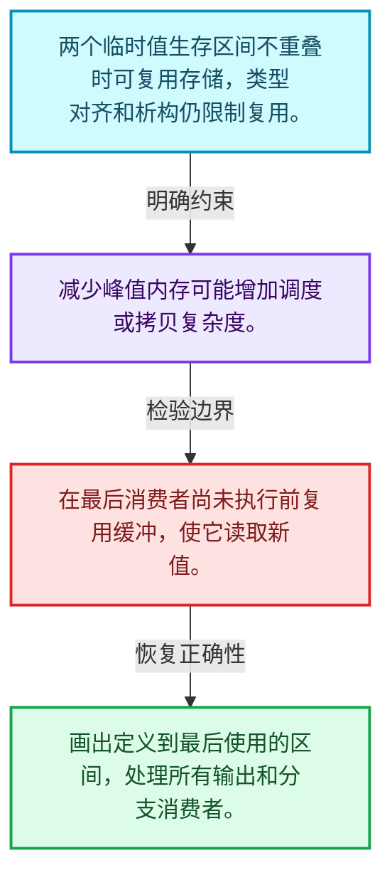
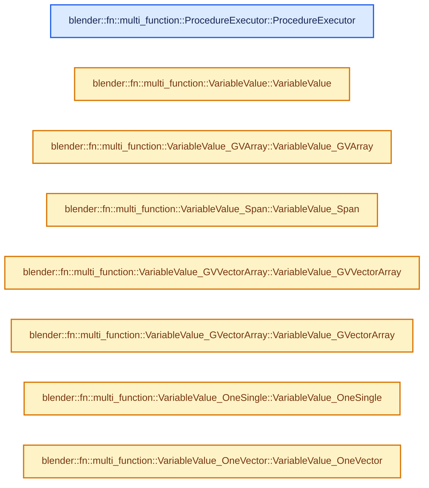
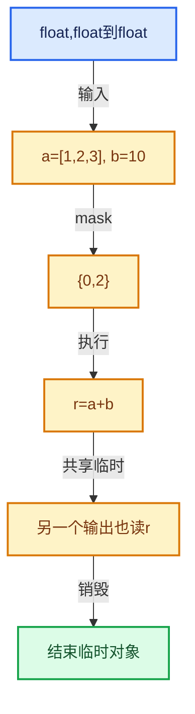

# 07-09 执行器与内存复用

[方向导航](README.md) · [总目录](../README.md) · [实现索引](../%E7%AC%A6%E5%8F%B7%E4%BE%9D%E8%B5%96%E4%B8%8E%E5%AE%9E%E7%8E%B0%E7%B4%A2%E5%BC%95.md)

## 从问题到实现

临时变量何时可以复用存储？

最后使用、元素有效范围和类型对齐限制复用；结束一个值寿命后才能在相同存储建立另一个值。

**数据模型**

两个临时值生存区间不重叠时可复用存储，类型对齐和析构仍限制复用。

**设计取舍**

减少峰值内存可能增加调度或拷贝复杂度。

**最小反例**

在最后消费者尚未执行前复用缓冲，使它读取新值。

**推导**

画出定义到最后使用的区间，处理所有输出和分支消费者。

## 阅读地图与执行推演








图中的数值推演是本方向的教学模型；实际函数之间的调用边与概念分析边分别标注，不能把概念关系当作运行时调度顺序。

## 完整源码单元与就地讲解

中文讲解直接放在相关代码旁，复杂机制在代码下展开。原文折叠区保留基准行号；不需要在行号表和函数之间来回查找。类布局可分段展示，函数实现不按固定行数切开。

### 类型布局、声明与编译条件 · FN_multi_function_procedure_executor.hh L1—L30

<a id="t-c45c503316d9"></a>

`ProcedureExecutor`在这里声明的数据成员：

- `Signature signature_`
- `Procedure procedure_`
- `void call`
- `ExecutionHints get_execution_hints`

<!-- annotated:2364092e1c4911 -->

```cpp
/* SPDX-FileCopyrightText: 2023 Blender Authors
 *
 * SPDX-License-Identifier: GPL-2.0-or-later */

#pragma once

/** \file
 * \ingroup fn
 */

#include "FN_multi_function_procedure.hh"

namespace blender::fn::multi_function {

/** A multi-function that executes a procedure internally. */
class ProcedureExecutor : public MultiFunction {
 private:
  Signature signature_;
  const Procedure &procedure_;

 public:
  ProcedureExecutor(const Procedure &procedure);

  void call(const IndexMask &mask, Params params, Context context) const override;

 private:
  ExecutionHints get_execution_hints() const override;
};

}  // namespace blender::fn::multi_function
```

<details>
<summary>核对原始源码：source/blender/functions/FN_multi_function_procedure_executor.hh · L1—L30</summary>

<!-- original:2364092e1c4911:source/blender/functions/FN_multi_function_procedure_executor.hh:1:30 -->

```cpp
/* SPDX-FileCopyrightText: 2023 Blender Authors
 *
 * SPDX-License-Identifier: GPL-2.0-or-later */

#pragma once

/** \file
 * \ingroup fn
 */

#include "FN_multi_function_procedure.hh"

namespace blender::fn::multi_function {

/** A multi-function that executes a procedure internally. */
class ProcedureExecutor : public MultiFunction {
 private:
  Signature signature_;
  const Procedure &procedure_;

 public:
  ProcedureExecutor(const Procedure &procedure);

  void call(const IndexMask &mask, Params params, Context context) const override;

 private:
  ExecutionHints get_execution_hints() const override;
};

}  // namespace blender::fn::multi_function
```

</details>

### 类型布局、声明与编译条件 · multi_function_procedure_executor.cc L1—L14

<!-- annotated:d2d6bc2b9f219c -->

```cpp
/* SPDX-FileCopyrightText: 2023 Blender Authors
 *
 * SPDX-License-Identifier: GPL-2.0-or-later */

/** \file
 * \ingroup fn
 */

#include "FN_multi_function_procedure_executor.hh"

#include "BLI_stack.hh"

namespace blender::fn::multi_function {

```

<details>
<summary>核对原始源码：source/blender/functions/intern/multi_function_procedure_executor.cc · L1—L14</summary>

<!-- original:d2d6bc2b9f219c:source/blender/functions/intern/multi_function_procedure_executor.cc:1:14 -->

```cpp
/* SPDX-FileCopyrightText: 2023 Blender Authors
 *
 * SPDX-License-Identifier: GPL-2.0-or-later */

/** \file
 * \ingroup fn
 */

#include "FN_multi_function_procedure_executor.hh"

#include "BLI_stack.hh"

namespace blender::fn::multi_function {

```

</details>

<a id="f-e06266765d19d919"></a>

### `blender::fn::multi_function::ProcedureExecutor::ProcedureExecutor`

实现位置：[source/blender/functions/intern/multi_function_procedure_executor.cc](../../../../../source/blender/functions/intern/multi_function_procedure_executor.cc) · L15—L24。

接口参数：

- `const Procedure &procedure`

**教学注释版**

<!-- annotated:61451bd527229b -->

```cpp
ProcedureExecutor::ProcedureExecutor(const Procedure &procedure) : procedure_(procedure)
{
  SignatureBuilder builder("Procedure Executor", signature_);

  for (const ConstParameter &param : procedure.params()) {
    builder.add("Parameter", ParamType(param.type, param.variable->data_type()));
  }

  this->set_signature(&signature_);
}
```

<details>
<summary>核对原始源码：source/blender/functions/intern/multi_function_procedure_executor.cc · L15—L24</summary>

<!-- original:61451bd527229b:source/blender/functions/intern/multi_function_procedure_executor.cc:15:24 -->

```cpp
ProcedureExecutor::ProcedureExecutor(const Procedure &procedure) : procedure_(procedure)
{
  SignatureBuilder builder("Procedure Executor", signature_);

  for (const ConstParameter &param : procedure.params()) {
    builder.add("Parameter", ParamType(param.type, param.variable->data_type()));
  }

  this->set_signature(&signature_);
}
```

</details>

**继续追踪实现**

- `procedure.params` → [blender::fn::multi_function::Procedure::params · L499](07-Procedure%E6%8C%87%E4%BB%A4%E4%B8%8E%E6%8E%A7%E5%88%B6%E6%B5%81.md#f-0ba3927a219e6465)。
- `builder.add` → [blender::fn::multi_function::SignatureBuilder::add · L183](02-%E5%87%BD%E6%95%B0%E7%AD%BE%E5%90%8D.md#f-5362d79471971d53)；[blender::fn::multi_function::SignatureBuilder::add · L198](02-%E5%87%BD%E6%95%B0%E7%AD%BE%E5%90%8D.md#f-c78f0b406df4344b)。同名重载需按实参类型选择。
- `ParamType` → [blender::fn::multi_function::ParamType::ParamType · L78](03-%E5%8F%82%E6%95%B0%E7%B1%BB%E5%9E%8B%E4%B8%8E%E8%A7%92%E8%89%B2.md#f-0e2fe2ba44d205ba)。
- `param.variable->data_type` → [调用协议](../%E6%A8%A1%E6%9D%BF%E5%AE%8F%E4%B8%8E%E5%8A%A8%E6%80%81%E5%88%86%E6%B4%BE%E5%8D%8F%E8%AE%AE.md)：接收对象类型依赖auto、返回值或模板实例；不按同名猜测目标。调用位置L20。
- `this->set_signature` → [blender::fn::multi_function::MultiFunction::set_signature · L133](01-%E6%89%B9%E9%87%8F%E8%AE%A1%E7%AE%97%E6%A8%A1%E5%9E%8B.md#f-3b440d337b220123)。

### 类型布局、声明与编译条件 · multi_function_procedure_executor.cc L25—L46

<a id="t-d395c8184fc0"></a>

<a id="t-6146479f871d"></a>

`VariableValue`在这里声明的数据成员：

- `ValueType type`

<!-- annotated:fc41544a0b9d41 -->

```cpp

using IndicesSplitVectors = std::array<Vector<int64_t>, 2>;

namespace {
enum class ValueType {
  GVArray = 0,
  Span = 1,
  GVVectorArray = 2,
  GVectorArray = 3,
  OneSingle = 4,
  OneVector = 5,
};
constexpr int tot_variable_value_types = 6;
}  // namespace

/**
 * During evaluation, a variable may be stored in various different forms, depending on what
 * instructions do with the variables.
 */
struct VariableValue {
  ValueType type;

```

<details>
<summary>核对原始源码：source/blender/functions/intern/multi_function_procedure_executor.cc · L25—L46</summary>

<!-- original:fc41544a0b9d41:source/blender/functions/intern/multi_function_procedure_executor.cc:25:46 -->

```cpp

using IndicesSplitVectors = std::array<Vector<int64_t>, 2>;

namespace {
enum class ValueType {
  GVArray = 0,
  Span = 1,
  GVVectorArray = 2,
  GVectorArray = 3,
  OneSingle = 4,
  OneVector = 5,
};
constexpr int tot_variable_value_types = 6;
}  // namespace

/**
 * During evaluation, a variable may be stored in various different forms, depending on what
 * instructions do with the variables.
 */
struct VariableValue {
  ValueType type;

```

</details>

<a id="f-baf35c005d300c3e"></a>

### `blender::fn::multi_function::VariableValue::VariableValue`

实现位置：[source/blender/functions/intern/multi_function_procedure_executor.cc](../../../../../source/blender/functions/intern/multi_function_procedure_executor.cc) · L47—L47。

接口参数：

- `ValueType type`

**教学注释版**

<!-- annotated:fc3ca8684b455a -->

```cpp
  VariableValue(ValueType type) : type(type) {}
```

<details>
<summary>核对原始源码：source/blender/functions/intern/multi_function_procedure_executor.cc · L47—L47</summary>

<!-- original:fc3ca8684b455a:source/blender/functions/intern/multi_function_procedure_executor.cc:47:47 -->

```cpp
  VariableValue(ValueType type) : type(type) {}
```

</details>

**继续追踪实现**

本实现没有需要继续展开的显式调用；检查返回表达式、对象转换和调用者前置条件。

### 类型布局、声明与编译条件 · multi_function_procedure_executor.cc L48—L54

<a id="t-c23eb4d6b1e9"></a>

`VariableValue_GVArray`在这里声明的数据成员：

- `ValueType static_type`
- `GVArray data`

<!-- annotated:de6d3dde1ab4e1 -->

```cpp
};

/* This variable is the unmodified virtual array from the caller. */
struct VariableValue_GVArray : public VariableValue {
  static constexpr ValueType static_type = ValueType::GVArray;
  const GVArray &data;

```

<details>
<summary>核对原始源码：source/blender/functions/intern/multi_function_procedure_executor.cc · L48—L54</summary>

<!-- original:de6d3dde1ab4e1:source/blender/functions/intern/multi_function_procedure_executor.cc:48:54 -->

```cpp
};

/* This variable is the unmodified virtual array from the caller. */
struct VariableValue_GVArray : public VariableValue {
  static constexpr ValueType static_type = ValueType::GVArray;
  const GVArray &data;

```

</details>

<a id="f-001a2ee3b68dd9f6"></a>

### `blender::fn::multi_function::VariableValue_GVArray::VariableValue_GVArray`

实现位置：[source/blender/functions/intern/multi_function_procedure_executor.cc](../../../../../source/blender/functions/intern/multi_function_procedure_executor.cc) · L55—L58。

接口参数：

- `const GVArray &data`

**教学注释版**

<!-- annotated:8c56ba8bbdc1cc -->

```cpp
  VariableValue_GVArray(const GVArray &data) : VariableValue(static_type), data(data)
  {
    BLI_assert(data);
  }
```

<details>
<summary>核对原始源码：source/blender/functions/intern/multi_function_procedure_executor.cc · L55—L58</summary>

<!-- original:8c56ba8bbdc1cc:source/blender/functions/intern/multi_function_procedure_executor.cc:55:58 -->

```cpp
  VariableValue_GVArray(const GVArray &data) : VariableValue(static_type), data(data)
  {
    BLI_assert(data);
  }
```

</details>

**继续追踪实现**

- `BLI_assert` → [BLI_assert · L48](../01-%E5%9F%BA%E7%A1%80%E5%AE%B9%E5%99%A8%E4%B8%8E%E7%8E%B0%E4%BB%A3CPP/%E4%BE%9D%E8%B5%96-BLI_assert-cc98e8.md#m-57a88495704d)；[BLI_assert · L63](../01-%E5%9F%BA%E7%A1%80%E5%AE%B9%E5%99%A8%E4%B8%8E%E7%8E%B0%E4%BB%A3CPP/%E4%BE%9D%E8%B5%96-BLI_assert-cc98e8.md#m-d07050020cb5)。宏定义由构建条件选择。

### 类型布局、声明与编译条件 · multi_function_procedure_executor.cc L59—L67

<a id="t-2212400e952e"></a>

`VariableValue_Span`在这里声明的数据成员：

- `ValueType static_type`
- `void data`
- `bool owned`

<!-- annotated:3ed19fa189300d -->

```cpp
};

/* This variable has a different value for every index. Some values may be uninitialized. The span
 * may be owned by the caller. */
struct VariableValue_Span : public VariableValue {
  static constexpr ValueType static_type = ValueType::Span;
  void *data;
  bool owned;

```

<details>
<summary>核对原始源码：source/blender/functions/intern/multi_function_procedure_executor.cc · L59—L67</summary>

<!-- original:3ed19fa189300d:source/blender/functions/intern/multi_function_procedure_executor.cc:59:67 -->

```cpp
};

/* This variable has a different value for every index. Some values may be uninitialized. The span
 * may be owned by the caller. */
struct VariableValue_Span : public VariableValue {
  static constexpr ValueType static_type = ValueType::Span;
  void *data;
  bool owned;

```

</details>

<a id="f-5b469585ce672a00"></a>

### `blender::fn::multi_function::VariableValue_Span::VariableValue_Span`

实现位置：[source/blender/functions/intern/multi_function_procedure_executor.cc](../../../../../source/blender/functions/intern/multi_function_procedure_executor.cc) · L68—L70。

接口参数：

- `void *data`
- `bool owned`

**教学注释版**

<!-- annotated:c5401886008818 -->

```cpp
  VariableValue_Span(void *data, bool owned) : VariableValue(static_type), data(data), owned(owned)
  {
  }
```

<details>
<summary>核对原始源码：source/blender/functions/intern/multi_function_procedure_executor.cc · L68—L70</summary>

<!-- original:c5401886008818:source/blender/functions/intern/multi_function_procedure_executor.cc:68:70 -->

```cpp
  VariableValue_Span(void *data, bool owned) : VariableValue(static_type), data(data), owned(owned)
  {
  }
```

</details>

**继续追踪实现**

本实现没有需要继续展开的显式调用；检查返回表达式、对象转换和调用者前置条件。

### 类型布局、声明与编译条件 · multi_function_procedure_executor.cc L71—L77

<a id="t-98fc800b8005"></a>

`VariableValue_GVVectorArray`在这里声明的数据成员：

- `ValueType static_type`
- `GVVectorArray data`

<!-- annotated:e6b74283456283 -->

```cpp
};

/* This variable is the unmodified virtual vector array from the caller. */
struct VariableValue_GVVectorArray : public VariableValue {
  static constexpr ValueType static_type = ValueType::GVVectorArray;
  const GVVectorArray &data;

```

<details>
<summary>核对原始源码：source/blender/functions/intern/multi_function_procedure_executor.cc · L71—L77</summary>

<!-- original:e6b74283456283:source/blender/functions/intern/multi_function_procedure_executor.cc:71:77 -->

```cpp
};

/* This variable is the unmodified virtual vector array from the caller. */
struct VariableValue_GVVectorArray : public VariableValue {
  static constexpr ValueType static_type = ValueType::GVVectorArray;
  const GVVectorArray &data;

```

</details>

<a id="f-75b221f11c9ac2dc"></a>

### `blender::fn::multi_function::VariableValue_GVVectorArray::VariableValue_GVVectorArray`

实现位置：[source/blender/functions/intern/multi_function_procedure_executor.cc](../../../../../source/blender/functions/intern/multi_function_procedure_executor.cc) · L78—L80。

接口参数：

- `const GVVectorArray &data`

**教学注释版**

<!-- annotated:9236de81b8eb00 -->

```cpp
  VariableValue_GVVectorArray(const GVVectorArray &data) : VariableValue(static_type), data(data)
  {
  }
```

<details>
<summary>核对原始源码：source/blender/functions/intern/multi_function_procedure_executor.cc · L78—L80</summary>

<!-- original:9236de81b8eb00:source/blender/functions/intern/multi_function_procedure_executor.cc:78:80 -->

```cpp
  VariableValue_GVVectorArray(const GVVectorArray &data) : VariableValue(static_type), data(data)
  {
  }
```

</details>

**继续追踪实现**

本实现没有需要继续展开的显式调用；检查返回表达式、对象转换和调用者前置条件。

### 类型布局、声明与编译条件 · multi_function_procedure_executor.cc L81—L88

<a id="t-86e4b4711d33"></a>

`VariableValue_GVectorArray`在这里声明的数据成员：

- `ValueType static_type`
- `GVectorArray data`
- `bool owned`

<!-- annotated:85dd79af9816cb -->

```cpp
};

/* This variable has a different vector for every index. */
struct VariableValue_GVectorArray : public VariableValue {
  static constexpr ValueType static_type = ValueType::GVectorArray;
  GVectorArray &data;
  bool owned;

```

<details>
<summary>核对原始源码：source/blender/functions/intern/multi_function_procedure_executor.cc · L81—L88</summary>

<!-- original:85dd79af9816cb:source/blender/functions/intern/multi_function_procedure_executor.cc:81:88 -->

```cpp
};

/* This variable has a different vector for every index. */
struct VariableValue_GVectorArray : public VariableValue {
  static constexpr ValueType static_type = ValueType::GVectorArray;
  GVectorArray &data;
  bool owned;

```

</details>

<a id="f-9c9076727c7ed03f"></a>

### `blender::fn::multi_function::VariableValue_GVectorArray::VariableValue_GVectorArray`

实现位置：[source/blender/functions/intern/multi_function_procedure_executor.cc](../../../../../source/blender/functions/intern/multi_function_procedure_executor.cc) · L89—L92。

接口参数：

- `GVectorArray &data`
- `bool owned`

**教学注释版**

<!-- annotated:c07a0de12d964f -->

```cpp
  VariableValue_GVectorArray(GVectorArray &data, bool owned)
      : VariableValue(static_type), data(data), owned(owned)
  {
  }
```

<details>
<summary>核对原始源码：source/blender/functions/intern/multi_function_procedure_executor.cc · L89—L92</summary>

<!-- original:c07a0de12d964f:source/blender/functions/intern/multi_function_procedure_executor.cc:89:92 -->

```cpp
  VariableValue_GVectorArray(GVectorArray &data, bool owned)
      : VariableValue(static_type), data(data), owned(owned)
  {
  }
```

</details>

**继续追踪实现**

本实现没有需要继续展开的显式调用；检查返回表达式、对象转换和调用者前置条件。

### 类型布局、声明与编译条件 · multi_function_procedure_executor.cc L93—L100

<a id="t-f8230ff86fa9"></a>

`VariableValue_OneSingle`在这里声明的数据成员：

- `ValueType static_type`
- `void data`
- `bool is_initialized`

<!-- annotated:e790a870144d4e -->

```cpp
};

/* This variable has the same value for every index. */
struct VariableValue_OneSingle : public VariableValue {
  static constexpr ValueType static_type = ValueType::OneSingle;
  void *data;
  bool is_initialized = false;

```

<details>
<summary>核对原始源码：source/blender/functions/intern/multi_function_procedure_executor.cc · L93—L100</summary>

<!-- original:e790a870144d4e:source/blender/functions/intern/multi_function_procedure_executor.cc:93:100 -->

```cpp
};

/* This variable has the same value for every index. */
struct VariableValue_OneSingle : public VariableValue {
  static constexpr ValueType static_type = ValueType::OneSingle;
  void *data;
  bool is_initialized = false;

```

</details>

<a id="f-beaecec2f5eab016"></a>

### `blender::fn::multi_function::VariableValue_OneSingle::VariableValue_OneSingle`

实现位置：[source/blender/functions/intern/multi_function_procedure_executor.cc](../../../../../source/blender/functions/intern/multi_function_procedure_executor.cc) · L101—L101。

接口参数：

- `void *data`

**教学注释版**

<!-- annotated:650416f2c37310 -->

```cpp
  VariableValue_OneSingle(void *data) : VariableValue(static_type), data(data) {}
```

<details>
<summary>核对原始源码：source/blender/functions/intern/multi_function_procedure_executor.cc · L101—L101</summary>

<!-- original:650416f2c37310:source/blender/functions/intern/multi_function_procedure_executor.cc:101:101 -->

```cpp
  VariableValue_OneSingle(void *data) : VariableValue(static_type), data(data) {}
```

</details>

**继续追踪实现**

本实现没有需要继续展开的显式调用；检查返回表达式、对象转换和调用者前置条件。

### 类型布局、声明与编译条件 · multi_function_procedure_executor.cc L102—L108

<a id="t-5fe2f597b94a"></a>

`VariableValue_OneVector`在这里声明的数据成员：

- `ValueType static_type`
- `GVectorArray data`

<!-- annotated:0b15fbeb7e3057 -->

```cpp
};

/* This variable has the same vector for every index. */
struct VariableValue_OneVector : public VariableValue {
  static constexpr ValueType static_type = ValueType::OneVector;
  GVectorArray &data;

```

<details>
<summary>核对原始源码：source/blender/functions/intern/multi_function_procedure_executor.cc · L102—L108</summary>

<!-- original:0b15fbeb7e3057:source/blender/functions/intern/multi_function_procedure_executor.cc:102:108 -->

```cpp
};

/* This variable has the same vector for every index. */
struct VariableValue_OneVector : public VariableValue {
  static constexpr ValueType static_type = ValueType::OneVector;
  GVectorArray &data;

```

</details>

<a id="f-9eb6beffea90baaf"></a>

### `blender::fn::multi_function::VariableValue_OneVector::VariableValue_OneVector`

实现位置：[source/blender/functions/intern/multi_function_procedure_executor.cc](../../../../../source/blender/functions/intern/multi_function_procedure_executor.cc) · L109—L109。

接口参数：

- `GVectorArray &data`

**教学注释版**

<!-- annotated:de3b36427beb5b -->

```cpp
  VariableValue_OneVector(GVectorArray &data) : VariableValue(static_type), data(data) {}
```

<details>
<summary>核对原始源码：source/blender/functions/intern/multi_function_procedure_executor.cc · L109—L109</summary>

<!-- original:de3b36427beb5b:source/blender/functions/intern/multi_function_procedure_executor.cc:109:109 -->

```cpp
  VariableValue_OneVector(GVectorArray &data) : VariableValue(static_type), data(data) {}
```

</details>

**继续追踪实现**

本实现没有需要继续展开的显式调用；检查返回表达式、对象转换和调用者前置条件。

### 类型布局、声明与编译条件 · multi_function_procedure_executor.cc L110—L155

<a id="t-8c6987c8181e"></a>

<a id="t-f9d175b1657a"></a>

`ValueAllocator`在这里声明的数据成员：

- `int min_alignment`
- `LinearAllocator<> linear_allocator_`
- `std::array<Stack<VariableValue *>, tot_variable_value_types> variable_value_free_lists_`
- `Stack<void *> small_span_buffers_free_list_`
- `Map<int, Stack<void *>> span_buffers_free_lists_`
- `int small_value_max_size`
- `int small_value_max_alignment`
- `Stack<void *> small_single_value_free_list_`
- `Map<const CPPType *, Stack<void *>> single_value_free_lists_`

<!-- annotated:02825d69397586 -->

```cpp
};

static_assert(std::is_trivially_destructible_v<VariableValue_GVArray>);
static_assert(std::is_trivially_destructible_v<VariableValue_Span>);
static_assert(std::is_trivially_destructible_v<VariableValue_GVVectorArray>);
static_assert(std::is_trivially_destructible_v<VariableValue_GVectorArray>);
static_assert(std::is_trivially_destructible_v<VariableValue_OneSingle>);
static_assert(std::is_trivially_destructible_v<VariableValue_OneVector>);

class VariableState;

/**
 * The #ValueAllocator is responsible for providing memory for variables and their values. It also
 * manages the reuse of buffers to improve performance.
 */
class ValueAllocator : NonCopyable, NonMovable {
 private:
  /**
   * Allocate with 64 byte alignment for better reusability of buffers and improved cache
   * performance.
   */
  static constexpr int min_alignment = 64;

  /** All buffers in the free-lists below have been allocated with this allocator. */
  LinearAllocator<> &linear_allocator_;

  /**
   * Use stacks so that the most recently used buffers are reused first. This improves cache
   * efficiency.
   */
  std::array<Stack<VariableValue *>, tot_variable_value_types> variable_value_free_lists_;

  /**
   * The integer key is the size of one element (e.g. 4 for an integer buffer). All buffers are
   * aligned to #min_alignment bytes.
   */
  Stack<void *> small_span_buffers_free_list_;
  Map<int, Stack<void *>> span_buffers_free_lists_;

  /** Cache buffers for single values of different types. */
  static constexpr int small_value_max_size = 16;
  static constexpr int small_value_max_alignment = 8;
  Stack<void *> small_single_value_free_list_;
  Map<const CPPType *, Stack<void *>> single_value_free_lists_;

 public:
```

<details>
<summary>核对原始源码：source/blender/functions/intern/multi_function_procedure_executor.cc · L110—L155</summary>

<!-- original:02825d69397586:source/blender/functions/intern/multi_function_procedure_executor.cc:110:155 -->

```cpp
};

static_assert(std::is_trivially_destructible_v<VariableValue_GVArray>);
static_assert(std::is_trivially_destructible_v<VariableValue_Span>);
static_assert(std::is_trivially_destructible_v<VariableValue_GVVectorArray>);
static_assert(std::is_trivially_destructible_v<VariableValue_GVectorArray>);
static_assert(std::is_trivially_destructible_v<VariableValue_OneSingle>);
static_assert(std::is_trivially_destructible_v<VariableValue_OneVector>);

class VariableState;

/**
 * The #ValueAllocator is responsible for providing memory for variables and their values. It also
 * manages the reuse of buffers to improve performance.
 */
class ValueAllocator : NonCopyable, NonMovable {
 private:
  /**
   * Allocate with 64 byte alignment for better reusability of buffers and improved cache
   * performance.
   */
  static constexpr int min_alignment = 64;

  /** All buffers in the free-lists below have been allocated with this allocator. */
  LinearAllocator<> &linear_allocator_;

  /**
   * Use stacks so that the most recently used buffers are reused first. This improves cache
   * efficiency.
   */
  std::array<Stack<VariableValue *>, tot_variable_value_types> variable_value_free_lists_;

  /**
   * The integer key is the size of one element (e.g. 4 for an integer buffer). All buffers are
   * aligned to #min_alignment bytes.
   */
  Stack<void *> small_span_buffers_free_list_;
  Map<int, Stack<void *>> span_buffers_free_lists_;

  /** Cache buffers for single values of different types. */
  static constexpr int small_value_max_size = 16;
  static constexpr int small_value_max_alignment = 8;
  Stack<void *> small_single_value_free_list_;
  Map<const CPPType *, Stack<void *>> single_value_free_lists_;

 public:
```

</details>

<a id="f-b33b09bf72ec4878"></a>

### `blender::fn::multi_function::ValueAllocator::ValueAllocator`

实现位置：[source/blender/functions/intern/multi_function_procedure_executor.cc](../../../../../source/blender/functions/intern/multi_function_procedure_executor.cc) · L156—L156。

接口参数：

- `LinearAllocator<> &linear_allocator`

**教学注释版**

<!-- annotated:4d714a30ca6afa -->

```cpp
  ValueAllocator(LinearAllocator<> &linear_allocator) : linear_allocator_(linear_allocator) {}
```

<details>
<summary>核对原始源码：source/blender/functions/intern/multi_function_procedure_executor.cc · L156—L156</summary>

<!-- original:4d714a30ca6afa:source/blender/functions/intern/multi_function_procedure_executor.cc:156:156 -->

```cpp
  ValueAllocator(LinearAllocator<> &linear_allocator) : linear_allocator_(linear_allocator) {}
```

</details>

**继续追踪实现**

本实现没有需要继续展开的显式调用；检查返回表达式、对象转换和调用者前置条件。

<!-- annotated:1192546a93a950 -->

```cpp

```

<details>
<summary>核对原始源码：source/blender/functions/intern/multi_function_procedure_executor.cc · L157—L157</summary>

<!-- original:1192546a93a950:source/blender/functions/intern/multi_function_procedure_executor.cc:157:157 -->

```cpp

```

</details>

<a id="f-14709e78ac0521ca"></a>

### `blender::fn::multi_function::ValueAllocator::obtain_GVArray`

实现位置：[source/blender/functions/intern/multi_function_procedure_executor.cc](../../../../../source/blender/functions/intern/multi_function_procedure_executor.cc) · L158—L161。

接口参数：

- `const GVArray &varray`

**教学注释版**

<!-- annotated:33d6dc5a66896e -->

```cpp
  VariableValue_GVArray *obtain_GVArray(const GVArray &varray)
  {
    return this->obtain<VariableValue_GVArray>(varray);
  }
```

<details>
<summary>核对原始源码：source/blender/functions/intern/multi_function_procedure_executor.cc · L158—L161</summary>

<!-- original:33d6dc5a66896e:source/blender/functions/intern/multi_function_procedure_executor.cc:158:161 -->

```cpp
  VariableValue_GVArray *obtain_GVArray(const GVArray &varray)
  {
    return this->obtain<VariableValue_GVArray>(varray);
  }
```

</details>

**结果出口**

- `return this->obtain<VariableValue_GVArray>(varray);`

**继续追踪实现**

- `this->obtain<VariableValue_GVArray>` → [blender::fn::multi_function::ValueAllocator::obtain · L294](09-%E6%89%A7%E8%A1%8C%E5%99%A8%E4%B8%8E%E5%86%85%E5%AD%98%E5%A4%8D%E7%94%A8.md#f-cbb11d2af929f70a)。

<!-- annotated:bf07de81c2a6fe -->

```cpp

```

<details>
<summary>核对原始源码：source/blender/functions/intern/multi_function_procedure_executor.cc · L162—L162</summary>

<!-- original:bf07de81c2a6fe:source/blender/functions/intern/multi_function_procedure_executor.cc:162:162 -->

```cpp

```

</details>

<a id="f-bbc312074060f315"></a>

### `blender::fn::multi_function::ValueAllocator::obtain_GVVectorArray`

实现位置：[source/blender/functions/intern/multi_function_procedure_executor.cc](../../../../../source/blender/functions/intern/multi_function_procedure_executor.cc) · L163—L166。

接口参数：

- `const GVVectorArray &varray`

**教学注释版**

<!-- annotated:38a260478e7aa5 -->

```cpp
  VariableValue_GVVectorArray *obtain_GVVectorArray(const GVVectorArray &varray)
  {
    return this->obtain<VariableValue_GVVectorArray>(varray);
  }
```

<details>
<summary>核对原始源码：source/blender/functions/intern/multi_function_procedure_executor.cc · L163—L166</summary>

<!-- original:38a260478e7aa5:source/blender/functions/intern/multi_function_procedure_executor.cc:163:166 -->

```cpp
  VariableValue_GVVectorArray *obtain_GVVectorArray(const GVVectorArray &varray)
  {
    return this->obtain<VariableValue_GVVectorArray>(varray);
  }
```

</details>

**结果出口**

- `return this->obtain<VariableValue_GVVectorArray>(varray);`

**继续追踪实现**

- `this->obtain<VariableValue_GVVectorArray>` → [blender::fn::multi_function::ValueAllocator::obtain · L294](09-%E6%89%A7%E8%A1%8C%E5%99%A8%E4%B8%8E%E5%86%85%E5%AD%98%E5%A4%8D%E7%94%A8.md#f-cbb11d2af929f70a)。

<!-- annotated:e05d23b5ea1c8b -->

```cpp

```

<details>
<summary>核对原始源码：source/blender/functions/intern/multi_function_procedure_executor.cc · L167—L167</summary>

<!-- original:e05d23b5ea1c8b:source/blender/functions/intern/multi_function_procedure_executor.cc:167:167 -->

```cpp

```

</details>

<a id="f-aca7ecb8cce4096c"></a>

### `blender::fn::multi_function::ValueAllocator::obtain_Span_not_owned`

实现位置：[source/blender/functions/intern/multi_function_procedure_executor.cc](../../../../../source/blender/functions/intern/multi_function_procedure_executor.cc) · L168—L171。

接口参数：

- `void *buffer`

**教学注释版**

<!-- annotated:caaf0251e54915 -->

```cpp
  VariableValue_Span *obtain_Span_not_owned(void *buffer)
  {
    return this->obtain<VariableValue_Span>(buffer, false);
  }
```

<details>
<summary>核对原始源码：source/blender/functions/intern/multi_function_procedure_executor.cc · L168—L171</summary>

<!-- original:caaf0251e54915:source/blender/functions/intern/multi_function_procedure_executor.cc:168:171 -->

```cpp
  VariableValue_Span *obtain_Span_not_owned(void *buffer)
  {
    return this->obtain<VariableValue_Span>(buffer, false);
  }
```

</details>

**结果出口**

- `return this->obtain<VariableValue_Span>(buffer, false);`

**继续追踪实现**

- `this->obtain<VariableValue_Span>` → [blender::fn::multi_function::ValueAllocator::obtain · L294](09-%E6%89%A7%E8%A1%8C%E5%99%A8%E4%B8%8E%E5%86%85%E5%AD%98%E5%A4%8D%E7%94%A8.md#f-cbb11d2af929f70a)。

<!-- annotated:eb0da7e835b6ad -->

```cpp

```

<details>
<summary>核对原始源码：source/blender/functions/intern/multi_function_procedure_executor.cc · L172—L172</summary>

<!-- original:eb0da7e835b6ad:source/blender/functions/intern/multi_function_procedure_executor.cc:172:172 -->

```cpp

```

</details>

<a id="f-bc03148392c6625f"></a>

### `blender::fn::multi_function::ValueAllocator::obtain_Span`

实现位置：[source/blender/functions/intern/multi_function_procedure_executor.cc](../../../../../source/blender/functions/intern/multi_function_procedure_executor.cc) · L173—L200。

接口参数：

- `const CPPType &type`
- `int size`

**教学注释版**

<!-- annotated:f9ee8c0c78331c -->

```cpp
  VariableValue_Span *obtain_Span(const CPPType &type, int size)
  {
    void *buffer = nullptr;

    const int64_t element_size = type.size;
    const int64_t alignment = type.alignment;

    if (alignment > min_alignment) {
      /* In this rare case we fall back to not reusing existing buffers. */
      buffer = linear_allocator_.allocate(element_size * size, alignment);
    }
    else {
      Stack<void *> *stack = type.can_exist_in_buffer(small_value_max_size,
                                                      small_value_max_alignment) ?
                                 &small_span_buffers_free_list_ :
                                 // [讲解] span_buffers_free_lists_.lookup_ptr：按键查找对应项。
                                 span_buffers_free_lists_.lookup_ptr(element_size);
      if (stack == nullptr || stack->is_empty()) {
        buffer = linear_allocator_.allocate(
            // [讲解] std::max<int64_t>：按比较关系选取较大值。本讲解中的增长公式同时满足最低请求和几何增长；若保存返回引用，还需注意实参寿命。
            std::max<int64_t>(element_size, small_value_max_size) * size, min_alignment);
      }
      else {
        /* Reuse existing buffer. */
        buffer = stack->pop();
      }
    }

    return this->obtain<VariableValue_Span>(buffer, true);
  }
```

<details>
<summary>核对原始源码：source/blender/functions/intern/multi_function_procedure_executor.cc · L173—L200</summary>

<!-- original:f9ee8c0c78331c:source/blender/functions/intern/multi_function_procedure_executor.cc:173:200 -->

```cpp
  VariableValue_Span *obtain_Span(const CPPType &type, int size)
  {
    void *buffer = nullptr;

    const int64_t element_size = type.size;
    const int64_t alignment = type.alignment;

    if (alignment > min_alignment) {
      /* In this rare case we fall back to not reusing existing buffers. */
      buffer = linear_allocator_.allocate(element_size * size, alignment);
    }
    else {
      Stack<void *> *stack = type.can_exist_in_buffer(small_value_max_size,
                                                      small_value_max_alignment) ?
                                 &small_span_buffers_free_list_ :
                                 span_buffers_free_lists_.lookup_ptr(element_size);
      if (stack == nullptr || stack->is_empty()) {
        buffer = linear_allocator_.allocate(
            std::max<int64_t>(element_size, small_value_max_size) * size, min_alignment);
      }
      else {
        /* Reuse existing buffer. */
        buffer = stack->pop();
      }
    }

    return this->obtain<VariableValue_Span>(buffer, true);
  }
```

</details>

**沿实际写入检查状态**

- `buffer = linear_allocator_.allocate(element_size * size, alignment);`
- `buffer = linear_allocator_.allocate(`
- `buffer = stack->pop();`

**结果出口**

- `return this->obtain<VariableValue_Span>(buffer, true);`

**继续追踪实现**

- `linear_allocator_.allocate` → [blender::LinearAllocator::allocate · L66](../03-%E5%86%85%E5%AD%98%E5%88%86%E9%85%8D%E4%B8%8E%E8%BF%90%E8%A1%8C%E6%97%B6%E7%B1%BB%E5%9E%8B/02-LinearAllocator%E5%B8%83%E5%B1%80.md#f-26209c6a21e04bc0)；[blender::LinearAllocator::allocate · L99](../03-%E5%86%85%E5%AD%98%E5%88%86%E9%85%8D%E4%B8%8E%E8%BF%90%E8%A1%8C%E6%97%B6%E7%B1%BB%E5%9E%8B/02-LinearAllocator%E5%B8%83%E5%B1%80.md#f-b34ac68f2e3d66f1)；[blender::LinearAllocator::allocate · L105](../03-%E5%86%85%E5%AD%98%E5%88%86%E9%85%8D%E4%B8%8E%E8%BF%90%E8%A1%8C%E6%97%B6%E7%B1%BB%E5%9E%8B/02-LinearAllocator%E5%B8%83%E5%B1%80.md#f-96480f78749ba1c7)。同名重载需按实参类型选择。
- `type.can_exist_in_buffer` → [blender::CPPType::can_exist_in_buffer · L700](../03-%E5%86%85%E5%AD%98%E5%88%86%E9%85%8D%E4%B8%8E%E8%BF%90%E8%A1%8C%E6%97%B6%E7%B1%BB%E5%9E%8B/09-CPPType%E5%A4%8D%E5%88%B6%E7%A7%BB%E5%8A%A8%E9%87%8D%E5%AE%9A%E4%BD%8D.md#f-b88c37f0bbabd288)。
- `span_buffers_free_lists_.lookup_ptr` → [blender::Map::lookup_ptr · L508](../02-%E5%93%88%E5%B8%8C%E8%A1%A8%E4%B8%8E%E5%85%B3%E8%81%94%E6%95%B0%E6%8D%AE%E7%BB%93%E6%9E%84/04-Map%E6%9F%A5%E6%89%BE%E4%B8%8E%E9%94%AE%E8%AE%BF%E9%97%AE.md#f-90844510a761dcb2)；[blender::Map::lookup_ptr · L512](../02-%E5%93%88%E5%B8%8C%E8%A1%A8%E4%B8%8E%E5%85%B3%E8%81%94%E6%95%B0%E6%8D%AE%E7%BB%93%E6%9E%84/04-Map%E6%9F%A5%E6%89%BE%E4%B8%8E%E9%94%AE%E8%AE%BF%E9%97%AE.md#f-ce017485b88f4b2c)。同名重载需按实参类型选择。
- `stack->is_empty` → [blender::Stack::is_empty · L310](../01-%E5%9F%BA%E7%A1%80%E5%AE%B9%E5%99%A8%E4%B8%8E%E7%8E%B0%E4%BB%A3CPP/13-Stack%E4%B8%8E%E6%A0%88%E6%8E%A5%E5%8F%A3.md#f-0dbc636232316093)。
- `std::max<int64_t>` → [外部契约](https://eel.is/c++draft/alg.min.max)：按比较关系选取较大值。本讲解中的增长公式同时满足最低请求和几何增长；若保存返回引用，还需注意实参寿命。
- `stack->pop` → [blender::Stack::pop · L244](../01-%E5%9F%BA%E7%A1%80%E5%AE%B9%E5%99%A8%E4%B8%8E%E7%8E%B0%E4%BB%A3CPP/13-Stack%E4%B8%8E%E6%A0%88%E6%8E%A5%E5%8F%A3.md#f-6ef6c36a2a0aa986)。
- `this->obtain<VariableValue_Span>` → [blender::fn::multi_function::ValueAllocator::obtain · L294](09-%E6%89%A7%E8%A1%8C%E5%99%A8%E4%B8%8E%E5%86%85%E5%AD%98%E5%A4%8D%E7%94%A8.md#f-cbb11d2af929f70a)。

<!-- annotated:7a73700a90ba6d -->

```cpp

```

<details>
<summary>核对原始源码：source/blender/functions/intern/multi_function_procedure_executor.cc · L201—L201</summary>

<!-- original:7a73700a90ba6d:source/blender/functions/intern/multi_function_procedure_executor.cc:201:201 -->

```cpp

```

</details>

<a id="f-1004a0d6ad71f67a"></a>

### `blender::fn::multi_function::ValueAllocator::obtain_GVectorArray_not_owned`

实现位置：[source/blender/functions/intern/multi_function_procedure_executor.cc](../../../../../source/blender/functions/intern/multi_function_procedure_executor.cc) · L202—L205。

接口参数：

- `GVectorArray &data`

**教学注释版**

<!-- annotated:15406f2d58ce59 -->

```cpp
  VariableValue_GVectorArray *obtain_GVectorArray_not_owned(GVectorArray &data)
  {
    return this->obtain<VariableValue_GVectorArray>(data, false);
  }
```

<details>
<summary>核对原始源码：source/blender/functions/intern/multi_function_procedure_executor.cc · L202—L205</summary>

<!-- original:15406f2d58ce59:source/blender/functions/intern/multi_function_procedure_executor.cc:202:205 -->

```cpp
  VariableValue_GVectorArray *obtain_GVectorArray_not_owned(GVectorArray &data)
  {
    return this->obtain<VariableValue_GVectorArray>(data, false);
  }
```

</details>

**结果出口**

- `return this->obtain<VariableValue_GVectorArray>(data, false);`

**继续追踪实现**

- `this->obtain<VariableValue_GVectorArray>` → [blender::fn::multi_function::ValueAllocator::obtain · L294](09-%E6%89%A7%E8%A1%8C%E5%99%A8%E4%B8%8E%E5%86%85%E5%AD%98%E5%A4%8D%E7%94%A8.md#f-cbb11d2af929f70a)。

<!-- annotated:853c609bc60ef0 -->

```cpp

```

<details>
<summary>核对原始源码：source/blender/functions/intern/multi_function_procedure_executor.cc · L206—L206</summary>

<!-- original:853c609bc60ef0:source/blender/functions/intern/multi_function_procedure_executor.cc:206:206 -->

```cpp

```

</details>

<a id="f-10b711ff25d6c239"></a>

### `blender::fn::multi_function::ValueAllocator::obtain_GVectorArray`

实现位置：[source/blender/functions/intern/multi_function_procedure_executor.cc](../../../../../source/blender/functions/intern/multi_function_procedure_executor.cc) · L207—L211。

接口参数：

- `const CPPType &type`
- `int size`

**教学注释版**

<!-- annotated:a9bf1b917c6784 -->

```cpp
  VariableValue_GVectorArray *obtain_GVectorArray(const CPPType &type, int size)
  {
    GVectorArray *vector_array = new GVectorArray(type, size);
    return this->obtain<VariableValue_GVectorArray>(*vector_array, true);
  }
```

<details>
<summary>核对原始源码：source/blender/functions/intern/multi_function_procedure_executor.cc · L207—L211</summary>

<!-- original:a9bf1b917c6784:source/blender/functions/intern/multi_function_procedure_executor.cc:207:211 -->

```cpp
  VariableValue_GVectorArray *obtain_GVectorArray(const CPPType &type, int size)
  {
    GVectorArray *vector_array = new GVectorArray(type, size);
    return this->obtain<VariableValue_GVectorArray>(*vector_array, true);
  }
```

</details>

**结果出口**

- `return this->obtain<VariableValue_GVectorArray>(*vector_array, true);`

**继续追踪实现**

- `this->obtain<VariableValue_GVectorArray>` → [blender::fn::multi_function::ValueAllocator::obtain · L294](09-%E6%89%A7%E8%A1%8C%E5%99%A8%E4%B8%8E%E5%86%85%E5%AD%98%E5%A4%8D%E7%94%A8.md#f-cbb11d2af929f70a)。

<!-- annotated:938fd5c94984b7 -->

```cpp

```

<details>
<summary>核对原始源码：source/blender/functions/intern/multi_function_procedure_executor.cc · L212—L212</summary>

<!-- original:938fd5c94984b7:source/blender/functions/intern/multi_function_procedure_executor.cc:212:212 -->

```cpp

```

</details>

<a id="f-ca70a1ef9159c3da"></a>

### `blender::fn::multi_function::ValueAllocator::obtain_OneSingle`

实现位置：[source/blender/functions/intern/multi_function_procedure_executor.cc](../../../../../source/blender/functions/intern/multi_function_procedure_executor.cc) · L213—L229。

接口参数：

- `const CPPType &type`

**教学注释版**

<!-- annotated:9a655e54d30ca1 -->

```cpp
  VariableValue_OneSingle *obtain_OneSingle(const CPPType &type)
  {
    const bool is_small = type.can_exist_in_buffer(small_value_max_size,
                                                   small_value_max_alignment);
    Stack<void *> &stack = is_small ? small_single_value_free_list_ :
                                      single_value_free_lists_.lookup_or_add_default(&type);
    void *buffer;
    if (stack.is_empty()) {
      buffer = linear_allocator_.allocate(
          // [讲解] std::max<int>：按比较关系选取较大值。本讲解中的增长公式同时满足最低请求和几何增长；若保存返回引用，还需注意实参寿命。
          std::max<int>(small_value_max_size, type.size),
          std::max<int>(small_value_max_alignment, type.alignment));
    }
    else {
      buffer = stack.pop();
    }
    return this->obtain<VariableValue_OneSingle>(buffer);
  }
```

<details>
<summary>核对原始源码：source/blender/functions/intern/multi_function_procedure_executor.cc · L213—L229</summary>

<!-- original:9a655e54d30ca1:source/blender/functions/intern/multi_function_procedure_executor.cc:213:229 -->

```cpp
  VariableValue_OneSingle *obtain_OneSingle(const CPPType &type)
  {
    const bool is_small = type.can_exist_in_buffer(small_value_max_size,
                                                   small_value_max_alignment);
    Stack<void *> &stack = is_small ? small_single_value_free_list_ :
                                      single_value_free_lists_.lookup_or_add_default(&type);
    void *buffer;
    if (stack.is_empty()) {
      buffer = linear_allocator_.allocate(
          std::max<int>(small_value_max_size, type.size),
          std::max<int>(small_value_max_alignment, type.alignment));
    }
    else {
      buffer = stack.pop();
    }
    return this->obtain<VariableValue_OneSingle>(buffer);
  }
```

</details>

**沿实际写入检查状态**

- `buffer = linear_allocator_.allocate(`
- `buffer = stack.pop();`

**结果出口**

- `return this->obtain<VariableValue_OneSingle>(buffer);`

**继续追踪实现**

- `type.can_exist_in_buffer` → [blender::CPPType::can_exist_in_buffer · L700](../03-%E5%86%85%E5%AD%98%E5%88%86%E9%85%8D%E4%B8%8E%E8%BF%90%E8%A1%8C%E6%97%B6%E7%B1%BB%E5%9E%8B/09-CPPType%E5%A4%8D%E5%88%B6%E7%A7%BB%E5%8A%A8%E9%87%8D%E5%AE%9A%E4%BD%8D.md#f-b88c37f0bbabd288)。
- `single_value_free_lists_.lookup_or_add_default` → [blender::Map::lookup_or_add_default · L639](../02-%E5%93%88%E5%B8%8C%E8%A1%A8%E4%B8%8E%E5%85%B3%E8%81%94%E6%95%B0%E6%8D%AE%E7%BB%93%E6%9E%84/05-Map%E6%8F%92%E5%85%A5%E4%B8%8E%E5%9B%9E%E8%B0%83.md#f-e8d33f0bfe1f3153)；[blender::Map::lookup_or_add_default · L643](../02-%E5%93%88%E5%B8%8C%E8%A1%A8%E4%B8%8E%E5%85%B3%E8%81%94%E6%95%B0%E6%8D%AE%E7%BB%93%E6%9E%84/05-Map%E6%8F%92%E5%85%A5%E4%B8%8E%E5%9B%9E%E8%B0%83.md#f-d67ab6e12fd0a267)。同名重载需按实参类型选择。
- `stack.is_empty` → [blender::Stack::is_empty · L310](../01-%E5%9F%BA%E7%A1%80%E5%AE%B9%E5%99%A8%E4%B8%8E%E7%8E%B0%E4%BB%A3CPP/13-Stack%E4%B8%8E%E6%A0%88%E6%8E%A5%E5%8F%A3.md#f-0dbc636232316093)。
- `linear_allocator_.allocate` → [blender::LinearAllocator::allocate · L66](../03-%E5%86%85%E5%AD%98%E5%88%86%E9%85%8D%E4%B8%8E%E8%BF%90%E8%A1%8C%E6%97%B6%E7%B1%BB%E5%9E%8B/02-LinearAllocator%E5%B8%83%E5%B1%80.md#f-26209c6a21e04bc0)；[blender::LinearAllocator::allocate · L99](../03-%E5%86%85%E5%AD%98%E5%88%86%E9%85%8D%E4%B8%8E%E8%BF%90%E8%A1%8C%E6%97%B6%E7%B1%BB%E5%9E%8B/02-LinearAllocator%E5%B8%83%E5%B1%80.md#f-b34ac68f2e3d66f1)；[blender::LinearAllocator::allocate · L105](../03-%E5%86%85%E5%AD%98%E5%88%86%E9%85%8D%E4%B8%8E%E8%BF%90%E8%A1%8C%E6%97%B6%E7%B1%BB%E5%9E%8B/02-LinearAllocator%E5%B8%83%E5%B1%80.md#f-96480f78749ba1c7)。同名重载需按实参类型选择。
- `std::max<int>` → [外部契约](https://eel.is/c++draft/alg.min.max)：按比较关系选取较大值。本讲解中的增长公式同时满足最低请求和几何增长；若保存返回引用，还需注意实参寿命。
- `stack.pop` → [blender::Stack::pop · L244](../01-%E5%9F%BA%E7%A1%80%E5%AE%B9%E5%99%A8%E4%B8%8E%E7%8E%B0%E4%BB%A3CPP/13-Stack%E4%B8%8E%E6%A0%88%E6%8E%A5%E5%8F%A3.md#f-6ef6c36a2a0aa986)。
- `this->obtain<VariableValue_OneSingle>` → [blender::fn::multi_function::ValueAllocator::obtain · L294](09-%E6%89%A7%E8%A1%8C%E5%99%A8%E4%B8%8E%E5%86%85%E5%AD%98%E5%A4%8D%E7%94%A8.md#f-cbb11d2af929f70a)。

<!-- annotated:6c37cc7469b9b9 -->

```cpp

```

<details>
<summary>核对原始源码：source/blender/functions/intern/multi_function_procedure_executor.cc · L230—L230</summary>

<!-- original:6c37cc7469b9b9:source/blender/functions/intern/multi_function_procedure_executor.cc:230:230 -->

```cpp

```

</details>

<a id="f-42c352abcafde57b"></a>

### `blender::fn::multi_function::ValueAllocator::obtain_OneVector`

实现位置：[source/blender/functions/intern/multi_function_procedure_executor.cc](../../../../../source/blender/functions/intern/multi_function_procedure_executor.cc) · L231—L235。

接口参数：

- `const CPPType &type`

**教学注释版**

<!-- annotated:8af79980868eaf -->

```cpp
  VariableValue_OneVector *obtain_OneVector(const CPPType &type)
  {
    GVectorArray *vector_array = new GVectorArray(type, 1);
    return this->obtain<VariableValue_OneVector>(*vector_array);
  }
```

<details>
<summary>核对原始源码：source/blender/functions/intern/multi_function_procedure_executor.cc · L231—L235</summary>

<!-- original:8af79980868eaf:source/blender/functions/intern/multi_function_procedure_executor.cc:231:235 -->

```cpp
  VariableValue_OneVector *obtain_OneVector(const CPPType &type)
  {
    GVectorArray *vector_array = new GVectorArray(type, 1);
    return this->obtain<VariableValue_OneVector>(*vector_array);
  }
```

</details>

**结果出口**

- `return this->obtain<VariableValue_OneVector>(*vector_array);`

**继续追踪实现**

- `this->obtain<VariableValue_OneVector>` → [blender::fn::multi_function::ValueAllocator::obtain · L294](09-%E6%89%A7%E8%A1%8C%E5%99%A8%E4%B8%8E%E5%86%85%E5%AD%98%E5%A4%8D%E7%94%A8.md#f-cbb11d2af929f70a)。

<!-- annotated:0b37dab2f52bea -->

```cpp

```

<details>
<summary>核对原始源码：source/blender/functions/intern/multi_function_procedure_executor.cc · L236—L236</summary>

<!-- original:0b37dab2f52bea:source/blender/functions/intern/multi_function_procedure_executor.cc:236:236 -->

```cpp

```

</details>

<a id="f-940606e0d3952ddb"></a>

### `blender::fn::multi_function::ValueAllocator::release_value`

实现位置：[source/blender/functions/intern/multi_function_procedure_executor.cc](../../../../../source/blender/functions/intern/multi_function_procedure_executor.cc) · L237—L291。

接口参数：

- `VariableValue *value`
- `const DataType &data_type`

**教学注释版**

<!-- annotated:a090db5f134691 -->

```cpp
  void release_value(VariableValue *value, const DataType &data_type)
  {
    switch (value->type) {
      case ValueType::GVArray: {
        break;
      }
      case ValueType::Span: {
        auto *value_typed = static_cast<VariableValue_Span *>(value);
        if (value_typed->owned) {
          const CPPType &type = data_type.single_type();
          /* Assumes all values in the buffer are uninitialized already. */
          Stack<void *> &buffers = type.can_exist_in_buffer(small_value_max_size,
                                                            small_value_max_alignment) ?
                                       small_span_buffers_free_list_ :
                                       span_buffers_free_lists_.lookup_or_add_default(type.size);
          buffers.push(value_typed->data);
        }
        break;
      }
      case ValueType::GVVectorArray: {
        break;
      }
      case ValueType::GVectorArray: {
        auto *value_typed = static_cast<VariableValue_GVectorArray *>(value);
        if (value_typed->owned) {
          delete &value_typed->data;
        }
        break;
      }
      case ValueType::OneSingle: {
        auto *value_typed = static_cast<VariableValue_OneSingle *>(value);
        const CPPType &type = data_type.single_type();
        if (value_typed->is_initialized) {
          type.destruct(value_typed->data);
        }
        const bool is_small = type.can_exist_in_buffer(small_value_max_size,
                                                       small_value_max_alignment);
        if (is_small) {
          small_single_value_free_list_.push(value_typed->data);
        }
        else {
          single_value_free_lists_.lookup_or_add_default(&type).push(value_typed->data);
        }
        break;
      }
      case ValueType::OneVector: {
        auto *value_typed = static_cast<VariableValue_OneVector *>(value);
        delete &value_typed->data;
        break;
      }
    }

    Stack<VariableValue *> &stack = variable_value_free_lists_[int(value->type)];
    stack.push(value);
  }
```

<details>
<summary>核对原始源码：source/blender/functions/intern/multi_function_procedure_executor.cc · L237—L291</summary>

<!-- original:a090db5f134691:source/blender/functions/intern/multi_function_procedure_executor.cc:237:291 -->

```cpp
  void release_value(VariableValue *value, const DataType &data_type)
  {
    switch (value->type) {
      case ValueType::GVArray: {
        break;
      }
      case ValueType::Span: {
        auto *value_typed = static_cast<VariableValue_Span *>(value);
        if (value_typed->owned) {
          const CPPType &type = data_type.single_type();
          /* Assumes all values in the buffer are uninitialized already. */
          Stack<void *> &buffers = type.can_exist_in_buffer(small_value_max_size,
                                                            small_value_max_alignment) ?
                                       small_span_buffers_free_list_ :
                                       span_buffers_free_lists_.lookup_or_add_default(type.size);
          buffers.push(value_typed->data);
        }
        break;
      }
      case ValueType::GVVectorArray: {
        break;
      }
      case ValueType::GVectorArray: {
        auto *value_typed = static_cast<VariableValue_GVectorArray *>(value);
        if (value_typed->owned) {
          delete &value_typed->data;
        }
        break;
      }
      case ValueType::OneSingle: {
        auto *value_typed = static_cast<VariableValue_OneSingle *>(value);
        const CPPType &type = data_type.single_type();
        if (value_typed->is_initialized) {
          type.destruct(value_typed->data);
        }
        const bool is_small = type.can_exist_in_buffer(small_value_max_size,
                                                       small_value_max_alignment);
        if (is_small) {
          small_single_value_free_list_.push(value_typed->data);
        }
        else {
          single_value_free_lists_.lookup_or_add_default(&type).push(value_typed->data);
        }
        break;
      }
      case ValueType::OneVector: {
        auto *value_typed = static_cast<VariableValue_OneVector *>(value);
        delete &value_typed->data;
        break;
      }
    }

    Stack<VariableValue *> &stack = variable_value_free_lists_[int(value->type)];
    stack.push(value);
  }
```

</details>

**继续追踪实现**

- `data_type.single_type` → [blender::fn::multi_function::DataType::single_type · L100](03-%E5%8F%82%E6%95%B0%E7%B1%BB%E5%9E%8B%E4%B8%8E%E8%A7%92%E8%89%B2.md#f-4c13c52b011327d7)。
- `type.can_exist_in_buffer` → [blender::CPPType::can_exist_in_buffer · L700](../03-%E5%86%85%E5%AD%98%E5%88%86%E9%85%8D%E4%B8%8E%E8%BF%90%E8%A1%8C%E6%97%B6%E7%B1%BB%E5%9E%8B/09-CPPType%E5%A4%8D%E5%88%B6%E7%A7%BB%E5%8A%A8%E9%87%8D%E5%AE%9A%E4%BD%8D.md#f-b88c37f0bbabd288)。
- `span_buffers_free_lists_.lookup_or_add_default` → [blender::Map::lookup_or_add_default · L639](../02-%E5%93%88%E5%B8%8C%E8%A1%A8%E4%B8%8E%E5%85%B3%E8%81%94%E6%95%B0%E6%8D%AE%E7%BB%93%E6%9E%84/05-Map%E6%8F%92%E5%85%A5%E4%B8%8E%E5%9B%9E%E8%B0%83.md#f-e8d33f0bfe1f3153)；[blender::Map::lookup_or_add_default · L643](../02-%E5%93%88%E5%B8%8C%E8%A1%A8%E4%B8%8E%E5%85%B3%E8%81%94%E6%95%B0%E6%8D%AE%E7%BB%93%E6%9E%84/05-Map%E6%8F%92%E5%85%A5%E4%B8%8E%E5%9B%9E%E8%B0%83.md#f-d67ab6e12fd0a267)。同名重载需按实参类型选择。
- `buffers.push` → [blender::Stack::push · L215](../01-%E5%9F%BA%E7%A1%80%E5%AE%B9%E5%99%A8%E4%B8%8E%E7%8E%B0%E4%BB%A3CPP/13-Stack%E4%B8%8E%E6%A0%88%E6%8E%A5%E5%8F%A3.md#f-4e2f52822df4658e)；[blender::Stack::push · L219](../01-%E5%9F%BA%E7%A1%80%E5%AE%B9%E5%99%A8%E4%B8%8E%E7%8E%B0%E4%BB%A3CPP/13-Stack%E4%B8%8E%E6%A0%88%E6%8E%A5%E5%8F%A3.md#f-6eb0d6a78e38b4e8)。同名重载需按实参类型选择。
- `type.destruct` → [blender::CPPType::destruct · L557](../03-%E5%86%85%E5%AD%98%E5%88%86%E9%85%8D%E4%B8%8E%E8%BF%90%E8%A1%8C%E6%97%B6%E7%B1%BB%E5%9E%8B/09-CPPType%E5%A4%8D%E5%88%B6%E7%A7%BB%E5%8A%A8%E9%87%8D%E5%AE%9A%E4%BD%8D.md#f-85f4f006e822b3c7)。
- `small_single_value_free_list_.push` → [blender::Stack::push · L215](../01-%E5%9F%BA%E7%A1%80%E5%AE%B9%E5%99%A8%E4%B8%8E%E7%8E%B0%E4%BB%A3CPP/13-Stack%E4%B8%8E%E6%A0%88%E6%8E%A5%E5%8F%A3.md#f-4e2f52822df4658e)；[blender::Stack::push · L219](../01-%E5%9F%BA%E7%A1%80%E5%AE%B9%E5%99%A8%E4%B8%8E%E7%8E%B0%E4%BB%A3CPP/13-Stack%E4%B8%8E%E6%A0%88%E6%8E%A5%E5%8F%A3.md#f-6eb0d6a78e38b4e8)。同名重载需按实参类型选择。
- `single_value_free_lists_.lookup_or_add_default(&type).push` → [调用协议](../%E6%A8%A1%E6%9D%BF%E5%AE%8F%E4%B8%8E%E5%8A%A8%E6%80%81%E5%88%86%E6%B4%BE%E5%8D%8F%E8%AE%AE.md)：接收对象类型依赖auto、返回值或模板实例；不按同名猜测目标。调用位置L278。
- `single_value_free_lists_.lookup_or_add_default` → [blender::Map::lookup_or_add_default · L639](../02-%E5%93%88%E5%B8%8C%E8%A1%A8%E4%B8%8E%E5%85%B3%E8%81%94%E6%95%B0%E6%8D%AE%E7%BB%93%E6%9E%84/05-Map%E6%8F%92%E5%85%A5%E4%B8%8E%E5%9B%9E%E8%B0%83.md#f-e8d33f0bfe1f3153)；[blender::Map::lookup_or_add_default · L643](../02-%E5%93%88%E5%B8%8C%E8%A1%A8%E4%B8%8E%E5%85%B3%E8%81%94%E6%95%B0%E6%8D%AE%E7%BB%93%E6%9E%84/05-Map%E6%8F%92%E5%85%A5%E4%B8%8E%E5%9B%9E%E8%B0%83.md#f-d67ab6e12fd0a267)。同名重载需按实参类型选择。
- `stack.push` → [blender::Stack::push · L215](../01-%E5%9F%BA%E7%A1%80%E5%AE%B9%E5%99%A8%E4%B8%8E%E7%8E%B0%E4%BB%A3CPP/13-Stack%E4%B8%8E%E6%A0%88%E6%8E%A5%E5%8F%A3.md#f-4e2f52822df4658e)；[blender::Stack::push · L219](../01-%E5%9F%BA%E7%A1%80%E5%AE%B9%E5%99%A8%E4%B8%8E%E7%8E%B0%E4%BB%A3CPP/13-Stack%E4%B8%8E%E6%A0%88%E6%8E%A5%E5%8F%A3.md#f-6eb0d6a78e38b4e8)。同名重载需按实参类型选择。

### 类型布局、声明与编译条件 · multi_function_procedure_executor.cc L292—L293

<!-- annotated:a884eb627d6b12 -->

```cpp

 private:
```

<details>
<summary>核对原始源码：source/blender/functions/intern/multi_function_procedure_executor.cc · L292—L293</summary>

<!-- original:a884eb627d6b12:source/blender/functions/intern/multi_function_procedure_executor.cc:292:293 -->

```cpp

 private:
```

</details>

<a id="f-cbb11d2af929f70a"></a>

### `blender::fn::multi_function::ValueAllocator::obtain`

实现位置：[source/blender/functions/intern/multi_function_procedure_executor.cc](../../../../../source/blender/functions/intern/multi_function_procedure_executor.cc) · L294—L303。

**教学注释版**

<!-- annotated:ad388f337474d4 -->

```cpp
  template<typename T, typename... Args> T *obtain(Args &&...args)
  {
    static_assert(std::is_base_of_v<VariableValue, T>);
    Stack<VariableValue *> &stack = variable_value_free_lists_[int(T::static_type)];
    if (stack.is_empty()) {
      void *buffer = linear_allocator_.allocate(sizeof(T), alignof(T));
      // [讲解] std::forward<Args>：在转发引用中恢复调用者传入的值类别；依赖推导类型，不能与无条件move互换。
      return new (buffer) T(std::forward<Args>(args)...);
    }
    return new (stack.pop()) T(std::forward<Args>(args)...);
  }
```

<details>
<summary>核对原始源码：source/blender/functions/intern/multi_function_procedure_executor.cc · L294—L303</summary>

<!-- original:ad388f337474d4:source/blender/functions/intern/multi_function_procedure_executor.cc:294:303 -->

```cpp
  template<typename T, typename... Args> T *obtain(Args &&...args)
  {
    static_assert(std::is_base_of_v<VariableValue, T>);
    Stack<VariableValue *> &stack = variable_value_free_lists_[int(T::static_type)];
    if (stack.is_empty()) {
      void *buffer = linear_allocator_.allocate(sizeof(T), alignof(T));
      return new (buffer) T(std::forward<Args>(args)...);
    }
    return new (stack.pop()) T(std::forward<Args>(args)...);
  }
```

</details>

**结果出口**

- `return new (buffer) T(std::forward<Args>(args)...);`
- `return new (stack.pop()) T(std::forward<Args>(args)...);`

**继续追踪实现**

- `stack.is_empty` → [blender::Stack::is_empty · L310](../01-%E5%9F%BA%E7%A1%80%E5%AE%B9%E5%99%A8%E4%B8%8E%E7%8E%B0%E4%BB%A3CPP/13-Stack%E4%B8%8E%E6%A0%88%E6%8E%A5%E5%8F%A3.md#f-0dbc636232316093)。
- `linear_allocator_.allocate` → [blender::LinearAllocator::allocate · L66](../03-%E5%86%85%E5%AD%98%E5%88%86%E9%85%8D%E4%B8%8E%E8%BF%90%E8%A1%8C%E6%97%B6%E7%B1%BB%E5%9E%8B/02-LinearAllocator%E5%B8%83%E5%B1%80.md#f-26209c6a21e04bc0)；[blender::LinearAllocator::allocate · L99](../03-%E5%86%85%E5%AD%98%E5%88%86%E9%85%8D%E4%B8%8E%E8%BF%90%E8%A1%8C%E6%97%B6%E7%B1%BB%E5%9E%8B/02-LinearAllocator%E5%B8%83%E5%B1%80.md#f-b34ac68f2e3d66f1)；[blender::LinearAllocator::allocate · L105](../03-%E5%86%85%E5%AD%98%E5%88%86%E9%85%8D%E4%B8%8E%E8%BF%90%E8%A1%8C%E6%97%B6%E7%B1%BB%E5%9E%8B/02-LinearAllocator%E5%B8%83%E5%B1%80.md#f-96480f78749ba1c7)。同名重载需按实参类型选择。
- `std::forward<Args>` → [外部契约](https://eel.is/c++draft/utility.forward)：在转发引用中恢复调用者传入的值类别；依赖推导类型，不能与无条件move互换。
- `stack.pop` → [blender::Stack::pop · L244](../01-%E5%9F%BA%E7%A1%80%E5%AE%B9%E5%99%A8%E4%B8%8E%E7%8E%B0%E4%BB%A3CPP/13-Stack%E4%B8%8E%E6%A0%88%E6%8E%A5%E5%8F%A3.md#f-6ef6c36a2a0aa986)。

### 类型布局、声明与编译条件 · multi_function_procedure_executor.cc L304—L317

<a id="t-e0ab71903dd5"></a>

`VariableState`在这里声明的数据成员：

- `VariableValue value_`
- `int tot_initialized_`
- `void caller_provided_storage_`

<!-- annotated:57b081f0147543 -->

```cpp
};

/**
 * This class keeps track of a single variable during evaluation.
 */
class VariableState : NonCopyable, NonMovable {
 public:
  /** The current value of the variable. The storage format may change over time. */
  VariableValue *value_ = nullptr;
  /** Number of indices that are currently initialized in this variable. */
  int tot_initialized_ = 0;
  /* This a non-owning pointer to either span buffer or #GVectorArray or null. */
  void *caller_provided_storage_ = nullptr;

```

<details>
<summary>核对原始源码：source/blender/functions/intern/multi_function_procedure_executor.cc · L304—L317</summary>

<!-- original:57b081f0147543:source/blender/functions/intern/multi_function_procedure_executor.cc:304:317 -->

```cpp
};

/**
 * This class keeps track of a single variable during evaluation.
 */
class VariableState : NonCopyable, NonMovable {
 public:
  /** The current value of the variable. The storage format may change over time. */
  VariableValue *value_ = nullptr;
  /** Number of indices that are currently initialized in this variable. */
  int tot_initialized_ = 0;
  /* This a non-owning pointer to either span buffer or #GVectorArray or null. */
  void *caller_provided_storage_ = nullptr;

```

</details>

<a id="f-420915cba29efaaa"></a>

### `blender::fn::multi_function::VariableState::destruct_value`

实现位置：[source/blender/functions/intern/multi_function_procedure_executor.cc](../../../../../source/blender/functions/intern/multi_function_procedure_executor.cc) · L318—L322。

接口参数：

- `ValueAllocator &value_allocator`
- `const DataType &data_type`

**教学注释版**

<!-- annotated:59ca71ebb5502b -->

```cpp
  void destruct_value(ValueAllocator &value_allocator, const DataType &data_type)
  {
    value_allocator.release_value(value_, data_type);
    value_ = nullptr;
  }
```

<details>
<summary>核对原始源码：source/blender/functions/intern/multi_function_procedure_executor.cc · L318—L322</summary>

<!-- original:59ca71ebb5502b:source/blender/functions/intern/multi_function_procedure_executor.cc:318:322 -->

```cpp
  void destruct_value(ValueAllocator &value_allocator, const DataType &data_type)
  {
    value_allocator.release_value(value_, data_type);
    value_ = nullptr;
  }
```

</details>

**沿实际写入检查状态**

- `value_ = nullptr;`

**继续追踪实现**

- `value_allocator.release_value` → [blender::fn::multi_function::ValueAllocator::release_value · L237](09-%E6%89%A7%E8%A1%8C%E5%99%A8%E4%B8%8E%E5%86%85%E5%AD%98%E5%A4%8D%E7%94%A8.md#f-940606e0d3952ddb)。

### 类型布局、声明与编译条件 · multi_function_procedure_executor.cc L323—L325

<!-- annotated:ca701d145941f2 -->

```cpp

  /* True if this contains only one value for all indices, i.e. the value for all indices is
   * the same. */
```

<details>
<summary>核对原始源码：source/blender/functions/intern/multi_function_procedure_executor.cc · L323—L325</summary>

<!-- original:ca701d145941f2:source/blender/functions/intern/multi_function_procedure_executor.cc:323:325 -->

```cpp

  /* True if this contains only one value for all indices, i.e. the value for all indices is
   * the same. */
```

</details>

<a id="f-c3aaf9effb975b09"></a>

### `blender::fn::multi_function::VariableState::is_one`

实现位置：[source/blender/functions/intern/multi_function_procedure_executor.cc](../../../../../source/blender/functions/intern/multi_function_procedure_executor.cc) · L326—L347。

**教学注释版**

<!-- annotated:11cbd189477940 -->

```cpp
  bool is_one() const
  {
    if (value_ == nullptr) {
      return true;
    }
    switch (value_->type) {
      case ValueType::GVArray:
        return this->value_as<VariableValue_GVArray>()->data.is_single();
      case ValueType::Span:
        return tot_initialized_ == 0;
      case ValueType::GVVectorArray:
        return this->value_as<VariableValue_GVVectorArray>()->data.is_single_vector();
      case ValueType::GVectorArray:
        return tot_initialized_ == 0;
      case ValueType::OneSingle:
        return true;
      case ValueType::OneVector:
        return true;
    }
    BLI_assert_unreachable();
    return false;
  }
```

<details>
<summary>核对原始源码：source/blender/functions/intern/multi_function_procedure_executor.cc · L326—L347</summary>

<!-- original:11cbd189477940:source/blender/functions/intern/multi_function_procedure_executor.cc:326:347 -->

```cpp
  bool is_one() const
  {
    if (value_ == nullptr) {
      return true;
    }
    switch (value_->type) {
      case ValueType::GVArray:
        return this->value_as<VariableValue_GVArray>()->data.is_single();
      case ValueType::Span:
        return tot_initialized_ == 0;
      case ValueType::GVVectorArray:
        return this->value_as<VariableValue_GVVectorArray>()->data.is_single_vector();
      case ValueType::GVectorArray:
        return tot_initialized_ == 0;
      case ValueType::OneSingle:
        return true;
      case ValueType::OneVector:
        return true;
    }
    BLI_assert_unreachable();
    return false;
  }
```

</details>

**结果出口**

- `return true;`
- `return this->value_as<VariableValue_GVArray>()->data.is_single();`
- `return tot_initialized_ == 0;`
- `return this->value_as<VariableValue_GVVectorArray>()->data.is_single_vector();`
- `return false;`

**继续追踪实现**

- `this->value_as<VariableValue_GVArray>()->data.is_single` → [调用协议](../%E6%A8%A1%E6%9D%BF%E5%AE%8F%E4%B8%8E%E5%8A%A8%E6%80%81%E5%88%86%E6%B4%BE%E5%8D%8F%E8%AE%AE.md)：接收对象类型依赖auto、返回值或模板实例；不按同名猜测目标。调用位置L333。
- `this->value_as<VariableValue_GVArray>` → [blender::fn::multi_function::VariableState::value_as · L802](09-%E6%89%A7%E8%A1%8C%E5%99%A8%E4%B8%8E%E5%86%85%E5%AD%98%E5%A4%8D%E7%94%A8.md#f-89a3a07abd8acf67)；[blender::fn::multi_function::VariableState::value_as · L809](09-%E6%89%A7%E8%A1%8C%E5%99%A8%E4%B8%8E%E5%86%85%E5%AD%98%E5%A4%8D%E7%94%A8.md#f-7b103b0772668bc9)。同名重载需按实参类型选择。
- `this->value_as<VariableValue_GVVectorArray>()->data.is_single_vector` → [调用协议](../%E6%A8%A1%E6%9D%BF%E5%AE%8F%E4%B8%8E%E5%8A%A8%E6%80%81%E5%88%86%E6%B4%BE%E5%8D%8F%E8%AE%AE.md)：接收对象类型依赖auto、返回值或模板实例；不按同名猜测目标。调用位置L337。
- `this->value_as<VariableValue_GVVectorArray>` → [blender::fn::multi_function::VariableState::value_as · L802](09-%E6%89%A7%E8%A1%8C%E5%99%A8%E4%B8%8E%E5%86%85%E5%AD%98%E5%A4%8D%E7%94%A8.md#f-89a3a07abd8acf67)；[blender::fn::multi_function::VariableState::value_as · L809](09-%E6%89%A7%E8%A1%8C%E5%99%A8%E4%B8%8E%E5%86%85%E5%AD%98%E5%A4%8D%E7%94%A8.md#f-7b103b0772668bc9)。同名重载需按实参类型选择。
- `BLI_assert_unreachable` → [BLI_assert_unreachable · L77](../01-%E5%9F%BA%E7%A1%80%E5%AE%B9%E5%99%A8%E4%B8%8E%E7%8E%B0%E4%BB%A3CPP/%E4%BE%9D%E8%B5%96-BLI_assert-cc98e8.md#m-7a2d91a67d8e)。宏定义由构建条件选择。

<!-- annotated:911d5dcc7eaf13 -->

```cpp

```

<details>
<summary>核对原始源码：source/blender/functions/intern/multi_function_procedure_executor.cc · L348—L348</summary>

<!-- original:911d5dcc7eaf13:source/blender/functions/intern/multi_function_procedure_executor.cc:348:348 -->

```cpp

```

</details>

<a id="f-819124874ca377ff"></a>

### `blender::fn::multi_function::VariableState::is_fully_initialized`

实现位置：[source/blender/functions/intern/multi_function_procedure_executor.cc](../../../../../source/blender/functions/intern/multi_function_procedure_executor.cc) · L349—L352。

接口参数：

- `const IndexMask &full_mask`

**教学注释版**

<!-- annotated:5ec28ba083937d -->

```cpp
  bool is_fully_initialized(const IndexMask &full_mask)
  {
    return tot_initialized_ == full_mask.size();
  }
```

<details>
<summary>核对原始源码：source/blender/functions/intern/multi_function_procedure_executor.cc · L349—L352</summary>

<!-- original:5ec28ba083937d:source/blender/functions/intern/multi_function_procedure_executor.cc:349:352 -->

```cpp
  bool is_fully_initialized(const IndexMask &full_mask)
  {
    return tot_initialized_ == full_mask.size();
  }
```

</details>

**结果出口**

- `return tot_initialized_ == full_mask.size();`

**继续追踪实现**

- `full_mask.size` → [blender::index_mask::IndexMask::size · L743](../04-%E8%99%9A%E6%8B%9F%E6%95%B0%E7%BB%84%E4%B8%8E%E7%B4%A2%E5%BC%95%E9%80%89%E6%8B%A9/09-%E5%88%86%E6%AE%B5%E5%AD%98%E5%82%A8%E4%B8%8E%E9%81%8D%E5%8E%86.md#f-0163b32abc9a0d9c)。

<!-- annotated:4b4fc7e88b0ea1 -->

```cpp

```

<details>
<summary>核对原始源码：source/blender/functions/intern/multi_function_procedure_executor.cc · L353—L353</summary>

<!-- original:4b4fc7e88b0ea1:source/blender/functions/intern/multi_function_procedure_executor.cc:353:353 -->

```cpp

```

</details>

<a id="f-2e32ad19c9d90bea"></a>

### `blender::fn::multi_function::VariableState::is_fully_uninitialized`

实现位置：[source/blender/functions/intern/multi_function_procedure_executor.cc](../../../../../source/blender/functions/intern/multi_function_procedure_executor.cc) · L354—L358。

接口参数：

- `const IndexMask &full_mask`

**教学注释版**

<!-- annotated:01add0cf68e3ea -->

```cpp
  bool is_fully_uninitialized(const IndexMask &full_mask)
  {
    UNUSED_VARS(full_mask);
    return tot_initialized_ == 0;
  }
```

<details>
<summary>核对原始源码：source/blender/functions/intern/multi_function_procedure_executor.cc · L354—L358</summary>

<!-- original:01add0cf68e3ea:source/blender/functions/intern/multi_function_procedure_executor.cc:354:358 -->

```cpp
  bool is_fully_uninitialized(const IndexMask &full_mask)
  {
    UNUSED_VARS(full_mask);
    return tot_initialized_ == 0;
  }
```

</details>

**结果出口**

- `return tot_initialized_ == 0;`

**继续追踪实现**

- `UNUSED_VARS` → [UNUSED_VARS · L522](../01-%E5%9F%BA%E7%A1%80%E5%AE%B9%E5%99%A8%E4%B8%8E%E7%8E%B0%E4%BB%A3CPP/%E4%BE%9D%E8%B5%96-BLI_utildefines-293a0a.md#m-013582537634)；[UNUSED_VARS · L41](../05-%E5%87%A0%E4%BD%95%E5%AD%98%E5%82%A8%E4%B8%8E%E6%8B%93%E6%89%91%E6%98%A0%E5%B0%84/%E4%BE%9D%E8%B5%96-GPU_shader_shared_utils-0adda3.md#m-05d9d7a33da0)；[UNUSED_VARS · L62](../05-%E5%87%A0%E4%BD%95%E5%AD%98%E5%82%A8%E4%B8%8E%E6%8B%93%E6%89%91%E6%98%A0%E5%B0%84/%E4%BE%9D%E8%B5%96-GPU_shader_shared_utils-0adda3.md#m-e12c683a4aca)。宏定义由构建条件选择。

<!-- annotated:967591df513052 -->

```cpp

```

<details>
<summary>核对原始源码：source/blender/functions/intern/multi_function_procedure_executor.cc · L359—L359</summary>

<!-- original:967591df513052:source/blender/functions/intern/multi_function_procedure_executor.cc:359:359 -->

```cpp

```

</details>

<a id="f-cc4b1d0f951b189c"></a>

### `blender::fn::multi_function::VariableState::add_as_input`

实现位置：[source/blender/functions/intern/multi_function_procedure_executor.cc](../../../../../source/blender/functions/intern/multi_function_procedure_executor.cc) · L360—L397。

接口参数：

- `ParamsBuilder &params`
- `const IndexMask &mask`
- `const DataType &data_type`

**教学注释版**

<!-- annotated:eaf826b0dfb0b1 -->

```cpp
  void add_as_input(ParamsBuilder &params, const IndexMask &mask, const DataType &data_type) const
  {
    /* Sanity check to make sure that enough values are initialized. */
    BLI_assert(mask.size() <= tot_initialized_);
    BLI_assert(value_ != nullptr);

    switch (value_->type) {
      case ValueType::GVArray: {
        params.add_readonly_single_input(this->value_as<VariableValue_GVArray>()->data);
        break;
      }
      case ValueType::Span: {
        const void *data = this->value_as<VariableValue_Span>()->data;
        const GSpan span{data_type.single_type(), data, mask.min_array_size()};
        params.add_readonly_single_input(span);
        break;
      }
      case ValueType::GVVectorArray: {
        params.add_readonly_vector_input(this->value_as<VariableValue_GVVectorArray>()->data);
        break;
      }
      case ValueType::GVectorArray: {
        params.add_readonly_vector_input(this->value_as<VariableValue_GVectorArray>()->data);
        break;
      }
      case ValueType::OneSingle: {
        const auto *value_typed = this->value_as<VariableValue_OneSingle>();
        BLI_assert(value_typed->is_initialized);
        const GPointer gpointer{data_type.single_type(), value_typed->data};
        params.add_readonly_single_input(gpointer);
        break;
      }
      case ValueType::OneVector: {
        params.add_readonly_vector_input(this->value_as<VariableValue_OneVector>()->data[0]);
        break;
      }
    }
  }
```

<details>
<summary>核对原始源码：source/blender/functions/intern/multi_function_procedure_executor.cc · L360—L397</summary>

<!-- original:eaf826b0dfb0b1:source/blender/functions/intern/multi_function_procedure_executor.cc:360:397 -->

```cpp
  void add_as_input(ParamsBuilder &params, const IndexMask &mask, const DataType &data_type) const
  {
    /* Sanity check to make sure that enough values are initialized. */
    BLI_assert(mask.size() <= tot_initialized_);
    BLI_assert(value_ != nullptr);

    switch (value_->type) {
      case ValueType::GVArray: {
        params.add_readonly_single_input(this->value_as<VariableValue_GVArray>()->data);
        break;
      }
      case ValueType::Span: {
        const void *data = this->value_as<VariableValue_Span>()->data;
        const GSpan span{data_type.single_type(), data, mask.min_array_size()};
        params.add_readonly_single_input(span);
        break;
      }
      case ValueType::GVVectorArray: {
        params.add_readonly_vector_input(this->value_as<VariableValue_GVVectorArray>()->data);
        break;
      }
      case ValueType::GVectorArray: {
        params.add_readonly_vector_input(this->value_as<VariableValue_GVectorArray>()->data);
        break;
      }
      case ValueType::OneSingle: {
        const auto *value_typed = this->value_as<VariableValue_OneSingle>();
        BLI_assert(value_typed->is_initialized);
        const GPointer gpointer{data_type.single_type(), value_typed->data};
        params.add_readonly_single_input(gpointer);
        break;
      }
      case ValueType::OneVector: {
        params.add_readonly_vector_input(this->value_as<VariableValue_OneVector>()->data[0]);
        break;
      }
    }
  }
```

</details>

**继续追踪实现**

- `BLI_assert` → [BLI_assert · L48](../01-%E5%9F%BA%E7%A1%80%E5%AE%B9%E5%99%A8%E4%B8%8E%E7%8E%B0%E4%BB%A3CPP/%E4%BE%9D%E8%B5%96-BLI_assert-cc98e8.md#m-57a88495704d)；[BLI_assert · L63](../01-%E5%9F%BA%E7%A1%80%E5%AE%B9%E5%99%A8%E4%B8%8E%E7%8E%B0%E4%BB%A3CPP/%E4%BE%9D%E8%B5%96-BLI_assert-cc98e8.md#m-d07050020cb5)。宏定义由构建条件选择。
- `mask.size` → [blender::index_mask::IndexMask::size · L743](../04-%E8%99%9A%E6%8B%9F%E6%95%B0%E7%BB%84%E4%B8%8E%E7%B4%A2%E5%BC%95%E9%80%89%E6%8B%A9/09-%E5%88%86%E6%AE%B5%E5%AD%98%E5%82%A8%E4%B8%8E%E9%81%8D%E5%8E%86.md#f-0163b32abc9a0d9c)。
- `params.add_readonly_single_input` → [blender::fn::multi_function::ParamsBuilder::add_readonly_single_input · L156](04-%E5%8F%82%E6%95%B0%E8%AE%BF%E9%97%AE%E4%B8%8E%E8%BE%93%E5%87%BA%E6%9E%84%E9%80%A0.md#f-5ef65d99e991c3f8)；[blender::fn::multi_function::ParamsBuilder::add_readonly_single_input · L167](04-%E5%8F%82%E6%95%B0%E8%AE%BF%E9%97%AE%E4%B8%8E%E8%BE%93%E5%87%BA%E6%9E%84%E9%80%A0.md#f-39d85bcf8f1eb606)；[blender::fn::multi_function::ParamsBuilder::add_readonly_single_input · L174](04-%E5%8F%82%E6%95%B0%E8%AE%BF%E9%97%AE%E4%B8%8E%E8%BE%93%E5%87%BA%E6%9E%84%E9%80%A0.md#f-b4224f26d95311ed)；[blender::fn::multi_function::ParamsBuilder::add_readonly_single_input · L184](04-%E5%8F%82%E6%95%B0%E8%AE%BF%E9%97%AE%E4%B8%8E%E8%BE%93%E5%87%BA%E6%9E%84%E9%80%A0.md#f-c9ee081fd1fae167)。同名重载需按实参类型选择。
- `this->value_as<VariableValue_GVArray>` → [blender::fn::multi_function::VariableState::value_as · L802](09-%E6%89%A7%E8%A1%8C%E5%99%A8%E4%B8%8E%E5%86%85%E5%AD%98%E5%A4%8D%E7%94%A8.md#f-89a3a07abd8acf67)；[blender::fn::multi_function::VariableState::value_as · L809](09-%E6%89%A7%E8%A1%8C%E5%99%A8%E4%B8%8E%E5%86%85%E5%AD%98%E5%A4%8D%E7%94%A8.md#f-7b103b0772668bc9)。同名重载需按实参类型选择。
- `this->value_as<VariableValue_Span>` → [blender::fn::multi_function::VariableState::value_as · L802](09-%E6%89%A7%E8%A1%8C%E5%99%A8%E4%B8%8E%E5%86%85%E5%AD%98%E5%A4%8D%E7%94%A8.md#f-89a3a07abd8acf67)；[blender::fn::multi_function::VariableState::value_as · L809](09-%E6%89%A7%E8%A1%8C%E5%99%A8%E4%B8%8E%E5%86%85%E5%AD%98%E5%A4%8D%E7%94%A8.md#f-7b103b0772668bc9)。同名重载需按实参类型选择。
- `data_type.single_type` → [blender::fn::multi_function::DataType::single_type · L100](03-%E5%8F%82%E6%95%B0%E7%B1%BB%E5%9E%8B%E4%B8%8E%E8%A7%92%E8%89%B2.md#f-4c13c52b011327d7)。
- `mask.min_array_size` → [blender::index_mask::IndexMask::min_array_size · L782](../04-%E8%99%9A%E6%8B%9F%E6%95%B0%E7%BB%84%E4%B8%8E%E7%B4%A2%E5%BC%95%E9%80%89%E6%8B%A9/09-%E5%88%86%E6%AE%B5%E5%AD%98%E5%82%A8%E4%B8%8E%E9%81%8D%E5%8E%86.md#f-f3a460d74b4fc7d6)。
- `params.add_readonly_vector_input` → [blender::fn::multi_function::ParamsBuilder::add_readonly_vector_input · L191](04-%E5%8F%82%E6%95%B0%E8%AE%BF%E9%97%AE%E4%B8%8E%E8%BE%93%E5%87%BA%E6%9E%84%E9%80%A0.md#f-46596f0075454a4f)；[blender::fn::multi_function::ParamsBuilder::add_readonly_vector_input · L199](04-%E5%8F%82%E6%95%B0%E8%AE%BF%E9%97%AE%E4%B8%8E%E8%BE%93%E5%87%BA%E6%9E%84%E9%80%A0.md#f-bd4cff0cdc49fd06)；[blender::fn::multi_function::ParamsBuilder::add_readonly_vector_input · L207](04-%E5%8F%82%E6%95%B0%E8%AE%BF%E9%97%AE%E4%B8%8E%E8%BE%93%E5%87%BA%E6%9E%84%E9%80%A0.md#f-4b1cbff206be0b9e)。同名重载需按实参类型选择。
- `this->value_as<VariableValue_GVVectorArray>` → [blender::fn::multi_function::VariableState::value_as · L802](09-%E6%89%A7%E8%A1%8C%E5%99%A8%E4%B8%8E%E5%86%85%E5%AD%98%E5%A4%8D%E7%94%A8.md#f-89a3a07abd8acf67)；[blender::fn::multi_function::VariableState::value_as · L809](09-%E6%89%A7%E8%A1%8C%E5%99%A8%E4%B8%8E%E5%86%85%E5%AD%98%E5%A4%8D%E7%94%A8.md#f-7b103b0772668bc9)。同名重载需按实参类型选择。
- `this->value_as<VariableValue_GVectorArray>` → [blender::fn::multi_function::VariableState::value_as · L802](09-%E6%89%A7%E8%A1%8C%E5%99%A8%E4%B8%8E%E5%86%85%E5%AD%98%E5%A4%8D%E7%94%A8.md#f-89a3a07abd8acf67)；[blender::fn::multi_function::VariableState::value_as · L809](09-%E6%89%A7%E8%A1%8C%E5%99%A8%E4%B8%8E%E5%86%85%E5%AD%98%E5%A4%8D%E7%94%A8.md#f-7b103b0772668bc9)。同名重载需按实参类型选择。
- `this->value_as<VariableValue_OneSingle>` → [blender::fn::multi_function::VariableState::value_as · L802](09-%E6%89%A7%E8%A1%8C%E5%99%A8%E4%B8%8E%E5%86%85%E5%AD%98%E5%A4%8D%E7%94%A8.md#f-89a3a07abd8acf67)；[blender::fn::multi_function::VariableState::value_as · L809](09-%E6%89%A7%E8%A1%8C%E5%99%A8%E4%B8%8E%E5%86%85%E5%AD%98%E5%A4%8D%E7%94%A8.md#f-7b103b0772668bc9)。同名重载需按实参类型选择。
- `this->value_as<VariableValue_OneVector>` → [blender::fn::multi_function::VariableState::value_as · L802](09-%E6%89%A7%E8%A1%8C%E5%99%A8%E4%B8%8E%E5%86%85%E5%AD%98%E5%A4%8D%E7%94%A8.md#f-89a3a07abd8acf67)；[blender::fn::multi_function::VariableState::value_as · L809](09-%E6%89%A7%E8%A1%8C%E5%99%A8%E4%B8%8E%E5%86%85%E5%AD%98%E5%A4%8D%E7%94%A8.md#f-7b103b0772668bc9)。同名重载需按实参类型选择。

<!-- annotated:587a3acfd58f2a -->

```cpp

```

<details>
<summary>核对原始源码：source/blender/functions/intern/multi_function_procedure_executor.cc · L398—L398</summary>

<!-- original:587a3acfd58f2a:source/blender/functions/intern/multi_function_procedure_executor.cc:398:398 -->

```cpp

```

</details>

<a id="f-4dafd0801bb84e85"></a>

### `blender::fn::multi_function::VariableState::ensure_is_mutable`

实现位置：[source/blender/functions/intern/multi_function_procedure_executor.cc](../../../../../source/blender/functions/intern/multi_function_procedure_executor.cc) · L399—L470。

接口参数：

- `const IndexMask &full_mask`
- `const DataType &data_type`
- `ValueAllocator &value_allocator`

**教学注释版**

<!-- annotated:3da75f44c9d7eb -->

```cpp
  void ensure_is_mutable(const IndexMask &full_mask,
                         const DataType &data_type,
                         ValueAllocator &value_allocator)
  {
    if (value_ != nullptr && ELEM(value_->type, ValueType::Span, ValueType::GVectorArray)) {
      return;
    }

    const int array_size = full_mask.min_array_size();

    switch (data_type.category()) {
      case DataType::Single: {
        const CPPType &type = data_type.single_type();
        VariableValue_Span *new_value = nullptr;
        if (caller_provided_storage_ == nullptr) {
          new_value = value_allocator.obtain_Span(type, array_size);
        }
        else {
          /* Reuse the storage provided caller when possible. */
          new_value = value_allocator.obtain_Span_not_owned(caller_provided_storage_);
        }
        if (value_ != nullptr) {
          if (value_->type == ValueType::GVArray) {
            /* Fill new buffer with data from virtual array. */
            this->value_as<VariableValue_GVArray>()->data.materialize_to_uninitialized(
                full_mask, new_value->data);
          }
          else if (value_->type == ValueType::OneSingle) {
            auto *old_value_typed_ = this->value_as<VariableValue_OneSingle>();
            if (old_value_typed_->is_initialized) {
              /* Fill the buffer with a single value. */
              type.fill_construct_indices(old_value_typed_->data, new_value->data, full_mask);
            }
          }
          else {
            BLI_assert_unreachable();
          }
          value_allocator.release_value(value_, data_type);
        }
        value_ = new_value;
        break;
      }
      case DataType::Vector: {
        const CPPType &type = data_type.vector_base_type();
        VariableValue_GVectorArray *new_value = nullptr;
        if (caller_provided_storage_ == nullptr) {
          new_value = value_allocator.obtain_GVectorArray(type, array_size);
        }
        else {
          new_value = value_allocator.obtain_GVectorArray_not_owned(
              *static_cast<GVectorArray *>(caller_provided_storage_));
        }
        if (value_ != nullptr) {
          if (value_->type == ValueType::GVVectorArray) {
            /* Fill new vector array with data from virtual vector array. */
            new_value->data.extend(full_mask, this->value_as<VariableValue_GVVectorArray>()->data);
          }
          else if (value_->type == ValueType::OneVector) {
            /* Fill all indices with the same value. */
            const GSpan vector = this->value_as<VariableValue_OneVector>()->data[0];
            new_value->data.extend(full_mask, GVVectorArray_For_SingleGSpan{vector, array_size});
          }
          else {
            BLI_assert_unreachable();
          }
          value_allocator.release_value(value_, data_type);
        }
        value_ = new_value;
        break;
      }
    }
  }
```

<details>
<summary>核对原始源码：source/blender/functions/intern/multi_function_procedure_executor.cc · L399—L470</summary>

<!-- original:3da75f44c9d7eb:source/blender/functions/intern/multi_function_procedure_executor.cc:399:470 -->

```cpp
  void ensure_is_mutable(const IndexMask &full_mask,
                         const DataType &data_type,
                         ValueAllocator &value_allocator)
  {
    if (value_ != nullptr && ELEM(value_->type, ValueType::Span, ValueType::GVectorArray)) {
      return;
    }

    const int array_size = full_mask.min_array_size();

    switch (data_type.category()) {
      case DataType::Single: {
        const CPPType &type = data_type.single_type();
        VariableValue_Span *new_value = nullptr;
        if (caller_provided_storage_ == nullptr) {
          new_value = value_allocator.obtain_Span(type, array_size);
        }
        else {
          /* Reuse the storage provided caller when possible. */
          new_value = value_allocator.obtain_Span_not_owned(caller_provided_storage_);
        }
        if (value_ != nullptr) {
          if (value_->type == ValueType::GVArray) {
            /* Fill new buffer with data from virtual array. */
            this->value_as<VariableValue_GVArray>()->data.materialize_to_uninitialized(
                full_mask, new_value->data);
          }
          else if (value_->type == ValueType::OneSingle) {
            auto *old_value_typed_ = this->value_as<VariableValue_OneSingle>();
            if (old_value_typed_->is_initialized) {
              /* Fill the buffer with a single value. */
              type.fill_construct_indices(old_value_typed_->data, new_value->data, full_mask);
            }
          }
          else {
            BLI_assert_unreachable();
          }
          value_allocator.release_value(value_, data_type);
        }
        value_ = new_value;
        break;
      }
      case DataType::Vector: {
        const CPPType &type = data_type.vector_base_type();
        VariableValue_GVectorArray *new_value = nullptr;
        if (caller_provided_storage_ == nullptr) {
          new_value = value_allocator.obtain_GVectorArray(type, array_size);
        }
        else {
          new_value = value_allocator.obtain_GVectorArray_not_owned(
              *static_cast<GVectorArray *>(caller_provided_storage_));
        }
        if (value_ != nullptr) {
          if (value_->type == ValueType::GVVectorArray) {
            /* Fill new vector array with data from virtual vector array. */
            new_value->data.extend(full_mask, this->value_as<VariableValue_GVVectorArray>()->data);
          }
          else if (value_->type == ValueType::OneVector) {
            /* Fill all indices with the same value. */
            const GSpan vector = this->value_as<VariableValue_OneVector>()->data[0];
            new_value->data.extend(full_mask, GVVectorArray_For_SingleGSpan{vector, array_size});
          }
          else {
            BLI_assert_unreachable();
          }
          value_allocator.release_value(value_, data_type);
        }
        value_ = new_value;
        break;
      }
    }
  }
```

</details>

**沿实际写入检查状态**

- `new_value = value_allocator.obtain_Span(type, array_size);`
- `new_value = value_allocator.obtain_Span_not_owned(caller_provided_storage_);`
- `value_ = new_value;`
- `new_value = value_allocator.obtain_GVectorArray(type, array_size);`
- `new_value = value_allocator.obtain_GVectorArray_not_owned(`

**继续追踪实现**

- `ELEM` → [ELEM · L88](../05-%E5%87%A0%E4%BD%95%E5%AD%98%E5%82%A8%E4%B8%8E%E6%8B%93%E6%89%91%E6%98%A0%E5%B0%84/%E4%BE%9D%E8%B5%96-GHOST_utildefines-34b996.md#m-d28724a15928)；[ELEM · L135](../01-%E5%9F%BA%E7%A1%80%E5%AE%B9%E5%99%A8%E4%B8%8E%E7%8E%B0%E4%BB%A3CPP/%E4%BE%9D%E8%B5%96-BLI_utildefines-293a0a.md#m-d6572de7cae0)。宏定义由构建条件选择。
- `full_mask.min_array_size` → [blender::index_mask::IndexMask::min_array_size · L782](../04-%E8%99%9A%E6%8B%9F%E6%95%B0%E7%BB%84%E4%B8%8E%E7%B4%A2%E5%BC%95%E9%80%89%E6%8B%A9/09-%E5%88%86%E6%AE%B5%E5%AD%98%E5%82%A8%E4%B8%8E%E9%81%8D%E5%8E%86.md#f-f3a460d74b4fc7d6)。
- `data_type.category` → [blender::fn::multi_function::DataType::category · L95](03-%E5%8F%82%E6%95%B0%E7%B1%BB%E5%9E%8B%E4%B8%8E%E8%A7%92%E8%89%B2.md#f-c6df4fec62069575)。
- `data_type.single_type` → [blender::fn::multi_function::DataType::single_type · L100](03-%E5%8F%82%E6%95%B0%E7%B1%BB%E5%9E%8B%E4%B8%8E%E8%A7%92%E8%89%B2.md#f-4c13c52b011327d7)。
- `value_allocator.obtain_Span` → [blender::fn::multi_function::ValueAllocator::obtain_Span · L173](09-%E6%89%A7%E8%A1%8C%E5%99%A8%E4%B8%8E%E5%86%85%E5%AD%98%E5%A4%8D%E7%94%A8.md#f-bc03148392c6625f)。
- `value_allocator.obtain_Span_not_owned` → [blender::fn::multi_function::ValueAllocator::obtain_Span_not_owned · L168](09-%E6%89%A7%E8%A1%8C%E5%99%A8%E4%B8%8E%E5%86%85%E5%AD%98%E5%A4%8D%E7%94%A8.md#f-aca7ecb8cce4096c)。
- `this->value_as<VariableValue_GVArray>()->data.materialize_to_uninitialized` → [调用协议](../%E6%A8%A1%E6%9D%BF%E5%AE%8F%E4%B8%8E%E5%8A%A8%E6%80%81%E5%88%86%E6%B4%BE%E5%8D%8F%E8%AE%AE.md)：接收对象类型依赖auto、返回值或模板实例；不按同名猜测目标。调用位置L423。
- `this->value_as<VariableValue_GVArray>` → [blender::fn::multi_function::VariableState::value_as · L802](09-%E6%89%A7%E8%A1%8C%E5%99%A8%E4%B8%8E%E5%86%85%E5%AD%98%E5%A4%8D%E7%94%A8.md#f-89a3a07abd8acf67)；[blender::fn::multi_function::VariableState::value_as · L809](09-%E6%89%A7%E8%A1%8C%E5%99%A8%E4%B8%8E%E5%86%85%E5%AD%98%E5%A4%8D%E7%94%A8.md#f-7b103b0772668bc9)。同名重载需按实参类型选择。
- `this->value_as<VariableValue_OneSingle>` → [blender::fn::multi_function::VariableState::value_as · L802](09-%E6%89%A7%E8%A1%8C%E5%99%A8%E4%B8%8E%E5%86%85%E5%AD%98%E5%A4%8D%E7%94%A8.md#f-89a3a07abd8acf67)；[blender::fn::multi_function::VariableState::value_as · L809](09-%E6%89%A7%E8%A1%8C%E5%99%A8%E4%B8%8E%E5%86%85%E5%AD%98%E5%A4%8D%E7%94%A8.md#f-7b103b0772668bc9)。同名重载需按实参类型选择。
- `type.fill_construct_indices` → [blender::CPPType::fill_construct_indices · L693](../03-%E5%86%85%E5%AD%98%E5%88%86%E9%85%8D%E4%B8%8E%E8%BF%90%E8%A1%8C%E6%97%B6%E7%B1%BB%E5%9E%8B/09-CPPType%E5%A4%8D%E5%88%B6%E7%A7%BB%E5%8A%A8%E9%87%8D%E5%AE%9A%E4%BD%8D.md#f-76c7dd833335e68b)。
- `BLI_assert_unreachable` → [BLI_assert_unreachable · L77](../01-%E5%9F%BA%E7%A1%80%E5%AE%B9%E5%99%A8%E4%B8%8E%E7%8E%B0%E4%BB%A3CPP/%E4%BE%9D%E8%B5%96-BLI_assert-cc98e8.md#m-7a2d91a67d8e)。宏定义由构建条件选择。
- `value_allocator.release_value` → [blender::fn::multi_function::ValueAllocator::release_value · L237](09-%E6%89%A7%E8%A1%8C%E5%99%A8%E4%B8%8E%E5%86%85%E5%AD%98%E5%A4%8D%E7%94%A8.md#f-940606e0d3952ddb)。
- `data_type.vector_base_type` → [blender::fn::multi_function::DataType::vector_base_type · L106](03-%E5%8F%82%E6%95%B0%E7%B1%BB%E5%9E%8B%E4%B8%8E%E8%A7%92%E8%89%B2.md#f-0e9453ed801fd6c6)。
- `value_allocator.obtain_GVectorArray` → [blender::fn::multi_function::ValueAllocator::obtain_GVectorArray · L207](09-%E6%89%A7%E8%A1%8C%E5%99%A8%E4%B8%8E%E5%86%85%E5%AD%98%E5%A4%8D%E7%94%A8.md#f-10b711ff25d6c239)。
- `value_allocator.obtain_GVectorArray_not_owned` → [blender::fn::multi_function::ValueAllocator::obtain_GVectorArray_not_owned · L202](09-%E6%89%A7%E8%A1%8C%E5%99%A8%E4%B8%8E%E5%86%85%E5%AD%98%E5%A4%8D%E7%94%A8.md#f-1004a0d6ad71f67a)。
- `new_value->data.extend` → [调用协议](../%E6%A8%A1%E6%9D%BF%E5%AE%8F%E4%B8%8E%E5%8A%A8%E6%80%81%E5%88%86%E6%B4%BE%E5%8D%8F%E8%AE%AE.md)：接收对象类型依赖auto、返回值或模板实例；不按同名猜测目标。调用位置L454。
- `this->value_as<VariableValue_GVVectorArray>` → [blender::fn::multi_function::VariableState::value_as · L802](09-%E6%89%A7%E8%A1%8C%E5%99%A8%E4%B8%8E%E5%86%85%E5%AD%98%E5%A4%8D%E7%94%A8.md#f-89a3a07abd8acf67)；[blender::fn::multi_function::VariableState::value_as · L809](09-%E6%89%A7%E8%A1%8C%E5%99%A8%E4%B8%8E%E5%86%85%E5%AD%98%E5%A4%8D%E7%94%A8.md#f-7b103b0772668bc9)。同名重载需按实参类型选择。
- `this->value_as<VariableValue_OneVector>` → [blender::fn::multi_function::VariableState::value_as · L802](09-%E6%89%A7%E8%A1%8C%E5%99%A8%E4%B8%8E%E5%86%85%E5%AD%98%E5%A4%8D%E7%94%A8.md#f-89a3a07abd8acf67)；[blender::fn::multi_function::VariableState::value_as · L809](09-%E6%89%A7%E8%A1%8C%E5%99%A8%E4%B8%8E%E5%86%85%E5%AD%98%E5%A4%8D%E7%94%A8.md#f-7b103b0772668bc9)。同名重载需按实参类型选择。

<!-- annotated:858d12083f574a -->

```cpp

```

<details>
<summary>核对原始源码：source/blender/functions/intern/multi_function_procedure_executor.cc · L471—L471</summary>

<!-- original:858d12083f574a:source/blender/functions/intern/multi_function_procedure_executor.cc:471:471 -->

```cpp

```

</details>

<a id="f-4d598d31d1140d6d"></a>

### `blender::fn::multi_function::VariableState::add_as_mutable`

实现位置：[source/blender/functions/intern/multi_function_procedure_executor.cc](../../../../../source/blender/functions/intern/multi_function_procedure_executor.cc) · L472—L503。

接口参数：

- `ParamsBuilder &params`
- `const IndexMask &mask`
- `const IndexMask &full_mask`
- `const DataType &data_type`
- `ValueAllocator &value_allocator`

**教学注释版**

<!-- annotated:8902e747fc3b5e -->

```cpp
  void add_as_mutable(ParamsBuilder &params,
                      const IndexMask &mask,
                      const IndexMask &full_mask,
                      const DataType &data_type,
                      ValueAllocator &value_allocator)
  {
    /* Sanity check to make sure that enough values are initialized. */
    BLI_assert(mask.size() <= tot_initialized_);

    this->ensure_is_mutable(full_mask, data_type, value_allocator);
    BLI_assert(value_ != nullptr);

    switch (value_->type) {
      case ValueType::Span: {
        void *data = this->value_as<VariableValue_Span>()->data;
        const GMutableSpan span{data_type.single_type(), data, mask.min_array_size()};
        params.add_single_mutable(span);
        break;
      }
      case ValueType::GVectorArray: {
        params.add_vector_mutable(this->value_as<VariableValue_GVectorArray>()->data);
        break;
      }
      case ValueType::GVArray:
      case ValueType::GVVectorArray:
      case ValueType::OneSingle:
      case ValueType::OneVector: {
        BLI_assert_unreachable();
        break;
      }
    }
  }
```

<details>
<summary>核对原始源码：source/blender/functions/intern/multi_function_procedure_executor.cc · L472—L503</summary>

<!-- original:8902e747fc3b5e:source/blender/functions/intern/multi_function_procedure_executor.cc:472:503 -->

```cpp
  void add_as_mutable(ParamsBuilder &params,
                      const IndexMask &mask,
                      const IndexMask &full_mask,
                      const DataType &data_type,
                      ValueAllocator &value_allocator)
  {
    /* Sanity check to make sure that enough values are initialized. */
    BLI_assert(mask.size() <= tot_initialized_);

    this->ensure_is_mutable(full_mask, data_type, value_allocator);
    BLI_assert(value_ != nullptr);

    switch (value_->type) {
      case ValueType::Span: {
        void *data = this->value_as<VariableValue_Span>()->data;
        const GMutableSpan span{data_type.single_type(), data, mask.min_array_size()};
        params.add_single_mutable(span);
        break;
      }
      case ValueType::GVectorArray: {
        params.add_vector_mutable(this->value_as<VariableValue_GVectorArray>()->data);
        break;
      }
      case ValueType::GVArray:
      case ValueType::GVVectorArray:
      case ValueType::OneSingle:
      case ValueType::OneVector: {
        BLI_assert_unreachable();
        break;
      }
    }
  }
```

</details>

**继续追踪实现**

- `BLI_assert` → [BLI_assert · L48](../01-%E5%9F%BA%E7%A1%80%E5%AE%B9%E5%99%A8%E4%B8%8E%E7%8E%B0%E4%BB%A3CPP/%E4%BE%9D%E8%B5%96-BLI_assert-cc98e8.md#m-57a88495704d)；[BLI_assert · L63](../01-%E5%9F%BA%E7%A1%80%E5%AE%B9%E5%99%A8%E4%B8%8E%E7%8E%B0%E4%BB%A3CPP/%E4%BE%9D%E8%B5%96-BLI_assert-cc98e8.md#m-d07050020cb5)。宏定义由构建条件选择。
- `mask.size` → [blender::index_mask::IndexMask::size · L743](../04-%E8%99%9A%E6%8B%9F%E6%95%B0%E7%BB%84%E4%B8%8E%E7%B4%A2%E5%BC%95%E9%80%89%E6%8B%A9/09-%E5%88%86%E6%AE%B5%E5%AD%98%E5%82%A8%E4%B8%8E%E9%81%8D%E5%8E%86.md#f-0163b32abc9a0d9c)。
- `this->ensure_is_mutable` → [blender::fn::multi_function::VariableState::ensure_is_mutable · L399](09-%E6%89%A7%E8%A1%8C%E5%99%A8%E4%B8%8E%E5%86%85%E5%AD%98%E5%A4%8D%E7%94%A8.md#f-4dafd0801bb84e85)。
- `this->value_as<VariableValue_Span>` → [blender::fn::multi_function::VariableState::value_as · L802](09-%E6%89%A7%E8%A1%8C%E5%99%A8%E4%B8%8E%E5%86%85%E5%AD%98%E5%A4%8D%E7%94%A8.md#f-89a3a07abd8acf67)；[blender::fn::multi_function::VariableState::value_as · L809](09-%E6%89%A7%E8%A1%8C%E5%99%A8%E4%B8%8E%E5%86%85%E5%AD%98%E5%A4%8D%E7%94%A8.md#f-7b103b0772668bc9)。同名重载需按实参类型选择。
- `data_type.single_type` → [blender::fn::multi_function::DataType::single_type · L100](03-%E5%8F%82%E6%95%B0%E7%B1%BB%E5%9E%8B%E4%B8%8E%E8%A7%92%E8%89%B2.md#f-4c13c52b011327d7)。
- `mask.min_array_size` → [blender::index_mask::IndexMask::min_array_size · L782](../04-%E8%99%9A%E6%8B%9F%E6%95%B0%E7%BB%84%E4%B8%8E%E7%B4%A2%E5%BC%95%E9%80%89%E6%8B%A9/09-%E5%88%86%E6%AE%B5%E5%AD%98%E5%82%A8%E4%B8%8E%E9%81%8D%E5%8E%86.md#f-f3a460d74b4fc7d6)。
- `params.add_single_mutable` → [blender::fn::multi_function::ParamsBuilder::add_single_mutable · L255](04-%E5%8F%82%E6%95%B0%E8%AE%BF%E9%97%AE%E4%B8%8E%E8%BE%93%E5%87%BA%E6%9E%84%E9%80%A0.md#f-239c619fcb387f5c)。
- `params.add_vector_mutable` → [blender::fn::multi_function::ParamsBuilder::add_vector_mutable · L262](04-%E5%8F%82%E6%95%B0%E8%AE%BF%E9%97%AE%E4%B8%8E%E8%BE%93%E5%87%BA%E6%9E%84%E9%80%A0.md#f-8b6b30e2e5fb69df)。
- `this->value_as<VariableValue_GVectorArray>` → [blender::fn::multi_function::VariableState::value_as · L802](09-%E6%89%A7%E8%A1%8C%E5%99%A8%E4%B8%8E%E5%86%85%E5%AD%98%E5%A4%8D%E7%94%A8.md#f-89a3a07abd8acf67)；[blender::fn::multi_function::VariableState::value_as · L809](09-%E6%89%A7%E8%A1%8C%E5%99%A8%E4%B8%8E%E5%86%85%E5%AD%98%E5%A4%8D%E7%94%A8.md#f-7b103b0772668bc9)。同名重载需按实参类型选择。
- `BLI_assert_unreachable` → [BLI_assert_unreachable · L77](../01-%E5%9F%BA%E7%A1%80%E5%AE%B9%E5%99%A8%E4%B8%8E%E7%8E%B0%E4%BB%A3CPP/%E4%BE%9D%E8%B5%96-BLI_assert-cc98e8.md#m-7a2d91a67d8e)。宏定义由构建条件选择。

<!-- annotated:589753e2930376 -->

```cpp

```

<details>
<summary>核对原始源码：source/blender/functions/intern/multi_function_procedure_executor.cc · L504—L504</summary>

<!-- original:589753e2930376:source/blender/functions/intern/multi_function_procedure_executor.cc:504:504 -->

```cpp

```

</details>

<a id="f-f53bdd1cf58fe93f"></a>

### `blender::fn::multi_function::VariableState::add_as_output`

实现位置：[source/blender/functions/intern/multi_function_procedure_executor.cc](../../../../../source/blender/functions/intern/multi_function_procedure_executor.cc) · L505—L537。

接口参数：

- `ParamsBuilder &params`
- `const IndexMask &mask`
- `const IndexMask &full_mask`
- `const DataType &data_type`
- `ValueAllocator &value_allocator`

**教学注释版**

<!-- annotated:19ec547bea7402 -->

```cpp
  void add_as_output(ParamsBuilder &params,
                     const IndexMask &mask,
                     const IndexMask &full_mask,
                     const DataType &data_type,
                     ValueAllocator &value_allocator)
  {
    /* Sanity check to make sure that enough values are not initialized. */
    BLI_assert(mask.size() <= full_mask.size() - tot_initialized_);
    this->ensure_is_mutable(full_mask, data_type, value_allocator);
    BLI_assert(value_ != nullptr);

    switch (value_->type) {
      case ValueType::Span: {
        void *data = this->value_as<VariableValue_Span>()->data;
        const GMutableSpan span{data_type.single_type(), data, mask.min_array_size()};
        params.add_uninitialized_single_output(span);
        break;
      }
      case ValueType::GVectorArray: {
        params.add_vector_output(this->value_as<VariableValue_GVectorArray>()->data);
        break;
      }
      case ValueType::GVArray:
      case ValueType::GVVectorArray:
      case ValueType::OneSingle:
      case ValueType::OneVector: {
        BLI_assert_unreachable();
        break;
      }
    }

    tot_initialized_ += mask.size();
  }
```

<details>
<summary>核对原始源码：source/blender/functions/intern/multi_function_procedure_executor.cc · L505—L537</summary>

<!-- original:19ec547bea7402:source/blender/functions/intern/multi_function_procedure_executor.cc:505:537 -->

```cpp
  void add_as_output(ParamsBuilder &params,
                     const IndexMask &mask,
                     const IndexMask &full_mask,
                     const DataType &data_type,
                     ValueAllocator &value_allocator)
  {
    /* Sanity check to make sure that enough values are not initialized. */
    BLI_assert(mask.size() <= full_mask.size() - tot_initialized_);
    this->ensure_is_mutable(full_mask, data_type, value_allocator);
    BLI_assert(value_ != nullptr);

    switch (value_->type) {
      case ValueType::Span: {
        void *data = this->value_as<VariableValue_Span>()->data;
        const GMutableSpan span{data_type.single_type(), data, mask.min_array_size()};
        params.add_uninitialized_single_output(span);
        break;
      }
      case ValueType::GVectorArray: {
        params.add_vector_output(this->value_as<VariableValue_GVectorArray>()->data);
        break;
      }
      case ValueType::GVArray:
      case ValueType::GVVectorArray:
      case ValueType::OneSingle:
      case ValueType::OneVector: {
        BLI_assert_unreachable();
        break;
      }
    }

    tot_initialized_ += mask.size();
  }
```

</details>

**沿实际写入检查状态**

- `tot_initialized_ += mask.size();`

**继续追踪实现**

- `BLI_assert` → [BLI_assert · L48](../01-%E5%9F%BA%E7%A1%80%E5%AE%B9%E5%99%A8%E4%B8%8E%E7%8E%B0%E4%BB%A3CPP/%E4%BE%9D%E8%B5%96-BLI_assert-cc98e8.md#m-57a88495704d)；[BLI_assert · L63](../01-%E5%9F%BA%E7%A1%80%E5%AE%B9%E5%99%A8%E4%B8%8E%E7%8E%B0%E4%BB%A3CPP/%E4%BE%9D%E8%B5%96-BLI_assert-cc98e8.md#m-d07050020cb5)。宏定义由构建条件选择。
- `mask.size` → [blender::index_mask::IndexMask::size · L743](../04-%E8%99%9A%E6%8B%9F%E6%95%B0%E7%BB%84%E4%B8%8E%E7%B4%A2%E5%BC%95%E9%80%89%E6%8B%A9/09-%E5%88%86%E6%AE%B5%E5%AD%98%E5%82%A8%E4%B8%8E%E9%81%8D%E5%8E%86.md#f-0163b32abc9a0d9c)。
- `full_mask.size` → [blender::index_mask::IndexMask::size · L743](../04-%E8%99%9A%E6%8B%9F%E6%95%B0%E7%BB%84%E4%B8%8E%E7%B4%A2%E5%BC%95%E9%80%89%E6%8B%A9/09-%E5%88%86%E6%AE%B5%E5%AD%98%E5%82%A8%E4%B8%8E%E9%81%8D%E5%8E%86.md#f-0163b32abc9a0d9c)。
- `this->ensure_is_mutable` → [blender::fn::multi_function::VariableState::ensure_is_mutable · L399](09-%E6%89%A7%E8%A1%8C%E5%99%A8%E4%B8%8E%E5%86%85%E5%AD%98%E5%A4%8D%E7%94%A8.md#f-4dafd0801bb84e85)。
- `this->value_as<VariableValue_Span>` → [blender::fn::multi_function::VariableState::value_as · L802](09-%E6%89%A7%E8%A1%8C%E5%99%A8%E4%B8%8E%E5%86%85%E5%AD%98%E5%A4%8D%E7%94%A8.md#f-89a3a07abd8acf67)；[blender::fn::multi_function::VariableState::value_as · L809](09-%E6%89%A7%E8%A1%8C%E5%99%A8%E4%B8%8E%E5%86%85%E5%AD%98%E5%A4%8D%E7%94%A8.md#f-7b103b0772668bc9)。同名重载需按实参类型选择。
- `data_type.single_type` → [blender::fn::multi_function::DataType::single_type · L100](03-%E5%8F%82%E6%95%B0%E7%B1%BB%E5%9E%8B%E4%B8%8E%E8%A7%92%E8%89%B2.md#f-4c13c52b011327d7)。
- `mask.min_array_size` → [blender::index_mask::IndexMask::min_array_size · L782](../04-%E8%99%9A%E6%8B%9F%E6%95%B0%E7%BB%84%E4%B8%8E%E7%B4%A2%E5%BC%95%E9%80%89%E6%8B%A9/09-%E5%88%86%E6%AE%B5%E5%AD%98%E5%82%A8%E4%B8%8E%E9%81%8D%E5%8E%86.md#f-f3a460d74b4fc7d6)。
- `params.add_uninitialized_single_output` → [blender::fn::multi_function::ParamsBuilder::add_uninitialized_single_output · L215](04-%E5%8F%82%E6%95%B0%E8%AE%BF%E9%97%AE%E4%B8%8E%E8%BE%93%E5%87%BA%E6%9E%84%E9%80%A0.md#f-1faa1a496d7da36b)；[blender::fn::multi_function::ParamsBuilder::add_uninitialized_single_output · L221](04-%E5%8F%82%E6%95%B0%E8%AE%BF%E9%97%AE%E4%B8%8E%E8%BE%93%E5%87%BA%E6%9E%84%E9%80%A0.md#f-1466d69a4fff0159)。同名重载需按实参类型选择。
- `params.add_vector_output` → [blender::fn::multi_function::ParamsBuilder::add_vector_output · L248](04-%E5%8F%82%E6%95%B0%E8%AE%BF%E9%97%AE%E4%B8%8E%E8%BE%93%E5%87%BA%E6%9E%84%E9%80%A0.md#f-df140eb09bdbb300)。
- `this->value_as<VariableValue_GVectorArray>` → [blender::fn::multi_function::VariableState::value_as · L802](09-%E6%89%A7%E8%A1%8C%E5%99%A8%E4%B8%8E%E5%86%85%E5%AD%98%E5%A4%8D%E7%94%A8.md#f-89a3a07abd8acf67)；[blender::fn::multi_function::VariableState::value_as · L809](09-%E6%89%A7%E8%A1%8C%E5%99%A8%E4%B8%8E%E5%86%85%E5%AD%98%E5%A4%8D%E7%94%A8.md#f-7b103b0772668bc9)。同名重载需按实参类型选择。
- `BLI_assert_unreachable` → [BLI_assert_unreachable · L77](../01-%E5%9F%BA%E7%A1%80%E5%AE%B9%E5%99%A8%E4%B8%8E%E7%8E%B0%E4%BB%A3CPP/%E4%BE%9D%E8%B5%96-BLI_assert-cc98e8.md#m-7a2d91a67d8e)。宏定义由构建条件选择。

<!-- annotated:cf8512d7fa40b0 -->

```cpp

```

<details>
<summary>核对原始源码：source/blender/functions/intern/multi_function_procedure_executor.cc · L538—L538</summary>

<!-- original:cf8512d7fa40b0:source/blender/functions/intern/multi_function_procedure_executor.cc:538:538 -->

```cpp

```

</details>

<a id="f-14f206cf9754ae40"></a>

### `blender::fn::multi_function::VariableState::add_as_input__one`

实现位置：[source/blender/functions/intern/multi_function_procedure_executor.cc](../../../../../source/blender/functions/intern/multi_function_procedure_executor.cc) · L539—L570。

接口参数：

- `ParamsBuilder &params`
- `const DataType &data_type`

**教学注释版**

<!-- annotated:a846f3afd79c8f -->

```cpp
  void add_as_input__one(ParamsBuilder &params, const DataType &data_type) const
  {
    BLI_assert(this->is_one());
    BLI_assert(value_ != nullptr);

    switch (value_->type) {
      case ValueType::GVArray: {
        params.add_readonly_single_input(this->value_as<VariableValue_GVArray>()->data);
        break;
      }
      case ValueType::GVVectorArray: {
        params.add_readonly_vector_input(this->value_as<VariableValue_GVVectorArray>()->data);
        break;
      }
      case ValueType::OneSingle: {
        const auto *value_typed = this->value_as<VariableValue_OneSingle>();
        BLI_assert(value_typed->is_initialized);
        GPointer ptr{data_type.single_type(), value_typed->data};
        params.add_readonly_single_input(ptr);
        break;
      }
      case ValueType::OneVector: {
        params.add_readonly_vector_input(this->value_as<VariableValue_OneVector>()->data);
        break;
      }
      case ValueType::Span:
      case ValueType::GVectorArray: {
        BLI_assert_unreachable();
        break;
      }
    }
  }
```

<details>
<summary>核对原始源码：source/blender/functions/intern/multi_function_procedure_executor.cc · L539—L570</summary>

<!-- original:a846f3afd79c8f:source/blender/functions/intern/multi_function_procedure_executor.cc:539:570 -->

```cpp
  void add_as_input__one(ParamsBuilder &params, const DataType &data_type) const
  {
    BLI_assert(this->is_one());
    BLI_assert(value_ != nullptr);

    switch (value_->type) {
      case ValueType::GVArray: {
        params.add_readonly_single_input(this->value_as<VariableValue_GVArray>()->data);
        break;
      }
      case ValueType::GVVectorArray: {
        params.add_readonly_vector_input(this->value_as<VariableValue_GVVectorArray>()->data);
        break;
      }
      case ValueType::OneSingle: {
        const auto *value_typed = this->value_as<VariableValue_OneSingle>();
        BLI_assert(value_typed->is_initialized);
        GPointer ptr{data_type.single_type(), value_typed->data};
        params.add_readonly_single_input(ptr);
        break;
      }
      case ValueType::OneVector: {
        params.add_readonly_vector_input(this->value_as<VariableValue_OneVector>()->data);
        break;
      }
      case ValueType::Span:
      case ValueType::GVectorArray: {
        BLI_assert_unreachable();
        break;
      }
    }
  }
```

</details>

**继续追踪实现**

- `BLI_assert` → [BLI_assert · L48](../01-%E5%9F%BA%E7%A1%80%E5%AE%B9%E5%99%A8%E4%B8%8E%E7%8E%B0%E4%BB%A3CPP/%E4%BE%9D%E8%B5%96-BLI_assert-cc98e8.md#m-57a88495704d)；[BLI_assert · L63](../01-%E5%9F%BA%E7%A1%80%E5%AE%B9%E5%99%A8%E4%B8%8E%E7%8E%B0%E4%BB%A3CPP/%E4%BE%9D%E8%B5%96-BLI_assert-cc98e8.md#m-d07050020cb5)。宏定义由构建条件选择。
- `this->is_one` → [blender::fn::multi_function::VariableState::is_one · L326](09-%E6%89%A7%E8%A1%8C%E5%99%A8%E4%B8%8E%E5%86%85%E5%AD%98%E5%A4%8D%E7%94%A8.md#f-c3aaf9effb975b09)。
- `params.add_readonly_single_input` → [blender::fn::multi_function::ParamsBuilder::add_readonly_single_input · L156](04-%E5%8F%82%E6%95%B0%E8%AE%BF%E9%97%AE%E4%B8%8E%E8%BE%93%E5%87%BA%E6%9E%84%E9%80%A0.md#f-5ef65d99e991c3f8)；[blender::fn::multi_function::ParamsBuilder::add_readonly_single_input · L167](04-%E5%8F%82%E6%95%B0%E8%AE%BF%E9%97%AE%E4%B8%8E%E8%BE%93%E5%87%BA%E6%9E%84%E9%80%A0.md#f-39d85bcf8f1eb606)；[blender::fn::multi_function::ParamsBuilder::add_readonly_single_input · L174](04-%E5%8F%82%E6%95%B0%E8%AE%BF%E9%97%AE%E4%B8%8E%E8%BE%93%E5%87%BA%E6%9E%84%E9%80%A0.md#f-b4224f26d95311ed)；[blender::fn::multi_function::ParamsBuilder::add_readonly_single_input · L184](04-%E5%8F%82%E6%95%B0%E8%AE%BF%E9%97%AE%E4%B8%8E%E8%BE%93%E5%87%BA%E6%9E%84%E9%80%A0.md#f-c9ee081fd1fae167)。同名重载需按实参类型选择。
- `this->value_as<VariableValue_GVArray>` → [blender::fn::multi_function::VariableState::value_as · L802](09-%E6%89%A7%E8%A1%8C%E5%99%A8%E4%B8%8E%E5%86%85%E5%AD%98%E5%A4%8D%E7%94%A8.md#f-89a3a07abd8acf67)；[blender::fn::multi_function::VariableState::value_as · L809](09-%E6%89%A7%E8%A1%8C%E5%99%A8%E4%B8%8E%E5%86%85%E5%AD%98%E5%A4%8D%E7%94%A8.md#f-7b103b0772668bc9)。同名重载需按实参类型选择。
- `params.add_readonly_vector_input` → [blender::fn::multi_function::ParamsBuilder::add_readonly_vector_input · L191](04-%E5%8F%82%E6%95%B0%E8%AE%BF%E9%97%AE%E4%B8%8E%E8%BE%93%E5%87%BA%E6%9E%84%E9%80%A0.md#f-46596f0075454a4f)；[blender::fn::multi_function::ParamsBuilder::add_readonly_vector_input · L199](04-%E5%8F%82%E6%95%B0%E8%AE%BF%E9%97%AE%E4%B8%8E%E8%BE%93%E5%87%BA%E6%9E%84%E9%80%A0.md#f-bd4cff0cdc49fd06)；[blender::fn::multi_function::ParamsBuilder::add_readonly_vector_input · L207](04-%E5%8F%82%E6%95%B0%E8%AE%BF%E9%97%AE%E4%B8%8E%E8%BE%93%E5%87%BA%E6%9E%84%E9%80%A0.md#f-4b1cbff206be0b9e)。同名重载需按实参类型选择。
- `this->value_as<VariableValue_GVVectorArray>` → [blender::fn::multi_function::VariableState::value_as · L802](09-%E6%89%A7%E8%A1%8C%E5%99%A8%E4%B8%8E%E5%86%85%E5%AD%98%E5%A4%8D%E7%94%A8.md#f-89a3a07abd8acf67)；[blender::fn::multi_function::VariableState::value_as · L809](09-%E6%89%A7%E8%A1%8C%E5%99%A8%E4%B8%8E%E5%86%85%E5%AD%98%E5%A4%8D%E7%94%A8.md#f-7b103b0772668bc9)。同名重载需按实参类型选择。
- `this->value_as<VariableValue_OneSingle>` → [blender::fn::multi_function::VariableState::value_as · L802](09-%E6%89%A7%E8%A1%8C%E5%99%A8%E4%B8%8E%E5%86%85%E5%AD%98%E5%A4%8D%E7%94%A8.md#f-89a3a07abd8acf67)；[blender::fn::multi_function::VariableState::value_as · L809](09-%E6%89%A7%E8%A1%8C%E5%99%A8%E4%B8%8E%E5%86%85%E5%AD%98%E5%A4%8D%E7%94%A8.md#f-7b103b0772668bc9)。同名重载需按实参类型选择。
- `data_type.single_type` → [blender::fn::multi_function::DataType::single_type · L100](03-%E5%8F%82%E6%95%B0%E7%B1%BB%E5%9E%8B%E4%B8%8E%E8%A7%92%E8%89%B2.md#f-4c13c52b011327d7)。
- `this->value_as<VariableValue_OneVector>` → [blender::fn::multi_function::VariableState::value_as · L802](09-%E6%89%A7%E8%A1%8C%E5%99%A8%E4%B8%8E%E5%86%85%E5%AD%98%E5%A4%8D%E7%94%A8.md#f-89a3a07abd8acf67)；[blender::fn::multi_function::VariableState::value_as · L809](09-%E6%89%A7%E8%A1%8C%E5%99%A8%E4%B8%8E%E5%86%85%E5%AD%98%E5%A4%8D%E7%94%A8.md#f-7b103b0772668bc9)。同名重载需按实参类型选择。
- `BLI_assert_unreachable` → [BLI_assert_unreachable · L77](../01-%E5%9F%BA%E7%A1%80%E5%AE%B9%E5%99%A8%E4%B8%8E%E7%8E%B0%E4%BB%A3CPP/%E4%BE%9D%E8%B5%96-BLI_assert-cc98e8.md#m-7a2d91a67d8e)。宏定义由构建条件选择。

<!-- annotated:11f11058a902fb -->

```cpp

```

<details>
<summary>核对原始源码：source/blender/functions/intern/multi_function_procedure_executor.cc · L571—L571</summary>

<!-- original:11f11058a902fb:source/blender/functions/intern/multi_function_procedure_executor.cc:571:571 -->

```cpp

```

</details>

<a id="f-4c1edd367c8f66f6"></a>

### `blender::fn::multi_function::VariableState::ensure_is_mutable__one`

实现位置：[source/blender/functions/intern/multi_function_procedure_executor.cc](../../../../../source/blender/functions/intern/multi_function_procedure_executor.cc) · L572—L623。

接口参数：

- `const DataType &data_type`
- `ValueAllocator &value_allocator`

**教学注释版**

<!-- annotated:38f0fbca55ae0a -->

```cpp
  void ensure_is_mutable__one(const DataType &data_type, ValueAllocator &value_allocator)
  {
    BLI_assert(this->is_one());
    if (value_ != nullptr && ELEM(value_->type, ValueType::OneSingle, ValueType::OneVector)) {
      return;
    }

    switch (data_type.category()) {
      case DataType::Single: {
        const CPPType &type = data_type.single_type();
        VariableValue_OneSingle *new_value = value_allocator.obtain_OneSingle(type);
        if (value_ != nullptr) {
          if (value_->type == ValueType::GVArray) {
            this->value_as<VariableValue_GVArray>()->data.get_internal_single_to_uninitialized(
                new_value->data);
            new_value->is_initialized = true;
          }
          else if (value_->type == ValueType::Span) {
            BLI_assert(tot_initialized_ == 0);
            /* Nothing to do, the single value is uninitialized already. */
          }
          else {
            BLI_assert_unreachable();
          }
          value_allocator.release_value(value_, data_type);
        }
        value_ = new_value;
        break;
      }
      case DataType::Vector: {
        const CPPType &type = data_type.vector_base_type();
        VariableValue_OneVector *new_value = value_allocator.obtain_OneVector(type);
        if (value_ != nullptr) {
          if (value_->type == ValueType::GVVectorArray) {
            const GVVectorArray &old_vector_array =
                this->value_as<VariableValue_GVVectorArray>()->data;
            new_value->data.extend(IndexRange(1), old_vector_array);
          }
          else if (value_->type == ValueType::GVectorArray) {
            BLI_assert(tot_initialized_ == 0);
            /* Nothing to do. */
          }
          else {
            BLI_assert_unreachable();
          }
          value_allocator.release_value(value_, data_type);
        }
        value_ = new_value;
        break;
      }
    }
  }
```

<details>
<summary>核对原始源码：source/blender/functions/intern/multi_function_procedure_executor.cc · L572—L623</summary>

<!-- original:38f0fbca55ae0a:source/blender/functions/intern/multi_function_procedure_executor.cc:572:623 -->

```cpp
  void ensure_is_mutable__one(const DataType &data_type, ValueAllocator &value_allocator)
  {
    BLI_assert(this->is_one());
    if (value_ != nullptr && ELEM(value_->type, ValueType::OneSingle, ValueType::OneVector)) {
      return;
    }

    switch (data_type.category()) {
      case DataType::Single: {
        const CPPType &type = data_type.single_type();
        VariableValue_OneSingle *new_value = value_allocator.obtain_OneSingle(type);
        if (value_ != nullptr) {
          if (value_->type == ValueType::GVArray) {
            this->value_as<VariableValue_GVArray>()->data.get_internal_single_to_uninitialized(
                new_value->data);
            new_value->is_initialized = true;
          }
          else if (value_->type == ValueType::Span) {
            BLI_assert(tot_initialized_ == 0);
            /* Nothing to do, the single value is uninitialized already. */
          }
          else {
            BLI_assert_unreachable();
          }
          value_allocator.release_value(value_, data_type);
        }
        value_ = new_value;
        break;
      }
      case DataType::Vector: {
        const CPPType &type = data_type.vector_base_type();
        VariableValue_OneVector *new_value = value_allocator.obtain_OneVector(type);
        if (value_ != nullptr) {
          if (value_->type == ValueType::GVVectorArray) {
            const GVVectorArray &old_vector_array =
                this->value_as<VariableValue_GVVectorArray>()->data;
            new_value->data.extend(IndexRange(1), old_vector_array);
          }
          else if (value_->type == ValueType::GVectorArray) {
            BLI_assert(tot_initialized_ == 0);
            /* Nothing to do. */
          }
          else {
            BLI_assert_unreachable();
          }
          value_allocator.release_value(value_, data_type);
        }
        value_ = new_value;
        break;
      }
    }
  }
```

</details>

**沿实际写入检查状态**

- `new_value->is_initialized = true;`
- `value_ = new_value;`

**继续追踪实现**

- `BLI_assert` → [BLI_assert · L48](../01-%E5%9F%BA%E7%A1%80%E5%AE%B9%E5%99%A8%E4%B8%8E%E7%8E%B0%E4%BB%A3CPP/%E4%BE%9D%E8%B5%96-BLI_assert-cc98e8.md#m-57a88495704d)；[BLI_assert · L63](../01-%E5%9F%BA%E7%A1%80%E5%AE%B9%E5%99%A8%E4%B8%8E%E7%8E%B0%E4%BB%A3CPP/%E4%BE%9D%E8%B5%96-BLI_assert-cc98e8.md#m-d07050020cb5)。宏定义由构建条件选择。
- `this->is_one` → [blender::fn::multi_function::VariableState::is_one · L326](09-%E6%89%A7%E8%A1%8C%E5%99%A8%E4%B8%8E%E5%86%85%E5%AD%98%E5%A4%8D%E7%94%A8.md#f-c3aaf9effb975b09)。
- `ELEM` → [ELEM · L88](../05-%E5%87%A0%E4%BD%95%E5%AD%98%E5%82%A8%E4%B8%8E%E6%8B%93%E6%89%91%E6%98%A0%E5%B0%84/%E4%BE%9D%E8%B5%96-GHOST_utildefines-34b996.md#m-d28724a15928)；[ELEM · L135](../01-%E5%9F%BA%E7%A1%80%E5%AE%B9%E5%99%A8%E4%B8%8E%E7%8E%B0%E4%BB%A3CPP/%E4%BE%9D%E8%B5%96-BLI_utildefines-293a0a.md#m-d6572de7cae0)。宏定义由构建条件选择。
- `data_type.category` → [blender::fn::multi_function::DataType::category · L95](03-%E5%8F%82%E6%95%B0%E7%B1%BB%E5%9E%8B%E4%B8%8E%E8%A7%92%E8%89%B2.md#f-c6df4fec62069575)。
- `data_type.single_type` → [blender::fn::multi_function::DataType::single_type · L100](03-%E5%8F%82%E6%95%B0%E7%B1%BB%E5%9E%8B%E4%B8%8E%E8%A7%92%E8%89%B2.md#f-4c13c52b011327d7)。
- `value_allocator.obtain_OneSingle` → [blender::fn::multi_function::ValueAllocator::obtain_OneSingle · L213](09-%E6%89%A7%E8%A1%8C%E5%99%A8%E4%B8%8E%E5%86%85%E5%AD%98%E5%A4%8D%E7%94%A8.md#f-ca70a1ef9159c3da)。
- `this->value_as<VariableValue_GVArray>()->data.get_internal_single_to_uninitialized` → [调用协议](../%E6%A8%A1%E6%9D%BF%E5%AE%8F%E4%B8%8E%E5%8A%A8%E6%80%81%E5%88%86%E6%B4%BE%E5%8D%8F%E8%AE%AE.md)：接收对象类型依赖auto、返回值或模板实例；不按同名猜测目标。调用位置L585。
- `this->value_as<VariableValue_GVArray>` → [blender::fn::multi_function::VariableState::value_as · L802](09-%E6%89%A7%E8%A1%8C%E5%99%A8%E4%B8%8E%E5%86%85%E5%AD%98%E5%A4%8D%E7%94%A8.md#f-89a3a07abd8acf67)；[blender::fn::multi_function::VariableState::value_as · L809](09-%E6%89%A7%E8%A1%8C%E5%99%A8%E4%B8%8E%E5%86%85%E5%AD%98%E5%A4%8D%E7%94%A8.md#f-7b103b0772668bc9)。同名重载需按实参类型选择。
- `BLI_assert_unreachable` → [BLI_assert_unreachable · L77](../01-%E5%9F%BA%E7%A1%80%E5%AE%B9%E5%99%A8%E4%B8%8E%E7%8E%B0%E4%BB%A3CPP/%E4%BE%9D%E8%B5%96-BLI_assert-cc98e8.md#m-7a2d91a67d8e)。宏定义由构建条件选择。
- `value_allocator.release_value` → [blender::fn::multi_function::ValueAllocator::release_value · L237](09-%E6%89%A7%E8%A1%8C%E5%99%A8%E4%B8%8E%E5%86%85%E5%AD%98%E5%A4%8D%E7%94%A8.md#f-940606e0d3952ddb)。
- `data_type.vector_base_type` → [blender::fn::multi_function::DataType::vector_base_type · L106](03-%E5%8F%82%E6%95%B0%E7%B1%BB%E5%9E%8B%E4%B8%8E%E8%A7%92%E8%89%B2.md#f-0e9453ed801fd6c6)。
- `value_allocator.obtain_OneVector` → [blender::fn::multi_function::ValueAllocator::obtain_OneVector · L231](09-%E6%89%A7%E8%A1%8C%E5%99%A8%E4%B8%8E%E5%86%85%E5%AD%98%E5%A4%8D%E7%94%A8.md#f-42c352abcafde57b)。
- `this->value_as<VariableValue_GVVectorArray>` → [blender::fn::multi_function::VariableState::value_as · L802](09-%E6%89%A7%E8%A1%8C%E5%99%A8%E4%B8%8E%E5%86%85%E5%AD%98%E5%A4%8D%E7%94%A8.md#f-89a3a07abd8acf67)；[blender::fn::multi_function::VariableState::value_as · L809](09-%E6%89%A7%E8%A1%8C%E5%99%A8%E4%B8%8E%E5%86%85%E5%AD%98%E5%A4%8D%E7%94%A8.md#f-7b103b0772668bc9)。同名重载需按实参类型选择。
- `new_value->data.extend` → [调用协议](../%E6%A8%A1%E6%9D%BF%E5%AE%8F%E4%B8%8E%E5%8A%A8%E6%80%81%E5%88%86%E6%B4%BE%E5%8D%8F%E8%AE%AE.md)：接收对象类型依赖auto、返回值或模板实例；不按同名猜测目标。调用位置L608。
- `IndexRange` → [blender::IndexRange](../01-%E5%9F%BA%E7%A1%80%E5%AE%B9%E5%99%A8%E4%B8%8E%E7%8E%B0%E4%BB%A3CPP/%E4%BE%9D%E8%B5%96-BLI_index_range-7d7cc5.md#t-caa3466d6776)；[blender::gpu::shader::parser::IndexRange](../05-%E5%87%A0%E4%BD%95%E5%AD%98%E5%82%A8%E4%B8%8E%E6%8B%93%E6%89%91%E6%98%A0%E5%B0%84/%E4%BE%9D%E8%B5%96-utils-06433d.md#t-82d2bd4ea71c)；[blender::IndexRange](../05-%E5%87%A0%E4%BD%95%E5%AD%98%E5%82%A8%E4%B8%8E%E6%8B%93%E6%89%91%E6%98%A0%E5%B0%84/%E4%BE%9D%E8%B5%96-DNA_node_types-6708b9.md#t-0448cc889d39)。

<!-- annotated:506683ec0916b9 -->

```cpp

```

<details>
<summary>核对原始源码：source/blender/functions/intern/multi_function_procedure_executor.cc · L624—L624</summary>

<!-- original:506683ec0916b9:source/blender/functions/intern/multi_function_procedure_executor.cc:624:624 -->

```cpp

```

</details>

<a id="f-89658e45b9d0aab1"></a>

### `blender::fn::multi_function::VariableState::add_as_mutable__one`

实现位置：[source/blender/functions/intern/multi_function_procedure_executor.cc](../../../../../source/blender/functions/intern/multi_function_procedure_executor.cc) · L625—L652。

接口参数：

- `ParamsBuilder &params`
- `const DataType &data_type`
- `ValueAllocator &value_allocator`

**教学注释版**

<!-- annotated:b9b590ee2726fa -->

```cpp
  void add_as_mutable__one(ParamsBuilder &params,
                           const DataType &data_type,
                           ValueAllocator &value_allocator)
  {
    BLI_assert(this->is_one());
    this->ensure_is_mutable__one(data_type, value_allocator);
    BLI_assert(value_ != nullptr);

    switch (value_->type) {
      case ValueType::OneSingle: {
        auto *value_typed = this->value_as<VariableValue_OneSingle>();
        BLI_assert(value_typed->is_initialized);
        params.add_single_mutable(GMutableSpan{data_type.single_type(), value_typed->data, 1});
        break;
      }
      case ValueType::OneVector: {
        params.add_vector_mutable(this->value_as<VariableValue_OneVector>()->data);
        break;
      }
      case ValueType::GVArray:
      case ValueType::Span:
      case ValueType::GVVectorArray:
      case ValueType::GVectorArray: {
        BLI_assert_unreachable();
        break;
      }
    }
  }
```

<details>
<summary>核对原始源码：source/blender/functions/intern/multi_function_procedure_executor.cc · L625—L652</summary>

<!-- original:b9b590ee2726fa:source/blender/functions/intern/multi_function_procedure_executor.cc:625:652 -->

```cpp
  void add_as_mutable__one(ParamsBuilder &params,
                           const DataType &data_type,
                           ValueAllocator &value_allocator)
  {
    BLI_assert(this->is_one());
    this->ensure_is_mutable__one(data_type, value_allocator);
    BLI_assert(value_ != nullptr);

    switch (value_->type) {
      case ValueType::OneSingle: {
        auto *value_typed = this->value_as<VariableValue_OneSingle>();
        BLI_assert(value_typed->is_initialized);
        params.add_single_mutable(GMutableSpan{data_type.single_type(), value_typed->data, 1});
        break;
      }
      case ValueType::OneVector: {
        params.add_vector_mutable(this->value_as<VariableValue_OneVector>()->data);
        break;
      }
      case ValueType::GVArray:
      case ValueType::Span:
      case ValueType::GVVectorArray:
      case ValueType::GVectorArray: {
        BLI_assert_unreachable();
        break;
      }
    }
  }
```

</details>

**继续追踪实现**

- `BLI_assert` → [BLI_assert · L48](../01-%E5%9F%BA%E7%A1%80%E5%AE%B9%E5%99%A8%E4%B8%8E%E7%8E%B0%E4%BB%A3CPP/%E4%BE%9D%E8%B5%96-BLI_assert-cc98e8.md#m-57a88495704d)；[BLI_assert · L63](../01-%E5%9F%BA%E7%A1%80%E5%AE%B9%E5%99%A8%E4%B8%8E%E7%8E%B0%E4%BB%A3CPP/%E4%BE%9D%E8%B5%96-BLI_assert-cc98e8.md#m-d07050020cb5)。宏定义由构建条件选择。
- `this->is_one` → [blender::fn::multi_function::VariableState::is_one · L326](09-%E6%89%A7%E8%A1%8C%E5%99%A8%E4%B8%8E%E5%86%85%E5%AD%98%E5%A4%8D%E7%94%A8.md#f-c3aaf9effb975b09)。
- `this->ensure_is_mutable__one` → [blender::fn::multi_function::VariableState::ensure_is_mutable__one · L572](09-%E6%89%A7%E8%A1%8C%E5%99%A8%E4%B8%8E%E5%86%85%E5%AD%98%E5%A4%8D%E7%94%A8.md#f-4c1edd367c8f66f6)。
- `this->value_as<VariableValue_OneSingle>` → [blender::fn::multi_function::VariableState::value_as · L802](09-%E6%89%A7%E8%A1%8C%E5%99%A8%E4%B8%8E%E5%86%85%E5%AD%98%E5%A4%8D%E7%94%A8.md#f-89a3a07abd8acf67)；[blender::fn::multi_function::VariableState::value_as · L809](09-%E6%89%A7%E8%A1%8C%E5%99%A8%E4%B8%8E%E5%86%85%E5%AD%98%E5%A4%8D%E7%94%A8.md#f-7b103b0772668bc9)。同名重载需按实参类型选择。
- `params.add_single_mutable` → [blender::fn::multi_function::ParamsBuilder::add_single_mutable · L255](04-%E5%8F%82%E6%95%B0%E8%AE%BF%E9%97%AE%E4%B8%8E%E8%BE%93%E5%87%BA%E6%9E%84%E9%80%A0.md#f-239c619fcb387f5c)。
- `data_type.single_type` → [blender::fn::multi_function::DataType::single_type · L100](03-%E5%8F%82%E6%95%B0%E7%B1%BB%E5%9E%8B%E4%B8%8E%E8%A7%92%E8%89%B2.md#f-4c13c52b011327d7)。
- `params.add_vector_mutable` → [blender::fn::multi_function::ParamsBuilder::add_vector_mutable · L262](04-%E5%8F%82%E6%95%B0%E8%AE%BF%E9%97%AE%E4%B8%8E%E8%BE%93%E5%87%BA%E6%9E%84%E9%80%A0.md#f-8b6b30e2e5fb69df)。
- `this->value_as<VariableValue_OneVector>` → [blender::fn::multi_function::VariableState::value_as · L802](09-%E6%89%A7%E8%A1%8C%E5%99%A8%E4%B8%8E%E5%86%85%E5%AD%98%E5%A4%8D%E7%94%A8.md#f-89a3a07abd8acf67)；[blender::fn::multi_function::VariableState::value_as · L809](09-%E6%89%A7%E8%A1%8C%E5%99%A8%E4%B8%8E%E5%86%85%E5%AD%98%E5%A4%8D%E7%94%A8.md#f-7b103b0772668bc9)。同名重载需按实参类型选择。
- `BLI_assert_unreachable` → [BLI_assert_unreachable · L77](../01-%E5%9F%BA%E7%A1%80%E5%AE%B9%E5%99%A8%E4%B8%8E%E7%8E%B0%E4%BB%A3CPP/%E4%BE%9D%E8%B5%96-BLI_assert-cc98e8.md#m-7a2d91a67d8e)。宏定义由构建条件选择。

<!-- annotated:fdf877bedffb26 -->

```cpp

```

<details>
<summary>核对原始源码：source/blender/functions/intern/multi_function_procedure_executor.cc · L653—L653</summary>

<!-- original:fdf877bedffb26:source/blender/functions/intern/multi_function_procedure_executor.cc:653:653 -->

```cpp

```

</details>

<a id="f-dda8677f1f9066c5"></a>

### `blender::fn::multi_function::VariableState::add_as_output__one`

实现位置：[source/blender/functions/intern/multi_function_procedure_executor.cc](../../../../../source/blender/functions/intern/multi_function_procedure_executor.cc) · L654—L689。

接口参数：

- `ParamsBuilder &params`
- `const IndexMask &mask`
- `const DataType &data_type`
- `ValueAllocator &value_allocator`

**教学注释版**

<!-- annotated:f20d8424658356 -->

```cpp
  void add_as_output__one(ParamsBuilder &params,
                          const IndexMask &mask,
                          const DataType &data_type,
                          ValueAllocator &value_allocator)
  {
    BLI_assert(this->is_one());
    this->ensure_is_mutable__one(data_type, value_allocator);
    BLI_assert(value_ != nullptr);

    switch (value_->type) {
      case ValueType::OneSingle: {
        auto *value_typed = this->value_as<VariableValue_OneSingle>();
        BLI_assert(!value_typed->is_initialized);
        params.add_uninitialized_single_output(
            GMutableSpan{data_type.single_type(), value_typed->data, 1});
        /* It becomes initialized when the multi-function is called. */
        value_typed->is_initialized = true;
        break;
      }
      case ValueType::OneVector: {
        auto *value_typed = this->value_as<VariableValue_OneVector>();
        BLI_assert(value_typed->data[0].is_empty());
        params.add_vector_output(value_typed->data);
        break;
      }
      case ValueType::GVArray:
      case ValueType::Span:
      case ValueType::GVVectorArray:
      case ValueType::GVectorArray: {
        BLI_assert_unreachable();
        break;
      }
    }

    tot_initialized_ += mask.size();
  }
```

<details>
<summary>核对原始源码：source/blender/functions/intern/multi_function_procedure_executor.cc · L654—L689</summary>

<!-- original:f20d8424658356:source/blender/functions/intern/multi_function_procedure_executor.cc:654:689 -->

```cpp
  void add_as_output__one(ParamsBuilder &params,
                          const IndexMask &mask,
                          const DataType &data_type,
                          ValueAllocator &value_allocator)
  {
    BLI_assert(this->is_one());
    this->ensure_is_mutable__one(data_type, value_allocator);
    BLI_assert(value_ != nullptr);

    switch (value_->type) {
      case ValueType::OneSingle: {
        auto *value_typed = this->value_as<VariableValue_OneSingle>();
        BLI_assert(!value_typed->is_initialized);
        params.add_uninitialized_single_output(
            GMutableSpan{data_type.single_type(), value_typed->data, 1});
        /* It becomes initialized when the multi-function is called. */
        value_typed->is_initialized = true;
        break;
      }
      case ValueType::OneVector: {
        auto *value_typed = this->value_as<VariableValue_OneVector>();
        BLI_assert(value_typed->data[0].is_empty());
        params.add_vector_output(value_typed->data);
        break;
      }
      case ValueType::GVArray:
      case ValueType::Span:
      case ValueType::GVVectorArray:
      case ValueType::GVectorArray: {
        BLI_assert_unreachable();
        break;
      }
    }

    tot_initialized_ += mask.size();
  }
```

</details>

**沿实际写入检查状态**

- `value_typed->is_initialized = true;`
- `tot_initialized_ += mask.size();`

**继续追踪实现**

- `BLI_assert` → [BLI_assert · L48](../01-%E5%9F%BA%E7%A1%80%E5%AE%B9%E5%99%A8%E4%B8%8E%E7%8E%B0%E4%BB%A3CPP/%E4%BE%9D%E8%B5%96-BLI_assert-cc98e8.md#m-57a88495704d)；[BLI_assert · L63](../01-%E5%9F%BA%E7%A1%80%E5%AE%B9%E5%99%A8%E4%B8%8E%E7%8E%B0%E4%BB%A3CPP/%E4%BE%9D%E8%B5%96-BLI_assert-cc98e8.md#m-d07050020cb5)。宏定义由构建条件选择。
- `this->is_one` → [blender::fn::multi_function::VariableState::is_one · L326](09-%E6%89%A7%E8%A1%8C%E5%99%A8%E4%B8%8E%E5%86%85%E5%AD%98%E5%A4%8D%E7%94%A8.md#f-c3aaf9effb975b09)。
- `this->ensure_is_mutable__one` → [blender::fn::multi_function::VariableState::ensure_is_mutable__one · L572](09-%E6%89%A7%E8%A1%8C%E5%99%A8%E4%B8%8E%E5%86%85%E5%AD%98%E5%A4%8D%E7%94%A8.md#f-4c1edd367c8f66f6)。
- `this->value_as<VariableValue_OneSingle>` → [blender::fn::multi_function::VariableState::value_as · L802](09-%E6%89%A7%E8%A1%8C%E5%99%A8%E4%B8%8E%E5%86%85%E5%AD%98%E5%A4%8D%E7%94%A8.md#f-89a3a07abd8acf67)；[blender::fn::multi_function::VariableState::value_as · L809](09-%E6%89%A7%E8%A1%8C%E5%99%A8%E4%B8%8E%E5%86%85%E5%AD%98%E5%A4%8D%E7%94%A8.md#f-7b103b0772668bc9)。同名重载需按实参类型选择。
- `params.add_uninitialized_single_output` → [blender::fn::multi_function::ParamsBuilder::add_uninitialized_single_output · L215](04-%E5%8F%82%E6%95%B0%E8%AE%BF%E9%97%AE%E4%B8%8E%E8%BE%93%E5%87%BA%E6%9E%84%E9%80%A0.md#f-1faa1a496d7da36b)；[blender::fn::multi_function::ParamsBuilder::add_uninitialized_single_output · L221](04-%E5%8F%82%E6%95%B0%E8%AE%BF%E9%97%AE%E4%B8%8E%E8%BE%93%E5%87%BA%E6%9E%84%E9%80%A0.md#f-1466d69a4fff0159)。同名重载需按实参类型选择。
- `data_type.single_type` → [blender::fn::multi_function::DataType::single_type · L100](03-%E5%8F%82%E6%95%B0%E7%B1%BB%E5%9E%8B%E4%B8%8E%E8%A7%92%E8%89%B2.md#f-4c13c52b011327d7)。
- `this->value_as<VariableValue_OneVector>` → [blender::fn::multi_function::VariableState::value_as · L802](09-%E6%89%A7%E8%A1%8C%E5%99%A8%E4%B8%8E%E5%86%85%E5%AD%98%E5%A4%8D%E7%94%A8.md#f-89a3a07abd8acf67)；[blender::fn::multi_function::VariableState::value_as · L809](09-%E6%89%A7%E8%A1%8C%E5%99%A8%E4%B8%8E%E5%86%85%E5%AD%98%E5%A4%8D%E7%94%A8.md#f-7b103b0772668bc9)。同名重载需按实参类型选择。
- `value_typed->data[0].is_empty` → [调用协议](../%E6%A8%A1%E6%9D%BF%E5%AE%8F%E4%B8%8E%E5%8A%A8%E6%80%81%E5%88%86%E6%B4%BE%E5%8D%8F%E8%AE%AE.md)：接收对象类型依赖auto、返回值或模板实例；不按同名猜测目标。调用位置L675。
- `params.add_vector_output` → [blender::fn::multi_function::ParamsBuilder::add_vector_output · L248](04-%E5%8F%82%E6%95%B0%E8%AE%BF%E9%97%AE%E4%B8%8E%E8%BE%93%E5%87%BA%E6%9E%84%E9%80%A0.md#f-df140eb09bdbb300)。
- `BLI_assert_unreachable` → [BLI_assert_unreachable · L77](../01-%E5%9F%BA%E7%A1%80%E5%AE%B9%E5%99%A8%E4%B8%8E%E7%8E%B0%E4%BB%A3CPP/%E4%BE%9D%E8%B5%96-BLI_assert-cc98e8.md#m-7a2d91a67d8e)。宏定义由构建条件选择。
- `mask.size` → [blender::index_mask::IndexMask::size · L743](../04-%E8%99%9A%E6%8B%9F%E6%95%B0%E7%BB%84%E4%B8%8E%E7%B4%A2%E5%BC%95%E9%80%89%E6%8B%A9/09-%E5%88%86%E6%AE%B5%E5%AD%98%E5%82%A8%E4%B8%8E%E9%81%8D%E5%8E%86.md#f-0163b32abc9a0d9c)。

### 类型布局、声明与编译条件 · multi_function_procedure_executor.cc L690—L695

<!-- annotated:618196aae98eeb -->

```cpp

  /**
   * Destruct the masked elements in this variable.
   * \return True when all elements of this variable are initialized and the variable state can be
   *  released.
   */
```

<details>
<summary>核对原始源码：source/blender/functions/intern/multi_function_procedure_executor.cc · L690—L695</summary>

<!-- original:618196aae98eeb:source/blender/functions/intern/multi_function_procedure_executor.cc:690:695 -->

```cpp

  /**
   * Destruct the masked elements in this variable.
   * \return True when all elements of this variable are initialized and the variable state can be
   *  released.
   */
```

</details>

<a id="f-1364c87d9fe1c435"></a>

### `blender::fn::multi_function::VariableState::destruct`

实现位置：[source/blender/functions/intern/multi_function_procedure_executor.cc](../../../../../source/blender/functions/intern/multi_function_procedure_executor.cc) · L696—L764。

接口参数：

- `const IndexMask &mask`
- `const IndexMask &full_mask`
- `const DataType &data_type`
- `ValueAllocator &value_allocator`

**教学注释版**

<!-- annotated:bc8ab6a1969c1e -->

```cpp
  bool destruct(const IndexMask &mask,
                const IndexMask &full_mask,
                const DataType &data_type,
                ValueAllocator &value_allocator)
  {
    BLI_assert(value_ != nullptr);
    int new_tot_initialized = tot_initialized_ - mask.size();

    /* Sanity check to make sure that enough indices can be destructed. */
    BLI_assert(new_tot_initialized >= 0);

    switch (value_->type) {
      case ValueType::GVArray: {
        if (mask.size() < full_mask.size()) {
          /* Not all elements are destructed. Since we can't work on the original array, we have to
           * create a copy first. */
          this->ensure_is_mutable(full_mask, data_type, value_allocator);
          BLI_assert(value_->type == ValueType::Span);
          const CPPType &type = data_type.single_type();
          type.destruct_indices(this->value_as<VariableValue_Span>()->data, mask);
        }
        break;
      }
      case ValueType::Span: {
        const CPPType &type = data_type.single_type();
        type.destruct_indices(this->value_as<VariableValue_Span>()->data, mask);
        break;
      }
      case ValueType::GVVectorArray: {
        if (mask.size() < full_mask.size()) {
          /* Not all elements are cleared. Since we can't work on the original vector array, we
           * have to create a copy first. A possible future optimization is to create the partial
           * copy directly. */
          this->ensure_is_mutable(full_mask, data_type, value_allocator);
          BLI_assert(value_->type == ValueType::GVectorArray);
          this->value_as<VariableValue_GVectorArray>()->data.clear(mask);
        }
        break;
      }
      case ValueType::GVectorArray: {
        this->value_as<VariableValue_GVectorArray>()->data.clear(mask);
        break;
      }
      case ValueType::OneSingle: {
        auto *value_typed = this->value_as<VariableValue_OneSingle>();
        BLI_assert(value_typed->is_initialized);
        UNUSED_VARS_NDEBUG(value_typed);
        if (mask.size() == tot_initialized_) {
          const CPPType &type = data_type.single_type();
          type.destruct(value_typed->data);
          value_typed->is_initialized = false;
        }
        break;
      }
      case ValueType::OneVector: {
        auto *value_typed = this->value_as<VariableValue_OneVector>();
        if (mask.size() == tot_initialized_) {
          value_typed->data.clear(IndexRange(1));
        }
        break;
      }
    }

    tot_initialized_ = new_tot_initialized;

    const bool should_self_destruct = new_tot_initialized == 0 &&
                                      caller_provided_storage_ == nullptr;
    return should_self_destruct;
  }
```

<details>
<summary>核对原始源码：source/blender/functions/intern/multi_function_procedure_executor.cc · L696—L764</summary>

<!-- original:bc8ab6a1969c1e:source/blender/functions/intern/multi_function_procedure_executor.cc:696:764 -->

```cpp
  bool destruct(const IndexMask &mask,
                const IndexMask &full_mask,
                const DataType &data_type,
                ValueAllocator &value_allocator)
  {
    BLI_assert(value_ != nullptr);
    int new_tot_initialized = tot_initialized_ - mask.size();

    /* Sanity check to make sure that enough indices can be destructed. */
    BLI_assert(new_tot_initialized >= 0);

    switch (value_->type) {
      case ValueType::GVArray: {
        if (mask.size() < full_mask.size()) {
          /* Not all elements are destructed. Since we can't work on the original array, we have to
           * create a copy first. */
          this->ensure_is_mutable(full_mask, data_type, value_allocator);
          BLI_assert(value_->type == ValueType::Span);
          const CPPType &type = data_type.single_type();
          type.destruct_indices(this->value_as<VariableValue_Span>()->data, mask);
        }
        break;
      }
      case ValueType::Span: {
        const CPPType &type = data_type.single_type();
        type.destruct_indices(this->value_as<VariableValue_Span>()->data, mask);
        break;
      }
      case ValueType::GVVectorArray: {
        if (mask.size() < full_mask.size()) {
          /* Not all elements are cleared. Since we can't work on the original vector array, we
           * have to create a copy first. A possible future optimization is to create the partial
           * copy directly. */
          this->ensure_is_mutable(full_mask, data_type, value_allocator);
          BLI_assert(value_->type == ValueType::GVectorArray);
          this->value_as<VariableValue_GVectorArray>()->data.clear(mask);
        }
        break;
      }
      case ValueType::GVectorArray: {
        this->value_as<VariableValue_GVectorArray>()->data.clear(mask);
        break;
      }
      case ValueType::OneSingle: {
        auto *value_typed = this->value_as<VariableValue_OneSingle>();
        BLI_assert(value_typed->is_initialized);
        UNUSED_VARS_NDEBUG(value_typed);
        if (mask.size() == tot_initialized_) {
          const CPPType &type = data_type.single_type();
          type.destruct(value_typed->data);
          value_typed->is_initialized = false;
        }
        break;
      }
      case ValueType::OneVector: {
        auto *value_typed = this->value_as<VariableValue_OneVector>();
        if (mask.size() == tot_initialized_) {
          value_typed->data.clear(IndexRange(1));
        }
        break;
      }
    }

    tot_initialized_ = new_tot_initialized;

    const bool should_self_destruct = new_tot_initialized == 0 &&
                                      caller_provided_storage_ == nullptr;
    return should_self_destruct;
  }
```

</details>

**沿实际写入检查状态**

- `value_typed->is_initialized = false;`
- `tot_initialized_ = new_tot_initialized;`

**结果出口**

- `return should_self_destruct;`

**继续追踪实现**

- `BLI_assert` → [BLI_assert · L48](../01-%E5%9F%BA%E7%A1%80%E5%AE%B9%E5%99%A8%E4%B8%8E%E7%8E%B0%E4%BB%A3CPP/%E4%BE%9D%E8%B5%96-BLI_assert-cc98e8.md#m-57a88495704d)；[BLI_assert · L63](../01-%E5%9F%BA%E7%A1%80%E5%AE%B9%E5%99%A8%E4%B8%8E%E7%8E%B0%E4%BB%A3CPP/%E4%BE%9D%E8%B5%96-BLI_assert-cc98e8.md#m-d07050020cb5)。宏定义由构建条件选择。
- `mask.size` → [blender::index_mask::IndexMask::size · L743](../04-%E8%99%9A%E6%8B%9F%E6%95%B0%E7%BB%84%E4%B8%8E%E7%B4%A2%E5%BC%95%E9%80%89%E6%8B%A9/09-%E5%88%86%E6%AE%B5%E5%AD%98%E5%82%A8%E4%B8%8E%E9%81%8D%E5%8E%86.md#f-0163b32abc9a0d9c)。
- `full_mask.size` → [blender::index_mask::IndexMask::size · L743](../04-%E8%99%9A%E6%8B%9F%E6%95%B0%E7%BB%84%E4%B8%8E%E7%B4%A2%E5%BC%95%E9%80%89%E6%8B%A9/09-%E5%88%86%E6%AE%B5%E5%AD%98%E5%82%A8%E4%B8%8E%E9%81%8D%E5%8E%86.md#f-0163b32abc9a0d9c)。
- `this->ensure_is_mutable` → [blender::fn::multi_function::VariableState::ensure_is_mutable · L399](09-%E6%89%A7%E8%A1%8C%E5%99%A8%E4%B8%8E%E5%86%85%E5%AD%98%E5%A4%8D%E7%94%A8.md#f-4dafd0801bb84e85)。
- `data_type.single_type` → [blender::fn::multi_function::DataType::single_type · L100](03-%E5%8F%82%E6%95%B0%E7%B1%BB%E5%9E%8B%E4%B8%8E%E8%A7%92%E8%89%B2.md#f-4c13c52b011327d7)。
- `type.destruct_indices` → [blender::CPPType::destruct_indices · L567](../03-%E5%86%85%E5%AD%98%E5%88%86%E9%85%8D%E4%B8%8E%E8%BF%90%E8%A1%8C%E6%97%B6%E7%B1%BB%E5%9E%8B/09-CPPType%E5%A4%8D%E5%88%B6%E7%A7%BB%E5%8A%A8%E9%87%8D%E5%AE%9A%E4%BD%8D.md#f-399974b7f6ab3ceb)。
- `this->value_as<VariableValue_Span>` → [blender::fn::multi_function::VariableState::value_as · L802](09-%E6%89%A7%E8%A1%8C%E5%99%A8%E4%B8%8E%E5%86%85%E5%AD%98%E5%A4%8D%E7%94%A8.md#f-89a3a07abd8acf67)；[blender::fn::multi_function::VariableState::value_as · L809](09-%E6%89%A7%E8%A1%8C%E5%99%A8%E4%B8%8E%E5%86%85%E5%AD%98%E5%A4%8D%E7%94%A8.md#f-7b103b0772668bc9)。同名重载需按实参类型选择。
- `this->value_as<VariableValue_GVectorArray>()->data.clear` → [调用协议](../%E6%A8%A1%E6%9D%BF%E5%AE%8F%E4%B8%8E%E5%8A%A8%E6%80%81%E5%88%86%E6%B4%BE%E5%8D%8F%E8%AE%AE.md)：接收对象类型依赖auto、返回值或模板实例；不按同名猜测目标。调用位置L731。
- `this->value_as<VariableValue_GVectorArray>` → [blender::fn::multi_function::VariableState::value_as · L802](09-%E6%89%A7%E8%A1%8C%E5%99%A8%E4%B8%8E%E5%86%85%E5%AD%98%E5%A4%8D%E7%94%A8.md#f-89a3a07abd8acf67)；[blender::fn::multi_function::VariableState::value_as · L809](09-%E6%89%A7%E8%A1%8C%E5%99%A8%E4%B8%8E%E5%86%85%E5%AD%98%E5%A4%8D%E7%94%A8.md#f-7b103b0772668bc9)。同名重载需按实参类型选择。
- `this->value_as<VariableValue_OneSingle>` → [blender::fn::multi_function::VariableState::value_as · L802](09-%E6%89%A7%E8%A1%8C%E5%99%A8%E4%B8%8E%E5%86%85%E5%AD%98%E5%A4%8D%E7%94%A8.md#f-89a3a07abd8acf67)；[blender::fn::multi_function::VariableState::value_as · L809](09-%E6%89%A7%E8%A1%8C%E5%99%A8%E4%B8%8E%E5%86%85%E5%AD%98%E5%A4%8D%E7%94%A8.md#f-7b103b0772668bc9)。同名重载需按实参类型选择。
- `UNUSED_VARS_NDEBUG` → [UNUSED_VARS_NDEBUG · L526](../01-%E5%9F%BA%E7%A1%80%E5%AE%B9%E5%99%A8%E4%B8%8E%E7%8E%B0%E4%BB%A3CPP/%E4%BE%9D%E8%B5%96-BLI_utildefines-293a0a.md#m-fea439f7d366)；[UNUSED_VARS_NDEBUG · L528](../01-%E5%9F%BA%E7%A1%80%E5%AE%B9%E5%99%A8%E4%B8%8E%E7%8E%B0%E4%BB%A3CPP/%E4%BE%9D%E8%B5%96-BLI_utildefines-293a0a.md#m-a8f8cfac06c0)。宏定义由构建条件选择。
- `type.destruct` → [blender::CPPType::destruct · L557](../03-%E5%86%85%E5%AD%98%E5%88%86%E9%85%8D%E4%B8%8E%E8%BF%90%E8%A1%8C%E6%97%B6%E7%B1%BB%E5%9E%8B/09-CPPType%E5%A4%8D%E5%88%B6%E7%A7%BB%E5%8A%A8%E9%87%8D%E5%AE%9A%E4%BD%8D.md#f-85f4f006e822b3c7)。
- `this->value_as<VariableValue_OneVector>` → [blender::fn::multi_function::VariableState::value_as · L802](09-%E6%89%A7%E8%A1%8C%E5%99%A8%E4%B8%8E%E5%86%85%E5%AD%98%E5%A4%8D%E7%94%A8.md#f-89a3a07abd8acf67)；[blender::fn::multi_function::VariableState::value_as · L809](09-%E6%89%A7%E8%A1%8C%E5%99%A8%E4%B8%8E%E5%86%85%E5%AD%98%E5%A4%8D%E7%94%A8.md#f-7b103b0772668bc9)。同名重载需按实参类型选择。
- `value_typed->data.clear` → [调用协议](../%E6%A8%A1%E6%9D%BF%E5%AE%8F%E4%B8%8E%E5%8A%A8%E6%80%81%E5%88%86%E6%B4%BE%E5%8D%8F%E8%AE%AE.md)：接收对象类型依赖auto、返回值或模板实例；不按同名猜测目标。调用位置L753。
- `IndexRange` → [blender::IndexRange](../01-%E5%9F%BA%E7%A1%80%E5%AE%B9%E5%99%A8%E4%B8%8E%E7%8E%B0%E4%BB%A3CPP/%E4%BE%9D%E8%B5%96-BLI_index_range-7d7cc5.md#t-caa3466d6776)；[blender::gpu::shader::parser::IndexRange](../05-%E5%87%A0%E4%BD%95%E5%AD%98%E5%82%A8%E4%B8%8E%E6%8B%93%E6%89%91%E6%98%A0%E5%B0%84/%E4%BE%9D%E8%B5%96-utils-06433d.md#t-82d2bd4ea71c)；[blender::IndexRange](../05-%E5%87%A0%E4%BD%95%E5%AD%98%E5%82%A8%E4%B8%8E%E6%8B%93%E6%89%91%E6%98%A0%E5%B0%84/%E4%BE%9D%E8%B5%96-DNA_node_types-6708b9.md#t-0448cc889d39)。

<!-- annotated:0e98f15cc0b4dd -->

```cpp

```

<details>
<summary>核对原始源码：source/blender/functions/intern/multi_function_procedure_executor.cc · L765—L765</summary>

<!-- original:0e98f15cc0b4dd:source/blender/functions/intern/multi_function_procedure_executor.cc:765:765 -->

```cpp

```

</details>

<a id="f-25b6f7d5e8fc662b"></a>

### `blender::fn::multi_function::VariableState::indices_split`

实现位置：[source/blender/functions/intern/multi_function_procedure_executor.cc](../../../../../source/blender/functions/intern/multi_function_procedure_executor.cc) · L766—L800。

接口参数：

- `const IndexMask &mask`
- `IndicesSplitVectors &r_indices`

**教学注释版**

<!-- annotated:5e6289d60ff6f1 -->

```cpp
  void indices_split(const IndexMask &mask, IndicesSplitVectors &r_indices)
  {
    BLI_assert(mask.size() <= tot_initialized_);
    BLI_assert(value_ != nullptr);

    switch (value_->type) {
      case ValueType::GVArray: {
        const VArray<bool> varray = this->value_as<VariableValue_GVArray>()->data.typed<bool>();
        mask.foreach_index([&](const int64_t i) { r_indices[varray[i]].append(i); });
        break;
      }
      case ValueType::Span: {
        const Span<bool> span(
            static_cast<const bool *>(this->value_as<VariableValue_Span>()->data),
            mask.min_array_size());
        mask.foreach_index([&](const int64_t i) { r_indices[span[i]].append(i); });
        break;
      }
      case ValueType::OneSingle: {
        auto *value_typed = this->value_as<VariableValue_OneSingle>();
        BLI_assert(value_typed->is_initialized);
        const bool condition = *static_cast<const bool *>(value_typed->data);
        Vector<int64_t> &indices = r_indices[condition];
        // [讲解] indices.reserve：确保可容纳至少min_capacity个元素；当前size和已有元素值不因容量请求本身而增加。
        indices.reserve(indices.size() + mask.size());
        // [讲解] indices.append：在尾部建立新元素，必要时先扩大存储。
        mask.foreach_index_optimized<int64_t>([&](const int64_t i) { indices.append(i); });
        break;
      }
      case ValueType::GVVectorArray:
      case ValueType::GVectorArray:
      case ValueType::OneVector: {
        BLI_assert_unreachable();
        break;
      }
    }
  }
```

<details>
<summary>核对原始源码：source/blender/functions/intern/multi_function_procedure_executor.cc · L766—L800</summary>

<!-- original:5e6289d60ff6f1:source/blender/functions/intern/multi_function_procedure_executor.cc:766:800 -->

```cpp
  void indices_split(const IndexMask &mask, IndicesSplitVectors &r_indices)
  {
    BLI_assert(mask.size() <= tot_initialized_);
    BLI_assert(value_ != nullptr);

    switch (value_->type) {
      case ValueType::GVArray: {
        const VArray<bool> varray = this->value_as<VariableValue_GVArray>()->data.typed<bool>();
        mask.foreach_index([&](const int64_t i) { r_indices[varray[i]].append(i); });
        break;
      }
      case ValueType::Span: {
        const Span<bool> span(
            static_cast<const bool *>(this->value_as<VariableValue_Span>()->data),
            mask.min_array_size());
        mask.foreach_index([&](const int64_t i) { r_indices[span[i]].append(i); });
        break;
      }
      case ValueType::OneSingle: {
        auto *value_typed = this->value_as<VariableValue_OneSingle>();
        BLI_assert(value_typed->is_initialized);
        const bool condition = *static_cast<const bool *>(value_typed->data);
        Vector<int64_t> &indices = r_indices[condition];
        indices.reserve(indices.size() + mask.size());
        mask.foreach_index_optimized<int64_t>([&](const int64_t i) { indices.append(i); });
        break;
      }
      case ValueType::GVVectorArray:
      case ValueType::GVectorArray:
      case ValueType::OneVector: {
        BLI_assert_unreachable();
        break;
      }
    }
  }
```

</details>

**继续追踪实现**

- `BLI_assert` → [BLI_assert · L48](../01-%E5%9F%BA%E7%A1%80%E5%AE%B9%E5%99%A8%E4%B8%8E%E7%8E%B0%E4%BB%A3CPP/%E4%BE%9D%E8%B5%96-BLI_assert-cc98e8.md#m-57a88495704d)；[BLI_assert · L63](../01-%E5%9F%BA%E7%A1%80%E5%AE%B9%E5%99%A8%E4%B8%8E%E7%8E%B0%E4%BB%A3CPP/%E4%BE%9D%E8%B5%96-BLI_assert-cc98e8.md#m-d07050020cb5)。宏定义由构建条件选择。
- `mask.size` → [blender::index_mask::IndexMask::size · L743](../04-%E8%99%9A%E6%8B%9F%E6%95%B0%E7%BB%84%E4%B8%8E%E7%B4%A2%E5%BC%95%E9%80%89%E6%8B%A9/09-%E5%88%86%E6%AE%B5%E5%AD%98%E5%82%A8%E4%B8%8E%E9%81%8D%E5%8E%86.md#f-0163b32abc9a0d9c)。
- `this->value_as<VariableValue_GVArray>()->data.typed<bool>` → [调用协议](../%E6%A8%A1%E6%9D%BF%E5%AE%8F%E4%B8%8E%E5%8A%A8%E6%80%81%E5%88%86%E6%B4%BE%E5%8D%8F%E8%AE%AE.md)：接收对象类型依赖auto、返回值或模板实例；不按同名猜测目标。调用位置L773。
- `this->value_as<VariableValue_GVArray>` → [blender::fn::multi_function::VariableState::value_as · L802](09-%E6%89%A7%E8%A1%8C%E5%99%A8%E4%B8%8E%E5%86%85%E5%AD%98%E5%A4%8D%E7%94%A8.md#f-89a3a07abd8acf67)；[blender::fn::multi_function::VariableState::value_as · L809](09-%E6%89%A7%E8%A1%8C%E5%99%A8%E4%B8%8E%E5%86%85%E5%AD%98%E5%A4%8D%E7%94%A8.md#f-7b103b0772668bc9)。同名重载需按实参类型选择。
- `mask.foreach_index` → [blender::index_mask::IndexMask::foreach_index · L855](../04-%E8%99%9A%E6%8B%9F%E6%95%B0%E7%BB%84%E4%B8%8E%E7%B4%A2%E5%BC%95%E9%80%89%E6%8B%A9/09-%E5%88%86%E6%AE%B5%E5%AD%98%E5%82%A8%E4%B8%8E%E9%81%8D%E5%8E%86.md#f-cd6cd317e2e2812c)。
- `r_indices[varray[i]].append` → [调用协议](../%E6%A8%A1%E6%9D%BF%E5%AE%8F%E4%B8%8E%E5%8A%A8%E6%80%81%E5%88%86%E6%B4%BE%E5%8D%8F%E8%AE%AE.md)：接收对象类型依赖auto、返回值或模板实例；不按同名猜测目标。调用位置L774。
- `this->value_as<VariableValue_Span>` → [blender::fn::multi_function::VariableState::value_as · L802](09-%E6%89%A7%E8%A1%8C%E5%99%A8%E4%B8%8E%E5%86%85%E5%AD%98%E5%A4%8D%E7%94%A8.md#f-89a3a07abd8acf67)；[blender::fn::multi_function::VariableState::value_as · L809](09-%E6%89%A7%E8%A1%8C%E5%99%A8%E4%B8%8E%E5%86%85%E5%AD%98%E5%A4%8D%E7%94%A8.md#f-7b103b0772668bc9)。同名重载需按实参类型选择。
- `mask.min_array_size` → [blender::index_mask::IndexMask::min_array_size · L782](../04-%E8%99%9A%E6%8B%9F%E6%95%B0%E7%BB%84%E4%B8%8E%E7%B4%A2%E5%BC%95%E9%80%89%E6%8B%A9/09-%E5%88%86%E6%AE%B5%E5%AD%98%E5%82%A8%E4%B8%8E%E9%81%8D%E5%8E%86.md#f-f3a460d74b4fc7d6)。
- `r_indices[span[i]].append` → [调用协议](../%E6%A8%A1%E6%9D%BF%E5%AE%8F%E4%B8%8E%E5%8A%A8%E6%80%81%E5%88%86%E6%B4%BE%E5%8D%8F%E8%AE%AE.md)：接收对象类型依赖auto、返回值或模板实例；不按同名猜测目标。调用位置L781。
- `this->value_as<VariableValue_OneSingle>` → [blender::fn::multi_function::VariableState::value_as · L802](09-%E6%89%A7%E8%A1%8C%E5%99%A8%E4%B8%8E%E5%86%85%E5%AD%98%E5%A4%8D%E7%94%A8.md#f-89a3a07abd8acf67)；[blender::fn::multi_function::VariableState::value_as · L809](09-%E6%89%A7%E8%A1%8C%E5%99%A8%E4%B8%8E%E5%86%85%E5%AD%98%E5%A4%8D%E7%94%A8.md#f-7b103b0772668bc9)。同名重载需按实参类型选择。
- `indices.reserve` → [blender::Vector::reserve · L405](../01-%E5%9F%BA%E7%A1%80%E5%AE%B9%E5%99%A8%E4%B8%8E%E7%8E%B0%E4%BB%A3CPP/10-Vector%E6%89%A9%E5%AE%B9%E4%B8%8E%E5%A2%9E%E9%95%BF.md#f-4cf9c0f00e01102e)。
- `indices.size` → [blender::Vector::size · L780](../01-%E5%9F%BA%E7%A1%80%E5%AE%B9%E5%99%A8%E4%B8%8E%E7%8E%B0%E4%BB%A3CPP/11-Vector%E6%8F%92%E5%85%A5%E5%88%A0%E9%99%A4%E4%B8%8E%E9%87%8D%E6%8E%92.md#f-714773731767349c)。
- `mask.foreach_index_optimized<int64_t>` → [blender::index_mask::IndexMask::foreach_index_optimized · L937](../04-%E8%99%9A%E6%8B%9F%E6%95%B0%E7%BB%84%E4%B8%8E%E7%B4%A2%E5%BC%95%E9%80%89%E6%8B%A9/12-%E9%87%8D%E6%9E%84%E5%8E%86%E5%8F%B2%E4%B8%8E%E5%9F%BA%E5%87%86%E7%BB%83%E4%B9%A0.md#f-a2c3e7876407eaaf)。
- `indices.append` → [blender::Vector::append · L498](../01-%E5%9F%BA%E7%A1%80%E5%AE%B9%E5%99%A8%E4%B8%8E%E7%8E%B0%E4%BB%A3CPP/11-Vector%E6%8F%92%E5%85%A5%E5%88%A0%E9%99%A4%E4%B8%8E%E9%87%8D%E6%8E%92.md#f-5bde268a69e443ec)；[blender::Vector::append · L502](../01-%E5%9F%BA%E7%A1%80%E5%AE%B9%E5%99%A8%E4%B8%8E%E7%8E%B0%E4%BB%A3CPP/11-Vector%E6%8F%92%E5%85%A5%E5%88%A0%E9%99%A4%E4%B8%8E%E9%87%8D%E6%8E%92.md#f-591e0b15e6308532)。同名重载需按实参类型选择。
- `BLI_assert_unreachable` → [BLI_assert_unreachable · L77](../01-%E5%9F%BA%E7%A1%80%E5%AE%B9%E5%99%A8%E4%B8%8E%E7%8E%B0%E4%BB%A3CPP/%E4%BE%9D%E8%B5%96-BLI_assert-cc98e8.md#m-7a2d91a67d8e)。宏定义由构建条件选择。

<!-- annotated:6f2ae0d856cc65 -->

```cpp

```

<details>
<summary>核对原始源码：source/blender/functions/intern/multi_function_procedure_executor.cc · L801—L801</summary>

<!-- original:6f2ae0d856cc65:source/blender/functions/intern/multi_function_procedure_executor.cc:801:801 -->

```cpp

```

</details>

<a id="f-89a3a07abd8acf67"></a>

### `blender::fn::multi_function::VariableState::value_as`

实现位置：[source/blender/functions/intern/multi_function_procedure_executor.cc](../../../../../source/blender/functions/intern/multi_function_procedure_executor.cc) · L802—L807。

**教学注释版**

<!-- annotated:65e66cb6b5f226 -->

```cpp
  template<typename T> T *value_as()
  {
    BLI_assert(value_ != nullptr);
    BLI_assert(value_->type == T::static_type);
    return static_cast<T *>(value_);
  }
```

<details>
<summary>核对原始源码：source/blender/functions/intern/multi_function_procedure_executor.cc · L802—L807</summary>

<!-- original:65e66cb6b5f226:source/blender/functions/intern/multi_function_procedure_executor.cc:802:807 -->

```cpp
  template<typename T> T *value_as()
  {
    BLI_assert(value_ != nullptr);
    BLI_assert(value_->type == T::static_type);
    return static_cast<T *>(value_);
  }
```

</details>

**结果出口**

- `return static_cast<T *>(value_);`

**继续追踪实现**

- `BLI_assert` → [BLI_assert · L48](../01-%E5%9F%BA%E7%A1%80%E5%AE%B9%E5%99%A8%E4%B8%8E%E7%8E%B0%E4%BB%A3CPP/%E4%BE%9D%E8%B5%96-BLI_assert-cc98e8.md#m-57a88495704d)；[BLI_assert · L63](../01-%E5%9F%BA%E7%A1%80%E5%AE%B9%E5%99%A8%E4%B8%8E%E7%8E%B0%E4%BB%A3CPP/%E4%BE%9D%E8%B5%96-BLI_assert-cc98e8.md#m-d07050020cb5)。宏定义由构建条件选择。

<!-- annotated:0c153c7b0fb57a -->

```cpp

```

<details>
<summary>核对原始源码：source/blender/functions/intern/multi_function_procedure_executor.cc · L808—L808</summary>

<!-- original:0c153c7b0fb57a:source/blender/functions/intern/multi_function_procedure_executor.cc:808:808 -->

```cpp

```

</details>

<a id="f-7b103b0772668bc9"></a>

### `blender::fn::multi_function::VariableState::value_as`

实现位置：[source/blender/functions/intern/multi_function_procedure_executor.cc](../../../../../source/blender/functions/intern/multi_function_procedure_executor.cc) · L809—L814。

**教学注释版**

<!-- annotated:f0b058d71cef9b -->

```cpp
  template<typename T> const T *value_as() const
  {
    BLI_assert(value_ != nullptr);
    BLI_assert(value_->type == T::static_type);
    return static_cast<T *>(value_);
  }
```

<details>
<summary>核对原始源码：source/blender/functions/intern/multi_function_procedure_executor.cc · L809—L814</summary>

<!-- original:f0b058d71cef9b:source/blender/functions/intern/multi_function_procedure_executor.cc:809:814 -->

```cpp
  template<typename T> const T *value_as() const
  {
    BLI_assert(value_ != nullptr);
    BLI_assert(value_->type == T::static_type);
    return static_cast<T *>(value_);
  }
```

</details>

**结果出口**

- `return static_cast<T *>(value_);`

**继续追踪实现**

- `BLI_assert` → [BLI_assert · L48](../01-%E5%9F%BA%E7%A1%80%E5%AE%B9%E5%99%A8%E4%B8%8E%E7%8E%B0%E4%BB%A3CPP/%E4%BE%9D%E8%B5%96-BLI_assert-cc98e8.md#m-57a88495704d)；[BLI_assert · L63](../01-%E5%9F%BA%E7%A1%80%E5%AE%B9%E5%99%A8%E4%B8%8E%E7%8E%B0%E4%BB%A3CPP/%E4%BE%9D%E8%B5%96-BLI_assert-cc98e8.md#m-d07050020cb5)。宏定义由构建条件选择。

### 类型布局、声明与编译条件 · multi_function_procedure_executor.cc L815—L826

<a id="t-f953e0a5ac42"></a>

`VariableStates`在这里声明的数据成员：

- `ValueAllocator value_allocator_`
- `Procedure procedure_`
- `Array<VariableState> variable_states_`
- `IndexMask full_mask_`

<!-- annotated:3def0fe3be8374 -->

```cpp
};

/** Keeps track of the states of all variables during evaluation. */
class VariableStates {
 private:
  ValueAllocator value_allocator_;
  const Procedure &procedure_;
  /** The state of every variable, indexed by #Variable::index_in_procedure(). */
  Array<VariableState> variable_states_;
  const IndexMask &full_mask_;

 public:
```

<details>
<summary>核对原始源码：source/blender/functions/intern/multi_function_procedure_executor.cc · L815—L826</summary>

<!-- original:3def0fe3be8374:source/blender/functions/intern/multi_function_procedure_executor.cc:815:826 -->

```cpp
};

/** Keeps track of the states of all variables during evaluation. */
class VariableStates {
 private:
  ValueAllocator value_allocator_;
  const Procedure &procedure_;
  /** The state of every variable, indexed by #Variable::index_in_procedure(). */
  Array<VariableState> variable_states_;
  const IndexMask &full_mask_;

 public:
```

</details>

<a id="f-a57723eff20e1ae9"></a>

### `blender::fn::multi_function::VariableStates::VariableStates`

实现位置：[source/blender/functions/intern/multi_function_procedure_executor.cc](../../../../../source/blender/functions/intern/multi_function_procedure_executor.cc) · L827—L835。

接口参数：

- `LinearAllocator<> &linear_allocator`
- `const Procedure &procedure`
- `const IndexMask &full_mask`

**教学注释版**

<!-- annotated:e162062c3e5e38 -->

```cpp
  VariableStates(LinearAllocator<> &linear_allocator,
                 const Procedure &procedure,
                 const IndexMask &full_mask)
      : value_allocator_(linear_allocator),
        procedure_(procedure),
        variable_states_(procedure.variables().size()),
        full_mask_(full_mask)
  {
  }
```

<details>
<summary>核对原始源码：source/blender/functions/intern/multi_function_procedure_executor.cc · L827—L835</summary>

<!-- original:e162062c3e5e38:source/blender/functions/intern/multi_function_procedure_executor.cc:827:835 -->

```cpp
  VariableStates(LinearAllocator<> &linear_allocator,
                 const Procedure &procedure,
                 const IndexMask &full_mask)
      : value_allocator_(linear_allocator),
        procedure_(procedure),
        variable_states_(procedure.variables().size()),
        full_mask_(full_mask)
  {
  }
```

</details>

**继续追踪实现**

本实现没有需要继续展开的显式调用；检查返回表达式、对象转换和调用者前置条件。

<!-- annotated:3b99c5bcd92f63 -->

```cpp

```

<details>
<summary>核对原始源码：source/blender/functions/intern/multi_function_procedure_executor.cc · L836—L836</summary>

<!-- original:3b99c5bcd92f63:source/blender/functions/intern/multi_function_procedure_executor.cc:836:836 -->

```cpp

```

</details>

<a id="f-bf34ce24a447bdf5"></a>

### `blender::fn::multi_function::VariableStates::~VariableStates`

实现位置：[source/blender/functions/intern/multi_function_procedure_executor.cc](../../../../../source/blender/functions/intern/multi_function_procedure_executor.cc) · L837—L846。

**教学注释版**

<!-- annotated:312523009f7679 -->

```cpp
  ~VariableStates()
  {
    for (const int variable_i : procedure_.variables().index_range()) {
      VariableState &state = variable_states_[variable_i];
      if (state.value_ != nullptr) {
        const Variable *variable = procedure_.variables()[variable_i];
        state.destruct_value(value_allocator_, variable->data_type());
      }
    }
  }
```

<details>
<summary>核对原始源码：source/blender/functions/intern/multi_function_procedure_executor.cc · L837—L846</summary>

<!-- original:312523009f7679:source/blender/functions/intern/multi_function_procedure_executor.cc:837:846 -->

```cpp
  ~VariableStates()
  {
    for (const int variable_i : procedure_.variables().index_range()) {
      VariableState &state = variable_states_[variable_i];
      if (state.value_ != nullptr) {
        const Variable *variable = procedure_.variables()[variable_i];
        state.destruct_value(value_allocator_, variable->data_type());
      }
    }
  }
```

</details>

**继续追踪实现**

- `procedure_.variables().index_range` → [调用协议](../%E6%A8%A1%E6%9D%BF%E5%AE%8F%E4%B8%8E%E5%8A%A8%E6%80%81%E5%88%86%E6%B4%BE%E5%8D%8F%E8%AE%AE.md)：接收对象类型依赖auto、返回值或模板实例；不按同名猜测目标。调用位置L839。
- `procedure_.variables` → [blender::fn::multi_function::Procedure::variables · L515](07-Procedure%E6%8C%87%E4%BB%A4%E4%B8%8E%E6%8E%A7%E5%88%B6%E6%B5%81.md#f-6adc5e63a3866c37)；[blender::fn::multi_function::Procedure::variables · L520](07-Procedure%E6%8C%87%E4%BB%A4%E4%B8%8E%E6%8E%A7%E5%88%B6%E6%B5%81.md#f-f61d930bbf9581fb)。同名重载需按实参类型选择。
- `state.destruct_value` → [blender::fn::multi_function::VariableState::destruct_value · L318](09-%E6%89%A7%E8%A1%8C%E5%99%A8%E4%B8%8E%E5%86%85%E5%AD%98%E5%A4%8D%E7%94%A8.md#f-420915cba29efaaa)。
- `variable->data_type` → [blender::fn::multi_function::Variable::data_type · L348](07-Procedure%E6%8C%87%E4%BB%A4%E4%B8%8E%E6%8E%A7%E5%88%B6%E6%B5%81.md#f-80356391ae1c000e)。

<!-- annotated:68d8fd3c6d1f34 -->

```cpp

```

<details>
<summary>核对原始源码：source/blender/functions/intern/multi_function_procedure_executor.cc · L847—L847</summary>

<!-- original:68d8fd3c6d1f34:source/blender/functions/intern/multi_function_procedure_executor.cc:847:847 -->

```cpp

```

</details>

<a id="f-ec3c51f6df4e2047"></a>

### `blender::fn::multi_function::VariableStates::value_allocator`

实现位置：[source/blender/functions/intern/multi_function_procedure_executor.cc](../../../../../source/blender/functions/intern/multi_function_procedure_executor.cc) · L848—L851。

**教学注释版**

<!-- annotated:e6f1fed97c4b2d -->

```cpp
  ValueAllocator &value_allocator()
  {
    return value_allocator_;
  }
```

<details>
<summary>核对原始源码：source/blender/functions/intern/multi_function_procedure_executor.cc · L848—L851</summary>

<!-- original:e6f1fed97c4b2d:source/blender/functions/intern/multi_function_procedure_executor.cc:848:851 -->

```cpp
  ValueAllocator &value_allocator()
  {
    return value_allocator_;
  }
```

</details>

**结果出口**

- `return value_allocator_;`

**继续追踪实现**

本实现没有需要继续展开的显式调用；检查返回表达式、对象转换和调用者前置条件。

<!-- annotated:c58a0cc1ebb494 -->

```cpp

```

<details>
<summary>核对原始源码：source/blender/functions/intern/multi_function_procedure_executor.cc · L852—L852</summary>

<!-- original:c58a0cc1ebb494:source/blender/functions/intern/multi_function_procedure_executor.cc:852:852 -->

```cpp

```

</details>

<a id="f-76616e3b2f2ae0c3"></a>

### `blender::fn::multi_function::VariableStates::full_mask`

实现位置：[source/blender/functions/intern/multi_function_procedure_executor.cc](../../../../../source/blender/functions/intern/multi_function_procedure_executor.cc) · L853—L856。

**教学注释版**

<!-- annotated:683eb669198d51 -->

```cpp
  const IndexMask &full_mask() const
  {
    return full_mask_;
  }
```

<details>
<summary>核对原始源码：source/blender/functions/intern/multi_function_procedure_executor.cc · L853—L856</summary>

<!-- original:683eb669198d51:source/blender/functions/intern/multi_function_procedure_executor.cc:853:856 -->

```cpp
  const IndexMask &full_mask() const
  {
    return full_mask_;
  }
```

</details>

**结果出口**

- `return full_mask_;`

**继续追踪实现**

本实现没有需要继续展开的显式调用；检查返回表达式、对象转换和调用者前置条件。

<!-- annotated:68ef2c67748a26 -->

```cpp

```

<details>
<summary>核对原始源码：source/blender/functions/intern/multi_function_procedure_executor.cc · L857—L857</summary>

<!-- original:68ef2c67748a26:source/blender/functions/intern/multi_function_procedure_executor.cc:857:857 -->

```cpp

```

</details>

<a id="f-39c05d916bbd5ab6"></a>

### `blender::fn::multi_function::VariableStates::add_initial_variable_states`

实现位置：[source/blender/functions/intern/multi_function_procedure_executor.cc](../../../../../source/blender/functions/intern/multi_function_procedure_executor.cc) · L858—L911。

接口参数：

- `const ProcedureExecutor &fn`
- `const Procedure &procedure`
- `Params &params`

**教学注释版**

<!-- annotated:5a10e3eecf564f -->

```cpp
  void add_initial_variable_states(const ProcedureExecutor &fn,
                                   const Procedure &procedure,
                                   Params &params)
  {
    for (const int param_index : fn.param_indices()) {
      ParamType param_type = fn.param_type(param_index);
      const Variable *variable = procedure.params()[param_index].variable;

      auto add_state = [&](VariableValue *value,
                           bool input_is_initialized,
                           void *caller_provided_storage = nullptr) {
        const int tot_initialized = input_is_initialized ? full_mask_.size() : 0;
        const int variable_i = variable->index_in_procedure();
        VariableState &variable_state = variable_states_[variable_i];
        BLI_assert(variable_state.value_ == nullptr);
        variable_state.value_ = value;
        variable_state.tot_initialized_ = tot_initialized;
        variable_state.caller_provided_storage_ = caller_provided_storage;
      };

      switch (param_type.category()) {
        case ParamCategory::SingleInput: {
          const GVArray &data = params.readonly_single_input(param_index);
          add_state(value_allocator_.obtain_GVArray(data), true);
          break;
        }
        case ParamCategory::VectorInput: {
          const GVVectorArray &data = params.readonly_vector_input(param_index);
          add_state(value_allocator_.obtain_GVVectorArray(data), true);
          break;
        }
        case ParamCategory::SingleOutput: {
          GMutableSpan data = params.uninitialized_single_output(param_index);
          add_state(value_allocator_.obtain_Span_not_owned(data.data()), false, data.data());
          break;
        }
        case ParamCategory::VectorOutput: {
          GVectorArray &data = params.vector_output(param_index);
          add_state(value_allocator_.obtain_GVectorArray_not_owned(data), false, &data);
          break;
        }
        case ParamCategory::SingleMutable: {
          GMutableSpan data = params.single_mutable(param_index);
          add_state(value_allocator_.obtain_Span_not_owned(data.data()), true, data.data());
          break;
        }
        case ParamCategory::VectorMutable: {
          GVectorArray &data = params.vector_mutable(param_index);
          add_state(value_allocator_.obtain_GVectorArray_not_owned(data), true, &data);
          break;
        }
      }
    }
  }
```

<details>
<summary>核对原始源码：source/blender/functions/intern/multi_function_procedure_executor.cc · L858—L911</summary>

<!-- original:5a10e3eecf564f:source/blender/functions/intern/multi_function_procedure_executor.cc:858:911 -->

```cpp
  void add_initial_variable_states(const ProcedureExecutor &fn,
                                   const Procedure &procedure,
                                   Params &params)
  {
    for (const int param_index : fn.param_indices()) {
      ParamType param_type = fn.param_type(param_index);
      const Variable *variable = procedure.params()[param_index].variable;

      auto add_state = [&](VariableValue *value,
                           bool input_is_initialized,
                           void *caller_provided_storage = nullptr) {
        const int tot_initialized = input_is_initialized ? full_mask_.size() : 0;
        const int variable_i = variable->index_in_procedure();
        VariableState &variable_state = variable_states_[variable_i];
        BLI_assert(variable_state.value_ == nullptr);
        variable_state.value_ = value;
        variable_state.tot_initialized_ = tot_initialized;
        variable_state.caller_provided_storage_ = caller_provided_storage;
      };

      switch (param_type.category()) {
        case ParamCategory::SingleInput: {
          const GVArray &data = params.readonly_single_input(param_index);
          add_state(value_allocator_.obtain_GVArray(data), true);
          break;
        }
        case ParamCategory::VectorInput: {
          const GVVectorArray &data = params.readonly_vector_input(param_index);
          add_state(value_allocator_.obtain_GVVectorArray(data), true);
          break;
        }
        case ParamCategory::SingleOutput: {
          GMutableSpan data = params.uninitialized_single_output(param_index);
          add_state(value_allocator_.obtain_Span_not_owned(data.data()), false, data.data());
          break;
        }
        case ParamCategory::VectorOutput: {
          GVectorArray &data = params.vector_output(param_index);
          add_state(value_allocator_.obtain_GVectorArray_not_owned(data), false, &data);
          break;
        }
        case ParamCategory::SingleMutable: {
          GMutableSpan data = params.single_mutable(param_index);
          add_state(value_allocator_.obtain_Span_not_owned(data.data()), true, data.data());
          break;
        }
        case ParamCategory::VectorMutable: {
          GVectorArray &data = params.vector_mutable(param_index);
          add_state(value_allocator_.obtain_GVectorArray_not_owned(data), true, &data);
          break;
        }
      }
    }
  }
```

</details>

**沿实际写入检查状态**

- `variable_state.value_ = value;`
- `variable_state.tot_initialized_ = tot_initialized;`
- `variable_state.caller_provided_storage_ = caller_provided_storage;`

**继续追踪实现**

- `fn.param_indices` → [blender::fn::multi_function::MultiFunction::param_indices · L67](01-%E6%89%B9%E9%87%8F%E8%AE%A1%E7%AE%97%E6%A8%A1%E5%9E%8B.md#f-e06e9cd4be7e3ea1)。
- `fn.param_type` → [blender::fn::multi_function::MultiFunction::param_type · L72](01-%E6%89%B9%E9%87%8F%E8%AE%A1%E7%AE%97%E6%A8%A1%E5%9E%8B.md#f-b713a5aeabff53fa)。
- `procedure.params` → [blender::fn::multi_function::Procedure::params · L499](07-Procedure%E6%8C%87%E4%BB%A4%E4%B8%8E%E6%8E%A7%E5%88%B6%E6%B5%81.md#f-0ba3927a219e6465)。
- `full_mask_.size` → [blender::index_mask::IndexMask::size · L743](../04-%E8%99%9A%E6%8B%9F%E6%95%B0%E7%BB%84%E4%B8%8E%E7%B4%A2%E5%BC%95%E9%80%89%E6%8B%A9/09-%E5%88%86%E6%AE%B5%E5%AD%98%E5%82%A8%E4%B8%8E%E9%81%8D%E5%8E%86.md#f-0163b32abc9a0d9c)。
- `variable->index_in_procedure` → [blender::fn::multi_function::Variable::index_in_procedure · L363](07-Procedure%E6%8C%87%E4%BB%A4%E4%B8%8E%E6%8E%A7%E5%88%B6%E6%B5%81.md#f-1ce9a9270d7eaf91)。
- `BLI_assert` → [BLI_assert · L48](../01-%E5%9F%BA%E7%A1%80%E5%AE%B9%E5%99%A8%E4%B8%8E%E7%8E%B0%E4%BB%A3CPP/%E4%BE%9D%E8%B5%96-BLI_assert-cc98e8.md#m-57a88495704d)；[BLI_assert · L63](../01-%E5%9F%BA%E7%A1%80%E5%AE%B9%E5%99%A8%E4%B8%8E%E7%8E%B0%E4%BB%A3CPP/%E4%BE%9D%E8%B5%96-BLI_assert-cc98e8.md#m-d07050020cb5)。宏定义由构建条件选择。
- `param_type.category` → [blender::fn::multi_function::ParamType::category · L123](03-%E5%8F%82%E6%95%B0%E7%B1%BB%E5%9E%8B%E4%B8%8E%E8%A7%92%E8%89%B2.md#f-3b4b7b7786763245)。
- `params.readonly_single_input` → [blender::fn::multi_function::Params::readonly_single_input · L333](04-%E5%8F%82%E6%95%B0%E8%AE%BF%E9%97%AE%E4%B8%8E%E8%BE%93%E5%87%BA%E6%9E%84%E9%80%A0.md#f-bf8962325f032689)；[blender::fn::multi_function::Params::readonly_single_input · L340](04-%E5%8F%82%E6%95%B0%E8%AE%BF%E9%97%AE%E4%B8%8E%E8%BE%93%E5%87%BA%E6%9E%84%E9%80%A0.md#f-fb1c312ddfea5e55)。同名重载需按实参类型选择。
- `add_state` → [调用协议](../%E6%A8%A1%E6%9D%BF%E5%AE%8F%E4%B8%8E%E5%8A%A8%E6%80%81%E5%88%86%E6%B4%BE%E5%8D%8F%E8%AE%AE.md)：局部可调用对象，须结合其初始化与捕获环境。调用位置L881。
- `value_allocator_.obtain_GVArray` → [blender::fn::multi_function::ValueAllocator::obtain_GVArray · L158](09-%E6%89%A7%E8%A1%8C%E5%99%A8%E4%B8%8E%E5%86%85%E5%AD%98%E5%A4%8D%E7%94%A8.md#f-14709e78ac0521ca)。
- `params.readonly_vector_input` → [blender::fn::multi_function::Params::readonly_vector_input · L384](04-%E5%8F%82%E6%95%B0%E8%AE%BF%E9%97%AE%E4%B8%8E%E8%BE%93%E5%87%BA%E6%9E%84%E9%80%A0.md#f-f10cb6752c83eb7e)；[blender::fn::multi_function::Params::readonly_vector_input · L391](04-%E5%8F%82%E6%95%B0%E8%AE%BF%E9%97%AE%E4%B8%8E%E8%BE%93%E5%87%BA%E6%9E%84%E9%80%A0.md#f-d0a0a8be68d7c202)。同名重载需按实参类型选择。
- `value_allocator_.obtain_GVVectorArray` → [blender::fn::multi_function::ValueAllocator::obtain_GVVectorArray · L163](09-%E6%89%A7%E8%A1%8C%E5%99%A8%E4%B8%8E%E5%86%85%E5%AD%98%E5%A4%8D%E7%94%A8.md#f-bbc312074060f315)。
- `params.uninitialized_single_output` → [blender::fn::multi_function::Params::uninitialized_single_output · L352](04-%E5%8F%82%E6%95%B0%E8%AE%BF%E9%97%AE%E4%B8%8E%E8%BE%93%E5%87%BA%E6%9E%84%E9%80%A0.md#f-80ab080c634045bd)；[blender::fn::multi_function::Params::uninitialized_single_output · L358](04-%E5%8F%82%E6%95%B0%E8%AE%BF%E9%97%AE%E4%B8%8E%E8%BE%93%E5%87%BA%E6%9E%84%E9%80%A0.md#f-86ca5af9f5eee7ba)。同名重载需按实参类型选择。
- `value_allocator_.obtain_Span_not_owned` → [blender::fn::multi_function::ValueAllocator::obtain_Span_not_owned · L168](09-%E6%89%A7%E8%A1%8C%E5%99%A8%E4%B8%8E%E5%86%85%E5%AD%98%E5%A4%8D%E7%94%A8.md#f-aca7ecb8cce4096c)。
- `data.data` → [调用协议](../%E6%A8%A1%E6%9D%BF%E5%AE%8F%E4%B8%8E%E5%8A%A8%E6%80%81%E5%88%86%E6%B4%BE%E5%8D%8F%E8%AE%AE.md)：由接收对象具体类型或运行时策略提供实现。调用位置L891。
- `params.vector_output` → [blender::fn::multi_function::Params::vector_output · L397](04-%E5%8F%82%E6%95%B0%E8%AE%BF%E9%97%AE%E4%B8%8E%E8%BE%93%E5%87%BA%E6%9E%84%E9%80%A0.md#f-e6968c248cf9952b)；[blender::fn::multi_function::Params::vector_output · L403](04-%E5%8F%82%E6%95%B0%E8%AE%BF%E9%97%AE%E4%B8%8E%E8%BE%93%E5%87%BA%E6%9E%84%E9%80%A0.md#f-864dcd22feffcff4)。同名重载需按实参类型选择。
- `value_allocator_.obtain_GVectorArray_not_owned` → [blender::fn::multi_function::ValueAllocator::obtain_GVectorArray_not_owned · L202](09-%E6%89%A7%E8%A1%8C%E5%99%A8%E4%B8%8E%E5%86%85%E5%AD%98%E5%A4%8D%E7%94%A8.md#f-1004a0d6ad71f67a)。
- `params.single_mutable` → [blender::fn::multi_function::Params::single_mutable · L409](04-%E5%8F%82%E6%95%B0%E8%AE%BF%E9%97%AE%E4%B8%8E%E8%BE%93%E5%87%BA%E6%9E%84%E9%80%A0.md#f-3624af775b0fc604)；[blender::fn::multi_function::Params::single_mutable · L414](04-%E5%8F%82%E6%95%B0%E8%AE%BF%E9%97%AE%E4%B8%8E%E8%BE%93%E5%87%BA%E6%9E%84%E9%80%A0.md#f-53a65f416e11568f)。同名重载需按实参类型选择。
- `params.vector_mutable` → [blender::fn::multi_function::Params::vector_mutable · L420](04-%E5%8F%82%E6%95%B0%E8%AE%BF%E9%97%AE%E4%B8%8E%E8%BE%93%E5%87%BA%E6%9E%84%E9%80%A0.md#f-d26c0a543522f4f1)；[blender::fn::multi_function::Params::vector_mutable · L426](04-%E5%8F%82%E6%95%B0%E8%AE%BF%E9%97%AE%E4%B8%8E%E8%BE%93%E5%87%BA%E6%9E%84%E9%80%A0.md#f-f84d494dd92b847b)。同名重载需按实参类型选择。

<!-- annotated:60afb809b7afa4 -->

```cpp

```

<details>
<summary>核对原始源码：source/blender/functions/intern/multi_function_procedure_executor.cc · L912—L912</summary>

<!-- original:60afb809b7afa4:source/blender/functions/intern/multi_function_procedure_executor.cc:912:912 -->

```cpp

```

</details>

<a id="f-7d408d43280242b6"></a>

### `blender::fn::multi_function::VariableStates::add_as_param`

实现位置：[source/blender/functions/intern/multi_function_procedure_executor.cc](../../../../../source/blender/functions/intern/multi_function_procedure_executor.cc) · L913—L933。

接口参数：

- `VariableState &variable_state`
- `ParamsBuilder &params`
- `const ParamType &param_type`
- `const IndexMask &mask`

**教学注释版**

<!-- annotated:1aa0860814f946 -->

```cpp
  void add_as_param(VariableState &variable_state,
                    ParamsBuilder &params,
                    const ParamType &param_type,
                    const IndexMask &mask)
  {
    const DataType data_type = param_type.data_type();
    switch (param_type.interface_type()) {
      case ParamType::Input: {
        variable_state.add_as_input(params, mask, data_type);
        break;
      }
      case ParamType::Mutable: {
        variable_state.add_as_mutable(params, mask, full_mask_, data_type, value_allocator_);
        break;
      }
      case ParamType::Output: {
        variable_state.add_as_output(params, mask, full_mask_, data_type, value_allocator_);
        break;
      }
    }
  }
```

<details>
<summary>核对原始源码：source/blender/functions/intern/multi_function_procedure_executor.cc · L913—L933</summary>

<!-- original:1aa0860814f946:source/blender/functions/intern/multi_function_procedure_executor.cc:913:933 -->

```cpp
  void add_as_param(VariableState &variable_state,
                    ParamsBuilder &params,
                    const ParamType &param_type,
                    const IndexMask &mask)
  {
    const DataType data_type = param_type.data_type();
    switch (param_type.interface_type()) {
      case ParamType::Input: {
        variable_state.add_as_input(params, mask, data_type);
        break;
      }
      case ParamType::Mutable: {
        variable_state.add_as_mutable(params, mask, full_mask_, data_type, value_allocator_);
        break;
      }
      case ParamType::Output: {
        variable_state.add_as_output(params, mask, full_mask_, data_type, value_allocator_);
        break;
      }
    }
  }
```

</details>

**继续追踪实现**

- `param_type.data_type` → [blender::fn::multi_function::ParamType::data_type · L113](03-%E5%8F%82%E6%95%B0%E7%B1%BB%E5%9E%8B%E4%B8%8E%E8%A7%92%E8%89%B2.md#f-b29743877463338d)。
- `param_type.interface_type` → [blender::fn::multi_function::ParamType::interface_type · L118](03-%E5%8F%82%E6%95%B0%E7%B1%BB%E5%9E%8B%E4%B8%8E%E8%A7%92%E8%89%B2.md#f-a506dc82cef792f5)。
- `variable_state.add_as_input` → [blender::fn::multi_function::VariableState::add_as_input · L360](09-%E6%89%A7%E8%A1%8C%E5%99%A8%E4%B8%8E%E5%86%85%E5%AD%98%E5%A4%8D%E7%94%A8.md#f-cc4b1d0f951b189c)。
- `variable_state.add_as_mutable` → [blender::fn::multi_function::VariableState::add_as_mutable · L472](09-%E6%89%A7%E8%A1%8C%E5%99%A8%E4%B8%8E%E5%86%85%E5%AD%98%E5%A4%8D%E7%94%A8.md#f-4d598d31d1140d6d)。
- `variable_state.add_as_output` → [blender::fn::multi_function::VariableState::add_as_output · L505](09-%E6%89%A7%E8%A1%8C%E5%99%A8%E4%B8%8E%E5%86%85%E5%AD%98%E5%A4%8D%E7%94%A8.md#f-f53bdd1cf58fe93f)。

<!-- annotated:8529df60ea9c27 -->

```cpp

```

<details>
<summary>核对原始源码：source/blender/functions/intern/multi_function_procedure_executor.cc · L934—L934</summary>

<!-- original:8529df60ea9c27:source/blender/functions/intern/multi_function_procedure_executor.cc:934:934 -->

```cpp

```

</details>

<a id="f-36edc217ca8ed448"></a>

### `blender::fn::multi_function::VariableStates::add_as_param__one`

实现位置：[source/blender/functions/intern/multi_function_procedure_executor.cc](../../../../../source/blender/functions/intern/multi_function_procedure_executor.cc) · L935—L955。

接口参数：

- `VariableState &variable_state`
- `ParamsBuilder &params`
- `const ParamType &param_type`
- `const IndexMask &mask`

**教学注释版**

<!-- annotated:43841761b61a84 -->

```cpp
  void add_as_param__one(VariableState &variable_state,
                         ParamsBuilder &params,
                         const ParamType &param_type,
                         const IndexMask &mask)
  {
    const DataType data_type = param_type.data_type();
    switch (param_type.interface_type()) {
      case ParamType::Input: {
        variable_state.add_as_input__one(params, data_type);
        break;
      }
      case ParamType::Mutable: {
        variable_state.add_as_mutable__one(params, data_type, value_allocator_);
        break;
      }
      case ParamType::Output: {
        variable_state.add_as_output__one(params, mask, data_type, value_allocator_);
        break;
      }
    }
  }
```

<details>
<summary>核对原始源码：source/blender/functions/intern/multi_function_procedure_executor.cc · L935—L955</summary>

<!-- original:43841761b61a84:source/blender/functions/intern/multi_function_procedure_executor.cc:935:955 -->

```cpp
  void add_as_param__one(VariableState &variable_state,
                         ParamsBuilder &params,
                         const ParamType &param_type,
                         const IndexMask &mask)
  {
    const DataType data_type = param_type.data_type();
    switch (param_type.interface_type()) {
      case ParamType::Input: {
        variable_state.add_as_input__one(params, data_type);
        break;
      }
      case ParamType::Mutable: {
        variable_state.add_as_mutable__one(params, data_type, value_allocator_);
        break;
      }
      case ParamType::Output: {
        variable_state.add_as_output__one(params, mask, data_type, value_allocator_);
        break;
      }
    }
  }
```

</details>

**继续追踪实现**

- `param_type.data_type` → [blender::fn::multi_function::ParamType::data_type · L113](03-%E5%8F%82%E6%95%B0%E7%B1%BB%E5%9E%8B%E4%B8%8E%E8%A7%92%E8%89%B2.md#f-b29743877463338d)。
- `param_type.interface_type` → [blender::fn::multi_function::ParamType::interface_type · L118](03-%E5%8F%82%E6%95%B0%E7%B1%BB%E5%9E%8B%E4%B8%8E%E8%A7%92%E8%89%B2.md#f-a506dc82cef792f5)。
- `variable_state.add_as_input__one` → [blender::fn::multi_function::VariableState::add_as_input__one · L539](09-%E6%89%A7%E8%A1%8C%E5%99%A8%E4%B8%8E%E5%86%85%E5%AD%98%E5%A4%8D%E7%94%A8.md#f-14f206cf9754ae40)。
- `variable_state.add_as_mutable__one` → [blender::fn::multi_function::VariableState::add_as_mutable__one · L625](09-%E6%89%A7%E8%A1%8C%E5%99%A8%E4%B8%8E%E5%86%85%E5%AD%98%E5%A4%8D%E7%94%A8.md#f-89658e45b9d0aab1)。
- `variable_state.add_as_output__one` → [blender::fn::multi_function::VariableState::add_as_output__one · L654](09-%E6%89%A7%E8%A1%8C%E5%99%A8%E4%B8%8E%E5%86%85%E5%AD%98%E5%A4%8D%E7%94%A8.md#f-dda8677f1f9066c5)。

<!-- annotated:74a880e7fd5097 -->

```cpp

```

<details>
<summary>核对原始源码：source/blender/functions/intern/multi_function_procedure_executor.cc · L956—L956</summary>

<!-- original:74a880e7fd5097:source/blender/functions/intern/multi_function_procedure_executor.cc:956:956 -->

```cpp

```

</details>

<a id="f-5c34cc50c6ab320a"></a>

### `blender::fn::multi_function::VariableStates::destruct`

实现位置：[source/blender/functions/intern/multi_function_procedure_executor.cc](../../../../../source/blender/functions/intern/multi_function_procedure_executor.cc) · L957—L963。

接口参数：

- `const Variable &variable`
- `const IndexMask &mask`

**教学注释版**

<!-- annotated:b5060a57a52a29 -->

```cpp
  void destruct(const Variable &variable, const IndexMask &mask)
  {
    VariableState &variable_state = this->get_variable_state(variable);
    if (variable_state.destruct(mask, full_mask_, variable.data_type(), value_allocator_)) {
      variable_state.destruct_value(value_allocator_, variable.data_type());
    }
  }
```

<details>
<summary>核对原始源码：source/blender/functions/intern/multi_function_procedure_executor.cc · L957—L963</summary>

<!-- original:b5060a57a52a29:source/blender/functions/intern/multi_function_procedure_executor.cc:957:963 -->

```cpp
  void destruct(const Variable &variable, const IndexMask &mask)
  {
    VariableState &variable_state = this->get_variable_state(variable);
    if (variable_state.destruct(mask, full_mask_, variable.data_type(), value_allocator_)) {
      variable_state.destruct_value(value_allocator_, variable.data_type());
    }
  }
```

</details>

**继续追踪实现**

- `this->get_variable_state` → [blender::fn::multi_function::VariableStates::get_variable_state · L965](09-%E6%89%A7%E8%A1%8C%E5%99%A8%E4%B8%8E%E5%86%85%E5%AD%98%E5%A4%8D%E7%94%A8.md#f-bf2b272a80e64d06)。
- `variable_state.destruct` → [blender::fn::multi_function::VariableState::destruct · L696](09-%E6%89%A7%E8%A1%8C%E5%99%A8%E4%B8%8E%E5%86%85%E5%AD%98%E5%A4%8D%E7%94%A8.md#f-1364c87d9fe1c435)。
- `variable.data_type` → [blender::fn::multi_function::Variable::data_type · L348](07-Procedure%E6%8C%87%E4%BB%A4%E4%B8%8E%E6%8E%A7%E5%88%B6%E6%B5%81.md#f-80356391ae1c000e)。
- `variable_state.destruct_value` → [blender::fn::multi_function::VariableState::destruct_value · L318](09-%E6%89%A7%E8%A1%8C%E5%99%A8%E4%B8%8E%E5%86%85%E5%AD%98%E5%A4%8D%E7%94%A8.md#f-420915cba29efaaa)。

<!-- annotated:dda55515d0954e -->

```cpp

```

<details>
<summary>核对原始源码：source/blender/functions/intern/multi_function_procedure_executor.cc · L964—L964</summary>

<!-- original:dda55515d0954e:source/blender/functions/intern/multi_function_procedure_executor.cc:964:964 -->

```cpp

```

</details>

<a id="f-bf2b272a80e64d06"></a>

### `blender::fn::multi_function::VariableStates::get_variable_state`

实现位置：[source/blender/functions/intern/multi_function_procedure_executor.cc](../../../../../source/blender/functions/intern/multi_function_procedure_executor.cc) · L965—L970。

接口参数：

- `const Variable &variable`

**教学注释版**

<!-- annotated:dd54a397c0c97e -->

```cpp
  VariableState &get_variable_state(const Variable &variable)
  {
    const int variable_i = variable.index_in_procedure();
    VariableState &variable_state = variable_states_[variable_i];
    return variable_state;
  }
```

<details>
<summary>核对原始源码：source/blender/functions/intern/multi_function_procedure_executor.cc · L965—L970</summary>

<!-- original:dd54a397c0c97e:source/blender/functions/intern/multi_function_procedure_executor.cc:965:970 -->

```cpp
  VariableState &get_variable_state(const Variable &variable)
  {
    const int variable_i = variable.index_in_procedure();
    VariableState &variable_state = variable_states_[variable_i];
    return variable_state;
  }
```

</details>

**结果出口**

- `return variable_state;`

**继续追踪实现**

- `variable.index_in_procedure` → [blender::fn::multi_function::Variable::index_in_procedure · L363](07-Procedure%E6%8C%87%E4%BB%A4%E4%B8%8E%E6%8E%A7%E5%88%B6%E6%B5%81.md#f-1ce9a9270d7eaf91)。

### 类型布局、声明与编译条件 · multi_function_procedure_executor.cc L971—L972

<!-- annotated:927e39afeaf928 -->

```cpp
};

```

<details>
<summary>核对原始源码：source/blender/functions/intern/multi_function_procedure_executor.cc · L971—L972</summary>

<!-- original:927e39afeaf928:source/blender/functions/intern/multi_function_procedure_executor.cc:971:972 -->

```cpp
};

```

</details>

<a id="f-d44db57c9b582b10"></a>

### `blender::fn::multi_function::evaluate_as_one`

实现位置：[source/blender/functions/intern/multi_function_procedure_executor.cc](../../../../../source/blender/functions/intern/multi_function_procedure_executor.cc) · L973—L986。

接口参数：

- `Span<VariableState *> param_variable_states`
- `const IndexMask &mask`
- `const IndexMask &full_mask`

**教学注释版**

<!-- annotated:7b852466696336 -->

```cpp
static bool evaluate_as_one(Span<VariableState *> param_variable_states,
                            const IndexMask &mask,
                            const IndexMask &full_mask)
{
  if (mask.size() < full_mask.size()) {
    return false;
  }
  for (VariableState *state : param_variable_states) {
    if (state != nullptr && state->value_ != nullptr && !state->is_one()) {
      return false;
    }
  }
  return true;
}
```

<details>
<summary>核对原始源码：source/blender/functions/intern/multi_function_procedure_executor.cc · L973—L986</summary>

<!-- original:7b852466696336:source/blender/functions/intern/multi_function_procedure_executor.cc:973:986 -->

```cpp
static bool evaluate_as_one(Span<VariableState *> param_variable_states,
                            const IndexMask &mask,
                            const IndexMask &full_mask)
{
  if (mask.size() < full_mask.size()) {
    return false;
  }
  for (VariableState *state : param_variable_states) {
    if (state != nullptr && state->value_ != nullptr && !state->is_one()) {
      return false;
    }
  }
  return true;
}
```

</details>

**结果出口**

- `return false;`
- `return true;`

**继续追踪实现**

- `mask.size` → [blender::index_mask::IndexMask::size · L743](../04-%E8%99%9A%E6%8B%9F%E6%95%B0%E7%BB%84%E4%B8%8E%E7%B4%A2%E5%BC%95%E9%80%89%E6%8B%A9/09-%E5%88%86%E6%AE%B5%E5%AD%98%E5%82%A8%E4%B8%8E%E9%81%8D%E5%8E%86.md#f-0163b32abc9a0d9c)。
- `full_mask.size` → [blender::index_mask::IndexMask::size · L743](../04-%E8%99%9A%E6%8B%9F%E6%95%B0%E7%BB%84%E4%B8%8E%E7%B4%A2%E5%BC%95%E9%80%89%E6%8B%A9/09-%E5%88%86%E6%AE%B5%E5%AD%98%E5%82%A8%E4%B8%8E%E9%81%8D%E5%8E%86.md#f-0163b32abc9a0d9c)。
- `state->is_one` → [调用协议](../%E6%A8%A1%E6%9D%BF%E5%AE%8F%E4%B8%8E%E5%8A%A8%E6%80%81%E5%88%86%E6%B4%BE%E5%8D%8F%E8%AE%AE.md)：接收对象类型依赖auto、返回值或模板实例；不按同名猜测目标。调用位置L981。

<!-- annotated:2b653de30bdb46 -->

```cpp

```

<details>
<summary>核对原始源码：source/blender/functions/intern/multi_function_procedure_executor.cc · L987—L987</summary>

<!-- original:2b653de30bdb46:source/blender/functions/intern/multi_function_procedure_executor.cc:987:987 -->

```cpp

```

</details>

<a id="f-fe21318b23663db2"></a>

### `blender::fn::multi_function::gather_parameter_variable_states`

实现位置：[source/blender/functions/intern/multi_function_procedure_executor.cc](../../../../../source/blender/functions/intern/multi_function_procedure_executor.cc) · L988—L1003。

接口参数：

- `const MultiFunction &fn`
- `const CallInstruction &instruction`
- `VariableStates &variable_states`
- `MutableSpan<VariableState *> r_param_variable_states`

**教学注释版**

<!-- annotated:e0e14c0c4d3a14 -->

```cpp
static void gather_parameter_variable_states(const MultiFunction &fn,
                                             const CallInstruction &instruction,
                                             VariableStates &variable_states,
                                             MutableSpan<VariableState *> r_param_variable_states)
{
  for (const int param_index : fn.param_indices()) {
    const Variable *variable = instruction.params()[param_index];
    if (variable == nullptr) {
      r_param_variable_states[param_index] = nullptr;
    }
    else {
      VariableState &variable_state = variable_states.get_variable_state(*variable);
      r_param_variable_states[param_index] = &variable_state;
    }
  }
}
```

<details>
<summary>核对原始源码：source/blender/functions/intern/multi_function_procedure_executor.cc · L988—L1003</summary>

<!-- original:e0e14c0c4d3a14:source/blender/functions/intern/multi_function_procedure_executor.cc:988:1003 -->

```cpp
static void gather_parameter_variable_states(const MultiFunction &fn,
                                             const CallInstruction &instruction,
                                             VariableStates &variable_states,
                                             MutableSpan<VariableState *> r_param_variable_states)
{
  for (const int param_index : fn.param_indices()) {
    const Variable *variable = instruction.params()[param_index];
    if (variable == nullptr) {
      r_param_variable_states[param_index] = nullptr;
    }
    else {
      VariableState &variable_state = variable_states.get_variable_state(*variable);
      r_param_variable_states[param_index] = &variable_state;
    }
  }
}
```

</details>

**沿实际写入检查状态**

- `r_param_variable_states[param_index] = nullptr;`
- `r_param_variable_states[param_index] = &variable_state;`

**继续追踪实现**

- `fn.param_indices` → [blender::fn::multi_function::MultiFunction::param_indices · L67](01-%E6%89%B9%E9%87%8F%E8%AE%A1%E7%AE%97%E6%A8%A1%E5%9E%8B.md#f-e06e9cd4be7e3ea1)。
- `instruction.params` → [blender::fn::multi_function::CallInstruction::params · L405](07-Procedure%E6%8C%87%E4%BB%A4%E4%B8%8E%E6%8E%A7%E5%88%B6%E6%B5%81.md#f-4a9ea187cb82c472)；[blender::fn::multi_function::CallInstruction::params · L410](07-Procedure%E6%8C%87%E4%BB%A4%E4%B8%8E%E6%8E%A7%E5%88%B6%E6%B5%81.md#f-a91b8ab686f96649)。同名重载需按实参类型选择。
- `variable_states.get_variable_state` → [blender::fn::multi_function::VariableStates::get_variable_state · L965](09-%E6%89%A7%E8%A1%8C%E5%99%A8%E4%B8%8E%E5%86%85%E5%AD%98%E5%A4%8D%E7%94%A8.md#f-bf2b272a80e64d06)。

<!-- annotated:5383dd57c3cb35 -->

```cpp

```

<details>
<summary>核对原始源码：source/blender/functions/intern/multi_function_procedure_executor.cc · L1004—L1004</summary>

<!-- original:5383dd57c3cb35:source/blender/functions/intern/multi_function_procedure_executor.cc:1004:1004 -->

```cpp

```

</details>

<a id="f-c0626a55d467235a"></a>

### `blender::fn::multi_function::fill_params__one`

实现位置：[source/blender/functions/intern/multi_function_procedure_executor.cc](../../../../../source/blender/functions/intern/multi_function_procedure_executor.cc) · L1005—L1021。

接口参数：

- `const MultiFunction &fn`
- `const IndexMask &mask`
- `ParamsBuilder &params`
- `VariableStates &variable_states`
- `const Span<VariableState *> param_variable_states`

**教学注释版**

<!-- annotated:3c8ddb452b70b8 -->

```cpp
static void fill_params__one(const MultiFunction &fn,
                             const IndexMask &mask,
                             ParamsBuilder &params,
                             VariableStates &variable_states,
                             const Span<VariableState *> param_variable_states)
{
  for (const int param_index : fn.param_indices()) {
    const ParamType param_type = fn.param_type(param_index);
    VariableState *variable_state = param_variable_states[param_index];
    if (variable_state == nullptr) {
      params.add_ignored_single_output();
    }
    else {
      variable_states.add_as_param__one(*variable_state, params, param_type, mask);
    }
  }
}
```

<details>
<summary>核对原始源码：source/blender/functions/intern/multi_function_procedure_executor.cc · L1005—L1021</summary>

<!-- original:3c8ddb452b70b8:source/blender/functions/intern/multi_function_procedure_executor.cc:1005:1021 -->

```cpp
static void fill_params__one(const MultiFunction &fn,
                             const IndexMask &mask,
                             ParamsBuilder &params,
                             VariableStates &variable_states,
                             const Span<VariableState *> param_variable_states)
{
  for (const int param_index : fn.param_indices()) {
    const ParamType param_type = fn.param_type(param_index);
    VariableState *variable_state = param_variable_states[param_index];
    if (variable_state == nullptr) {
      params.add_ignored_single_output();
    }
    else {
      variable_states.add_as_param__one(*variable_state, params, param_type, mask);
    }
  }
}
```

</details>

**继续追踪实现**

- `fn.param_indices` → [blender::fn::multi_function::MultiFunction::param_indices · L67](01-%E6%89%B9%E9%87%8F%E8%AE%A1%E7%AE%97%E6%A8%A1%E5%9E%8B.md#f-e06e9cd4be7e3ea1)。
- `fn.param_type` → [blender::fn::multi_function::MultiFunction::param_type · L72](01-%E6%89%B9%E9%87%8F%E8%AE%A1%E7%AE%97%E6%A8%A1%E5%9E%8B.md#f-b713a5aeabff53fa)。
- `params.add_ignored_single_output` → [blender::fn::multi_function::ParamsBuilder::add_ignored_single_output · L229](04-%E5%8F%82%E6%95%B0%E8%AE%BF%E9%97%AE%E4%B8%8E%E8%BE%93%E5%87%BA%E6%9E%84%E9%80%A0.md#f-1c7fc6f769a09e79)。
- `variable_states.add_as_param__one` → [blender::fn::multi_function::VariableStates::add_as_param__one · L935](09-%E6%89%A7%E8%A1%8C%E5%99%A8%E4%B8%8E%E5%86%85%E5%AD%98%E5%A4%8D%E7%94%A8.md#f-36edc217ca8ed448)。

<!-- annotated:7b0e74bb2b4a99 -->

```cpp

```

<details>
<summary>核对原始源码：source/blender/functions/intern/multi_function_procedure_executor.cc · L1022—L1022</summary>

<!-- original:7b0e74bb2b4a99:source/blender/functions/intern/multi_function_procedure_executor.cc:1022:1022 -->

```cpp

```

</details>

<a id="f-6f72c3a9623e07df"></a>

### `blender::fn::multi_function::fill_params`

实现位置：[source/blender/functions/intern/multi_function_procedure_executor.cc](../../../../../source/blender/functions/intern/multi_function_procedure_executor.cc) · L1023—L1039。

接口参数：

- `const MultiFunction &fn`
- `const IndexMask &mask`
- `ParamsBuilder &params`
- `VariableStates &variable_states`
- `const Span<VariableState *> param_variable_states`

**教学注释版**

<!-- annotated:aacc0f146b4a5f -->

```cpp
static void fill_params(const MultiFunction &fn,
                        const IndexMask &mask,
                        ParamsBuilder &params,
                        VariableStates &variable_states,
                        const Span<VariableState *> param_variable_states)
{
  for (const int param_index : fn.param_indices()) {
    const ParamType param_type = fn.param_type(param_index);
    VariableState *variable_state = param_variable_states[param_index];
    if (variable_state == nullptr) {
      params.add_ignored_single_output();
    }
    else {
      variable_states.add_as_param(*variable_state, params, param_type, mask);
    }
  }
}
```

<details>
<summary>核对原始源码：source/blender/functions/intern/multi_function_procedure_executor.cc · L1023—L1039</summary>

<!-- original:aacc0f146b4a5f:source/blender/functions/intern/multi_function_procedure_executor.cc:1023:1039 -->

```cpp
static void fill_params(const MultiFunction &fn,
                        const IndexMask &mask,
                        ParamsBuilder &params,
                        VariableStates &variable_states,
                        const Span<VariableState *> param_variable_states)
{
  for (const int param_index : fn.param_indices()) {
    const ParamType param_type = fn.param_type(param_index);
    VariableState *variable_state = param_variable_states[param_index];
    if (variable_state == nullptr) {
      params.add_ignored_single_output();
    }
    else {
      variable_states.add_as_param(*variable_state, params, param_type, mask);
    }
  }
}
```

</details>

**继续追踪实现**

- `fn.param_indices` → [blender::fn::multi_function::MultiFunction::param_indices · L67](01-%E6%89%B9%E9%87%8F%E8%AE%A1%E7%AE%97%E6%A8%A1%E5%9E%8B.md#f-e06e9cd4be7e3ea1)。
- `fn.param_type` → [blender::fn::multi_function::MultiFunction::param_type · L72](01-%E6%89%B9%E9%87%8F%E8%AE%A1%E7%AE%97%E6%A8%A1%E5%9E%8B.md#f-b713a5aeabff53fa)。
- `params.add_ignored_single_output` → [blender::fn::multi_function::ParamsBuilder::add_ignored_single_output · L229](04-%E5%8F%82%E6%95%B0%E8%AE%BF%E9%97%AE%E4%B8%8E%E8%BE%93%E5%87%BA%E6%9E%84%E9%80%A0.md#f-1c7fc6f769a09e79)。
- `variable_states.add_as_param` → [blender::fn::multi_function::VariableStates::add_as_param · L913](09-%E6%89%A7%E8%A1%8C%E5%99%A8%E4%B8%8E%E5%86%85%E5%AD%98%E5%A4%8D%E7%94%A8.md#f-7d408d43280242b6)。

<!-- annotated:3993962f427484 -->

```cpp

```

<details>
<summary>核对原始源码：source/blender/functions/intern/multi_function_procedure_executor.cc · L1040—L1040</summary>

<!-- original:3993962f427484:source/blender/functions/intern/multi_function_procedure_executor.cc:1040:1040 -->

```cpp

```

</details>

<a id="f-5168133cdd9412e9"></a>

### `blender::fn::multi_function::execute_call_instruction`

实现位置：[source/blender/functions/intern/multi_function_procedure_executor.cc](../../../../../source/blender/functions/intern/multi_function_procedure_executor.cc) · L1041—L1079。

接口参数：

- `const CallInstruction &instruction`
- `const IndexMask &mask`
- `VariableStates &variable_states`
- `const Context &context`

**教学注释版**

<!-- annotated:c6c7c3ddffdeb9 -->

```cpp
static void execute_call_instruction(const CallInstruction &instruction,
                                     const IndexMask &mask,
                                     VariableStates &variable_states,
                                     const Context &context)
{
  const MultiFunction &fn = instruction.fn();

  Vector<VariableState *> param_variable_states;
  // [讲解] param_variable_states.resize：把有效元素数调整为new_size。增长路径构造新元素，缩小路径销毁尾部对象，最后才提交新的end_。
  param_variable_states.resize(fn.param_amount());
  gather_parameter_variable_states(fn, instruction, variable_states, param_variable_states);

  /* If all inputs to the function are constant, it's enough to call the function only once instead
   * of for every index. */
  if (evaluate_as_one(param_variable_states, mask, variable_states.full_mask())) {
    static const IndexMask one_mask(1);
    ParamsBuilder params(fn, &one_mask);
    fill_params__one(fn, mask, params, variable_states, param_variable_states);

    try {
      fn.call(one_mask, params, context);
    }
    catch (...) {
      /* Multi-functions must not throw exceptions. */
      BLI_assert_unreachable();
    }
  }
  else {
    ParamsBuilder params(fn, &mask);
    fill_params(fn, mask, params, variable_states, param_variable_states);

    try {
      fn.call_auto(mask, params, context);
    }
    catch (...) {
      /* Multi-functions must not throw exceptions. */
      BLI_assert_unreachable();
    }
  }
}
```

<details>
<summary>核对原始源码：source/blender/functions/intern/multi_function_procedure_executor.cc · L1041—L1079</summary>

<!-- original:c6c7c3ddffdeb9:source/blender/functions/intern/multi_function_procedure_executor.cc:1041:1079 -->

```cpp
static void execute_call_instruction(const CallInstruction &instruction,
                                     const IndexMask &mask,
                                     VariableStates &variable_states,
                                     const Context &context)
{
  const MultiFunction &fn = instruction.fn();

  Vector<VariableState *> param_variable_states;
  param_variable_states.resize(fn.param_amount());
  gather_parameter_variable_states(fn, instruction, variable_states, param_variable_states);

  /* If all inputs to the function are constant, it's enough to call the function only once instead
   * of for every index. */
  if (evaluate_as_one(param_variable_states, mask, variable_states.full_mask())) {
    static const IndexMask one_mask(1);
    ParamsBuilder params(fn, &one_mask);
    fill_params__one(fn, mask, params, variable_states, param_variable_states);

    try {
      fn.call(one_mask, params, context);
    }
    catch (...) {
      /* Multi-functions must not throw exceptions. */
      BLI_assert_unreachable();
    }
  }
  else {
    ParamsBuilder params(fn, &mask);
    fill_params(fn, mask, params, variable_states, param_variable_states);

    try {
      fn.call_auto(mask, params, context);
    }
    catch (...) {
      /* Multi-functions must not throw exceptions. */
      BLI_assert_unreachable();
    }
  }
}
```

</details>

**继续追踪实现**

- `instruction.fn` → [blender::fn::multi_function::CallInstruction::fn · L390](07-Procedure%E6%8C%87%E4%BB%A4%E4%B8%8E%E6%8E%A7%E5%88%B6%E6%B5%81.md#f-572ebb7362882f77)。
- `param_variable_states.resize` → [blender::Vector::resize · L418](../01-%E5%9F%BA%E7%A1%80%E5%AE%B9%E5%99%A8%E4%B8%8E%E7%8E%B0%E4%BB%A3CPP/10-Vector%E6%89%A9%E5%AE%B9%E4%B8%8E%E5%A2%9E%E9%95%BF.md#f-059312cabb8abe3a)；[blender::Vector::resize · L439](../01-%E5%9F%BA%E7%A1%80%E5%AE%B9%E5%99%A8%E4%B8%8E%E7%8E%B0%E4%BB%A3CPP/10-Vector%E6%89%A9%E5%AE%B9%E4%B8%8E%E5%A2%9E%E9%95%BF.md#f-ab8f94924ebe2d12)。同名重载需按实参类型选择。
- `fn.param_amount` → [blender::fn::multi_function::MultiFunction::param_amount · L62](01-%E6%89%B9%E9%87%8F%E8%AE%A1%E7%AE%97%E6%A8%A1%E5%9E%8B.md#f-dbc6d25e1e7ed8c8)。
- `gather_parameter_variable_states` → [blender::fn::multi_function::gather_parameter_variable_states · L988](09-%E6%89%A7%E8%A1%8C%E5%99%A8%E4%B8%8E%E5%86%85%E5%AD%98%E5%A4%8D%E7%94%A8.md#f-fe21318b23663db2)。
- `evaluate_as_one` → [blender::fn::multi_function::evaluate_as_one · L973](09-%E6%89%A7%E8%A1%8C%E5%99%A8%E4%B8%8E%E5%86%85%E5%AD%98%E5%A4%8D%E7%94%A8.md#f-d44db57c9b582b10)。
- `variable_states.full_mask` → [blender::fn::multi_function::VariableStates::full_mask · L853](09-%E6%89%A7%E8%A1%8C%E5%99%A8%E4%B8%8E%E5%86%85%E5%AD%98%E5%A4%8D%E7%94%A8.md#f-76616e3b2f2ae0c3)。
- `fill_params__one` → [blender::fn::multi_function::fill_params__one · L1005](09-%E6%89%A7%E8%A1%8C%E5%99%A8%E4%B8%8E%E5%86%85%E5%AD%98%E5%A4%8D%E7%94%A8.md#f-c0626a55d467235a)。
- `fn.call` → [blender::fn::multi_function::ProcedureExecutor::call · L1164](09-%E6%89%A7%E8%A1%8C%E5%99%A8%E4%B8%8E%E5%86%85%E5%AD%98%E5%A4%8D%E7%94%A8.md#f-7c940e46e6fc4dae)。
- `BLI_assert_unreachable` → [BLI_assert_unreachable · L77](../01-%E5%9F%BA%E7%A1%80%E5%AE%B9%E5%99%A8%E4%B8%8E%E7%8E%B0%E4%BB%A3CPP/%E4%BE%9D%E8%B5%96-BLI_assert-cc98e8.md#m-7a2d91a67d8e)。宏定义由构建条件选择。
- `fill_params` → [blender::fn::multi_function::fill_params · L1023](09-%E6%89%A7%E8%A1%8C%E5%99%A8%E4%B8%8E%E5%86%85%E5%AD%98%E5%A4%8D%E7%94%A8.md#f-6f72c3a9623e07df)。
- `fn.call_auto` → [blender::fn::multi_function::MultiFunction::call_auto · L130](01-%E6%89%B9%E9%87%8F%E8%AE%A1%E7%AE%97%E6%A8%A1%E5%9E%8B.md#f-003a5b189ca0aabc)。

### 类型布局、声明与编译条件 · multi_function_procedure_executor.cc L1080—L1085

<a id="t-9fd2afb15c91"></a>

`InstructionIndices`在这里声明的数据成员：

- `std::unique_ptr<IndexMaskMemory> memory`
- `IndexMask referenced_indices`

<!-- annotated:57ccf2ec7574c3 -->

```cpp

/** An index mask, that might own the indices if necessary. */
struct InstructionIndices {
  std::unique_ptr<IndexMaskMemory> memory;
  IndexMask referenced_indices;

```

<details>
<summary>核对原始源码：source/blender/functions/intern/multi_function_procedure_executor.cc · L1080—L1085</summary>

<!-- original:57ccf2ec7574c3:source/blender/functions/intern/multi_function_procedure_executor.cc:1080:1085 -->

```cpp

/** An index mask, that might own the indices if necessary. */
struct InstructionIndices {
  std::unique_ptr<IndexMaskMemory> memory;
  IndexMask referenced_indices;

```

</details>

<a id="f-130225c8e9c57414"></a>

### `blender::fn::multi_function::InstructionIndices::mask`

实现位置：[source/blender/functions/intern/multi_function_procedure_executor.cc](../../../../../source/blender/functions/intern/multi_function_procedure_executor.cc) · L1086—L1089。

**教学注释版**

<!-- annotated:038f842ff68794 -->

```cpp
  const IndexMask &mask() const
  {
    return this->referenced_indices;
  }
```

<details>
<summary>核对原始源码：source/blender/functions/intern/multi_function_procedure_executor.cc · L1086—L1089</summary>

<!-- original:038f842ff68794:source/blender/functions/intern/multi_function_procedure_executor.cc:1086:1089 -->

```cpp
  const IndexMask &mask() const
  {
    return this->referenced_indices;
  }
```

</details>

**结果出口**

- `return this->referenced_indices;`

**继续追踪实现**

本实现没有需要继续展开的显式调用；检查返回表达式、对象转换和调用者前置条件。

### 类型布局、声明与编译条件 · multi_function_procedure_executor.cc L1090—L1096

<a id="t-ca7d8a1b5485"></a>

`NextInstructionInfo`在这里声明的数据成员：

- `Instruction instruction`
- `InstructionIndices indices`

<!-- annotated:8f33912670769d -->

```cpp
};

/** Contains information about the next instruction that should be executed. */
struct NextInstructionInfo {
  const Instruction *instruction = nullptr;
  InstructionIndices indices;

```

<details>
<summary>核对原始源码：source/blender/functions/intern/multi_function_procedure_executor.cc · L1090—L1096</summary>

<!-- original:8f33912670769d:source/blender/functions/intern/multi_function_procedure_executor.cc:1090:1096 -->

```cpp
};

/** Contains information about the next instruction that should be executed. */
struct NextInstructionInfo {
  const Instruction *instruction = nullptr;
  InstructionIndices indices;

```

</details>

<a id="f-1f052a20bb17069e"></a>

### `blender::fn::multi_function::NextInstructionInfo::mask`

实现位置：[source/blender/functions/intern/multi_function_procedure_executor.cc](../../../../../source/blender/functions/intern/multi_function_procedure_executor.cc) · L1097—L1100。

**教学注释版**

<!-- annotated:b89e21f23c966e -->

```cpp
  const IndexMask &mask() const
  {
    return this->indices.mask();
  }
```

<details>
<summary>核对原始源码：source/blender/functions/intern/multi_function_procedure_executor.cc · L1097—L1100</summary>

<!-- original:b89e21f23c966e:source/blender/functions/intern/multi_function_procedure_executor.cc:1097:1100 -->

```cpp
  const IndexMask &mask() const
  {
    return this->indices.mask();
  }
```

</details>

**结果出口**

- `return this->indices.mask();`

**继续追踪实现**

- `this->indices.mask` → [调用协议](../%E6%A8%A1%E6%9D%BF%E5%AE%8F%E4%B8%8E%E5%8A%A8%E6%80%81%E5%88%86%E6%B4%BE%E5%8D%8F%E8%AE%AE.md)：接收对象类型依赖auto、返回值或模板实例；不按同名猜测目标。调用位置L1099。

<!-- annotated:667d12d1b3301c -->

```cpp

```

<details>
<summary>核对原始源码：source/blender/functions/intern/multi_function_procedure_executor.cc · L1101—L1101</summary>

<!-- original:667d12d1b3301c:source/blender/functions/intern/multi_function_procedure_executor.cc:1101:1101 -->

```cpp

```

</details>

<a id="f-cf44cebaf13cb83f"></a>

### `blender::fn::multi_function::NextInstructionInfo::() const`

实现位置：[source/blender/functions/intern/multi_function_procedure_executor.cc](../../../../../source/blender/functions/intern/multi_function_procedure_executor.cc) · L1102—L1105。

**教学注释版**

<!-- annotated:df3f98eb4e39d9 -->

```cpp
  operator bool() const
  {
    return this->instruction != nullptr;
  }
```

<details>
<summary>核对原始源码：source/blender/functions/intern/multi_function_procedure_executor.cc · L1102—L1105</summary>

<!-- original:df3f98eb4e39d9:source/blender/functions/intern/multi_function_procedure_executor.cc:1102:1105 -->

```cpp
  operator bool() const
  {
    return this->instruction != nullptr;
  }
```

</details>

**结果出口**

- `return this->instruction != nullptr;`

**继续追踪实现**

本实现没有需要继续展开的显式调用；检查返回表达式、对象转换和调用者前置条件。

### 类型布局、声明与编译条件 · multi_function_procedure_executor.cc L1106—L1116

<a id="t-793fa6d5e5f7"></a>

`InstructionScheduler`在这里声明的数据成员：

- `Stack<NextInstructionInfo> next_instructions_`

<!-- annotated:76a64bd269d8a1 -->

```cpp
};

/**
 * Keeps track of the next instruction for all indices and decides in which order instructions are
 * evaluated.
 */
class InstructionScheduler {
 private:
  Stack<NextInstructionInfo> next_instructions_;

 public:
```

<details>
<summary>核对原始源码：source/blender/functions/intern/multi_function_procedure_executor.cc · L1106—L1116</summary>

<!-- original:76a64bd269d8a1:source/blender/functions/intern/multi_function_procedure_executor.cc:1106:1116 -->

```cpp
};

/**
 * Keeps track of the next instruction for all indices and decides in which order instructions are
 * evaluated.
 */
class InstructionScheduler {
 private:
  Stack<NextInstructionInfo> next_instructions_;

 public:
```

</details>

<a id="f-ce9d6eb0876ac5ad"></a>

### `blender::fn::multi_function::InstructionScheduler::InstructionScheduler`

实现位置：[source/blender/functions/intern/multi_function_procedure_executor.cc](../../../../../source/blender/functions/intern/multi_function_procedure_executor.cc) · L1117—L1117。

**教学注释版**

<!-- annotated:5f1cdb00c937ac -->

```cpp
  InstructionScheduler() = default;
```

<details>
<summary>核对原始源码：source/blender/functions/intern/multi_function_procedure_executor.cc · L1117—L1117</summary>

<!-- original:5f1cdb00c937ac:source/blender/functions/intern/multi_function_procedure_executor.cc:1117:1117 -->

```cpp
  InstructionScheduler() = default;
```

</details>

**继续追踪实现**

本实现没有需要继续展开的显式调用；检查返回表达式、对象转换和调用者前置条件。

<!-- annotated:cfb823cb061ab7 -->

```cpp

```

<details>
<summary>核对原始源码：source/blender/functions/intern/multi_function_procedure_executor.cc · L1118—L1118</summary>

<!-- original:cfb823cb061ab7:source/blender/functions/intern/multi_function_procedure_executor.cc:1118:1118 -->

```cpp

```

</details>

<a id="f-eceaaad526c03539"></a>

### `blender::fn::multi_function::InstructionScheduler::add_referenced_indices`

实现位置：[source/blender/functions/intern/multi_function_procedure_executor.cc](../../../../../source/blender/functions/intern/multi_function_procedure_executor.cc) · L1119—L1127。

接口参数：

- `const Instruction &instruction`
- `const IndexMask &mask`

**教学注释版**

<!-- annotated:03cd64f436d8c6 -->

```cpp
  void add_referenced_indices(const Instruction &instruction, const IndexMask &mask)
  {
    if (mask.is_empty()) {
      return;
    }
    InstructionIndices new_indices;
    new_indices.referenced_indices = mask;
    // [讲解] std::move：把表达式转换成可供移动重载选择的值类别；不保证真的移动，不结束源对象寿命，对const值可能选择复制。
    next_instructions_.push({&instruction, std::move(new_indices)});
  }
```

<details>
<summary>核对原始源码：source/blender/functions/intern/multi_function_procedure_executor.cc · L1119—L1127</summary>

<!-- original:03cd64f436d8c6:source/blender/functions/intern/multi_function_procedure_executor.cc:1119:1127 -->

```cpp
  void add_referenced_indices(const Instruction &instruction, const IndexMask &mask)
  {
    if (mask.is_empty()) {
      return;
    }
    InstructionIndices new_indices;
    new_indices.referenced_indices = mask;
    next_instructions_.push({&instruction, std::move(new_indices)});
  }
```

</details>

**沿实际写入检查状态**

- `new_indices.referenced_indices = mask;`

**继续追踪实现**

- `mask.is_empty` → [blender::index_mask::IndexMask::is_empty · L748](../04-%E8%99%9A%E6%8B%9F%E6%95%B0%E7%BB%84%E4%B8%8E%E7%B4%A2%E5%BC%95%E9%80%89%E6%8B%A9/09-%E5%88%86%E6%AE%B5%E5%AD%98%E5%82%A8%E4%B8%8E%E9%81%8D%E5%8E%86.md#f-190ac996386064f4)。
- `next_instructions_.push` → [blender::Stack::push · L215](../01-%E5%9F%BA%E7%A1%80%E5%AE%B9%E5%99%A8%E4%B8%8E%E7%8E%B0%E4%BB%A3CPP/13-Stack%E4%B8%8E%E6%A0%88%E6%8E%A5%E5%8F%A3.md#f-4e2f52822df4658e)；[blender::Stack::push · L219](../01-%E5%9F%BA%E7%A1%80%E5%AE%B9%E5%99%A8%E4%B8%8E%E7%8E%B0%E4%BB%A3CPP/13-Stack%E4%B8%8E%E6%A0%88%E6%8E%A5%E5%8F%A3.md#f-6eb0d6a78e38b4e8)。同名重载需按实参类型选择。
- `std::move` → [外部契约](https://eel.is/c++draft/utility.forward)：把表达式转换成可供移动重载选择的值类别；不保证真的移动，不结束源对象寿命，对const值可能选择复制。

<!-- annotated:6b39be242d93a7 -->

```cpp

```

<details>
<summary>核对原始源码：source/blender/functions/intern/multi_function_procedure_executor.cc · L1128—L1128</summary>

<!-- original:6b39be242d93a7:source/blender/functions/intern/multi_function_procedure_executor.cc:1128:1128 -->

```cpp

```

</details>

<a id="f-12f759fbe0626460"></a>

### `blender::fn::multi_function::InstructionScheduler::add_owned_indices`

实现位置：[source/blender/functions/intern/multi_function_procedure_executor.cc](../../../../../source/blender/functions/intern/multi_function_procedure_executor.cc) · L1129—L1140。

接口参数：

- `const Instruction &instruction`
- `Vector<int64_t> indices`

**教学注释版**

<!-- annotated:0f12d553577f86 -->

```cpp
  void add_owned_indices(const Instruction &instruction, Vector<int64_t> indices)
  {
    if (indices.is_empty()) {
      return;
    }

    InstructionIndices new_indices;
    // [讲解] std::make_unique<IndexMaskMemory>：创建独占拥有的对象，拥有关系可移动，get返回的借用指针不自动延长寿命。
    new_indices.memory = std::make_unique<IndexMaskMemory>();
    new_indices.referenced_indices = IndexMask::from_indices<int64_t>(indices,
                                                                      *new_indices.memory);
    // [讲解] std::move：把表达式转换成可供移动重载选择的值类别；不保证真的移动，不结束源对象寿命，对const值可能选择复制。
    next_instructions_.push({&instruction, std::move(new_indices)});
  }
```

<details>
<summary>核对原始源码：source/blender/functions/intern/multi_function_procedure_executor.cc · L1129—L1140</summary>

<!-- original:0f12d553577f86:source/blender/functions/intern/multi_function_procedure_executor.cc:1129:1140 -->

```cpp
  void add_owned_indices(const Instruction &instruction, Vector<int64_t> indices)
  {
    if (indices.is_empty()) {
      return;
    }

    InstructionIndices new_indices;
    new_indices.memory = std::make_unique<IndexMaskMemory>();
    new_indices.referenced_indices = IndexMask::from_indices<int64_t>(indices,
                                                                      *new_indices.memory);
    next_instructions_.push({&instruction, std::move(new_indices)});
  }
```

</details>

**沿实际写入检查状态**

- `new_indices.memory = std::make_unique<IndexMaskMemory>();`
- `new_indices.referenced_indices = IndexMask::from_indices<int64_t>(indices,`

**继续追踪实现**

- `indices.is_empty` → [blender::Vector::is_empty · L792](../01-%E5%9F%BA%E7%A1%80%E5%AE%B9%E5%99%A8%E4%B8%8E%E7%8E%B0%E4%BB%A3CPP/11-Vector%E6%8F%92%E5%85%A5%E5%88%A0%E9%99%A4%E4%B8%8E%E9%87%8D%E6%8E%92.md#f-937bbd9cb80bdcc8)。
- `std::make_unique<IndexMaskMemory>` → [外部契约](https://eel.is/c++draft/unique.ptr.create)：创建独占拥有的对象，拥有关系可移动，get返回的借用指针不自动延长寿命。
- `IndexMask::from_indices<int64_t>` → [blender::index_mask::IndexMask::from_indices · L414](../04-%E8%99%9A%E6%8B%9F%E6%95%B0%E7%BB%84%E4%B8%8E%E7%B4%A2%E5%BC%95%E9%80%89%E6%8B%A9/10-IndexMask%E6%9E%84%E5%BB%BA%E4%B8%8E%E5%B9%B6%E8%A1%8C.md#f-85c4cb3a40ba9bbe)。
- `next_instructions_.push` → [blender::Stack::push · L215](../01-%E5%9F%BA%E7%A1%80%E5%AE%B9%E5%99%A8%E4%B8%8E%E7%8E%B0%E4%BB%A3CPP/13-Stack%E4%B8%8E%E6%A0%88%E6%8E%A5%E5%8F%A3.md#f-4e2f52822df4658e)；[blender::Stack::push · L219](../01-%E5%9F%BA%E7%A1%80%E5%AE%B9%E5%99%A8%E4%B8%8E%E7%8E%B0%E4%BB%A3CPP/13-Stack%E4%B8%8E%E6%A0%88%E6%8E%A5%E5%8F%A3.md#f-6eb0d6a78e38b4e8)。同名重载需按实参类型选择。
- `std::move` → [外部契约](https://eel.is/c++draft/utility.forward)：把表达式转换成可供移动重载选择的值类别；不保证真的移动，不结束源对象寿命，对const值可能选择复制。

<!-- annotated:dface742e70b30 -->

```cpp

```

<details>
<summary>核对原始源码：source/blender/functions/intern/multi_function_procedure_executor.cc · L1141—L1141</summary>

<!-- original:dface742e70b30:source/blender/functions/intern/multi_function_procedure_executor.cc:1141:1141 -->

```cpp

```

</details>

<a id="f-987251250e2fa0c6"></a>

### `blender::fn::multi_function::InstructionScheduler::is_done`

实现位置：[source/blender/functions/intern/multi_function_procedure_executor.cc](../../../../../source/blender/functions/intern/multi_function_procedure_executor.cc) · L1142—L1145。

**教学注释版**

<!-- annotated:d7d4d0065767c7 -->

```cpp
  bool is_done() const
  {
    return next_instructions_.is_empty();
  }
```

<details>
<summary>核对原始源码：source/blender/functions/intern/multi_function_procedure_executor.cc · L1142—L1145</summary>

<!-- original:d7d4d0065767c7:source/blender/functions/intern/multi_function_procedure_executor.cc:1142:1145 -->

```cpp
  bool is_done() const
  {
    return next_instructions_.is_empty();
  }
```

</details>

**结果出口**

- `return next_instructions_.is_empty();`

**继续追踪实现**

- `next_instructions_.is_empty` → [blender::Stack::is_empty · L310](../01-%E5%9F%BA%E7%A1%80%E5%AE%B9%E5%99%A8%E4%B8%8E%E7%8E%B0%E4%BB%A3CPP/13-Stack%E4%B8%8E%E6%A0%88%E6%8E%A5%E5%8F%A3.md#f-0dbc636232316093)。

<!-- annotated:b39266eb330c59 -->

```cpp

```

<details>
<summary>核对原始源码：source/blender/functions/intern/multi_function_procedure_executor.cc · L1146—L1146</summary>

<!-- original:b39266eb330c59:source/blender/functions/intern/multi_function_procedure_executor.cc:1146:1146 -->

```cpp

```

</details>

<a id="f-ba0eee28daaf39e1"></a>

### `blender::fn::multi_function::InstructionScheduler::peek`

实现位置：[source/blender/functions/intern/multi_function_procedure_executor.cc](../../../../../source/blender/functions/intern/multi_function_procedure_executor.cc) · L1147—L1151。

**教学注释版**

<!-- annotated:774b93a678c8fa -->

```cpp
  const NextInstructionInfo &peek() const
  {
    BLI_assert(!this->is_done());
    return next_instructions_.peek();
  }
```

<details>
<summary>核对原始源码：source/blender/functions/intern/multi_function_procedure_executor.cc · L1147—L1151</summary>

<!-- original:774b93a678c8fa:source/blender/functions/intern/multi_function_procedure_executor.cc:1147:1151 -->

```cpp
  const NextInstructionInfo &peek() const
  {
    BLI_assert(!this->is_done());
    return next_instructions_.peek();
  }
```

</details>

**结果出口**

- `return next_instructions_.peek();`

**继续追踪实现**

- `BLI_assert` → [BLI_assert · L48](../01-%E5%9F%BA%E7%A1%80%E5%AE%B9%E5%99%A8%E4%B8%8E%E7%8E%B0%E4%BB%A3CPP/%E4%BE%9D%E8%B5%96-BLI_assert-cc98e8.md#m-57a88495704d)；[BLI_assert · L63](../01-%E5%9F%BA%E7%A1%80%E5%AE%B9%E5%99%A8%E4%B8%8E%E7%8E%B0%E4%BB%A3CPP/%E4%BE%9D%E8%B5%96-BLI_assert-cc98e8.md#m-d07050020cb5)。宏定义由构建条件选择。
- `this->is_done` → [blender::fn::multi_function::InstructionScheduler::is_done · L1142](09-%E6%89%A7%E8%A1%8C%E5%99%A8%E4%B8%8E%E5%86%85%E5%AD%98%E5%A4%8D%E7%94%A8.md#f-987251250e2fa0c6)。
- `next_instructions_.peek` → [blender::Stack::peek · L265](../01-%E5%9F%BA%E7%A1%80%E5%AE%B9%E5%99%A8%E4%B8%8E%E7%8E%B0%E4%BB%A3CPP/13-Stack%E4%B8%8E%E6%A0%88%E6%8E%A5%E5%8F%A3.md#f-a3114651b0124209)；[blender::Stack::peek · L271](../01-%E5%9F%BA%E7%A1%80%E5%AE%B9%E5%99%A8%E4%B8%8E%E7%8E%B0%E4%BB%A3CPP/13-Stack%E4%B8%8E%E6%A0%88%E6%8E%A5%E5%8F%A3.md#f-2a790db47a49cdfc)。同名重载需按实参类型选择。

<!-- annotated:ad29891135cf48 -->

```cpp

```

<details>
<summary>核对原始源码：source/blender/functions/intern/multi_function_procedure_executor.cc · L1152—L1152</summary>

<!-- original:ad29891135cf48:source/blender/functions/intern/multi_function_procedure_executor.cc:1152:1152 -->

```cpp

```

</details>

<a id="f-f487095c6f82a204"></a>

### `blender::fn::multi_function::InstructionScheduler::update_instruction_pointer`

实现位置：[source/blender/functions/intern/multi_function_procedure_executor.cc](../../../../../source/blender/functions/intern/multi_function_procedure_executor.cc) · L1153—L1156。

接口参数：

- `const Instruction &instruction`

**教学注释版**

<!-- annotated:a3279c9b0df62b -->

```cpp
  void update_instruction_pointer(const Instruction &instruction)
  {
    next_instructions_.peek().instruction = &instruction;
  }
```

<details>
<summary>核对原始源码：source/blender/functions/intern/multi_function_procedure_executor.cc · L1153—L1156</summary>

<!-- original:a3279c9b0df62b:source/blender/functions/intern/multi_function_procedure_executor.cc:1153:1156 -->

```cpp
  void update_instruction_pointer(const Instruction &instruction)
  {
    next_instructions_.peek().instruction = &instruction;
  }
```

</details>

**继续追踪实现**

- `next_instructions_.peek` → [blender::Stack::peek · L265](../01-%E5%9F%BA%E7%A1%80%E5%AE%B9%E5%99%A8%E4%B8%8E%E7%8E%B0%E4%BB%A3CPP/13-Stack%E4%B8%8E%E6%A0%88%E6%8E%A5%E5%8F%A3.md#f-a3114651b0124209)；[blender::Stack::peek · L271](../01-%E5%9F%BA%E7%A1%80%E5%AE%B9%E5%99%A8%E4%B8%8E%E7%8E%B0%E4%BB%A3CPP/13-Stack%E4%B8%8E%E6%A0%88%E6%8E%A5%E5%8F%A3.md#f-2a790db47a49cdfc)。同名重载需按实参类型选择。

<!-- annotated:d6f82a34896295 -->

```cpp

```

<details>
<summary>核对原始源码：source/blender/functions/intern/multi_function_procedure_executor.cc · L1157—L1157</summary>

<!-- original:d6f82a34896295:source/blender/functions/intern/multi_function_procedure_executor.cc:1157:1157 -->

```cpp

```

</details>

<a id="f-8d62a03b35659c90"></a>

### `blender::fn::multi_function::InstructionScheduler::pop`

实现位置：[source/blender/functions/intern/multi_function_procedure_executor.cc](../../../../../source/blender/functions/intern/multi_function_procedure_executor.cc) · L1158—L1161。

**教学注释版**

<!-- annotated:3af99ce6233cf6 -->

```cpp
  NextInstructionInfo pop()
  {
    return next_instructions_.pop();
  }
```

<details>
<summary>核对原始源码：source/blender/functions/intern/multi_function_procedure_executor.cc · L1158—L1161</summary>

<!-- original:3af99ce6233cf6:source/blender/functions/intern/multi_function_procedure_executor.cc:1158:1161 -->

```cpp
  NextInstructionInfo pop()
  {
    return next_instructions_.pop();
  }
```

</details>

**结果出口**

- `return next_instructions_.pop();`

**继续追踪实现**

- `next_instructions_.pop` → [blender::Stack::pop · L244](../01-%E5%9F%BA%E7%A1%80%E5%AE%B9%E5%99%A8%E4%B8%8E%E7%8E%B0%E4%BB%A3CPP/13-Stack%E4%B8%8E%E6%A0%88%E6%8E%A5%E5%8F%A3.md#f-6ef6c36a2a0aa986)。

### 类型布局、声明与编译条件 · multi_function_procedure_executor.cc L1162—L1163

<!-- annotated:b60023d7a95cb6 -->

```cpp
};

```

<details>
<summary>核对原始源码：source/blender/functions/intern/multi_function_procedure_executor.cc · L1162—L1163</summary>

<!-- original:b60023d7a95cb6:source/blender/functions/intern/multi_function_procedure_executor.cc:1162:1163 -->

```cpp
};

```

</details>

<a id="f-7c940e46e6fc4dae"></a>

### `blender::fn::multi_function::ProcedureExecutor::call`

实现位置：[source/blender/functions/intern/multi_function_procedure_executor.cc](../../../../../source/blender/functions/intern/multi_function_procedure_executor.cc) · L1164—L1246。

接口参数：

- `const IndexMask &full_mask`
- `Params params`
- `Context context`

**教学注释版**

<!-- annotated:3bc68b16e06457 -->

```cpp
void ProcedureExecutor::call(const IndexMask &full_mask, Params params, Context context) const
{
  BLI_assert(procedure_.validate());

  AlignedBuffer<512, 64> local_buffer;
  LinearAllocator<> linear_allocator;
  linear_allocator.provide_buffer(local_buffer);

  VariableStates variable_states{linear_allocator, procedure_, full_mask};
  variable_states.add_initial_variable_states(*this, procedure_, params);

  InstructionScheduler scheduler;
  scheduler.add_referenced_indices(*procedure_.entry(), full_mask);

  /* Loop until all indices got to a return instruction. */
  while (!scheduler.is_done()) {
    const NextInstructionInfo &instr_info = scheduler.peek();
    const Instruction &instruction = *instr_info.instruction;
    switch (instruction.type()) {
      case InstructionType::Call: {
        const CallInstruction &call_instruction = static_cast<const CallInstruction &>(
            instruction);
        execute_call_instruction(call_instruction, instr_info.mask(), variable_states, context);
        scheduler.update_instruction_pointer(*call_instruction.next());
        break;
      }
      case InstructionType::Branch: {
        const BranchInstruction &branch_instruction = static_cast<const BranchInstruction &>(
            instruction);
        const Variable *condition_var = branch_instruction.condition();
        VariableState &variable_state = variable_states.get_variable_state(*condition_var);

        IndicesSplitVectors new_indices;
        variable_state.indices_split(instr_info.mask(), new_indices);
        scheduler.pop();
        scheduler.add_owned_indices(*branch_instruction.branch_false(), new_indices[false]);
        scheduler.add_owned_indices(*branch_instruction.branch_true(), new_indices[true]);
        break;
      }
      case InstructionType::Destruct: {
        const DestructInstruction &destruct_instruction = static_cast<const DestructInstruction &>(
            instruction);
        const Variable *variable = destruct_instruction.variable();
        variable_states.destruct(*variable, instr_info.mask());
        scheduler.update_instruction_pointer(*destruct_instruction.next());
        break;
      }
      case InstructionType::Dummy: {
        const DummyInstruction &dummy_instruction = static_cast<const DummyInstruction &>(
            instruction);
        scheduler.update_instruction_pointer(*dummy_instruction.next());
        break;
      }
      case InstructionType::Return: {
        /* Don't insert the indices back into the scheduler. */
        scheduler.pop();
        break;
      }
    }
  }

  for (const int param_index : this->param_indices()) {
    const ParamType param_type = this->param_type(param_index);
    const Variable *variable = procedure_.params()[param_index].variable;
    VariableState &variable_state = variable_states.get_variable_state(*variable);
    switch (param_type.interface_type()) {
      case ParamType::Input: {
        /* Input variables must be destructed in the end. */
        BLI_assert(variable_state.is_fully_uninitialized(full_mask));
        break;
      }
      case ParamType::Mutable:
      case ParamType::Output: {
        /* Mutable and output variables must be initialized in the end. */
        BLI_assert(variable_state.is_fully_initialized(full_mask));
        /* Make sure that the data is in the memory provided by the caller. */
        variable_state.ensure_is_mutable(
            full_mask, param_type.data_type(), variable_states.value_allocator());
        break;
      }
    }
  }
}
```

<details>
<summary>核对原始源码：source/blender/functions/intern/multi_function_procedure_executor.cc · L1164—L1246</summary>

<!-- original:3bc68b16e06457:source/blender/functions/intern/multi_function_procedure_executor.cc:1164:1246 -->

```cpp
void ProcedureExecutor::call(const IndexMask &full_mask, Params params, Context context) const
{
  BLI_assert(procedure_.validate());

  AlignedBuffer<512, 64> local_buffer;
  LinearAllocator<> linear_allocator;
  linear_allocator.provide_buffer(local_buffer);

  VariableStates variable_states{linear_allocator, procedure_, full_mask};
  variable_states.add_initial_variable_states(*this, procedure_, params);

  InstructionScheduler scheduler;
  scheduler.add_referenced_indices(*procedure_.entry(), full_mask);

  /* Loop until all indices got to a return instruction. */
  while (!scheduler.is_done()) {
    const NextInstructionInfo &instr_info = scheduler.peek();
    const Instruction &instruction = *instr_info.instruction;
    switch (instruction.type()) {
      case InstructionType::Call: {
        const CallInstruction &call_instruction = static_cast<const CallInstruction &>(
            instruction);
        execute_call_instruction(call_instruction, instr_info.mask(), variable_states, context);
        scheduler.update_instruction_pointer(*call_instruction.next());
        break;
      }
      case InstructionType::Branch: {
        const BranchInstruction &branch_instruction = static_cast<const BranchInstruction &>(
            instruction);
        const Variable *condition_var = branch_instruction.condition();
        VariableState &variable_state = variable_states.get_variable_state(*condition_var);

        IndicesSplitVectors new_indices;
        variable_state.indices_split(instr_info.mask(), new_indices);
        scheduler.pop();
        scheduler.add_owned_indices(*branch_instruction.branch_false(), new_indices[false]);
        scheduler.add_owned_indices(*branch_instruction.branch_true(), new_indices[true]);
        break;
      }
      case InstructionType::Destruct: {
        const DestructInstruction &destruct_instruction = static_cast<const DestructInstruction &>(
            instruction);
        const Variable *variable = destruct_instruction.variable();
        variable_states.destruct(*variable, instr_info.mask());
        scheduler.update_instruction_pointer(*destruct_instruction.next());
        break;
      }
      case InstructionType::Dummy: {
        const DummyInstruction &dummy_instruction = static_cast<const DummyInstruction &>(
            instruction);
        scheduler.update_instruction_pointer(*dummy_instruction.next());
        break;
      }
      case InstructionType::Return: {
        /* Don't insert the indices back into the scheduler. */
        scheduler.pop();
        break;
      }
    }
  }

  for (const int param_index : this->param_indices()) {
    const ParamType param_type = this->param_type(param_index);
    const Variable *variable = procedure_.params()[param_index].variable;
    VariableState &variable_state = variable_states.get_variable_state(*variable);
    switch (param_type.interface_type()) {
      case ParamType::Input: {
        /* Input variables must be destructed in the end. */
        BLI_assert(variable_state.is_fully_uninitialized(full_mask));
        break;
      }
      case ParamType::Mutable:
      case ParamType::Output: {
        /* Mutable and output variables must be initialized in the end. */
        BLI_assert(variable_state.is_fully_initialized(full_mask));
        /* Make sure that the data is in the memory provided by the caller. */
        variable_state.ensure_is_mutable(
            full_mask, param_type.data_type(), variable_states.value_allocator());
        break;
      }
    }
  }
}
```

</details>

**继续追踪实现**

- `BLI_assert` → [BLI_assert · L48](../01-%E5%9F%BA%E7%A1%80%E5%AE%B9%E5%99%A8%E4%B8%8E%E7%8E%B0%E4%BB%A3CPP/%E4%BE%9D%E8%B5%96-BLI_assert-cc98e8.md#m-57a88495704d)；[BLI_assert · L63](../01-%E5%9F%BA%E7%A1%80%E5%AE%B9%E5%99%A8%E4%B8%8E%E7%8E%B0%E4%BB%A3CPP/%E4%BE%9D%E8%B5%96-BLI_assert-cc98e8.md#m-d07050020cb5)。宏定义由构建条件选择。
- `procedure_.validate` → [调用协议](../%E6%A8%A1%E6%9D%BF%E5%AE%8F%E4%B8%8E%E5%8A%A8%E6%80%81%E5%88%86%E6%B4%BE%E5%8D%8F%E8%AE%AE.md)：接收对象类型依赖auto、返回值或模板实例；不按同名猜测目标。调用位置L1166。
- `linear_allocator.provide_buffer` → [blender::LinearAllocator::provide_buffer · L217](../03-%E5%86%85%E5%AD%98%E5%88%86%E9%85%8D%E4%B8%8E%E8%BF%90%E8%A1%8C%E6%97%B6%E7%B1%BB%E5%9E%8B/03-LinearAllocator%E5%88%86%E9%85%8D%E4%B8%8E%E6%89%A9%E5%B1%95.md#f-7fb26e552e8c2077)；[blender::LinearAllocator::provide_buffer · L224](../03-%E5%86%85%E5%AD%98%E5%88%86%E9%85%8D%E4%B8%8E%E8%BF%90%E8%A1%8C%E6%97%B6%E7%B1%BB%E5%9E%8B/03-LinearAllocator%E5%88%86%E9%85%8D%E4%B8%8E%E6%89%A9%E5%B1%95.md#f-f477894fce14f489)。同名重载需按实参类型选择。
- `variable_states.add_initial_variable_states` → [blender::fn::multi_function::VariableStates::add_initial_variable_states · L858](09-%E6%89%A7%E8%A1%8C%E5%99%A8%E4%B8%8E%E5%86%85%E5%AD%98%E5%A4%8D%E7%94%A8.md#f-39c05d916bbd5ab6)。
- `scheduler.add_referenced_indices` → [blender::fn::multi_function::InstructionScheduler::add_referenced_indices · L1119](09-%E6%89%A7%E8%A1%8C%E5%99%A8%E4%B8%8E%E5%86%85%E5%AD%98%E5%A4%8D%E7%94%A8.md#f-eceaaad526c03539)。
- `procedure_.entry` → [调用协议](../%E6%A8%A1%E6%9D%BF%E5%AE%8F%E4%B8%8E%E5%8A%A8%E6%80%81%E5%88%86%E6%B4%BE%E5%8D%8F%E8%AE%AE.md)：接收对象类型依赖auto、返回值或模板实例；不按同名猜测目标。调用位置L1176。
- `scheduler.is_done` → [blender::fn::multi_function::InstructionScheduler::is_done · L1142](09-%E6%89%A7%E8%A1%8C%E5%99%A8%E4%B8%8E%E5%86%85%E5%AD%98%E5%A4%8D%E7%94%A8.md#f-987251250e2fa0c6)。
- `scheduler.peek` → [blender::fn::multi_function::InstructionScheduler::peek · L1147](09-%E6%89%A7%E8%A1%8C%E5%99%A8%E4%B8%8E%E5%86%85%E5%AD%98%E5%A4%8D%E7%94%A8.md#f-ba0eee28daaf39e1)。
- `instruction.type` → [blender::fn::multi_function::Instruction::type · L374](07-Procedure%E6%8C%87%E4%BB%A4%E4%B8%8E%E6%8E%A7%E5%88%B6%E6%B5%81.md#f-7627ff2a0b57ac1f)。
- `execute_call_instruction` → [blender::fn::multi_function::execute_call_instruction · L1041](09-%E6%89%A7%E8%A1%8C%E5%99%A8%E4%B8%8E%E5%86%85%E5%AD%98%E5%A4%8D%E7%94%A8.md#f-5168133cdd9412e9)。
- `instr_info.mask` → [blender::fn::multi_function::NextInstructionInfo::mask · L1097](09-%E6%89%A7%E8%A1%8C%E5%99%A8%E4%B8%8E%E5%86%85%E5%AD%98%E5%A4%8D%E7%94%A8.md#f-1f052a20bb17069e)。
- `scheduler.update_instruction_pointer` → [blender::fn::multi_function::InstructionScheduler::update_instruction_pointer · L1153](09-%E6%89%A7%E8%A1%8C%E5%99%A8%E4%B8%8E%E5%86%85%E5%AD%98%E5%A4%8D%E7%94%A8.md#f-f487095c6f82a204)。
- `call_instruction.next` → [blender::fn::multi_function::CallInstruction::next · L395](07-Procedure%E6%8C%87%E4%BB%A4%E4%B8%8E%E6%8E%A7%E5%88%B6%E6%B5%81.md#f-fbae951f837e1665)；[blender::fn::multi_function::CallInstruction::next · L400](07-Procedure%E6%8C%87%E4%BB%A4%E4%B8%8E%E6%8E%A7%E5%88%B6%E6%B5%81.md#f-d1ed628812aad40a)。同名重载需按实参类型选择。
- `branch_instruction.condition` → [blender::fn::multi_function::BranchInstruction::condition · L421](07-Procedure%E6%8C%87%E4%BB%A4%E4%B8%8E%E6%8E%A7%E5%88%B6%E6%B5%81.md#f-c95145698d6f8749)；[blender::fn::multi_function::BranchInstruction::condition · L426](07-Procedure%E6%8C%87%E4%BB%A4%E4%B8%8E%E6%8E%A7%E5%88%B6%E6%B5%81.md#f-3e3191e98a53bb9a)。同名重载需按实参类型选择。
- `variable_states.get_variable_state` → [blender::fn::multi_function::VariableStates::get_variable_state · L965](09-%E6%89%A7%E8%A1%8C%E5%99%A8%E4%B8%8E%E5%86%85%E5%AD%98%E5%A4%8D%E7%94%A8.md#f-bf2b272a80e64d06)。
- `variable_state.indices_split` → [blender::fn::multi_function::VariableState::indices_split · L766](09-%E6%89%A7%E8%A1%8C%E5%99%A8%E4%B8%8E%E5%86%85%E5%AD%98%E5%A4%8D%E7%94%A8.md#f-25b6f7d5e8fc662b)。
- `scheduler.pop` → [blender::fn::multi_function::InstructionScheduler::pop · L1158](09-%E6%89%A7%E8%A1%8C%E5%99%A8%E4%B8%8E%E5%86%85%E5%AD%98%E5%A4%8D%E7%94%A8.md#f-8d62a03b35659c90)。
- `scheduler.add_owned_indices` → [blender::fn::multi_function::InstructionScheduler::add_owned_indices · L1129](09-%E6%89%A7%E8%A1%8C%E5%99%A8%E4%B8%8E%E5%86%85%E5%AD%98%E5%A4%8D%E7%94%A8.md#f-12f759fbe0626460)。
- `branch_instruction.branch_false` → [blender::fn::multi_function::BranchInstruction::branch_false · L441](07-Procedure%E6%8C%87%E4%BB%A4%E4%B8%8E%E6%8E%A7%E5%88%B6%E6%B5%81.md#f-5f559cc4a23b8ad8)；[blender::fn::multi_function::BranchInstruction::branch_false · L446](07-Procedure%E6%8C%87%E4%BB%A4%E4%B8%8E%E6%8E%A7%E5%88%B6%E6%B5%81.md#f-64488c0b7992ae49)。同名重载需按实参类型选择。
- `branch_instruction.branch_true` → [blender::fn::multi_function::BranchInstruction::branch_true · L431](07-Procedure%E6%8C%87%E4%BB%A4%E4%B8%8E%E6%8E%A7%E5%88%B6%E6%B5%81.md#f-214bcef229090a6a)；[blender::fn::multi_function::BranchInstruction::branch_true · L436](07-Procedure%E6%8C%87%E4%BB%A4%E4%B8%8E%E6%8E%A7%E5%88%B6%E6%B5%81.md#f-ab726f068b20fae8)。同名重载需按实参类型选择。
- `destruct_instruction.variable` → [blender::fn::multi_function::DestructInstruction::variable · L457](07-Procedure%E6%8C%87%E4%BB%A4%E4%B8%8E%E6%8E%A7%E5%88%B6%E6%B5%81.md#f-9a543d124703e5f7)；[blender::fn::multi_function::DestructInstruction::variable · L462](07-Procedure%E6%8C%87%E4%BB%A4%E4%B8%8E%E6%8E%A7%E5%88%B6%E6%B5%81.md#f-a4656c3cfa7704c1)。同名重载需按实参类型选择。
- `variable_states.destruct` → [blender::fn::multi_function::VariableStates::destruct · L957](09-%E6%89%A7%E8%A1%8C%E5%99%A8%E4%B8%8E%E5%86%85%E5%AD%98%E5%A4%8D%E7%94%A8.md#f-5c34cc50c6ab320a)。
- `destruct_instruction.next` → [blender::fn::multi_function::DestructInstruction::next · L467](07-Procedure%E6%8C%87%E4%BB%A4%E4%B8%8E%E6%8E%A7%E5%88%B6%E6%B5%81.md#f-5247a1ab6a5e8119)；[blender::fn::multi_function::DestructInstruction::next · L472](07-Procedure%E6%8C%87%E4%BB%A4%E4%B8%8E%E6%8E%A7%E5%88%B6%E6%B5%81.md#f-145e184be00d486a)。同名重载需按实参类型选择。
- `dummy_instruction.next` → [blender::fn::multi_function::DummyInstruction::next · L483](07-Procedure%E6%8C%87%E4%BB%A4%E4%B8%8E%E6%8E%A7%E5%88%B6%E6%B5%81.md#f-58111eede308b083)；[blender::fn::multi_function::DummyInstruction::next · L488](07-Procedure%E6%8C%87%E4%BB%A4%E4%B8%8E%E6%8E%A7%E5%88%B6%E6%B5%81.md#f-d8df726602a36843)。同名重载需按实参类型选择。
- `this->param_indices` → [blender::fn::multi_function::MultiFunction::param_indices · L67](01-%E6%89%B9%E9%87%8F%E8%AE%A1%E7%AE%97%E6%A8%A1%E5%9E%8B.md#f-e06e9cd4be7e3ea1)。
- `this->param_type` → [blender::fn::multi_function::MultiFunction::param_type · L72](01-%E6%89%B9%E9%87%8F%E8%AE%A1%E7%AE%97%E6%A8%A1%E5%9E%8B.md#f-b713a5aeabff53fa)。
- `procedure_.params` → [调用协议](../%E6%A8%A1%E6%9D%BF%E5%AE%8F%E4%B8%8E%E5%8A%A8%E6%80%81%E5%88%86%E6%B4%BE%E5%8D%8F%E8%AE%AE.md)：接收对象类型依赖auto、返回值或模板实例；不按同名猜测目标。调用位置L1227。
- `param_type.interface_type` → [blender::fn::multi_function::ParamType::interface_type · L118](03-%E5%8F%82%E6%95%B0%E7%B1%BB%E5%9E%8B%E4%B8%8E%E8%A7%92%E8%89%B2.md#f-a506dc82cef792f5)。
- `variable_state.is_fully_uninitialized` → [blender::fn::multi_function::VariableState::is_fully_uninitialized · L354](09-%E6%89%A7%E8%A1%8C%E5%99%A8%E4%B8%8E%E5%86%85%E5%AD%98%E5%A4%8D%E7%94%A8.md#f-2e32ad19c9d90bea)。
- `variable_state.is_fully_initialized` → [blender::fn::multi_function::VariableState::is_fully_initialized · L349](09-%E6%89%A7%E8%A1%8C%E5%99%A8%E4%B8%8E%E5%86%85%E5%AD%98%E5%A4%8D%E7%94%A8.md#f-819124874ca377ff)。
- `variable_state.ensure_is_mutable` → [blender::fn::multi_function::VariableState::ensure_is_mutable · L399](09-%E6%89%A7%E8%A1%8C%E5%99%A8%E4%B8%8E%E5%86%85%E5%AD%98%E5%A4%8D%E7%94%A8.md#f-4dafd0801bb84e85)。
- `param_type.data_type` → [blender::fn::multi_function::ParamType::data_type · L113](03-%E5%8F%82%E6%95%B0%E7%B1%BB%E5%9E%8B%E4%B8%8E%E8%A7%92%E8%89%B2.md#f-b29743877463338d)。
- `variable_states.value_allocator` → [blender::fn::multi_function::VariableStates::value_allocator · L848](09-%E6%89%A7%E8%A1%8C%E5%99%A8%E4%B8%8E%E5%86%85%E5%AD%98%E5%A4%8D%E7%94%A8.md#f-ec3c51f6df4e2047)。

<!-- annotated:4bbc08f699b75d -->

```cpp

```

<details>
<summary>核对原始源码：source/blender/functions/intern/multi_function_procedure_executor.cc · L1247—L1247</summary>

<!-- original:4bbc08f699b75d:source/blender/functions/intern/multi_function_procedure_executor.cc:1247:1247 -->

```cpp

```

</details>

<a id="f-9606a43a4bbd9a39"></a>

### `blender::fn::multi_function::ProcedureExecutor::get_execution_hints`

实现位置：[source/blender/functions/intern/multi_function_procedure_executor.cc](../../../../../source/blender/functions/intern/multi_function_procedure_executor.cc) · L1248—L1254。

**教学注释版**

<!-- annotated:0fbc6c15ee3cc0 -->

```cpp
MultiFunction::ExecutionHints ProcedureExecutor::get_execution_hints() const
{
  ExecutionHints hints;
  hints.allocates_array = true;
  hints.min_grain_size = 10000;
  return hints;
}
```

<details>
<summary>核对原始源码：source/blender/functions/intern/multi_function_procedure_executor.cc · L1248—L1254</summary>

<!-- original:0fbc6c15ee3cc0:source/blender/functions/intern/multi_function_procedure_executor.cc:1248:1254 -->

```cpp
MultiFunction::ExecutionHints ProcedureExecutor::get_execution_hints() const
{
  ExecutionHints hints;
  hints.allocates_array = true;
  hints.min_grain_size = 10000;
  return hints;
}
```

</details>

**沿实际写入检查状态**

- `hints.allocates_array = true;`
- `hints.min_grain_size = 10000;`

**结果出口**

- `return hints;`

**继续追踪实现**

本实现没有需要继续展开的显式调用；检查返回表达式、对象转换和调用者前置条件。

### 类型布局、声明与编译条件 · multi_function_procedure_executor.cc L1255—L1256

<!-- annotated:357f1c4415a62f -->

```cpp

}  // namespace blender::fn::multi_function
```

<details>
<summary>核对原始源码：source/blender/functions/intern/multi_function_procedure_executor.cc · L1255—L1256</summary>

<!-- original:357f1c4415a62f:source/blender/functions/intern/multi_function_procedure_executor.cc:1255:1256 -->

```cpp

}  // namespace blender::fn::multi_function
```

</details>

## 语法与相关类型

### 模板 template

模板把类型或常量作为生成实现的参数。读声明时先列出类型参数、非类型参数和默认值，再看使用者实际实例化了什么。模板声明本身不意味着每种T都支持其全部成员。

把T替换为int、string、只能移动的类型，分别检查每个被调用操作是否成立。

### 依赖名称 typename

typename既可引入类型模板参数，也可告诉编译器某个依赖名称是类型。它不创建运行时对象；解析期确认语法类别与实例化期检查具体类型是不同阶段。

区分typename T::value_type和T::size()，前者标记类型，后者是表达式。

### 常量求值 constexpr

constexpr声明允许相应实体参与常量求值，但constexpr函数仍可以在运行时执行。是否常量求值由调用场景和表达式合法性共同决定。

比较constexpr变量初始化和从运行时输入调用同一函数。

### 只读限定 const

const约束当前访问路径可做的修改。const指针、指向const的指针、const视图对象、const元素是不同位置的限定；其他别名可能仍可修改原对象。

分别写T* const、const T*与const T* const，并画出不可修改的层次。

### 移动转换 std::move

std::move把表达式转换为可供移动重载选择的值类别，实际资源转移发生在被选中的构造或赋值中。对const对象move可能仍调用复制，对视图move也不会获得底层数据所有权。

记录移动构造调用次数，不用变量名或std::move的出现次数替代测量。

### 完美转发 std::forward

std::forward在转发引用模板中恢复调用者原来的值类别。它依赖推导出的模板实参；无条件move会改变左值调用者的语义。

对同一接口分别传入左值、临时对象和const左值，记录实际重载。

### 异常边界 try与catch

try定义异常传播的局部边界。失败路径需要销毁已经成功构造的部分并释放相应存储；未构造的对象不能被析构。

在第k次构造失败，列出已经存在的对象集合与待释放缓冲。

### 显式静态转换 static_cast

static_cast表达编译期允许的转换，不会自动验证运行时真实类型、指针寿命或索引边界。由void指针恢复T指针时，调用者仍须保证实际存储中确有合法T对象。

标出转换前后的类型以及正确性依据来自哪里。

### 运行时多态 virtual

虚调用根据实际动态类型选择实现；经基类指针销毁对象时通常需要相应虚析构契约。每元素虚调用和循环外一次分派有不同开销。

找出虚接口的实现类和调用频率，再讨论是否值得去虚拟化。

### 覆写检查 override

override要求函数确实覆盖基类虚函数，可捕获参数类型和const限定不匹配。它不改变基类规定的生命周期或线程约束。

故意改变一个参数或const，观察编译器如何拒绝误写的新函数。

### 对齐 alignof

alignof得到类型要求的地址对齐。分配足够字节后仍需把地址对齐到相应边界，内嵌缓冲也一样。

对齐a为2的幂时可推导向上取整，但仍要考虑溢出与边界。

### 对象表示 sizeof

sizeof给出对象表示大小，不是其引用的所有堆内存总量。sizeof视图很小并不说明底层数组很小。

分别统计容器对象、容量字节和元素拥有的间接资源。

### 构造与new表达式

普通new可能分配并构造；placement new在给定地址构造，存储由其他机制提供。失败回滚应区分两类责任。

追踪地址来自哪里、构造何时成功、由谁析构、由谁释放。

### 内部断言 assert

断言表达开发者预期成立的内部契约，发布构建可能关闭。它不能替代对不可信输入的完整错误处理，也不保证后续操作被运行时保护。

对每条断言构造违反条件的输入，区分调用者错误与应向用户报告的错误。

### 独占拥有 unique_ptr

unique_ptr通过移动转移拥有关系，默认删除策略必须与资源来源匹配。get返回借用指针，release交出责任而不销毁。

区分move、get、release和reset后谁负责销毁。

### 类型别名 using

类型别名为已有类型建立名字，不创建运行期对象。它常把模板内部使用的类型统一暴露给泛型调用者。

展开别名直到基础类型，区分类型别名和变量声明。

### 枚举与状态模型 enum

枚举把有限状态命名；enum class避免许多隐式整数转换。状态机正确性还依赖允许的转移，不能只看有哪些枚举项。

列出每个状态的进入条件和离开条件，检查终止状态是否仍可能被调度。

## 实现练习与验证

给三个临时数组安排生存区间并比较峰值内存。

参考推理：画出定义到最后使用的区间，处理所有输出和分支消费者。

签名与参数类型一致；指令读取前变量已定义；存储复用发生在最后使用和析构之后。

## 历史、跨库比较与证据

与std::function逐次调用和简单字节码解释器比较：批量接口可把动态分派放到循环外，Procedure额外表达变量寿命和控制流。

[历史提交索引](../%E5%8E%86%E5%8F%B2%E6%8F%90%E4%BA%A4%E4%B8%8E%E8%AE%BE%E8%AE%A1%E6%BC%94%E5%8C%96%E7%B4%A2%E5%BC%95.md) · [源码基准](../%E6%BA%90%E7%A0%81%E7%89%88%E6%9C%AC%E4%B8%8E%E8%A6%86%E7%9B%96%E7%B4%A2%E5%BC%95.md) · [验收报告](../%E9%AA%8C%E6%94%B6%E6%8A%A5%E5%91%8A.md)
