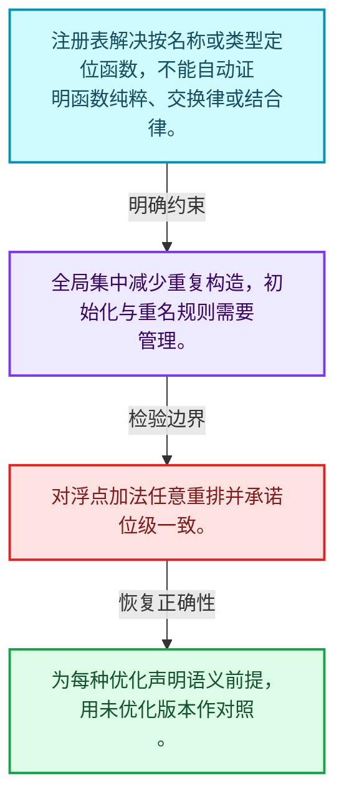
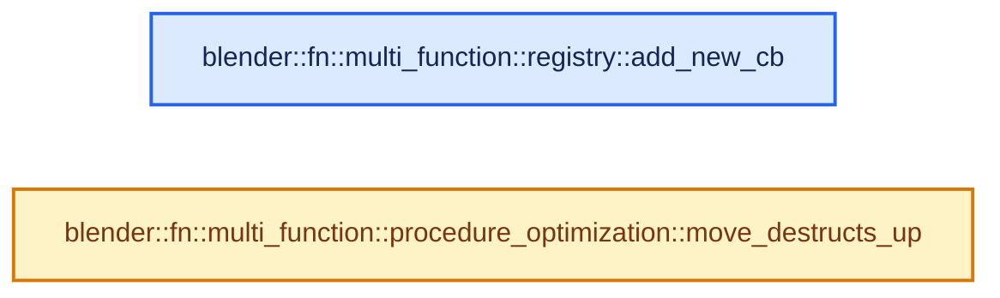
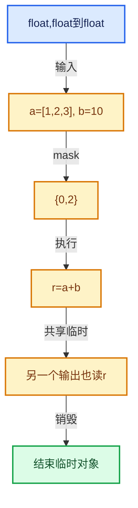

# 07-10 优化注册与实战

[方向导航](README.md) · [总目录](../README.md) · [实现索引](../00-课程指南/02-源码与提交索引/符号依赖与实现索引.md)

## 从问题到实现

哪些优化需要语义保证而不仅是图形相同？

常量折叠和消除计算要求考虑副作用与类型；注册表提供查找但不自动证明函数可交换或纯粹。

**数据模型**

注册表解决按名称或类型定位函数，不能自动证明函数纯粹、交换律或结合律。

**设计取舍**

全局集中减少重复构造，初始化与重名规则需要管理。

**最小反例**

对浮点加法任意重排并承诺位级一致。

**推导**

为每种优化声明语义前提，用未优化版本作对照。

## 阅读地图与执行推演








图中的数值推演是本方向的教学模型；实际函数之间的调用边与概念分析边分别标注，不能把概念关系当作运行时调度顺序。

## 完整源码单元与就地讲解

中文讲解直接放在相关代码旁，复杂机制在代码下展开。原文折叠区保留基准行号；不需要在行号表和函数之间来回查找。类布局可分段展示，函数实现不按固定行数切开。

### 类型布局、声明与编译条件 · FN_multi_function_procedure_optimization.hh L1—L49

<!-- annotated:5e85c713ee6169 -->

```cpp
/* SPDX-FileCopyrightText: 2023 Blender Authors
 *
 * SPDX-License-Identifier: GPL-2.0-or-later */

#pragma once

/** \file
 * \ingroup fn
 *
 * A #Procedure optimization pass takes an existing procedure and changes it in a way that
 * improves its performance when executed.
 *
 * Oftentimes it would also be possible to implement a specific optimization directly during
 * construction of the initial #Procedure. There is a trade-off between doing that or just
 * building a "simple" procedure and then optimizing it uses separate optimization passes.
 * - Doing optimizations directly during construction is typically faster than doing it as a
 *   separate pass. However, it would be much harder to turn the optimization off when it is not
 *   necessary, making the construction potentially slower in those cases.
 * - Doing optimizations directly would also make code more complex, because it mixes the logic
 *   that generates the procedure from some other data with optimization decisions.
 * - Having a separate pass allows us to use it in different places when necessary.
 * - Having a separate pass allows us to enable and disable it easily to better understand its
 *   impact on performance.
 */

#include "FN_multi_function_procedure.hh"

namespace blender::fn::multi_function::procedure_optimization {

/**
 * When generating a procedure, destruct instructions (#DestructInstruction) have to be inserted
 * for all variables that are not outputs. Often the simplest approach is to add these instructions
 * at the very end. However, when the procedure is executed this is not optimal, because many more
 * variables are initialized at the same time than necessary. This inhibits the reuse of memory
 * buffers which decreases performance and increases memory use.
 *
 * This optimization pass moves destruct instructions up in the procedure. The goal is to destruct
 * each variable right after its last use.
 *
 * For simplicity, and because this is the most common use case, this optimization currently only
 * works on a single chain of instructions. Destruct instructions are not moved across branches.
 *
 * \param procedure: The procedure that should be optimized.
 * \param block_end_instr: The instruction that points to the last instruction within a linear
 * chain of instructions. The algorithm moves instructions backward starting at this instruction.
 */
void move_destructs_up(Procedure &procedure, Instruction &block_end_instr);

}  // namespace blender::fn::multi_function::procedure_optimization
```

<details>
<summary>核对原始源码：source/blender/functions/FN_multi_function_procedure_optimization.hh · L1—L49</summary>

<!-- original:5e85c713ee6169:source/blender/functions/FN_multi_function_procedure_optimization.hh:1:49 -->

```cpp
/* SPDX-FileCopyrightText: 2023 Blender Authors
 *
 * SPDX-License-Identifier: GPL-2.0-or-later */

#pragma once

/** \file
 * \ingroup fn
 *
 * A #Procedure optimization pass takes an existing procedure and changes it in a way that
 * improves its performance when executed.
 *
 * Oftentimes it would also be possible to implement a specific optimization directly during
 * construction of the initial #Procedure. There is a trade-off between doing that or just
 * building a "simple" procedure and then optimizing it uses separate optimization passes.
 * - Doing optimizations directly during construction is typically faster than doing it as a
 *   separate pass. However, it would be much harder to turn the optimization off when it is not
 *   necessary, making the construction potentially slower in those cases.
 * - Doing optimizations directly would also make code more complex, because it mixes the logic
 *   that generates the procedure from some other data with optimization decisions.
 * - Having a separate pass allows us to use it in different places when necessary.
 * - Having a separate pass allows us to enable and disable it easily to better understand its
 *   impact on performance.
 */

#include "FN_multi_function_procedure.hh"

namespace blender::fn::multi_function::procedure_optimization {

/**
 * When generating a procedure, destruct instructions (#DestructInstruction) have to be inserted
 * for all variables that are not outputs. Often the simplest approach is to add these instructions
 * at the very end. However, when the procedure is executed this is not optimal, because many more
 * variables are initialized at the same time than necessary. This inhibits the reuse of memory
 * buffers which decreases performance and increases memory use.
 *
 * This optimization pass moves destruct instructions up in the procedure. The goal is to destruct
 * each variable right after its last use.
 *
 * For simplicity, and because this is the most common use case, this optimization currently only
 * works on a single chain of instructions. Destruct instructions are not moved across branches.
 *
 * \param procedure: The procedure that should be optimized.
 * \param block_end_instr: The instruction that points to the last instruction within a linear
 * chain of instructions. The algorithm moves instructions backward starting at this instruction.
 */
void move_destructs_up(Procedure &procedure, Instruction &block_end_instr);

}  // namespace blender::fn::multi_function::procedure_optimization
```

</details>

### 类型布局、声明与编译条件 · FN_multi_function_registry.hh L1—L25

<!-- annotated:691e43a937b266 -->

```cpp
/* SPDX-FileCopyrightText: 2026 Blender Authors
 *
 * SPDX-License-Identifier: GPL-2.0-or-later */

/** \file
 * \ingroup fn
 */

#pragma once

#include "BLI_ustring.hh"

#include "FN_multi_function.hh"

namespace blender::fn::multi_function::registry {

/**
 * Add a new multi-function to the registry. The #MultiFunction::name is used as identifier.
 * This multi-function is expected to have static storage duration.
 */
void add_new(const MultiFunction &fn);

/**
 * Utility to create a multi-function with static storage duration that is added to the registry.
 */
```

<details>
<summary>核对原始源码：source/blender/functions/FN_multi_function_registry.hh · L1—L25</summary>

<!-- original:691e43a937b266:source/blender/functions/FN_multi_function_registry.hh:1:25 -->

```cpp
/* SPDX-FileCopyrightText: 2026 Blender Authors
 *
 * SPDX-License-Identifier: GPL-2.0-or-later */

/** \file
 * \ingroup fn
 */

#pragma once

#include "BLI_ustring.hh"

#include "FN_multi_function.hh"

namespace blender::fn::multi_function::registry {

/**
 * Add a new multi-function to the registry. The #MultiFunction::name is used as identifier.
 * This multi-function is expected to have static storage duration.
 */
void add_new(const MultiFunction &fn);

/**
 * Utility to create a multi-function with static storage duration that is added to the registry.
 */
```

</details>

<a id="f-1b55c08551584bc6"></a>

### `blender::fn::multi_function::registry::add_new_cb`

实现位置：[source/blender/functions/FN_multi_function_registry.hh](../../../../../source/blender/functions/FN_multi_function_registry.hh) · L26—L30。

接口参数：

- `CreateFn &&create_fn`

**教学注释版**

<!-- annotated:d325b2c40acdf3 -->

```cpp
template<typename CreateFn> inline void add_new_cb(CreateFn &&create_fn)
{
  static auto fn = create_fn();
  registry::add_new(fn);
}
```

<details>
<summary>核对原始源码：source/blender/functions/FN_multi_function_registry.hh · L26—L30</summary>

<!-- original:d325b2c40acdf3:source/blender/functions/FN_multi_function_registry.hh:26:30 -->

```cpp
template<typename CreateFn> inline void add_new_cb(CreateFn &&create_fn)
{
  static auto fn = create_fn();
  registry::add_new(fn);
}
```

</details>

**继续追踪实现**

- `create_fn` → [调用协议](../00-课程指南/01-路线与规范/模板宏与动态分派协议.md)：局部可调用对象，须结合其初始化与捕获环境。调用位置L28。
- `registry::add_new` → [blender::fn::multi_function::registry::add_new · L31](../90-实现依赖专题/03-FN函数与求值/intern/multi_function_registry.cc.md#f-38a87506481d5dfd)。

### 类型布局、声明与编译条件 · FN_multi_function_registry.hh L31—L37

<!-- annotated:59689a3596314c -->

```cpp

/**
 * Find the multi-function with the given identifier. The multi-function is expected to exist.
 */
const MultiFunction &lookup(UString id);

}  // namespace blender::fn::multi_function::registry
```

<details>
<summary>核对原始源码：source/blender/functions/FN_multi_function_registry.hh · L31—L37</summary>

<!-- original:59689a3596314c:source/blender/functions/FN_multi_function_registry.hh:31:37 -->

```cpp

/**
 * Find the multi-function with the given identifier. The multi-function is expected to exist.
 */
const MultiFunction &lookup(UString id);

}  // namespace blender::fn::multi_function::registry
```

</details>

### 类型布局、声明与编译条件 · multi_function_procedure_optimization.cc L1—L12

<!-- annotated:6cdcaca111bb09 -->

```cpp
/* SPDX-FileCopyrightText: 2023 Blender Authors
 *
 * SPDX-License-Identifier: GPL-2.0-or-later */

/** \file
 * \ingroup fn
 */

#include "FN_multi_function_procedure_optimization.hh"

namespace blender::fn::multi_function::procedure_optimization {

```

<details>
<summary>核对原始源码：source/blender/functions/intern/multi_function_procedure_optimization.cc · L1—L12</summary>

<!-- original:6cdcaca111bb09:source/blender/functions/intern/multi_function_procedure_optimization.cc:1:12 -->

```cpp
/* SPDX-FileCopyrightText: 2023 Blender Authors
 *
 * SPDX-License-Identifier: GPL-2.0-or-later */

/** \file
 * \ingroup fn
 */

#include "FN_multi_function_procedure_optimization.hh"

namespace blender::fn::multi_function::procedure_optimization {

```

</details>

<a id="f-2cc183d1baed074d"></a>

### `blender::fn::multi_function::procedure_optimization::move_destructs_up`

实现位置：[source/blender/functions/intern/multi_function_procedure_optimization.cc](../../../../../source/blender/functions/intern/multi_function_procedure_optimization.cc) · L13—L79。

接口参数：

- `Procedure &procedure`
- `Instruction &block_end_instr`

**教学注释版**

<!-- annotated:563b8b3993115e -->

```cpp
void move_destructs_up(Procedure &procedure, Instruction &block_end_instr)
{
  /* A mapping from a variable to its destruct instruction. */
  Map<Variable *, DestructInstruction *> destruct_instructions;
  Instruction *current_instr = &block_end_instr;
  while (true) {
    InstructionType instr_type = current_instr->type();
    switch (instr_type) {
      case InstructionType::Destruct: {
        DestructInstruction &destruct_instr = static_cast<DestructInstruction &>(*current_instr);
        Variable *variable = destruct_instr.variable();
        if (variable == nullptr) {
          continue;
        }
        /* Remember this destruct instruction so that it can be moved up later on when the last use
         * of the variable is found. */
        // [讲解] destruct_instructions.add：按哈希与相等关系加入键或键值。
        destruct_instructions.add(variable, &destruct_instr);
        break;
      }
      case InstructionType::Call: {
        CallInstruction &call_instr = static_cast<CallInstruction &>(*current_instr);
        /* For each variable, place the corresponding remembered destruct instruction right after
         * this call instruction. */
        for (Variable *variable : call_instr.params()) {
          if (variable == nullptr) {
            continue;
          }
          DestructInstruction *destruct_instr = destruct_instructions.pop_default(variable,
                                                                                  nullptr);
          if (destruct_instr == nullptr) {
            continue;
          }

          /* Unlink destruct instruction from previous position. */
          Instruction *after_destruct_instr = destruct_instr->next();
          while (!destruct_instr->prev().is_empty()) {
            /* Do a copy of the cursor here, because `destruct_instr->prev()` changes when
             * #set_next is called below. */
            const InstructionCursor cursor = destruct_instr->prev()[0];
            cursor.set_next(procedure, after_destruct_instr);
          }

          /* Insert destruct instruction in new position. */
          Instruction *next_instr = call_instr.next();
          call_instr.set_next(destruct_instr);
          destruct_instr->set_next(next_instr);
        }
        break;
      }
      default: {
        break;
      }
    }

    const Span<InstructionCursor> prev_cursors = current_instr->prev();
    // [讲解] prev_cursors.size：查询视图长度或生成对应有效索引区间。
    if (prev_cursors.size() != 1) {
      /* Stop when there is some branching before this instruction. */
      break;
    }
    const InstructionCursor &prev_cursor = prev_cursors[0];
    current_instr = prev_cursor.instruction();
    if (current_instr == nullptr) {
      /* Stop when there is no previous instruction. E.g. when this is the first instruction. */
      break;
    }
  }
}
```

<details>
<summary>核对原始源码：source/blender/functions/intern/multi_function_procedure_optimization.cc · L13—L79</summary>

<!-- original:563b8b3993115e:source/blender/functions/intern/multi_function_procedure_optimization.cc:13:79 -->

```cpp
void move_destructs_up(Procedure &procedure, Instruction &block_end_instr)
{
  /* A mapping from a variable to its destruct instruction. */
  Map<Variable *, DestructInstruction *> destruct_instructions;
  Instruction *current_instr = &block_end_instr;
  while (true) {
    InstructionType instr_type = current_instr->type();
    switch (instr_type) {
      case InstructionType::Destruct: {
        DestructInstruction &destruct_instr = static_cast<DestructInstruction &>(*current_instr);
        Variable *variable = destruct_instr.variable();
        if (variable == nullptr) {
          continue;
        }
        /* Remember this destruct instruction so that it can be moved up later on when the last use
         * of the variable is found. */
        destruct_instructions.add(variable, &destruct_instr);
        break;
      }
      case InstructionType::Call: {
        CallInstruction &call_instr = static_cast<CallInstruction &>(*current_instr);
        /* For each variable, place the corresponding remembered destruct instruction right after
         * this call instruction. */
        for (Variable *variable : call_instr.params()) {
          if (variable == nullptr) {
            continue;
          }
          DestructInstruction *destruct_instr = destruct_instructions.pop_default(variable,
                                                                                  nullptr);
          if (destruct_instr == nullptr) {
            continue;
          }

          /* Unlink destruct instruction from previous position. */
          Instruction *after_destruct_instr = destruct_instr->next();
          while (!destruct_instr->prev().is_empty()) {
            /* Do a copy of the cursor here, because `destruct_instr->prev()` changes when
             * #set_next is called below. */
            const InstructionCursor cursor = destruct_instr->prev()[0];
            cursor.set_next(procedure, after_destruct_instr);
          }

          /* Insert destruct instruction in new position. */
          Instruction *next_instr = call_instr.next();
          call_instr.set_next(destruct_instr);
          destruct_instr->set_next(next_instr);
        }
        break;
      }
      default: {
        break;
      }
    }

    const Span<InstructionCursor> prev_cursors = current_instr->prev();
    if (prev_cursors.size() != 1) {
      /* Stop when there is some branching before this instruction. */
      break;
    }
    const InstructionCursor &prev_cursor = prev_cursors[0];
    current_instr = prev_cursor.instruction();
    if (current_instr == nullptr) {
      /* Stop when there is no previous instruction. E.g. when this is the first instruction. */
      break;
    }
  }
}
```

</details>

**沿实际写入检查状态**

- `current_instr = prev_cursor.instruction();`

**继续追踪实现**

- `current_instr->type` → [blender::fn::multi_function::Instruction::type · L374](07-Procedure指令与控制流.md#f-7627ff2a0b57ac1f)。
- `destruct_instr.variable` → [blender::fn::multi_function::DestructInstruction::variable · L457](07-Procedure指令与控制流.md#f-9a543d124703e5f7)；[blender::fn::multi_function::DestructInstruction::variable · L462](07-Procedure指令与控制流.md#f-a4656c3cfa7704c1)。同名重载需按实参类型选择。
- `destruct_instructions.add` → [blender::Map::add · L295](../02-哈希表与关联数据结构/04-Map查找与键访问.md#f-8d38101abf162f88)；[blender::Map::add · L299](../02-哈希表与关联数据结构/04-Map查找与键访问.md#f-1f59510cdfbd9f87)；[blender::Map::add · L303](../02-哈希表与关联数据结构/04-Map查找与键访问.md#f-645e0522347aa018)；[blender::Map::add · L307](../02-哈希表与关联数据结构/04-Map查找与键访问.md#f-03405db0730cedc0)。同名重载需按实参类型选择。
- `call_instr.params` → [blender::fn::multi_function::CallInstruction::params · L405](07-Procedure指令与控制流.md#f-4a9ea187cb82c472)；[blender::fn::multi_function::CallInstruction::params · L410](07-Procedure指令与控制流.md#f-a91b8ab686f96649)。同名重载需按实参类型选择。
- `destruct_instructions.pop_default` → [blender::Map::pop_default · L439](../02-哈希表与关联数据结构/04-Map查找与键访问.md#f-9dd656831c024785)；[blender::Map::pop_default · L443](../02-哈希表与关联数据结构/04-Map查找与键访问.md#f-f0e4b7971e882c92)。同名重载需按实参类型选择。
- `destruct_instr->next` → [blender::fn::multi_function::DestructInstruction::next · L467](07-Procedure指令与控制流.md#f-5247a1ab6a5e8119)；[blender::fn::multi_function::DestructInstruction::next · L472](07-Procedure指令与控制流.md#f-145e184be00d486a)。同名重载需按实参类型选择。
- `destruct_instr->prev().is_empty` → [调用协议](../00-课程指南/01-路线与规范/模板宏与动态分派协议.md)：接收对象类型依赖auto、返回值或模板实例；不按同名猜测目标。调用位置L48。
- `destruct_instr->prev` → [调用协议](../00-课程指南/01-路线与规范/模板宏与动态分派协议.md)：由接收对象具体类型或运行时策略提供实现。调用位置L48。
- `cursor.set_next` → [blender::fn::multi_function::InstructionCursor::set_next · L18](07-Procedure指令与控制流.md#f-36ec225368437022)。
- `call_instr.next` → [blender::fn::multi_function::CallInstruction::next · L395](07-Procedure指令与控制流.md#f-fbae951f837e1665)；[blender::fn::multi_function::CallInstruction::next · L400](07-Procedure指令与控制流.md#f-d1ed628812aad40a)。同名重载需按实参类型选择。
- `call_instr.set_next` → [blender::fn::multi_function::CallInstruction::set_next · L82](07-Procedure指令与控制流.md#f-34d8e94ed3409f09)。
- `destruct_instr->set_next` → [blender::fn::multi_function::DestructInstruction::set_next · L160](07-Procedure指令与控制流.md#f-b14c2cd3343e3ff0)。
- `current_instr->prev` → [blender::fn::multi_function::Instruction::prev · L379](07-Procedure指令与控制流.md#f-7054e50273301b5a)。
- `prev_cursors.size` → [blender::Span::size · L256](../01-基础容器与现代CPP/05-Span只读连续视图.md#f-5f80fa006089c998)。
- `prev_cursor.instruction` → [blender::fn::multi_function::InstructionCursor::instruction · L330](07-Procedure指令与控制流.md#f-d4e9127f4d3672d7)。

### 类型布局、声明与编译条件 · multi_function_procedure_optimization.cc L80—L81

<!-- annotated:0609abda362680 -->

```cpp

}  // namespace blender::fn::multi_function::procedure_optimization
```

<details>
<summary>核对原始源码：source/blender/functions/intern/multi_function_procedure_optimization.cc · L80—L81</summary>

<!-- original:0609abda362680:source/blender/functions/intern/multi_function_procedure_optimization.cc:80:81 -->

```cpp

}  // namespace blender::fn::multi_function::procedure_optimization
```

</details>

## 语法与相关类型

### 模板 template

模板把类型或常量作为生成实现的参数。读声明时先列出类型参数、非类型参数和默认值，再看使用者实际实例化了什么。模板声明本身不意味着每种T都支持其全部成员。

把T替换为int、string、只能移动的类型，分别检查每个被调用操作是否成立。

### 依赖名称 typename

typename既可引入类型模板参数，也可告诉编译器某个依赖名称是类型。它不创建运行时对象；解析期确认语法类别与实例化期检查具体类型是不同阶段。

区分typename T::value_type和T::size()，前者标记类型，后者是表达式。

### 只读限定 const

const约束当前访问路径可做的修改。const指针、指向const的指针、const视图对象、const元素是不同位置的限定；其他别名可能仍可修改原对象。

分别写T* const、const T*与const T* const，并画出不可修改的层次。

### 异常边界 try与catch

try定义异常传播的局部边界。失败路径需要销毁已经成功构造的部分并释放相应存储；未构造的对象不能被析构。

在第k次构造失败，列出已经存在的对象集合与待释放缓冲。

### 显式静态转换 static_cast

static_cast表达编译期允许的转换，不会自动验证运行时真实类型、指针寿命或索引边界。由void指针恢复T指针时，调用者仍须保证实际存储中确有合法T对象。

标出转换前后的类型以及正确性依据来自哪里。

### 构造与new表达式

普通new可能分配并构造；placement new在给定地址构造，存储由其他机制提供。失败回滚应区分两类责任。

追踪地址来自哪里、构造何时成功、由谁析构、由谁释放。

## 实现练习与验证

对小过程做死值消除，并以未优化执行作为对照。

参考推理：为每种优化声明语义前提，用未优化版本作对照。

签名与参数类型一致；指令读取前变量已定义；存储复用发生在最后使用和析构之后。

## 历史、跨库比较与证据

与std::function逐次调用和简单字节码解释器比较：批量接口可把动态分派放到循环外，Procedure额外表达变量寿命和控制流。

[历史提交索引](../00-课程指南/02-源码与提交索引/历史提交与设计演化索引.md) · [源码基准](../00-课程指南/02-源码与提交索引/源码版本与覆盖索引.md) · [验收报告](../00-课程指南/03-验收报告/验收报告.md)
