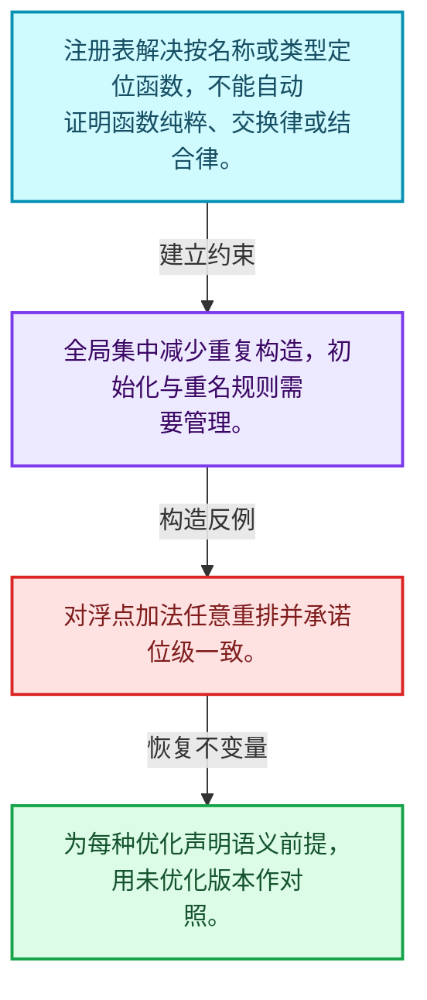
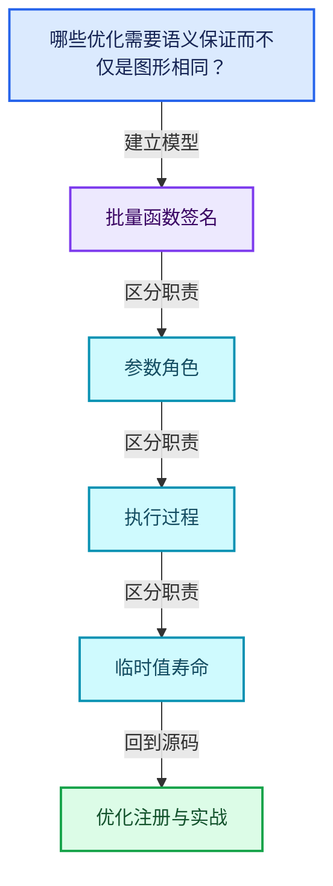
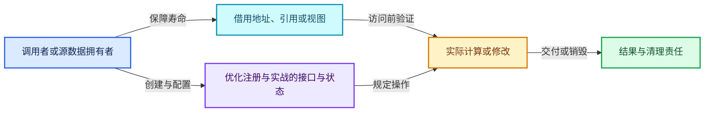
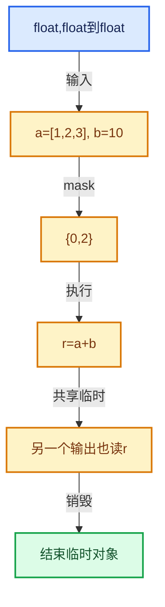

# 07-10 优化注册与实战

[方向导航](README.md) · [总目录](../README.md) · [覆盖索引](../%E6%BA%90%E7%A0%81%E7%89%88%E6%9C%AC%E4%B8%8E%E8%A6%86%E7%9B%96%E7%B4%A2%E5%BC%95.md)

> 阅读顺序：问题与数据模型 → 语法与类型 → 源码逐行 → 调用线索 → 历史与取舍 → 推演和练习。

- 基准 HEAD：`cbda6b96c26c0dee3c3b5cbb93960c4ac06a6b30`。
- 记录日期：2026-10-14。
- 教学示例状态：正文中的推演不是本机性能实测；已运行练习见验收报告。

## 一、从问题到设计

哪些优化需要语义保证而不仅是图形相同？

常量折叠和消除计算要求考虑副作用与类型；注册表提供查找但不自动证明函数可交换或纯粹。

本篇把语法、数据语义和系统取舍连接起来。把调用准备与元素循环分开，把值依赖与对象生存区间同时显式化。

### 本篇独立模型与设计推理

注册表解决按名称或类型定位函数，不能自动证明函数纯粹、交换律或结合律。

设计取舍：全局集中减少重复构造，初始化与重名规则需要管理。

最小反例：对浮点加法任意重排并承诺位级一致。

推导与处理：为每种优化声明语义前提，用未优化版本作对照。



### 源码范围与相邻篇章

| 文件 | 本篇逐行范围 | 基准SHA-256 |
|---|---|---|
| [source/blender/functions/FN_multi_function_procedure_optimization.hh](../../../../../source/blender/functions/FN_multi_function_procedure_optimization.hh) | L1—L49 | `2d2087da1204bddb04847953d135f571204ac37945c8b6e9c0f9ad393fa38384` |
| [source/blender/functions/intern/multi_function_procedure_optimization.cc](../../../../../source/blender/functions/intern/multi_function_procedure_optimization.cc) | L1—L81 | `02b18fff576729496a3daec39c02137f05baa4194b15ed9aadb3e2864fc41b4b` |
| [source/blender/functions/FN_multi_function_registry.hh](../../../../../source/blender/functions/FN_multi_function_registry.hh) | L1—L37 | `77fa6df62463343fc10217870e83a645dfd3ed5b720e251ef0e904fcc8f2728f` |

同一主讲文件可能分多篇覆盖；超出本篇范围的符号通过覆盖索引定位。空行与纯注释保留在源码摘录中，逐行表解释有效语句与语法边界；许可证头统一保留。

前篇：[执行器与内存复用](09-%E6%89%A7%E8%A1%8C%E5%99%A8%E4%B8%8E%E5%86%85%E5%AD%98%E5%A4%8D%E7%94%A8.md).

## 二、类型、数据与阅读地图



这是概念依赖图，边表示阅读关系，不声称是运行时调用顺序。

### 直接编译依赖


箭头只表示头文件包含关系；完整调用线索见后面的符号定位表。

## 三、关键词、语法与类型角色

### 模板 template

模板把类型或常量作为生成实现的参数。读声明时先列出类型参数、非类型参数和默认值，再看使用者实际实例化了什么。模板声明本身不意味着每种T都支持其全部成员。

具体检查：把T替换为int、string、只能移动的类型，分别检查每个被调用操作是否成立。

### 依赖名称 typename

typename既可引入类型模板参数，也可告诉编译器某个依赖名称是类型。它不创建运行时对象；解析期确认语法类别与实例化期检查具体类型是不同阶段。

具体检查：区分typename T::value_type和T::size()，前者标记类型，后者是表达式。

### 只读限定 const

const约束当前访问路径可做的修改。const指针、指向const的指针、const视图对象、const元素是不同位置的限定；其他别名可能仍可修改原对象。

具体检查：分别写T* const、const T*与const T* const，并画出不可修改的层次。

### 异常边界 try与catch

try定义异常传播的局部边界。失败路径需要销毁已经成功构造的部分并释放相应存储；未构造的对象不能被析构。

具体检查：在第k次构造失败，列出已经存在的对象集合与待释放缓冲。

### 显式静态转换 static_cast

static_cast表达编译期允许的转换，不会自动验证运行时真实类型、指针寿命或索引边界。由void指针恢复T指针时，调用者仍须保证实际存储中确有合法T对象。

具体检查：标出转换前后的类型以及正确性依据来自哪里。

### 构造与new表达式

普通new可能分配并构造；placement new在给定地址构造，存储由其他机制提供。失败回滚应区分两类责任。

具体检查：追踪地址来自哪里、构造何时成功、由谁析构、由谁释放。

## 四、真实源码与逐行讲解

源码块保持原行内容，原始行号由小节标题及逐行表给出。表中的调用定位是静态阅读辅助；重载、模板实例化、宏展开和虚调用需结合完整声明，不能仅凭词法出现证明动态调用。

### FN_multi_function_procedure_optimization.hh：L1—L49

<!-- source:source/blender/functions/FN_multi_function_procedure_optimization.hh:1:49 -->

```cpp
/* SPDX-FileCopyrightText: 2023 Blender Authors
 *
 * SPDX-License-Identifier: GPL-2.0-or-later */

#pragma once

/** \file
 * \ingroup fn
 *
 * A #Procedure optimization pass takes an existing procedure and changes it in a way that
 * improves its performance when executed.
 *
 * Oftentimes it would also be possible to implement a specific optimization directly during
 * construction of the initial #Procedure. There is a trade-off between doing that or just
 * building a "simple" procedure and then optimizing it uses separate optimization passes.
 * - Doing optimizations directly during construction is typically faster than doing it as a
 *   separate pass. However, it would be much harder to turn the optimization off when it is not
 *   necessary, making the construction potentially slower in those cases.
 * - Doing optimizations directly would also make code more complex, because it mixes the logic
 *   that generates the procedure from some other data with optimization decisions.
 * - Having a separate pass allows us to use it in different places when necessary.
 * - Having a separate pass allows us to enable and disable it easily to better understand its
 *   impact on performance.
 */

#include "FN_multi_function_procedure.hh"

namespace blender::fn::multi_function::procedure_optimization {

/**
 * When generating a procedure, destruct instructions (#DestructInstruction) have to be inserted
 * for all variables that are not outputs. Often the simplest approach is to add these instructions
 * at the very end. However, when the procedure is executed this is not optimal, because many more
 * variables are initialized at the same time than necessary. This inhibits the reuse of memory
 * buffers which decreases performance and increases memory use.
 *
 * This optimization pass moves destruct instructions up in the procedure. The goal is to destruct
 * each variable right after its last use.
 *
 * For simplicity, and because this is the most common use case, this optimization currently only
 * works on a single chain of instructions. Destruct instructions are not moved across branches.
 *
 * \param procedure: The procedure that should be optimized.
 * \param block_end_instr: The instruction that points to the last instruction within a linear
 * chain of instructions. The algorithm moves instructions backward starting at this instruction.
 */
void move_destructs_up(Procedure &procedure, Instruction &block_end_instr);

}  // namespace blender::fn::multi_function::procedure_optimization
```

| 原始行 | 语义、约束与检查 |
|---|---|
| L5 | 防止同一头文件在一个翻译单元中重复展开；不控制多个源文件之间的链接或对象寿命。 |
| L26 | 引入编译依赖 "FN_multi_function_procedure.hh"；这是声明可见性关系，不表示运行时一定调用该文件的所有接口。 |
| L28 | 把后续声明放入 blender::fn::multi_function::procedure_optimization 命名空间，影响名称查找和符号归属，不创建运行时对象。 |
| L47 | 声明接口 `void move_destructs_up(Procedure &procedure, Instruction &block_end_instr)`，本行没有对应函数体；返回类型、参数限定和const/noexcept共同组成调用契约，实际行为需继续定位实现。 |
| L49 | 结束当前语法单元。局部自动对象在离开其作用域时按规则销毁；这不等于所有被引用的外部数据也被释放。 |

### multi_function_procedure_optimization.cc：L1—L79

<!-- source:source/blender/functions/intern/multi_function_procedure_optimization.cc:1:79 -->

```cpp
/* SPDX-FileCopyrightText: 2023 Blender Authors
 *
 * SPDX-License-Identifier: GPL-2.0-or-later */

/** \file
 * \ingroup fn
 */

#include "FN_multi_function_procedure_optimization.hh"

namespace blender::fn::multi_function::procedure_optimization {

void move_destructs_up(Procedure &procedure, Instruction &block_end_instr)
{
  /* A mapping from a variable to its destruct instruction. */
  Map<Variable *, DestructInstruction *> destruct_instructions;
  Instruction *current_instr = &block_end_instr;
  while (true) {
    InstructionType instr_type = current_instr->type();
    switch (instr_type) {
      case InstructionType::Destruct: {
        DestructInstruction &destruct_instr = static_cast<DestructInstruction &>(*current_instr);
        Variable *variable = destruct_instr.variable();
        if (variable == nullptr) {
          continue;
        }
        /* Remember this destruct instruction so that it can be moved up later on when the last use
         * of the variable is found. */
        destruct_instructions.add(variable, &destruct_instr);
        break;
      }
      case InstructionType::Call: {
        CallInstruction &call_instr = static_cast<CallInstruction &>(*current_instr);
        /* For each variable, place the corresponding remembered destruct instruction right after
         * this call instruction. */
        for (Variable *variable : call_instr.params()) {
          if (variable == nullptr) {
            continue;
          }
          DestructInstruction *destruct_instr = destruct_instructions.pop_default(variable,
                                                                                  nullptr);
          if (destruct_instr == nullptr) {
            continue;
          }

          /* Unlink destruct instruction from previous position. */
          Instruction *after_destruct_instr = destruct_instr->next();
          while (!destruct_instr->prev().is_empty()) {
            /* Do a copy of the cursor here, because `destruct_instr->prev()` changes when
             * #set_next is called below. */
            const InstructionCursor cursor = destruct_instr->prev()[0];
            cursor.set_next(procedure, after_destruct_instr);
          }

          /* Insert destruct instruction in new position. */
          Instruction *next_instr = call_instr.next();
          call_instr.set_next(destruct_instr);
          destruct_instr->set_next(next_instr);
        }
        break;
      }
      default: {
        break;
      }
    }

    const Span<InstructionCursor> prev_cursors = current_instr->prev();
    if (prev_cursors.size() != 1) {
      /* Stop when there is some branching before this instruction. */
      break;
    }
    const InstructionCursor &prev_cursor = prev_cursors[0];
    current_instr = prev_cursor.instruction();
    if (current_instr == nullptr) {
      /* Stop when there is no previous instruction. E.g. when this is the first instruction. */
      break;
    }
  }
}
```

本段语义重点：

- 分支证据 `true)`：分别推演条件成立与不成立，核对相同出口处的状态。
- 分支证据 `variable == nullptr)`：分别推演条件成立与不成立，核对相同出口处的状态。

| 原始行 | 语义、约束与检查 |
|---|---|
| L9 | 引入编译依赖 "FN_multi_function_procedure_optimization.hh"；这是声明可见性关系，不表示运行时一定调用该文件的所有接口。 |
| L11 | 把后续声明放入 blender::fn::multi_function::procedure_optimization 命名空间，影响名称查找和符号归属，不创建运行时对象。 |
| L13 | 出现调用或函数声明 `move_destructs_up`，对应表达式为 `void move_destructs_up(Procedure &procedure, Instruction &block_end_instr)`。参数求值、返回类型与重载需结合前后完整语句；静态文本引用不能证明动态目标。 |
| L14 | 连接上一行的声明或控制结构与其语句块；后续行在这个作用域中执行或声明。 |
| L16 | 声明成员、局部对象或完成语句 `Map<Variable *, DestructInstruction *> destruct_instructions`。若为指针或引用，它本身不说明拥有；若为值对象，其构造析构由所在作用域或外层对象管理。 |
| L17 | 把右侧 `&block_end_instr` 用于初始化或更新左侧 `Instruction *current_instr`。声明初始化与已有对象赋值应按上下文区分；有资源的类型会调用相应特殊成员。 |
| L18 | 按 `while (true)` 指定的范围或条件重复执行。对照循环变量与真实元素编号；循环内调用成本乘以实际迭代次数。 |
| L19 | 把右侧 `current_instr->type()` 用于初始化或更新左侧 `InstructionType instr_type`。声明初始化与已有对象赋值应按上下文区分；有资源的类型会调用相应特殊成员。 |
| L20 | 按 switch (instr_type) 选择状态处理路径；每个case的break、return或贯穿行为决定下一步。 |
| L21 | 进入枚举或判别值对应分支 case InstructionType::Destruct: {；结合状态定义和后续更新判断允许的转移。 |
| L22 | 把右侧 `static_cast<DestructInstruction &>(*current_instr)` 用于初始化或更新左侧 `DestructInstruction &destruct_instr`。声明初始化与已有对象赋值应按上下文区分；有资源的类型会调用相应特殊成员。 |
| L23 | 把右侧 `destruct_instr.variable()` 用于初始化或更新左侧 `Variable *variable`。声明初始化与已有对象赋值应按上下文区分；有资源的类型会调用相应特殊成员。 |
| L24 | 判断 `variable == nullptr`，成立时进入本分支，否则继续后续路径。这里区分空地址与可用地址，但非空本身仍不能证明对象存活。 |
| L25 | 结束本轮循环并进入下一轮；核对本轮已经取得的资源是否由作用域或显式代码清理。 |
| L26 | 结束当前语法单元。局部自动对象在离开其作用域时按规则销毁；这不等于所有被引用的外部数据也被释放。 |
| L29 | 出现调用或函数声明 `add`，对应表达式为 `destruct_instructions.add(variable, &destruct_instr);`。参数求值、返回类型与重载需结合前后完整语句；静态文本引用不能证明动态目标。 |
| L30 | 离开最近的循环或switch；不是离开整个函数，后续清理和提交代码可能仍会执行。 |
| L31 | 结束当前语法单元。局部自动对象在离开其作用域时按规则销毁；这不等于所有被引用的外部数据也被释放。 |
| L32 | 进入枚举或判别值对应分支 case InstructionType::Call: {；结合状态定义和后续更新判断允许的转移。 |
| L33 | 把右侧 `static_cast<CallInstruction &>(*current_instr)` 用于初始化或更新左侧 `CallInstruction &call_instr`。声明初始化与已有对象赋值应按上下文区分；有资源的类型会调用相应特殊成员。 |
| L36 | 按 `for (Variable *variable : call_instr.params())` 指定的范围或条件重复执行。对照循环变量与真实元素编号；循环内调用成本乘以实际迭代次数。 |
| L37 | 判断 `variable == nullptr`，成立时进入本分支，否则继续后续路径。这里区分空地址与可用地址，但非空本身仍不能证明对象存活。 |
| L38 | 结束本轮循环并进入下一轮；核对本轮已经取得的资源是否由作用域或显式代码清理。 |
| L39 | 结束当前语法单元。局部自动对象在离开其作用域时按规则销毁；这不等于所有被引用的外部数据也被释放。 |
| L40 | 把右侧 `destruct_instructions.pop_default(variable,` 用于初始化或更新左侧 `DestructInstruction *destruct_instr`。声明初始化与已有对象赋值应按上下文区分；有资源的类型会调用相应特殊成员。 |
| L41 | 声明成员、局部对象或完成语句 `nullptr)`。若为指针或引用，它本身不说明拥有；若为值对象，其构造析构由所在作用域或外层对象管理。 |
| L42 | 判断 `destruct_instr == nullptr`，成立时进入本分支，否则继续后续路径。这里区分空地址与可用地址，但非空本身仍不能证明对象存活。 |
| L43 | 结束本轮循环并进入下一轮；核对本轮已经取得的资源是否由作用域或显式代码清理。 |
| L44 | 结束当前语法单元。局部自动对象在离开其作用域时按规则销毁；这不等于所有被引用的外部数据也被释放。 |
| L47 | 把右侧 `destruct_instr->next()` 用于初始化或更新左侧 `Instruction *after_destruct_instr`。声明初始化与已有对象赋值应按上下文区分；有资源的类型会调用相应特殊成员。 |
| L48 | 按 `while (!destruct_instr->prev().is_empty())` 指定的范围或条件重复执行。对照循环变量与真实元素编号；循环内调用成本乘以实际迭代次数。 |
| L51 | 把右侧 `destruct_instr->prev()[0]` 用于初始化或更新左侧 `const InstructionCursor cursor`。声明初始化与已有对象赋值应按上下文区分；有资源的类型会调用相应特殊成员。 |
| L52 | 出现调用或函数声明 `set_next`，对应表达式为 `cursor.set_next(procedure, after_destruct_instr);`。参数求值、返回类型与重载需结合前后完整语句；静态文本引用不能证明动态目标。 |
| L53 | 结束当前语法单元。局部自动对象在离开其作用域时按规则销毁；这不等于所有被引用的外部数据也被释放。 |
| L56 | 把右侧 `call_instr.next()` 用于初始化或更新左侧 `Instruction *next_instr`。声明初始化与已有对象赋值应按上下文区分；有资源的类型会调用相应特殊成员。 |
| L57 | 出现调用或函数声明 `set_next`，对应表达式为 `call_instr.set_next(destruct_instr);`。参数求值、返回类型与重载需结合前后完整语句；静态文本引用不能证明动态目标。 |
| L58 | 出现调用或函数声明 `set_next`，对应表达式为 `destruct_instr->set_next(next_instr);`。参数求值、返回类型与重载需结合前后完整语句；静态文本引用不能证明动态目标。 |
| L59 | 结束当前语法单元。局部自动对象在离开其作用域时按规则销毁；这不等于所有被引用的外部数据也被释放。 |
| L60 | 离开最近的循环或switch；不是离开整个函数，后续清理和提交代码可能仍会执行。 |
| L61 | 结束当前语法单元。局部自动对象在离开其作用域时按规则销毁；这不等于所有被引用的外部数据也被释放。 |
| L62 | 进入枚举或判别值对应分支 default: {；结合状态定义和后续更新判断允许的转移。 |
| L63 | 离开最近的循环或switch；不是离开整个函数，后续清理和提交代码可能仍会执行。 |
| L64 | 结束当前语法单元。局部自动对象在离开其作用域时按规则销毁；这不等于所有被引用的外部数据也被释放。 |
| L65 | 结束当前语法单元。局部自动对象在离开其作用域时按规则销毁；这不等于所有被引用的外部数据也被释放。 |
| L67 | 把右侧 `current_instr->prev()` 用于初始化或更新左侧 `const Span<InstructionCursor> prev_cursors`。声明初始化与已有对象赋值应按上下文区分；有资源的类型会调用相应特殊成员。 |
| L68 | 判断 `prev_cursors.size() != 1`，成立时进入本分支，否则继续后续路径。该边界影响可访问元素或可用容量，两者要按各变量的定义区分。 |
| L70 | 离开最近的循环或switch；不是离开整个函数，后续清理和提交代码可能仍会执行。 |
| L71 | 结束当前语法单元。局部自动对象在离开其作用域时按规则销毁；这不等于所有被引用的外部数据也被释放。 |
| L72 | 把右侧 `prev_cursors[0]` 用于初始化或更新左侧 `const InstructionCursor &prev_cursor`。声明初始化与已有对象赋值应按上下文区分；有资源的类型会调用相应特殊成员。 |
| L73 | 把右侧 `prev_cursor.instruction()` 用于初始化或更新左侧 `current_instr`。声明初始化与已有对象赋值应按上下文区分；有资源的类型会调用相应特殊成员。 |
| L74 | 判断 `current_instr == nullptr`，成立时进入本分支，否则继续后续路径。这里区分空地址与可用地址，但非空本身仍不能证明对象存活。 |
| L76 | 离开最近的循环或switch；不是离开整个函数，后续清理和提交代码可能仍会执行。 |
| L77 | 结束当前语法单元。局部自动对象在离开其作用域时按规则销毁；这不等于所有被引用的外部数据也被释放。 |
| L78 | 结束当前语法单元。局部自动对象在离开其作用域时按规则销毁；这不等于所有被引用的外部数据也被释放。 |
| L79 | 结束当前语法单元。局部自动对象在离开其作用域时按规则销毁；这不等于所有被引用的外部数据也被释放。 |

### multi_function_procedure_optimization.cc：L80—L81

<!-- source:source/blender/functions/intern/multi_function_procedure_optimization.cc:80:81 -->

```cpp

}  // namespace blender::fn::multi_function::procedure_optimization
```

| 原始行 | 语义、约束与检查 |
|---|---|
| L81 | 结束当前语法单元。局部自动对象在离开其作用域时按规则销毁；这不等于所有被引用的外部数据也被释放。 |

### FN_multi_function_registry.hh：L1—L37

<!-- source:source/blender/functions/FN_multi_function_registry.hh:1:37 -->

```cpp
/* SPDX-FileCopyrightText: 2026 Blender Authors
 *
 * SPDX-License-Identifier: GPL-2.0-or-later */

/** \file
 * \ingroup fn
 */

#pragma once

#include "BLI_ustring.hh"

#include "FN_multi_function.hh"

namespace blender::fn::multi_function::registry {

/**
 * Add a new multi-function to the registry. The #MultiFunction::name is used as identifier.
 * This multi-function is expected to have static storage duration.
 */
void add_new(const MultiFunction &fn);

/**
 * Utility to create a multi-function with static storage duration that is added to the registry.
 */
template<typename CreateFn> inline void add_new_cb(CreateFn &&create_fn)
{
  static auto fn = create_fn();
  registry::add_new(fn);
}

/**
 * Find the multi-function with the given identifier. The multi-function is expected to exist.
 */
const MultiFunction &lookup(UString id);

}  // namespace blender::fn::multi_function::registry
```

| 原始行 | 语义、约束与检查 |
|---|---|
| L9 | 防止同一头文件在一个翻译单元中重复展开；不控制多个源文件之间的链接或对象寿命。 |
| L11 | 引入编译依赖 "BLI_ustring.hh"；这是声明可见性关系，不表示运行时一定调用该文件的所有接口。 |
| L13 | 引入编译依赖 "FN_multi_function.hh"；这是声明可见性关系，不表示运行时一定调用该文件的所有接口。 |
| L15 | 把后续声明放入 blender::fn::multi_function::registry 命名空间，影响名称查找和符号归属，不创建运行时对象。 |
| L21 | 声明接口 `void add_new(const MultiFunction &fn)`，本行没有对应函数体；返回类型、参数限定和const/noexcept共同组成调用契约，实际行为需继续定位实现。 |
| L26 | 声明模板参数 `template<typename CreateFn> inline void add_new_cb(CreateFn &&create_fn)`。类型参数决定生成操作的类型，非类型参数可决定内嵌容量或编译期分支。 |
| L27 | 连接上一行的声明或控制结构与其语句块；后续行在这个作用域中执行或声明。 |
| L28 | 把右侧 `create_fn()` 用于初始化或更新左侧 `static auto fn`。声明初始化与已有对象赋值应按上下文区分；有资源的类型会调用相应特殊成员。 |
| L29 | 出现调用或函数声明 `registry::add_new`，对应表达式为 `registry::add_new(fn);`。参数求值、返回类型与重载需结合前后完整语句；静态文本引用不能证明动态目标。 |
| L30 | 结束当前语法单元。局部自动对象在离开其作用域时按规则销毁；这不等于所有被引用的外部数据也被释放。 |
| L35 | 声明接口 `const MultiFunction &lookup(UString id)`，本行没有对应函数体；返回类型、参数限定和const/noexcept共同组成调用契约，实际行为需继续定位实现。 |
| L37 | 结束当前语法单元。局部自动对象在离开其作用域时按规则销毁；这不等于所有被引用的外部数据也被释放。 |

## 五、接口定位、调用线索与生命周期

### 本篇声明与实现入口

| 源码位置 | 实际声明片段 |
|---|---|
| [FN_multi_function_procedure_optimization.hh:L47](../../../../../source/blender/functions/FN_multi_function_procedure_optimization.hh#L47) | `void move_destructs_up(Procedure &procedure, Instruction &block_end_instr);` |
| [multi_function_procedure_optimization.cc:L13](../../../../../source/blender/functions/intern/multi_function_procedure_optimization.cc#L13) | `void move_destructs_up(Procedure &procedure, Instruction &block_end_instr)` |
| [FN_multi_function_registry.hh:L21](../../../../../source/blender/functions/FN_multi_function_registry.hh#L21) | `void add_new(const MultiFunction &fn);` |
| [FN_multi_function_registry.hh:L26](../../../../../source/blender/functions/FN_multi_function_registry.hh#L26) | `template<typename CreateFn> inline void add_new_cb(CreateFn &&create_fn)` |
| [FN_multi_function_registry.hh:L35](../../../../../source/blender/functions/FN_multi_function_registry.hh#L35) | `const MultiFunction &lookup(UString id);` |

### 同名符号出现位置

以下表提供跨文件阅读入口，包含声明、调用或测试使用；没有经过完整C++名称解析，不把它命名为已证明的运行时调用图。

| 符号 | 位置 | 文本证据 |
|---|---|---|
| `move_destructs_up` | [field_evaluation.cc:L292](../../../../../source/blender/functions/intern/field_evaluation.cc#L292) | `mf::procedure_optimization::move_destructs_up(procedure, return_instr);` |
| `move_destructs_up` | [multi_function_procedure_optimization.cc:L13](../../../../../source/blender/functions/intern/multi_function_procedure_optimization.cc#L13) | `void move_destructs_up(Procedure &procedure, Instruction &block_end_instr)` |
| `add_new` | [mesh.cc:L1313](../../../../../source/blender/blenkernel/intern/mesh.cc#L1313) | `names.add_new(iter.name);` |
| `add_new` | [mesh.cc:L2045](../../../../../source/blender/blenkernel/intern/mesh.cc#L2045) | `r_data.add_new(i);` |
| `add_new` | [BLI_map.hh:L265](../../../../../source/blender/blenlib/BLI_map.hh#L265) | `void add_new(const Key &key, const Value &value)` |
| `lookup` | [BKE_attribute.hh:L585](../../../../../source/blender/blenkernel/BKE_attribute.hh#L585) | `GAttributeReader lookup(const StringRef name) const` |
| `lookup` | [BKE_attribute.hh:L587](../../../../../source/blender/blenkernel/BKE_attribute.hh#L587) | `return fn_->lookup(owner_, name);` |
| `lookup` | [BKE_attribute.hh:L594](../../../../../source/blender/blenkernel/BKE_attribute.hh#L594) | `GAttributeReader lookup(StringRef name,` |

### 生命周期推理图



这是审查生命周期的通用模型。具体类是否拥有数据由本篇成员、构造、析构和调用者一起证明；任何箭头都不自动代表shared_ptr。

## 六、把代码放进具体数据中推演

本方向的共同数值模型如下。本篇的专门检查是：对小过程做死值消除，并以未优化执行作为对照。

| 步骤 | 数据或状态 | 为什么需要这一步 |
|---|---|---|
| 签名 | float,float到float | 输入输出序号与类型一致 |
| 输入 | a=[1,2,3], b=10 | b可保持单值表示 |
| mask | {0,2} | 只处理选中元素 |
| 执行 | r=a+b | 得到r0=11,r2=13 |
| 共享临时 | 另一个输出也读r | 最后使用前不能复用存储 |
| 销毁 | 结束临时对象 | 依据真实构造集合进行清理 |



图是教学推演模型；精确分支与状态更新以本篇摘录及调用契约为准。

### 本篇独立练习与参考思路

对小过程做死值消除，并以未优化执行作为对照。

参考思路：常量折叠和消除计算要求考虑副作用与类型；注册表提供查找但不自动证明函数可交换或纯粹。

将输入、预期结果和资源责任分成三张清单。先用最直接的实现给出可核对的答案，再替换成对应源码使用的表示；比较结果不变的条件，而不是只比较接口名字。

验收依据：签名与参数类型一致；指令读取前变量已定义；存储复用发生在最后使用和析构之后。

## 七、复杂度、设计取舍与其他基础库

与std::function逐次调用和简单字节码解释器比较：批量接口可把动态分派放到循环外，Procedure额外表达变量寿命和控制流。

本篇的具体取舍：常量折叠和消除计算要求考虑副作用与类型；注册表提供查找但不自动证明函数可交换或纯粹。

| 观察维度 | 从源码取得证据的方法 | 本篇要避免的误判 |
|---|---|---|
| 时间 | 对循环次数、分派次数和重建频率分别计数 | 看到单次常数操作就断定整个操作序列是常数成本 |
| 内存 | 区分对象本体、容量存储、间接资源和共享控制块 | 用sizeof代替总内存 |
| 安全 | 沿构造、失败回滚、销毁与失效逐路径检查 | 把断言或非空指针当作完整安全证明 |
| 并发 | 逐字段确认锁、发布顺序和借用寿命 | 把引用计数线程安全等同数据读写线程安全 |

相关一手资料：

- [C++公开工作草案](https://eel.is/c++draft/)：持续更新的工作草案；语言与标准库语义以相应章节为准。
- [Blender依赖图设计](https://developer.blender.org/docs/features/core/depsgraph/)：包含历史设计背景，当前行为以本地源码为准。

资料用于核对契约和进一步阅读；这里没有声称外部库与Blender实现相同，也没有把上游性能数字当作本机实测。

## 八、历史提交与设计演化

### 2026-03-26 · Jacques Lucke

[Functions: add global multi-function registry](https://projects.blender.org/blender/blender/commit/e9e940af53c7ef3cff3370cf30cc98f9f8d05925)

完整哈希：`e9e940af53c7ef3cff3370cf30cc98f9f8d05925`。提交标题与作者日期来自本地Git对象。

提交说明原文（历史证据，不能直接作为当前API说明）：

```text
Functions: add global multi-function registry

The new multi-function registry is a global `name -> multi-function` mapping.
The goal is to simplify reusing optimized multi-functions across Blender.
Additionally, this allows more easily checking if a specific multi-function does
a certain operation by comparing its reference to the one stored in the
registry.

As part of this patch, all the multi-functions for the float math and vector
math nodes have been moved to the registry. Many more could be added though.

This helps with #156277 and #156028.

No performance changes are expected.

Pull Request: https://projects.blender.org/blender/blender/pulls/156324
```

阅读任务：先根据说明复述旧问题，提出一个自己的修复方案，再对照diff。结合本篇重点“哪些优化需要语义保证而不仅是图形相同？”判断方案改变的是表示、接口、生命周期还是调度。

## 九、反例、测试入口与掌握标准

需要实际构造的反例：

- 空输入或没有结果需求：确认接口允许的空状态与不允许访问的操作。
- 边界位置和退化结构：把长度为1、末尾位置、重复值或深链代入真实分支。
- 生命周期结束或修改之后：检查保存的指针、引用、结果视图是否仍有效。
- 与本篇核心不变量相冲突的输入：对小过程做死值消除，并以未优化执行作为对照。

### 可运行的教学参考程序

[reference_exercises.cc](../_tools/reference_exercises.cc)包含独立于Blender的C++20参考检查：视图、简化SmallVector、异常回滚、哈希碰撞与删除、偏移数组、拓扑映射、共享缓存、表达式、惰性分支、闭包和暴力最近邻。

参考程序有意省略生产实现的完整能力。例如SmallVector禁止复制移动容器，不支持只能移动的元素，并禁止append参数别名到自身元素；TinyMap固定8槽，不提供增长。程序通过不能替代Blender实现测试。实际运行结果、编译器与命令见验收报告。

掌握标准：离开源码解释“哪些优化需要语义保证而不仅是图形相同？”；独立完成上述练习；能指出一个会破坏批量函数签名相关约束的最小反例，并用具体代码行说明检查或修复应放在哪里。
