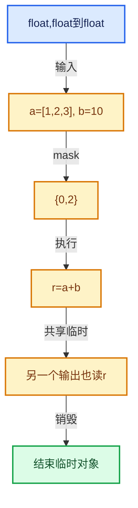

# 07-MultiFunction与批量执行

[总目录](../README.md)

把调用准备与元素循环分开，把值依赖与对象生存区间同时显式化。

## 前置知识与阅读层次

- [03-内存分配与运行时类型](../03-%E5%86%85%E5%AD%98%E5%88%86%E9%85%8D%E4%B8%8E%E8%BF%90%E8%A1%8C%E6%97%B6%E7%B1%BB%E5%9E%8B/README.md)
- [04-虚拟数组与索引选择](../04-%E8%99%9A%E6%8B%9F%E6%95%B0%E7%BB%84%E4%B8%8E%E7%B4%A2%E5%BC%95%E9%80%89%E6%8B%A9/README.md)

初读抓住数据模型，复读逐行检查，再完成反例和独立实现。方向间允许按实际问题回查，不要求机械线性阅读。

## 正文与源码范围

| 顺序 | 文档 | 主讲文件与范围 |
|---|---|---|
| 07-01 | [批量计算模型](01-%E6%89%B9%E9%87%8F%E8%AE%A1%E7%AE%97%E6%A8%A1%E5%9E%8B.md) | FN_multi_function.hh:L1—L152；multi_function.cc:L1—L182 |
| 07-02 | [函数签名](02-%E5%87%BD%E6%95%B0%E7%AD%BE%E5%90%8D.md) | FN_multi_function_signature.hh:L1—L226 |
| 07-03 | [参数类型与角色](03-%E5%8F%82%E6%95%B0%E7%B1%BB%E5%9E%8B%E4%B8%8E%E8%A7%92%E8%89%B2.md) | FN_multi_function_param_type.hh:L1—L170；FN_multi_function_data_type.hh:L1—L131 |
| 07-04 | [参数访问与输出构造](04-%E5%8F%82%E6%95%B0%E8%AE%BF%E9%97%AE%E4%B8%8E%E8%BE%93%E5%87%BA%E6%9E%84%E9%80%A0.md) | FN_multi_function_params.hh:L1—L456；multi_function_params.cc:L1—L25 |
| 07-05 | [Context与临时资源](05-Context%E4%B8%8E%E4%B8%B4%E6%97%B6%E8%B5%84%E6%BA%90.md) | FN_multi_function_context.hh:L1—L58 |
| 07-06 | [函数构建器](06-%E5%87%BD%E6%95%B0%E6%9E%84%E5%BB%BA%E5%99%A8.md) | FN_multi_function_builder.hh:L1—L922；multi_function_builder.cc:L1—L137 |
| 07-07 | [Procedure指令与控制流](07-Procedure%E6%8C%87%E4%BB%A4%E4%B8%8E%E6%8E%A7%E5%88%B6%E6%B5%81.md) | FN_multi_function_procedure.hh:L1—L536；multi_function_procedure.cc:L1—L882 |
| 07-08 | [ProcedureBuilder](08-ProcedureBuilder.md) | FN_multi_function_procedure_builder.hh:L1—L190；multi_function_procedure_builder.cc:L1—L123 |
| 07-09 | [执行器与内存复用](09-%E6%89%A7%E8%A1%8C%E5%99%A8%E4%B8%8E%E5%86%85%E5%AD%98%E5%A4%8D%E7%94%A8.md) | FN_multi_function_procedure_executor.hh:L1—L30；multi_function_procedure_executor.cc:L1—L1256 |
| 07-10 | [优化注册与实战](10-%E4%BC%98%E5%8C%96%E6%B3%A8%E5%86%8C%E4%B8%8E%E5%AE%9E%E6%88%98.md) | FN_multi_function_procedure_optimization.hh:L1—L49；multi_function_procedure_optimization.cc:L1—L81；FN_multi_function_registry.hh:L1—L37 |

## 本方向的数据模型

## 状态推演

## 历史入口

- [Functions: Multi Function](https://projects.blender.org/blender/blender/commit/4365de38700ccc05f98f601efdde0963de4645c1) · Jacques Lucke · 2020-06-16
- [Geometry Nodes: refactor array devirtualization](https://projects.blender.org/blender/blender/commit/ae94e36cfb2f3bc9a99b638782092d9c71d4b3c7) · Jacques Lucke · 2022-04-26
- [Functions: add global multi-function registry](https://projects.blender.org/blender/blender/commit/e9e940af53c7ef3cff3370cf30cc98f9f8d05925) · Jacques Lucke · 2026-03-26

## 跨库比较与验收

与std::function逐次调用和简单字节码解释器比较：批量接口可把动态分派放到循环外，Procedure额外表达变量寿命和控制流。

签名与参数类型一致；指令读取前变量已定义；存储复用发生在最后使用和析构之后。

正文和源码区间已建立；自动检查结果见根目录验收报告。阅读者的掌握程度以独立练习与反例推理为准。
