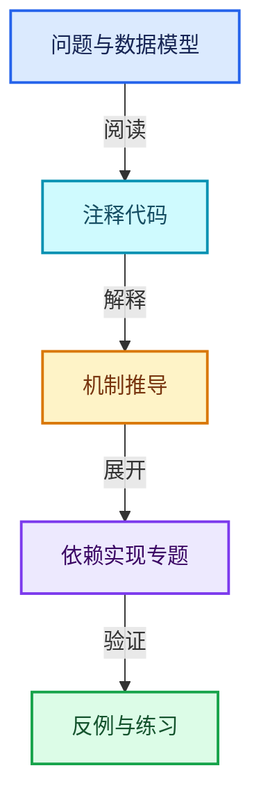
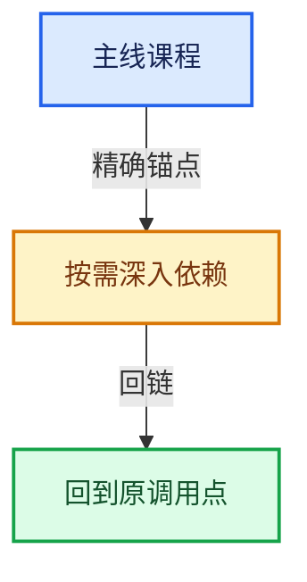

# 07-MultiFunction与批量执行

[总目录](../README.md) · [实现索引](../%E7%AC%A6%E5%8F%B7%E4%BE%9D%E8%B5%96%E4%B8%8E%E5%AE%9E%E7%8E%B0%E7%B4%A2%E5%BC%95.md)

## 主线课程

- [07-01 批量计算模型](01-%E6%89%B9%E9%87%8F%E8%AE%A1%E7%AE%97%E6%A8%A1%E5%9E%8B.md)
- [07-02 函数签名](02-%E5%87%BD%E6%95%B0%E7%AD%BE%E5%90%8D.md)
- [07-03 参数类型与角色](03-%E5%8F%82%E6%95%B0%E7%B1%BB%E5%9E%8B%E4%B8%8E%E8%A7%92%E8%89%B2.md)
- [07-04 参数访问与输出构造](04-%E5%8F%82%E6%95%B0%E8%AE%BF%E9%97%AE%E4%B8%8E%E8%BE%93%E5%87%BA%E6%9E%84%E9%80%A0.md)
- [07-05 Context与临时资源](05-Context%E4%B8%8E%E4%B8%B4%E6%97%B6%E8%B5%84%E6%BA%90.md)
- [07-06 函数构建器](06-%E5%87%BD%E6%95%B0%E6%9E%84%E5%BB%BA%E5%99%A8.md)
- [07-07 Procedure指令与控制流](07-Procedure%E6%8C%87%E4%BB%A4%E4%B8%8E%E6%8E%A7%E5%88%B6%E6%B5%81.md)
- [07-08 ProcedureBuilder](08-ProcedureBuilder.md)
- [07-09 执行器与内存复用](09-%E6%89%A7%E8%A1%8C%E5%99%A8%E4%B8%8E%E5%86%85%E5%AD%98%E5%A4%8D%E7%94%A8.md)
- [07-10 优化注册与实战](10-%E4%BC%98%E5%8C%96%E6%B3%A8%E5%86%8C%E4%B8%8E%E5%AE%9E%E6%88%98.md)

## 共享实现专题

- [source/blender/functions/FN_multi_function_builder.hh](%E4%BE%9D%E8%B5%96-FN_multi_function_builder-404df7.md)
- [source/blender/functions/FN_multi_function_procedure.hh](%E4%BE%9D%E8%B5%96-FN_multi_function_procedure-70e3b3.md)
- [source/blender/functions/intern/multi_function_registry.cc](%E4%BE%9D%E8%B5%96-multi_function_registry-020ea8.md)

## 几何节点扩展专题

- [GN-07 数学节点从MultiFunction到FieldOperation](%E6%89%A9%E5%B1%9501-%E6%95%B0%E5%AD%A6%E8%8A%82%E7%82%B9%E4%BB%8EMultiFunction%E5%88%B0FieldOperation.md)
