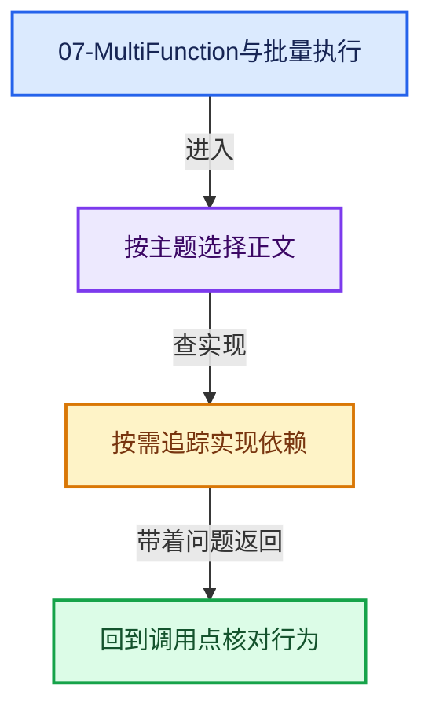
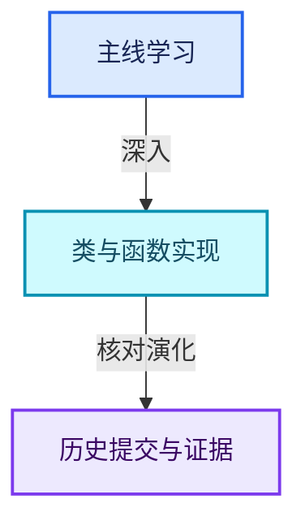

# 07-MultiFunction与批量执行

[总入口](../README.md) · [几何节点专题](../13-几何节点专题/README.md) · [实现依赖](../90-实现依赖专题/README.md)

## 阅读顺序

- [07-01 批量计算模型](01-批量计算模型.md)
- [07-02 函数签名](02-函数签名.md)
- [07-03 参数类型与角色](03-参数类型与角色.md)
- [07-04 参数访问与输出构造](04-参数访问与输出构造.md)
- [07-05 Context与临时资源](05-Context与临时资源.md)
- [07-06 函数构建器](06-函数构建器.md)
- [07-07 Procedure指令与控制流](07-Procedure指令与控制流.md)
- [07-08 ProcedureBuilder](08-ProcedureBuilder.md)
- [07-09 执行器与内存复用](09-执行器与内存复用.md)
- [07-10 优化注册与实战](10-优化注册与实战.md)

