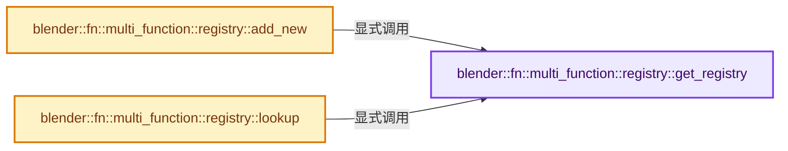
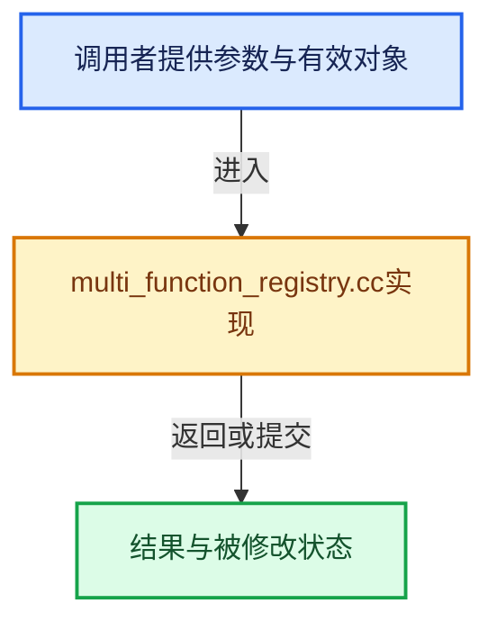

# 实现依赖专题：source/blender/functions/intern/multi_function_registry.cc

[方向导航](README.md) · [符号索引](../%E7%AC%A6%E5%8F%B7%E4%BE%9D%E8%B5%96%E4%B8%8E%E5%AE%9E%E7%8E%B0%E7%B4%A2%E5%BC%95.md)

本专题从正文实际调用进入，集中保存共享实现。函数有稳定锚点，可从调用处直接跳到对应完整函数；递归与互相调用通过回链组织。

## 本文件的实现关系






## 完整成员与函数实现

<a id="f-9b1de9cc39097108"></a>

### `blender::fn::multi_function::registry::get_registry`

实现位置：[source/blender/functions/intern/multi_function_registry.cc](../../../../../source/blender/functions/intern/multi_function_registry.cc) · L25—L29。

**教学注释版**

<!-- annotated:b898cc75e046f7 -->

```cpp
static Registry &get_registry()
{
  static Registry registry;
  return registry;
}
```

<details>
<summary>核对原始源码：source/blender/functions/intern/multi_function_registry.cc · L25—L29</summary>

<!-- original:b898cc75e046f7:source/blender/functions/intern/multi_function_registry.cc:25:29 -->

```cpp
static Registry &get_registry()
{
  static Registry registry;
  return registry;
}
```

</details>

**结果出口**

- `return registry;`

**继续追踪实现**

本实现没有需要继续展开的显式调用；检查返回表达式、对象转换和调用者前置条件。

<a id="f-38a87506481d5dfd"></a>

### `blender::fn::multi_function::registry::add_new`

实现位置：[source/blender/functions/intern/multi_function_registry.cc](../../../../../source/blender/functions/intern/multi_function_registry.cc) · L31—L44。

接口参数：

- `const MultiFunction &fn`

**教学注释版**

<!-- annotated:83913ab44f9159 -->

```cpp
void add_new(const MultiFunction &fn)
{
  Registry &registry = get_registry();
  RegistryMap::MutableAccessor accessor;
  const UString id = UString(fn.name());
  if (registry.map.add(accessor, id)) {
    accessor->second = &fn;
  }
  else {
    /* A function can only be registered once. */
    CLOG_ERROR(&LOG, "Multi-function already registered: '%s'", id.c_str());
    BLI_assert_unreachable();
  }
}
```

<details>
<summary>核对原始源码：source/blender/functions/intern/multi_function_registry.cc · L31—L44</summary>

<!-- original:83913ab44f9159:source/blender/functions/intern/multi_function_registry.cc:31:44 -->

```cpp
void add_new(const MultiFunction &fn)
{
  Registry &registry = get_registry();
  RegistryMap::MutableAccessor accessor;
  const UString id = UString(fn.name());
  if (registry.map.add(accessor, id)) {
    accessor->second = &fn;
  }
  else {
    /* A function can only be registered once. */
    CLOG_ERROR(&LOG, "Multi-function already registered: '%s'", id.c_str());
    BLI_assert_unreachable();
  }
}
```

</details>

**沿实际写入检查状态**

- `accessor->second = &fn;`

**继续追踪实现**

- `get_registry` → [blender::fn::multi_function::registry::get_registry · L25](%E4%BE%9D%E8%B5%96-multi_function_registry-020ea8.md#f-9b1de9cc39097108)。
- `UString` → [blender::UString::UString · L65](../01-%E5%9F%BA%E7%A1%80%E5%AE%B9%E5%99%A8%E4%B8%8E%E7%8E%B0%E4%BB%A3CPP/%E4%BE%9D%E8%B5%96-BLI_ustring-e50d0d.md#f-af044c001f6ab696)；[blender::UString::UString · L68](../01-%E5%9F%BA%E7%A1%80%E5%AE%B9%E5%99%A8%E4%B8%8E%E7%8E%B0%E4%BB%A3CPP/%E4%BE%9D%E8%B5%96-BLI_ustring-e50d0d.md#f-acdd59bd65bf3333)；[blender::UString::UString · L69](../01-%E5%9F%BA%E7%A1%80%E5%AE%B9%E5%99%A8%E4%B8%8E%E7%8E%B0%E4%BB%A3CPP/%E4%BE%9D%E8%B5%96-BLI_ustring-e50d0d.md#f-bc4cac73ffd771a5)。同名重载需按实参类型选择。
- `fn.name` → [blender::fn::multi_function::MultiFunction::name · L82](01-%E6%89%B9%E9%87%8F%E8%AE%A1%E7%AE%97%E6%A8%A1%E5%9E%8B.md#f-1e2f3fd60998b0bd)。
- `registry.map.add` → [调用协议](../%E6%A8%A1%E6%9D%BF%E5%AE%8F%E4%B8%8E%E5%8A%A8%E6%80%81%E5%88%86%E6%B4%BE%E5%8D%8F%E8%AE%AE.md)：接收对象类型依赖auto、返回值或模板实例；不按同名猜测目标。调用位置L36。
- `CLOG_ERROR` → [CLOG_ERROR · L188](../05-%E5%87%A0%E4%BD%95%E5%AD%98%E5%82%A8%E4%B8%8E%E6%8B%93%E6%89%91%E6%98%A0%E5%B0%84/%E4%BE%9D%E8%B5%96-CLG_log-e9051b.md#m-081575cdc8d0)。宏定义由构建条件选择。
- `id.c_str` → [blender::UString::c_str · L88](../01-%E5%9F%BA%E7%A1%80%E5%AE%B9%E5%99%A8%E4%B8%8E%E7%8E%B0%E4%BB%A3CPP/%E4%BE%9D%E8%B5%96-BLI_ustring-e50d0d.md#f-2ff40d65689d1a13)。
- `BLI_assert_unreachable` → [BLI_assert_unreachable · L77](../01-%E5%9F%BA%E7%A1%80%E5%AE%B9%E5%99%A8%E4%B8%8E%E7%8E%B0%E4%BB%A3CPP/%E4%BE%9D%E8%B5%96-BLI_assert-cc98e8.md#m-7a2d91a67d8e)。宏定义由构建条件选择。

<a id="f-1a054f3e76280e66"></a>

### `blender::fn::multi_function::registry::lookup`

实现位置：[source/blender/functions/intern/multi_function_registry.cc](../../../../../source/blender/functions/intern/multi_function_registry.cc) · L46—L57。

接口参数：

- `UString id`

**教学注释版**

<!-- annotated:faaf4f4e592608 -->

```cpp
const MultiFunction &lookup(UString id)
{
  Registry &registry = get_registry();
  RegistryMap::ConstAccessor accessor;
  if (registry.map.lookup(accessor, id)) {
    return *accessor->second;
  }
  /* The function is expected to exist when using the #lookup function. */
  CLOG_ERROR(&LOG, "Multi-function does not exist: '%s'", id.c_str());
  BLI_assert_unreachable();
  return *accessor->second;
}
```

<details>
<summary>核对原始源码：source/blender/functions/intern/multi_function_registry.cc · L46—L57</summary>

<!-- original:faaf4f4e592608:source/blender/functions/intern/multi_function_registry.cc:46:57 -->

```cpp
const MultiFunction &lookup(UString id)
{
  Registry &registry = get_registry();
  RegistryMap::ConstAccessor accessor;
  if (registry.map.lookup(accessor, id)) {
    return *accessor->second;
  }
  /* The function is expected to exist when using the #lookup function. */
  CLOG_ERROR(&LOG, "Multi-function does not exist: '%s'", id.c_str());
  BLI_assert_unreachable();
  return *accessor->second;
}
```

</details>

**结果出口**

- `return *accessor->second;`

**继续追踪实现**

- `get_registry` → [blender::fn::multi_function::registry::get_registry · L25](%E4%BE%9D%E8%B5%96-multi_function_registry-020ea8.md#f-9b1de9cc39097108)。
- `registry.map.lookup` → [调用协议](../%E6%A8%A1%E6%9D%BF%E5%AE%8F%E4%B8%8E%E5%8A%A8%E6%80%81%E5%88%86%E6%B4%BE%E5%8D%8F%E8%AE%AE.md)：接收对象类型依赖auto、返回值或模板实例；不按同名猜测目标。调用位置L50。
- `CLOG_ERROR` → [CLOG_ERROR · L188](../05-%E5%87%A0%E4%BD%95%E5%AD%98%E5%82%A8%E4%B8%8E%E6%8B%93%E6%89%91%E6%98%A0%E5%B0%84/%E4%BE%9D%E8%B5%96-CLG_log-e9051b.md#m-081575cdc8d0)。宏定义由构建条件选择。
- `id.c_str` → [blender::UString::c_str · L88](../01-%E5%9F%BA%E7%A1%80%E5%AE%B9%E5%99%A8%E4%B8%8E%E7%8E%B0%E4%BB%A3CPP/%E4%BE%9D%E8%B5%96-BLI_ustring-e50d0d.md#f-2ff40d65689d1a13)。
- `BLI_assert_unreachable` → [BLI_assert_unreachable · L77](../01-%E5%9F%BA%E7%A1%80%E5%AE%B9%E5%99%A8%E4%B8%8E%E7%8E%B0%E4%BB%A3CPP/%E4%BE%9D%E8%B5%96-BLI_assert-cc98e8.md#m-7a2d91a67d8e)。宏定义由构建条件选择。
