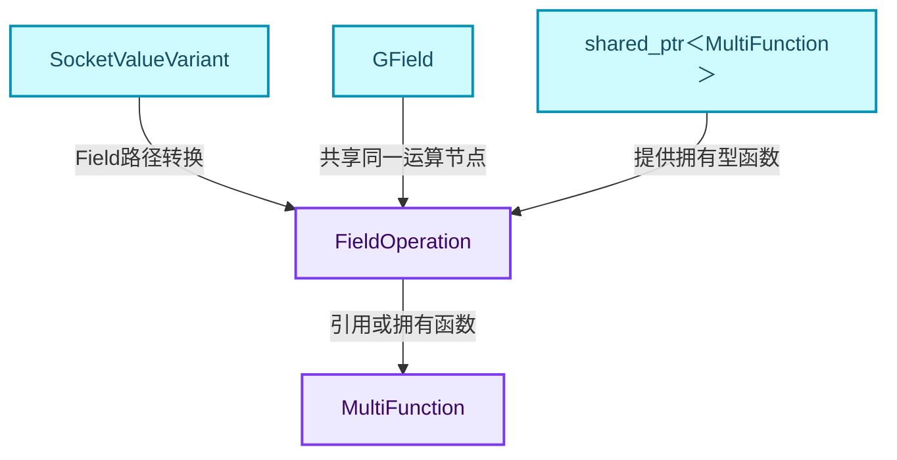
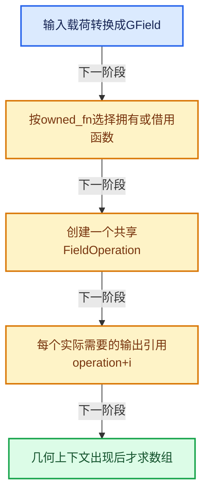
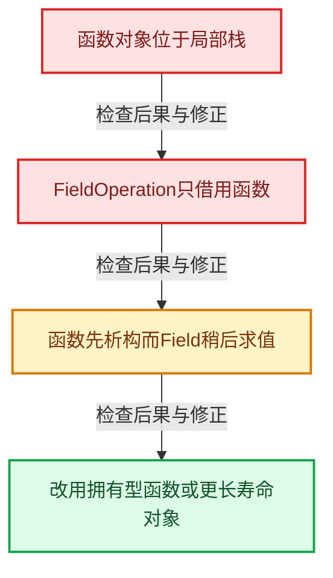

# GN-07 数学节点从MultiFunction到FieldOperation

[几何节点学习地图](../%E5%87%A0%E4%BD%95%E8%8A%82%E7%82%B9%E6%89%A9%E5%B1%95%E5%AD%A6%E4%B9%A0%E5%9C%B0%E5%9B%BE.md) · [方向导航](README.md) · [全局实现索引](../%E7%AC%A6%E5%8F%B7%E4%BE%9D%E8%B5%96%E4%B8%8E%E5%AE%9E%E7%8E%B0%E7%B4%A2%E5%BC%95.md)

基准：`cbda6b96c26c0dee3c3b5cbb93960c4ac06a6b30`；文件哈希及连续摘录区间记录在[新增专题证据](../_evidence/geometry-extension.json)。本篇围绕所选函数解释核心机制，辅助依赖明确列出已定位实现与尚需类型确认的边界，不宣称相关整个文件已全文复核。

## 先回答一个具体问题

一个加法函数怎样同时服务单值插槽和逐点Field，而不用写两套数学算法？

## 相关类与数据的职责

- **`MultiFunction`**：描述批量函数签名及批量调用。 定义入口：[source/blender/functions/FN_multi_function.hh · L43](../../../../../source/blender/functions/FN_multi_function.hh)。
- **`SocketValueVariant`**：承载单值或Field输入输出。 定义入口：[source/blender/blenkernel/BKE_node_socket_value.hh · L83](../../../../../source/blender/blenkernel/BKE_node_socket_value.hh)。
- **`FieldOperation`**：记录函数及其输入Field，表示延迟运算。 定义入口：[source/blender/functions/FN_field.hh · L387](../../../../../source/blender/functions/FN_field.hh)。
- **`GField`**：用operation和输出索引引用某个结果。 定义入口：[source/blender/functions/FN_field.hh · L55](../../../../../source/blender/functions/FN_field.hh)。
- **`shared_ptr<MultiFunction>`**：在动态拥有函数时延长函数实现寿命。



上图箭头文字区分拥有、借用、调用和数据依赖。连线不表示这些类型存在同名继承关系；只有源码明确声明的继承才按继承理解。

## 设计推导与扩展知识

### 推导1

数学函数可以保持一个与几何组件无关的批量实现。单值与Field路径的差别在于什么时候执行、输入如何表示，而不必重新实现加法、比较等核心运算。

### 推导2

Field路径先把输入统一成GField；常量也可以包装成常量表达式。这样FieldOperation只需面对统一表达式接口，而不用为每种输入表示组合建立一个新类。

### 推导3

operation只建立一次，每个输出GField携带不同的输出索引。多输出共享一次运算节点的设计避免把同一函数复制成互不相关的表达式子树。

### 推导4

owned_fn存在时传shared_ptr；否则传函数引用。后者要求外部函数实现活得足够长，常见static注册函数可以满足，但栈上临时函数不能照抄这一借用路径。

### 推导5

这里没有执行逐点循环。要区分构图成本、表达式分析成本和真正的批量计算成本；仅测创建FieldOperation的时间不能代表数学节点处理百万元素的速度。

## 实际处理阶段



这张图概括本篇所讨论的主路径；等待输入、构建失败与不同策略的分支以下方完整代码为准，不能把概括图当作每次都会执行的无条件顺序。

## 教学注释代码与分段机制

<a id="f-93bbba2243ea41c6"></a>

### `blender::nodes::execute_multi_function_on_value_variant__field` · L466—L494

三个循环阶段分别规范输入、建立运算、包装输出。output_values中的nullptr说明该输出没有目标，不要强制构造。

实现位置：[source/blender/nodes/intern/geometry_nodes_lazy_function.cc](../../../../../source/blender/nodes/intern/geometry_nodes_lazy_function.cc)。

**教学注释版**

<!-- annotated:5c6960cac7c1ef -->

```cpp
static void execute_multi_function_on_value_variant__field(
    const MultiFunction &fn,
    const std::shared_ptr<MultiFunction> &owned_fn,
    const Span<SocketValueVariant *> input_values,
    const Span<SocketValueVariant *> output_values)
{
  /* Convert all inputs into fields, so that they can be used as input in the new field. */
  Vector<GField> input_fields;
  for (const int i : input_values.index_range()) {
    // [讲解] 把输入表示统一成GField，保留延迟求值语义。
    input_fields.append(input_values[i]->extract<GField>());
  }

  /* Construct the new field node. */
  ImplicitSharingPtr<fn::FieldOperation> operation;
  if (owned_fn) {
    // [讲解] 函数需要被拥有时传shared_ptr，延长实现寿命。
    operation = fn::FieldOperation::from(owned_fn, std::move(input_fields));
  }
  else {
    // [讲解] 此路径借用函数实现，外层必须保证其寿命。
    operation = fn::FieldOperation::from(fn, std::move(input_fields));
  }

  /* Store the new fields in the output. */
  for (const int i : output_values.index_range()) {
    if (output_values[i] == nullptr) {
      continue;
    }
    // [讲解] 各输出共享同一个运算节点，通过i选择对应结果。
    *output_values[i] = bke::SocketValueVariant::from(GField{operation, i});
  }
}
```

<details>
<summary>核对原始源码：source/blender/nodes/intern/geometry_nodes_lazy_function.cc · L466—L494</summary>

<!-- original:5c6960cac7c1ef:source/blender/nodes/intern/geometry_nodes_lazy_function.cc:466:494 -->

```cpp
static void execute_multi_function_on_value_variant__field(
    const MultiFunction &fn,
    const std::shared_ptr<MultiFunction> &owned_fn,
    const Span<SocketValueVariant *> input_values,
    const Span<SocketValueVariant *> output_values)
{
  /* Convert all inputs into fields, so that they can be used as input in the new field. */
  Vector<GField> input_fields;
  for (const int i : input_values.index_range()) {
    input_fields.append(input_values[i]->extract<GField>());
  }

  /* Construct the new field node. */
  ImplicitSharingPtr<fn::FieldOperation> operation;
  if (owned_fn) {
    operation = fn::FieldOperation::from(owned_fn, std::move(input_fields));
  }
  else {
    operation = fn::FieldOperation::from(fn, std::move(input_fields));
  }

  /* Store the new fields in the output. */
  for (const int i : output_values.index_range()) {
    if (output_values[i] == nullptr) {
      continue;
    }
    *output_values[i] = bke::SocketValueVariant::from(GField{operation, i});
  }
}
```

</details>

<details>
<summary>实现依赖入口与尚需类型确认的调用</summary>

- `input_values.index_range` → [blender::Span::index_range · L405](../01-%E5%9F%BA%E7%A1%80%E5%AE%B9%E5%99%A8%E4%B8%8E%E7%8E%B0%E4%BB%A3CPP/05-Span%E5%8F%AA%E8%AF%BB%E8%BF%9E%E7%BB%AD%E8%A7%86%E5%9B%BE.md#f-caaa9b06e13e53e0)。
- `input_fields.append` → [blender::Vector::append · L498](../01-%E5%9F%BA%E7%A1%80%E5%AE%B9%E5%99%A8%E4%B8%8E%E7%8E%B0%E4%BB%A3CPP/11-Vector%E6%8F%92%E5%85%A5%E5%88%A0%E9%99%A4%E4%B8%8E%E9%87%8D%E6%8E%92.md#f-5bde268a69e443ec)；[blender::Vector::append · L502](../01-%E5%9F%BA%E7%A1%80%E5%AE%B9%E5%99%A8%E4%B8%8E%E7%8E%B0%E4%BB%A3CPP/11-Vector%E6%8F%92%E5%85%A5%E5%88%A0%E9%99%A4%E4%B8%8E%E9%87%8D%E6%8E%92.md#f-591e0b15e6308532)。多候选需按实参和重载规则确认。
- `input_values[i]->extract<GField>`：L475的类型或分派协议；接收对象类型依赖auto、返回值或模板实例；不按同名猜测目标。
- `fn::FieldOperation::from` → [blender::fn::from · L252](../08-Field%E8%A1%A8%E8%BE%BE%E5%BC%8F%E4%B8%8E%E6%B1%82%E5%80%BC/06-FieldContext%E4%B8%8A%E4%B8%8B%E6%96%87.md#f-d78060e8f5e1929f)；[blender::fn::from · L258](../08-Field%E8%A1%A8%E8%BE%BE%E5%BC%8F%E4%B8%8E%E6%B1%82%E5%80%BC/06-FieldContext%E4%B8%8A%E4%B8%8B%E6%96%87.md#f-60a41b323ee8ceb7)。多候选需按实参和重载规则确认。
- `std::move`：把表达式转换成可供移动重载选择的值类别；不保证真的移动，不结束源对象寿命，对const值可能选择复制。 [接口资料](https://eel.is/c++draft/utility.forward)。
- `output_values.index_range` → [blender::Span::index_range · L405](../01-%E5%9F%BA%E7%A1%80%E5%AE%B9%E5%99%A8%E4%B8%8E%E7%8E%B0%E4%BB%A3CPP/05-Span%E5%8F%AA%E8%AF%BB%E8%BF%9E%E7%BB%AD%E8%A7%86%E5%9B%BE.md#f-caaa9b06e13e53e0)。
- `bke::SocketValueVariant::from` → [blender::bke::from · L220](../09-LazyFunction%E4%B8%8E%E8%8A%82%E7%82%B9%E6%89%A7%E8%A1%8C%E6%9E%B6%E6%9E%84/%E6%89%A9%E5%B1%9504-SocketValueVariant%E5%BC%82%E6%9E%84%E5%80%BC%E4%B8%8E%E8%BD%AC%E6%8D%A2%E8%BE%B9%E7%95%8C.md#f-fa3c16e83ef6de45)。

</details>

<a id="f-b3bbb9da34c5cb4c"></a>

### `blender::nodes::execute_multi_function_on_value_variant` · L500—L539

对照该分派函数的真实分支判定，避免把所有Variant都强转成Field。

实现位置：[source/blender/nodes/intern/geometry_nodes_lazy_function.cc](../../../../../source/blender/nodes/intern/geometry_nodes_lazy_function.cc)。

**教学注释版**

<!-- annotated:d8fbc21c849453 -->

```cpp
[[nodiscard]] bool execute_multi_function_on_value_variant(
    const MultiFunction &fn,
    const std::shared_ptr<MultiFunction> &owned_fn,
    const Span<SocketValueVariant *> input_values,
    const Span<SocketValueVariant *> output_values,
    GeoNodesUserData *user_data,
    std::string &r_error_message)
{
  /* Check input types which determine how the function is evaluated. */
  bool any_input_is_field = false;
  bool any_input_is_volume_grid = false;
  bool any_input_is_list = false;
  for (const int i : input_values.index_range()) {
    const SocketValueVariant &value = *input_values[i];
    if (value.is_context_dependent_field()) {
      any_input_is_field = true;
    }
    else if (value.is_volume_grid()) {
      any_input_is_volume_grid = true;
    }
    else if (value.is_list()) {
      any_input_is_list = true;
    }
  }

  if (any_input_is_volume_grid) {
    return execute_multi_function_on_value_variant__volume_grid(
        fn, input_values, output_values, r_error_message);
  }
  if (any_input_is_list) {
    return execute_multi_function_on_value_variant__list(
        fn, owned_fn, input_values, output_values, user_data, r_error_message);
  }
  if (any_input_is_field) {
    execute_multi_function_on_value_variant__field(fn, owned_fn, input_values, output_values);
    return true;
  }
  execute_multi_function_on_value_variant__single(fn, input_values, output_values, user_data);
  return true;
}
```

<details>
<summary>核对原始源码：source/blender/nodes/intern/geometry_nodes_lazy_function.cc · L500—L539</summary>

<!-- original:d8fbc21c849453:source/blender/nodes/intern/geometry_nodes_lazy_function.cc:500:539 -->

```cpp
[[nodiscard]] bool execute_multi_function_on_value_variant(
    const MultiFunction &fn,
    const std::shared_ptr<MultiFunction> &owned_fn,
    const Span<SocketValueVariant *> input_values,
    const Span<SocketValueVariant *> output_values,
    GeoNodesUserData *user_data,
    std::string &r_error_message)
{
  /* Check input types which determine how the function is evaluated. */
  bool any_input_is_field = false;
  bool any_input_is_volume_grid = false;
  bool any_input_is_list = false;
  for (const int i : input_values.index_range()) {
    const SocketValueVariant &value = *input_values[i];
    if (value.is_context_dependent_field()) {
      any_input_is_field = true;
    }
    else if (value.is_volume_grid()) {
      any_input_is_volume_grid = true;
    }
    else if (value.is_list()) {
      any_input_is_list = true;
    }
  }

  if (any_input_is_volume_grid) {
    return execute_multi_function_on_value_variant__volume_grid(
        fn, input_values, output_values, r_error_message);
  }
  if (any_input_is_list) {
    return execute_multi_function_on_value_variant__list(
        fn, owned_fn, input_values, output_values, user_data, r_error_message);
  }
  if (any_input_is_field) {
    execute_multi_function_on_value_variant__field(fn, owned_fn, input_values, output_values);
    return true;
  }
  execute_multi_function_on_value_variant__single(fn, input_values, output_values, user_data);
  return true;
}
```

</details>

<details>
<summary>实现依赖入口与尚需类型确认的调用</summary>

- `input_values.index_range` → [blender::Span::index_range · L405](../01-%E5%9F%BA%E7%A1%80%E5%AE%B9%E5%99%A8%E4%B8%8E%E7%8E%B0%E4%BB%A3CPP/05-Span%E5%8F%AA%E8%AF%BB%E8%BF%9E%E7%BB%AD%E8%A7%86%E5%9B%BE.md#f-caaa9b06e13e53e0)。
- `value.is_context_dependent_field` → [is_context_dependent_field · L534](../05-%E5%87%A0%E4%BD%95%E5%AD%98%E5%82%A8%E4%B8%8E%E6%8B%93%E6%89%91%E6%98%A0%E5%B0%84/%E4%BE%9D%E8%B5%96-node_socket_value-841c72.md#f-55e5e1818d077c80)。
- `value.is_volume_grid` → [is_volume_grid · L525](../05-%E5%87%A0%E4%BD%95%E5%AD%98%E5%82%A8%E4%B8%8E%E6%8B%93%E6%89%91%E6%98%A0%E5%B0%84/%E4%BE%9D%E8%B5%96-node_socket_value-841c72.md#f-e53b8ae8600b40db)。
- `value.is_list` → [is_list · L521](../05-%E5%87%A0%E4%BD%95%E5%AD%98%E5%82%A8%E4%B8%8E%E6%8B%93%E6%89%91%E6%98%A0%E5%B0%84/%E4%BE%9D%E8%B5%96-node_socket_value-841c72.md#f-8ca466804cfc0dfe)。
- `execute_multi_function_on_value_variant__volume_grid` → [blender::nodes::execute_multi_function_on_value_variant__volume_grid · L25](../09-LazyFunction%E4%B8%8E%E8%8A%82%E7%82%B9%E6%89%A7%E8%A1%8C%E6%9E%B6%E6%9E%84/%E4%BE%9D%E8%B5%96-volume_grid_function_eval-0d385c.md#f-6abe69dd207c7004)；[blender::nodes::execute_multi_function_on_value_variant__volume_grid · L81](../09-LazyFunction%E4%B8%8E%E8%8A%82%E7%82%B9%E6%89%A7%E8%A1%8C%E6%9E%B6%E6%9E%84/%E4%BE%9D%E8%B5%96-volume_grid_function_eval-0d385c.md#f-e63ded3fa1414b64)。多候选需按实参和重载规则确认。
- `execute_multi_function_on_value_variant__list` → [blender::nodes::execute_multi_function_on_value_variant__list · L251](../09-LazyFunction%E4%B8%8E%E8%8A%82%E7%82%B9%E6%89%A7%E8%A1%8C%E6%9E%B6%E6%9E%84/%E4%BE%9D%E8%B5%96-list_function_eval-d4a4cc.md#f-023b413e63f13be9)。
- `execute_multi_function_on_value_variant__field` → [blender::nodes::execute_multi_function_on_value_variant__field · L466](%E6%89%A9%E5%B1%9501-%E6%95%B0%E5%AD%A6%E8%8A%82%E7%82%B9%E4%BB%8EMultiFunction%E5%88%B0FieldOperation.md#f-93bbba2243ea41c6)。
- `execute_multi_function_on_value_variant__single` → [blender::nodes::execute_multi_function_on_value_variant__single · L432](../09-LazyFunction%E4%B8%8E%E8%8A%82%E7%82%B9%E6%89%A7%E8%A1%8C%E6%9E%B6%E6%9E%84/09-%E5%87%A0%E4%BD%95%E8%8A%82%E7%82%B9%E5%9B%BE%E6%9E%84%E5%BB%BA%E5%99%A8.md#f-04cff8b4b1ad9384)。

</details>

## 用小数据走一遍

1. 数学函数有两个输出。
2. 输入先变成两个GField。
3. operation建立一次。
4. 输出0和输出1共享operation。


这是明确输入条件下的教学推演，不是本地性能实测。对源码的验证应同时检查数值、对象寿命、输出需求和数据是否存在。

## 反例与边界

- 函数对象位于局部栈。
- FieldOperation只借用函数。
- 函数先析构而Field稍后求值。
- 改用拥有型函数或更长寿命对象。



## 历史提交阅读

本地历史阅读样本：**Jacques Lucke**，2026-09-13T00:12:00+02:00。

`954a62b3420b287de83ca92ab80b3ddaf5208aa0`

提交标题：Refactor: Nodes: use separate type for internal links

[所选文件的真实diff](../_evidence/geometry-history/GN-07.patch)。这是本地历史中匹配作者的近期样本，不冒称该系统的最初引入提交。阅读时先找变更前后的不变量，再检查新增分支与测试；本篇当前源码说明不混用历史签名。

## 独立实现与验收

实现一个同时输出平方与立方的批量函数，并画出两个Field输出的共享结构。

<details>
<summary>参考思路</summary>

两个输出使用同一operation、索引0和1；测试共享输入和函数寿命，不能各自创建一份借用临时函数的operation。

</details>

验收时保留一个能击穿错误设计的反例，再对照实际符号重走调用链。教学练习未在完整Blender中运行；本轮独立运行的模型验证另见新增专题验收报告。

## 继续阅读

- [GN-06 按需执行匿名输出与Switch需求传播](../09-LazyFunction%E4%B8%8E%E8%8A%82%E7%82%B9%E6%89%A7%E8%A1%8C%E6%9E%B6%E6%9E%84/%E6%89%A9%E5%B1%9506-%E6%8C%89%E9%9C%80%E6%89%A7%E8%A1%8C%E5%8C%BF%E5%90%8D%E8%BE%93%E5%87%BA%E4%B8%8ESwitch%E9%9C%80%E6%B1%82%E4%BC%A0%E6%92%AD.md)
- [GN-08 GeometrySet组件组合与写时分离](../05-%E5%87%A0%E4%BD%95%E5%AD%98%E5%82%A8%E4%B8%8E%E6%8B%93%E6%89%91%E6%98%A0%E5%B0%84/%E6%89%A9%E5%B1%9501-GeometrySet%E7%BB%84%E4%BB%B6%E7%BB%84%E5%90%88%E4%B8%8E%E5%86%99%E6%97%B6%E5%88%86%E7%A6%BB.md)
