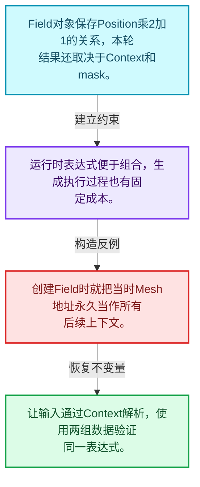
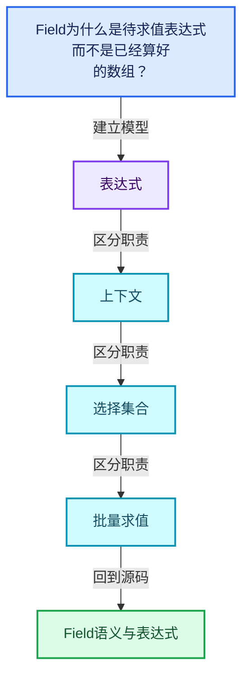
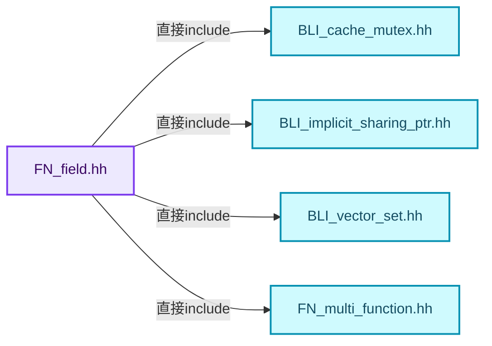
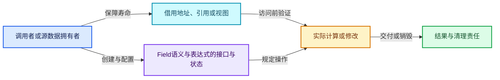
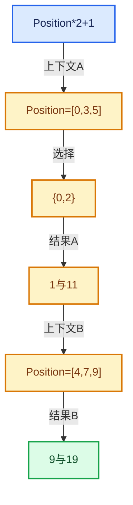

# 08-01 Field语义与表达式

[方向导航](README.md) · [总目录](../README.md) · [覆盖索引](../%E6%BA%90%E7%A0%81%E7%89%88%E6%9C%AC%E4%B8%8E%E8%A6%86%E7%9B%96%E7%B4%A2%E5%BC%95.md)

> 阅读顺序：问题与数据模型 → 语法与类型 → 源码逐行 → 调用线索 → 历史与取舍 → 推演和练习。

- 基准 HEAD：`cbda6b96c26c0dee3c3b5cbb93960c4ac06a6b30`。
- 记录日期：2026-10-14。
- 教学示例状态：正文中的推演不是本机性能实测；已运行练习见验收报告。

## 一、从问题到设计

Field为什么是待求值表达式而不是已经算好的数组？

表达式描述计算，FieldContext提供具体输入，IndexMask决定处理哪些元素；三者职责不同。

本篇把语法、数据语义和系统取舍连接起来。Field表达式、求值上下文、mask与结果存储各自有独立职责和生命周期。

### 本篇独立模型与设计推理

Field对象保存Position乘2加1的关系，本轮结果还取决于Context和mask。

设计取舍：运行时表达式便于组合，生成执行过程也有固定成本。

最小反例：创建Field时就把当时Mesh地址永久当作所有后续上下文。

推导与处理：让输入通过Context解析，使用两组数据验证同一表达式。



### 源码范围与相邻篇章

| 文件 | 本篇逐行范围 | 基准SHA-256 |
|---|---|---|
| [source/blender/functions/FN_field.hh](../../../../../source/blender/functions/FN_field.hh) | L1—L54 | `4ce5d9b67e7b82f22293a3250ae787716e34c6a6b5f1afe561a000eeb6dfa112` |

同一主讲文件可能分多篇覆盖；超出本篇范围的符号通过覆盖索引定位。空行与纯注释保留在源码摘录中，逐行表解释有效语句与语法边界；许可证头统一保留。

后篇：[GField存储表示](02-GField%E5%AD%98%E5%82%A8%E8%A1%A8%E7%A4%BA.md).

## 二、类型、数据与阅读地图



这是概念依赖图，边表示阅读关系，不声称是运行时调用顺序。

### 直接编译依赖



箭头只表示头文件包含关系；完整调用线索见后面的符号定位表。

## 三、关键词、语法与类型角色

### 模板 template

模板把类型或常量作为生成实现的参数。读声明时先列出类型参数、非类型参数和默认值，再看使用者实际实例化了什么。模板声明本身不意味着每种T都支持其全部成员。

具体检查：把T替换为int、string、只能移动的类型，分别检查每个被调用操作是否成立。

### 依赖名称 typename

typename既可引入类型模板参数，也可告诉编译器某个依赖名称是类型。它不创建运行时对象；解析期确认语法类别与实例化期检查具体类型是不同阶段。

具体检查：区分typename T::value_type和T::size()，前者标记类型，后者是表达式。

### 类型别名 using

类型别名为已有类型建立名字，不创建运行期对象。它常把模板内部使用的类型统一暴露给泛型调用者。

具体检查：展开别名直到基础类型，区分类型别名和变量声明。

## 四、真实源码与逐行讲解

源码块保持原行内容，原始行号由小节标题及逐行表给出。表中的调用定位是静态阅读辅助；重载、模板实例化、宏展开和虚调用需结合完整声明，不能仅凭词法出现证明动态调用。

### FN_field.hh：L1—L54

<!-- source:source/blender/functions/FN_field.hh:1:54 -->

```cpp
/* SPDX-FileCopyrightText: 2026 Blender Authors
 *
 * SPDX-License-Identifier: GPL-2.0-or-later */

#pragma once

/** \file
 * \ingroup fn
 *
 * A #Field represents a function that outputs a value based on an arbitrary number of inputs. The
 * inputs for a specific field evaluation are provided by a #FieldContext.
 *
 * A typical example is a field that computes a displacement vector for every vertex on a mesh
 * based on its position.
 *
 * Fields can be built, composed and evaluated at run-time. They are stored in a directed tree
 * graph data structure. A field may generally depend on other fields.
 *
 * When fields are evaluated, they are converted into a multi-function procedure which allows
 * efficient computation. In the future, we might support different field evaluation mechanisms for
 * e.g. the following scenarios:
 *  - Latency of a single evaluation is more important than throughput.
 *  - Evaluation should happen on other hardware like GPUs.
 *
 * Whenever possible, multiple fields should be evaluated together to avoid duplicate work when
 * they share common sub-fields and a common context.
 */

#include "BLI_cache_mutex.hh"
#include "BLI_implicit_sharing_ptr.hh"
#include "BLI_vector_set.hh"

#include "FN_multi_function.hh"

namespace blender::fn {

class GField;
class FieldInput;
class FieldOperation;
class FieldInputs;
class FieldContext;

using FieldInputPtr = ImplicitSharingPtr<FieldInput>;
using FieldOperationPtr = ImplicitSharingPtr<FieldOperation>;
using FieldInputsPtr = ImplicitSharingPtr<FieldInputs>;
template<typename T> class Field;

/**
 * A field with a type that is only known at runtime which can be accessed through the #cpp_type
 * method. If the type is known at compile time, it is recommended to use #Field<T> instead.
 *
 * It is designed to support various internal storage representations to avoid unnecessary
 * allocations or reference counting in many common cases.
 */
```

| 原始行 | 语义、约束与检查 |
|---|---|
| L5 | 防止同一头文件在一个翻译单元中重复展开；不控制多个源文件之间的链接或对象寿命。 |
| L29 | 引入编译依赖 "BLI_cache_mutex.hh"；这是声明可见性关系，不表示运行时一定调用该文件的所有接口。 |
| L30 | 引入编译依赖 "BLI_implicit_sharing_ptr.hh"；这是声明可见性关系，不表示运行时一定调用该文件的所有接口。 |
| L31 | 引入编译依赖 "BLI_vector_set.hh"；这是声明可见性关系，不表示运行时一定调用该文件的所有接口。 |
| L33 | 引入编译依赖 "FN_multi_function.hh"；这是声明可见性关系，不表示运行时一定调用该文件的所有接口。 |
| L35 | 把后续声明放入 blender::fn 命名空间，影响名称查找和符号归属，不创建运行时对象。 |
| L37 | 声明或定义类型 `class GField`。结合继承、访问权限和成员布局确认接口与拥有关系；前向声明本身没有完整对象布局。 |
| L38 | 声明或定义类型 `class FieldInput`。结合继承、访问权限和成员布局确认接口与拥有关系；前向声明本身没有完整对象布局。 |
| L39 | 声明或定义类型 `class FieldOperation`。结合继承、访问权限和成员布局确认接口与拥有关系；前向声明本身没有完整对象布局。 |
| L40 | 声明或定义类型 `class FieldInputs`。结合继承、访问权限和成员布局确认接口与拥有关系；前向声明本身没有完整对象布局。 |
| L41 | 声明或定义类型 `class FieldContext`。结合继承、访问权限和成员布局确认接口与拥有关系；前向声明本身没有完整对象布局。 |
| L43 | 定义类型别名 `using FieldInputPtr = ImplicitSharingPtr<FieldInput>`，为模板接口或内部实现统一命名；本行不分配该类型对象。 |
| L44 | 定义类型别名 `using FieldOperationPtr = ImplicitSharingPtr<FieldOperation>`，为模板接口或内部实现统一命名；本行不分配该类型对象。 |
| L45 | 定义类型别名 `using FieldInputsPtr = ImplicitSharingPtr<FieldInputs>`，为模板接口或内部实现统一命名；本行不分配该类型对象。 |
| L46 | 声明模板参数 `template<typename T> class Field;`。类型参数决定生成操作的类型，非类型参数可决定内嵌容量或编译期分支。 |

## 五、接口定位、调用线索与生命周期

### 本篇声明与实现入口

| 源码位置 | 实际声明片段 |
|---|---|
| [FN_field.hh:L37](../../../../../source/blender/functions/FN_field.hh#L37) | `class GField;` |
| [FN_field.hh:L38](../../../../../source/blender/functions/FN_field.hh#L38) | `class FieldInput;` |
| [FN_field.hh:L39](../../../../../source/blender/functions/FN_field.hh#L39) | `class FieldOperation;` |
| [FN_field.hh:L40](../../../../../source/blender/functions/FN_field.hh#L40) | `class FieldInputs;` |
| [FN_field.hh:L41](../../../../../source/blender/functions/FN_field.hh#L41) | `class FieldContext;` |
| [FN_field.hh:L46](../../../../../source/blender/functions/FN_field.hh#L46) | `template<typename T> class Field;` |

### 同名符号出现位置

以下表提供跨文件阅读入口，包含声明、调用或测试使用；没有经过完整C++名称解析，不把它命名为已证明的运行时调用图。

| 符号 | 位置 | 文本证据 |
|---|---|---|
| 本段无跨主讲文件的同名入口 | — | 沿直接include与所在类接口继续定位 |

### 生命周期推理图



这是审查生命周期的通用模型。具体类是否拥有数据由本篇成员、构造、析构和调用者一起证明；任何箭头都不自动代表shared_ptr。

## 六、把代码放进具体数据中推演

本方向的共同数值模型如下。本篇的专门检查是：同一Position加Offset表达式在两组点上执行。

| 步骤 | 数据或状态 | 为什么需要这一步 |
|---|---|---|
| 表达式 | Position*2+1 | 尚未绑定具体数组 |
| 上下文A | Position=[0,3,5] | 输入有3个元素 |
| 选择 | {0,2} | 只要求元素0和2 |
| 结果A | 1与11 | 元素1不属于本轮要求 |
| 上下文B | Position=[4,7,9] | 复用表达式而改变环境 |
| 结果B | 9与19 | 结果由表达式和上下文共同决定 |



图是教学推演模型；精确分支与状态更新以本篇摘录及调用契约为准。

### 本篇独立练习与参考思路

同一Position加Offset表达式在两组点上执行。

参考思路：表达式描述计算，FieldContext提供具体输入，IndexMask决定处理哪些元素；三者职责不同。

将输入、预期结果和资源责任分成三张清单。先用最直接的实现给出可核对的答案，再替换成对应源码使用的表示；比较结果不变的条件，而不是只比较接口名字。

验收依据：结果与直接计算一致；多个输出共享子表达式时不改变语义；深链构造、执行、销毁三个阶段分别检查。

## 七、复杂度、设计取舍与其他基础库

与表达式模板、AST和闭包比较：Field可在运行时组合并对不同上下文批量求值；不要把Field对象误当作固定几何的结果数组。

本篇的具体取舍：表达式描述计算，FieldContext提供具体输入，IndexMask决定处理哪些元素；三者职责不同。

| 观察维度 | 从源码取得证据的方法 | 本篇要避免的误判 |
|---|---|---|
| 时间 | 对循环次数、分派次数和重建频率分别计数 | 看到单次常数操作就断定整个操作序列是常数成本 |
| 内存 | 区分对象本体、容量存储、间接资源和共享控制块 | 用sizeof代替总内存 |
| 安全 | 沿构造、失败回滚、销毁与失效逐路径检查 | 把断言或非空指针当作完整安全证明 |
| 并发 | 逐字段确认锁、发布顺序和借用寿命 | 把引用计数线程安全等同数据读写线程安全 |

相关一手资料：

- [C++公开工作草案](https://eel.is/c++draft/)：持续更新的工作草案；语言与标准库语义以相应章节为准。
- [Blender依赖图设计](https://developer.blender.org/docs/features/core/depsgraph/)：包含历史设计背景，当前行为以本地源码为准。

资料用于核对契约和进一步阅读；这里没有声称外部库与Blender实现相同，也没有把上游性能数字当作本机实测。

## 八、历史提交与设计演化

### 2021-09-09 · Jacques Lucke

[Geometry Nodes: fields and anonymous attributes](https://projects.blender.org/blender/blender/commit/bf47fb40fd6f0ee9386e9936cf213a1049c55b61)

完整哈希：`bf47fb40fd6f0ee9386e9936cf213a1049c55b61`。提交标题与作者日期来自本地Git对象。

提交说明原文（历史证据，不能直接作为当前API说明）：

```text
Geometry Nodes: fields and anonymous attributes

This implements the initial core framework for fields and anonymous
attributes (also see T91274).

The new functionality is hidden behind the "Geometry Nodes Fields"
feature flag. When enabled in the user preferences, the following
new nodes become available: `Position`, `Index`, `Normal`,
`Set Position` and `Attribute Capture`.

Socket inspection has not been updated to work with fields yet.

Besides these changes at the user level, this patch contains the
ground work for:
* building and evaluating fields at run-time (`FN_fields.hh`) and
* creating and accessing anonymous attributes on geometry
  (`BKE_anonymous_attribute.h`).

For evaluating fields we use a new so called multi-function procedure
(`FN_multi_function_procedure.hh`). It allows composing multi-functions
in arbitrary ways and supports efficient evaluation as is required by
fields. See `FN_multi_function_procedure.hh` for more details on how
this evaluation mechanism can be used.

A new `AttributeIDRef` has been added which allows handling named
and anonymous attributes in the same way in many places.

Hans and I worked on this patch together.

Differential Revision: https://developer.blender.org/D12414
```

阅读任务：先根据说明复述旧问题，提出一个自己的修复方案，再对照diff。结合本篇重点“Field为什么是待求值表达式而不是已经算好的数组？”判断方案改变的是表示、接口、生命周期还是调度。

### 2026-04-02 · Jacques Lucke

[Refactor: Functions: update field storage and API](https://projects.blender.org/blender/blender/commit/66bee9561ba6b7ce89f0f95f4ed0420360c69924)

完整哈希：`66bee9561ba6b7ce89f0f95f4ed0420360c69924`。提交标题与作者日期来自本地Git对象。

提交说明原文（历史证据，不能直接作为当前API说明）：

```text
Refactor: Functions: update field storage and API

This reimplements the entire field API. Large parts of the API surface is the
same, but how a field is stored has change significantly.

The main motivating goals for this refactor were:
* Support storing single value fields without doing an allocation.
* Support referencing common fields without doing reference counting (e.g. the
  position field).

On top of these goals, a few other improvements were done:
* Field types are not nullable anymore. So one needs to use `std::optional` in
  such cases. This also implies that `GField` can't be default-constructed
  anymore because then it wouldn't have a type.
* Field comparisons are shallow now. Previously one could easily do a deep
  comparison of nested field inputs.
* `GField` now stores a `std::variant` to support different internal storage
  types, making it more easily extensible.

In my test file that is adapted from #156308 I get a speedup from 60ms to 54ms
of the modifier evaluation time.

Pull Request: https://projects.blender.org/blender/blender/pulls/156723
```

阅读任务：先根据说明复述旧问题，提出一个自己的修复方案，再对照diff。结合本篇重点“Field为什么是待求值表达式而不是已经算好的数组？”判断方案改变的是表示、接口、生命周期还是调度。

### 2026-06-01 · Jacques Lucke

[Fix #157485: avoid deep recursion when freeing field trees](https://projects.blender.org/blender/blender/commit/32f550c35ab3ffd89a8e8a602e4045e4091e044c)

完整哈希：`32f550c35ab3ffd89a8e8a602e4045e4091e044c`。提交标题与作者日期来自本地Git对象。

提交说明原文（历史证据，不能直接作为当前API说明）：

```text
Fix #157485: avoid deep recursion when freeing field trees

Destructing large fields could result in deep call stacks because of
long ownership chains. This could result in stack overflows leading
to crashes. The fix is to customize the destruction code a bit so that
it becomes more iterative instead of recursive.

Pull Request: https://projects.blender.org/blender/blender/pulls/159375
```

阅读任务：先根据说明复述旧问题，提出一个自己的修复方案，再对照diff。结合本篇重点“Field为什么是待求值表达式而不是已经算好的数组？”判断方案改变的是表示、接口、生命周期还是调度。

## 九、反例、测试入口与掌握标准

仓库测试入口：

- [FN_field_test.cc](../../../../../source/blender/functions/tests/FN_field_test.cc)：阅读输入、断言与覆盖边界；本篇不把“存在测试”写成“本轮已运行”。

需要实际构造的反例：

- 空输入或没有结果需求：确认接口允许的空状态与不允许访问的操作。
- 边界位置和退化结构：把长度为1、末尾位置、重复值或深链代入真实分支。
- 生命周期结束或修改之后：检查保存的指针、引用、结果视图是否仍有效。
- 与本篇核心不变量相冲突的输入：同一Position加Offset表达式在两组点上执行。

### 可运行的教学参考程序

[reference_exercises.cc](../_tools/reference_exercises.cc)包含独立于Blender的C++20参考检查：视图、简化SmallVector、异常回滚、哈希碰撞与删除、偏移数组、拓扑映射、共享缓存、表达式、惰性分支、闭包和暴力最近邻。

参考程序有意省略生产实现的完整能力。例如SmallVector禁止复制移动容器，不支持只能移动的元素，并禁止append参数别名到自身元素；TinyMap固定8槽，不提供增长。程序通过不能替代Blender实现测试。实际运行结果、编译器与命令见验收报告。

掌握标准：离开源码解释“Field为什么是待求值表达式而不是已经算好的数组？”；独立完成上述练习；能指出一个会破坏表达式相关约束的最小反例，并用具体代码行说明检查或修复应放在哪里。
