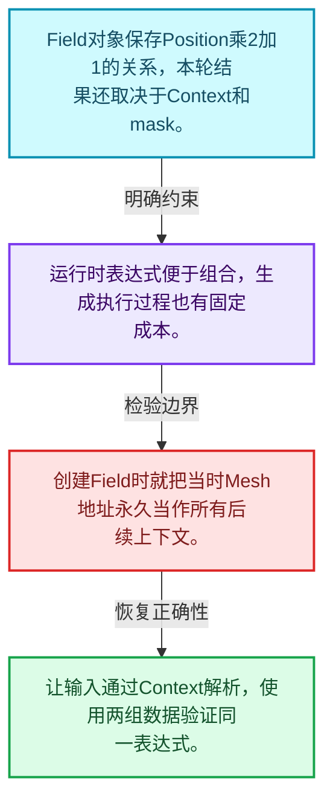
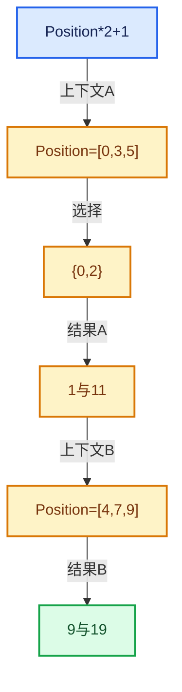

# 08-01 Field语义与表达式

[方向导航](README.md) · [总目录](../README.md) · [实现索引](../%E7%AC%A6%E5%8F%B7%E4%BE%9D%E8%B5%96%E4%B8%8E%E5%AE%9E%E7%8E%B0%E7%B4%A2%E5%BC%95.md)

## 从问题到实现

Field为什么是待求值表达式而不是已经算好的数组？

表达式描述计算，FieldContext提供具体输入，IndexMask决定处理哪些元素；三者职责不同。

**数据模型**

Field对象保存Position乘2加1的关系，本轮结果还取决于Context和mask。

**设计取舍**

运行时表达式便于组合，生成执行过程也有固定成本。

**最小反例**

创建Field时就把当时Mesh地址永久当作所有后续上下文。

**推导**

让输入通过Context解析，使用两组数据验证同一表达式。

## 阅读地图与执行推演






图中的数值推演是本方向的教学模型；实际函数之间的调用边与概念分析边分别标注，不能把概念关系当作运行时调度顺序。

## 完整源码单元与就地讲解

中文讲解直接放在相关代码旁，复杂机制在代码下展开。原文折叠区保留基准行号；不需要在行号表和函数之间来回查找。类布局可分段展示，函数实现不按固定行数切开。

### 类型布局、声明与编译条件 · FN_field.hh L1—L120

<a id="t-2fa88eb64e99"></a>

`GField`在这里声明的数据成员：

- `Variant variant_`

<a id="t-5cf685e3df85"></a>

<a id="t-caa6e6980d41"></a>

<a id="t-9bbb36653b15"></a>

<a id="t-b9b25b5a9ded"></a>

<a id="t-3da99a783974"></a>

<a id="t-b1fc34918e25"></a>

`GField`在这里声明的数据成员：

- `Variant variant_`

<a id="t-9eef7eb68ce5"></a>

`Input`在这里声明的数据成员：

- `FieldInputPtr node`

<a id="t-2889c628a92e"></a>

`MultiFn`在这里声明的数据成员：

- `FieldOperationPtr node`
- `int output_i`

<a id="t-0554c12182dd"></a>

`FieldRef`在这里声明的数据成员：

- `GField field_ref`

<a id="t-16a2f07d81b3"></a>

`ConstantRef`在这里声明的数据成员：

- `CPPType type`
- `void value`

<a id="t-fcf495a30344"></a>

`TrivialInlineConstant`在这里声明的数据成员：

- `int64_t inline_size`
- `int64_t inline_alignment`
- `bool cpp_type_supported`
- `CPPType type`
- `AlignedBuffer<inline_size, inline_alignment> value`

<a id="t-623d386376a2"></a>

`OwnedConstant`在这里声明的数据成员：

- `CPPType type`
- `void value`

<!-- annotated:4b3bffa547cf8b -->

```cpp
/* SPDX-FileCopyrightText: 2026 Blender Authors
 *
 * SPDX-License-Identifier: GPL-2.0-or-later */

#pragma once

/** \file
 * \ingroup fn
 *
 * A #Field represents a function that outputs a value based on an arbitrary number of inputs. The
 * inputs for a specific field evaluation are provided by a #FieldContext.
 *
 * A typical example is a field that computes a displacement vector for every vertex on a mesh
 * based on its position.
 *
 * Fields can be built, composed and evaluated at run-time. They are stored in a directed tree
 * graph data structure. A field may generally depend on other fields.
 *
 * When fields are evaluated, they are converted into a multi-function procedure which allows
 * efficient computation. In the future, we might support different field evaluation mechanisms for
 * e.g. the following scenarios:
 *  - Latency of a single evaluation is more important than throughput.
 *  - Evaluation should happen on other hardware like GPUs.
 *
 * Whenever possible, multiple fields should be evaluated together to avoid duplicate work when
 * they share common sub-fields and a common context.
 */

#include "BLI_cache_mutex.hh"
#include "BLI_implicit_sharing_ptr.hh"
#include "BLI_vector_set.hh"

#include "FN_multi_function.hh"

namespace blender::fn {

class GField;
class FieldInput;
class FieldOperation;
class FieldInputs;
class FieldContext;

using FieldInputPtr = ImplicitSharingPtr<FieldInput>;
using FieldOperationPtr = ImplicitSharingPtr<FieldOperation>;
using FieldInputsPtr = ImplicitSharingPtr<FieldInputs>;
template<typename T> class Field;

/**
 * A field with a type that is only known at runtime which can be accessed through the #cpp_type
 * method. If the type is known at compile time, it is recommended to use #Field<T> instead.
 *
 * It is designed to support various internal storage representations to avoid unnecessary
 * allocations or reference counting in many common cases.
 */
class GField {
 public:
  struct Input {
    FieldInputPtr node;
  };

  struct MultiFn {
    FieldOperationPtr node;
    int output_i = 0;
  };

  /**
   * Allows referencing another field without owning it. This helps with fields that are highly
   * reused like the position field because it avoids reference counting..
   */
  struct FieldRef {
    const GField *field_ref = nullptr;
  };

  struct ConstantRef {
    const CPPType *type = nullptr;
    /** This value is not owned. Typically it has static lifetime. */
    const void *value = nullptr;
  };

  /**
   * Allows storing constants inside of #GField without any additional memory allocation.
   */
  struct TrivialInlineConstant {
    static constexpr int64_t inline_size = 16;
    static constexpr int64_t inline_alignment = 8;

    template<typename T>
    static constexpr bool type_supported_v = std::is_trivially_destructible_v<T> &&
                                             std::is_trivially_copyable_v<T> &&
                                             sizeof(T) <= inline_size &&
                                             alignof(T) <= inline_alignment;

    static bool cpp_type_supported(const CPPType &type);

    const CPPType *type = nullptr;
    AlignedBuffer<inline_size, inline_alignment> value;
  };

  /** Used for storing constants that can't be inlined. */
  struct OwnedConstant {
    const CPPType *type = nullptr;
    /* This value is owned by the #GField. */
    void *value = nullptr;
  };

  template<typename T>
  static constexpr bool is_constant_value_v =
      is_same_any_v<T, ConstantRef, TrivialInlineConstant, OwnedConstant>;

  using Variant =
      std::variant<Input, MultiFn, FieldRef, ConstantRef, TrivialInlineConstant, OwnedConstant>;

 private:
  Variant variant_;

 public:
  /**
   * #GField is expected to always have a valid #CPPType. Therefore, it can't be default
   * constructed.
   */
```

<details>
<summary>核对原始源码：source/blender/functions/FN_field.hh · L1—L120</summary>

<!-- original:4b3bffa547cf8b:source/blender/functions/FN_field.hh:1:120 -->

```cpp
/* SPDX-FileCopyrightText: 2026 Blender Authors
 *
 * SPDX-License-Identifier: GPL-2.0-or-later */

#pragma once

/** \file
 * \ingroup fn
 *
 * A #Field represents a function that outputs a value based on an arbitrary number of inputs. The
 * inputs for a specific field evaluation are provided by a #FieldContext.
 *
 * A typical example is a field that computes a displacement vector for every vertex on a mesh
 * based on its position.
 *
 * Fields can be built, composed and evaluated at run-time. They are stored in a directed tree
 * graph data structure. A field may generally depend on other fields.
 *
 * When fields are evaluated, they are converted into a multi-function procedure which allows
 * efficient computation. In the future, we might support different field evaluation mechanisms for
 * e.g. the following scenarios:
 *  - Latency of a single evaluation is more important than throughput.
 *  - Evaluation should happen on other hardware like GPUs.
 *
 * Whenever possible, multiple fields should be evaluated together to avoid duplicate work when
 * they share common sub-fields and a common context.
 */

#include "BLI_cache_mutex.hh"
#include "BLI_implicit_sharing_ptr.hh"
#include "BLI_vector_set.hh"

#include "FN_multi_function.hh"

namespace blender::fn {

class GField;
class FieldInput;
class FieldOperation;
class FieldInputs;
class FieldContext;

using FieldInputPtr = ImplicitSharingPtr<FieldInput>;
using FieldOperationPtr = ImplicitSharingPtr<FieldOperation>;
using FieldInputsPtr = ImplicitSharingPtr<FieldInputs>;
template<typename T> class Field;

/**
 * A field with a type that is only known at runtime which can be accessed through the #cpp_type
 * method. If the type is known at compile time, it is recommended to use #Field<T> instead.
 *
 * It is designed to support various internal storage representations to avoid unnecessary
 * allocations or reference counting in many common cases.
 */
class GField {
 public:
  struct Input {
    FieldInputPtr node;
  };

  struct MultiFn {
    FieldOperationPtr node;
    int output_i = 0;
  };

  /**
   * Allows referencing another field without owning it. This helps with fields that are highly
   * reused like the position field because it avoids reference counting..
   */
  struct FieldRef {
    const GField *field_ref = nullptr;
  };

  struct ConstantRef {
    const CPPType *type = nullptr;
    /** This value is not owned. Typically it has static lifetime. */
    const void *value = nullptr;
  };

  /**
   * Allows storing constants inside of #GField without any additional memory allocation.
   */
  struct TrivialInlineConstant {
    static constexpr int64_t inline_size = 16;
    static constexpr int64_t inline_alignment = 8;

    template<typename T>
    static constexpr bool type_supported_v = std::is_trivially_destructible_v<T> &&
                                             std::is_trivially_copyable_v<T> &&
                                             sizeof(T) <= inline_size &&
                                             alignof(T) <= inline_alignment;

    static bool cpp_type_supported(const CPPType &type);

    const CPPType *type = nullptr;
    AlignedBuffer<inline_size, inline_alignment> value;
  };

  /** Used for storing constants that can't be inlined. */
  struct OwnedConstant {
    const CPPType *type = nullptr;
    /* This value is owned by the #GField. */
    void *value = nullptr;
  };

  template<typename T>
  static constexpr bool is_constant_value_v =
      is_same_any_v<T, ConstantRef, TrivialInlineConstant, OwnedConstant>;

  using Variant =
      std::variant<Input, MultiFn, FieldRef, ConstantRef, TrivialInlineConstant, OwnedConstant>;

 private:
  Variant variant_;

 public:
  /**
   * #GField is expected to always have a valid #CPPType. Therefore, it can't be default
   * constructed.
   */
```

</details>

## 语法与相关类型

### 模板 template

模板把类型或常量作为生成实现的参数。读声明时先列出类型参数、非类型参数和默认值，再看使用者实际实例化了什么。模板声明本身不意味着每种T都支持其全部成员。

把T替换为int、string、只能移动的类型，分别检查每个被调用操作是否成立。

### 依赖名称 typename

typename既可引入类型模板参数，也可告诉编译器某个依赖名称是类型。它不创建运行时对象；解析期确认语法类别与实例化期检查具体类型是不同阶段。

区分typename T::value_type和T::size()，前者标记类型，后者是表达式。

### 常量求值 constexpr

constexpr声明允许相应实体参与常量求值，但constexpr函数仍可以在运行时执行。是否常量求值由调用场景和表达式合法性共同决定。

比较constexpr变量初始化和从运行时输入调用同一函数。

### 只读限定 const

const约束当前访问路径可做的修改。const指针、指向const的指针、const视图对象、const元素是不同位置的限定；其他别名可能仍可修改原对象。

分别写T* const、const T*与const T* const，并画出不可修改的层次。

### 判别联合 variant

variant在若干候选类型中保存一个活动值，通过判别信息选择操作。它能把不同表示集中在值类型中，但各分支的复制移动成本不同。

列出活动分支及每种分支实际拥有或借用的数据。

### 对齐 alignof

alignof得到类型要求的地址对齐。分配足够字节后仍需把地址对齐到相应边界，内嵌缓冲也一样。

对齐a为2的幂时可推导向上取整，但仍要考虑溢出与边界。

### 对象表示 sizeof

sizeof给出对象表示大小，不是其引用的所有堆内存总量。sizeof视图很小并不说明底层数组很小。

分别统计容器对象、容量字节和元素拥有的间接资源。

### 类型别名 using

类型别名为已有类型建立名字，不创建运行期对象。它常把模板内部使用的类型统一暴露给泛型调用者。

展开别名直到基础类型，区分类型别名和变量声明。

## 实现练习与验证

同一Position加Offset表达式在两组点上执行。

参考推理：让输入通过Context解析，使用两组数据验证同一表达式。

结果与直接计算一致；多个输出共享子表达式时不改变语义；深链构造、执行、销毁三个阶段分别检查。

## 历史、跨库比较与证据

与表达式模板、AST和闭包比较：Field可在运行时组合并对不同上下文批量求值；不要把Field对象误当作固定几何的结果数组。

[历史提交索引](../%E5%8E%86%E5%8F%B2%E6%8F%90%E4%BA%A4%E4%B8%8E%E8%AE%BE%E8%AE%A1%E6%BC%94%E5%8C%96%E7%B4%A2%E5%BC%95.md) · [源码基准](../%E6%BA%90%E7%A0%81%E7%89%88%E6%9C%AC%E4%B8%8E%E8%A6%86%E7%9B%96%E7%B4%A2%E5%BC%95.md) · [验收报告](../%E9%AA%8C%E6%94%B6%E6%8A%A5%E5%91%8A.md)
