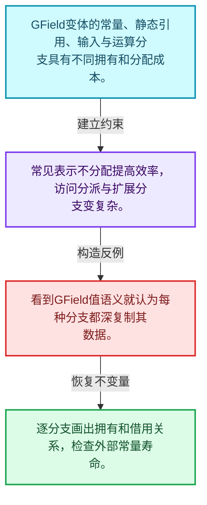
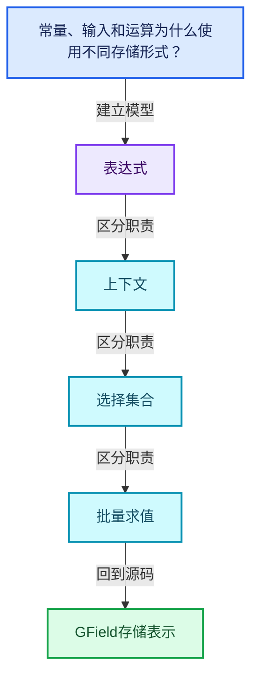
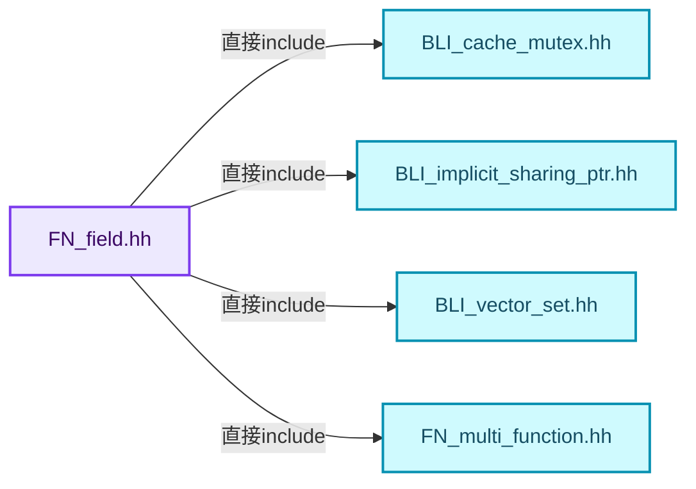
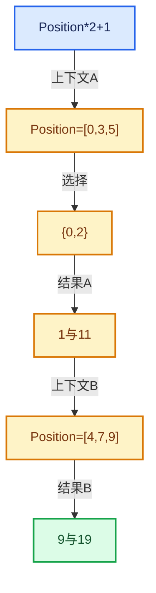

# 08-02 GField存储表示

[方向导航](README.md) · [总目录](../README.md) · [覆盖索引](../%E6%BA%90%E7%A0%81%E7%89%88%E6%9C%AC%E4%B8%8E%E8%A6%86%E7%9B%96%E7%B4%A2%E5%BC%95.md)

> 阅读顺序：问题与数据模型 → 语法与类型 → 源码逐行 → 调用线索 → 历史与取舍 → 推演和练习。

- 基准 HEAD：`cbda6b96c26c0dee3c3b5cbb93960c4ac06a6b30`。
- 记录日期：2026-10-14。
- 教学示例状态：正文中的推演不是本机性能实测；已运行练习见验收报告。

## 一、从问题到设计

常量、输入和运算为什么使用不同存储形式？

2026实现以变体容纳不同表示，常见情况减少分配或引用计数；每个分支仍需正确类型与生命周期。

本篇把语法、数据语义和系统取舍连接起来。Field表达式、求值上下文、mask与结果存储各自有独立职责和生命周期。

### 本篇独立模型与设计推理

GField变体的常量、静态引用、输入与运算分支具有不同拥有和分配成本。

设计取舍：常见表示不分配提高效率，访问分派与扩展分支变复杂。

最小反例：看到GField值语义就认为每种分支都深复制其数据。

推导与处理：逐分支画出拥有和借用关系，检查外部常量寿命。



### 源码范围与相邻篇章

| 文件 | 本篇逐行范围 | 基准SHA-256 |
|---|---|---|
| [source/blender/functions/FN_field.hh](../../../../../source/blender/functions/FN_field.hh) | L55—L202 | `4ce5d9b67e7b82f22293a3250ae787716e34c6a6b5f1afe561a000eeb6dfa112` |

同一主讲文件可能分多篇覆盖；超出本篇范围的符号通过覆盖索引定位。空行与纯注释保留在源码摘录中，逐行表解释有效语句与语法边界；许可证头统一保留。

前篇：[Field语义与表达式](01-Field%E8%AF%AD%E4%B9%89%E4%B8%8E%E8%A1%A8%E8%BE%BE%E5%BC%8F.md).

后篇：[Field类型接口](03-Field%E7%B1%BB%E5%9E%8B%E6%8E%A5%E5%8F%A3.md).

## 二、类型、数据与阅读地图



这是概念依赖图，边表示阅读关系，不声称是运行时调用顺序。

### 直接编译依赖



箭头只表示头文件包含关系；完整调用线索见后面的符号定位表。

## 三、关键词、语法与类型角色

### 模板 template

模板把类型或常量作为生成实现的参数。读声明时先列出类型参数、非类型参数和默认值，再看使用者实际实例化了什么。模板声明本身不意味着每种T都支持其全部成员。

具体检查：把T替换为int、string、只能移动的类型，分别检查每个被调用操作是否成立。

### 依赖名称 typename

typename既可引入类型模板参数，也可告诉编译器某个依赖名称是类型。它不创建运行时对象；解析期确认语法类别与实例化期检查具体类型是不同阶段。

具体检查：区分typename T::value_type和T::size()，前者标记类型，后者是表达式。

### 约束 requires

requires表达式或requires子句限制模板参与重载的条件。它提供编译期可用性检查，不是运行时if，不能指望输入到达程序后再被这一机制验证。

具体检查：构造满足和不满足约束的两个类型，观察候选被排除而不是在函数内返回错误。

### 常量求值 constexpr

constexpr声明允许相应实体参与常量求值，但constexpr函数仍可以在运行时执行。是否常量求值由调用场景和表达式合法性共同决定。

具体检查：比较constexpr变量初始化和从运行时输入调用同一函数。

### 只读限定 const

const约束当前访问路径可做的修改。const指针、指向const的指针、const视图对象、const元素是不同位置的限定；其他别名可能仍可修改原对象。

具体检查：分别写T* const、const T*与const T* const，并画出不可修改的层次。

### 异常约定 noexcept

noexcept表达式可以依赖类型特征。违反不抛异常约定会终止程序；它不是自动捕获异常，也不是资源回滚代码。

具体检查：找出声明的条件与实际可能抛出的分配、构造操作是否一致。

### 异常边界 try与catch

try定义异常传播的局部边界。失败路径需要销毁已经成功构造的部分并释放相应存储；未构造的对象不能被析构。

具体检查：在第k次构造失败，列出已经存在的对象集合与待释放缓冲。

### 判别联合 variant

variant在若干候选类型中保存一个活动值，通过判别信息选择操作。它能把不同表示集中在值类型中，但各分支的复制移动成本不同。

具体检查：列出活动分支及每种分支实际拥有或借用的数据。

### 对齐 alignof

alignof得到类型要求的地址对齐。分配足够字节后仍需把地址对齐到相应边界，内嵌缓冲也一样。

具体检查：对齐a为2的幂时可推导向上取整，但仍要考虑溢出与边界。

### 对象表示 sizeof

sizeof给出对象表示大小，不是其引用的所有堆内存总量。sizeof视图很小并不说明底层数组很小。

具体检查：分别统计容器对象、容量字节和元素拥有的间接资源。

### 构造与new表达式

普通new可能分配并构造；placement new在给定地址构造，存储由其他机制提供。失败回滚应区分两类责任。

具体检查：追踪地址来自哪里、构造何时成功、由谁析构、由谁释放。

### 受控访问 friend

friend授予指定函数或类访问非公开成员的权限，并不意味着继承，也不自动扩展到友元的派生类。

具体检查：解释执行器为何需要访问包装器的内部映射，同时检查边界是否仍清楚。

### 类型别名 using

类型别名为已有类型建立名字，不创建运行期对象。它常把模板内部使用的类型统一暴露给泛型调用者。

具体检查：展开别名直到基础类型，区分类型别名和变量声明。

## 四、真实源码与逐行讲解

源码块保持原行内容，原始行号由小节标题及逐行表给出。表中的调用定位是静态阅读辅助；重载、模板实例化、宏展开和虚调用需结合完整声明，不能仅凭词法出现证明动态调用。

### FN_field.hh：L55—L101

<!-- source:source/blender/functions/FN_field.hh:55:101 -->

```cpp
class GField {
 public:
  struct Input {
    FieldInputPtr node;
  };

  struct MultiFn {
    FieldOperationPtr node;
    int output_i = 0;
  };

  /**
   * Allows referencing another field without owning it. This helps with fields that are highly
   * reused like the position field because it avoids reference counting..
   */
  struct FieldRef {
    const GField *field_ref = nullptr;
  };

  struct ConstantRef {
    const CPPType *type = nullptr;
    /** This value is not owned. Typically it has static lifetime. */
    const void *value = nullptr;
  };

  /**
   * Allows storing constants inside of #GField without any additional memory allocation.
   */
  struct TrivialInlineConstant {
    static constexpr int64_t inline_size = 16;
    static constexpr int64_t inline_alignment = 8;

    template<typename T>
    static constexpr bool type_supported_v = std::is_trivially_destructible_v<T> &&
                                             std::is_trivially_copyable_v<T> &&
                                             sizeof(T) <= inline_size &&
                                             alignof(T) <= inline_alignment;

    static bool cpp_type_supported(const CPPType &type);

    const CPPType *type = nullptr;
    AlignedBuffer<inline_size, inline_alignment> value;
  };

  /** Used for storing constants that can't be inlined. */
  struct OwnedConstant {
    const CPPType *type = nullptr;
```

| 原始行 | 语义、约束与检查 |
|---|---|
| L55 | 声明或定义类型 `class GField`。结合继承、访问权限和成员布局确认接口与拥有关系；前向声明本身没有完整对象布局。 |
| L56 | 切换成员访问权限为 public；它是编译期接口边界，不是线程同步或内存保护。 |
| L57 | 声明或定义类型 `struct Input`。结合继承、访问权限和成员布局确认接口与拥有关系；前向声明本身没有完整对象布局。 |
| L58 | 声明成员、局部对象或完成语句 `FieldInputPtr node`。若为指针或引用，它本身不说明拥有；若为值对象，其构造析构由所在作用域或外层对象管理。 |
| L59 | 结束当前语法单元。局部自动对象在离开其作用域时按规则销毁；这不等于所有被引用的外部数据也被释放。 |
| L61 | 声明或定义类型 `struct MultiFn`。结合继承、访问权限和成员布局确认接口与拥有关系；前向声明本身没有完整对象布局。 |
| L62 | 声明成员、局部对象或完成语句 `FieldOperationPtr node`。若为指针或引用，它本身不说明拥有；若为值对象，其构造析构由所在作用域或外层对象管理。 |
| L63 | 把右侧 `0` 用于初始化或更新左侧 `int output_i`。声明初始化与已有对象赋值应按上下文区分；有资源的类型会调用相应特殊成员。 |
| L64 | 结束当前语法单元。局部自动对象在离开其作用域时按规则销毁；这不等于所有被引用的外部数据也被释放。 |
| L70 | 声明或定义类型 `struct FieldRef`。结合继承、访问权限和成员布局确认接口与拥有关系；前向声明本身没有完整对象布局。 |
| L71 | 把右侧 `nullptr` 用于初始化或更新左侧 `const GField *field_ref`。声明初始化与已有对象赋值应按上下文区分；有资源的类型会调用相应特殊成员。 |
| L72 | 结束当前语法单元。局部自动对象在离开其作用域时按规则销毁；这不等于所有被引用的外部数据也被释放。 |
| L74 | 声明或定义类型 `struct ConstantRef`。结合继承、访问权限和成员布局确认接口与拥有关系；前向声明本身没有完整对象布局。 |
| L75 | 把右侧 `nullptr` 用于初始化或更新左侧 `const CPPType *type`。声明初始化与已有对象赋值应按上下文区分；有资源的类型会调用相应特殊成员。 |
| L77 | 把右侧 `nullptr` 用于初始化或更新左侧 `const void *value`。声明初始化与已有对象赋值应按上下文区分；有资源的类型会调用相应特殊成员。 |
| L78 | 结束当前语法单元。局部自动对象在离开其作用域时按规则销毁；这不等于所有被引用的外部数据也被释放。 |
| L83 | 声明或定义类型 `struct TrivialInlineConstant`。结合继承、访问权限和成员布局确认接口与拥有关系；前向声明本身没有完整对象布局。 |
| L84 | 把右侧 `16` 用于初始化或更新左侧 `static constexpr int64_t inline_size`。声明初始化与已有对象赋值应按上下文区分；有资源的类型会调用相应特殊成员。 |
| L85 | 把右侧 `8` 用于初始化或更新左侧 `static constexpr int64_t inline_alignment`。声明初始化与已有对象赋值应按上下文区分；有资源的类型会调用相应特殊成员。 |
| L87 | 声明模板参数 `template<typename T>`。类型参数决定生成操作的类型，非类型参数可决定内嵌容量或编译期分支。 |
| L88 | 把右侧 `std::is_trivially_destructible_v<T> &&` 用于初始化或更新左侧 `static constexpr bool type_supported_v`。声明初始化与已有对象赋值应按上下文区分；有资源的类型会调用相应特殊成员。 |
| L89 | 本行是连续声明或表达式的一部分：`std::is_trivially_copyable_v<T> &&`。与本段前后行合读；逗号、括号和限定符决定它属于参数、初始化列表还是实际计算。 |
| L90 | 出现调用或函数声明 `sizeof`，对应表达式为 `sizeof(T) <= inline_size &&`。参数求值、返回类型与重载需结合前后完整语句；静态文本引用不能证明动态目标。 |
| L91 | 出现调用或函数声明 `alignof`，对应表达式为 `alignof(T) <= inline_alignment;`。参数求值、返回类型与重载需结合前后完整语句；静态文本引用不能证明动态目标。 |
| L93 | 声明接口 `static bool cpp_type_supported(const CPPType &type)`，本行没有对应函数体；返回类型、参数限定和const/noexcept共同组成调用契约，实际行为需继续定位实现。 |
| L95 | 把右侧 `nullptr` 用于初始化或更新左侧 `const CPPType *type`。声明初始化与已有对象赋值应按上下文区分；有资源的类型会调用相应特殊成员。 |
| L96 | 声明成员、局部对象或完成语句 `AlignedBuffer<inline_size, inline_alignment> value`。若为指针或引用，它本身不说明拥有；若为值对象，其构造析构由所在作用域或外层对象管理。 |
| L97 | 结束当前语法单元。局部自动对象在离开其作用域时按规则销毁；这不等于所有被引用的外部数据也被释放。 |
| L100 | 声明或定义类型 `struct OwnedConstant`。结合继承、访问权限和成员布局确认接口与拥有关系；前向声明本身没有完整对象布局。 |
| L101 | 把右侧 `nullptr` 用于初始化或更新左侧 `const CPPType *type`。声明初始化与已有对象赋值应按上下文区分；有资源的类型会调用相应特殊成员。 |

### FN_field.hh：L102—L150

<!-- source:source/blender/functions/FN_field.hh:102:150 -->

```cpp
    /* This value is owned by the #GField. */
    void *value = nullptr;
  };

  template<typename T>
  static constexpr bool is_constant_value_v =
      is_same_any_v<T, ConstantRef, TrivialInlineConstant, OwnedConstant>;

  using Variant =
      std::variant<Input, MultiFn, FieldRef, ConstantRef, TrivialInlineConstant, OwnedConstant>;

 private:
  Variant variant_;

 public:
  /**
   * #GField is expected to always have a valid #CPPType. Therefore, it can't be default
   * constructed.
   */
  GField() = delete;
  /** Construct a field that just outputs the default value of the given type. */
  explicit GField(const CPPType &type) noexcept;
  /** Construct a field owning a field input. */
  explicit GField(FieldInputPtr node) noexcept;
  /** Construct a field that owns a field operation and outputs one of its outputs. */
  explicit GField(FieldOperationPtr node, int output_i = 0) noexcept;
  /** Construct directly from a #Variant, mostly for internal use. */
  explicit GField(Variant variant) noexcept;

  /**
   * Wraps the given field in a new field. This is used to avoid reference counting for some field
   * fields which have static lifetime.
   */
  static GField from_non_owning_ref(const GField &field);

  /** Construct a field that just outputs the given constant value. */
  static GField from_constant(const CPPType &type, const void *value);

  /** Construct a field that just outputs the given constant value without owning it. */
  static GField from_non_owning_constant(const CPPType &type, const void *value);

  /** Build a new #FieldInput with the given arguments. */
  template<typename InputT, typename... Args> static GField from_input(Args &&...args);

  /**
   * #GField requires manual memory management due to inlined values and to support move semantics
   * without making #GField nullable.
   */
  GField(const GField &other);
```

| 原始行 | 语义、约束与检查 |
|---|---|
| L103 | 把右侧 `nullptr` 用于初始化或更新左侧 `void *value`。声明初始化与已有对象赋值应按上下文区分；有资源的类型会调用相应特殊成员。 |
| L104 | 结束当前语法单元。局部自动对象在离开其作用域时按规则销毁；这不等于所有被引用的外部数据也被释放。 |
| L106 | 声明模板参数 `template<typename T>`。类型参数决定生成操作的类型，非类型参数可决定内嵌容量或编译期分支。 |
| L107 | 把右侧 `` 用于初始化或更新左侧 `static constexpr bool is_constant_value_v`。声明初始化与已有对象赋值应按上下文区分；有资源的类型会调用相应特殊成员。 |
| L108 | 声明成员、局部对象或完成语句 `is_same_any_v<T, ConstantRef, TrivialInlineConstant, OwnedConstant>`。若为指针或引用，它本身不说明拥有；若为值对象，其构造析构由所在作用域或外层对象管理。 |
| L110 | 定义类型别名 `using Variant =`，为模板接口或内部实现统一命名；本行不分配该类型对象。 |
| L111 | 声明成员、局部对象或完成语句 `std::variant<Input, MultiFn, FieldRef, ConstantRef, TrivialInlineConstant, OwnedConstant>`。若为指针或引用，它本身不说明拥有；若为值对象，其构造析构由所在作用域或外层对象管理。 |
| L113 | 切换成员访问权限为 private；它是编译期接口边界，不是线程同步或内存保护。 |
| L114 | 声明成员、局部对象或完成语句 `Variant variant_`。若为指针或引用，它本身不说明拥有；若为值对象，其构造析构由所在作用域或外层对象管理。 |
| L116 | 切换成员访问权限为 public；它是编译期接口边界，不是线程同步或内存保护。 |
| L121 | 显式禁止接口：`GField() = delete;`。调用会在编译期被拒绝，常用于禁止复制或移动；这里没有释放对象或删除文件的运行时动作。 |
| L123 | 声明接口 `explicit GField(const CPPType &type) noexcept`，本行没有对应函数体；返回类型、参数限定和const/noexcept共同组成调用契约，实际行为需继续定位实现。 |
| L125 | 声明接口 `explicit GField(FieldInputPtr node) noexcept`，本行没有对应函数体；返回类型、参数限定和const/noexcept共同组成调用契约，实际行为需继续定位实现。 |
| L127 | 把右侧 `0) noexcept` 用于初始化或更新左侧 `explicit GField(FieldOperationPtr node, int output_i`。声明初始化与已有对象赋值应按上下文区分；有资源的类型会调用相应特殊成员。 |
| L129 | 声明接口 `explicit GField(Variant variant) noexcept`，本行没有对应函数体；返回类型、参数限定和const/noexcept共同组成调用契约，实际行为需继续定位实现。 |
| L135 | 声明接口 `static GField from_non_owning_ref(const GField &field)`，本行没有对应函数体；返回类型、参数限定和const/noexcept共同组成调用契约，实际行为需继续定位实现。 |
| L138 | 声明接口 `static GField from_constant(const CPPType &type, const void *value)`，本行没有对应函数体；返回类型、参数限定和const/noexcept共同组成调用契约，实际行为需继续定位实现。 |
| L141 | 声明接口 `static GField from_non_owning_constant(const CPPType &type, const void *value)`，本行没有对应函数体；返回类型、参数限定和const/noexcept共同组成调用契约，实际行为需继续定位实现。 |
| L144 | 声明模板参数 `template<typename InputT, typename... Args> static GField from_input(Args &&...args);`。类型参数决定生成操作的类型，非类型参数可决定内嵌容量或编译期分支。 |
| L150 | 出现调用或函数声明 `GField`，对应表达式为 `GField(const GField &other);`。参数求值、返回类型与重载需结合前后完整语句；静态文本引用不能证明动态目标。 |

### FN_field.hh：L151—L202

<!-- source:source/blender/functions/FN_field.hh:151:202 -->

```cpp
  GField(GField &&other) noexcept;
  GField &operator=(const GField &other);
  GField &operator=(GField &&other) noexcept;
  ~GField();

  /** The value type the field outputs for each element, e.g. float. */
  const CPPType &cpp_type() const;

  /** Root #FieldInput nodes that this field depends on. */
  const FieldInputsPtr &field_inputs() const;

  /**
   * This "normalizes" the field. Specifically, if this field is just a non-owning reference to
   * some other field, the referenced field is returned.
   */
  const GField &deref_field_ref() const;

  /** Get the underlying #Variant. */
  const Variant &variant() const;

  /** Returns true when the field depends on some input. */
  bool depends_on_input() const;

  /** Utility to access a specific input type if this field is just an input. */
  template<typename InputT> const InputT *get_input_if() const;

  const void *get_if_constant() const;

  /**
   * This only implements shallow comparison. A more deep comparison could reveal that two fields
   * are semantically the same even if this comparison is false. Deep comparison is much more
   * expensive though.
   */
  friend bool operator==(const GField &a, const GField &b);
  uint64_t hash() const;

  /**
   * Get a typed reference to this field. Note that #Field<T> happens to be identical to #GField on
   * a bit-level. So this is just a cast.
   */
  template<typename T> const Field<T> &typed() const;
  template<typename T> Field<T> &typed();

  /**
   * Attempts to take ownership of a FieldOperation stored in this field, leaving the field input.
   * It's expected to be deleted shortly after. This is necessary to avoid deep recursion when
   * destructing a field tree.
   */
  FieldOperationPtr try_extract_operation();
};

/** A version of #GField that should be used when the field type is known at compile time. */
```

| 原始行 | 语义、约束与检查 |
|---|---|
| L151 | 出现调用或函数声明 `GField`，对应表达式为 `GField(GField &&other) noexcept;`。参数求值、返回类型与重载需结合前后完整语句；静态文本引用不能证明动态目标。 |
| L152 | 运算符重载声明、定义或显式调用：`GField &operator=(const GField &other);`。结合参数和返回类型判断是赋值、索引、比较还是转换；operator=声明中的等号不是在给名为operator的变量赋值。 |
| L153 | 运算符重载声明、定义或显式调用：`GField &operator=(GField &&other) noexcept;`。结合参数和返回类型判断是赋值、索引、比较还是转换；operator=声明中的等号不是在给名为operator的变量赋值。 |
| L154 | 涉及析构接口或显式析构：`~GField();`。检查目标对象已成功构造，且资源不会在另一条清理路径再次销毁。 |
| L157 | 声明接口 `const CPPType &cpp_type() const`，本行没有对应函数体；返回类型、参数限定和const/noexcept共同组成调用契约，实际行为需继续定位实现。 |
| L160 | 声明接口 `const FieldInputsPtr &field_inputs() const`，本行没有对应函数体；返回类型、参数限定和const/noexcept共同组成调用契约，实际行为需继续定位实现。 |
| L166 | 声明接口 `const GField &deref_field_ref() const`，本行没有对应函数体；返回类型、参数限定和const/noexcept共同组成调用契约，实际行为需继续定位实现。 |
| L169 | 声明接口 `const Variant &variant() const`，本行没有对应函数体；返回类型、参数限定和const/noexcept共同组成调用契约，实际行为需继续定位实现。 |
| L172 | 声明接口 `bool depends_on_input() const`，本行没有对应函数体；返回类型、参数限定和const/noexcept共同组成调用契约，实际行为需继续定位实现。 |
| L175 | 声明模板参数 `template<typename InputT> const InputT *get_input_if() const;`。类型参数决定生成操作的类型，非类型参数可决定内嵌容量或编译期分支。 |
| L177 | 声明接口 `const void *get_if_constant() const`，本行没有对应函数体；返回类型、参数限定和const/noexcept共同组成调用契约，实际行为需继续定位实现。 |
| L184 | 运算符重载声明、定义或显式调用：`friend bool operator==(const GField &a, const GField &b);`。结合参数和返回类型判断是赋值、索引、比较还是转换；operator=声明中的等号不是在给名为operator的变量赋值。 |
| L185 | 声明接口 `uint64_t hash() const`，本行没有对应函数体；返回类型、参数限定和const/noexcept共同组成调用契约，实际行为需继续定位实现。 |
| L191 | 声明模板参数 `template<typename T> const Field<T> &typed() const;`。类型参数决定生成操作的类型，非类型参数可决定内嵌容量或编译期分支。 |
| L192 | 声明模板参数 `template<typename T> Field<T> &typed();`。类型参数决定生成操作的类型，非类型参数可决定内嵌容量或编译期分支。 |
| L199 | 出现调用或函数声明 `try_extract_operation`，对应表达式为 `FieldOperationPtr try_extract_operation();`。参数求值、返回类型与重载需结合前后完整语句；静态文本引用不能证明动态目标。 |
| L200 | 结束当前语法单元。局部自动对象在离开其作用域时按规则销毁；这不等于所有被引用的外部数据也被释放。 |

## 五、接口定位、调用线索与生命周期

### 本篇声明与实现入口

| 源码位置 | 实际声明片段 |
|---|---|
| [FN_field.hh:L55](../../../../../source/blender/functions/FN_field.hh#L55) | `class GField` |
| [FN_field.hh:L57](../../../../../source/blender/functions/FN_field.hh#L57) | `struct Input` |
| [FN_field.hh:L61](../../../../../source/blender/functions/FN_field.hh#L61) | `struct MultiFn` |
| [FN_field.hh:L70](../../../../../source/blender/functions/FN_field.hh#L70) | `struct FieldRef` |
| [FN_field.hh:L74](../../../../../source/blender/functions/FN_field.hh#L74) | `struct ConstantRef` |
| [FN_field.hh:L83](../../../../../source/blender/functions/FN_field.hh#L83) | `struct TrivialInlineConstant` |
| [FN_field.hh:L93](../../../../../source/blender/functions/FN_field.hh#L93) | `static bool cpp_type_supported(const CPPType &type);` |
| [FN_field.hh:L100](../../../../../source/blender/functions/FN_field.hh#L100) | `struct OwnedConstant` |
| [FN_field.hh:L121](../../../../../source/blender/functions/FN_field.hh#L121) | `GField() = delete;` |
| [FN_field.hh:L123](../../../../../source/blender/functions/FN_field.hh#L123) | `explicit GField(const CPPType &type) noexcept;` |
| [FN_field.hh:L125](../../../../../source/blender/functions/FN_field.hh#L125) | `explicit GField(FieldInputPtr node) noexcept;` |
| [FN_field.hh:L127](../../../../../source/blender/functions/FN_field.hh#L127) | `explicit GField(FieldOperationPtr node, int output_i = 0) noexcept;` |
| [FN_field.hh:L129](../../../../../source/blender/functions/FN_field.hh#L129) | `explicit GField(Variant variant) noexcept;` |
| [FN_field.hh:L135](../../../../../source/blender/functions/FN_field.hh#L135) | `static GField from_non_owning_ref(const GField &field);` |
| [FN_field.hh:L138](../../../../../source/blender/functions/FN_field.hh#L138) | `static GField from_constant(const CPPType &type, const void *value);` |
| [FN_field.hh:L141](../../../../../source/blender/functions/FN_field.hh#L141) | `static GField from_non_owning_constant(const CPPType &type, const void *value);` |
| [FN_field.hh:L150](../../../../../source/blender/functions/FN_field.hh#L150) | `GField(const GField &other);` |
| [FN_field.hh:L151](../../../../../source/blender/functions/FN_field.hh#L151) | `GField(GField &&other) noexcept;` |
| [FN_field.hh:L157](../../../../../source/blender/functions/FN_field.hh#L157) | `const CPPType &cpp_type() const;` |
| [FN_field.hh:L160](../../../../../source/blender/functions/FN_field.hh#L160) | `const FieldInputsPtr &field_inputs() const;` |
| [FN_field.hh:L166](../../../../../source/blender/functions/FN_field.hh#L166) | `const GField &deref_field_ref() const;` |
| [FN_field.hh:L169](../../../../../source/blender/functions/FN_field.hh#L169) | `const Variant &variant() const;` |
| [FN_field.hh:L172](../../../../../source/blender/functions/FN_field.hh#L172) | `bool depends_on_input() const;` |
| [FN_field.hh:L175](../../../../../source/blender/functions/FN_field.hh#L175) | `template<typename InputT> const InputT *get_input_if() const;` |
| [FN_field.hh:L177](../../../../../source/blender/functions/FN_field.hh#L177) | `const void *get_if_constant() const;` |
| [FN_field.hh:L185](../../../../../source/blender/functions/FN_field.hh#L185) | `uint64_t hash() const;` |
| [FN_field.hh:L191](../../../../../source/blender/functions/FN_field.hh#L191) | `template<typename T> const Field<T> &typed() const;` |
| [FN_field.hh:L192](../../../../../source/blender/functions/FN_field.hh#L192) | `template<typename T> Field<T> &typed();` |
| [FN_field.hh:L199](../../../../../source/blender/functions/FN_field.hh#L199) | `FieldOperationPtr try_extract_operation();` |

### 同名符号出现位置

以下表提供跨文件阅读入口，包含声明、调用或测试使用；没有经过完整C++名称解析，不把它命名为已证明的运行时调用图。

| 符号 | 位置 | 文本证据 |
|---|---|---|
| `cpp_type_supported` | [field.cc:L26](../../../../../source/blender/functions/intern/field.cc#L26) | `if (TrivialInlineConstant::cpp_type_supported(type)) {` |
| `GField` | [FN_field_evaluation.hh:L82](../../../../../source/blender/functions/FN_field_evaluation.hh#L82) | `return this->add_with_destination(GField(std::move(field)), GVMutableArray(std::move(dst)));` |
| `GField` | [field.cc:L30](../../../../../source/blender/functions/intern/field.cc#L30) | `return GField(constant);` |
| `GField` | [field.cc:L34](../../../../../source/blender/functions/intern/field.cc#L34) | `return GField(OwnedConstant{&type, new_value});` |
| `from_non_owning_ref` | [BKE_geometry_fields.hh:L358](../../../../../source/blender/blenkernel/BKE_geometry_fields.hh#L358) | `static const auto field_ref = fn::Field<T>::from_non_owning_ref(field);` |
| `from_non_owning_ref` | [geometry_fields.cc:L577](../../../../../source/blender/blenkernel/intern/geometry_fields.cc#L577) | `static const fn::Field<int> field_ref = fn::Field<int>::from_non_owning_ref(field);` |
| `from_non_owning_ref` | [geometry_fields.cc:L903](../../../../../source/blender/blenkernel/intern/geometry_fields.cc#L903) | `static const fn::Field<float3> field_ref = fn::Field<float3>::from_non_owning_ref(field);` |
| `from_constant` | [field.cc:L24](../../../../../source/blender/functions/intern/field.cc#L24) | `GField GField::from_constant(const CPPType &type, const void *value)` |
| `from_constant` | [field_evaluation.cc:L530](../../../../../source/blender/functions/intern/field_evaluation.cc#L530) | `GField new_field = GField::from_constant(type, buffer);` |
| `from_constant` | [field_evaluation.cc:L605](../../../../../source/blender/functions/intern/field_evaluation.cc#L605) | `fields.append(GFieldRef::from_constant(CPPType::get<bool>(), &true_value));` |
| `cpp_type` | [geometry_fields.cc:L630](../../../../../source/blender/blenkernel/intern/geometry_fields.cc#L630) | `: bke::GeometryFieldInput(value_field.cpp_type(), "Evaluate at Index"),` |
| `cpp_type` | [geometry_fields.cc:L716](../../../../../source/blender/blenkernel/intern/geometry_fields.cc#L716) | `builder.single_output("Value", src_field_.cpp_type());` |
| `cpp_type` | [geometry_fields.cc:L767](../../../../../source/blender/blenkernel/intern/geometry_fields.cc#L767) | `: bke::GeometryFieldInput(field.cpp_type(), "Evaluate on Domain"),` |
| `field_inputs` | [geometry_fields.cc:L1205](../../../../../source/blender/blenkernel/intern/geometry_fields.cc#L1205) | `const fn::FieldInputsPtr &field_inputs = field.field_inputs();` |
| `field_inputs` | [geometry_fields.cc:L1255](../../../../../source/blender/blenkernel/intern/geometry_fields.cc#L1255) | `const fn::FieldInputsPtr &field_inputs = field.field_inputs();` |
| `field_inputs` | [field.cc:L175](../../../../../source/blender/functions/intern/field.cc#L175) | `const FieldInputsPtr &FieldInput::field_inputs() const` |
| `deref_field_ref` | [field.cc:L39](../../../../../source/blender/functions/intern/field.cc#L39) | `const GField &a_ref = a.deref_field_ref();` |
| `deref_field_ref` | [field.cc:L40](../../../../../source/blender/functions/intern/field.cc#L40) | `const GField &b_ref = b.deref_field_ref();` |
| `deref_field_ref` | [field.cc:L89](../../../../../source/blender/functions/intern/field.cc#L89) | `const GField &ref = this->deref_field_ref();` |
| `variant` | [BKE_geometry_fields.hh:L247](../../../../../source/blender/blenkernel/BKE_geometry_fields.hh#L247) | `NativeFieldDomain(const None & ) : variant(None{}) {}` |
| `variant` | [BKE_geometry_fields.hh:L248](../../../../../source/blender/blenkernel/BKE_geometry_fields.hh#L248) | `NativeFieldDomain(const Domain &domain) : variant(domain) {}` |
| `variant` | [BKE_geometry_fields.hh:L249](../../../../../source/blender/blenkernel/BKE_geometry_fields.hh#L249) | `NativeFieldDomain(const Constant & ) : variant(Constant{}) {}` |
| `depends_on_input` | [geometry_fields.cc:L1019](../../../../../source/blender/blenkernel/intern/geometry_fields.cc#L1019) | `const bool selection_is_full = !selection.depends_on_input() &&` |
| `depends_on_input` | [geometry_fields.cc:L1077](../../../../../source/blender/blenkernel/intern/geometry_fields.cc#L1077) | `if (field.depends_on_input() &#124;&#124; !selection_is_full) {` |
| `depends_on_input` | [field_evaluation.cc:L509](../../../../../source/blender/functions/intern/field_evaluation.cc#L509) | `if (field.depends_on_input()) {` |
| `hash` | [BKE_geometry_set.hh:L470](../../../../../source/blender/blenkernel/BKE_geometry_set.hh#L470) | `uint64_t hash() const` |
| `hash` | [BLI_array.hh:L376](../../../../../source/blender/blenlib/BLI_array.hh#L376) | `uint64_t hash() const` |
| `hash` | [BLI_array.hh:L378](../../../../../source/blender/blenlib/BLI_array.hh#L378) | `return this->as_span().hash();` |
| `typed` | [BKE_attribute.hh:L318](../../../../../source/blender/blenkernel/BKE_attribute.hh#L318) | `template<typename T> AttributeReader<T> typed() const` |
| `typed` | [BKE_attribute.hh:L344](../../../../../source/blender/blenkernel/BKE_attribute.hh#L344) | `template<typename T> AttributeWriter<T> typed() const` |
| `typed` | [BLI_generic_span.hh:L92](../../../../../source/blender/blenlib/BLI_generic_span.hh#L92) | `template<typename T> Span<T> typed() const` |

### 生命周期推理图


这是审查生命周期的通用模型。具体类是否拥有数据由本篇成员、构造、析构和调用者一起证明；任何箭头都不自动代表shared_ptr。

## 六、把代码放进具体数据中推演

本方向的共同数值模型如下。本篇的专门检查是：画出常量、静态引用和运算输出的存储差异。

| 步骤 | 数据或状态 | 为什么需要这一步 |
|---|---|---|
| 表达式 | Position*2+1 | 尚未绑定具体数组 |
| 上下文A | Position=[0,3,5] | 输入有3个元素 |
| 选择 | {0,2} | 只要求元素0和2 |
| 结果A | 1与11 | 元素1不属于本轮要求 |
| 上下文B | Position=[4,7,9] | 复用表达式而改变环境 |
| 结果B | 9与19 | 结果由表达式和上下文共同决定 |



图是教学推演模型；精确分支与状态更新以本篇摘录及调用契约为准。

### 本篇独立练习与参考思路

画出常量、静态引用和运算输出的存储差异。

参考思路：2026实现以变体容纳不同表示，常见情况减少分配或引用计数；每个分支仍需正确类型与生命周期。

将输入、预期结果和资源责任分成三张清单。先用最直接的实现给出可核对的答案，再替换成对应源码使用的表示；比较结果不变的条件，而不是只比较接口名字。

验收依据：结果与直接计算一致；多个输出共享子表达式时不改变语义；深链构造、执行、销毁三个阶段分别检查。

## 七、复杂度、设计取舍与其他基础库

与表达式模板、AST和闭包比较：Field可在运行时组合并对不同上下文批量求值；不要把Field对象误当作固定几何的结果数组。

本篇的具体取舍：2026实现以变体容纳不同表示，常见情况减少分配或引用计数；每个分支仍需正确类型与生命周期。

| 观察维度 | 从源码取得证据的方法 | 本篇要避免的误判 |
|---|---|---|
| 时间 | 对循环次数、分派次数和重建频率分别计数 | 看到单次常数操作就断定整个操作序列是常数成本 |
| 内存 | 区分对象本体、容量存储、间接资源和共享控制块 | 用sizeof代替总内存 |
| 安全 | 沿构造、失败回滚、销毁与失效逐路径检查 | 把断言或非空指针当作完整安全证明 |
| 并发 | 逐字段确认锁、发布顺序和借用寿命 | 把引用计数线程安全等同数据读写线程安全 |

相关一手资料：

- [C++公开工作草案](https://eel.is/c++draft/)：持续更新的工作草案；语言与标准库语义以相应章节为准。
- [Blender依赖图设计](https://developer.blender.org/docs/features/core/depsgraph/)：包含历史设计背景，当前行为以本地源码为准。

资料用于核对契约和进一步阅读；这里没有声称外部库与Blender实现相同，也没有把上游性能数字当作本机实测。

## 八、历史提交与设计演化

### 2021-09-09 · Jacques Lucke

[Geometry Nodes: fields and anonymous attributes](https://projects.blender.org/blender/blender/commit/bf47fb40fd6f0ee9386e9936cf213a1049c55b61)

完整哈希：`bf47fb40fd6f0ee9386e9936cf213a1049c55b61`。提交标题与作者日期来自本地Git对象。

提交说明原文（历史证据，不能直接作为当前API说明）：

```text
Geometry Nodes: fields and anonymous attributes

This implements the initial core framework for fields and anonymous
attributes (also see T91274).

The new functionality is hidden behind the "Geometry Nodes Fields"
feature flag. When enabled in the user preferences, the following
new nodes become available: `Position`, `Index`, `Normal`,
`Set Position` and `Attribute Capture`.

Socket inspection has not been updated to work with fields yet.

Besides these changes at the user level, this patch contains the
ground work for:
* building and evaluating fields at run-time (`FN_fields.hh`) and
* creating and accessing anonymous attributes on geometry
  (`BKE_anonymous_attribute.h`).

For evaluating fields we use a new so called multi-function procedure
(`FN_multi_function_procedure.hh`). It allows composing multi-functions
in arbitrary ways and supports efficient evaluation as is required by
fields. See `FN_multi_function_procedure.hh` for more details on how
this evaluation mechanism can be used.

A new `AttributeIDRef` has been added which allows handling named
and anonymous attributes in the same way in many places.

Hans and I worked on this patch together.

Differential Revision: https://developer.blender.org/D12414
```

阅读任务：先根据说明复述旧问题，提出一个自己的修复方案，再对照diff。结合本篇重点“常量、输入和运算为什么使用不同存储形式？”判断方案改变的是表示、接口、生命周期还是调度。

### 2026-04-02 · Jacques Lucke

[Refactor: Functions: update field storage and API](https://projects.blender.org/blender/blender/commit/66bee9561ba6b7ce89f0f95f4ed0420360c69924)

完整哈希：`66bee9561ba6b7ce89f0f95f4ed0420360c69924`。提交标题与作者日期来自本地Git对象。

提交说明原文（历史证据，不能直接作为当前API说明）：

```text
Refactor: Functions: update field storage and API

This reimplements the entire field API. Large parts of the API surface is the
same, but how a field is stored has change significantly.

The main motivating goals for this refactor were:
* Support storing single value fields without doing an allocation.
* Support referencing common fields without doing reference counting (e.g. the
  position field).

On top of these goals, a few other improvements were done:
* Field types are not nullable anymore. So one needs to use `std::optional` in
  such cases. This also implies that `GField` can't be default-constructed
  anymore because then it wouldn't have a type.
* Field comparisons are shallow now. Previously one could easily do a deep
  comparison of nested field inputs.
* `GField` now stores a `std::variant` to support different internal storage
  types, making it more easily extensible.

In my test file that is adapted from #156308 I get a speedup from 60ms to 54ms
of the modifier evaluation time.

Pull Request: https://projects.blender.org/blender/blender/pulls/156723
```

阅读任务：先根据说明复述旧问题，提出一个自己的修复方案，再对照diff。结合本篇重点“常量、输入和运算为什么使用不同存储形式？”判断方案改变的是表示、接口、生命周期还是调度。

### 2026-06-01 · Jacques Lucke

[Fix #157485: avoid deep recursion when freeing field trees](https://projects.blender.org/blender/blender/commit/32f550c35ab3ffd89a8e8a602e4045e4091e044c)

完整哈希：`32f550c35ab3ffd89a8e8a602e4045e4091e044c`。提交标题与作者日期来自本地Git对象。

提交说明原文（历史证据，不能直接作为当前API说明）：

```text
Fix #157485: avoid deep recursion when freeing field trees

Destructing large fields could result in deep call stacks because of
long ownership chains. This could result in stack overflows leading
to crashes. The fix is to customize the destruction code a bit so that
it becomes more iterative instead of recursive.

Pull Request: https://projects.blender.org/blender/blender/pulls/159375
```

阅读任务：先根据说明复述旧问题，提出一个自己的修复方案，再对照diff。结合本篇重点“常量、输入和运算为什么使用不同存储形式？”判断方案改变的是表示、接口、生命周期还是调度。

## 九、反例、测试入口与掌握标准

仓库测试入口：

- [FN_field_test.cc](../../../../../source/blender/functions/tests/FN_field_test.cc)：阅读输入、断言与覆盖边界；本篇不把“存在测试”写成“本轮已运行”。

需要实际构造的反例：

- 空输入或没有结果需求：确认接口允许的空状态与不允许访问的操作。
- 边界位置和退化结构：把长度为1、末尾位置、重复值或深链代入真实分支。
- 生命周期结束或修改之后：检查保存的指针、引用、结果视图是否仍有效。
- 与本篇核心不变量相冲突的输入：画出常量、静态引用和运算输出的存储差异。

### 可运行的教学参考程序

[reference_exercises.cc](../_tools/reference_exercises.cc)包含独立于Blender的C++20参考检查：视图、简化SmallVector、异常回滚、哈希碰撞与删除、偏移数组、拓扑映射、共享缓存、表达式、惰性分支、闭包和暴力最近邻。

参考程序有意省略生产实现的完整能力。例如SmallVector禁止复制移动容器，不支持只能移动的元素，并禁止append参数别名到自身元素；TinyMap固定8槽，不提供增长。程序通过不能替代Blender实现测试。实际运行结果、编译器与命令见验收报告。

掌握标准：离开源码解释“常量、输入和运算为什么使用不同存储形式？”；独立完成上述练习；能指出一个会破坏表达式相关约束的最小反例，并用具体代码行说明检查或修复应放在哪里。
