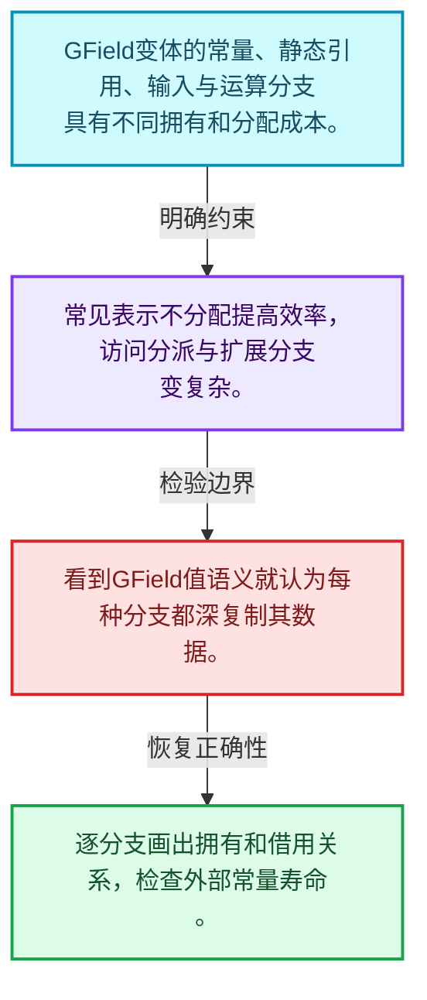
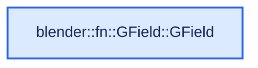
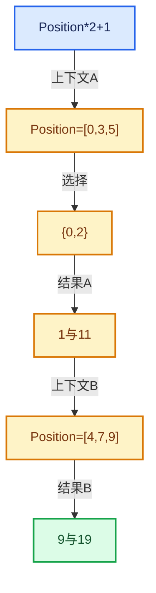

# 08-02 GField存储表示

[方向导航](README.md) · [总目录](../README.md) · [实现索引](../%E7%AC%A6%E5%8F%B7%E4%BE%9D%E8%B5%96%E4%B8%8E%E5%AE%9E%E7%8E%B0%E7%B4%A2%E5%BC%95.md)

## 从问题到实现

常量、输入和运算为什么使用不同存储形式？

2026实现以变体容纳不同表示，常见情况减少分配或引用计数；每个分支仍需正确类型与生命周期。

**数据模型**

GField变体的常量、静态引用、输入与运算分支具有不同拥有和分配成本。

**设计取舍**

常见表示不分配提高效率，访问分派与扩展分支变复杂。

**最小反例**

看到GField值语义就认为每种分支都深复制其数据。

**推导**

逐分支画出拥有和借用关系，检查外部常量寿命。

## 阅读地图与执行推演








图中的数值推演是本方向的教学模型；实际函数之间的调用边与概念分析边分别标注，不能把概念关系当作运行时调度顺序。

## 完整源码单元与就地讲解

中文讲解直接放在相关代码旁，复杂机制在代码下展开。原文折叠区保留基准行号；不需要在行号表和函数之间来回查找。类布局可分段展示，函数实现不按固定行数切开。

<a id="f-05b8cf641fd81420"></a>

### `blender::fn::GField::GField`

实现位置：[source/blender/functions/FN_field.hh](../../../../../source/blender/functions/FN_field.hh) · L121—L121。

**教学注释版**

<!-- annotated:98ec30a6f9e7cd -->

```cpp
  GField() = delete;
```

<details>
<summary>核对原始源码：source/blender/functions/FN_field.hh · L121—L121</summary>

<!-- original:98ec30a6f9e7cd:source/blender/functions/FN_field.hh:121:121 -->

```cpp
  GField() = delete;
```

</details>

**继续追踪实现**

本实现没有需要继续展开的显式调用；检查返回表达式、对象转换和调用者前置条件。

### 类型布局、声明与编译条件 · FN_field.hh L122—L292

<a id="t-2e8886b3200b"></a>

`Field`在这里声明的数据成员：

- `GField field_`
- `bool depends_on_input`
- `uint64_t hash`
- `Field from_non_owning_ref`

<a id="t-305d959f1d67"></a>

`GFieldRef`在这里声明的数据成员：

- `Variant variant_`
- `Variant variant`
- `CPPType cpp_type`
- `FieldInputsPtr field_inputs`
- `uint64_t hash`
- `GFieldRef from_constant`

<a id="t-c10039d00c56"></a>

`Value`在这里声明的数据成员：

- `CPPType type`
- `void value`

<a id="t-93df5cc13ad4"></a>

`Input`在这里声明的数据成员：

- `FieldInput node`

<a id="t-81f1c124511c"></a>

`MultiFn`在这里声明的数据成员：

- `FieldOperation node`
- `int output_i`

<a id="t-d205f184751b"></a>

<!-- annotated:06c2965a4939df -->

```cpp
  /** Construct a field that just outputs the default value of the given type. */
  explicit GField(const CPPType &type) noexcept;
  /** Construct a field owning a field input. */
  explicit GField(FieldInputPtr node) noexcept;
  /** Construct a field that owns a field operation and outputs one of its outputs. */
  explicit GField(FieldOperationPtr node, int output_i = 0) noexcept;
  /** Construct directly from a #Variant, mostly for internal use. */
  explicit GField(Variant variant) noexcept;

  /**
   * Wraps the given field in a new field. This is used to avoid reference counting for some field
   * fields which have static lifetime.
   */
  static GField from_non_owning_ref(const GField &field);

  /** Construct a field that just outputs the given constant value. */
  static GField from_constant(const CPPType &type, const void *value);

  /** Construct a field that just outputs the given constant value without owning it. */
  static GField from_non_owning_constant(const CPPType &type, const void *value);

  /** Build a new #FieldInput with the given arguments. */
  template<typename InputT, typename... Args> static GField from_input(Args &&...args);

  /**
   * #GField requires manual memory management due to inlined values and to support move semantics
   * without making #GField nullable.
   */
  GField(const GField &other);
  GField(GField &&other) noexcept;
  GField &operator=(const GField &other);
  GField &operator=(GField &&other) noexcept;
  ~GField();

  /** The value type the field outputs for each element, e.g. float. */
  const CPPType &cpp_type() const;

  /** Root #FieldInput nodes that this field depends on. */
  const FieldInputsPtr &field_inputs() const;

  /**
   * This "normalizes" the field. Specifically, if this field is just a non-owning reference to
   * some other field, the referenced field is returned.
   */
  const GField &deref_field_ref() const;

  /** Get the underlying #Variant. */
  const Variant &variant() const;

  /** Returns true when the field depends on some input. */
  bool depends_on_input() const;

  /** Utility to access a specific input type if this field is just an input. */
  template<typename InputT> const InputT *get_input_if() const;

  const void *get_if_constant() const;

  /**
   * This only implements shallow comparison. A more deep comparison could reveal that two fields
   * are semantically the same even if this comparison is false. Deep comparison is much more
   * expensive though.
   */
  friend bool operator==(const GField &a, const GField &b);
  uint64_t hash() const;

  /**
   * Get a typed reference to this field. Note that #Field<T> happens to be identical to #GField on
   * a bit-level. So this is just a cast.
   */
  template<typename T> const Field<T> &typed() const;
  template<typename T> Field<T> &typed();

  /**
   * Attempts to take ownership of a FieldOperation stored in this field, leaving the field input.
   * It's expected to be deleted shortly after. This is necessary to avoid deep recursion when
   * destructing a field tree.
   */
  FieldOperationPtr try_extract_operation();
};

/** A version of #GField that should be used when the field type is known at compile time. */
template<typename T> class Field {
 public:
  using base_type = T;
  using generic_type = GField;

 private:
  /**
   * #Field<T> just stores a #GField. This makes converting between the two types easy.
   */
  GField field_;

  friend GField;

 public:
  /**
   * Unlike #GField, default construction is allowed here, because the type is known without extra
   * arguments.
   */
  Field();

  /** Same as corresponding #GField constructors. */
  explicit Field(FieldInputPtr node);
  explicit Field(FieldOperationPtr node, int output_i = 0);

  /** Construct a field that just outputs the given value. */
  explicit Field(T value);

  /** This is implicitly cast to #GField which is always valid. */
  operator const GField &() const;

  /** These are the same as the corresponding #GField methods. */
  bool depends_on_input() const;
  template<typename InputT, typename... Args> static Field from_input(Args &&...args);
  template<typename InputT> const InputT *get_input_if() const;
  uint64_t hash() const;
  static Field from_non_owning_ref(const Field &field);
};

/**
 * A version of #GField that only references data from other fields but does not own any data
 * itself. This allows it to be smaller and trivially copyable making it more efficient in some
 * contexts. This is mainly used during field evaluation.
 */
class GFieldRef {
 public:
  struct Value {
    const CPPType *type = nullptr;
    const void *value = nullptr;
  };
  struct Input {
    const FieldInput *node = nullptr;
  };
  struct MultiFn {
    const FieldOperation *node = nullptr;
    int output_i = 0;
  };

  using Variant = std::variant<Value, Input, MultiFn>;

 private:
  Variant variant_;

 public:
  /**
   * Create a reference to the given fields. The caller is responsible for making sure that the
   * referenced data stays valid.
   */
  GFieldRef(const GField &field);
  template<typename T> GFieldRef(const Field<T> &field);
  explicit GFieldRef(const FieldInput &field_input);
  explicit GFieldRef(const FieldOperation &field_multi_fn, int output_i = 0);
  explicit GFieldRef(Variant variant);

  /** Get access to the underlying #Variant. */
  const Variant &variant() const;

  /** These are the same as the corresponding #GField methods. */
  const CPPType &cpp_type() const;
  const FieldInputsPtr &field_inputs() const;
  uint64_t hash() const;

  static GFieldRef from_constant(const CPPType &type, const void *value);
};

/**
 * A field is always evaluated in some context. This context determines the value of the field
 * inputs.
 */
class FieldContext {
 public:
```

<details>
<summary>核对原始源码：source/blender/functions/FN_field.hh · L122—L292</summary>

<!-- original:06c2965a4939df:source/blender/functions/FN_field.hh:122:292 -->

```cpp
  /** Construct a field that just outputs the default value of the given type. */
  explicit GField(const CPPType &type) noexcept;
  /** Construct a field owning a field input. */
  explicit GField(FieldInputPtr node) noexcept;
  /** Construct a field that owns a field operation and outputs one of its outputs. */
  explicit GField(FieldOperationPtr node, int output_i = 0) noexcept;
  /** Construct directly from a #Variant, mostly for internal use. */
  explicit GField(Variant variant) noexcept;

  /**
   * Wraps the given field in a new field. This is used to avoid reference counting for some field
   * fields which have static lifetime.
   */
  static GField from_non_owning_ref(const GField &field);

  /** Construct a field that just outputs the given constant value. */
  static GField from_constant(const CPPType &type, const void *value);

  /** Construct a field that just outputs the given constant value without owning it. */
  static GField from_non_owning_constant(const CPPType &type, const void *value);

  /** Build a new #FieldInput with the given arguments. */
  template<typename InputT, typename... Args> static GField from_input(Args &&...args);

  /**
   * #GField requires manual memory management due to inlined values and to support move semantics
   * without making #GField nullable.
   */
  GField(const GField &other);
  GField(GField &&other) noexcept;
  GField &operator=(const GField &other);
  GField &operator=(GField &&other) noexcept;
  ~GField();

  /** The value type the field outputs for each element, e.g. float. */
  const CPPType &cpp_type() const;

  /** Root #FieldInput nodes that this field depends on. */
  const FieldInputsPtr &field_inputs() const;

  /**
   * This "normalizes" the field. Specifically, if this field is just a non-owning reference to
   * some other field, the referenced field is returned.
   */
  const GField &deref_field_ref() const;

  /** Get the underlying #Variant. */
  const Variant &variant() const;

  /** Returns true when the field depends on some input. */
  bool depends_on_input() const;

  /** Utility to access a specific input type if this field is just an input. */
  template<typename InputT> const InputT *get_input_if() const;

  const void *get_if_constant() const;

  /**
   * This only implements shallow comparison. A more deep comparison could reveal that two fields
   * are semantically the same even if this comparison is false. Deep comparison is much more
   * expensive though.
   */
  friend bool operator==(const GField &a, const GField &b);
  uint64_t hash() const;

  /**
   * Get a typed reference to this field. Note that #Field<T> happens to be identical to #GField on
   * a bit-level. So this is just a cast.
   */
  template<typename T> const Field<T> &typed() const;
  template<typename T> Field<T> &typed();

  /**
   * Attempts to take ownership of a FieldOperation stored in this field, leaving the field input.
   * It's expected to be deleted shortly after. This is necessary to avoid deep recursion when
   * destructing a field tree.
   */
  FieldOperationPtr try_extract_operation();
};

/** A version of #GField that should be used when the field type is known at compile time. */
template<typename T> class Field {
 public:
  using base_type = T;
  using generic_type = GField;

 private:
  /**
   * #Field<T> just stores a #GField. This makes converting between the two types easy.
   */
  GField field_;

  friend GField;

 public:
  /**
   * Unlike #GField, default construction is allowed here, because the type is known without extra
   * arguments.
   */
  Field();

  /** Same as corresponding #GField constructors. */
  explicit Field(FieldInputPtr node);
  explicit Field(FieldOperationPtr node, int output_i = 0);

  /** Construct a field that just outputs the given value. */
  explicit Field(T value);

  /** This is implicitly cast to #GField which is always valid. */
  operator const GField &() const;

  /** These are the same as the corresponding #GField methods. */
  bool depends_on_input() const;
  template<typename InputT, typename... Args> static Field from_input(Args &&...args);
  template<typename InputT> const InputT *get_input_if() const;
  uint64_t hash() const;
  static Field from_non_owning_ref(const Field &field);
};

/**
 * A version of #GField that only references data from other fields but does not own any data
 * itself. This allows it to be smaller and trivially copyable making it more efficient in some
 * contexts. This is mainly used during field evaluation.
 */
class GFieldRef {
 public:
  struct Value {
    const CPPType *type = nullptr;
    const void *value = nullptr;
  };
  struct Input {
    const FieldInput *node = nullptr;
  };
  struct MultiFn {
    const FieldOperation *node = nullptr;
    int output_i = 0;
  };

  using Variant = std::variant<Value, Input, MultiFn>;

 private:
  Variant variant_;

 public:
  /**
   * Create a reference to the given fields. The caller is responsible for making sure that the
   * referenced data stays valid.
   */
  GFieldRef(const GField &field);
  template<typename T> GFieldRef(const Field<T> &field);
  explicit GFieldRef(const FieldInput &field_input);
  explicit GFieldRef(const FieldOperation &field_multi_fn, int output_i = 0);
  explicit GFieldRef(Variant variant);

  /** Get access to the underlying #Variant. */
  const Variant &variant() const;

  /** These are the same as the corresponding #GField methods. */
  const CPPType &cpp_type() const;
  const FieldInputsPtr &field_inputs() const;
  uint64_t hash() const;

  static GFieldRef from_constant(const CPPType &type, const void *value);
};

/**
 * A field is always evaluated in some context. This context determines the value of the field
 * inputs.
 */
class FieldContext {
 public:
```

</details>

## 语法与相关类型

### 模板 template

模板把类型或常量作为生成实现的参数。读声明时先列出类型参数、非类型参数和默认值，再看使用者实际实例化了什么。模板声明本身不意味着每种T都支持其全部成员。

把T替换为int、string、只能移动的类型，分别检查每个被调用操作是否成立。

### 依赖名称 typename

typename既可引入类型模板参数，也可告诉编译器某个依赖名称是类型。它不创建运行时对象；解析期确认语法类别与实例化期检查具体类型是不同阶段。

区分typename T::value_type和T::size()，前者标记类型，后者是表达式。

### 约束 requires

requires表达式或requires子句限制模板参与重载的条件。它提供编译期可用性检查，不是运行时if，不能指望输入到达程序后再被这一机制验证。

构造满足和不满足约束的两个类型，观察候选被排除而不是在函数内返回错误。

### 只读限定 const

const约束当前访问路径可做的修改。const指针、指向const的指针、const视图对象、const元素是不同位置的限定；其他别名可能仍可修改原对象。

分别写T* const、const T*与const T* const，并画出不可修改的层次。

### 异常约定 noexcept

noexcept表达式可以依赖类型特征。违反不抛异常约定会终止程序；它不是自动捕获异常，也不是资源回滚代码。

找出声明的条件与实际可能抛出的分配、构造操作是否一致。

### 异常边界 try与catch

try定义异常传播的局部边界。失败路径需要销毁已经成功构造的部分并释放相应存储；未构造的对象不能被析构。

在第k次构造失败，列出已经存在的对象集合与待释放缓冲。

### 判别联合 variant

variant在若干候选类型中保存一个活动值，通过判别信息选择操作。它能把不同表示集中在值类型中，但各分支的复制移动成本不同。

列出活动分支及每种分支实际拥有或借用的数据。

### 构造与new表达式

普通new可能分配并构造；placement new在给定地址构造，存储由其他机制提供。失败回滚应区分两类责任。

追踪地址来自哪里、构造何时成功、由谁析构、由谁释放。

### 受控访问 friend

friend授予指定函数或类访问非公开成员的权限，并不意味着继承，也不自动扩展到友元的派生类。

解释执行器为何需要访问包装器的内部映射，同时检查边界是否仍清楚。

### 类型别名 using

类型别名为已有类型建立名字，不创建运行期对象。它常把模板内部使用的类型统一暴露给泛型调用者。

展开别名直到基础类型，区分类型别名和变量声明。

## 实现练习与验证

画出常量、静态引用和运算输出的存储差异。

参考推理：逐分支画出拥有和借用关系，检查外部常量寿命。

结果与直接计算一致；多个输出共享子表达式时不改变语义；深链构造、执行、销毁三个阶段分别检查。

## 历史、跨库比较与证据

与表达式模板、AST和闭包比较：Field可在运行时组合并对不同上下文批量求值；不要把Field对象误当作固定几何的结果数组。

[历史提交索引](../%E5%8E%86%E5%8F%B2%E6%8F%90%E4%BA%A4%E4%B8%8E%E8%AE%BE%E8%AE%A1%E6%BC%94%E5%8C%96%E7%B4%A2%E5%BC%95.md) · [源码基准](../%E6%BA%90%E7%A0%81%E7%89%88%E6%9C%AC%E4%B8%8E%E8%A6%86%E7%9B%96%E7%B4%A2%E5%BC%95.md) · [验收报告](../%E9%AA%8C%E6%94%B6%E6%8A%A5%E5%91%8A.md)
