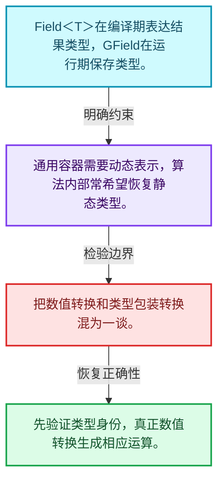
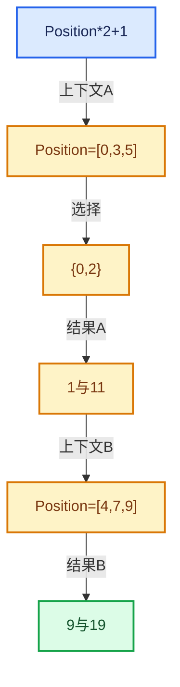

# 08-03 Field类型接口

[方向导航](README.md) · [总目录](../README.md) · [实现索引](../00-课程指南/02-源码与提交索引/符号依赖与实现索引.md)

## 从问题到实现

Field<T>和GField怎样平衡类型安全与通用性？

静态类型包装便于编译期检查，动态形式支持统一容器；转换必须维护真实CPPType一致。

**数据模型**

Field<T>在编译期表达结果类型，GField在运行期保存类型。

**设计取舍**

通用容器需要动态表示，算法内部常希望恢复静态类型。

**最小反例**

把数值转换和类型包装转换混为一谈。

**推导**

先验证类型身份，真正数值转换生成相应运算。

## 阅读地图与执行推演

图中的数值推演是本方向的教学模型；实际函数之间的调用边与概念分析边分别标注，不能把概念关系当作运行时调度顺序。

## 完整源码单元与就地讲解

中文讲解直接放在相关代码旁，复杂机制在代码下展开。原文折叠区保留基准行号；不需要在行号表和函数之间来回查找。类布局可分段展示，函数实现不按固定行数切开。

## 语法与相关类型

## 实现练习与验证

比较明确类型转换和错误强转的契约。

参考推理：先验证类型身份，真正数值转换生成相应运算。

结果与直接计算一致；多个输出共享子表达式时不改变语义；深链构造、执行、销毁三个阶段分别检查。

## 历史、跨库比较与证据

与表达式模板、AST和闭包比较：Field可在运行时组合并对不同上下文批量求值；不要把Field对象误当作固定几何的结果数组。

[历史提交索引](../00-课程指南/02-源码与提交索引/历史提交与设计演化索引.md) · [源码基准](../00-课程指南/02-源码与提交索引/源码版本与覆盖索引.md) · [验收报告](../00-课程指南/03-验收报告/验收报告.md)
