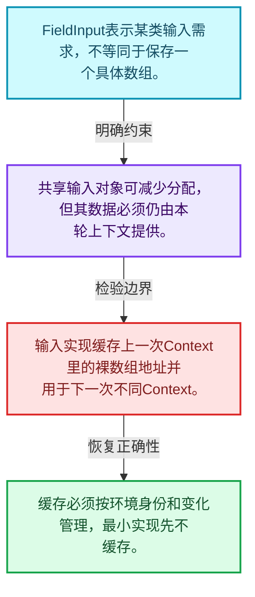
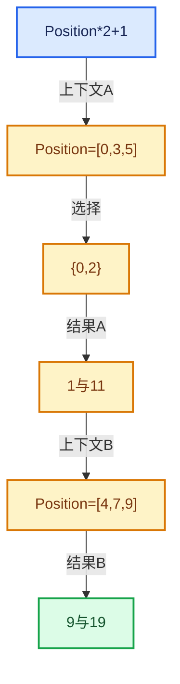

# 08-04 FieldInput输入节点

[方向导航](README.md) · [总目录](../README.md) · [实现索引](../00-课程指南/02-源码与提交索引/符号依赖与实现索引.md)

## 从问题到实现

输入如何从上下文读取不同几何数据？

输入节点表示需求，实际数据由上下文解析；同一个输入对象不固定绑定某一网格地址。

**数据模型**

FieldInput表示某类输入需求，不等同于保存一个具体数组。

**设计取舍**

共享输入对象可减少分配，但其数据必须仍由本轮上下文提供。

**最小反例**

输入实现缓存上一次Context里的裸数组地址并用于下一次不同Context。

**推导**

缓存必须按环境身份和变化管理，最小实现先不缓存。

## 阅读地图与执行推演

图中的数值推演是本方向的教学模型；实际函数之间的调用边与概念分析边分别标注，不能把概念关系当作运行时调度顺序。

## 完整源码单元与就地讲解

中文讲解直接放在相关代码旁，复杂机制在代码下展开。原文折叠区保留基准行号；不需要在行号表和函数之间来回查找。类布局可分段展示，函数实现不按固定行数切开。

## 语法与相关类型

## 实现练习与验证

实现读取索引的输入，并在不同mask下验证编号。

参考推理：缓存必须按环境身份和变化管理，最小实现先不缓存。

结果与直接计算一致；多个输出共享子表达式时不改变语义；深链构造、执行、销毁三个阶段分别检查。

## 历史、跨库比较与证据

与表达式模板、AST和闭包比较：Field可在运行时组合并对不同上下文批量求值；不要把Field对象误当作固定几何的结果数组。

[历史提交索引](../00-课程指南/02-源码与提交索引/历史提交与设计演化索引.md) · [源码基准](../00-课程指南/02-源码与提交索引/源码版本与覆盖索引.md) · [验收报告](../00-课程指南/03-验收报告/验收报告.md)
