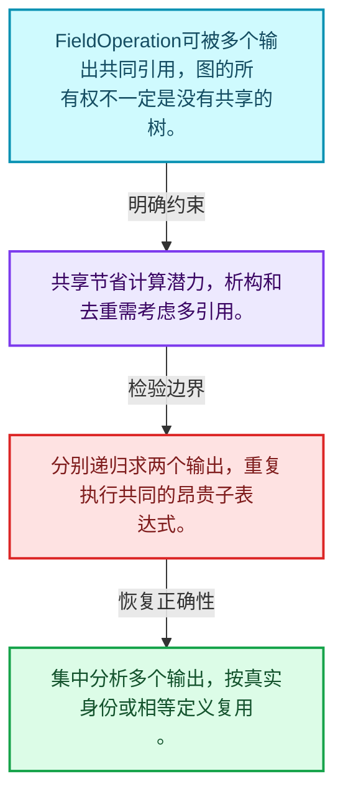
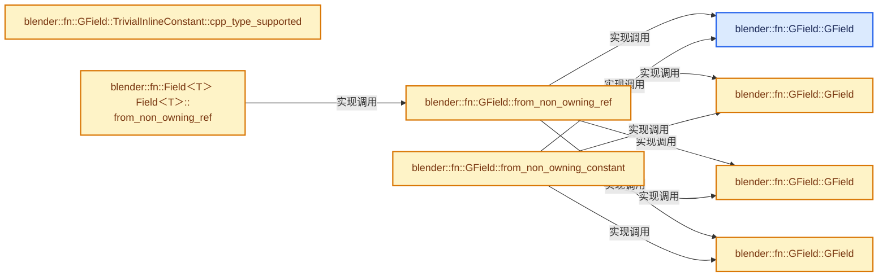
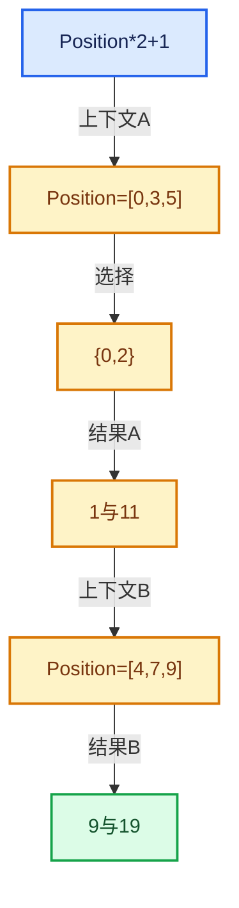

# 08-05 FieldOperation运算节点

[方向导航](README.md) · [总目录](../README.md) · [实现索引](../%E7%AC%A6%E5%8F%B7%E4%BE%9D%E8%B5%96%E4%B8%8E%E5%AE%9E%E7%8E%B0%E7%B4%A2%E5%BC%95.md)

## 从问题到实现

共享子表达式怎样连接多个输出？

操作保存函数与输入表达式关系，某个输出索引选择结果；共享所有权图不能误当成互不相关的树。

**数据模型**

FieldOperation可被多个输出共同引用，图的所有权不一定是没有共享的树。

**设计取舍**

共享节省计算潜力，析构和去重需考虑多引用。

**最小反例**

分别递归求两个输出，重复执行共同的昂贵子表达式。

**推导**

集中分析多个输出，按真实身份或相等定义复用。

## 阅读地图与执行推演








图中的数值推演是本方向的教学模型；实际函数之间的调用边与概念分析边分别标注，不能把概念关系当作运行时调度顺序。

## 完整源码单元与就地讲解

中文讲解直接放在相关代码旁，复杂机制在代码下展开。原文折叠区保留基准行号；不需要在行号表和函数之间来回查找。类布局可分段展示，函数实现不按固定行数切开。

<a id="f-211db26b169f2f41"></a>

### `blender::fn::GField::GField`

实现位置：[source/blender/functions/FN_field.hh](../../../../../source/blender/functions/FN_field.hh) · L450—L453。

接口参数：

- `const CPPType &type`

**教学注释版**

<!-- annotated:5fb2ae7547e5fb -->

```cpp
inline GField::GField(const CPPType &type) noexcept
    : variant_(ConstantRef{&type, type.default_value()})
{
}
```

<details>
<summary>核对原始源码：source/blender/functions/FN_field.hh · L450—L453</summary>

<!-- original:5fb2ae7547e5fb:source/blender/functions/FN_field.hh:450:453 -->

```cpp
inline GField::GField(const CPPType &type) noexcept
    : variant_(ConstantRef{&type, type.default_value()})
{
}
```

</details>

**继续追踪实现**

本实现没有需要继续展开的显式调用；检查返回表达式、对象转换和调用者前置条件。

<a id="f-7fdb26f58de14966"></a>

### `blender::fn::GField::GField`

实现位置：[source/blender/functions/FN_field.hh](../../../../../source/blender/functions/FN_field.hh) · L454—L454。

接口参数：

- `FieldInputPtr node`

**教学注释版**

<!-- annotated:aabd76500c74da -->

```cpp
inline GField::GField(FieldInputPtr node) noexcept : variant_(Input{std::move(node)}) {}
```

<details>
<summary>核对原始源码：source/blender/functions/FN_field.hh · L454—L454</summary>

<!-- original:aabd76500c74da:source/blender/functions/FN_field.hh:454:454 -->

```cpp
inline GField::GField(FieldInputPtr node) noexcept : variant_(Input{std::move(node)}) {}
```

</details>

**继续追踪实现**

本实现没有需要继续展开的显式调用；检查返回表达式、对象转换和调用者前置条件。

<a id="f-0f8304d195c6e071"></a>

### `blender::fn::GField::GField`

实现位置：[source/blender/functions/FN_field.hh](../../../../../source/blender/functions/FN_field.hh) · L455—L455。

接口参数：

- `Variant variant`

**教学注释版**

<!-- annotated:237b864440ee28 -->

```cpp
inline GField::GField(Variant variant) noexcept : variant_(std::move(variant)) {}
```

<details>
<summary>核对原始源码：source/blender/functions/FN_field.hh · L455—L455</summary>

<!-- original:237b864440ee28:source/blender/functions/FN_field.hh:455:455 -->

```cpp
inline GField::GField(Variant variant) noexcept : variant_(std::move(variant)) {}
```

</details>

**继续追踪实现**

本实现没有需要继续展开的显式调用；检查返回表达式、对象转换和调用者前置条件。

<a id="f-49cf4fb08737a047"></a>

### `blender::fn::GField::GField`

实现位置：[source/blender/functions/FN_field.hh](../../../../../source/blender/functions/FN_field.hh) · L456—L459。

接口参数：

- `FieldOperationPtr node`
- `const int output_i`

**教学注释版**

<!-- annotated:5d85a3a8ef33e8 -->

```cpp
inline GField::GField(FieldOperationPtr node, const int output_i) noexcept
    : variant_(MultiFn{std::move(node), output_i})
{
}
```

<details>
<summary>核对原始源码：source/blender/functions/FN_field.hh · L456—L459</summary>

<!-- original:5d85a3a8ef33e8:source/blender/functions/FN_field.hh:456:459 -->

```cpp
inline GField::GField(FieldOperationPtr node, const int output_i) noexcept
    : variant_(MultiFn{std::move(node), output_i})
{
}
```

</details>

**继续追踪实现**

本实现没有需要继续展开的显式调用；检查返回表达式、对象转换和调用者前置条件。

<!-- annotated:db4af532ff12a5 -->

```cpp

```

<details>
<summary>核对原始源码：source/blender/functions/FN_field.hh · L460—L460</summary>

<!-- original:db4af532ff12a5:source/blender/functions/FN_field.hh:460:460 -->

```cpp

```

</details>

<a id="f-3418a2faa8f1c8c6"></a>

### `blender::fn::GField::from_non_owning_ref`

建立运算、常量或借用表示。

实现位置：[source/blender/functions/FN_field.hh](../../../../../source/blender/functions/FN_field.hh) · L461—L464。

接口参数：

- `const GField &field`

**教学注释版**

<!-- annotated:e339a168eef4f3 -->

```cpp
inline GField GField::from_non_owning_ref(const GField &field)
{
  return GField(FieldRef{&field});
}
```

<details>
<summary>核对原始源码：source/blender/functions/FN_field.hh · L461—L464</summary>

<!-- original:e339a168eef4f3:source/blender/functions/FN_field.hh:461:464 -->

```cpp
inline GField GField::from_non_owning_ref(const GField &field)
{
  return GField(FieldRef{&field});
}
```

</details>

**接口与不变量**

不同表示的拥有关系不同；静态引用路径要求被引用对象存活足够久。

**结果出口**

- `return GField(FieldRef{&field});`

**继续追踪实现**

- `GField` → [blender::fn::GField::GField · L450](05-FieldOperation%E8%BF%90%E7%AE%97%E8%8A%82%E7%82%B9.md#f-211db26b169f2f41)；[blender::fn::GField::GField · L454](05-FieldOperation%E8%BF%90%E7%AE%97%E8%8A%82%E7%82%B9.md#f-7fdb26f58de14966)；[blender::fn::GField::GField · L455](05-FieldOperation%E8%BF%90%E7%AE%97%E8%8A%82%E7%82%B9.md#f-0f8304d195c6e071)；[blender::fn::GField::GField · L456](05-FieldOperation%E8%BF%90%E7%AE%97%E8%8A%82%E7%82%B9.md#f-49cf4fb08737a047)。同名重载需按实参类型选择。

<!-- annotated:d1c6cc9d9d1bbd -->

```cpp

```

<details>
<summary>核对原始源码：source/blender/functions/FN_field.hh · L465—L465</summary>

<!-- original:d1c6cc9d9d1bbd:source/blender/functions/FN_field.hh:465:465 -->

```cpp

```

</details>

<a id="f-d3dcf87f1fd371b9"></a>

### `blender::fn::GField::TrivialInlineConstant::cpp_type_supported`

实现位置：[source/blender/functions/FN_field.hh](../../../../../source/blender/functions/FN_field.hh) · L466—L470。

接口参数：

- `const CPPType &type`

**教学注释版**

<!-- annotated:41dfa1cff850e3 -->

```cpp
inline bool GField::TrivialInlineConstant::cpp_type_supported(const CPPType &type)
{
  return type.is_trivial && type.size <= TrivialInlineConstant::inline_size &&
         type.alignment <= TrivialInlineConstant::inline_alignment;
}
```

<details>
<summary>核对原始源码：source/blender/functions/FN_field.hh · L466—L470</summary>

<!-- original:41dfa1cff850e3:source/blender/functions/FN_field.hh:466:470 -->

```cpp
inline bool GField::TrivialInlineConstant::cpp_type_supported(const CPPType &type)
{
  return type.is_trivial && type.size <= TrivialInlineConstant::inline_size &&
         type.alignment <= TrivialInlineConstant::inline_alignment;
}
```

</details>

**结果出口**

- `return type.is_trivial && type.size <= TrivialInlineConstant::inline_size &&`

**继续追踪实现**

本实现没有需要继续展开的显式调用；检查返回表达式、对象转换和调用者前置条件。

<!-- annotated:1d9e81970c5348 -->

```cpp

```

<details>
<summary>核对原始源码：source/blender/functions/FN_field.hh · L471—L471</summary>

<!-- original:1d9e81970c5348:source/blender/functions/FN_field.hh:471:471 -->

```cpp

```

</details>

<a id="f-b7deb7357dcded50"></a>

### `blender::fn::GField::from_non_owning_constant`

实现位置：[source/blender/functions/FN_field.hh](../../../../../source/blender/functions/FN_field.hh) · L472—L475。

接口参数：

- `const CPPType &type`
- `const void *value`

**教学注释版**

<!-- annotated:8cb71dd4cd55aa -->

```cpp
inline GField GField::from_non_owning_constant(const CPPType &type, const void *value)
{
  return GField(ConstantRef{&type, value});
}
```

<details>
<summary>核对原始源码：source/blender/functions/FN_field.hh · L472—L475</summary>

<!-- original:8cb71dd4cd55aa:source/blender/functions/FN_field.hh:472:475 -->

```cpp
inline GField GField::from_non_owning_constant(const CPPType &type, const void *value)
{
  return GField(ConstantRef{&type, value});
}
```

</details>

**结果出口**

- `return GField(ConstantRef{&type, value});`

**继续追踪实现**

- `GField` → [blender::fn::GField::GField · L450](05-FieldOperation%E8%BF%90%E7%AE%97%E8%8A%82%E7%82%B9.md#f-211db26b169f2f41)；[blender::fn::GField::GField · L454](05-FieldOperation%E8%BF%90%E7%AE%97%E8%8A%82%E7%82%B9.md#f-7fdb26f58de14966)；[blender::fn::GField::GField · L455](05-FieldOperation%E8%BF%90%E7%AE%97%E8%8A%82%E7%82%B9.md#f-0f8304d195c6e071)；[blender::fn::GField::GField · L456](05-FieldOperation%E8%BF%90%E7%AE%97%E8%8A%82%E7%82%B9.md#f-49cf4fb08737a047)。同名重载需按实参类型选择。

<!-- annotated:b592e579f378fa -->

```cpp

```

<details>
<summary>核对原始源码：source/blender/functions/FN_field.hh · L476—L476</summary>

<!-- original:b592e579f378fa:source/blender/functions/FN_field.hh:476:476 -->

```cpp

```

</details>

<a id="f-054313375a3ccf97"></a>

### `blender::fn::Field<T> Field<T>::from_non_owning_ref`

建立运算、常量或借用表示。

实现位置：[source/blender/functions/FN_field.hh](../../../../../source/blender/functions/FN_field.hh) · L477—L480。

接口参数：

- `const Field &field`

**教学注释版**

<!-- annotated:63e1b32a660c6b -->

```cpp
template<typename T> inline Field<T> Field<T>::from_non_owning_ref(const Field &field)
{
  // [讲解] GField::from_non_owning_ref：建立运算、常量或借用表示。
  return GField::from_non_owning_ref(field).template typed<T>();
}
```

<details>
<summary>核对原始源码：source/blender/functions/FN_field.hh · L477—L480</summary>

<!-- original:63e1b32a660c6b:source/blender/functions/FN_field.hh:477:480 -->

```cpp
template<typename T> inline Field<T> Field<T>::from_non_owning_ref(const Field &field)
{
  return GField::from_non_owning_ref(field).template typed<T>();
}
```

</details>

**接口与不变量**

不同表示的拥有关系不同；静态引用路径要求被引用对象存活足够久。

**结果出口**

- `return GField::from_non_owning_ref(field).template typed<T>();`

**继续追踪实现**

- `GField::from_non_owning_ref(field).template typed<T>` → [调用协议](../%E6%A8%A1%E6%9D%BF%E5%AE%8F%E4%B8%8E%E5%8A%A8%E6%80%81%E5%88%86%E6%B4%BE%E5%8D%8F%E8%AE%AE.md)：接收对象类型依赖auto、返回值或模板实例；不按同名猜测目标。调用位置L479。
- `GField::from_non_owning_ref` → [blender::fn::GField::from_non_owning_ref · L461](05-FieldOperation%E8%BF%90%E7%AE%97%E8%8A%82%E7%82%B9.md#f-3418a2faa8f1c8c6)。

<!-- annotated:51f3bb29638f0e -->

```cpp

```

<details>
<summary>核对原始源码：source/blender/functions/FN_field.hh · L481—L481</summary>

<!-- original:51f3bb29638f0e:source/blender/functions/FN_field.hh:481:481 -->

```cpp

```

</details>

<a id="f-53eedc63fedfa749"></a>

### `blender::fn::GField::from_input`

实现位置：[source/blender/functions/FN_field.hh](../../../../../source/blender/functions/FN_field.hh) · L482—L486。

**教学注释版**

<!-- annotated:91ca4dbc19c2fe -->

```cpp
template<typename InputT, typename... Args> inline GField GField::from_input(Args &&...args)
{
  // [讲解] std::forward<Args>：在转发引用中恢复调用者传入的值类别；依赖推导类型，不能与无条件move互换。
  FieldInputPtr input{MEM_new<InputT>(__func__, std::forward<Args>(args)...)};
  // [讲解] std::move：把表达式转换成可供移动重载选择的值类别；不保证真的移动，不结束源对象寿命，对const值可能选择复制。
  return GField(Input{std::move(input)});
}
```

<details>
<summary>核对原始源码：source/blender/functions/FN_field.hh · L482—L486</summary>

<!-- original:91ca4dbc19c2fe:source/blender/functions/FN_field.hh:482:486 -->

```cpp
template<typename InputT, typename... Args> inline GField GField::from_input(Args &&...args)
{
  FieldInputPtr input{MEM_new<InputT>(__func__, std::forward<Args>(args)...)};
  return GField(Input{std::move(input)});
}
```

</details>

**结果出口**

- `return GField(Input{std::move(input)});`

**继续追踪实现**

- `MEM_new<InputT>` → [MEM_new · L351](../03-%E5%86%85%E5%AD%98%E5%88%86%E9%85%8D%E4%B8%8E%E8%BF%90%E8%A1%8C%E6%97%B6%E7%B1%BB%E5%9E%8B/%E4%BE%9D%E8%B5%96-MEM_guardedalloc-b54eca.md#f-115f9b6784f89912)。
- `std::forward<Args>` → [外部契约](https://eel.is/c++draft/utility.forward)：在转发引用中恢复调用者传入的值类别；依赖推导类型，不能与无条件move互换。
- `GField` → [blender::fn::GField::GField · L450](05-FieldOperation%E8%BF%90%E7%AE%97%E8%8A%82%E7%82%B9.md#f-211db26b169f2f41)；[blender::fn::GField::GField · L454](05-FieldOperation%E8%BF%90%E7%AE%97%E8%8A%82%E7%82%B9.md#f-7fdb26f58de14966)；[blender::fn::GField::GField · L455](05-FieldOperation%E8%BF%90%E7%AE%97%E8%8A%82%E7%82%B9.md#f-0f8304d195c6e071)；[blender::fn::GField::GField · L456](05-FieldOperation%E8%BF%90%E7%AE%97%E8%8A%82%E7%82%B9.md#f-49cf4fb08737a047)。同名重载需按实参类型选择。
- `std::move` → [外部契约](https://eel.is/c++draft/utility.forward)：把表达式转换成可供移动重载选择的值类别；不保证真的移动，不结束源对象寿命，对const值可能选择复制。

### 类型布局、声明与编译条件 · FN_field.hh L487—L488

<!-- annotated:b886fb12c95361 -->

```cpp

template<typename T>
```

<details>
<summary>核对原始源码：source/blender/functions/FN_field.hh · L487—L488</summary>

<!-- original:b886fb12c95361:source/blender/functions/FN_field.hh:487:488 -->

```cpp

template<typename T>
```

</details>

<a id="f-f776b1001f6d77c2"></a>

### `blender::fn::Field<T> Field<T>::from_input`

实现位置：[source/blender/functions/FN_field.hh](../../../../../source/blender/functions/FN_field.hh) · L489—L493。

**教学注释版**

<!-- annotated:a79d118d6bd8f1 -->

```cpp
template<typename InputT, typename... Args>
inline Field<T> Field<T>::from_input(Args &&...args)
{
  // [讲解] std::forward<Args>：在转发引用中恢复调用者传入的值类别；依赖推导类型，不能与无条件move互换。
  return GField::from_input<InputT>(std::forward<Args>(args)...).template typed<T>();
}
```

<details>
<summary>核对原始源码：source/blender/functions/FN_field.hh · L489—L493</summary>

<!-- original:a79d118d6bd8f1:source/blender/functions/FN_field.hh:489:493 -->

```cpp
template<typename InputT, typename... Args>
inline Field<T> Field<T>::from_input(Args &&...args)
{
  return GField::from_input<InputT>(std::forward<Args>(args)...).template typed<T>();
}
```

</details>

**结果出口**

- `return GField::from_input<InputT>(std::forward<Args>(args)...).template typed<T>();`

**继续追踪实现**

- `GField::from_input<InputT>(std::forward<Args>(args)...).template typed<T>` → [调用协议](../%E6%A8%A1%E6%9D%BF%E5%AE%8F%E4%B8%8E%E5%8A%A8%E6%80%81%E5%88%86%E6%B4%BE%E5%8D%8F%E8%AE%AE.md)：接收对象类型依赖auto、返回值或模板实例；不按同名猜测目标。调用位置L492。
- `GField::from_input<InputT>` → [blender::fn::GField::from_input · L482](05-FieldOperation%E8%BF%90%E7%AE%97%E8%8A%82%E7%82%B9.md#f-53eedc63fedfa749)。
- `std::forward<Args>` → [外部契约](https://eel.is/c++draft/utility.forward)：在转发引用中恢复调用者传入的值类别；依赖推导类型，不能与无条件move互换。

<!-- annotated:a97a7c7408b882 -->

```cpp

```

<details>
<summary>核对原始源码：source/blender/functions/FN_field.hh · L494—L494</summary>

<!-- original:a97a7c7408b882:source/blender/functions/FN_field.hh:494:494 -->

```cpp

```

</details>

<a id="f-0b2f3f4cecd8c44a"></a>

### `blender::fn::Field<T>::Field`

实现位置：[source/blender/functions/FN_field.hh](../../../../../source/blender/functions/FN_field.hh) · L495—L511。

接口参数：

- `T value`

**教学注释版**

<!-- annotated:940cbab5242d2f -->

```cpp
template<typename T>
inline Field<T>::Field(T value)
    : field_([&]() {
        const CPPType &type = CPPType::get<T>();
        if constexpr (GField::TrivialInlineConstant::type_supported_v<T>) {
          GField::TrivialInlineConstant constant;
          constant.type = &type;
          new (constant.value.ptr()) T(std::move(value));
          return GField(constant);
        }
        else {
          T *new_value = MEM_new<T>(__func__, std::move(new_value));
          return GField(GField::OwnedConstant{&type, new_value});
        }
      }())
{
}
```

<details>
<summary>核对原始源码：source/blender/functions/FN_field.hh · L495—L511</summary>

<!-- original:940cbab5242d2f:source/blender/functions/FN_field.hh:495:511 -->

```cpp
template<typename T>
inline Field<T>::Field(T value)
    : field_([&]() {
        const CPPType &type = CPPType::get<T>();
        if constexpr (GField::TrivialInlineConstant::type_supported_v<T>) {
          GField::TrivialInlineConstant constant;
          constant.type = &type;
          new (constant.value.ptr()) T(std::move(value));
          return GField(constant);
        }
        else {
          T *new_value = MEM_new<T>(__func__, std::move(new_value));
          return GField(GField::OwnedConstant{&type, new_value});
        }
      }())
{
}
```

</details>

**继续追踪实现**

本实现没有需要继续展开的显式调用；检查返回表达式、对象转换和调用者前置条件。

<!-- annotated:036542a114cd3d -->

```cpp

```

<details>
<summary>核对原始源码：source/blender/functions/FN_field.hh · L512—L512</summary>

<!-- original:036542a114cd3d:source/blender/functions/FN_field.hh:512:512 -->

```cpp

```

</details>

<a id="f-c0874f9733e45938"></a>

### `blender::fn::Field<T>::depends_on_input`

实现位置：[source/blender/functions/FN_field.hh](../../../../../source/blender/functions/FN_field.hh) · L513—L516。

**教学注释版**

<!-- annotated:92a41d7b13df59 -->

```cpp
template<typename T> inline bool Field<T>::depends_on_input() const
{
  return field_.depends_on_input();
}
```

<details>
<summary>核对原始源码：source/blender/functions/FN_field.hh · L513—L516</summary>

<!-- original:92a41d7b13df59:source/blender/functions/FN_field.hh:513:516 -->

```cpp
template<typename T> inline bool Field<T>::depends_on_input() const
{
  return field_.depends_on_input();
}
```

</details>

**结果出口**

- `return field_.depends_on_input();`

**继续追踪实现**

- `field_.depends_on_input` → [blender::fn::GField::depends_on_input · L614](05-FieldOperation%E8%BF%90%E7%AE%97%E8%8A%82%E7%82%B9.md#f-f9ec31f757d56a15)。

<!-- annotated:ddc2bdf40f127b -->

```cpp

```

<details>
<summary>核对原始源码：source/blender/functions/FN_field.hh · L517—L517</summary>

<!-- original:ddc2bdf40f127b:source/blender/functions/FN_field.hh:517:517 -->

```cpp

```

</details>

<a id="f-284e6a7a85c0110e"></a>

### `blender::fn::GField::cpp_type`

取得表达式结果的类型信息。

实现位置：[source/blender/functions/FN_field.hh](../../../../../source/blender/functions/FN_field.hh) · L518—L539。

**教学注释版**

<!-- annotated:e5bdad7d94aad6 -->

```cpp
inline const CPPType &GField::cpp_type() const
{
  // [讲解] std::visit：按variant当前活动分支调用访客；所有候选分支的类型要求需满足，不能读取非活动分支的对象表示。
  return std::visit(
      []<typename T>(const T &v) -> const CPPType & {
        if constexpr (std::is_same_v<T, Input>) {
          return v.node->cpp_type();
        }
        else if constexpr (std::is_same_v<T, MultiFn>) {
          return v.node->output_cpp_type(v.output_i);
        }
        else if constexpr (std::is_same_v<T, FieldRef>) {
          return v.field_ref->cpp_type();
        }
        else if constexpr (is_same_any_v<T, ConstantRef, TrivialInlineConstant, OwnedConstant>) {
          return *v.type;
        }
        else {
          BLI_assert_unreachable_static_t(T);
        }
      },
      this->variant_);
}
```

<details>
<summary>核对原始源码：source/blender/functions/FN_field.hh · L518—L539</summary>

<!-- original:e5bdad7d94aad6:source/blender/functions/FN_field.hh:518:539 -->

```cpp
inline const CPPType &GField::cpp_type() const
{
  return std::visit(
      []<typename T>(const T &v) -> const CPPType & {
        if constexpr (std::is_same_v<T, Input>) {
          return v.node->cpp_type();
        }
        else if constexpr (std::is_same_v<T, MultiFn>) {
          return v.node->output_cpp_type(v.output_i);
        }
        else if constexpr (std::is_same_v<T, FieldRef>) {
          return v.field_ref->cpp_type();
        }
        else if constexpr (is_same_any_v<T, ConstantRef, TrivialInlineConstant, OwnedConstant>) {
          return *v.type;
        }
        else {
          BLI_assert_unreachable_static_t(T);
        }
      },
      this->variant_);
}
```

</details>

**接口与不变量**

类型描述与某一具体求值结果的地址分开；恢复静态类型时需要真实类型一致。

**结果出口**

- `return std::visit(`
- `return v.node->cpp_type();`
- `return v.node->output_cpp_type(v.output_i);`
- `return v.field_ref->cpp_type();`
- `return *v.type;`

**继续追踪实现**

- `std::visit` → [外部契约](https://eel.is/c++draft/variant.visit)：按variant当前活动分支调用访客；所有候选分支的类型要求需满足，不能读取非活动分支的对象表示。
- `v.node->cpp_type` → [调用协议](../%E6%A8%A1%E6%9D%BF%E5%AE%8F%E4%B8%8E%E5%8A%A8%E6%80%81%E5%88%86%E6%B4%BE%E5%8D%8F%E8%AE%AE.md)：接收对象类型依赖auto、返回值或模板实例；不按同名猜测目标。调用位置L523。
- `v.node->output_cpp_type` → [调用协议](../%E6%A8%A1%E6%9D%BF%E5%AE%8F%E4%B8%8E%E5%8A%A8%E6%80%81%E5%88%86%E6%B4%BE%E5%8D%8F%E8%AE%AE.md)：接收对象类型依赖auto、返回值或模板实例；不按同名猜测目标。调用位置L526。
- `v.field_ref->cpp_type` → [调用协议](../%E6%A8%A1%E6%9D%BF%E5%AE%8F%E4%B8%8E%E5%8A%A8%E6%80%81%E5%88%86%E6%B4%BE%E5%8D%8F%E8%AE%AE.md)：接收对象类型依赖auto、返回值或模板实例；不按同名猜测目标。调用位置L529。
- `BLI_assert_unreachable_static_t` → [BLI_assert_unreachable_static_t · L99](../01-%E5%9F%BA%E7%A1%80%E5%AE%B9%E5%99%A8%E4%B8%8E%E7%8E%B0%E4%BB%A3CPP/%E4%BE%9D%E8%B5%96-BLI_assert-cc98e8.md#m-368120c7952b)。宏定义由构建条件选择。

<!-- annotated:d63886d7e96209 -->

```cpp

```

<details>
<summary>核对原始源码：source/blender/functions/FN_field.hh · L540—L540</summary>

<!-- original:d63886d7e96209:source/blender/functions/FN_field.hh:540:540 -->

```cpp

```

</details>

<a id="f-a19407c284f28fcf"></a>

### `blender::fn::GField::deref_field_ref`

实现位置：[source/blender/functions/FN_field.hh](../../../../../source/blender/functions/FN_field.hh) · L541—L547。

**教学注释版**

<!-- annotated:34e15cb668516b -->

```cpp
inline const GField &GField::deref_field_ref() const
{
  if (const auto *field_ref = std::get_if<FieldRef>(&this->variant_)) {
    return field_ref->field_ref->deref_field_ref();
  }
  return *this;
}
```

<details>
<summary>核对原始源码：source/blender/functions/FN_field.hh · L541—L547</summary>

<!-- original:34e15cb668516b:source/blender/functions/FN_field.hh:541:547 -->

```cpp
inline const GField &GField::deref_field_ref() const
{
  if (const auto *field_ref = std::get_if<FieldRef>(&this->variant_)) {
    return field_ref->field_ref->deref_field_ref();
  }
  return *this;
}
```

</details>

**结果出口**

- `return field_ref->field_ref->deref_field_ref();`
- `return *this;`

**继续追踪实现**

- `std::get_if<FieldRef>` → [外部契约](https://eel.is/c++draft/)：这个边界按实际表达式及所属类型核对参数、返回值、寿命与失败行为。这里提供接口入口，不声称已解释该第三方版本的内部实现。
- `field_ref->field_ref->deref_field_ref` → [调用协议](../%E6%A8%A1%E6%9D%BF%E5%AE%8F%E4%B8%8E%E5%8A%A8%E6%80%81%E5%88%86%E6%B4%BE%E5%8D%8F%E8%AE%AE.md)：接收对象类型依赖auto、返回值或模板实例；不按同名猜测目标。调用位置L544。

<!-- annotated:abac138aeeeebb -->

```cpp

```

<details>
<summary>核对原始源码：source/blender/functions/FN_field.hh · L548—L548</summary>

<!-- original:abac138aeeeebb:source/blender/functions/FN_field.hh:548:548 -->

```cpp

```

</details>

<a id="f-902838a06abfecea"></a>

### `blender::fn::operator==`

实现位置：[source/blender/functions/FN_field.hh](../../../../../source/blender/functions/FN_field.hh) · L549—L552。

接口参数：

- `const Field<T> &a`
- `const Field<T> &b`

**教学注释版**

<!-- annotated:7986dbc5b5633a -->

```cpp
template<typename T> inline bool operator==(const Field<T> &a, const Field<T> &b)
{
  return static_cast<const GField &>(a) == static_cast<const GField &>(b);
}
```

<details>
<summary>核对原始源码：source/blender/functions/FN_field.hh · L549—L552</summary>

<!-- original:7986dbc5b5633a:source/blender/functions/FN_field.hh:549:552 -->

```cpp
template<typename T> inline bool operator==(const Field<T> &a, const Field<T> &b)
{
  return static_cast<const GField &>(a) == static_cast<const GField &>(b);
}
```

</details>

**结果出口**

- `return static_cast<const GField &>(a) == static_cast<const GField &>(b);`

**继续追踪实现**

本实现没有需要继续展开的显式调用；检查返回表达式、对象转换和调用者前置条件。

<!-- annotated:c68bf4f16761f9 -->

```cpp

```

<details>
<summary>核对原始源码：source/blender/functions/FN_field.hh · L553—L553</summary>

<!-- original:c68bf4f16761f9:source/blender/functions/FN_field.hh:553:553 -->

```cpp

```

</details>

<a id="f-cf906dac4510906c"></a>

### `blender::fn::Field<T>::hash`

为表达式比较或去重提供身份信息。

实现位置：[source/blender/functions/FN_field.hh](../../../../../source/blender/functions/FN_field.hh) · L554—L557。

**教学注释版**

<!-- annotated:7c4129b56a7345 -->

```cpp
template<typename T> inline uint64_t Field<T>::hash() const
{
  // [讲解] field_.hash：为表达式比较或去重提供身份信息。
  return field_.hash();
}
```

<details>
<summary>核对原始源码：source/blender/functions/FN_field.hh · L554—L557</summary>

<!-- original:7c4129b56a7345:source/blender/functions/FN_field.hh:554:557 -->

```cpp
template<typename T> inline uint64_t Field<T>::hash() const
{
  return field_.hash();
}
```

</details>

**接口与不变量**

浅身份、内容相等与深层表达式等价不是同一个问题，不能沿用旧版本的定义。

**结果出口**

- `return field_.hash();`

**继续追踪实现**

- `field_.hash` → [blender::fn::GField::hash · L87](06-FieldContext%E4%B8%8A%E4%B8%8B%E6%96%87.md#f-032ec4a1ea6ba9ad)。

<!-- annotated:1c807d766fd69a -->

```cpp

```

<details>
<summary>核对原始源码：source/blender/functions/FN_field.hh · L558—L558</summary>

<!-- original:1c807d766fd69a:source/blender/functions/FN_field.hh:558:558 -->

```cpp

```

</details>

<a id="f-fd32b5474fd78eee"></a>

### `blender::fn::FieldInput::cpp_type`

取得表达式结果的类型信息。

实现位置：[source/blender/functions/FN_field.hh](../../../../../source/blender/functions/FN_field.hh) · L559—L562。

**教学注释版**

<!-- annotated:727c88e4a77794 -->

```cpp
inline const CPPType &FieldInput::cpp_type() const
{
  return *this->type_;
}
```

<details>
<summary>核对原始源码：source/blender/functions/FN_field.hh · L559—L562</summary>

<!-- original:727c88e4a77794:source/blender/functions/FN_field.hh:559:562 -->

```cpp
inline const CPPType &FieldInput::cpp_type() const
{
  return *this->type_;
}
```

</details>

**接口与不变量**

类型描述与某一具体求值结果的地址分开；恢复静态类型时需要真实类型一致。

**结果出口**

- `return *this->type_;`

**继续追踪实现**

本实现没有需要继续展开的显式调用；检查返回表达式、对象转换和调用者前置条件。

<!-- annotated:2904c1b5c7526b -->

```cpp

```

<details>
<summary>核对原始源码：source/blender/functions/FN_field.hh · L563—L563</summary>

<!-- original:2904c1b5c7526b:source/blender/functions/FN_field.hh:563:563 -->

```cpp

```

</details>

<a id="f-cf4ea6a3da6247fa"></a>

### `blender::fn::FieldOperation::field_inputs`

实现位置：[source/blender/functions/FN_field.hh](../../../../../source/blender/functions/FN_field.hh) · L564—L567。

**教学注释版**

<!-- annotated:8db6aad4b289ad -->

```cpp
inline const FieldInputsPtr &FieldOperation::field_inputs() const
{
  return field_inputs_;
}
```

<details>
<summary>核对原始源码：source/blender/functions/FN_field.hh · L564—L567</summary>

<!-- original:8db6aad4b289ad:source/blender/functions/FN_field.hh:564:567 -->

```cpp
inline const FieldInputsPtr &FieldOperation::field_inputs() const
{
  return field_inputs_;
}
```

</details>

**结果出口**

- `return field_inputs_;`

**继续追踪实现**

本实现没有需要继续展开的显式调用；检查返回表达式、对象转换和调用者前置条件。

<!-- annotated:1e38c7b427c3dc -->

```cpp

```

<details>
<summary>核对原始源码：source/blender/functions/FN_field.hh · L568—L568</summary>

<!-- original:1e38c7b427c3dc:source/blender/functions/FN_field.hh:568:568 -->

```cpp

```

</details>

<a id="f-fa0a83004ce05d59"></a>

### `blender::fn::FieldInput::debug_name`

实现位置：[source/blender/functions/FN_field.hh](../../../../../source/blender/functions/FN_field.hh) · L569—L572。

**教学注释版**

<!-- annotated:d5fe28ec5042fc -->

```cpp
inline StringRefNull FieldInput::debug_name() const
{
  return debug_name_;
}
```

<details>
<summary>核对原始源码：source/blender/functions/FN_field.hh · L569—L572</summary>

<!-- original:d5fe28ec5042fc:source/blender/functions/FN_field.hh:569:572 -->

```cpp
inline StringRefNull FieldInput::debug_name() const
{
  return debug_name_;
}
```

</details>

**结果出口**

- `return debug_name_;`

**继续追踪实现**

本实现没有需要继续展开的显式调用；检查返回表达式、对象转换和调用者前置条件。

<!-- annotated:2ba0f16ed6786e -->

```cpp

```

<details>
<summary>核对原始源码：source/blender/functions/FN_field.hh · L573—L573</summary>

<!-- original:2ba0f16ed6786e:source/blender/functions/FN_field.hh:573:573 -->

```cpp

```

</details>

<a id="f-cdb28d30b6850ce2"></a>

### `blender::fn::FieldInput::socket_inspection_name`

实现位置：[source/blender/functions/FN_field.hh](../../../../../source/blender/functions/FN_field.hh) · L574—L577。

**教学注释版**

<!-- annotated:d26833de416f0c -->

```cpp
inline std::string FieldInput::socket_inspection_name() const
{
  return debug_name_;
}
```

<details>
<summary>核对原始源码：source/blender/functions/FN_field.hh · L574—L577</summary>

<!-- original:d26833de416f0c:source/blender/functions/FN_field.hh:574:577 -->

```cpp
inline std::string FieldInput::socket_inspection_name() const
{
  return debug_name_;
}
```

</details>

**结果出口**

- `return debug_name_;`

**继续追踪实现**

本实现没有需要继续展开的显式调用；检查返回表达式、对象转换和调用者前置条件。

<!-- annotated:779ed07298b105 -->

```cpp

```

<details>
<summary>核对原始源码：source/blender/functions/FN_field.hh · L578—L578</summary>

<!-- original:779ed07298b105:source/blender/functions/FN_field.hh:578:578 -->

```cpp

```

</details>

<a id="f-642c6ea7bfcae8fe"></a>

### `blender::fn::() const`

实现位置：[source/blender/functions/FN_field.hh](../../../../../source/blender/functions/FN_field.hh) · L579—L582。

**教学注释版**

<!-- annotated:dc13f2eb9c129b -->

```cpp
template<typename T> inline Field<T>::operator const GField &() const
{
  return field_;
}
```

<details>
<summary>核对原始源码：source/blender/functions/FN_field.hh · L579—L582</summary>

<!-- original:dc13f2eb9c129b:source/blender/functions/FN_field.hh:579:582 -->

```cpp
template<typename T> inline Field<T>::operator const GField &() const
{
  return field_;
}
```

</details>

**结果出口**

- `return field_;`

**继续追踪实现**

本实现没有需要继续展开的显式调用；检查返回表达式、对象转换和调用者前置条件。

<!-- annotated:8cd7807d0da6ca -->

```cpp

```

<details>
<summary>核对原始源码：source/blender/functions/FN_field.hh · L583—L583</summary>

<!-- original:8cd7807d0da6ca:source/blender/functions/FN_field.hh:583:583 -->

```cpp

```

</details>

<a id="f-14b7d34a50f6f754"></a>

### `blender::fn::GField::typed`

实现位置：[source/blender/functions/FN_field.hh](../../../../../source/blender/functions/FN_field.hh) · L584—L589。

**教学注释版**

<!-- annotated:7e413dacadf216 -->

```cpp
template<typename T> inline const Field<T> &GField::typed() const
{
  static_assert(sizeof(GField) == sizeof(Field<T>));
  // [讲解] this->cpp_type：取得表达式结果的类型信息。
  BLI_assert(this->cpp_type().is<T>());
  return reinterpret_cast<const Field<T> &>(*this);
}
```

<details>
<summary>核对原始源码：source/blender/functions/FN_field.hh · L584—L589</summary>

<!-- original:7e413dacadf216:source/blender/functions/FN_field.hh:584:589 -->

```cpp
template<typename T> inline const Field<T> &GField::typed() const
{
  static_assert(sizeof(GField) == sizeof(Field<T>));
  BLI_assert(this->cpp_type().is<T>());
  return reinterpret_cast<const Field<T> &>(*this);
}
```

</details>

**结果出口**

- `return reinterpret_cast<const Field<T> &>(*this);`

**继续追踪实现**

- `BLI_assert` → [BLI_assert · L48](../01-%E5%9F%BA%E7%A1%80%E5%AE%B9%E5%99%A8%E4%B8%8E%E7%8E%B0%E4%BB%A3CPP/%E4%BE%9D%E8%B5%96-BLI_assert-cc98e8.md#m-57a88495704d)；[BLI_assert · L63](../01-%E5%9F%BA%E7%A1%80%E5%AE%B9%E5%99%A8%E4%B8%8E%E7%8E%B0%E4%BB%A3CPP/%E4%BE%9D%E8%B5%96-BLI_assert-cc98e8.md#m-d07050020cb5)。宏定义由构建条件选择。
- `this->cpp_type().is<T>` → [调用协议](../%E6%A8%A1%E6%9D%BF%E5%AE%8F%E4%B8%8E%E5%8A%A8%E6%80%81%E5%88%86%E6%B4%BE%E5%8D%8F%E8%AE%AE.md)：接收对象类型依赖auto、返回值或模板实例；不按同名猜测目标。调用位置L587。
- `this->cpp_type` → [blender::fn::GField::cpp_type · L518](05-FieldOperation%E8%BF%90%E7%AE%97%E8%8A%82%E7%82%B9.md#f-284e6a7a85c0110e)。

<!-- annotated:5c7806bf9189b5 -->

```cpp

```

<details>
<summary>核对原始源码：source/blender/functions/FN_field.hh · L590—L590</summary>

<!-- original:5c7806bf9189b5:source/blender/functions/FN_field.hh:590:590 -->

```cpp

```

</details>

<a id="f-f2a9fa08827bea89"></a>

### `blender::fn::GField::typed`

实现位置：[source/blender/functions/FN_field.hh](../../../../../source/blender/functions/FN_field.hh) · L591—L596。

**教学注释版**

<!-- annotated:e60cae336e95e2 -->

```cpp
template<typename T> inline Field<T> &GField::typed()
{
  static_assert(sizeof(GField) == sizeof(Field<T>));
  // [讲解] this->cpp_type：取得表达式结果的类型信息。
  BLI_assert(this->cpp_type().is<T>());
  return reinterpret_cast<Field<T> &>(*this);
}
```

<details>
<summary>核对原始源码：source/blender/functions/FN_field.hh · L591—L596</summary>

<!-- original:e60cae336e95e2:source/blender/functions/FN_field.hh:591:596 -->

```cpp
template<typename T> inline Field<T> &GField::typed()
{
  static_assert(sizeof(GField) == sizeof(Field<T>));
  BLI_assert(this->cpp_type().is<T>());
  return reinterpret_cast<Field<T> &>(*this);
}
```

</details>

**结果出口**

- `return reinterpret_cast<Field<T> &>(*this);`

**继续追踪实现**

- `BLI_assert` → [BLI_assert · L48](../01-%E5%9F%BA%E7%A1%80%E5%AE%B9%E5%99%A8%E4%B8%8E%E7%8E%B0%E4%BB%A3CPP/%E4%BE%9D%E8%B5%96-BLI_assert-cc98e8.md#m-57a88495704d)；[BLI_assert · L63](../01-%E5%9F%BA%E7%A1%80%E5%AE%B9%E5%99%A8%E4%B8%8E%E7%8E%B0%E4%BB%A3CPP/%E4%BE%9D%E8%B5%96-BLI_assert-cc98e8.md#m-d07050020cb5)。宏定义由构建条件选择。
- `this->cpp_type().is<T>` → [调用协议](../%E6%A8%A1%E6%9D%BF%E5%AE%8F%E4%B8%8E%E5%8A%A8%E6%80%81%E5%88%86%E6%B4%BE%E5%8D%8F%E8%AE%AE.md)：接收对象类型依赖auto、返回值或模板实例；不按同名猜测目标。调用位置L594。
- `this->cpp_type` → [blender::fn::GField::cpp_type · L518](05-FieldOperation%E8%BF%90%E7%AE%97%E8%8A%82%E7%82%B9.md#f-284e6a7a85c0110e)。

<!-- annotated:1e64006b88caa2 -->

```cpp

```

<details>
<summary>核对原始源码：source/blender/functions/FN_field.hh · L597—L597</summary>

<!-- original:1e64006b88caa2:source/blender/functions/FN_field.hh:597:597 -->

```cpp

```

</details>

<a id="f-8f429c3ff862c024"></a>

### `blender::fn::GField::variant`

实现位置：[source/blender/functions/FN_field.hh](../../../../../source/blender/functions/FN_field.hh) · L598—L601。

**教学注释版**

<!-- annotated:dfe36cca059597 -->

```cpp
inline const GField::Variant &GField::variant() const
{
  return variant_;
}
```

<details>
<summary>核对原始源码：source/blender/functions/FN_field.hh · L598—L601</summary>

<!-- original:dfe36cca059597:source/blender/functions/FN_field.hh:598:601 -->

```cpp
inline const GField::Variant &GField::variant() const
{
  return variant_;
}
```

</details>

**结果出口**

- `return variant_;`

**继续追踪实现**

本实现没有需要继续展开的显式调用；检查返回表达式、对象转换和调用者前置条件。

<!-- annotated:939761fc4b6919 -->

```cpp

```

<details>
<summary>核对原始源码：source/blender/functions/FN_field.hh · L602—L602</summary>

<!-- original:939761fc4b6919:source/blender/functions/FN_field.hh:602:602 -->

```cpp

```

</details>

<a id="f-6fbbe0144f689448"></a>

### `blender::fn::Field<T>::Field`

实现位置：[source/blender/functions/FN_field.hh](../../../../../source/blender/functions/FN_field.hh) · L603—L603。

**教学注释版**

<!-- annotated:aeacf15bfed056 -->

```cpp
template<typename T> inline Field<T>::Field() : field_(CPPType::get<T>()) {}
```

<details>
<summary>核对原始源码：source/blender/functions/FN_field.hh · L603—L603</summary>

<!-- original:aeacf15bfed056:source/blender/functions/FN_field.hh:603:603 -->

```cpp
template<typename T> inline Field<T>::Field() : field_(CPPType::get<T>()) {}
```

</details>

**继续追踪实现**

本实现没有需要继续展开的显式调用；检查返回表达式、对象转换和调用者前置条件。

<!-- annotated:356e04230e6e9a -->

```cpp

```

<details>
<summary>核对原始源码：source/blender/functions/FN_field.hh · L604—L604</summary>

<!-- original:356e04230e6e9a:source/blender/functions/FN_field.hh:604:604 -->

```cpp

```

</details>

<a id="f-b9fadbb0d8465bfe"></a>

### `blender::fn::Field<T>::Field`

实现位置：[source/blender/functions/FN_field.hh](../../../../../source/blender/functions/FN_field.hh) · L605—L607。

接口参数：

- `FieldInputPtr node`

**教学注释版**

<!-- annotated:d9f2761a8d1809 -->

```cpp
template<typename T> inline Field<T>::Field(FieldInputPtr node) : field_(GField(std::move(node)))
{
}
```

<details>
<summary>核对原始源码：source/blender/functions/FN_field.hh · L605—L607</summary>

<!-- original:d9f2761a8d1809:source/blender/functions/FN_field.hh:605:607 -->

```cpp
template<typename T> inline Field<T>::Field(FieldInputPtr node) : field_(GField(std::move(node)))
{
}
```

</details>

**继续追踪实现**

本实现没有需要继续展开的显式调用；检查返回表达式、对象转换和调用者前置条件。

<a id="f-be75a0525262720c"></a>

### `blender::fn::Field<T>::Field`

实现位置：[source/blender/functions/FN_field.hh](../../../../../source/blender/functions/FN_field.hh) · L608—L612。

接口参数：

- `FieldOperationPtr node`
- `const int output_i`

**教学注释版**

<!-- annotated:4dbe464048952d -->

```cpp
template<typename T>
inline Field<T>::Field(FieldOperationPtr node, const int output_i)
    : field_(GField(std::move(node), output_i))
{
}
```

<details>
<summary>核对原始源码：source/blender/functions/FN_field.hh · L608—L612</summary>

<!-- original:4dbe464048952d:source/blender/functions/FN_field.hh:608:612 -->

```cpp
template<typename T>
inline Field<T>::Field(FieldOperationPtr node, const int output_i)
    : field_(GField(std::move(node), output_i))
{
}
```

</details>

**继续追踪实现**

本实现没有需要继续展开的显式调用；检查返回表达式、对象转换和调用者前置条件。

<!-- annotated:3641fd2fd60c5c -->

```cpp

```

<details>
<summary>核对原始源码：source/blender/functions/FN_field.hh · L613—L613</summary>

<!-- original:3641fd2fd60c5c:source/blender/functions/FN_field.hh:613:613 -->

```cpp

```

</details>

<a id="f-f9ec31f757d56a15"></a>

### `blender::fn::GField::depends_on_input`

实现位置：[source/blender/functions/FN_field.hh](../../../../../source/blender/functions/FN_field.hh) · L614—L621。

**教学注释版**

<!-- annotated:4b76ec472c63d6 -->

```cpp
inline bool GField::depends_on_input() const
{
  const FieldInputsPtr &inputs = this->field_inputs();
  if (!inputs) {
    return false;
  }
  return !inputs->inputs.is_empty();
}
```

<details>
<summary>核对原始源码：source/blender/functions/FN_field.hh · L614—L621</summary>

<!-- original:4b76ec472c63d6:source/blender/functions/FN_field.hh:614:621 -->

```cpp
inline bool GField::depends_on_input() const
{
  const FieldInputsPtr &inputs = this->field_inputs();
  if (!inputs) {
    return false;
  }
  return !inputs->inputs.is_empty();
}
```

</details>

**结果出口**

- `return false;`
- `return !inputs->inputs.is_empty();`

**继续追踪实现**

- `this->field_inputs` → [blender::fn::GField::field_inputs · L504](12-Field%E9%87%8D%E6%9E%84%E4%B8%8E%E6%B7%B1%E9%93%BE%E9%94%80%E6%AF%81.md#f-38d3beaa39d9b6e4)。
- `inputs->inputs.is_empty` → [调用协议](../%E6%A8%A1%E6%9D%BF%E5%AE%8F%E4%B8%8E%E5%8A%A8%E6%80%81%E5%88%86%E6%B4%BE%E5%8D%8F%E8%AE%AE.md)：接收对象类型依赖auto、返回值或模板实例；不按同名猜测目标。调用位置L620。

<!-- annotated:23bdc5a007d3c3 -->

```cpp

```

<details>
<summary>核对原始源码：source/blender/functions/FN_field.hh · L622—L622</summary>

<!-- original:23bdc5a007d3c3:source/blender/functions/FN_field.hh:622:622 -->

```cpp

```

</details>

<a id="f-38e9a387769f7559"></a>

### `blender::fn::GField::get_input_if`

实现位置：[source/blender/functions/FN_field.hh](../../../../../source/blender/functions/FN_field.hh) · L623—L630。

**教学注释版**

<!-- annotated:d97ed61978109b -->

```cpp
template<typename InputT> inline const InputT *GField::get_input_if() const
{
  const GField &deref_field = this->deref_field_ref();
  if (const auto *input = std::get_if<Input>(&deref_field.variant())) {
    return dynamic_cast<const InputT *>(input->node.get());
  }
  return nullptr;
}
```

<details>
<summary>核对原始源码：source/blender/functions/FN_field.hh · L623—L630</summary>

<!-- original:d97ed61978109b:source/blender/functions/FN_field.hh:623:630 -->

```cpp
template<typename InputT> inline const InputT *GField::get_input_if() const
{
  const GField &deref_field = this->deref_field_ref();
  if (const auto *input = std::get_if<Input>(&deref_field.variant())) {
    return dynamic_cast<const InputT *>(input->node.get());
  }
  return nullptr;
}
```

</details>

**结果出口**

- `return dynamic_cast<const InputT *>(input->node.get());`
- `return nullptr;`

**继续追踪实现**

- `this->deref_field_ref` → [blender::fn::GField::deref_field_ref · L541](05-FieldOperation%E8%BF%90%E7%AE%97%E8%8A%82%E7%82%B9.md#f-a19407c284f28fcf)。
- `std::get_if<Input>` → [外部契约](https://eel.is/c++draft/)：这个边界按实际表达式及所属类型核对参数、返回值、寿命与失败行为。这里提供接口入口，不声称已解释该第三方版本的内部实现。
- `deref_field.variant` → [blender::fn::GField::variant · L598](05-FieldOperation%E8%BF%90%E7%AE%97%E8%8A%82%E7%82%B9.md#f-8f429c3ff862c024)。
- `input->node.get` → [调用协议](../%E6%A8%A1%E6%9D%BF%E5%AE%8F%E4%B8%8E%E5%8A%A8%E6%80%81%E5%88%86%E6%B4%BE%E5%8D%8F%E8%AE%AE.md)：接收对象类型依赖auto、返回值或模板实例；不按同名猜测目标。调用位置L627。

<!-- annotated:109a510d4dae15 -->

```cpp

```

<details>
<summary>核对原始源码：source/blender/functions/FN_field.hh · L631—L631</summary>

<!-- original:109a510d4dae15:source/blender/functions/FN_field.hh:631:631 -->

```cpp

```

</details>

<a id="f-ccb799dec3f9ae8b"></a>

### `blender::fn::GField::get_if_constant`

实现位置：[source/blender/functions/FN_field.hh](../../../../../source/blender/functions/FN_field.hh) · L632—L647。

**教学注释版**

<!-- annotated:715b3e214f1505 -->

```cpp
inline const void *GField::get_if_constant() const
{
  // [讲解] std::visit：按variant当前活动分支调用访客；所有候选分支的类型要求需满足，不能读取非活动分支的对象表示。
  return std::visit(
      []<typename T>(const T &v) -> const void * {
        if constexpr (is_same_any_v<T, Input, MultiFn>) {
          return nullptr;
        }
        else if constexpr (std::is_same_v<T, FieldRef>) {
          return v.field_ref->get_if_constant();
        }
        else {
          return v.value;
        }
      },
      variant_);
}
```

<details>
<summary>核对原始源码：source/blender/functions/FN_field.hh · L632—L647</summary>

<!-- original:715b3e214f1505:source/blender/functions/FN_field.hh:632:647 -->

```cpp
inline const void *GField::get_if_constant() const
{
  return std::visit(
      []<typename T>(const T &v) -> const void * {
        if constexpr (is_same_any_v<T, Input, MultiFn>) {
          return nullptr;
        }
        else if constexpr (std::is_same_v<T, FieldRef>) {
          return v.field_ref->get_if_constant();
        }
        else {
          return v.value;
        }
      },
      variant_);
}
```

</details>

**结果出口**

- `return std::visit(`
- `return nullptr;`
- `return v.field_ref->get_if_constant();`
- `return v.value;`

**继续追踪实现**

- `std::visit` → [外部契约](https://eel.is/c++draft/variant.visit)：按variant当前活动分支调用访客；所有候选分支的类型要求需满足，不能读取非活动分支的对象表示。
- `v.field_ref->get_if_constant` → [调用协议](../%E6%A8%A1%E6%9D%BF%E5%AE%8F%E4%B8%8E%E5%8A%A8%E6%80%81%E5%88%86%E6%B4%BE%E5%8D%8F%E8%AE%AE.md)：接收对象类型依赖auto、返回值或模板实例；不按同名猜测目标。调用位置L640。

<!-- annotated:5447e264ae121a -->

```cpp

```

<details>
<summary>核对原始源码：source/blender/functions/FN_field.hh · L648—L648</summary>

<!-- original:5447e264ae121a:source/blender/functions/FN_field.hh:648:648 -->

```cpp

```

</details>

<a id="f-cc6fc1999773d702"></a>

### `blender::fn::Field<T>::get_input_if`

实现位置：[source/blender/functions/FN_field.hh](../../../../../source/blender/functions/FN_field.hh) · L649—L652。

**教学注释版**

<!-- annotated:1ec5bc73a771d9 -->

```cpp
template<typename T> template<typename InputT> inline const InputT *Field<T>::get_input_if() const
{
  return field_.get_input_if<InputT>();
}
```

<details>
<summary>核对原始源码：source/blender/functions/FN_field.hh · L649—L652</summary>

<!-- original:1ec5bc73a771d9:source/blender/functions/FN_field.hh:649:652 -->

```cpp
template<typename T> template<typename InputT> inline const InputT *Field<T>::get_input_if() const
{
  return field_.get_input_if<InputT>();
}
```

</details>

**结果出口**

- `return field_.get_input_if<InputT>();`

**继续追踪实现**

- `field_.get_input_if<InputT>` → [blender::fn::GField::get_input_if · L623](05-FieldOperation%E8%BF%90%E7%AE%97%E8%8A%82%E7%82%B9.md#f-38e9a387769f7559)。

<!-- annotated:42e8fa5fd3ae06 -->

```cpp

```

<details>
<summary>核对原始源码：source/blender/functions/FN_field.hh · L653—L653</summary>

<!-- original:42e8fa5fd3ae06:source/blender/functions/FN_field.hh:653:653 -->

```cpp

```

</details>

<a id="f-f12207436a4ae11f"></a>

### `blender::fn::FieldOperation::inputs`

实现位置：[source/blender/functions/FN_field.hh](../../../../../source/blender/functions/FN_field.hh) · L654—L657。

**教学注释版**

<!-- annotated:19468ee2dc210a -->

```cpp
inline Span<GField> FieldOperation::inputs() const
{
  return inputs_;
}
```

<details>
<summary>核对原始源码：source/blender/functions/FN_field.hh · L654—L657</summary>

<!-- original:19468ee2dc210a:source/blender/functions/FN_field.hh:654:657 -->

```cpp
inline Span<GField> FieldOperation::inputs() const
{
  return inputs_;
}
```

</details>

**结果出口**

- `return inputs_;`

**继续追踪实现**

本实现没有需要继续展开的显式调用；检查返回表达式、对象转换和调用者前置条件。

<!-- annotated:4462d66dd31817 -->

```cpp

```

<details>
<summary>核对原始源码：source/blender/functions/FN_field.hh · L658—L658</summary>

<!-- original:4462d66dd31817:source/blender/functions/FN_field.hh:658:658 -->

```cpp

```

</details>

<a id="f-7c3c61754c76e5b3"></a>

### `blender::fn::GFieldRef::GFieldRef`

实现位置：[source/blender/functions/FN_field.hh](../../../../../source/blender/functions/FN_field.hh) · L659—L659。

接口参数：

- `const FieldInput &field_input`

**教学注释版**

<!-- annotated:09a3260b5482d1 -->

```cpp
inline GFieldRef::GFieldRef(const FieldInput &field_input) : variant_(Input{&field_input}) {}
```

<details>
<summary>核对原始源码：source/blender/functions/FN_field.hh · L659—L659</summary>

<!-- original:09a3260b5482d1:source/blender/functions/FN_field.hh:659:659 -->

```cpp
inline GFieldRef::GFieldRef(const FieldInput &field_input) : variant_(Input{&field_input}) {}
```

</details>

**继续追踪实现**

本实现没有需要继续展开的显式调用；检查返回表达式、对象转换和调用者前置条件。

<!-- annotated:f29c4a591e874f -->

```cpp

```

<details>
<summary>核对原始源码：source/blender/functions/FN_field.hh · L660—L660</summary>

<!-- original:f29c4a591e874f:source/blender/functions/FN_field.hh:660:660 -->

```cpp

```

</details>

<a id="f-15ef31dab45d2b47"></a>

### `blender::fn::GFieldRef::GFieldRef`

实现位置：[source/blender/functions/FN_field.hh](../../../../../source/blender/functions/FN_field.hh) · L661—L664。

接口参数：

- `const FieldOperation &field_multi_fn`
- `int output_i`

**教学注释版**

<!-- annotated:d5b00f8eb5b782 -->

```cpp
inline GFieldRef::GFieldRef(const FieldOperation &field_multi_fn, int output_i)
    : variant_(MultiFn{&field_multi_fn, output_i})
{
}
```

<details>
<summary>核对原始源码：source/blender/functions/FN_field.hh · L661—L664</summary>

<!-- original:d5b00f8eb5b782:source/blender/functions/FN_field.hh:661:664 -->

```cpp
inline GFieldRef::GFieldRef(const FieldOperation &field_multi_fn, int output_i)
    : variant_(MultiFn{&field_multi_fn, output_i})
{
}
```

</details>

**继续追踪实现**

本实现没有需要继续展开的显式调用；检查返回表达式、对象转换和调用者前置条件。

<!-- annotated:8c1a8ad0c9af8a -->

```cpp

```

<details>
<summary>核对原始源码：source/blender/functions/FN_field.hh · L665—L665</summary>

<!-- original:8c1a8ad0c9af8a:source/blender/functions/FN_field.hh:665:665 -->

```cpp

```

</details>

<a id="f-484aa20064f4a61a"></a>

### `blender::fn::GFieldRef::GFieldRef`

实现位置：[source/blender/functions/FN_field.hh](../../../../../source/blender/functions/FN_field.hh) · L666—L666。

接口参数：

- `Variant variant`

**教学注释版**

<!-- annotated:6cbd1bb6d20ce1 -->

```cpp
inline GFieldRef::GFieldRef(Variant variant) : variant_(std::move(variant)) {}
```

<details>
<summary>核对原始源码：source/blender/functions/FN_field.hh · L666—L666</summary>

<!-- original:6cbd1bb6d20ce1:source/blender/functions/FN_field.hh:666:666 -->

```cpp
inline GFieldRef::GFieldRef(Variant variant) : variant_(std::move(variant)) {}
```

</details>

**继续追踪实现**

本实现没有需要继续展开的显式调用；检查返回表达式、对象转换和调用者前置条件。

<!-- annotated:28a3cf37cf7143 -->

```cpp

```

<details>
<summary>核对原始源码：source/blender/functions/FN_field.hh · L667—L667</summary>

<!-- original:28a3cf37cf7143:source/blender/functions/FN_field.hh:667:667 -->

```cpp

```

</details>

<a id="f-a6b928050c1a3157"></a>

### `blender::fn::GFieldRef::from_constant`

实现位置：[source/blender/functions/FN_field.hh](../../../../../source/blender/functions/FN_field.hh) · L668—L671。

接口参数：

- `const CPPType &type`
- `const void *value`

**教学注释版**

<!-- annotated:5bd6ac69cb5feb -->

```cpp
inline GFieldRef GFieldRef::from_constant(const CPPType &type, const void *value)
{
  return GFieldRef(Value{&type, value});
}
```

<details>
<summary>核对原始源码：source/blender/functions/FN_field.hh · L668—L671</summary>

<!-- original:5bd6ac69cb5feb:source/blender/functions/FN_field.hh:668:671 -->

```cpp
inline GFieldRef GFieldRef::from_constant(const CPPType &type, const void *value)
{
  return GFieldRef(Value{&type, value});
}
```

</details>

**结果出口**

- `return GFieldRef(Value{&type, value});`

**继续追踪实现**

- `GFieldRef` → [blender::fn::GFieldRef::GFieldRef · L659](05-FieldOperation%E8%BF%90%E7%AE%97%E8%8A%82%E7%82%B9.md#f-7c3c61754c76e5b3)；[blender::fn::GFieldRef::GFieldRef · L661](05-FieldOperation%E8%BF%90%E7%AE%97%E8%8A%82%E7%82%B9.md#f-15ef31dab45d2b47)；[blender::fn::GFieldRef::GFieldRef · L666](05-FieldOperation%E8%BF%90%E7%AE%97%E8%8A%82%E7%82%B9.md#f-484aa20064f4a61a)；[blender::fn::GFieldRef::GFieldRef · L673](05-FieldOperation%E8%BF%90%E7%AE%97%E8%8A%82%E7%82%B9.md#f-e54eebdf61c69d0c)。同名重载需按实参类型选择。

<!-- annotated:f3ba99d8ecf30f -->

```cpp

```

<details>
<summary>核对原始源码：source/blender/functions/FN_field.hh · L672—L672</summary>

<!-- original:f3ba99d8ecf30f:source/blender/functions/FN_field.hh:672:672 -->

```cpp

```

</details>

<a id="f-e54eebdf61c69d0c"></a>

### `blender::fn::GFieldRef::GFieldRef`

实现位置：[source/blender/functions/FN_field.hh](../../../../../source/blender/functions/FN_field.hh) · L673—L676。

接口参数：

- `const Field<T> &field`

**教学注释版**

<!-- annotated:0731820d224198 -->

```cpp
template<typename T>
inline GFieldRef::GFieldRef(const Field<T> &field) : GFieldRef(static_cast<const GField &>(field))
{
}
```

<details>
<summary>核对原始源码：source/blender/functions/FN_field.hh · L673—L676</summary>

<!-- original:0731820d224198:source/blender/functions/FN_field.hh:673:676 -->

```cpp
template<typename T>
inline GFieldRef::GFieldRef(const Field<T> &field) : GFieldRef(static_cast<const GField &>(field))
{
}
```

</details>

**继续追踪实现**

本实现没有需要继续展开的显式调用；检查返回表达式、对象转换和调用者前置条件。

<!-- annotated:b641204a5d34a9 -->

```cpp

```

<details>
<summary>核对原始源码：source/blender/functions/FN_field.hh · L677—L677</summary>

<!-- original:b641204a5d34a9:source/blender/functions/FN_field.hh:677:677 -->

```cpp

```

</details>

<a id="f-0658bc405899b72d"></a>

### `blender::fn::GFieldRef::variant`

实现位置：[source/blender/functions/FN_field.hh](../../../../../source/blender/functions/FN_field.hh) · L678—L681。

**教学注释版**

<!-- annotated:84ba79a7528ff9 -->

```cpp
inline const GFieldRef::Variant &GFieldRef::variant() const
{
  return variant_;
}
```

<details>
<summary>核对原始源码：source/blender/functions/FN_field.hh · L678—L681</summary>

<!-- original:84ba79a7528ff9:source/blender/functions/FN_field.hh:678:681 -->

```cpp
inline const GFieldRef::Variant &GFieldRef::variant() const
{
  return variant_;
}
```

</details>

**结果出口**

- `return variant_;`

**继续追踪实现**

本实现没有需要继续展开的显式调用；检查返回表达式、对象转换和调用者前置条件。

<!-- annotated:d22ea6304423bc -->

```cpp

```

<details>
<summary>核对原始源码：source/blender/functions/FN_field.hh · L682—L682</summary>

<!-- original:d22ea6304423bc:source/blender/functions/FN_field.hh:682:682 -->

```cpp

```

</details>

<a id="f-1aef155d79027564"></a>

### `blender::fn::GFieldRef::cpp_type`

实现位置：[source/blender/functions/FN_field.hh](../../../../../source/blender/functions/FN_field.hh) · L683—L701。

**教学注释版**

<!-- annotated:8b2b1771ec3a6b -->

```cpp
inline const CPPType &GFieldRef::cpp_type() const
{
  // [讲解] std::visit：按variant当前活动分支调用访客；所有候选分支的类型要求需满足，不能读取非活动分支的对象表示。
  return std::visit(
      []<typename T>(const T &v) -> const CPPType & {
        if constexpr (std::is_same_v<T, Value>) {
          return *v.type;
        }
        else if constexpr (std::is_same_v<T, Input>) {
          return v.node->cpp_type();
        }
        else if constexpr (std::is_same_v<T, MultiFn>) {
          return v.node->output_cpp_type(v.output_i);
        }
        else {
          BLI_assert_unreachable_static_t(T);
        }
      },
      variant_);
}
```

<details>
<summary>核对原始源码：source/blender/functions/FN_field.hh · L683—L701</summary>

<!-- original:8b2b1771ec3a6b:source/blender/functions/FN_field.hh:683:701 -->

```cpp
inline const CPPType &GFieldRef::cpp_type() const
{
  return std::visit(
      []<typename T>(const T &v) -> const CPPType & {
        if constexpr (std::is_same_v<T, Value>) {
          return *v.type;
        }
        else if constexpr (std::is_same_v<T, Input>) {
          return v.node->cpp_type();
        }
        else if constexpr (std::is_same_v<T, MultiFn>) {
          return v.node->output_cpp_type(v.output_i);
        }
        else {
          BLI_assert_unreachable_static_t(T);
        }
      },
      variant_);
}
```

</details>

**结果出口**

- `return std::visit(`
- `return *v.type;`
- `return v.node->cpp_type();`
- `return v.node->output_cpp_type(v.output_i);`

**继续追踪实现**

- `std::visit` → [外部契约](https://eel.is/c++draft/variant.visit)：按variant当前活动分支调用访客；所有候选分支的类型要求需满足，不能读取非活动分支的对象表示。
- `v.node->cpp_type` → [调用协议](../%E6%A8%A1%E6%9D%BF%E5%AE%8F%E4%B8%8E%E5%8A%A8%E6%80%81%E5%88%86%E6%B4%BE%E5%8D%8F%E8%AE%AE.md)：接收对象类型依赖auto、返回值或模板实例；不按同名猜测目标。调用位置L691。
- `v.node->output_cpp_type` → [调用协议](../%E6%A8%A1%E6%9D%BF%E5%AE%8F%E4%B8%8E%E5%8A%A8%E6%80%81%E5%88%86%E6%B4%BE%E5%8D%8F%E8%AE%AE.md)：接收对象类型依赖auto、返回值或模板实例；不按同名猜测目标。调用位置L694。
- `BLI_assert_unreachable_static_t` → [BLI_assert_unreachable_static_t · L99](../01-%E5%9F%BA%E7%A1%80%E5%AE%B9%E5%99%A8%E4%B8%8E%E7%8E%B0%E4%BB%A3CPP/%E4%BE%9D%E8%B5%96-BLI_assert-cc98e8.md#m-368120c7952b)。宏定义由构建条件选择。

<!-- annotated:fe697652f67aa4 -->

```cpp

```

<details>
<summary>核对原始源码：source/blender/functions/FN_field.hh · L702—L702</summary>

<!-- original:fe697652f67aa4:source/blender/functions/FN_field.hh:702:702 -->

```cpp

```

</details>

<a id="f-9ad8861ba5ef7030"></a>

### `blender::fn::operator==`

实现位置：[source/blender/functions/FN_field.hh](../../../../../source/blender/functions/FN_field.hh) · L703—L706。

接口参数：

- `const FieldInput &a`
- `const FieldInput &b`

**教学注释版**

<!-- annotated:331d4dca6a35b0 -->

```cpp
inline bool operator==(const FieldInput &a, const FieldInput &b)
{
  return &a == &b;
}
```

<details>
<summary>核对原始源码：source/blender/functions/FN_field.hh · L703—L706</summary>

<!-- original:331d4dca6a35b0:source/blender/functions/FN_field.hh:703:706 -->

```cpp
inline bool operator==(const FieldInput &a, const FieldInput &b)
{
  return &a == &b;
}
```

</details>

**结果出口**

- `return &a == &b;`

**继续追踪实现**

本实现没有需要继续展开的显式调用；检查返回表达式、对象转换和调用者前置条件。

<!-- annotated:e0d31e579bc469 -->

```cpp

```

<details>
<summary>核对原始源码：source/blender/functions/FN_field.hh · L707—L707</summary>

<!-- original:e0d31e579bc469:source/blender/functions/FN_field.hh:707:707 -->

```cpp

```

</details>

<a id="f-153d145518f644fe"></a>

### `blender::fn::FieldOperation::multi_function`

实现位置：[source/blender/functions/FN_field.hh](../../../../../source/blender/functions/FN_field.hh) · L708—L711。

**教学注释版**

<!-- annotated:5bc3a1c47fb4d2 -->

```cpp
inline const mf::MultiFunction &FieldOperation::multi_function() const
{
  return *this->fn_;
}
```

<details>
<summary>核对原始源码：source/blender/functions/FN_field.hh · L708—L711</summary>

<!-- original:5bc3a1c47fb4d2:source/blender/functions/FN_field.hh:708:711 -->

```cpp
inline const mf::MultiFunction &FieldOperation::multi_function() const
{
  return *this->fn_;
}
```

</details>

**结果出口**

- `return *this->fn_;`

**继续追踪实现**

本实现没有需要继续展开的显式调用；检查返回表达式、对象转换和调用者前置条件。

### 类型布局、声明与编译条件 · FN_field.hh L712—L715

<!-- annotated:09d60c3eadd53c -->

```cpp

/** \} */

}  // namespace blender::fn
```

<details>
<summary>核对原始源码：source/blender/functions/FN_field.hh · L712—L715</summary>

<!-- original:09d60c3eadd53c:source/blender/functions/FN_field.hh:712:715 -->

```cpp

/** \} */

}  // namespace blender::fn
```

</details>

## 语法与相关类型

### 模板 template

模板把类型或常量作为生成实现的参数。读声明时先列出类型参数、非类型参数和默认值，再看使用者实际实例化了什么。模板声明本身不意味着每种T都支持其全部成员。

把T替换为int、string、只能移动的类型，分别检查每个被调用操作是否成立。

### 依赖名称 typename

typename既可引入类型模板参数，也可告诉编译器某个依赖名称是类型。它不创建运行时对象；解析期确认语法类别与实例化期检查具体类型是不同阶段。

区分typename T::value_type和T::size()，前者标记类型，后者是表达式。

### 常量求值 constexpr

constexpr声明允许相应实体参与常量求值，但constexpr函数仍可以在运行时执行。是否常量求值由调用场景和表达式合法性共同决定。

比较constexpr变量初始化和从运行时输入调用同一函数。

### 只读限定 const

const约束当前访问路径可做的修改。const指针、指向const的指针、const视图对象、const元素是不同位置的限定；其他别名可能仍可修改原对象。

分别写T* const、const T*与const T* const，并画出不可修改的层次。

### 移动转换 std::move

std::move把表达式转换为可供移动重载选择的值类别，实际资源转移发生在被选中的构造或赋值中。对const对象move可能仍调用复制，对视图move也不会获得底层数据所有权。

记录移动构造调用次数，不用变量名或std::move的出现次数替代测量。

### 完美转发 std::forward

std::forward在转发引用模板中恢复调用者原来的值类别。它依赖推导出的模板实参；无条件move会改变左值调用者的语义。

对同一接口分别传入左值、临时对象和const左值，记录实际重载。

### 异常约定 noexcept

noexcept表达式可以依赖类型特征。违反不抛异常约定会终止程序；它不是自动捕获异常，也不是资源回滚代码。

找出声明的条件与实际可能抛出的分配、构造操作是否一致。

### 显式静态转换 static_cast

static_cast表达编译期允许的转换，不会自动验证运行时真实类型、指针寿命或索引边界。由void指针恢复T指针时，调用者仍须保证实际存储中确有合法T对象。

标出转换前后的类型以及正确性依据来自哪里。

### 表示层转换 reinterpret_cast

reinterpret_cast不能自动开始任意对象的生命周期，也不能豁免对齐和别名规则。读这类代码需要追溯原始分配与实际构造操作。

分别检查大小、对齐、生命周期和可访问类型，四项不能互相替代。

### 对象表示 sizeof

sizeof给出对象表示大小，不是其引用的所有堆内存总量。sizeof视图很小并不说明底层数组很小。

分别统计容器对象、容量字节和元素拥有的间接资源。

### 构造与new表达式

普通new可能分配并构造；placement new在给定地址构造，存储由其他机制提供。失败回滚应区分两类责任。

追踪地址来自哪里、构造何时成功、由谁析构、由谁释放。

### 内部断言 assert

断言表达开发者预期成立的内部契约，发布构建可能关闭。它不能替代对不可信输入的完整错误处理，也不保证后续操作被运行时保护。

对每条断言构造违反条件的输入，区分调用者错误与应向用户报告的错误。

### 编译期分支 if constexpr

条件在实例化时决定被保留的分支，这常用于不同类型的合法操作选择。它与运行时if有不同的实例化检查规则。

找出每个分支依赖哪些类型特征，再使用满足与不满足条件的类型。

## 实现练习与验证

构造共同乘法子表达式和两个加法输出，统计求值次数。

参考推理：集中分析多个输出，按真实身份或相等定义复用。

结果与直接计算一致；多个输出共享子表达式时不改变语义；深链构造、执行、销毁三个阶段分别检查。

## 历史、跨库比较与证据

与表达式模板、AST和闭包比较：Field可在运行时组合并对不同上下文批量求值；不要把Field对象误当作固定几何的结果数组。

[历史提交索引](../%E5%8E%86%E5%8F%B2%E6%8F%90%E4%BA%A4%E4%B8%8E%E8%AE%BE%E8%AE%A1%E6%BC%94%E5%8C%96%E7%B4%A2%E5%BC%95.md) · [源码基准](../%E6%BA%90%E7%A0%81%E7%89%88%E6%9C%AC%E4%B8%8E%E8%A6%86%E7%9B%96%E7%B4%A2%E5%BC%95.md) · [验收报告](../%E9%AA%8C%E6%94%B6%E6%8A%A5%E5%91%8A.md)
