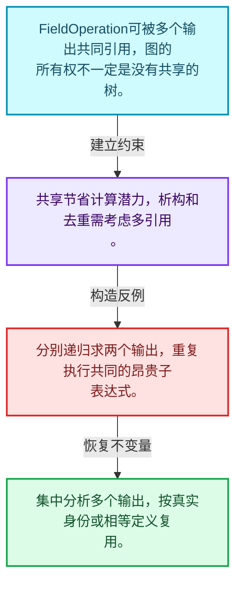
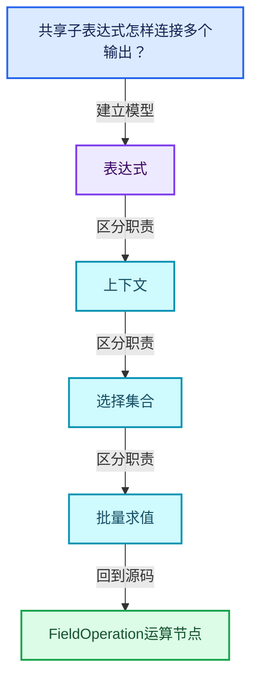
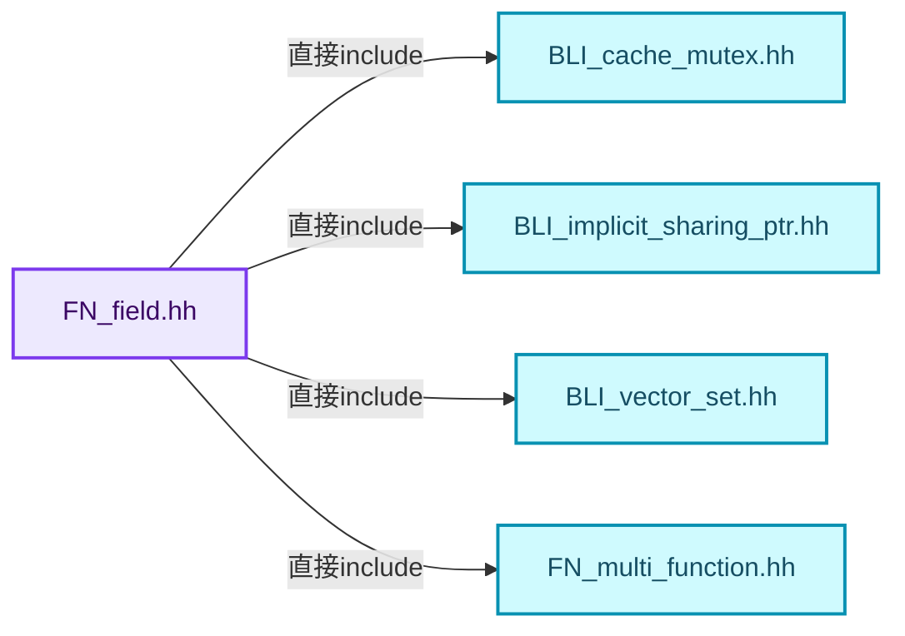
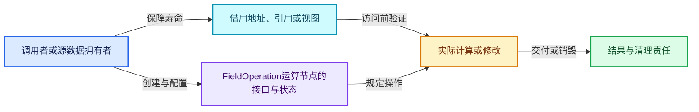
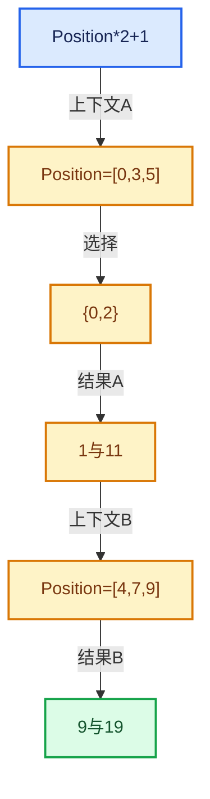

# 08-05 FieldOperation运算节点

[方向导航](README.md) · [总目录](../README.md) · [覆盖索引](../%E6%BA%90%E7%A0%81%E7%89%88%E6%9C%AC%E4%B8%8E%E8%A6%86%E7%9B%96%E7%B4%A2%E5%BC%95.md)

> 阅读顺序：问题与数据模型 → 语法与类型 → 源码逐行 → 调用线索 → 历史与取舍 → 推演和练习。

- 基准 HEAD：`cbda6b96c26c0dee3c3b5cbb93960c4ac06a6b30`。
- 记录日期：2026-10-14。
- 教学示例状态：正文中的推演不是本机性能实测；已运行练习见验收报告。

## 一、从问题到设计

共享子表达式怎样连接多个输出？

操作保存函数与输入表达式关系，某个输出索引选择结果；共享所有权图不能误当成互不相关的树。

本篇把语法、数据语义和系统取舍连接起来。Field表达式、求值上下文、mask与结果存储各自有独立职责和生命周期。

### 本篇独立模型与设计推理

FieldOperation可被多个输出共同引用，图的所有权不一定是没有共享的树。

设计取舍：共享节省计算潜力，析构和去重需考虑多引用。

最小反例：分别递归求两个输出，重复执行共同的昂贵子表达式。

推导与处理：集中分析多个输出，按真实身份或相等定义复用。



### 源码范围与相邻篇章

| 文件 | 本篇逐行范围 | 基准SHA-256 |
|---|---|---|
| [source/blender/functions/FN_field.hh](../../../../../source/blender/functions/FN_field.hh) | L387—L715 | `4ce5d9b67e7b82f22293a3250ae787716e34c6a6b5f1afe561a000eeb6dfa112` |

同一主讲文件可能分多篇覆盖；超出本篇范围的符号通过覆盖索引定位。空行与纯注释保留在源码摘录中，逐行表解释有效语句与语法边界；许可证头统一保留。

前篇：[FieldInput输入节点](04-FieldInput%E8%BE%93%E5%85%A5%E8%8A%82%E7%82%B9.md).

后篇：[FieldContext上下文](06-FieldContext%E4%B8%8A%E4%B8%8B%E6%96%87.md).

## 二、类型、数据与阅读地图



这是概念依赖图，边表示阅读关系，不声称是运行时调用顺序。

### 直接编译依赖



箭头只表示头文件包含关系；完整调用线索见后面的符号定位表。

## 三、关键词、语法与类型角色

### 模板 template

模板把类型或常量作为生成实现的参数。读声明时先列出类型参数、非类型参数和默认值，再看使用者实际实例化了什么。模板声明本身不意味着每种T都支持其全部成员。

具体检查：把T替换为int、string、只能移动的类型，分别检查每个被调用操作是否成立。

### 依赖名称 typename

typename既可引入类型模板参数，也可告诉编译器某个依赖名称是类型。它不创建运行时对象；解析期确认语法类别与实例化期检查具体类型是不同阶段。

具体检查：区分typename T::value_type和T::size()，前者标记类型，后者是表达式。

### 常量求值 constexpr

constexpr声明允许相应实体参与常量求值，但constexpr函数仍可以在运行时执行。是否常量求值由调用场景和表达式合法性共同决定。

具体检查：比较constexpr变量初始化和从运行时输入调用同一函数。

### 只读限定 const

const约束当前访问路径可做的修改。const指针、指向const的指针、const视图对象、const元素是不同位置的限定；其他别名可能仍可修改原对象。

具体检查：分别写T* const、const T*与const T* const，并画出不可修改的层次。

### 移动转换 std::move

std::move把表达式转换为可供移动重载选择的值类别，实际资源转移发生在被选中的构造或赋值中。对const对象move可能仍调用复制，对视图move也不会获得底层数据所有权。

具体检查：记录移动构造调用次数，不用变量名或std::move的出现次数替代测量。

### 完美转发 std::forward

std::forward在转发引用模板中恢复调用者原来的值类别。它依赖推导出的模板实参；无条件move会改变左值调用者的语义。

具体检查：对同一接口分别传入左值、临时对象和const左值，记录实际重载。

### 异常约定 noexcept

noexcept表达式可以依赖类型特征。违反不抛异常约定会终止程序；它不是自动捕获异常，也不是资源回滚代码。

具体检查：找出声明的条件与实际可能抛出的分配、构造操作是否一致。

### 显式静态转换 static_cast

static_cast表达编译期允许的转换，不会自动验证运行时真实类型、指针寿命或索引边界。由void指针恢复T指针时，调用者仍须保证实际存储中确有合法T对象。

具体检查：标出转换前后的类型以及正确性依据来自哪里。

### 表示层转换 reinterpret_cast

reinterpret_cast不能自动开始任意对象的生命周期，也不能豁免对齐和别名规则。读这类代码需要追溯原始分配与实际构造操作。

具体检查：分别检查大小、对齐、生命周期和可访问类型，四项不能互相替代。

### 覆写检查 override

override要求函数确实覆盖基类虚函数，可捕获参数类型和const限定不匹配。它不改变基类规定的生命周期或线程约束。

具体检查：故意改变一个参数或const，观察编译器如何拒绝误写的新函数。

### 对象表示 sizeof

sizeof给出对象表示大小，不是其引用的所有堆内存总量。sizeof视图很小并不说明底层数组很小。

具体检查：分别统计容器对象、容量字节和元素拥有的间接资源。

### 构造与new表达式

普通new可能分配并构造；placement new在给定地址构造，存储由其他机制提供。失败回滚应区分两类责任。

具体检查：追踪地址来自哪里、构造何时成功、由谁析构、由谁释放。

### 内部断言 assert

断言表达开发者预期成立的内部契约，发布构建可能关闭。它不能替代对不可信输入的完整错误处理，也不保证后续操作被运行时保护。

具体检查：对每条断言构造违反条件的输入，区分调用者错误与应向用户报告的错误。

### 编译期分支 if constexpr

条件在实例化时决定被保留的分支，这常用于不同类型的合法操作选择。它与运行时if有不同的实例化检查规则。

具体检查：找出每个分支依赖哪些类型特征，再使用满足与不满足条件的类型。

### 共享拥有 shared_ptr

shared_ptr让控制块跟踪共享寿命，不自动使被指向对象的读写线程安全；循环拥有可能阻止销毁。

具体检查：画出强引用环并考虑是否应改变所有权方向或引入弱引用。

## 四、真实源码与逐行讲解

源码块保持原行内容，原始行号由小节标题及逐行表给出。表中的调用定位是静态阅读辅助；重载、模板实例化、宏展开和虚调用需结合完整声明，不能仅凭词法出现证明动态调用。

### FN_field.hh：L387—L434

<!-- source:source/blender/functions/FN_field.hh:387:434 -->

```cpp
class FieldOperation : public ImplicitSharingMixin {
 private:
  /** One #GField for every input of the multi-function. */
  Vector<GField> inputs_;

  /** Optionally owned multi-function. */
  std::shared_ptr<const mf::MultiFunction> owned_fn_;
  const mf::MultiFunction *fn_;

  /** Cached field inputs. */
  FieldInputsPtr field_inputs_;

 public:
  /** Prefer `from*` constructor functions instead. */
  FieldOperation(std::shared_ptr<const mf::MultiFunction> fn, Vector<GField> inputs);
  FieldOperation(const mf::MultiFunction &fn, Vector<GField> inputs);

  static FieldOperationPtr from(std::shared_ptr<const mf::MultiFunction> fn,
                                Vector<GField> inputs);
  static FieldOperationPtr from(const mf::MultiFunction &fn, Vector<GField> inputs);

  /** Get the type of a specific output. */
  const CPPType &output_cpp_type(int output_i) const;

  const mf::MultiFunction &multi_function() const;
  const FieldInputsPtr &field_inputs() const;
  Span<GField> inputs() const;

  void delete_self() override;

 private:
  void delete_input_fields();
};

bool operator==(const GField &a, const GField &b);
bool operator==(const GFieldRef &a, const GFieldRef &b);

/** Type trait to detect field types. */
template<typename T> constexpr bool is_field_v = false;
template<typename T> constexpr bool is_field_v<Field<T>> = true;

Field<bool> invert_boolean_field(const Field<bool> &field);

class IndexFieldInput final : public FieldInput {
 public:
  IndexFieldInput();

  static GVArray get_index_varray(const IndexMask &mask);
```

| 原始行 | 语义、约束与检查 |
|---|---|
| L387 | 声明或定义类型 `class FieldOperation : public ImplicitSharingMixin`。结合继承、访问权限和成员布局确认接口与拥有关系；前向声明本身没有完整对象布局。 |
| L388 | 切换成员访问权限为 private；它是编译期接口边界，不是线程同步或内存保护。 |
| L390 | 声明成员、局部对象或完成语句 `Vector<GField> inputs_`。若为指针或引用，它本身不说明拥有；若为值对象，其构造析构由所在作用域或外层对象管理。 |
| L393 | 声明成员、局部对象或完成语句 `std::shared_ptr<const mf::MultiFunction> owned_fn_`。若为指针或引用，它本身不说明拥有；若为值对象，其构造析构由所在作用域或外层对象管理。 |
| L394 | 声明成员、局部对象或完成语句 `const mf::MultiFunction *fn_`。若为指针或引用，它本身不说明拥有；若为值对象，其构造析构由所在作用域或外层对象管理。 |
| L397 | 声明成员、局部对象或完成语句 `FieldInputsPtr field_inputs_`。若为指针或引用，它本身不说明拥有；若为值对象，其构造析构由所在作用域或外层对象管理。 |
| L399 | 切换成员访问权限为 public；它是编译期接口边界，不是线程同步或内存保护。 |
| L401 | 出现调用或函数声明 `FieldOperation`，对应表达式为 `FieldOperation(std::shared_ptr<const mf::MultiFunction> fn, Vector<GField> inputs);`。参数求值、返回类型与重载需结合前后完整语句；静态文本引用不能证明动态目标。 |
| L402 | 出现调用或函数声明 `FieldOperation`，对应表达式为 `FieldOperation(const mf::MultiFunction &fn, Vector<GField> inputs);`。参数求值、返回类型与重载需结合前后完整语句；静态文本引用不能证明动态目标。 |
| L404 | 出现调用或函数声明 `from`，对应表达式为 `static FieldOperationPtr from(std::shared_ptr<const mf::MultiFunction> fn,`。参数求值、返回类型与重载需结合前后完整语句；静态文本引用不能证明动态目标。 |
| L405 | 声明成员、局部对象或完成语句 `Vector<GField> inputs)`。若为指针或引用，它本身不说明拥有；若为值对象，其构造析构由所在作用域或外层对象管理。 |
| L406 | 声明接口 `static FieldOperationPtr from(const mf::MultiFunction &fn, Vector<GField> inputs)`，本行没有对应函数体；返回类型、参数限定和const/noexcept共同组成调用契约，实际行为需继续定位实现。 |
| L409 | 声明接口 `const CPPType &output_cpp_type(int output_i) const`，本行没有对应函数体；返回类型、参数限定和const/noexcept共同组成调用契约，实际行为需继续定位实现。 |
| L411 | 声明接口 `const mf::MultiFunction &multi_function() const`，本行没有对应函数体；返回类型、参数限定和const/noexcept共同组成调用契约，实际行为需继续定位实现。 |
| L412 | 声明接口 `const FieldInputsPtr &field_inputs() const`，本行没有对应函数体；返回类型、参数限定和const/noexcept共同组成调用契约，实际行为需继续定位实现。 |
| L413 | 声明接口 `Span<GField> inputs() const`，本行没有对应函数体；返回类型、参数限定和const/noexcept共同组成调用契约，实际行为需继续定位实现。 |
| L415 | 声明接口 `void delete_self() override`，本行没有对应函数体；返回类型、参数限定和const/noexcept共同组成调用契约，实际行为需继续定位实现。 |
| L417 | 切换成员访问权限为 private；它是编译期接口边界，不是线程同步或内存保护。 |
| L418 | 声明接口 `void delete_input_fields()`，本行没有对应函数体；返回类型、参数限定和const/noexcept共同组成调用契约，实际行为需继续定位实现。 |
| L419 | 结束当前语法单元。局部自动对象在离开其作用域时按规则销毁；这不等于所有被引用的外部数据也被释放。 |
| L421 | 运算符重载声明、定义或显式调用：`bool operator==(const GField &a, const GField &b);`。结合参数和返回类型判断是赋值、索引、比较还是转换；operator=声明中的等号不是在给名为operator的变量赋值。 |
| L422 | 运算符重载声明、定义或显式调用：`bool operator==(const GFieldRef &a, const GFieldRef &b);`。结合参数和返回类型判断是赋值、索引、比较还是转换；operator=声明中的等号不是在给名为operator的变量赋值。 |
| L425 | 声明模板参数 `template<typename T> constexpr bool is_field_v = false;`。类型参数决定生成操作的类型，非类型参数可决定内嵌容量或编译期分支。 |
| L426 | 声明模板参数 `template<typename T> constexpr bool is_field_v<Field<T>> = true;`。类型参数决定生成操作的类型，非类型参数可决定内嵌容量或编译期分支。 |
| L428 | 出现调用或函数声明 `invert_boolean_field`，对应表达式为 `Field<bool> invert_boolean_field(const Field<bool> &field);`。参数求值、返回类型与重载需结合前后完整语句；静态文本引用不能证明动态目标。 |
| L430 | 声明或定义类型 `class IndexFieldInput final : public FieldInput`。结合继承、访问权限和成员布局确认接口与拥有关系；前向声明本身没有完整对象布局。 |
| L431 | 切换成员访问权限为 public；它是编译期接口边界，不是线程同步或内存保护。 |
| L432 | 出现调用或函数声明 `IndexFieldInput`，对应表达式为 `IndexFieldInput();`。参数求值、返回类型与重载需结合前后完整语句；静态文本引用不能证明动态目标。 |
| L434 | 声明接口 `static GVArray get_index_varray(const IndexMask &mask)`，本行没有对应函数体；返回类型、参数限定和const/noexcept共同组成调用契约，实际行为需继续定位实现。 |

### FN_field.hh：L435—L480

<!-- source:source/blender/functions/FN_field.hh:435:480 -->

```cpp

  GVArray get_varray_for_context(const FieldContext &context,
                                 const IndexMask &mask,
                                 ResourceScope &scope) const final;

  void hash_unique(UniqueHashBytes &hash, FieldHashDeep &deep_hash_cache) const override;

  /** Cached index field to avoid allocating a new one every time. */
  static const Field<int> &get_field();
};

/* -------------------------------------------------------------------- */
/** \name Inline Methods
 * \{ */

inline GField::GField(const CPPType &type) noexcept
    : variant_(ConstantRef{&type, type.default_value()})
{
}
inline GField::GField(FieldInputPtr node) noexcept : variant_(Input{std::move(node)}) {}
inline GField::GField(Variant variant) noexcept : variant_(std::move(variant)) {}
inline GField::GField(FieldOperationPtr node, const int output_i) noexcept
    : variant_(MultiFn{std::move(node), output_i})
{
}

inline GField GField::from_non_owning_ref(const GField &field)
{
  return GField(FieldRef{&field});
}

inline bool GField::TrivialInlineConstant::cpp_type_supported(const CPPType &type)
{
  return type.is_trivial && type.size <= TrivialInlineConstant::inline_size &&
         type.alignment <= TrivialInlineConstant::inline_alignment;
}

inline GField GField::from_non_owning_constant(const CPPType &type, const void *value)
{
  return GField(ConstantRef{&type, value});
}

template<typename T> inline Field<T> Field<T>::from_non_owning_ref(const Field &field)
{
  return GField::from_non_owning_ref(field).template typed<T>();
}
```

| 原始行 | 语义、约束与检查 |
|---|---|
| L436 | 出现调用或函数声明 `get_varray_for_context`，对应表达式为 `GVArray get_varray_for_context(const FieldContext &context,`。参数求值、返回类型与重载需结合前后完整语句；静态文本引用不能证明动态目标。 |
| L437 | 本行是连续声明或表达式的一部分：`const IndexMask &mask,`。与本段前后行合读；逗号、括号和限定符决定它属于参数、初始化列表还是实际计算。 |
| L438 | 声明成员、局部对象或完成语句 `ResourceScope &scope) const final`。若为指针或引用，它本身不说明拥有；若为值对象，其构造析构由所在作用域或外层对象管理。 |
| L440 | 声明接口 `void hash_unique(UniqueHashBytes &hash, FieldHashDeep &deep_hash_cache) const override`，本行没有对应函数体；返回类型、参数限定和const/noexcept共同组成调用契约，实际行为需继续定位实现。 |
| L443 | 声明接口 `static const Field<int> &get_field()`，本行没有对应函数体；返回类型、参数限定和const/noexcept共同组成调用契约，实际行为需继续定位实现。 |
| L444 | 结束当前语法单元。局部自动对象在离开其作用域时按规则销毁；这不等于所有被引用的外部数据也被释放。 |
| L450 | 出现调用或函数声明 `GField::GField`，对应表达式为 `inline GField::GField(const CPPType &type) noexcept`。参数求值、返回类型与重载需结合前后完整语句；静态文本引用不能证明动态目标。 |
| L451 | 出现调用或函数声明 `variant_`，对应表达式为 `: variant_(ConstantRef{&type, type.default_value()})`。参数求值、返回类型与重载需结合前后完整语句；静态文本引用不能证明动态目标。 |
| L452 | 连接上一行的声明或控制结构与其语句块；后续行在这个作用域中执行或声明。 |
| L453 | 结束当前语法单元。局部自动对象在离开其作用域时按规则销毁；这不等于所有被引用的外部数据也被释放。 |
| L454 | 出现调用或函数声明 `GField::GField`，对应表达式为 `inline GField::GField(FieldInputPtr node) noexcept : variant_(Input{std::move(node)}) {}`。参数求值、返回类型与重载需结合前后完整语句；静态文本引用不能证明动态目标。 |
| L455 | 出现调用或函数声明 `GField::GField`，对应表达式为 `inline GField::GField(Variant variant) noexcept : variant_(std::move(variant)) {}`。参数求值、返回类型与重载需结合前后完整语句；静态文本引用不能证明动态目标。 |
| L456 | 出现调用或函数声明 `GField::GField`，对应表达式为 `inline GField::GField(FieldOperationPtr node, const int output_i) noexcept`。参数求值、返回类型与重载需结合前后完整语句；静态文本引用不能证明动态目标。 |
| L457 | 出现调用或函数声明 `variant_`，对应表达式为 `: variant_(MultiFn{std::move(node), output_i})`。参数求值、返回类型与重载需结合前后完整语句；静态文本引用不能证明动态目标。 |
| L458 | 连接上一行的声明或控制结构与其语句块；后续行在这个作用域中执行或声明。 |
| L459 | 结束当前语法单元。局部自动对象在离开其作用域时按规则销毁；这不等于所有被引用的外部数据也被释放。 |
| L461 | 出现调用或函数声明 `GField::from_non_owning_ref`，对应表达式为 `inline GField GField::from_non_owning_ref(const GField &field)`。参数求值、返回类型与重载需结合前后完整语句；静态文本引用不能证明动态目标。 |
| L462 | 连接上一行的声明或控制结构与其语句块；后续行在这个作用域中执行或声明。 |
| L463 | 返回表达式 `GField(FieldRef{&field})`。 |
| L464 | 结束当前语法单元。局部自动对象在离开其作用域时按规则销毁；这不等于所有被引用的外部数据也被释放。 |
| L466 | 出现调用或函数声明 `GField::TrivialInlineConstant::cpp_type_supported`，对应表达式为 `inline bool GField::TrivialInlineConstant::cpp_type_supported(const CPPType &type)`。参数求值、返回类型与重载需结合前后完整语句；静态文本引用不能证明动态目标。 |
| L467 | 连接上一行的声明或控制结构与其语句块；后续行在这个作用域中执行或声明。 |
| L468 | 返回表达式 `type.is_trivial && type.size <= TrivialInlineConstant::inline_size &&`。 |
| L469 | 声明成员、局部对象或完成语句 `type.alignment <= TrivialInlineConstant::inline_alignment`。若为指针或引用，它本身不说明拥有；若为值对象，其构造析构由所在作用域或外层对象管理。 |
| L470 | 结束当前语法单元。局部自动对象在离开其作用域时按规则销毁；这不等于所有被引用的外部数据也被释放。 |
| L472 | 出现调用或函数声明 `GField::from_non_owning_constant`，对应表达式为 `inline GField GField::from_non_owning_constant(const CPPType &type, const void *value)`。参数求值、返回类型与重载需结合前后完整语句；静态文本引用不能证明动态目标。 |
| L473 | 连接上一行的声明或控制结构与其语句块；后续行在这个作用域中执行或声明。 |
| L474 | 返回表达式 `GField(ConstantRef{&type, value})`。 |
| L475 | 结束当前语法单元。局部自动对象在离开其作用域时按规则销毁；这不等于所有被引用的外部数据也被释放。 |
| L477 | 声明模板参数 `template<typename T> inline Field<T> Field<T>::from_non_owning_ref(const Field &field)`。类型参数决定生成操作的类型，非类型参数可决定内嵌容量或编译期分支。 |
| L478 | 连接上一行的声明或控制结构与其语句块；后续行在这个作用域中执行或声明。 |
| L479 | 返回表达式 `GField::from_non_owning_ref(field).template typed<T>()`。 |
| L480 | 结束当前语法单元。局部自动对象在离开其作用域时按规则销毁；这不等于所有被引用的外部数据也被释放。 |

### FN_field.hh：L481—L539

<!-- source:source/blender/functions/FN_field.hh:481:539 -->

```cpp

template<typename InputT, typename... Args> inline GField GField::from_input(Args &&...args)
{
  FieldInputPtr input{MEM_new<InputT>(__func__, std::forward<Args>(args)...)};
  return GField(Input{std::move(input)});
}

template<typename T>
template<typename InputT, typename... Args>
inline Field<T> Field<T>::from_input(Args &&...args)
{
  return GField::from_input<InputT>(std::forward<Args>(args)...).template typed<T>();
}

template<typename T>
inline Field<T>::Field(T value)
    : field_([&]() {
        const CPPType &type = CPPType::get<T>();
        if constexpr (GField::TrivialInlineConstant::type_supported_v<T>) {
          GField::TrivialInlineConstant constant;
          constant.type = &type;
          new (constant.value.ptr()) T(std::move(value));
          return GField(constant);
        }
        else {
          T *new_value = MEM_new<T>(__func__, std::move(new_value));
          return GField(GField::OwnedConstant{&type, new_value});
        }
      }())
{
}

template<typename T> inline bool Field<T>::depends_on_input() const
{
  return field_.depends_on_input();
}

inline const CPPType &GField::cpp_type() const
{
  return std::visit(
      []<typename T>(const T &v) -> const CPPType & {
        if constexpr (std::is_same_v<T, Input>) {
          return v.node->cpp_type();
        }
        else if constexpr (std::is_same_v<T, MultiFn>) {
          return v.node->output_cpp_type(v.output_i);
        }
        else if constexpr (std::is_same_v<T, FieldRef>) {
          return v.field_ref->cpp_type();
        }
        else if constexpr (is_same_any_v<T, ConstantRef, TrivialInlineConstant, OwnedConstant>) {
          return *v.type;
        }
        else {
          BLI_assert_unreachable_static_t(T);
        }
      },
      this->variant_);
}
```

本段语义重点：

- `std::visit`：根据variant当前活动类型执行对应操作；每个候选分支都必须满足访客约定。

| 原始行 | 语义、约束与检查 |
|---|---|
| L482 | 声明模板参数 `template<typename InputT, typename... Args> inline GField GField::from_input(Args &&...args)`。类型参数决定生成操作的类型，非类型参数可决定内嵌容量或编译期分支。 |
| L483 | 连接上一行的声明或控制结构与其语句块；后续行在这个作用域中执行或声明。 |
| L484 | 出现调用或函数声明 `MEM_new`，对应表达式为 `FieldInputPtr input{MEM_new<InputT>(__func__, std::forward<Args>(args)...)};`。参数求值、返回类型与重载需结合前后完整语句；静态文本引用不能证明动态目标。 |
| L485 | 返回表达式 `GField(Input{std::move(input)})`。 |
| L486 | 结束当前语法单元。局部自动对象在离开其作用域时按规则销毁；这不等于所有被引用的外部数据也被释放。 |
| L488 | 声明模板参数 `template<typename T>`。类型参数决定生成操作的类型，非类型参数可决定内嵌容量或编译期分支。 |
| L489 | 声明模板参数 `template<typename InputT, typename... Args>`。类型参数决定生成操作的类型，非类型参数可决定内嵌容量或编译期分支。 |
| L490 | 出现调用或函数声明 `::from_input`，对应表达式为 `inline Field<T> Field<T>::from_input(Args &&...args)`。参数求值、返回类型与重载需结合前后完整语句；静态文本引用不能证明动态目标。 |
| L491 | 连接上一行的声明或控制结构与其语句块；后续行在这个作用域中执行或声明。 |
| L492 | 返回表达式 `GField::from_input<InputT>(std::forward<Args>(args)...).template typed<T>()`。 |
| L493 | 结束当前语法单元。局部自动对象在离开其作用域时按规则销毁；这不等于所有被引用的外部数据也被释放。 |
| L495 | 声明模板参数 `template<typename T>`。类型参数决定生成操作的类型，非类型参数可决定内嵌容量或编译期分支。 |
| L496 | 出现调用或函数声明 `::Field`，对应表达式为 `inline Field<T>::Field(T value)`。参数求值、返回类型与重载需结合前后完整语句；静态文本引用不能证明动态目标。 |
| L497 | 出现调用或函数声明 `field_`，对应表达式为 `: field_([&]() {`。参数求值、返回类型与重载需结合前后完整语句；静态文本引用不能证明动态目标。 |
| L498 | 把右侧 `CPPType::get<T>()` 用于初始化或更新左侧 `const CPPType &type`。声明初始化与已有对象赋值应按上下文区分；有资源的类型会调用相应特殊成员。 |
| L499 | 编译期条件分支 `if constexpr (GField::TrivialInlineConstant::type_supported_v<T>)`。按实例化类型选择相应实现；被舍弃分支和运行期if具有不同检查规则，不能当作运行时输入验证。 |
| L500 | 声明成员、局部对象或完成语句 `GField::TrivialInlineConstant constant`。若为指针或引用，它本身不说明拥有；若为值对象，其构造析构由所在作用域或外层对象管理。 |
| L501 | 把右侧 `&type` 用于初始化或更新左侧 `constant.type`。声明初始化与已有对象赋值应按上下文区分；有资源的类型会调用相应特殊成员。 |
| L502 | 出现调用或函数声明 `new`，对应表达式为 `new (constant.value.ptr()) T(std::move(value));`。参数求值、返回类型与重载需结合前后完整语句；静态文本引用不能证明动态目标。 |
| L503 | 返回表达式 `GField(constant)`。 |
| L504 | 结束当前语法单元。局部自动对象在离开其作用域时按规则销毁；这不等于所有被引用的外部数据也被释放。 |
| L505 | 处理前一条件不成立的互补路径。比较两条路径最后是否恢复同一不变量，以及是否产生不同的资源责任。 |
| L506 | 把右侧 `MEM_new<T>(__func__, std::move(new_value))` 用于初始化或更新左侧 `T *new_value`。声明初始化与已有对象赋值应按上下文区分；有资源的类型会调用相应特殊成员。 |
| L507 | 返回表达式 `GField(GField::OwnedConstant{&type, new_value})`。结合函数声明检查返回值是否借用原存储，借用值不会自动延长其寿命。 |
| L508 | 结束当前语法单元。局部自动对象在离开其作用域时按规则销毁；这不等于所有被引用的外部数据也被释放。 |
| L509 | 本行是连续声明或表达式的一部分：`}())`。与本段前后行合读；逗号、括号和限定符决定它属于参数、初始化列表还是实际计算。 |
| L510 | 连接上一行的声明或控制结构与其语句块；后续行在这个作用域中执行或声明。 |
| L511 | 结束当前语法单元。局部自动对象在离开其作用域时按规则销毁；这不等于所有被引用的外部数据也被释放。 |
| L513 | 声明模板参数 `template<typename T> inline bool Field<T>::depends_on_input() const`。类型参数决定生成操作的类型，非类型参数可决定内嵌容量或编译期分支。 |
| L514 | 连接上一行的声明或控制结构与其语句块；后续行在这个作用域中执行或声明。 |
| L515 | 返回表达式 `field_.depends_on_input()`。 |
| L516 | 结束当前语法单元。局部自动对象在离开其作用域时按规则销毁；这不等于所有被引用的外部数据也被释放。 |
| L518 | 出现调用或函数声明 `GField::cpp_type`，对应表达式为 `inline const CPPType &GField::cpp_type() const`。参数求值、返回类型与重载需结合前后完整语句；静态文本引用不能证明动态目标。 |
| L519 | 连接上一行的声明或控制结构与其语句块；后续行在这个作用域中执行或声明。 |
| L520 | 返回表达式 `std::visit(`。 |
| L521 | 本行是连续声明或表达式的一部分：`[]<typename T>(const T &v) -> const CPPType & {`。与本段前后行合读；逗号、括号和限定符决定它属于参数、初始化列表还是实际计算。 |
| L522 | 编译期条件分支 `if constexpr (std::is_same_v<T, Input>)`。按实例化类型选择相应实现；被舍弃分支和运行期if具有不同检查规则，不能当作运行时输入验证。 |
| L523 | 返回表达式 `v.node->cpp_type()`。 |
| L524 | 结束当前语法单元。局部自动对象在离开其作用域时按规则销毁；这不等于所有被引用的外部数据也被释放。 |
| L525 | 出现调用或函数声明 `constexpr`，对应表达式为 `else if constexpr (std::is_same_v<T, MultiFn>) {`。参数求值、返回类型与重载需结合前后完整语句；静态文本引用不能证明动态目标。 |
| L526 | 返回表达式 `v.node->output_cpp_type(v.output_i)`。 |
| L527 | 结束当前语法单元。局部自动对象在离开其作用域时按规则销毁；这不等于所有被引用的外部数据也被释放。 |
| L528 | 出现调用或函数声明 `constexpr`，对应表达式为 `else if constexpr (std::is_same_v<T, FieldRef>) {`。参数求值、返回类型与重载需结合前后完整语句；静态文本引用不能证明动态目标。 |
| L529 | 返回表达式 `v.field_ref->cpp_type()`。 |
| L530 | 结束当前语法单元。局部自动对象在离开其作用域时按规则销毁；这不等于所有被引用的外部数据也被释放。 |
| L531 | 出现调用或函数声明 `constexpr`，对应表达式为 `else if constexpr (is_same_any_v<T, ConstantRef, TrivialInlineConstant, OwnedConstant>) {`。参数求值、返回类型与重载需结合前后完整语句；静态文本引用不能证明动态目标。 |
| L532 | 返回表达式 `*v.type`。 |
| L533 | 结束当前语法单元。局部自动对象在离开其作用域时按规则销毁；这不等于所有被引用的外部数据也被释放。 |
| L534 | 处理前一条件不成立的互补路径。比较两条路径最后是否恢复同一不变量，以及是否产生不同的资源责任。 |
| L535 | 断言约束 `BLI_assert_unreachable_static_t(T);`。条件是后续访问的内部前置条件；发布构建可能不执行，不能把断言当作输入修复。 |
| L536 | 结束当前语法单元。局部自动对象在离开其作用域时按规则销毁；这不等于所有被引用的外部数据也被释放。 |
| L537 | 结束当前语法单元。局部自动对象在离开其作用域时按规则销毁；这不等于所有被引用的外部数据也被释放。 |
| L538 | 声明成员、局部对象或完成语句 `this->variant_)`。若为指针或引用，它本身不说明拥有；若为值对象，其构造析构由所在作用域或外层对象管理。 |
| L539 | 结束当前语法单元。局部自动对象在离开其作用域时按规则销毁；这不等于所有被引用的外部数据也被释放。 |

### FN_field.hh：L540—L589

<!-- source:source/blender/functions/FN_field.hh:540:589 -->

```cpp

inline const GField &GField::deref_field_ref() const
{
  if (const auto *field_ref = std::get_if<FieldRef>(&this->variant_)) {
    return field_ref->field_ref->deref_field_ref();
  }
  return *this;
}

template<typename T> inline bool operator==(const Field<T> &a, const Field<T> &b)
{
  return static_cast<const GField &>(a) == static_cast<const GField &>(b);
}

template<typename T> inline uint64_t Field<T>::hash() const
{
  return field_.hash();
}

inline const CPPType &FieldInput::cpp_type() const
{
  return *this->type_;
}

inline const FieldInputsPtr &FieldOperation::field_inputs() const
{
  return field_inputs_;
}

inline StringRefNull FieldInput::debug_name() const
{
  return debug_name_;
}

inline std::string FieldInput::socket_inspection_name() const
{
  return debug_name_;
}

template<typename T> inline Field<T>::operator const GField &() const
{
  return field_;
}

template<typename T> inline const Field<T> &GField::typed() const
{
  static_assert(sizeof(GField) == sizeof(Field<T>));
  BLI_assert(this->cpp_type().is<T>());
  return reinterpret_cast<const Field<T> &>(*this);
}
```

本段语义重点：

- 分支证据 `const auto *field_ref = std::get_if<FieldRef>(&this->variant_))`：分别推演条件成立与不成立，核对相同出口处的状态。

| 原始行 | 语义、约束与检查 |
|---|---|
| L541 | 出现调用或函数声明 `GField::deref_field_ref`，对应表达式为 `inline const GField &GField::deref_field_ref() const`。参数求值、返回类型与重载需结合前后完整语句；静态文本引用不能证明动态目标。 |
| L542 | 连接上一行的声明或控制结构与其语句块；后续行在这个作用域中执行或声明。 |
| L543 | 判断 `const auto *field_ref = std::get_if<FieldRef>(&this->variant_)`，成立时进入本分支，否则继续后续路径。 |
| L544 | 返回表达式 `field_ref->field_ref->deref_field_ref()`。结合函数声明检查返回值是否借用原存储，借用值不会自动延长其寿命。 |
| L545 | 结束当前语法单元。局部自动对象在离开其作用域时按规则销毁；这不等于所有被引用的外部数据也被释放。 |
| L546 | 返回表达式 `*this`。返回当前对象；返回类型决定它是引用还是值，不能仅凭表达式假定复制。 |
| L547 | 结束当前语法单元。局部自动对象在离开其作用域时按规则销毁；这不等于所有被引用的外部数据也被释放。 |
| L549 | 运算符重载声明、定义或显式调用：`template<typename T> inline bool operator==(const Field<T> &a, const Field<T> &b)`。结合参数和返回类型判断是赋值、索引、比较还是转换；operator=声明中的等号不是在给名为operator的变量赋值。 |
| L550 | 连接上一行的声明或控制结构与其语句块；后续行在这个作用域中执行或声明。 |
| L551 | 返回表达式 `static_cast<const GField &>(a) == static_cast<const GField &>(b)`。 |
| L552 | 结束当前语法单元。局部自动对象在离开其作用域时按规则销毁；这不等于所有被引用的外部数据也被释放。 |
| L554 | 声明模板参数 `template<typename T> inline uint64_t Field<T>::hash() const`。类型参数决定生成操作的类型，非类型参数可决定内嵌容量或编译期分支。 |
| L555 | 连接上一行的声明或控制结构与其语句块；后续行在这个作用域中执行或声明。 |
| L556 | 返回表达式 `field_.hash()`。 |
| L557 | 结束当前语法单元。局部自动对象在离开其作用域时按规则销毁；这不等于所有被引用的外部数据也被释放。 |
| L559 | 出现调用或函数声明 `FieldInput::cpp_type`，对应表达式为 `inline const CPPType &FieldInput::cpp_type() const`。参数求值、返回类型与重载需结合前后完整语句；静态文本引用不能证明动态目标。 |
| L560 | 连接上一行的声明或控制结构与其语句块；后续行在这个作用域中执行或声明。 |
| L561 | 返回表达式 `*this->type_`。 |
| L562 | 结束当前语法单元。局部自动对象在离开其作用域时按规则销毁；这不等于所有被引用的外部数据也被释放。 |
| L564 | 出现调用或函数声明 `FieldOperation::field_inputs`，对应表达式为 `inline const FieldInputsPtr &FieldOperation::field_inputs() const`。参数求值、返回类型与重载需结合前后完整语句；静态文本引用不能证明动态目标。 |
| L565 | 连接上一行的声明或控制结构与其语句块；后续行在这个作用域中执行或声明。 |
| L566 | 返回表达式 `field_inputs_`。 |
| L567 | 结束当前语法单元。局部自动对象在离开其作用域时按规则销毁；这不等于所有被引用的外部数据也被释放。 |
| L569 | 出现调用或函数声明 `FieldInput::debug_name`，对应表达式为 `inline StringRefNull FieldInput::debug_name() const`。参数求值、返回类型与重载需结合前后完整语句；静态文本引用不能证明动态目标。 |
| L570 | 连接上一行的声明或控制结构与其语句块；后续行在这个作用域中执行或声明。 |
| L571 | 返回表达式 `debug_name_`。 |
| L572 | 结束当前语法单元。局部自动对象在离开其作用域时按规则销毁；这不等于所有被引用的外部数据也被释放。 |
| L574 | 出现调用或函数声明 `FieldInput::socket_inspection_name`，对应表达式为 `inline std::string FieldInput::socket_inspection_name() const`。参数求值、返回类型与重载需结合前后完整语句；静态文本引用不能证明动态目标。 |
| L575 | 连接上一行的声明或控制结构与其语句块；后续行在这个作用域中执行或声明。 |
| L576 | 返回表达式 `debug_name_`。 |
| L577 | 结束当前语法单元。局部自动对象在离开其作用域时按规则销毁；这不等于所有被引用的外部数据也被释放。 |
| L579 | 运算符重载声明、定义或显式调用：`template<typename T> inline Field<T>::operator const GField &() const`。结合参数和返回类型判断是赋值、索引、比较还是转换；operator=声明中的等号不是在给名为operator的变量赋值。 |
| L580 | 连接上一行的声明或控制结构与其语句块；后续行在这个作用域中执行或声明。 |
| L581 | 返回表达式 `field_`。 |
| L582 | 结束当前语法单元。局部自动对象在离开其作用域时按规则销毁；这不等于所有被引用的外部数据也被释放。 |
| L584 | 声明模板参数 `template<typename T> inline const Field<T> &GField::typed() const`。类型参数决定生成操作的类型，非类型参数可决定内嵌容量或编译期分支。 |
| L585 | 连接上一行的声明或控制结构与其语句块；后续行在这个作用域中执行或声明。 |
| L586 | 在编译期检查 `static_assert(sizeof(GField) == sizeof(Field<T>));`；条件失败导致编译错误，不存在运行时错误恢复路径。 |
| L587 | 断言约束 `BLI_assert(this->cpp_type().is<T>());`。条件是后续访问的内部前置条件；发布构建可能不执行，不能把断言当作输入修复。 |
| L588 | 返回表达式 `reinterpret_cast<const Field<T> &>(*this)`。 |
| L589 | 结束当前语法单元。局部自动对象在离开其作用域时按规则销毁；这不等于所有被引用的外部数据也被释放。 |

### FN_field.hh：L590—L630

<!-- source:source/blender/functions/FN_field.hh:590:630 -->

```cpp

template<typename T> inline Field<T> &GField::typed()
{
  static_assert(sizeof(GField) == sizeof(Field<T>));
  BLI_assert(this->cpp_type().is<T>());
  return reinterpret_cast<Field<T> &>(*this);
}

inline const GField::Variant &GField::variant() const
{
  return variant_;
}

template<typename T> inline Field<T>::Field() : field_(CPPType::get<T>()) {}

template<typename T> inline Field<T>::Field(FieldInputPtr node) : field_(GField(std::move(node)))
{
}
template<typename T>
inline Field<T>::Field(FieldOperationPtr node, const int output_i)
    : field_(GField(std::move(node), output_i))
{
}

inline bool GField::depends_on_input() const
{
  const FieldInputsPtr &inputs = this->field_inputs();
  if (!inputs) {
    return false;
  }
  return !inputs->inputs.is_empty();
}

template<typename InputT> inline const InputT *GField::get_input_if() const
{
  const GField &deref_field = this->deref_field_ref();
  if (const auto *input = std::get_if<Input>(&deref_field.variant())) {
    return dynamic_cast<const InputT *>(input->node.get());
  }
  return nullptr;
}
```

本段语义重点：

- 分支证据 `!inputs)`：分别推演条件成立与不成立，核对相同出口处的状态。
- 分支证据 `const auto *input = std::get_if<Input>(&deref_field.variant()))`：分别推演条件成立与不成立，核对相同出口处的状态。

| 原始行 | 语义、约束与检查 |
|---|---|
| L591 | 声明模板参数 `template<typename T> inline Field<T> &GField::typed()`。类型参数决定生成操作的类型，非类型参数可决定内嵌容量或编译期分支。 |
| L592 | 连接上一行的声明或控制结构与其语句块；后续行在这个作用域中执行或声明。 |
| L593 | 在编译期检查 `static_assert(sizeof(GField) == sizeof(Field<T>));`；条件失败导致编译错误，不存在运行时错误恢复路径。 |
| L594 | 断言约束 `BLI_assert(this->cpp_type().is<T>());`。条件是后续访问的内部前置条件；发布构建可能不执行，不能把断言当作输入修复。 |
| L595 | 返回表达式 `reinterpret_cast<Field<T> &>(*this)`。 |
| L596 | 结束当前语法单元。局部自动对象在离开其作用域时按规则销毁；这不等于所有被引用的外部数据也被释放。 |
| L598 | 出现调用或函数声明 `GField::variant`，对应表达式为 `inline const GField::Variant &GField::variant() const`。参数求值、返回类型与重载需结合前后完整语句；静态文本引用不能证明动态目标。 |
| L599 | 连接上一行的声明或控制结构与其语句块；后续行在这个作用域中执行或声明。 |
| L600 | 返回表达式 `variant_`。 |
| L601 | 结束当前语法单元。局部自动对象在离开其作用域时按规则销毁；这不等于所有被引用的外部数据也被释放。 |
| L603 | 声明模板参数 `template<typename T> inline Field<T>::Field() : field_(CPPType::get<T>()) {}`。类型参数决定生成操作的类型，非类型参数可决定内嵌容量或编译期分支。 |
| L605 | 声明模板参数 `template<typename T> inline Field<T>::Field(FieldInputPtr node) : field_(GField(std::move(node)))`。类型参数决定生成操作的类型，非类型参数可决定内嵌容量或编译期分支。 |
| L606 | 连接上一行的声明或控制结构与其语句块；后续行在这个作用域中执行或声明。 |
| L607 | 结束当前语法单元。局部自动对象在离开其作用域时按规则销毁；这不等于所有被引用的外部数据也被释放。 |
| L608 | 声明模板参数 `template<typename T>`。类型参数决定生成操作的类型，非类型参数可决定内嵌容量或编译期分支。 |
| L609 | 出现调用或函数声明 `::Field`，对应表达式为 `inline Field<T>::Field(FieldOperationPtr node, const int output_i)`。参数求值、返回类型与重载需结合前后完整语句；静态文本引用不能证明动态目标。 |
| L610 | 出现调用或函数声明 `field_`，对应表达式为 `: field_(GField(std::move(node), output_i))`。参数求值、返回类型与重载需结合前后完整语句；静态文本引用不能证明动态目标。 |
| L611 | 连接上一行的声明或控制结构与其语句块；后续行在这个作用域中执行或声明。 |
| L612 | 结束当前语法单元。局部自动对象在离开其作用域时按规则销毁；这不等于所有被引用的外部数据也被释放。 |
| L614 | 出现调用或函数声明 `GField::depends_on_input`，对应表达式为 `inline bool GField::depends_on_input() const`。参数求值、返回类型与重载需结合前后完整语句；静态文本引用不能证明动态目标。 |
| L615 | 连接上一行的声明或控制结构与其语句块；后续行在这个作用域中执行或声明。 |
| L616 | 把右侧 `this->field_inputs()` 用于初始化或更新左侧 `const FieldInputsPtr &inputs`。声明初始化与已有对象赋值应按上下文区分；有资源的类型会调用相应特殊成员。 |
| L617 | 判断 `!inputs`，成立时进入本分支，否则继续后续路径。 |
| L618 | 返回表达式 `false`。这是本路径的布尔结果，具体成功、存在或状态含义由函数接口规定。 |
| L619 | 结束当前语法单元。局部自动对象在离开其作用域时按规则销毁；这不等于所有被引用的外部数据也被释放。 |
| L620 | 返回表达式 `!inputs->inputs.is_empty()`。 |
| L621 | 结束当前语法单元。局部自动对象在离开其作用域时按规则销毁；这不等于所有被引用的外部数据也被释放。 |
| L623 | 声明模板参数 `template<typename InputT> inline const InputT *GField::get_input_if() const`。类型参数决定生成操作的类型，非类型参数可决定内嵌容量或编译期分支。 |
| L624 | 连接上一行的声明或控制结构与其语句块；后续行在这个作用域中执行或声明。 |
| L625 | 把右侧 `this->deref_field_ref()` 用于初始化或更新左侧 `const GField &deref_field`。声明初始化与已有对象赋值应按上下文区分；有资源的类型会调用相应特殊成员。 |
| L626 | 判断 `const auto *input = std::get_if<Input>(&deref_field.variant())`，成立时进入本分支，否则继续后续路径。 |
| L627 | 返回表达式 `dynamic_cast<const InputT *>(input->node.get())`。结合函数声明检查返回值是否借用原存储，借用值不会自动延长其寿命。 |
| L628 | 结束当前语法单元。局部自动对象在离开其作用域时按规则销毁；这不等于所有被引用的外部数据也被释放。 |
| L629 | 返回表达式 `nullptr`。 |
| L630 | 结束当前语法单元。局部自动对象在离开其作用域时按规则销毁；这不等于所有被引用的外部数据也被释放。 |

### FN_field.hh：L631—L676

<!-- source:source/blender/functions/FN_field.hh:631:676 -->

```cpp

inline const void *GField::get_if_constant() const
{
  return std::visit(
      []<typename T>(const T &v) -> const void * {
        if constexpr (is_same_any_v<T, Input, MultiFn>) {
          return nullptr;
        }
        else if constexpr (std::is_same_v<T, FieldRef>) {
          return v.field_ref->get_if_constant();
        }
        else {
          return v.value;
        }
      },
      variant_);
}

template<typename T> template<typename InputT> inline const InputT *Field<T>::get_input_if() const
{
  return field_.get_input_if<InputT>();
}

inline Span<GField> FieldOperation::inputs() const
{
  return inputs_;
}

inline GFieldRef::GFieldRef(const FieldInput &field_input) : variant_(Input{&field_input}) {}

inline GFieldRef::GFieldRef(const FieldOperation &field_multi_fn, int output_i)
    : variant_(MultiFn{&field_multi_fn, output_i})
{
}

inline GFieldRef::GFieldRef(Variant variant) : variant_(std::move(variant)) {}

inline GFieldRef GFieldRef::from_constant(const CPPType &type, const void *value)
{
  return GFieldRef(Value{&type, value});
}

template<typename T>
inline GFieldRef::GFieldRef(const Field<T> &field) : GFieldRef(static_cast<const GField &>(field))
{
}
```

本段语义重点：

- `std::visit`：根据variant当前活动类型执行对应操作；每个候选分支都必须满足访客约定。

| 原始行 | 语义、约束与检查 |
|---|---|
| L632 | 出现调用或函数声明 `GField::get_if_constant`，对应表达式为 `inline const void *GField::get_if_constant() const`。参数求值、返回类型与重载需结合前后完整语句；静态文本引用不能证明动态目标。 |
| L633 | 连接上一行的声明或控制结构与其语句块；后续行在这个作用域中执行或声明。 |
| L634 | 返回表达式 `std::visit(`。 |
| L635 | 本行是连续声明或表达式的一部分：`[]<typename T>(const T &v) -> const void * {`。与本段前后行合读；逗号、括号和限定符决定它属于参数、初始化列表还是实际计算。 |
| L636 | 编译期条件分支 `if constexpr (is_same_any_v<T, Input, MultiFn>)`。按实例化类型选择相应实现；被舍弃分支和运行期if具有不同检查规则，不能当作运行时输入验证。 |
| L637 | 返回表达式 `nullptr`。 |
| L638 | 结束当前语法单元。局部自动对象在离开其作用域时按规则销毁；这不等于所有被引用的外部数据也被释放。 |
| L639 | 出现调用或函数声明 `constexpr`，对应表达式为 `else if constexpr (std::is_same_v<T, FieldRef>) {`。参数求值、返回类型与重载需结合前后完整语句；静态文本引用不能证明动态目标。 |
| L640 | 返回表达式 `v.field_ref->get_if_constant()`。 |
| L641 | 结束当前语法单元。局部自动对象在离开其作用域时按规则销毁；这不等于所有被引用的外部数据也被释放。 |
| L642 | 处理前一条件不成立的互补路径。比较两条路径最后是否恢复同一不变量，以及是否产生不同的资源责任。 |
| L643 | 返回表达式 `v.value`。 |
| L644 | 结束当前语法单元。局部自动对象在离开其作用域时按规则销毁；这不等于所有被引用的外部数据也被释放。 |
| L645 | 结束当前语法单元。局部自动对象在离开其作用域时按规则销毁；这不等于所有被引用的外部数据也被释放。 |
| L646 | 声明成员、局部对象或完成语句 `variant_)`。若为指针或引用，它本身不说明拥有；若为值对象，其构造析构由所在作用域或外层对象管理。 |
| L647 | 结束当前语法单元。局部自动对象在离开其作用域时按规则销毁；这不等于所有被引用的外部数据也被释放。 |
| L649 | 声明模板参数 `template<typename T> template<typename InputT> inline const InputT *Field<T>::get_input_if() const`。类型参数决定生成操作的类型，非类型参数可决定内嵌容量或编译期分支。 |
| L650 | 连接上一行的声明或控制结构与其语句块；后续行在这个作用域中执行或声明。 |
| L651 | 返回表达式 `field_.get_input_if<InputT>()`。 |
| L652 | 结束当前语法单元。局部自动对象在离开其作用域时按规则销毁；这不等于所有被引用的外部数据也被释放。 |
| L654 | 出现调用或函数声明 `FieldOperation::inputs`，对应表达式为 `inline Span<GField> FieldOperation::inputs() const`。参数求值、返回类型与重载需结合前后完整语句；静态文本引用不能证明动态目标。 |
| L655 | 连接上一行的声明或控制结构与其语句块；后续行在这个作用域中执行或声明。 |
| L656 | 返回表达式 `inputs_`。 |
| L657 | 结束当前语法单元。局部自动对象在离开其作用域时按规则销毁；这不等于所有被引用的外部数据也被释放。 |
| L659 | 出现调用或函数声明 `GFieldRef::GFieldRef`，对应表达式为 `inline GFieldRef::GFieldRef(const FieldInput &field_input) : variant_(Input{&field_input}) {}`。参数求值、返回类型与重载需结合前后完整语句；静态文本引用不能证明动态目标。 |
| L661 | 出现调用或函数声明 `GFieldRef::GFieldRef`，对应表达式为 `inline GFieldRef::GFieldRef(const FieldOperation &field_multi_fn, int output_i)`。参数求值、返回类型与重载需结合前后完整语句；静态文本引用不能证明动态目标。 |
| L662 | 出现调用或函数声明 `variant_`，对应表达式为 `: variant_(MultiFn{&field_multi_fn, output_i})`。参数求值、返回类型与重载需结合前后完整语句；静态文本引用不能证明动态目标。 |
| L663 | 连接上一行的声明或控制结构与其语句块；后续行在这个作用域中执行或声明。 |
| L664 | 结束当前语法单元。局部自动对象在离开其作用域时按规则销毁；这不等于所有被引用的外部数据也被释放。 |
| L666 | 出现调用或函数声明 `GFieldRef::GFieldRef`，对应表达式为 `inline GFieldRef::GFieldRef(Variant variant) : variant_(std::move(variant)) {}`。参数求值、返回类型与重载需结合前后完整语句；静态文本引用不能证明动态目标。 |
| L668 | 出现调用或函数声明 `GFieldRef::from_constant`，对应表达式为 `inline GFieldRef GFieldRef::from_constant(const CPPType &type, const void *value)`。参数求值、返回类型与重载需结合前后完整语句；静态文本引用不能证明动态目标。 |
| L669 | 连接上一行的声明或控制结构与其语句块；后续行在这个作用域中执行或声明。 |
| L670 | 返回表达式 `GFieldRef(Value{&type, value})`。 |
| L671 | 结束当前语法单元。局部自动对象在离开其作用域时按规则销毁；这不等于所有被引用的外部数据也被释放。 |
| L673 | 声明模板参数 `template<typename T>`。类型参数决定生成操作的类型，非类型参数可决定内嵌容量或编译期分支。 |
| L674 | 出现调用或函数声明 `GFieldRef::GFieldRef`，对应表达式为 `inline GFieldRef::GFieldRef(const Field<T> &field) : GFieldRef(static_cast<const GField &>(field))`。参数求值、返回类型与重载需结合前后完整语句；静态文本引用不能证明动态目标。 |
| L675 | 连接上一行的声明或控制结构与其语句块；后续行在这个作用域中执行或声明。 |
| L676 | 结束当前语法单元。局部自动对象在离开其作用域时按规则销毁；这不等于所有被引用的外部数据也被释放。 |

### FN_field.hh：L677—L715

<!-- source:source/blender/functions/FN_field.hh:677:715 -->

```cpp

inline const GFieldRef::Variant &GFieldRef::variant() const
{
  return variant_;
}

inline const CPPType &GFieldRef::cpp_type() const
{
  return std::visit(
      []<typename T>(const T &v) -> const CPPType & {
        if constexpr (std::is_same_v<T, Value>) {
          return *v.type;
        }
        else if constexpr (std::is_same_v<T, Input>) {
          return v.node->cpp_type();
        }
        else if constexpr (std::is_same_v<T, MultiFn>) {
          return v.node->output_cpp_type(v.output_i);
        }
        else {
          BLI_assert_unreachable_static_t(T);
        }
      },
      variant_);
}

inline bool operator==(const FieldInput &a, const FieldInput &b)
{
  return &a == &b;
}

inline const mf::MultiFunction &FieldOperation::multi_function() const
{
  return *this->fn_;
}

/** \} */

}  // namespace blender::fn
```

本段语义重点：

- `std::visit`：根据variant当前活动类型执行对应操作；每个候选分支都必须满足访客约定。

| 原始行 | 语义、约束与检查 |
|---|---|
| L678 | 出现调用或函数声明 `GFieldRef::variant`，对应表达式为 `inline const GFieldRef::Variant &GFieldRef::variant() const`。参数求值、返回类型与重载需结合前后完整语句；静态文本引用不能证明动态目标。 |
| L679 | 连接上一行的声明或控制结构与其语句块；后续行在这个作用域中执行或声明。 |
| L680 | 返回表达式 `variant_`。 |
| L681 | 结束当前语法单元。局部自动对象在离开其作用域时按规则销毁；这不等于所有被引用的外部数据也被释放。 |
| L683 | 出现调用或函数声明 `GFieldRef::cpp_type`，对应表达式为 `inline const CPPType &GFieldRef::cpp_type() const`。参数求值、返回类型与重载需结合前后完整语句；静态文本引用不能证明动态目标。 |
| L684 | 连接上一行的声明或控制结构与其语句块；后续行在这个作用域中执行或声明。 |
| L685 | 返回表达式 `std::visit(`。 |
| L686 | 本行是连续声明或表达式的一部分：`[]<typename T>(const T &v) -> const CPPType & {`。与本段前后行合读；逗号、括号和限定符决定它属于参数、初始化列表还是实际计算。 |
| L687 | 编译期条件分支 `if constexpr (std::is_same_v<T, Value>)`。按实例化类型选择相应实现；被舍弃分支和运行期if具有不同检查规则，不能当作运行时输入验证。 |
| L688 | 返回表达式 `*v.type`。 |
| L689 | 结束当前语法单元。局部自动对象在离开其作用域时按规则销毁；这不等于所有被引用的外部数据也被释放。 |
| L690 | 出现调用或函数声明 `constexpr`，对应表达式为 `else if constexpr (std::is_same_v<T, Input>) {`。参数求值、返回类型与重载需结合前后完整语句；静态文本引用不能证明动态目标。 |
| L691 | 返回表达式 `v.node->cpp_type()`。 |
| L692 | 结束当前语法单元。局部自动对象在离开其作用域时按规则销毁；这不等于所有被引用的外部数据也被释放。 |
| L693 | 出现调用或函数声明 `constexpr`，对应表达式为 `else if constexpr (std::is_same_v<T, MultiFn>) {`。参数求值、返回类型与重载需结合前后完整语句；静态文本引用不能证明动态目标。 |
| L694 | 返回表达式 `v.node->output_cpp_type(v.output_i)`。 |
| L695 | 结束当前语法单元。局部自动对象在离开其作用域时按规则销毁；这不等于所有被引用的外部数据也被释放。 |
| L696 | 处理前一条件不成立的互补路径。比较两条路径最后是否恢复同一不变量，以及是否产生不同的资源责任。 |
| L697 | 断言约束 `BLI_assert_unreachable_static_t(T);`。条件是后续访问的内部前置条件；发布构建可能不执行，不能把断言当作输入修复。 |
| L698 | 结束当前语法单元。局部自动对象在离开其作用域时按规则销毁；这不等于所有被引用的外部数据也被释放。 |
| L699 | 结束当前语法单元。局部自动对象在离开其作用域时按规则销毁；这不等于所有被引用的外部数据也被释放。 |
| L700 | 声明成员、局部对象或完成语句 `variant_)`。若为指针或引用，它本身不说明拥有；若为值对象，其构造析构由所在作用域或外层对象管理。 |
| L701 | 结束当前语法单元。局部自动对象在离开其作用域时按规则销毁；这不等于所有被引用的外部数据也被释放。 |
| L703 | 运算符重载声明、定义或显式调用：`inline bool operator==(const FieldInput &a, const FieldInput &b)`。结合参数和返回类型判断是赋值、索引、比较还是转换；operator=声明中的等号不是在给名为operator的变量赋值。 |
| L704 | 连接上一行的声明或控制结构与其语句块；后续行在这个作用域中执行或声明。 |
| L705 | 返回表达式 `&a == &b`。 |
| L706 | 结束当前语法单元。局部自动对象在离开其作用域时按规则销毁；这不等于所有被引用的外部数据也被释放。 |
| L708 | 出现调用或函数声明 `FieldOperation::multi_function`，对应表达式为 `inline const mf::MultiFunction &FieldOperation::multi_function() const`。参数求值、返回类型与重载需结合前后完整语句；静态文本引用不能证明动态目标。 |
| L709 | 连接上一行的声明或控制结构与其语句块；后续行在这个作用域中执行或声明。 |
| L710 | 返回表达式 `*this->fn_`。 |
| L711 | 结束当前语法单元。局部自动对象在离开其作用域时按规则销毁；这不等于所有被引用的外部数据也被释放。 |
| L715 | 结束当前语法单元。局部自动对象在离开其作用域时按规则销毁；这不等于所有被引用的外部数据也被释放。 |

## 五、接口定位、调用线索与生命周期

### 本篇声明与实现入口

| 源码位置 | 实际声明片段 |
|---|---|
| [FN_field.hh:L387](../../../../../source/blender/functions/FN_field.hh#L387) | `class FieldOperation : public ImplicitSharingMixin` |
| [FN_field.hh:L401](../../../../../source/blender/functions/FN_field.hh#L401) | `FieldOperation(std::shared_ptr<const mf::MultiFunction> fn, Vector<GField> inputs);` |
| [FN_field.hh:L402](../../../../../source/blender/functions/FN_field.hh#L402) | `FieldOperation(const mf::MultiFunction &fn, Vector<GField> inputs);` |
| [FN_field.hh:L404](../../../../../source/blender/functions/FN_field.hh#L404) | `static FieldOperationPtr from(std::shared_ptr<const mf::MultiFunction> fn,` |
| [FN_field.hh:L406](../../../../../source/blender/functions/FN_field.hh#L406) | `static FieldOperationPtr from(const mf::MultiFunction &fn, Vector<GField> inputs);` |
| [FN_field.hh:L409](../../../../../source/blender/functions/FN_field.hh#L409) | `const CPPType &output_cpp_type(int output_i) const;` |
| [FN_field.hh:L411](../../../../../source/blender/functions/FN_field.hh#L411) | `const mf::MultiFunction &multi_function() const;` |
| [FN_field.hh:L412](../../../../../source/blender/functions/FN_field.hh#L412) | `const FieldInputsPtr &field_inputs() const;` |
| [FN_field.hh:L413](../../../../../source/blender/functions/FN_field.hh#L413) | `Span<GField> inputs() const;` |
| [FN_field.hh:L415](../../../../../source/blender/functions/FN_field.hh#L415) | `void delete_self() override;` |
| [FN_field.hh:L418](../../../../../source/blender/functions/FN_field.hh#L418) | `void delete_input_fields();` |
| [FN_field.hh:L428](../../../../../source/blender/functions/FN_field.hh#L428) | `Field<bool> invert_boolean_field(const Field<bool> &field);` |
| [FN_field.hh:L430](../../../../../source/blender/functions/FN_field.hh#L430) | `class IndexFieldInput final : public FieldInput` |
| [FN_field.hh:L432](../../../../../source/blender/functions/FN_field.hh#L432) | `IndexFieldInput();` |
| [FN_field.hh:L434](../../../../../source/blender/functions/FN_field.hh#L434) | `static GVArray get_index_varray(const IndexMask &mask);` |
| [FN_field.hh:L436](../../../../../source/blender/functions/FN_field.hh#L436) | `GVArray get_varray_for_context(const FieldContext &context,` |
| [FN_field.hh:L440](../../../../../source/blender/functions/FN_field.hh#L440) | `void hash_unique(UniqueHashBytes &hash, FieldHashDeep &deep_hash_cache) const override;` |
| [FN_field.hh:L443](../../../../../source/blender/functions/FN_field.hh#L443) | `static const Field<int> &get_field();` |
| [FN_field.hh:L450](../../../../../source/blender/functions/FN_field.hh#L450) | `inline GField::GField(const CPPType &type) noexcept` |
| [FN_field.hh:L451](../../../../../source/blender/functions/FN_field.hh#L451) | `: variant_(ConstantRef{&type, type.default_value()})` |
| [FN_field.hh:L454](../../../../../source/blender/functions/FN_field.hh#L454) | `inline GField::GField(FieldInputPtr node) noexcept : variant_(Input{std::move(node)}) {}` |
| [FN_field.hh:L455](../../../../../source/blender/functions/FN_field.hh#L455) | `inline GField::GField(Variant variant) noexcept : variant_(std::move(variant)) {}` |
| [FN_field.hh:L456](../../../../../source/blender/functions/FN_field.hh#L456) | `inline GField::GField(FieldOperationPtr node, const int output_i) noexcept` |
| [FN_field.hh:L457](../../../../../source/blender/functions/FN_field.hh#L457) | `: variant_(MultiFn{std::move(node), output_i})` |
| [FN_field.hh:L461](../../../../../source/blender/functions/FN_field.hh#L461) | `inline GField GField::from_non_owning_ref(const GField &field)` |
| [FN_field.hh:L466](../../../../../source/blender/functions/FN_field.hh#L466) | `inline bool GField::TrivialInlineConstant::cpp_type_supported(const CPPType &type)` |
| [FN_field.hh:L472](../../../../../source/blender/functions/FN_field.hh#L472) | `inline GField GField::from_non_owning_constant(const CPPType &type, const void *value)` |
| [FN_field.hh:L497](../../../../../source/blender/functions/FN_field.hh#L497) | `: field_([&]()` |
| [FN_field.hh:L518](../../../../../source/blender/functions/FN_field.hh#L518) | `inline const CPPType &GField::cpp_type() const` |
| [FN_field.hh:L525](../../../../../source/blender/functions/FN_field.hh#L525) | `else if constexpr (std::is_same_v<T, MultiFn>)` |
| [FN_field.hh:L528](../../../../../source/blender/functions/FN_field.hh#L528) | `else if constexpr (std::is_same_v<T, FieldRef>)` |
| [FN_field.hh:L531](../../../../../source/blender/functions/FN_field.hh#L531) | `else if constexpr (is_same_any_v<T, ConstantRef, TrivialInlineConstant, OwnedConstant>)` |
| [FN_field.hh:L541](../../../../../source/blender/functions/FN_field.hh#L541) | `inline const GField &GField::deref_field_ref() const` |
| [FN_field.hh:L559](../../../../../source/blender/functions/FN_field.hh#L559) | `inline const CPPType &FieldInput::cpp_type() const` |
| [FN_field.hh:L564](../../../../../source/blender/functions/FN_field.hh#L564) | `inline const FieldInputsPtr &FieldOperation::field_inputs() const` |
| [FN_field.hh:L569](../../../../../source/blender/functions/FN_field.hh#L569) | `inline StringRefNull FieldInput::debug_name() const` |
| [FN_field.hh:L574](../../../../../source/blender/functions/FN_field.hh#L574) | `inline std::string FieldInput::socket_inspection_name() const` |
| [FN_field.hh:L584](../../../../../source/blender/functions/FN_field.hh#L584) | `template<typename T> inline const Field<T> &GField::typed() const` |
| [FN_field.hh:L591](../../../../../source/blender/functions/FN_field.hh#L591) | `template<typename T> inline Field<T> &GField::typed()` |
| [FN_field.hh:L598](../../../../../source/blender/functions/FN_field.hh#L598) | `inline const GField::Variant &GField::variant() const` |
| [FN_field.hh:L610](../../../../../source/blender/functions/FN_field.hh#L610) | `: field_(GField(std::move(node), output_i))` |
| [FN_field.hh:L614](../../../../../source/blender/functions/FN_field.hh#L614) | `inline bool GField::depends_on_input() const` |
| [FN_field.hh:L623](../../../../../source/blender/functions/FN_field.hh#L623) | `template<typename InputT> inline const InputT *GField::get_input_if() const` |
| [FN_field.hh:L632](../../../../../source/blender/functions/FN_field.hh#L632) | `inline const void *GField::get_if_constant() const` |
| [FN_field.hh:L639](../../../../../source/blender/functions/FN_field.hh#L639) | `else if constexpr (std::is_same_v<T, FieldRef>)` |
| [FN_field.hh:L654](../../../../../source/blender/functions/FN_field.hh#L654) | `inline Span<GField> FieldOperation::inputs() const` |
| [FN_field.hh:L659](../../../../../source/blender/functions/FN_field.hh#L659) | `inline GFieldRef::GFieldRef(const FieldInput &field_input) : variant_(Input{&field_input}) {}` |
| [FN_field.hh:L661](../../../../../source/blender/functions/FN_field.hh#L661) | `inline GFieldRef::GFieldRef(const FieldOperation &field_multi_fn, int output_i)` |
| [FN_field.hh:L662](../../../../../source/blender/functions/FN_field.hh#L662) | `: variant_(MultiFn{&field_multi_fn, output_i})` |
| [FN_field.hh:L666](../../../../../source/blender/functions/FN_field.hh#L666) | `inline GFieldRef::GFieldRef(Variant variant) : variant_(std::move(variant)) {}` |
| [FN_field.hh:L668](../../../../../source/blender/functions/FN_field.hh#L668) | `inline GFieldRef GFieldRef::from_constant(const CPPType &type, const void *value)` |
| [FN_field.hh:L674](../../../../../source/blender/functions/FN_field.hh#L674) | `inline GFieldRef::GFieldRef(const Field<T> &field) : GFieldRef(static_cast<const GField &>(field))` |
| [FN_field.hh:L678](../../../../../source/blender/functions/FN_field.hh#L678) | `inline const GFieldRef::Variant &GFieldRef::variant() const` |
| [FN_field.hh:L683](../../../../../source/blender/functions/FN_field.hh#L683) | `inline const CPPType &GFieldRef::cpp_type() const` |
| [FN_field.hh:L690](../../../../../source/blender/functions/FN_field.hh#L690) | `else if constexpr (std::is_same_v<T, Input>)` |
| [FN_field.hh:L693](../../../../../source/blender/functions/FN_field.hh#L693) | `else if constexpr (std::is_same_v<T, MultiFn>)` |
| [FN_field.hh:L708](../../../../../source/blender/functions/FN_field.hh#L708) | `inline const mf::MultiFunction &FieldOperation::multi_function() const` |

### 同名符号出现位置

以下表提供跨文件阅读入口，包含声明、调用或测试使用；没有经过完整C++名称解析，不把它命名为已证明的运行时调用图。

| 符号 | 位置 | 文本证据 |
|---|---|---|
| `FieldOperation` | [field.cc:L476](../../../../../source/blender/functions/intern/field.cc#L476) | `FieldOperation::FieldOperation(std::shared_ptr<const mf::MultiFunction> fn, Vector<GField> inputs)` |
| `FieldOperation` | [field.cc:L477](../../../../../source/blender/functions/intern/field.cc#L477) | `: FieldOperation(*fn, std::move(inputs))` |
| `FieldOperation` | [field.cc:L482](../../../../../source/blender/functions/intern/field.cc#L482) | `FieldOperation::FieldOperation(const mf::MultiFunction &fn, Vector<GField> inputs)` |
| `from` | [BKE_geometry_fields.hh:L324](../../../../../source/blender/blenkernel/BKE_geometry_fields.hh#L324) | `static fn::GField from(std::string name,` |
| `from` | [BKE_geometry_fields.hh:L332](../../../../../source/blender/blenkernel/BKE_geometry_fields.hh#L332) | `static fn::Field<T> from(std::string name,` |
| `from` | [BKE_geometry_fields.hh:L335](../../../../../source/blender/blenkernel/BKE_geometry_fields.hh#L335) | `return from(std::move(name), CPPType::get<T>(), std::move(socket_inspection_name))` |
| `output_cpp_type` | [field.cc:L488](../../../../../source/blender/functions/intern/field.cc#L488) | `const CPPType &FieldOperation::output_cpp_type(const int output_i) const` |
| `multi_function` | [field.cc:L144](../../../../../source/blender/functions/intern/field.cc#L144) | `v.node->multi_function().hash_unique(hash_context);` |
| `multi_function` | [field_evaluation.cc:L213](../../../../../source/blender/functions/intern/field_evaluation.cc#L213) | `const mf::MultiFunction &multi_function = field_multi_fn.multi_function();` |
| `field_inputs` | [geometry_fields.cc:L1205](../../../../../source/blender/blenkernel/intern/geometry_fields.cc#L1205) | `const fn::FieldInputsPtr &field_inputs = field.field_inputs();` |
| `field_inputs` | [geometry_fields.cc:L1255](../../../../../source/blender/blenkernel/intern/geometry_fields.cc#L1255) | `const fn::FieldInputsPtr &field_inputs = field.field_inputs();` |
| `field_inputs` | [field.cc:L175](../../../../../source/blender/functions/intern/field.cc#L175) | `const FieldInputsPtr &FieldInput::field_inputs() const` |
| `inputs` | [FN_lazy_function.hh:L290](../../../../../source/blender/functions/FN_lazy_function.hh#L290) | `Span<Input> inputs() const;` |
| `inputs` | [FN_lazy_function.hh:L331](../../../../../source/blender/functions/FN_lazy_function.hh#L331) | `inline Span<Input> LazyFunction::inputs() const` |
| `inputs` | [FN_lazy_function.hh:L368](../../../../../source/blender/functions/FN_lazy_function.hh#L368) | `BLI_assert(index >= 0 && index < fn_.inputs().size());` |
| `delete_self` | [BKE_geometry_set.hh:L125](../../../../../source/blender/blenkernel/BKE_geometry_set.hh#L125) | `void delete_self() override;` |
| `delete_self` | [geometry_set.cc:L96](../../../../../source/blender/blenkernel/intern/geometry_set.cc#L96) | `void GeometryComponent::delete_self()` |
| `delete_self` | [BLI_implicit_sharing.hh:L203](../../../../../source/blender/blenlib/BLI_implicit_sharing.hh#L203) | `this->delete_self();` |
| `delete_input_fields` | [field.cc:L218](../../../../../source/blender/functions/intern/field.cc#L218) | `this->delete_input_fields();` |
| `delete_input_fields` | [field.cc:L222](../../../../../source/blender/functions/intern/field.cc#L222) | `void FieldOperation::delete_input_fields()` |
| `invert_boolean_field` | [field.cc:L564](../../../../../source/blender/functions/intern/field.cc#L564) | `Field<bool> invert_boolean_field(const Field<bool> &field)` |
| `IndexFieldInput` | [field.cc:L534](../../../../../source/blender/functions/intern/field.cc#L534) | `IndexFieldInput::IndexFieldInput() : FieldInput(CPPType::get<int>(), "Index") {}` |
| `get_index_varray` | [geometry_fields.cc:L559](../../../../../source/blender/blenkernel/intern/geometry_fields.cc#L559) | `return fn::IndexFieldInput::get_index_varray(mask);` |
| `get_index_varray` | [field.cc:L536](../../../../../source/blender/functions/intern/field.cc#L536) | `GVArray IndexFieldInput::get_index_varray(const IndexMask &mask)` |
| `get_index_varray` | [field.cc:L547](../../../../../source/blender/functions/intern/field.cc#L547) | `return get_index_varray(mask);` |
| `get_varray_for_context` | [BKE_geometry_fields.hh:L255](../../../../../source/blender/blenkernel/BKE_geometry_fields.hh#L255) | `GVArray get_varray_for_context(const fn::FieldContext &context,` |
| `get_varray_for_context` | [BKE_geometry_fields.hh:L258](../../../../../source/blender/blenkernel/BKE_geometry_fields.hh#L258) | `virtual GVArray get_varray_for_context(const GeometryFieldContext &context,` |
| `get_varray_for_context` | [BKE_geometry_fields.hh:L267](../../../../../source/blender/blenkernel/BKE_geometry_fields.hh#L267) | `GVArray get_varray_for_context(const fn::FieldContext &context,` |
| `hash_unique` | [BKE_geometry_fields.hh:L349](../../../../../source/blender/blenkernel/BKE_geometry_fields.hh#L349) | `void hash_unique(UniqueHashBytes &hash, fn::FieldHashDeep &deep_hash_cache) const override;` |
| `hash_unique` | [BKE_geometry_fields.hh:L381](../../../../../source/blender/blenkernel/BKE_geometry_fields.hh#L381) | `void hash_unique(UniqueHashBytes &hash, fn::FieldHashDeep &deep_hash_cache) const override;` |
| `hash_unique` | [BKE_geometry_fields.hh:L398](../../../../../source/blender/blenkernel/BKE_geometry_fields.hh#L398) | `void hash_unique(UniqueHashBytes &hash, fn::FieldHashDeep &deep_hash_cache) const override;` |

### 生命周期推理图



这是审查生命周期的通用模型。具体类是否拥有数据由本篇成员、构造、析构和调用者一起证明；任何箭头都不自动代表shared_ptr。

## 六、把代码放进具体数据中推演

本方向的共同数值模型如下。本篇的专门检查是：构造共同乘法子表达式和两个加法输出，统计求值次数。

| 步骤 | 数据或状态 | 为什么需要这一步 |
|---|---|---|
| 表达式 | Position*2+1 | 尚未绑定具体数组 |
| 上下文A | Position=[0,3,5] | 输入有3个元素 |
| 选择 | {0,2} | 只要求元素0和2 |
| 结果A | 1与11 | 元素1不属于本轮要求 |
| 上下文B | Position=[4,7,9] | 复用表达式而改变环境 |
| 结果B | 9与19 | 结果由表达式和上下文共同决定 |



图是教学推演模型；精确分支与状态更新以本篇摘录及调用契约为准。

### 本篇独立练习与参考思路

构造共同乘法子表达式和两个加法输出，统计求值次数。

参考思路：操作保存函数与输入表达式关系，某个输出索引选择结果；共享所有权图不能误当成互不相关的树。

将输入、预期结果和资源责任分成三张清单。先用最直接的实现给出可核对的答案，再替换成对应源码使用的表示；比较结果不变的条件，而不是只比较接口名字。

验收依据：结果与直接计算一致；多个输出共享子表达式时不改变语义；深链构造、执行、销毁三个阶段分别检查。

## 七、复杂度、设计取舍与其他基础库

与表达式模板、AST和闭包比较：Field可在运行时组合并对不同上下文批量求值；不要把Field对象误当作固定几何的结果数组。

本篇的具体取舍：操作保存函数与输入表达式关系，某个输出索引选择结果；共享所有权图不能误当成互不相关的树。

| 观察维度 | 从源码取得证据的方法 | 本篇要避免的误判 |
|---|---|---|
| 时间 | 对循环次数、分派次数和重建频率分别计数 | 看到单次常数操作就断定整个操作序列是常数成本 |
| 内存 | 区分对象本体、容量存储、间接资源和共享控制块 | 用sizeof代替总内存 |
| 安全 | 沿构造、失败回滚、销毁与失效逐路径检查 | 把断言或非空指针当作完整安全证明 |
| 并发 | 逐字段确认锁、发布顺序和借用寿命 | 把引用计数线程安全等同数据读写线程安全 |

相关一手资料：

- [C++公开工作草案](https://eel.is/c++draft/)：持续更新的工作草案；语言与标准库语义以相应章节为准。
- [Blender依赖图设计](https://developer.blender.org/docs/features/core/depsgraph/)：包含历史设计背景，当前行为以本地源码为准。

资料用于核对契约和进一步阅读；这里没有声称外部库与Blender实现相同，也没有把上游性能数字当作本机实测。

## 八、历史提交与设计演化

### 2021-09-09 · Jacques Lucke

[Geometry Nodes: fields and anonymous attributes](https://projects.blender.org/blender/blender/commit/bf47fb40fd6f0ee9386e9936cf213a1049c55b61)

完整哈希：`bf47fb40fd6f0ee9386e9936cf213a1049c55b61`。提交标题与作者日期来自本地Git对象。

提交说明原文（历史证据，不能直接作为当前API说明）：

```text
Geometry Nodes: fields and anonymous attributes

This implements the initial core framework for fields and anonymous
attributes (also see T91274).

The new functionality is hidden behind the "Geometry Nodes Fields"
feature flag. When enabled in the user preferences, the following
new nodes become available: `Position`, `Index`, `Normal`,
`Set Position` and `Attribute Capture`.

Socket inspection has not been updated to work with fields yet.

Besides these changes at the user level, this patch contains the
ground work for:
* building and evaluating fields at run-time (`FN_fields.hh`) and
* creating and accessing anonymous attributes on geometry
  (`BKE_anonymous_attribute.h`).

For evaluating fields we use a new so called multi-function procedure
(`FN_multi_function_procedure.hh`). It allows composing multi-functions
in arbitrary ways and supports efficient evaluation as is required by
fields. See `FN_multi_function_procedure.hh` for more details on how
this evaluation mechanism can be used.

A new `AttributeIDRef` has been added which allows handling named
and anonymous attributes in the same way in many places.

Hans and I worked on this patch together.

Differential Revision: https://developer.blender.org/D12414
```

阅读任务：先根据说明复述旧问题，提出一个自己的修复方案，再对照diff。结合本篇重点“共享子表达式怎样连接多个输出？”判断方案改变的是表示、接口、生命周期还是调度。

### 2026-04-02 · Jacques Lucke

[Refactor: Functions: update field storage and API](https://projects.blender.org/blender/blender/commit/66bee9561ba6b7ce89f0f95f4ed0420360c69924)

完整哈希：`66bee9561ba6b7ce89f0f95f4ed0420360c69924`。提交标题与作者日期来自本地Git对象。

提交说明原文（历史证据，不能直接作为当前API说明）：

```text
Refactor: Functions: update field storage and API

This reimplements the entire field API. Large parts of the API surface is the
same, but how a field is stored has change significantly.

The main motivating goals for this refactor were:
* Support storing single value fields without doing an allocation.
* Support referencing common fields without doing reference counting (e.g. the
  position field).

On top of these goals, a few other improvements were done:
* Field types are not nullable anymore. So one needs to use `std::optional` in
  such cases. This also implies that `GField` can't be default-constructed
  anymore because then it wouldn't have a type.
* Field comparisons are shallow now. Previously one could easily do a deep
  comparison of nested field inputs.
* `GField` now stores a `std::variant` to support different internal storage
  types, making it more easily extensible.

In my test file that is adapted from #156308 I get a speedup from 60ms to 54ms
of the modifier evaluation time.

Pull Request: https://projects.blender.org/blender/blender/pulls/156723
```

阅读任务：先根据说明复述旧问题，提出一个自己的修复方案，再对照diff。结合本篇重点“共享子表达式怎样连接多个输出？”判断方案改变的是表示、接口、生命周期还是调度。

### 2026-06-01 · Jacques Lucke

[Fix #157485: avoid deep recursion when freeing field trees](https://projects.blender.org/blender/blender/commit/32f550c35ab3ffd89a8e8a602e4045e4091e044c)

完整哈希：`32f550c35ab3ffd89a8e8a602e4045e4091e044c`。提交标题与作者日期来自本地Git对象。

提交说明原文（历史证据，不能直接作为当前API说明）：

```text
Fix #157485: avoid deep recursion when freeing field trees

Destructing large fields could result in deep call stacks because of
long ownership chains. This could result in stack overflows leading
to crashes. The fix is to customize the destruction code a bit so that
it becomes more iterative instead of recursive.

Pull Request: https://projects.blender.org/blender/blender/pulls/159375
```

阅读任务：先根据说明复述旧问题，提出一个自己的修复方案，再对照diff。结合本篇重点“共享子表达式怎样连接多个输出？”判断方案改变的是表示、接口、生命周期还是调度。

## 九、反例、测试入口与掌握标准

仓库测试入口：

- [FN_field_test.cc](../../../../../source/blender/functions/tests/FN_field_test.cc)：阅读输入、断言与覆盖边界；本篇不把“存在测试”写成“本轮已运行”。

需要实际构造的反例：

- 空输入或没有结果需求：确认接口允许的空状态与不允许访问的操作。
- 边界位置和退化结构：把长度为1、末尾位置、重复值或深链代入真实分支。
- 生命周期结束或修改之后：检查保存的指针、引用、结果视图是否仍有效。
- 与本篇核心不变量相冲突的输入：构造共同乘法子表达式和两个加法输出，统计求值次数。

### 可运行的教学参考程序

[reference_exercises.cc](../_tools/reference_exercises.cc)包含独立于Blender的C++20参考检查：视图、简化SmallVector、异常回滚、哈希碰撞与删除、偏移数组、拓扑映射、共享缓存、表达式、惰性分支、闭包和暴力最近邻。

参考程序有意省略生产实现的完整能力。例如SmallVector禁止复制移动容器，不支持只能移动的元素，并禁止append参数别名到自身元素；TinyMap固定8槽，不提供增长。程序通过不能替代Blender实现测试。实际运行结果、编译器与命令见验收报告。

掌握标准：离开源码解释“共享子表达式怎样连接多个输出？”；独立完成上述练习；能指出一个会破坏表达式相关约束的最小反例，并用具体代码行说明检查或修复应放在哪里。
