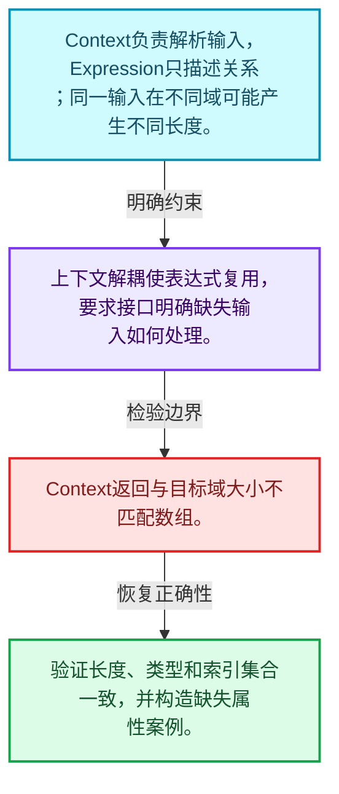
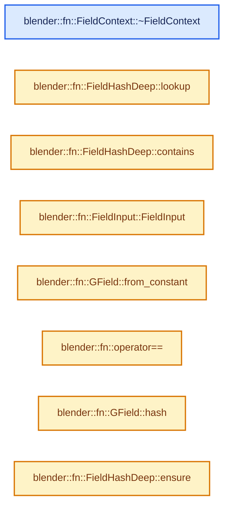
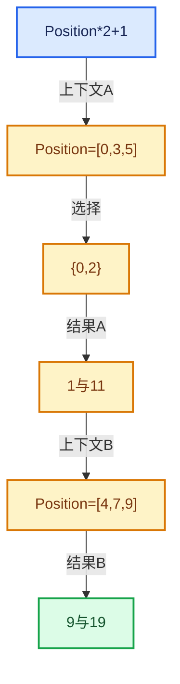

# 08-06 FieldContext上下文

[方向导航](README.md) · [总目录](../README.md) · [实现索引](../%E7%AC%A6%E5%8F%B7%E4%BE%9D%E8%B5%96%E4%B8%8E%E5%AE%9E%E7%8E%B0%E7%B4%A2%E5%BC%95.md)

## 从问题到实现

表达式缺少具体输入时由谁提供？

上下文是求值环境，接口抽象允许不同域的数据来源；上下文寿命须覆盖同步求值。

**数据模型**

Context负责解析输入，Expression只描述关系；同一输入在不同域可能产生不同长度。

**设计取舍**

上下文解耦使表达式复用，要求接口明确缺失输入如何处理。

**最小反例**

Context返回与目标域大小不匹配数组。

**推导**

验证长度、类型和索引集合一致，并构造缺失属性案例。

## 阅读地图与执行推演








图中的数值推演是本方向的教学模型；实际函数之间的调用边与概念分析边分别标注，不能把概念关系当作运行时调度顺序。

## 完整源码单元与就地讲解

中文讲解直接放在相关代码旁，复杂机制在代码下展开。原文折叠区保留基准行号；不需要在行号表和函数之间来回查找。类布局可分段展示，函数实现不按固定行数切开。

<a id="f-95d74d3ba390252c"></a>

### `blender::fn::FieldContext::~FieldContext`

实现位置：[source/blender/functions/FN_field.hh](../../../../../source/blender/functions/FN_field.hh) · L293—L293。

**教学注释版**

<!-- annotated:b088a234053582 -->

```cpp
  virtual ~FieldContext() = default;
```

<details>
<summary>核对原始源码：source/blender/functions/FN_field.hh · L293—L293</summary>

<!-- original:b088a234053582:source/blender/functions/FN_field.hh:293:293 -->

```cpp
  virtual ~FieldContext() = default;
```

</details>

**继续追踪实现**

本实现没有需要继续展开的显式调用；检查返回表达式、对象转换和调用者前置条件。

### 类型布局、声明与编译条件 · FN_field.hh L294—L308

<a id="t-daeaffee29f7"></a>

`FieldHashDeep`在这里声明的数据成员：

- `Map<GFieldRef, UniqueHash> cache`
- `UniqueHash ensure`

<!-- annotated:9b74c70b4abaf0 -->

```cpp

  virtual GVArray get_varray_for_input(const FieldInput &field_input,
                                       const IndexMask &mask,
                                       ResourceScope &scope) const;
};

/**
 * "Deep" hashing for fields that considers the operation and inputs semantically, rather than
 * just the shallow data (i.e. memory address) of the field data, like the default "hash()"
 * implementation. Because common field reuse would give this potentially exponential cost, this
 * struct caches the hashes of intermediate fields.
 */
struct FieldHashDeep {
  Map<GFieldRef, UniqueHash> cache;
  UniqueHash ensure(const GFieldRef &field);
```

<details>
<summary>核对原始源码：source/blender/functions/FN_field.hh · L294—L308</summary>

<!-- original:9b74c70b4abaf0:source/blender/functions/FN_field.hh:294:308 -->

```cpp

  virtual GVArray get_varray_for_input(const FieldInput &field_input,
                                       const IndexMask &mask,
                                       ResourceScope &scope) const;
};

/**
 * "Deep" hashing for fields that considers the operation and inputs semantically, rather than
 * just the shallow data (i.e. memory address) of the field data, like the default "hash()"
 * implementation. Because common field reuse would give this potentially exponential cost, this
 * struct caches the hashes of intermediate fields.
 */
struct FieldHashDeep {
  Map<GFieldRef, UniqueHash> cache;
  UniqueHash ensure(const GFieldRef &field);
```

</details>

<a id="f-2483e2b840f48397"></a>

### `blender::fn::FieldHashDeep::lookup`

实现位置：[source/blender/functions/FN_field.hh](../../../../../source/blender/functions/FN_field.hh) · L309—L312。

接口参数：

- `const GFieldRef &field`

**教学注释版**

<!-- annotated:91bf6f6e5eea01 -->

```cpp
  UniqueHash lookup(const GFieldRef &field) const
  {
    return this->cache.lookup(field);
  }
```

<details>
<summary>核对原始源码：source/blender/functions/FN_field.hh · L309—L312</summary>

<!-- original:91bf6f6e5eea01:source/blender/functions/FN_field.hh:309:312 -->

```cpp
  UniqueHash lookup(const GFieldRef &field) const
  {
    return this->cache.lookup(field);
  }
```

</details>

**结果出口**

- `return this->cache.lookup(field);`

**继续追踪实现**

- `this->cache.lookup` → [调用协议](../%E6%A8%A1%E6%9D%BF%E5%AE%8F%E4%B8%8E%E5%8A%A8%E6%80%81%E5%88%86%E6%B4%BE%E5%8D%8F%E8%AE%AE.md)：接收对象类型依赖auto、返回值或模板实例；不按同名猜测目标。调用位置L311。

<a id="f-1d3dbeb7482b6f18"></a>

### `blender::fn::FieldHashDeep::contains`

实现位置：[source/blender/functions/FN_field.hh](../../../../../source/blender/functions/FN_field.hh) · L313—L316。

接口参数：

- `const GFieldRef &field`

**教学注释版**

<!-- annotated:7a42d747d1c3e4 -->

```cpp
  bool contains(const GFieldRef &field) const
  {
    return this->cache.contains(field);
  }
```

<details>
<summary>核对原始源码：source/blender/functions/FN_field.hh · L313—L316</summary>

<!-- original:7a42d747d1c3e4:source/blender/functions/FN_field.hh:313:316 -->

```cpp
  bool contains(const GFieldRef &field) const
  {
    return this->cache.contains(field);
  }
```

</details>

**结果出口**

- `return this->cache.contains(field);`

**继续追踪实现**

- `this->cache.contains` → [调用协议](../%E6%A8%A1%E6%9D%BF%E5%AE%8F%E4%B8%8E%E5%8A%A8%E6%80%81%E5%88%86%E6%B4%BE%E5%8D%8F%E8%AE%AE.md)：接收对象类型依赖auto、返回值或模板实例；不按同名猜测目标。调用位置L315。

### 类型布局、声明与编译条件 · FN_field.hh L317—L449

<a id="t-b0057c9cc7c9"></a>

`FieldInputs`在这里声明的数据成员：

- `VectorSet<std::reference_wrapper<const FieldInput>> inputs`
- `void delete_self`

<a id="t-6b2cb654ac36"></a>

`FieldInput`在这里声明的数据成员：

- `CPPType type_`
- `std::string debug_name_`
- `CacheMutex field_inputs_mutex_`
- `FieldInputsPtr field_inputs_`
- `StringRefNull debug_name`
- `std::string socket_inspection_name`
- `CPPType cpp_type`
- `FieldInputsPtr field_inputs`
- `uint64_t hash`
- `void hash_unique`
- `void foreach_recursive_field`
- `GVArray get_varray_for_context`
- `void delete_self`

<a id="t-314480557e53"></a>

`FieldOperation`在这里声明的数据成员：

- `Vector<GField> inputs_`
- `std::shared_ptr<const mf::MultiFunction> owned_fn_`
- `mf::MultiFunction fn_`
- `FieldInputsPtr field_inputs_`
- `FieldOperationPtr from`
- `FieldOperationPtr from`
- `CPPType output_cpp_type`
- `mf::MultiFunction multi_function`
- `FieldInputsPtr field_inputs`
- `Span<GField> inputs`
- `void delete_self`
- `void delete_input_fields`

<a id="t-ba49f4ea9b6e"></a>

`IndexFieldInput`在这里声明的数据成员：

- `GVArray get_index_varray`
- `GVArray get_varray_for_context`
- `void hash_unique`
- `Field<int> get_field`

<!-- annotated:0b9d55ae6ba7f5 -->

```cpp
};

/**
 * Cache of field inputs. This is used quite often and is therefore computed eagerly for
 * intermediate operations. Otherwise one would have to parse the field tree every time the set of
 * inputs is required. Since many fields share the same set of inputs, this is often shared.
 */
class FieldInputs : public ImplicitSharingMixin {
 public:
  /** Deduplicated set of field inputs. */
  VectorSet<std::reference_wrapper<const FieldInput>> inputs;

  void delete_self() override;
};

/**
 * This is an abstract class which concrete field inputs have to derive from. When a field is
 * evaluated, this can provide values based on the provided context.
 *
 * Since there is no better way yet, #FieldInput is also often used to process the output of
 * intermediate fields, in which case this is not technically an "input".
 */
class FieldInput : public ImplicitSharingMixin {
 protected:
  const CPPType *type_;
  std::string debug_name_;

  /**
   * Field inputs are initialized lazily because it can't be done in the constructor because the
   * derived class constructor has not run yet.
   */
  mutable CacheMutex field_inputs_mutex_;
  mutable FieldInputsPtr field_inputs_;

 public:
  FieldInput(const CPPType &type, std::string debug_name = "");
  ~FieldInput() override;

  StringRefNull debug_name() const;
  virtual std::string socket_inspection_name() const;

  const CPPType &cpp_type() const;

  const FieldInputsPtr &field_inputs() const;

  uint64_t hash() const;
  virtual void hash_unique(UniqueHashBytes &hash, FieldHashDeep &deep_hash_cache) const;

  /**
   * If this #FieldInput depends on other fields, this function should be overridden.
   */
  virtual void foreach_recursive_field(FunctionRef<void(const GField &)> fn) const;

  /**
   * Output a virtual array for the given index mask in the given context.
   */
  virtual GVArray get_varray_for_context(const FieldContext &context,
                                         const IndexMask &mask,
                                         ResourceScope &scope) const = 0;

  void delete_self() override;
};

/**
 * This is an intermediate node in a field tree which executes a #MultiFunction on each value. The
 * #MultiFunction can either be owned or just referenced.
 *
 * It also stores a #GField for every input of the multi-function. Other fields may reference
 * individual outputs.
 */
class FieldOperation : public ImplicitSharingMixin {
 private:
  /** One #GField for every input of the multi-function. */
  Vector<GField> inputs_;

  /** Optionally owned multi-function. */
  std::shared_ptr<const mf::MultiFunction> owned_fn_;
  const mf::MultiFunction *fn_;

  /** Cached field inputs. */
  FieldInputsPtr field_inputs_;

 public:
  /** Prefer `from*` constructor functions instead. */
  FieldOperation(std::shared_ptr<const mf::MultiFunction> fn, Vector<GField> inputs);
  FieldOperation(const mf::MultiFunction &fn, Vector<GField> inputs);

  static FieldOperationPtr from(std::shared_ptr<const mf::MultiFunction> fn,
                                Vector<GField> inputs);
  static FieldOperationPtr from(const mf::MultiFunction &fn, Vector<GField> inputs);

  /** Get the type of a specific output. */
  const CPPType &output_cpp_type(int output_i) const;

  const mf::MultiFunction &multi_function() const;
  const FieldInputsPtr &field_inputs() const;
  Span<GField> inputs() const;

  void delete_self() override;

 private:
  void delete_input_fields();
};

bool operator==(const GField &a, const GField &b);
bool operator==(const GFieldRef &a, const GFieldRef &b);

/** Type trait to detect field types. */
template<typename T> constexpr bool is_field_v = false;
template<typename T> constexpr bool is_field_v<Field<T>> = true;

Field<bool> invert_boolean_field(const Field<bool> &field);

class IndexFieldInput final : public FieldInput {
 public:
  IndexFieldInput();

  static GVArray get_index_varray(const IndexMask &mask);

  GVArray get_varray_for_context(const FieldContext &context,
                                 const IndexMask &mask,
                                 ResourceScope &scope) const final;

  void hash_unique(UniqueHashBytes &hash, FieldHashDeep &deep_hash_cache) const override;

  /** Cached index field to avoid allocating a new one every time. */
  static const Field<int> &get_field();
};

/* -------------------------------------------------------------------- */
/** \name Inline Methods
 * \{ */

```

<details>
<summary>核对原始源码：source/blender/functions/FN_field.hh · L317—L449</summary>

<!-- original:0b9d55ae6ba7f5:source/blender/functions/FN_field.hh:317:449 -->

```cpp
};

/**
 * Cache of field inputs. This is used quite often and is therefore computed eagerly for
 * intermediate operations. Otherwise one would have to parse the field tree every time the set of
 * inputs is required. Since many fields share the same set of inputs, this is often shared.
 */
class FieldInputs : public ImplicitSharingMixin {
 public:
  /** Deduplicated set of field inputs. */
  VectorSet<std::reference_wrapper<const FieldInput>> inputs;

  void delete_self() override;
};

/**
 * This is an abstract class which concrete field inputs have to derive from. When a field is
 * evaluated, this can provide values based on the provided context.
 *
 * Since there is no better way yet, #FieldInput is also often used to process the output of
 * intermediate fields, in which case this is not technically an "input".
 */
class FieldInput : public ImplicitSharingMixin {
 protected:
  const CPPType *type_;
  std::string debug_name_;

  /**
   * Field inputs are initialized lazily because it can't be done in the constructor because the
   * derived class constructor has not run yet.
   */
  mutable CacheMutex field_inputs_mutex_;
  mutable FieldInputsPtr field_inputs_;

 public:
  FieldInput(const CPPType &type, std::string debug_name = "");
  ~FieldInput() override;

  StringRefNull debug_name() const;
  virtual std::string socket_inspection_name() const;

  const CPPType &cpp_type() const;

  const FieldInputsPtr &field_inputs() const;

  uint64_t hash() const;
  virtual void hash_unique(UniqueHashBytes &hash, FieldHashDeep &deep_hash_cache) const;

  /**
   * If this #FieldInput depends on other fields, this function should be overridden.
   */
  virtual void foreach_recursive_field(FunctionRef<void(const GField &)> fn) const;

  /**
   * Output a virtual array for the given index mask in the given context.
   */
  virtual GVArray get_varray_for_context(const FieldContext &context,
                                         const IndexMask &mask,
                                         ResourceScope &scope) const = 0;

  void delete_self() override;
};

/**
 * This is an intermediate node in a field tree which executes a #MultiFunction on each value. The
 * #MultiFunction can either be owned or just referenced.
 *
 * It also stores a #GField for every input of the multi-function. Other fields may reference
 * individual outputs.
 */
class FieldOperation : public ImplicitSharingMixin {
 private:
  /** One #GField for every input of the multi-function. */
  Vector<GField> inputs_;

  /** Optionally owned multi-function. */
  std::shared_ptr<const mf::MultiFunction> owned_fn_;
  const mf::MultiFunction *fn_;

  /** Cached field inputs. */
  FieldInputsPtr field_inputs_;

 public:
  /** Prefer `from*` constructor functions instead. */
  FieldOperation(std::shared_ptr<const mf::MultiFunction> fn, Vector<GField> inputs);
  FieldOperation(const mf::MultiFunction &fn, Vector<GField> inputs);

  static FieldOperationPtr from(std::shared_ptr<const mf::MultiFunction> fn,
                                Vector<GField> inputs);
  static FieldOperationPtr from(const mf::MultiFunction &fn, Vector<GField> inputs);

  /** Get the type of a specific output. */
  const CPPType &output_cpp_type(int output_i) const;

  const mf::MultiFunction &multi_function() const;
  const FieldInputsPtr &field_inputs() const;
  Span<GField> inputs() const;

  void delete_self() override;

 private:
  void delete_input_fields();
};

bool operator==(const GField &a, const GField &b);
bool operator==(const GFieldRef &a, const GFieldRef &b);

/** Type trait to detect field types. */
template<typename T> constexpr bool is_field_v = false;
template<typename T> constexpr bool is_field_v<Field<T>> = true;

Field<bool> invert_boolean_field(const Field<bool> &field);

class IndexFieldInput final : public FieldInput {
 public:
  IndexFieldInput();

  static GVArray get_index_varray(const IndexMask &mask);

  GVArray get_varray_for_context(const FieldContext &context,
                                 const IndexMask &mask,
                                 ResourceScope &scope) const final;

  void hash_unique(UniqueHashBytes &hash, FieldHashDeep &deep_hash_cache) const override;

  /** Cached index field to avoid allocating a new one every time. */
  static const Field<int> &get_field();
};

/* -------------------------------------------------------------------- */
/** \name Inline Methods
 * \{ */

```

</details>

### 类型布局、声明与编译条件 · field.cc L1—L18

<!-- annotated:bc3b55394d455e -->

```cpp
/* SPDX-FileCopyrightText: 2026 Blender Authors
 *
 * SPDX-License-Identifier: GPL-2.0-or-later */

/** \file
 * \ingroup fn
 */

#include "BLI_set.hh"
#include "BLI_stack.hh"

#include "FN_field.hh"
#include "FN_multi_function_registry.hh"

#include <xxhash.h>

namespace blender::fn {

```

<details>
<summary>核对原始源码：source/blender/functions/intern/field.cc · L1—L18</summary>

<!-- original:bc3b55394d455e:source/blender/functions/intern/field.cc:1:18 -->

```cpp
/* SPDX-FileCopyrightText: 2026 Blender Authors
 *
 * SPDX-License-Identifier: GPL-2.0-or-later */

/** \file
 * \ingroup fn
 */

#include "BLI_set.hh"
#include "BLI_stack.hh"

#include "FN_field.hh"
#include "FN_multi_function_registry.hh"

#include <xxhash.h>

namespace blender::fn {

```

</details>

<a id="f-1d7188e5c0ab1865"></a>

### `blender::fn::FieldInput::FieldInput`

实现位置：[source/blender/functions/intern/field.cc](../../../../../source/blender/functions/intern/field.cc) · L19—L22。

接口参数：

- `const CPPType &type`
- `std::string debug_name`

**教学注释版**

<!-- annotated:9723d173599319 -->

```cpp
FieldInput::FieldInput(const CPPType &type, std::string debug_name)
    : type_(&type), debug_name_(std::move(debug_name))
{
}
```

<details>
<summary>核对原始源码：source/blender/functions/intern/field.cc · L19—L22</summary>

<!-- original:9723d173599319:source/blender/functions/intern/field.cc:19:22 -->

```cpp
FieldInput::FieldInput(const CPPType &type, std::string debug_name)
    : type_(&type), debug_name_(std::move(debug_name))
{
}
```

</details>

**继续追踪实现**

本实现没有需要继续展开的显式调用；检查返回表达式、对象转换和调用者前置条件。

<!-- annotated:9212cb7465f5e8 -->

```cpp

```

<details>
<summary>核对原始源码：source/blender/functions/intern/field.cc · L23—L23</summary>

<!-- original:9212cb7465f5e8:source/blender/functions/intern/field.cc:23:23 -->

```cpp

```

</details>

<a id="f-5d89d09beb3c6aa2"></a>

### `blender::fn::GField::from_constant`

建立运算、常量或借用表示。

实现位置：[source/blender/functions/intern/field.cc](../../../../../source/blender/functions/intern/field.cc) · L24—L35。

接口参数：

- `const CPPType &type`
- `const void *value`

**教学注释版**

<!-- annotated:f4ad7fdae684f7 -->

```cpp
GField GField::from_constant(const CPPType &type, const void *value)
{
  if (TrivialInlineConstant::cpp_type_supported(type)) {
    TrivialInlineConstant constant;
    constant.type = &type;
    type.copy_construct(value, constant.value.ptr());
    return GField(constant);
  }
  // [讲解] MEM_new_uninitialized_aligned：把公开MEM分配接口转交给当前选择的对齐分配后端。
  void *new_value = MEM_new_uninitialized_aligned(type.size, type.alignment, __func__);
  type.copy_construct(value, new_value);
  return GField(OwnedConstant{&type, new_value});
}
```

<details>
<summary>核对原始源码：source/blender/functions/intern/field.cc · L24—L35</summary>

<!-- original:f4ad7fdae684f7:source/blender/functions/intern/field.cc:24:35 -->

```cpp
GField GField::from_constant(const CPPType &type, const void *value)
{
  if (TrivialInlineConstant::cpp_type_supported(type)) {
    TrivialInlineConstant constant;
    constant.type = &type;
    type.copy_construct(value, constant.value.ptr());
    return GField(constant);
  }
  void *new_value = MEM_new_uninitialized_aligned(type.size, type.alignment, __func__);
  type.copy_construct(value, new_value);
  return GField(OwnedConstant{&type, new_value});
}
```

</details>

**接口与不变量**

不同表示的拥有关系不同；静态引用路径要求被引用对象存活足够久。

**沿实际写入检查状态**

- `constant.type = &type;`

**结果出口**

- `return GField(constant);`
- `return GField(OwnedConstant{&type, new_value});`

**继续追踪实现**

- `TrivialInlineConstant::cpp_type_supported` → [blender::fn::GField::TrivialInlineConstant::cpp_type_supported · L466](05-FieldOperation%E8%BF%90%E7%AE%97%E8%8A%82%E7%82%B9.md#f-d3dcf87f1fd371b9)。
- `type.copy_construct` → [blender::CPPType::copy_construct · L594](../03-%E5%86%85%E5%AD%98%E5%88%86%E9%85%8D%E4%B8%8E%E8%BF%90%E8%A1%8C%E6%97%B6%E7%B1%BB%E5%9E%8B/09-CPPType%E5%A4%8D%E5%88%B6%E7%A7%BB%E5%8A%A8%E9%87%8D%E5%AE%9A%E4%BD%8D.md#f-cfda413a9784073e)。
- `constant.value.ptr` → [调用协议](../%E6%A8%A1%E6%9D%BF%E5%AE%8F%E4%B8%8E%E5%8A%A8%E6%80%81%E5%88%86%E6%B4%BE%E5%8D%8F%E8%AE%AE.md)：接收对象类型依赖auto、返回值或模板实例；不按同名猜测目标。调用位置L29。
- `GField` → [blender::fn::GField::GField · L321](12-Field%E9%87%8D%E6%9E%84%E4%B8%8E%E6%B7%B1%E9%93%BE%E9%94%80%E6%AF%81.md#f-7865e4089df6225d)；[blender::fn::GField::GField · L335](12-Field%E9%87%8D%E6%9E%84%E4%B8%8E%E6%B7%B1%E9%93%BE%E9%94%80%E6%AF%81.md#f-438a60155477a30a)。同名重载需按实参类型选择。
- `MEM_new_uninitialized_aligned` → [MEM_new_uninitialized_aligned · L134](../03-%E5%86%85%E5%AD%98%E5%88%86%E9%85%8D%E4%B8%8E%E8%BF%90%E8%A1%8C%E6%97%B6%E7%B1%BB%E5%9E%8B/%E4%BE%9D%E8%B5%96-mallocn-afdcd4.md#f-9f3d21bd7da93c68)。

<!-- annotated:4a9e5c15a1f58b -->

```cpp

```

<details>
<summary>核对原始源码：source/blender/functions/intern/field.cc · L36—L36</summary>

<!-- original:4a9e5c15a1f58b:source/blender/functions/intern/field.cc:36:36 -->

```cpp

```

</details>

<a id="f-785025a775df58a3"></a>

### `blender::fn::operator==`

实现位置：[source/blender/functions/intern/field.cc](../../../../../source/blender/functions/intern/field.cc) · L37—L85。

接口参数：

- `const GField &a`
- `const GField &b`

**教学注释版**

<!-- annotated:45119942ebb385 -->

```cpp
bool operator==(const GField &a, const GField &b)
{
  const GField &a_ref = a.deref_field_ref();
  const GField &b_ref = b.deref_field_ref();

  // [讲解] std::visit：按variant当前活动分支调用访客；所有候选分支的类型要求需满足，不能读取非活动分支的对象表示。
  return std::visit(
      [&]<typename T>(const T &v_a) -> bool {
        if constexpr (std::is_same_v<T, GField::Input>) {
          if (const auto *v_b = std::get_if<GField::Input>(&b_ref.variant_)) {
            return v_a.node == v_b->node;
          }
          return false;
        }
        else if constexpr (std::is_same_v<T, GField::MultiFn>) {
          if (const auto *v_b = std::get_if<GField::MultiFn>(&b_ref.variant_)) {
            return v_a.node == v_b->node && v_a.output_i == v_b->output_i;
          }
          return false;
        }
        else if constexpr (std::is_same_v<T, GField::FieldRef>) {
          /* Should not exist due to #deref_field_ref above. */
          BLI_assert_unreachable();
          return false;
        }
        else if constexpr (GField::is_constant_value_v<T>) {
          const CPPType &type_a = *v_a.type;
          const void *constant_a = v_a.value;
          return std::visit(
              [&]<typename U>(const U &v_b) -> bool {
                if constexpr (GField::is_constant_value_v<U>) {
                  const CPPType &type_b = *v_b.type;
                  if (type_a != type_b) {
                    return false;
                  }
                  const void *constant_b = v_b.value;
                  return type_a.is_equal_or_false(constant_a, constant_b);
                }
                else {
                  return false;
                }
              },
              b_ref.variant_);
        }
        else {
          BLI_assert_unreachable_static_t(T);
        }
      },
      a_ref.variant_);
}
```

<details>
<summary>核对原始源码：source/blender/functions/intern/field.cc · L37—L85</summary>

<!-- original:45119942ebb385:source/blender/functions/intern/field.cc:37:85 -->

```cpp
bool operator==(const GField &a, const GField &b)
{
  const GField &a_ref = a.deref_field_ref();
  const GField &b_ref = b.deref_field_ref();

  return std::visit(
      [&]<typename T>(const T &v_a) -> bool {
        if constexpr (std::is_same_v<T, GField::Input>) {
          if (const auto *v_b = std::get_if<GField::Input>(&b_ref.variant_)) {
            return v_a.node == v_b->node;
          }
          return false;
        }
        else if constexpr (std::is_same_v<T, GField::MultiFn>) {
          if (const auto *v_b = std::get_if<GField::MultiFn>(&b_ref.variant_)) {
            return v_a.node == v_b->node && v_a.output_i == v_b->output_i;
          }
          return false;
        }
        else if constexpr (std::is_same_v<T, GField::FieldRef>) {
          /* Should not exist due to #deref_field_ref above. */
          BLI_assert_unreachable();
          return false;
        }
        else if constexpr (GField::is_constant_value_v<T>) {
          const CPPType &type_a = *v_a.type;
          const void *constant_a = v_a.value;
          return std::visit(
              [&]<typename U>(const U &v_b) -> bool {
                if constexpr (GField::is_constant_value_v<U>) {
                  const CPPType &type_b = *v_b.type;
                  if (type_a != type_b) {
                    return false;
                  }
                  const void *constant_b = v_b.value;
                  return type_a.is_equal_or_false(constant_a, constant_b);
                }
                else {
                  return false;
                }
              },
              b_ref.variant_);
        }
        else {
          BLI_assert_unreachable_static_t(T);
        }
      },
      a_ref.variant_);
}
```

</details>

**结果出口**

- `return std::visit(`
- `return v_a.node == v_b->node;`
- `return false;`
- `return v_a.node == v_b->node && v_a.output_i == v_b->output_i;`
- `return type_a.is_equal_or_false(constant_a, constant_b);`

**继续追踪实现**

- `a.deref_field_ref` → [blender::fn::GField::deref_field_ref · L541](05-FieldOperation%E8%BF%90%E7%AE%97%E8%8A%82%E7%82%B9.md#f-a19407c284f28fcf)。
- `b.deref_field_ref` → [blender::fn::GField::deref_field_ref · L541](05-FieldOperation%E8%BF%90%E7%AE%97%E8%8A%82%E7%82%B9.md#f-a19407c284f28fcf)。
- `std::visit` → [外部契约](https://eel.is/c++draft/variant.visit)：按variant当前活动分支调用访客；所有候选分支的类型要求需满足，不能读取非活动分支的对象表示。
- `std::get_if<GField::Input>` → [外部契约](https://eel.is/c++draft/)：这个边界按实际表达式及所属类型核对参数、返回值、寿命与失败行为。这里提供接口入口，不声称已解释该第三方版本的内部实现。
- `std::get_if<GField::MultiFn>` → [外部契约](https://eel.is/c++draft/)：这个边界按实际表达式及所属类型核对参数、返回值、寿命与失败行为。这里提供接口入口，不声称已解释该第三方版本的内部实现。
- `BLI_assert_unreachable` → [BLI_assert_unreachable · L77](../01-%E5%9F%BA%E7%A1%80%E5%AE%B9%E5%99%A8%E4%B8%8E%E7%8E%B0%E4%BB%A3CPP/%E4%BE%9D%E8%B5%96-BLI_assert-cc98e8.md#m-7a2d91a67d8e)。宏定义由构建条件选择。
- `type_a.is_equal_or_false` → [blender::CPPType::is_equal_or_false · L717](../03-%E5%86%85%E5%AD%98%E5%88%86%E9%85%8D%E4%B8%8E%E8%BF%90%E8%A1%8C%E6%97%B6%E7%B1%BB%E5%9E%8B/09-CPPType%E5%A4%8D%E5%88%B6%E7%A7%BB%E5%8A%A8%E9%87%8D%E5%AE%9A%E4%BD%8D.md#f-0492816f8a6e1e91)。
- `BLI_assert_unreachable_static_t` → [BLI_assert_unreachable_static_t · L99](../01-%E5%9F%BA%E7%A1%80%E5%AE%B9%E5%99%A8%E4%B8%8E%E7%8E%B0%E4%BB%A3CPP/%E4%BE%9D%E8%B5%96-BLI_assert-cc98e8.md#m-368120c7952b)。宏定义由构建条件选择。

<!-- annotated:e18fa9680dc6a5 -->

```cpp

```

<details>
<summary>核对原始源码：source/blender/functions/intern/field.cc · L86—L86</summary>

<!-- original:e18fa9680dc6a5:source/blender/functions/intern/field.cc:86:86 -->

```cpp

```

</details>

<a id="f-032ec4a1ea6ba9ad"></a>

### `blender::fn::GField::hash`

为表达式比较或去重提供身份信息。

实现位置：[source/blender/functions/intern/field.cc](../../../../../source/blender/functions/intern/field.cc) · L87—L111。

**教学注释版**

<!-- annotated:c5cc6bdb9d774b -->

```cpp
uint64_t GField::hash() const
{
  const GField &ref = this->deref_field_ref();
  // [讲解] std::visit：按variant当前活动分支调用访客；所有候选分支的类型要求需满足，不能读取非活动分支的对象表示。
  return std::visit(
      [&]<typename T>(const T &v) -> uint64_t {
        if constexpr (std::is_same_v<T, Input>) {
          return get_default_hash(v.node);
        }
        else if constexpr (std::is_same_v<T, MultiFn>) {
          return get_default_hash(v.node, v.output_i);
        }
        else if constexpr (std::is_same_v<T, FieldRef>) {
          /* Should not exist due to #deref_field_ref above. */
          BLI_assert_unreachable();
          return 0;
        }
        else if constexpr (is_constant_value_v<T>) {
          return v.type->hash_or_fallback(v.value, uint64_t(v.type));
        }
        else {
          BLI_assert_unreachable_static_t(T);
        }
      },
      ref.variant_);
}
```

<details>
<summary>核对原始源码：source/blender/functions/intern/field.cc · L87—L111</summary>

<!-- original:c5cc6bdb9d774b:source/blender/functions/intern/field.cc:87:111 -->

```cpp
uint64_t GField::hash() const
{
  const GField &ref = this->deref_field_ref();
  return std::visit(
      [&]<typename T>(const T &v) -> uint64_t {
        if constexpr (std::is_same_v<T, Input>) {
          return get_default_hash(v.node);
        }
        else if constexpr (std::is_same_v<T, MultiFn>) {
          return get_default_hash(v.node, v.output_i);
        }
        else if constexpr (std::is_same_v<T, FieldRef>) {
          /* Should not exist due to #deref_field_ref above. */
          BLI_assert_unreachable();
          return 0;
        }
        else if constexpr (is_constant_value_v<T>) {
          return v.type->hash_or_fallback(v.value, uint64_t(v.type));
        }
        else {
          BLI_assert_unreachable_static_t(T);
        }
      },
      ref.variant_);
}
```

</details>

**接口与不变量**

浅身份、内容相等与深层表达式等价不是同一个问题，不能沿用旧版本的定义。

**结果出口**

- `return std::visit(`
- `return get_default_hash(v.node);`
- `return get_default_hash(v.node, v.output_i);`
- `return 0;`
- `return v.type->hash_or_fallback(v.value, uint64_t(v.type));`

**继续追踪实现**

- `this->deref_field_ref` → [blender::fn::GField::deref_field_ref · L541](05-FieldOperation%E8%BF%90%E7%AE%97%E8%8A%82%E7%82%B9.md#f-a19407c284f28fcf)。
- `std::visit` → [外部契约](https://eel.is/c++draft/variant.visit)：按variant当前活动分支调用访客；所有候选分支的类型要求需满足，不能读取非活动分支的对象表示。
- `get_default_hash` → [blender::get_default_hash · L251](../02-%E5%93%88%E5%B8%8C%E8%A1%A8%E4%B8%8E%E5%85%B3%E8%81%94%E6%95%B0%E6%8D%AE%E7%BB%93%E6%9E%84/01-%E5%93%88%E5%B8%8C%E4%B8%8E%E7%9B%B8%E7%AD%89%E5%A5%91%E7%BA%A6.md#f-5f2c246aedf3dc0a)。
- `BLI_assert_unreachable` → [BLI_assert_unreachable · L77](../01-%E5%9F%BA%E7%A1%80%E5%AE%B9%E5%99%A8%E4%B8%8E%E7%8E%B0%E4%BB%A3CPP/%E4%BE%9D%E8%B5%96-BLI_assert-cc98e8.md#m-7a2d91a67d8e)。宏定义由构建条件选择。
- `v.type->hash_or_fallback` → [调用协议](../%E6%A8%A1%E6%9D%BF%E5%AE%8F%E4%B8%8E%E5%8A%A8%E6%80%81%E5%88%86%E6%B4%BE%E5%8D%8F%E8%AE%AE.md)：接收对象类型依赖auto、返回值或模板实例；不按同名猜测目标。调用位置L104。
- `BLI_assert_unreachable_static_t` → [BLI_assert_unreachable_static_t · L99](../01-%E5%9F%BA%E7%A1%80%E5%AE%B9%E5%99%A8%E4%B8%8E%E7%8E%B0%E4%BB%A3CPP/%E4%BE%9D%E8%B5%96-BLI_assert-cc98e8.md#m-368120c7952b)。宏定义由构建条件选择。

<!-- annotated:e1ec466f86db0e -->

```cpp

```

<details>
<summary>核对原始源码：source/blender/functions/intern/field.cc · L112—L112</summary>

<!-- original:e1ec466f86db0e:source/blender/functions/intern/field.cc:112:112 -->

```cpp

```

</details>

<a id="f-b9ff7b1bca42851f"></a>

### `blender::fn::FieldHashDeep::ensure`

实现位置：[source/blender/functions/intern/field.cc](../../../../../source/blender/functions/intern/field.cc) · L113—L173。

接口参数：

- `const GFieldRef &field`

**教学注释版**

<!-- annotated:1ffb04fbcf140c -->

```cpp
UniqueHash FieldHashDeep::ensure(const GFieldRef &field)
{
  if (const UniqueHash *cached = this->cache.lookup_ptr(field)) {
    return *cached;
  }

  /* With a post-order DFS traversal, push each node twice. On the first pop (not yet in
   * `visited`), push a field's children. On the second pop (already in `visited`), all children
   * will be in `cache`, so compute and store the hash. Checking the cache for a hash avoids
   * duplicate work when the same sub-field is reached via multiple paths (e.g. diamond-shaped
   * graphs). */
  Set<GFieldRef, 8> visited;
  Stack<GFieldRef, 16> stack;
  stack.push(field);
  while (!stack.is_empty()) {
    GFieldRef current = stack.pop();
    if (this->cache.contains(current)) {
      continue;
    }
    // [讲解] visited.contains：查询活项数量或键是否存在。
    if (visited.contains(current)) {
      UniqueHashBytes hash_context;
      // [讲解] std::visit：按variant当前活动分支调用访客；所有候选分支的类型要求需满足，不能读取非活动分支的对象表示。
      std::visit(
          [&]<typename T>(const T &v) {
            if constexpr (std::is_same_v<T, GFieldRef::Value>) {
              v.type->hash_unique(v.value, hash_context);
              hash_context.add(v.type);
            }
            else if constexpr (std::is_same_v<T, GFieldRef::Input>) {
              v.node->hash_unique(hash_context, *this);
            }
            else if constexpr (std::is_same_v<T, GFieldRef::MultiFn>) {
              v.node->multi_function().hash_unique(hash_context);
              hash_context.add(v.output_i);
              for (const GField &input_field : v.node->inputs()) {
                hash_context.add(this->cache.lookup(input_field));
              }
            }
            else {
              BLI_assert_unreachable_static_t(T);
            }
          },
          current.variant());
      const Span bytes = hash_context.data.as_span();
      UniqueHash hash;
      // [讲解] bytes.data：返回借用范围的地址。
      const XXH128_hash_t xxhash = XXH3_128bits(bytes.data(), bytes.size());
      static_assert(sizeof(UniqueHash) == sizeof(xxhash));
      // [讲解] memcpy：复制字节，源与目标不应重叠。类型生命周期、对齐和可复制表示须由调用者证明，不是任意对象的复制构造。
      memcpy(static_cast<void *>(&hash), &xxhash, sizeof(xxhash));
      this->cache.add_new(current, hash);
      continue;
    }
    // [讲解] visited.add：按哈希与相等关系加入键或键值。
    visited.add(current);
    stack.push(current);
    if (const auto *multi_fn = std::get_if<GFieldRef::MultiFn>(&current.variant())) {
      for (const GField &input : multi_fn->node->inputs()) {
        stack.push(input);
      }
    }
  }

  return this->cache.lookup(field);
}
```

<details>
<summary>核对原始源码：source/blender/functions/intern/field.cc · L113—L173</summary>

<!-- original:1ffb04fbcf140c:source/blender/functions/intern/field.cc:113:173 -->

```cpp
UniqueHash FieldHashDeep::ensure(const GFieldRef &field)
{
  if (const UniqueHash *cached = this->cache.lookup_ptr(field)) {
    return *cached;
  }

  /* With a post-order DFS traversal, push each node twice. On the first pop (not yet in
   * `visited`), push a field's children. On the second pop (already in `visited`), all children
   * will be in `cache`, so compute and store the hash. Checking the cache for a hash avoids
   * duplicate work when the same sub-field is reached via multiple paths (e.g. diamond-shaped
   * graphs). */
  Set<GFieldRef, 8> visited;
  Stack<GFieldRef, 16> stack;
  stack.push(field);
  while (!stack.is_empty()) {
    GFieldRef current = stack.pop();
    if (this->cache.contains(current)) {
      continue;
    }
    if (visited.contains(current)) {
      UniqueHashBytes hash_context;
      std::visit(
          [&]<typename T>(const T &v) {
            if constexpr (std::is_same_v<T, GFieldRef::Value>) {
              v.type->hash_unique(v.value, hash_context);
              hash_context.add(v.type);
            }
            else if constexpr (std::is_same_v<T, GFieldRef::Input>) {
              v.node->hash_unique(hash_context, *this);
            }
            else if constexpr (std::is_same_v<T, GFieldRef::MultiFn>) {
              v.node->multi_function().hash_unique(hash_context);
              hash_context.add(v.output_i);
              for (const GField &input_field : v.node->inputs()) {
                hash_context.add(this->cache.lookup(input_field));
              }
            }
            else {
              BLI_assert_unreachable_static_t(T);
            }
          },
          current.variant());
      const Span bytes = hash_context.data.as_span();
      UniqueHash hash;
      const XXH128_hash_t xxhash = XXH3_128bits(bytes.data(), bytes.size());
      static_assert(sizeof(UniqueHash) == sizeof(xxhash));
      memcpy(static_cast<void *>(&hash), &xxhash, sizeof(xxhash));
      this->cache.add_new(current, hash);
      continue;
    }
    visited.add(current);
    stack.push(current);
    if (const auto *multi_fn = std::get_if<GFieldRef::MultiFn>(&current.variant())) {
      for (const GField &input : multi_fn->node->inputs()) {
        stack.push(input);
      }
    }
  }

  return this->cache.lookup(field);
}
```

</details>

**结果出口**

- `return *cached;`
- `return this->cache.lookup(field);`

**继续追踪实现**

- `this->cache.lookup_ptr` → [调用协议](../%E6%A8%A1%E6%9D%BF%E5%AE%8F%E4%B8%8E%E5%8A%A8%E6%80%81%E5%88%86%E6%B4%BE%E5%8D%8F%E8%AE%AE.md)：接收对象类型依赖auto、返回值或模板实例；不按同名猜测目标。调用位置L115。
- `stack.push` → [blender::Stack::push · L215](../01-%E5%9F%BA%E7%A1%80%E5%AE%B9%E5%99%A8%E4%B8%8E%E7%8E%B0%E4%BB%A3CPP/13-Stack%E4%B8%8E%E6%A0%88%E6%8E%A5%E5%8F%A3.md#f-4e2f52822df4658e)；[blender::Stack::push · L219](../01-%E5%9F%BA%E7%A1%80%E5%AE%B9%E5%99%A8%E4%B8%8E%E7%8E%B0%E4%BB%A3CPP/13-Stack%E4%B8%8E%E6%A0%88%E6%8E%A5%E5%8F%A3.md#f-6eb0d6a78e38b4e8)。同名重载需按实参类型选择。
- `stack.is_empty` → [blender::Stack::is_empty · L310](../01-%E5%9F%BA%E7%A1%80%E5%AE%B9%E5%99%A8%E4%B8%8E%E7%8E%B0%E4%BB%A3CPP/13-Stack%E4%B8%8E%E6%A0%88%E6%8E%A5%E5%8F%A3.md#f-0dbc636232316093)。
- `stack.pop` → [blender::Stack::pop · L244](../01-%E5%9F%BA%E7%A1%80%E5%AE%B9%E5%99%A8%E4%B8%8E%E7%8E%B0%E4%BB%A3CPP/13-Stack%E4%B8%8E%E6%A0%88%E6%8E%A5%E5%8F%A3.md#f-6ef6c36a2a0aa986)。
- `this->cache.contains` → [调用协议](../%E6%A8%A1%E6%9D%BF%E5%AE%8F%E4%B8%8E%E5%8A%A8%E6%80%81%E5%88%86%E6%B4%BE%E5%8D%8F%E8%AE%AE.md)：接收对象类型依赖auto、返回值或模板实例；不按同名猜测目标。调用位置L129。
- `visited.contains` → [blender::Set::contains · L310](../02-%E5%93%88%E5%B8%8C%E8%A1%A8%E4%B8%8E%E5%85%B3%E8%81%94%E6%95%B0%E6%8D%AE%E7%BB%93%E6%9E%84/08-Set%E4%B8%8E%E9%9B%86%E5%90%88%E8%AF%AD%E4%B9%89.md#f-af7099799494350e)。
- `std::visit` → [外部契约](https://eel.is/c++draft/variant.visit)：按variant当前活动分支调用访客；所有候选分支的类型要求需满足，不能读取非活动分支的对象表示。
- `v.type->hash_unique` → [调用协议](../%E6%A8%A1%E6%9D%BF%E5%AE%8F%E4%B8%8E%E5%8A%A8%E6%80%81%E5%88%86%E6%B4%BE%E5%8D%8F%E8%AE%AE.md)：接收对象类型依赖auto、返回值或模板实例；不按同名猜测目标。调用位置L137。
- `hash_context.add` → [blender::UniqueHashBytes::add · L40](../02-%E5%93%88%E5%B8%8C%E8%A1%A8%E4%B8%8E%E5%85%B3%E8%81%94%E6%95%B0%E6%8D%AE%E7%BB%93%E6%9E%84/%E4%BE%9D%E8%B5%96-BLI_unique_hash-5663a0.md#f-12ca7cac7556bc01)。
- `v.node->hash_unique` → [调用协议](../%E6%A8%A1%E6%9D%BF%E5%AE%8F%E4%B8%8E%E5%8A%A8%E6%80%81%E5%88%86%E6%B4%BE%E5%8D%8F%E8%AE%AE.md)：接收对象类型依赖auto、返回值或模板实例；不按同名猜测目标。调用位置L141。
- `v.node->multi_function().hash_unique` → [调用协议](../%E6%A8%A1%E6%9D%BF%E5%AE%8F%E4%B8%8E%E5%8A%A8%E6%80%81%E5%88%86%E6%B4%BE%E5%8D%8F%E8%AE%AE.md)：接收对象类型依赖auto、返回值或模板实例；不按同名猜测目标。调用位置L144。
- `v.node->multi_function` → [调用协议](../%E6%A8%A1%E6%9D%BF%E5%AE%8F%E4%B8%8E%E5%8A%A8%E6%80%81%E5%88%86%E6%B4%BE%E5%8D%8F%E8%AE%AE.md)：接收对象类型依赖auto、返回值或模板实例；不按同名猜测目标。调用位置L144。
- `v.node->inputs` → [调用协议](../%E6%A8%A1%E6%9D%BF%E5%AE%8F%E4%B8%8E%E5%8A%A8%E6%80%81%E5%88%86%E6%B4%BE%E5%8D%8F%E8%AE%AE.md)：接收对象类型依赖auto、返回值或模板实例；不按同名猜测目标。调用位置L146。
- `this->cache.lookup` → [调用协议](../%E6%A8%A1%E6%9D%BF%E5%AE%8F%E4%B8%8E%E5%8A%A8%E6%80%81%E5%88%86%E6%B4%BE%E5%8D%8F%E8%AE%AE.md)：接收对象类型依赖auto、返回值或模板实例；不按同名猜测目标。调用位置L147。
- `BLI_assert_unreachable_static_t` → [BLI_assert_unreachable_static_t · L99](../01-%E5%9F%BA%E7%A1%80%E5%AE%B9%E5%99%A8%E4%B8%8E%E7%8E%B0%E4%BB%A3CPP/%E4%BE%9D%E8%B5%96-BLI_assert-cc98e8.md#m-368120c7952b)。宏定义由构建条件选择。
- `current.variant` → [blender::fn::GFieldRef::variant · L678](05-FieldOperation%E8%BF%90%E7%AE%97%E8%8A%82%E7%82%B9.md#f-0658bc405899b72d)。
- `hash_context.data.as_span` → [调用协议](../%E6%A8%A1%E6%9D%BF%E5%AE%8F%E4%B8%8E%E5%8A%A8%E6%80%81%E5%88%86%E6%B4%BE%E5%8D%8F%E8%AE%AE.md)：接收对象类型依赖auto、返回值或模板实例；不按同名猜测目标。调用位置L155。
- `XXH3_128bits` → [调用协议](../%E6%A8%A1%E6%9D%BF%E5%AE%8F%E4%B8%8E%E5%8A%A8%E6%80%81%E5%88%86%E6%B4%BE%E5%8D%8F%E8%AE%AE.md)：函数指针、局部可调用对象或未展开的宏；必须结合调用者环境。调用位置L157。
- `bytes.data` → [blender::Span::data · L219](../01-%E5%9F%BA%E7%A1%80%E5%AE%B9%E5%99%A8%E4%B8%8E%E7%8E%B0%E4%BB%A3CPP/05-Span%E5%8F%AA%E8%AF%BB%E8%BF%9E%E7%BB%AD%E8%A7%86%E5%9B%BE.md#f-10c5889198935800)。
- `bytes.size` → [blender::Span::size · L256](../01-%E5%9F%BA%E7%A1%80%E5%AE%B9%E5%99%A8%E4%B8%8E%E7%8E%B0%E4%BB%A3CPP/05-Span%E5%8F%AA%E8%AF%BB%E8%BF%9E%E7%BB%AD%E8%A7%86%E5%9B%BE.md#f-5f80fa006089c998)。
- `memcpy` → [外部契约](https://eel.is/c++draft/cstring.syn)：复制字节，源与目标不应重叠。类型生命周期、对齐和可复制表示须由调用者证明，不是任意对象的复制构造。
- `this->cache.add_new` → [调用协议](../%E6%A8%A1%E6%9D%BF%E5%AE%8F%E4%B8%8E%E5%8A%A8%E6%80%81%E5%88%86%E6%B4%BE%E5%8D%8F%E8%AE%AE.md)：接收对象类型依赖auto、返回值或模板实例；不按同名猜测目标。调用位置L160。
- `visited.add` → [blender::Set::add · L248](../02-%E5%93%88%E5%B8%8C%E8%A1%A8%E4%B8%8E%E5%85%B3%E8%81%94%E6%95%B0%E6%8D%AE%E7%BB%93%E6%9E%84/08-Set%E4%B8%8E%E9%9B%86%E5%90%88%E8%AF%AD%E4%B9%89.md#f-c7498809c2327fba)；[blender::Set::add · L252](../02-%E5%93%88%E5%B8%8C%E8%A1%A8%E4%B8%8E%E5%85%B3%E8%81%94%E6%95%B0%E6%8D%AE%E7%BB%93%E6%9E%84/08-Set%E4%B8%8E%E9%9B%86%E5%90%88%E8%AF%AD%E4%B9%89.md#f-e3ac8d1c52c03c2b)。同名重载需按实参类型选择。
- `std::get_if<GFieldRef::MultiFn>` → [外部契约](https://eel.is/c++draft/)：这个边界按实际表达式及所属类型核对参数、返回值、寿命与失败行为。这里提供接口入口，不声称已解释该第三方版本的内部实现。
- `multi_fn->node->inputs` → [调用协议](../%E6%A8%A1%E6%9D%BF%E5%AE%8F%E4%B8%8E%E5%8A%A8%E6%80%81%E5%88%86%E6%B4%BE%E5%8D%8F%E8%AE%AE.md)：接收对象类型依赖auto、返回值或模板实例；不按同名猜测目标。调用位置L166。

<!-- annotated:70abf4afcbe04c -->

```cpp

```

<details>
<summary>核对原始源码：source/blender/functions/intern/field.cc · L174—L174</summary>

<!-- original:70abf4afcbe04c:source/blender/functions/intern/field.cc:174:174 -->

```cpp

```

</details>

<a id="f-05676e282eec0f39"></a>

### `blender::fn::FieldInput::field_inputs`

实现位置：[source/blender/functions/intern/field.cc](../../../../../source/blender/functions/intern/field.cc) · L175—L183。

**教学注释版**

<!-- annotated:36b430a8837c7e -->

```cpp
const FieldInputsPtr &FieldInput::field_inputs() const
{
  field_inputs_mutex_.ensure([&]() {
    FieldInputs *inputs = MEM_new<FieldInputs>("field_inputs");
    inputs->inputs.add(*this);
    field_inputs_ = FieldInputsPtr(inputs);
  });
  return field_inputs_;
}
```

<details>
<summary>核对原始源码：source/blender/functions/intern/field.cc · L175—L183</summary>

<!-- original:36b430a8837c7e:source/blender/functions/intern/field.cc:175:183 -->

```cpp
const FieldInputsPtr &FieldInput::field_inputs() const
{
  field_inputs_mutex_.ensure([&]() {
    FieldInputs *inputs = MEM_new<FieldInputs>("field_inputs");
    inputs->inputs.add(*this);
    field_inputs_ = FieldInputsPtr(inputs);
  });
  return field_inputs_;
}
```

</details>

**沿实际写入检查状态**

- `field_inputs_ = FieldInputsPtr(inputs);`

**结果出口**

- `return field_inputs_;`

**继续追踪实现**

- `field_inputs_mutex_.ensure` → [调用协议](../%E6%A8%A1%E6%9D%BF%E5%AE%8F%E4%B8%8E%E5%8A%A8%E6%80%81%E5%88%86%E6%B4%BE%E5%8D%8F%E8%AE%AE.md)：接收对象类型依赖auto、返回值或模板实例；不按同名猜测目标。调用位置L177。
- `MEM_new<FieldInputs>` → [MEM_new · L351](../03-%E5%86%85%E5%AD%98%E5%88%86%E9%85%8D%E4%B8%8E%E8%BF%90%E8%A1%8C%E6%97%B6%E7%B1%BB%E5%9E%8B/%E4%BE%9D%E8%B5%96-MEM_guardedalloc-b54eca.md#f-115f9b6784f89912)。
- `inputs->inputs.add` → [调用协议](../%E6%A8%A1%E6%9D%BF%E5%AE%8F%E4%B8%8E%E5%8A%A8%E6%80%81%E5%88%86%E6%B4%BE%E5%8D%8F%E8%AE%AE.md)：接收对象类型依赖auto、返回值或模板实例；不按同名猜测目标。调用位置L179。
- `FieldInputsPtr` → [调用协议](../%E6%A8%A1%E6%9D%BF%E5%AE%8F%E4%B8%8E%E5%8A%A8%E6%80%81%E5%88%86%E6%B4%BE%E5%8D%8F%E8%AE%AE.md)：函数指针、局部可调用对象或未展开的宏；必须结合调用者环境。调用位置L180。

<!-- annotated:e94df3f48b2145 -->

```cpp

```

<details>
<summary>核对原始源码：source/blender/functions/intern/field.cc · L184—L184</summary>

<!-- original:e94df3f48b2145:source/blender/functions/intern/field.cc:184:184 -->

```cpp

```

</details>

<a id="f-d29927fe8c713513"></a>

### `blender::fn::FieldInput::hash`

为表达式比较或去重提供身份信息。

实现位置：[source/blender/functions/intern/field.cc](../../../../../source/blender/functions/intern/field.cc) · L185—L191。

**教学注释版**

<!-- annotated:a3d929ad55bd08 -->

```cpp
uint64_t FieldInput::hash() const
{
  UniqueHashBytes hash_context;
  FieldHashDeep deep_hash_cache;
  this->hash_unique(hash_context, deep_hash_cache);
  return get_default_hash(hash_context.data);
}
```

<details>
<summary>核对原始源码：source/blender/functions/intern/field.cc · L185—L191</summary>

<!-- original:a3d929ad55bd08:source/blender/functions/intern/field.cc:185:191 -->

```cpp
uint64_t FieldInput::hash() const
{
  UniqueHashBytes hash_context;
  FieldHashDeep deep_hash_cache;
  this->hash_unique(hash_context, deep_hash_cache);
  return get_default_hash(hash_context.data);
}
```

</details>

**接口与不变量**

浅身份、内容相等与深层表达式等价不是同一个问题，不能沿用旧版本的定义。

**结果出口**

- `return get_default_hash(hash_context.data);`

**继续追踪实现**

- `this->hash_unique` → [blender::fn::FieldInput::hash_unique · L197](06-FieldContext%E4%B8%8A%E4%B8%8B%E6%96%87.md#f-4d782bec4202a01f)。
- `get_default_hash` → [blender::get_default_hash · L251](../02-%E5%93%88%E5%B8%8C%E8%A1%A8%E4%B8%8E%E5%85%B3%E8%81%94%E6%95%B0%E6%8D%AE%E7%BB%93%E6%9E%84/01-%E5%93%88%E5%B8%8C%E4%B8%8E%E7%9B%B8%E7%AD%89%E5%A5%91%E7%BA%A6.md#f-5f2c246aedf3dc0a)。

<!-- annotated:e69ac5d02bf258 -->

```cpp

```

<details>
<summary>核对原始源码：source/blender/functions/intern/field.cc · L192—L192</summary>

<!-- original:e69ac5d02bf258:source/blender/functions/intern/field.cc:192:192 -->

```cpp

```

</details>

<a id="f-2bc23bc02f92c19c"></a>

### `blender::fn::~FieldInput`

实现位置：[source/blender/functions/intern/field.cc](../../../../../source/blender/functions/intern/field.cc) · L193—L193。

**教学注释版**

<!-- annotated:63dc8ae3e44408 -->

```cpp
FieldInput::~FieldInput() = default;
```

<details>
<summary>核对原始源码：source/blender/functions/intern/field.cc · L193—L193</summary>

<!-- original:63dc8ae3e44408:source/blender/functions/intern/field.cc:193:193 -->

```cpp
FieldInput::~FieldInput() = default;
```

</details>

**继续追踪实现**

本实现没有需要继续展开的显式调用；检查返回表达式、对象转换和调用者前置条件。

<!-- annotated:3354a60d190770 -->

```cpp

```

<details>
<summary>核对原始源码：source/blender/functions/intern/field.cc · L194—L194</summary>

<!-- original:3354a60d190770:source/blender/functions/intern/field.cc:194:194 -->

```cpp

```

</details>

<a id="f-137a6e56c5cc5d19"></a>

### `blender::fn::FieldInput::foreach_recursive_field`

实现位置：[source/blender/functions/intern/field.cc](../../../../../source/blender/functions/intern/field.cc) · L195—L195。

接口参数：

- `FunctionRef<void(const GField &)>`
- `const GField &`

**教学注释版**

<!-- annotated:6f7f31a902b0aa -->

```cpp
void FieldInput::foreach_recursive_field(FunctionRef<void(const GField &)> /*fn*/) const {}
```

<details>
<summary>核对原始源码：source/blender/functions/intern/field.cc · L195—L195</summary>

<!-- original:6f7f31a902b0aa:source/blender/functions/intern/field.cc:195:195 -->

```cpp
void FieldInput::foreach_recursive_field(FunctionRef<void(const GField &)> /*fn*/) const {}
```

</details>

**继续追踪实现**

本实现没有需要继续展开的显式调用；检查返回表达式、对象转换和调用者前置条件。

<!-- annotated:451df6ce983443 -->

```cpp

```

<details>
<summary>核对原始源码：source/blender/functions/intern/field.cc · L196—L196</summary>

<!-- original:451df6ce983443:source/blender/functions/intern/field.cc:196:196 -->

```cpp

```

</details>

<a id="f-4d782bec4202a01f"></a>

### `blender::fn::FieldInput::hash_unique`

实现位置：[source/blender/functions/intern/field.cc](../../../../../source/blender/functions/intern/field.cc) · L197—L200。

接口参数：

- `UniqueHashBytes &hash`
- `FieldHashDeep &`

**教学注释版**

<!-- annotated:9a0edf12d6c6a6 -->

```cpp
void FieldInput::hash_unique(UniqueHashBytes &hash, FieldHashDeep & /*deep_hash_cache*/) const
{
  hash.add(this);
}
```

<details>
<summary>核对原始源码：source/blender/functions/intern/field.cc · L197—L200</summary>

<!-- original:9a0edf12d6c6a6:source/blender/functions/intern/field.cc:197:200 -->

```cpp
void FieldInput::hash_unique(UniqueHashBytes &hash, FieldHashDeep & /*deep_hash_cache*/) const
{
  hash.add(this);
}
```

</details>

**继续追踪实现**

- `hash.add` → [blender::UniqueHashBytes::add · L40](../02-%E5%93%88%E5%B8%8C%E8%A1%A8%E4%B8%8E%E5%85%B3%E8%81%94%E6%95%B0%E6%8D%AE%E7%BB%93%E6%9E%84/%E4%BE%9D%E8%B5%96-BLI_unique_hash-5663a0.md#f-12ca7cac7556bc01)。

<!-- annotated:ee33d2bf2bcf5d -->

```cpp

```

<details>
<summary>核对原始源码：source/blender/functions/intern/field.cc · L201—L201</summary>

<!-- original:ee33d2bf2bcf5d:source/blender/functions/intern/field.cc:201:201 -->

```cpp

```

</details>

<a id="f-2bc372408f0f8ad9"></a>

### `blender::fn::GField::try_extract_operation`

实现位置：[source/blender/functions/intern/field.cc](../../../../../source/blender/functions/intern/field.cc) · L202—L209。

**教学注释版**

<!-- annotated:b9c2b8584fc35f -->

```cpp
FieldOperationPtr GField::try_extract_operation()
{
  MultiFn *multi_fn = std::get_if<MultiFn>(&variant_);
  if (!multi_fn || !multi_fn->node) {
    return nullptr;
  }
  // [讲解] std::move：把表达式转换成可供移动重载选择的值类别；不保证真的移动，不结束源对象寿命，对const值可能选择复制。
  return std::move(multi_fn->node);
}
```

<details>
<summary>核对原始源码：source/blender/functions/intern/field.cc · L202—L209</summary>

<!-- original:b9c2b8584fc35f:source/blender/functions/intern/field.cc:202:209 -->

```cpp
FieldOperationPtr GField::try_extract_operation()
{
  MultiFn *multi_fn = std::get_if<MultiFn>(&variant_);
  if (!multi_fn || !multi_fn->node) {
    return nullptr;
  }
  return std::move(multi_fn->node);
}
```

</details>

**结果出口**

- `return nullptr;`
- `return std::move(multi_fn->node);`

**继续追踪实现**

- `std::get_if<MultiFn>` → [外部契约](https://eel.is/c++draft/)：这个边界按实际表达式及所属类型核对参数、返回值、寿命与失败行为。这里提供接口入口，不声称已解释该第三方版本的内部实现。
- `std::move` → [外部契约](https://eel.is/c++draft/utility.forward)：把表达式转换成可供移动重载选择的值类别；不保证真的移动，不结束源对象寿命，对const值可能选择复制。

<!-- annotated:7b6895c2232d41 -->

```cpp

```

<details>
<summary>核对原始源码：source/blender/functions/intern/field.cc · L210—L210</summary>

<!-- original:7b6895c2232d41:source/blender/functions/intern/field.cc:210:210 -->

```cpp

```

</details>

<a id="f-522228a2cbf86b86"></a>

### `blender::fn::FieldInput::delete_self`

实现位置：[source/blender/functions/intern/field.cc](../../../../../source/blender/functions/intern/field.cc) · L211—L214。

**教学注释版**

<!-- annotated:e8ebbcdec17e14 -->

```cpp
void FieldInput::delete_self()
{
  MEM_delete(this);
}
```

<details>
<summary>核对原始源码：source/blender/functions/intern/field.cc · L211—L214</summary>

<!-- original:e8ebbcdec17e14:source/blender/functions/intern/field.cc:211:214 -->

```cpp
void FieldInput::delete_self()
{
  MEM_delete(this);
}
```

</details>

**继续追踪实现**

- `MEM_delete` → [MEM_delete · L400](../03-%E5%86%85%E5%AD%98%E5%88%86%E9%85%8D%E4%B8%8E%E8%BF%90%E8%A1%8C%E6%97%B6%E7%B1%BB%E5%9E%8B/%E4%BE%9D%E8%B5%96-MEM_guardedalloc-b54eca.md#f-9049ffdd1682887c)。

<!-- annotated:db178abab84bff -->

```cpp

```

<details>
<summary>核对原始源码：source/blender/functions/intern/field.cc · L215—L215</summary>

<!-- original:db178abab84bff:source/blender/functions/intern/field.cc:215:215 -->

```cpp

```

</details>

<a id="f-feceaf0068cb17bb"></a>

### `blender::fn::FieldOperation::delete_self`

实现位置：[source/blender/functions/intern/field.cc](../../../../../source/blender/functions/intern/field.cc) · L216—L220。

**教学注释版**

<!-- annotated:9cf68445cd5c09 -->

```cpp
void FieldOperation::delete_self()
{
  this->delete_input_fields();
  MEM_delete(this);
}
```

<details>
<summary>核对原始源码：source/blender/functions/intern/field.cc · L216—L220</summary>

<!-- original:9cf68445cd5c09:source/blender/functions/intern/field.cc:216:220 -->

```cpp
void FieldOperation::delete_self()
{
  this->delete_input_fields();
  MEM_delete(this);
}
```

</details>

**继续追踪实现**

- `this->delete_input_fields` → [blender::fn::FieldOperation::delete_input_fields · L222](06-FieldContext%E4%B8%8A%E4%B8%8B%E6%96%87.md#f-8da7b0f6b5c47498)。
- `MEM_delete` → [MEM_delete · L400](../03-%E5%86%85%E5%AD%98%E5%88%86%E9%85%8D%E4%B8%8E%E8%BF%90%E8%A1%8C%E6%97%B6%E7%B1%BB%E5%9E%8B/%E4%BE%9D%E8%B5%96-MEM_guardedalloc-b54eca.md#f-9049ffdd1682887c)。

<!-- annotated:92ccb5c1ebb863 -->

```cpp

```

<details>
<summary>核对原始源码：source/blender/functions/intern/field.cc · L221—L221</summary>

<!-- original:92ccb5c1ebb863:source/blender/functions/intern/field.cc:221:221 -->

```cpp

```

</details>

<a id="f-8da7b0f6b5c47498"></a>

### `blender::fn::FieldOperation::delete_input_fields`

实现位置：[source/blender/functions/intern/field.cc](../../../../../source/blender/functions/intern/field.cc) · L222—L245。

**教学注释版**

<!-- annotated:9ec780295849ae -->

```cpp
void FieldOperation::delete_input_fields()
{
  BLI_assert(this->is_expired());
  /* Some input fields are freed iteratively instead of recursively to avoid a potentially very
   * deep call stack. */
  Vector<FieldOperationPtr, 16> remaining;
  for (GField &input : inputs_) {
    if (FieldOperationPtr input_op = input.try_extract_operation()) {
      // [讲解] remaining.append：在尾部建立新元素，必要时先扩大存储。
      remaining.append(std::move(input_op));
    }
  }
  while (!remaining.is_empty()) {
    // [讲解] remaining.pop_last：取走最后一个值并移除末元素。
    FieldOperationPtr op = remaining.pop_last();
    // [讲解] op->is_mutable：检查相应共享状态是否允许独占修改。
    if (!op->is_mutable()) {
      continue;
    }
    FieldOperation &op_ref = const_cast<FieldOperation &>(*op);
    for (GField &input : op_ref.inputs_) {
      if (FieldOperationPtr input_op = input.try_extract_operation()) {
        // [讲解] std::move：把表达式转换成可供移动重载选择的值类别；不保证真的移动，不结束源对象寿命，对const值可能选择复制。
        remaining.append(std::move(input_op));
      }
    }
  }
}
```

<details>
<summary>核对原始源码：source/blender/functions/intern/field.cc · L222—L245</summary>

<!-- original:9ec780295849ae:source/blender/functions/intern/field.cc:222:245 -->

```cpp
void FieldOperation::delete_input_fields()
{
  BLI_assert(this->is_expired());
  /* Some input fields are freed iteratively instead of recursively to avoid a potentially very
   * deep call stack. */
  Vector<FieldOperationPtr, 16> remaining;
  for (GField &input : inputs_) {
    if (FieldOperationPtr input_op = input.try_extract_operation()) {
      remaining.append(std::move(input_op));
    }
  }
  while (!remaining.is_empty()) {
    FieldOperationPtr op = remaining.pop_last();
    if (!op->is_mutable()) {
      continue;
    }
    FieldOperation &op_ref = const_cast<FieldOperation &>(*op);
    for (GField &input : op_ref.inputs_) {
      if (FieldOperationPtr input_op = input.try_extract_operation()) {
        remaining.append(std::move(input_op));
      }
    }
  }
}
```

</details>

**继续追踪实现**

- `BLI_assert` → [BLI_assert · L48](../01-%E5%9F%BA%E7%A1%80%E5%AE%B9%E5%99%A8%E4%B8%8E%E7%8E%B0%E4%BB%A3CPP/%E4%BE%9D%E8%B5%96-BLI_assert-cc98e8.md#m-57a88495704d)；[BLI_assert · L63](../01-%E5%9F%BA%E7%A1%80%E5%AE%B9%E5%99%A8%E4%B8%8E%E7%8E%B0%E4%BB%A3CPP/%E4%BE%9D%E8%B5%96-BLI_assert-cc98e8.md#m-d07050020cb5)。宏定义由构建条件选择。
- `this->is_expired` → [blender::ImplicitSharingInfo::is_expired · L85](../06-%E9%9A%90%E5%BC%8F%E5%85%B1%E4%BA%AB%E4%B8%8E%E7%BC%93%E5%AD%98%E7%B3%BB%E7%BB%9F/01-%E6%89%80%E6%9C%89%E6%9D%83%E4%B8%8E%E5%86%99%E6%97%B6%E5%A4%8D%E5%88%B6.md#f-2dc355bd9568b068)。
- `input.try_extract_operation` → [调用协议](../%E6%A8%A1%E6%9D%BF%E5%AE%8F%E4%B8%8E%E5%8A%A8%E6%80%81%E5%88%86%E6%B4%BE%E5%8D%8F%E8%AE%AE.md)：接收对象类型依赖auto、返回值或模板实例；不按同名猜测目标。调用位置L229。
- `remaining.append` → [blender::Vector::append · L498](../01-%E5%9F%BA%E7%A1%80%E5%AE%B9%E5%99%A8%E4%B8%8E%E7%8E%B0%E4%BB%A3CPP/11-Vector%E6%8F%92%E5%85%A5%E5%88%A0%E9%99%A4%E4%B8%8E%E9%87%8D%E6%8E%92.md#f-5bde268a69e443ec)；[blender::Vector::append · L502](../01-%E5%9F%BA%E7%A1%80%E5%AE%B9%E5%99%A8%E4%B8%8E%E7%8E%B0%E4%BB%A3CPP/11-Vector%E6%8F%92%E5%85%A5%E5%88%A0%E9%99%A4%E4%B8%8E%E9%87%8D%E6%8E%92.md#f-591e0b15e6308532)。同名重载需按实参类型选择。
- `std::move` → [外部契约](https://eel.is/c++draft/utility.forward)：把表达式转换成可供移动重载选择的值类别；不保证真的移动，不结束源对象寿命，对const值可能选择复制。
- `remaining.is_empty` → [blender::Vector::is_empty · L792](../01-%E5%9F%BA%E7%A1%80%E5%AE%B9%E5%99%A8%E4%B8%8E%E7%8E%B0%E4%BB%A3CPP/11-Vector%E6%8F%92%E5%85%A5%E5%88%A0%E9%99%A4%E4%B8%8E%E9%87%8D%E6%8E%92.md#f-937bbd9cb80bdcc8)。
- `remaining.pop_last` → [blender::Vector::pop_last · L815](../01-%E5%9F%BA%E7%A1%80%E5%AE%B9%E5%99%A8%E4%B8%8E%E7%8E%B0%E4%BB%A3CPP/11-Vector%E6%8F%92%E5%85%A5%E5%88%A0%E9%99%A4%E4%B8%8E%E9%87%8D%E6%8E%92.md#f-e001e773e04130ce)。
- `op->is_mutable` → [blender::ImplicitSharingInfo::is_mutable · L76](../06-%E9%9A%90%E5%BC%8F%E5%85%B1%E4%BA%AB%E4%B8%8E%E7%BC%93%E5%AD%98%E7%B3%BB%E7%BB%9F/01-%E6%89%80%E6%9C%89%E6%9D%83%E4%B8%8E%E5%86%99%E6%97%B6%E5%A4%8D%E5%88%B6.md#f-b4d31aba499caecb)。

<!-- annotated:7fc4a3ec626cbe -->

```cpp

```

<details>
<summary>核对原始源码：source/blender/functions/intern/field.cc · L246—L246</summary>

<!-- original:7fc4a3ec626cbe:source/blender/functions/intern/field.cc:246:246 -->

```cpp

```

</details>

<a id="f-68595ebb783901ca"></a>

### `blender::fn::FieldInputs::delete_self`

实现位置：[source/blender/functions/intern/field.cc](../../../../../source/blender/functions/intern/field.cc) · L247—L250。

**教学注释版**

<!-- annotated:213098aa2c7c48 -->

```cpp
void FieldInputs::delete_self()
{
  MEM_delete(this);
}
```

<details>
<summary>核对原始源码：source/blender/functions/intern/field.cc · L247—L250</summary>

<!-- original:213098aa2c7c48:source/blender/functions/intern/field.cc:247:250 -->

```cpp
void FieldInputs::delete_self()
{
  MEM_delete(this);
}
```

</details>

**继续追踪实现**

- `MEM_delete` → [MEM_delete · L400](../03-%E5%86%85%E5%AD%98%E5%88%86%E9%85%8D%E4%B8%8E%E8%BF%90%E8%A1%8C%E6%97%B6%E7%B1%BB%E5%9E%8B/%E4%BE%9D%E8%B5%96-MEM_guardedalloc-b54eca.md#f-9049ffdd1682887c)。

<!-- annotated:3cd5ffa29c6572 -->

```cpp

```

<details>
<summary>核对原始源码：source/blender/functions/intern/field.cc · L251—L251</summary>

<!-- original:3cd5ffa29c6572:source/blender/functions/intern/field.cc:251:251 -->

```cpp

```

</details>

<a id="f-d78060e8f5e1929f"></a>

### `blender::fn::FieldOperation::from`

建立运算、常量或借用表示。

实现位置：[source/blender/functions/intern/field.cc](../../../../../source/blender/functions/intern/field.cc) · L252—L256。

接口参数：

- `std::shared_ptr<const mf::MultiFunction> fn`
- `Vector<GField> inputs`

**教学注释版**

<!-- annotated:de8be16963c70f -->

```cpp
FieldOperationPtr FieldOperation::from(std::shared_ptr<const mf::MultiFunction> fn,
                                       Vector<GField> inputs)
{
  // [讲解] std::move：把表达式转换成可供移动重载选择的值类别；不保证真的移动，不结束源对象寿命，对const值可能选择复制。
  return FieldOperationPtr(MEM_new<FieldOperation>(__func__, std::move(fn), std::move(inputs)));
}
```

<details>
<summary>核对原始源码：source/blender/functions/intern/field.cc · L252—L256</summary>

<!-- original:de8be16963c70f:source/blender/functions/intern/field.cc:252:256 -->

```cpp
FieldOperationPtr FieldOperation::from(std::shared_ptr<const mf::MultiFunction> fn,
                                       Vector<GField> inputs)
{
  return FieldOperationPtr(MEM_new<FieldOperation>(__func__, std::move(fn), std::move(inputs)));
}
```

</details>

**接口与不变量**

不同表示的拥有关系不同；静态引用路径要求被引用对象存活足够久。

**结果出口**

- `return FieldOperationPtr(MEM_new<FieldOperation>(__func__, std::move(fn), std::move(inputs)));`

**继续追踪实现**

- `FieldOperationPtr` → [调用协议](../%E6%A8%A1%E6%9D%BF%E5%AE%8F%E4%B8%8E%E5%8A%A8%E6%80%81%E5%88%86%E6%B4%BE%E5%8D%8F%E8%AE%AE.md)：函数指针、局部可调用对象或未展开的宏；必须结合调用者环境。调用位置L255。
- `MEM_new<FieldOperation>` → [MEM_new · L351](../03-%E5%86%85%E5%AD%98%E5%88%86%E9%85%8D%E4%B8%8E%E8%BF%90%E8%A1%8C%E6%97%B6%E7%B1%BB%E5%9E%8B/%E4%BE%9D%E8%B5%96-MEM_guardedalloc-b54eca.md#f-115f9b6784f89912)。
- `std::move` → [外部契约](https://eel.is/c++draft/utility.forward)：把表达式转换成可供移动重载选择的值类别；不保证真的移动，不结束源对象寿命，对const值可能选择复制。

<!-- annotated:3c8eaf271f0097 -->

```cpp

```

<details>
<summary>核对原始源码：source/blender/functions/intern/field.cc · L257—L257</summary>

<!-- original:3c8eaf271f0097:source/blender/functions/intern/field.cc:257:257 -->

```cpp

```

</details>

<a id="f-60a41b323ee8ceb7"></a>

### `blender::fn::FieldOperation::from`

建立运算、常量或借用表示。

实现位置：[source/blender/functions/intern/field.cc](../../../../../source/blender/functions/intern/field.cc) · L258—L261。

接口参数：

- `const mf::MultiFunction &fn`
- `Vector<GField> inputs`

**教学注释版**

<!-- annotated:2e2c8066e47262 -->

```cpp
FieldOperationPtr FieldOperation::from(const mf::MultiFunction &fn, Vector<GField> inputs)
{
  // [讲解] std::move：把表达式转换成可供移动重载选择的值类别；不保证真的移动，不结束源对象寿命，对const值可能选择复制。
  return FieldOperationPtr(MEM_new<FieldOperation>(__func__, fn, std::move(inputs)));
}
```

<details>
<summary>核对原始源码：source/blender/functions/intern/field.cc · L258—L261</summary>

<!-- original:2e2c8066e47262:source/blender/functions/intern/field.cc:258:261 -->

```cpp
FieldOperationPtr FieldOperation::from(const mf::MultiFunction &fn, Vector<GField> inputs)
{
  return FieldOperationPtr(MEM_new<FieldOperation>(__func__, fn, std::move(inputs)));
}
```

</details>

**接口与不变量**

不同表示的拥有关系不同；静态引用路径要求被引用对象存活足够久。

**结果出口**

- `return FieldOperationPtr(MEM_new<FieldOperation>(__func__, fn, std::move(inputs)));`

**继续追踪实现**

- `FieldOperationPtr` → [调用协议](../%E6%A8%A1%E6%9D%BF%E5%AE%8F%E4%B8%8E%E5%8A%A8%E6%80%81%E5%88%86%E6%B4%BE%E5%8D%8F%E8%AE%AE.md)：函数指针、局部可调用对象或未展开的宏；必须结合调用者环境。调用位置L260。
- `MEM_new<FieldOperation>` → [MEM_new · L351](../03-%E5%86%85%E5%AD%98%E5%88%86%E9%85%8D%E4%B8%8E%E8%BF%90%E8%A1%8C%E6%97%B6%E7%B1%BB%E5%9E%8B/%E4%BE%9D%E8%B5%96-MEM_guardedalloc-b54eca.md#f-115f9b6784f89912)。
- `std::move` → [外部契约](https://eel.is/c++draft/utility.forward)：把表达式转换成可供移动重载选择的值类别；不保证真的移动，不结束源对象寿命，对const值可能选择复制。

## 语法与相关类型

### 模板 template

模板把类型或常量作为生成实现的参数。读声明时先列出类型参数、非类型参数和默认值，再看使用者实际实例化了什么。模板声明本身不意味着每种T都支持其全部成员。

把T替换为int、string、只能移动的类型，分别检查每个被调用操作是否成立。

### 依赖名称 typename

typename既可引入类型模板参数，也可告诉编译器某个依赖名称是类型。它不创建运行时对象；解析期确认语法类别与实例化期检查具体类型是不同阶段。

区分typename T::value_type和T::size()，前者标记类型，后者是表达式。

### 常量求值 constexpr

constexpr声明允许相应实体参与常量求值，但constexpr函数仍可以在运行时执行。是否常量求值由调用场景和表达式合法性共同决定。

比较constexpr变量初始化和从运行时输入调用同一函数。

### 只读限定 const

const约束当前访问路径可做的修改。const指针、指向const的指针、const视图对象、const元素是不同位置的限定；其他别名可能仍可修改原对象。

分别写T* const、const T*与const T* const，并画出不可修改的层次。

### 移动转换 std::move

std::move把表达式转换为可供移动重载选择的值类别，实际资源转移发生在被选中的构造或赋值中。对const对象move可能仍调用复制，对视图move也不会获得底层数据所有权。

记录移动构造调用次数，不用变量名或std::move的出现次数替代测量。

### 异常边界 try与catch

try定义异常传播的局部边界。失败路径需要销毁已经成功构造的部分并释放相应存储；未构造的对象不能被析构。

在第k次构造失败，列出已经存在的对象集合与待释放缓冲。

### 显式静态转换 static_cast

static_cast表达编译期允许的转换，不会自动验证运行时真实类型、指针寿命或索引边界。由void指针恢复T指针时，调用者仍须保证实际存储中确有合法T对象。

标出转换前后的类型以及正确性依据来自哪里。

### 限定转换 const_cast

const_cast可以改变访问路径的限定，但不能让本来就是const的对象合法可写。常用于复用只读实现时，仍需检查底层对象是否实际可变。

对非const对象的const引用与真正const对象分别分析修改是否合法。

### 运行时多态 virtual

虚调用根据实际动态类型选择实现；经基类指针销毁对象时通常需要相应虚析构契约。每元素虚调用和循环外一次分派有不同开销。

找出虚接口的实现类和调用频率，再讨论是否值得去虚拟化。

### 覆写检查 override

override要求函数确实覆盖基类虚函数，可捕获参数类型和const限定不匹配。它不改变基类规定的生命周期或线程约束。

故意改变一个参数或const，观察编译器如何拒绝误写的新函数。

### 对象表示 sizeof

sizeof给出对象表示大小，不是其引用的所有堆内存总量。sizeof视图很小并不说明底层数组很小。

分别统计容器对象、容量字节和元素拥有的间接资源。

### 构造与new表达式

普通new可能分配并构造；placement new在给定地址构造，存储由其他机制提供。失败回滚应区分两类责任。

追踪地址来自哪里、构造何时成功、由谁析构、由谁释放。

### 内部断言 assert

断言表达开发者预期成立的内部契约，发布构建可能关闭。它不能替代对不可信输入的完整错误处理，也不保证后续操作被运行时保护。

对每条断言构造违反条件的输入，区分调用者错误与应向用户报告的错误。

### 编译期分支 if constexpr

条件在实例化时决定被保留的分支，这常用于不同类型的合法操作选择。它与运行时if有不同的实例化检查规则。

找出每个分支依赖哪些类型特征，再使用满足与不满足条件的类型。

### 共享拥有 shared_ptr

shared_ptr让控制块跟踪共享寿命，不自动使被指向对象的读写线程安全；循环拥有可能阻止销毁。

画出强引用环并考虑是否应改变所有权方向或引入弱引用。

## 实现练习与验证

为两个数组实现不同上下文，保持表达式不变。

参考推理：验证长度、类型和索引集合一致，并构造缺失属性案例。

结果与直接计算一致；多个输出共享子表达式时不改变语义；深链构造、执行、销毁三个阶段分别检查。

## 历史、跨库比较与证据

与表达式模板、AST和闭包比较：Field可在运行时组合并对不同上下文批量求值；不要把Field对象误当作固定几何的结果数组。

[历史提交索引](../%E5%8E%86%E5%8F%B2%E6%8F%90%E4%BA%A4%E4%B8%8E%E8%AE%BE%E8%AE%A1%E6%BC%94%E5%8C%96%E7%B4%A2%E5%BC%95.md) · [源码基准](../%E6%BA%90%E7%A0%81%E7%89%88%E6%9C%AC%E4%B8%8E%E8%A6%86%E7%9B%96%E7%B4%A2%E5%BC%95.md) · [验收报告](../%E9%AA%8C%E6%94%B6%E6%8A%A5%E5%91%8A.md)
