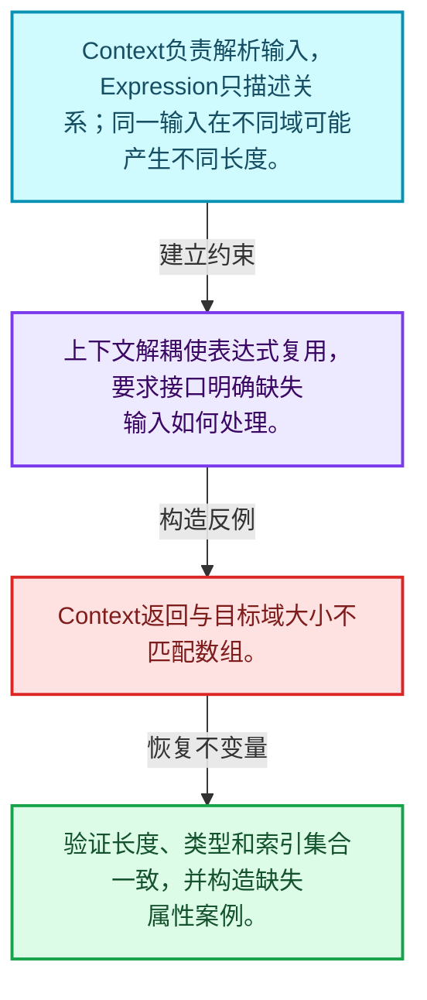
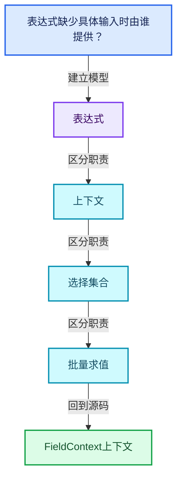
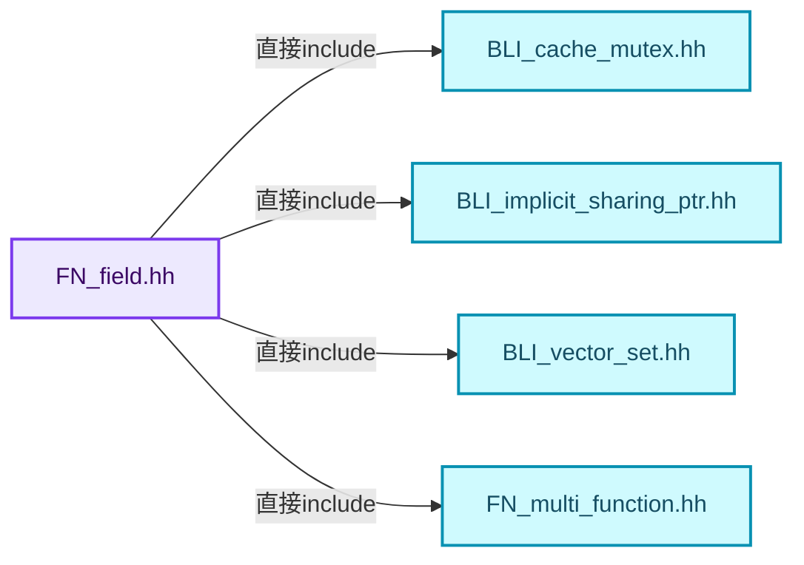
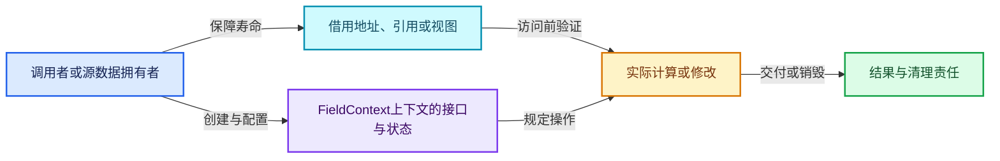
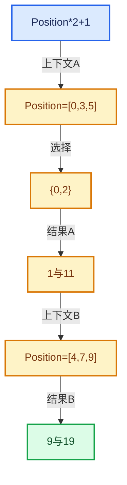

# 08-06 FieldContext上下文

[方向导航](README.md) · [总目录](../README.md) · [覆盖索引](../%E6%BA%90%E7%A0%81%E7%89%88%E6%9C%AC%E4%B8%8E%E8%A6%86%E7%9B%96%E7%B4%A2%E5%BC%95.md)

> 阅读顺序：问题与数据模型 → 语法与类型 → 源码逐行 → 调用线索 → 历史与取舍 → 推演和练习。

- 基准 HEAD：`cbda6b96c26c0dee3c3b5cbb93960c4ac06a6b30`。
- 记录日期：2026-10-14。
- 教学示例状态：正文中的推演不是本机性能实测；已运行练习见验收报告。

## 一、从问题到设计

表达式缺少具体输入时由谁提供？

上下文是求值环境，接口抽象允许不同域的数据来源；上下文寿命须覆盖同步求值。

本篇把语法、数据语义和系统取舍连接起来。Field表达式、求值上下文、mask与结果存储各自有独立职责和生命周期。

### 本篇独立模型与设计推理

Context负责解析输入，Expression只描述关系；同一输入在不同域可能产生不同长度。

设计取舍：上下文解耦使表达式复用，要求接口明确缺失输入如何处理。

最小反例：Context返回与目标域大小不匹配数组。

推导与处理：验证长度、类型和索引集合一致，并构造缺失属性案例。



### 源码范围与相邻篇章

| 文件 | 本篇逐行范围 | 基准SHA-256 |
|---|---|---|
| [source/blender/functions/intern/field.cc](../../../../../source/blender/functions/intern/field.cc) | L1—L261 | `b7e5a1f7396dc171501ce4ace49a569bce95dee9377adeabd565929b45e825b7` |
| [source/blender/functions/FN_field.hh](../../../../../source/blender/functions/FN_field.hh) | L291—L338 | `4ce5d9b67e7b82f22293a3250ae787716e34c6a6b5f1afe561a000eeb6dfa112` |

同一主讲文件可能分多篇覆盖；超出本篇范围的符号通过覆盖索引定位。空行与纯注释保留在源码摘录中，逐行表解释有效语句与语法边界；许可证头统一保留。

前篇：[FieldOperation运算节点](05-FieldOperation%E8%BF%90%E7%AE%97%E8%8A%82%E7%82%B9.md).

后篇：[FieldEvaluator接口与使用](07-FieldEvaluator%E6%8E%A5%E5%8F%A3%E4%B8%8E%E4%BD%BF%E7%94%A8.md).

## 二、类型、数据与阅读地图



这是概念依赖图，边表示阅读关系，不声称是运行时调用顺序。

### 直接编译依赖



箭头只表示头文件包含关系；完整调用线索见后面的符号定位表。

## 三、关键词、语法与类型角色

### 依赖名称 typename

typename既可引入类型模板参数，也可告诉编译器某个依赖名称是类型。它不创建运行时对象；解析期确认语法类别与实例化期检查具体类型是不同阶段。

具体检查：区分typename T::value_type和T::size()，前者标记类型，后者是表达式。

### 常量求值 constexpr

constexpr声明允许相应实体参与常量求值，但constexpr函数仍可以在运行时执行。是否常量求值由调用场景和表达式合法性共同决定。

具体检查：比较constexpr变量初始化和从运行时输入调用同一函数。

### 只读限定 const

const约束当前访问路径可做的修改。const指针、指向const的指针、const视图对象、const元素是不同位置的限定；其他别名可能仍可修改原对象。

具体检查：分别写T* const、const T*与const T* const，并画出不可修改的层次。

### 移动转换 std::move

std::move把表达式转换为可供移动重载选择的值类别，实际资源转移发生在被选中的构造或赋值中。对const对象move可能仍调用复制，对视图move也不会获得底层数据所有权。

具体检查：记录移动构造调用次数，不用变量名或std::move的出现次数替代测量。

### 异常边界 try与catch

try定义异常传播的局部边界。失败路径需要销毁已经成功构造的部分并释放相应存储；未构造的对象不能被析构。

具体检查：在第k次构造失败，列出已经存在的对象集合与待释放缓冲。

### 显式静态转换 static_cast

static_cast表达编译期允许的转换，不会自动验证运行时真实类型、指针寿命或索引边界。由void指针恢复T指针时，调用者仍须保证实际存储中确有合法T对象。

具体检查：标出转换前后的类型以及正确性依据来自哪里。

### 限定转换 const_cast

const_cast可以改变访问路径的限定，但不能让本来就是const的对象合法可写。常用于复用只读实现时，仍需检查底层对象是否实际可变。

具体检查：对非const对象的const引用与真正const对象分别分析修改是否合法。

### 运行时多态 virtual

虚调用根据实际动态类型选择实现；经基类指针销毁对象时通常需要相应虚析构契约。每元素虚调用和循环外一次分派有不同开销。

具体检查：找出虚接口的实现类和调用频率，再讨论是否值得去虚拟化。

### 覆写检查 override

override要求函数确实覆盖基类虚函数，可捕获参数类型和const限定不匹配。它不改变基类规定的生命周期或线程约束。

具体检查：故意改变一个参数或const，观察编译器如何拒绝误写的新函数。

### 对象表示 sizeof

sizeof给出对象表示大小，不是其引用的所有堆内存总量。sizeof视图很小并不说明底层数组很小。

具体检查：分别统计容器对象、容量字节和元素拥有的间接资源。

### 内部断言 assert

断言表达开发者预期成立的内部契约，发布构建可能关闭。它不能替代对不可信输入的完整错误处理，也不保证后续操作被运行时保护。

具体检查：对每条断言构造违反条件的输入，区分调用者错误与应向用户报告的错误。

### 编译期分支 if constexpr

条件在实例化时决定被保留的分支，这常用于不同类型的合法操作选择。它与运行时if有不同的实例化检查规则。

具体检查：找出每个分支依赖哪些类型特征，再使用满足与不满足条件的类型。

### 共享拥有 shared_ptr

shared_ptr让控制块跟踪共享寿命，不自动使被指向对象的读写线程安全；循环拥有可能阻止销毁。

具体检查：画出强引用环并考虑是否应改变所有权方向或引入弱引用。

## 四、真实源码与逐行讲解

源码块保持原行内容，原始行号由小节标题及逐行表给出。表中的调用定位是静态阅读辅助；重载、模板实例化、宏展开和虚调用需结合完整声明，不能仅凭词法出现证明动态调用。

### field.cc：L1—L35

<!-- source:source/blender/functions/intern/field.cc:1:35 -->

```cpp
/* SPDX-FileCopyrightText: 2026 Blender Authors
 *
 * SPDX-License-Identifier: GPL-2.0-or-later */

/** \file
 * \ingroup fn
 */

#include "BLI_set.hh"
#include "BLI_stack.hh"

#include "FN_field.hh"
#include "FN_multi_function_registry.hh"

#include <xxhash.h>

namespace blender::fn {

FieldInput::FieldInput(const CPPType &type, std::string debug_name)
    : type_(&type), debug_name_(std::move(debug_name))
{
}

GField GField::from_constant(const CPPType &type, const void *value)
{
  if (TrivialInlineConstant::cpp_type_supported(type)) {
    TrivialInlineConstant constant;
    constant.type = &type;
    type.copy_construct(value, constant.value.ptr());
    return GField(constant);
  }
  void *new_value = MEM_new_uninitialized_aligned(type.size, type.alignment, __func__);
  type.copy_construct(value, new_value);
  return GField(OwnedConstant{&type, new_value});
}
```

本段语义重点：

- 分支证据 `TrivialInlineConstant::cpp_type_supported(type))`：分别推演条件成立与不成立，核对相同出口处的状态。

| 原始行 | 语义、约束与检查 |
|---|---|
| L9 | 引入编译依赖 "BLI_set.hh"；这是声明可见性关系，不表示运行时一定调用该文件的所有接口。 |
| L10 | 引入编译依赖 "BLI_stack.hh"；这是声明可见性关系，不表示运行时一定调用该文件的所有接口。 |
| L12 | 引入编译依赖 "FN_field.hh"；这是声明可见性关系，不表示运行时一定调用该文件的所有接口。 |
| L13 | 引入编译依赖 "FN_multi_function_registry.hh"；这是声明可见性关系，不表示运行时一定调用该文件的所有接口。 |
| L15 | 引入编译依赖 <xxhash.h>；这是声明可见性关系，不表示运行时一定调用该文件的所有接口。 |
| L17 | 把后续声明放入 blender::fn 命名空间，影响名称查找和符号归属，不创建运行时对象。 |
| L19 | 出现调用或函数声明 `FieldInput::FieldInput`，对应表达式为 `FieldInput::FieldInput(const CPPType &type, std::string debug_name)`。参数求值、返回类型与重载需结合前后完整语句；静态文本引用不能证明动态目标。 |
| L20 | 出现调用或函数声明 `type_`，对应表达式为 `: type_(&type), debug_name_(std::move(debug_name))`。参数求值、返回类型与重载需结合前后完整语句；静态文本引用不能证明动态目标。 |
| L21 | 连接上一行的声明或控制结构与其语句块；后续行在这个作用域中执行或声明。 |
| L22 | 结束当前语法单元。局部自动对象在离开其作用域时按规则销毁；这不等于所有被引用的外部数据也被释放。 |
| L24 | 出现调用或函数声明 `GField::from_constant`，对应表达式为 `GField GField::from_constant(const CPPType &type, const void *value)`。参数求值、返回类型与重载需结合前后完整语句；静态文本引用不能证明动态目标。 |
| L25 | 连接上一行的声明或控制结构与其语句块；后续行在这个作用域中执行或声明。 |
| L26 | 判断 `TrivialInlineConstant::cpp_type_supported(type)`，成立时进入本分支，否则继续后续路径。 |
| L27 | 声明成员、局部对象或完成语句 `TrivialInlineConstant constant`。若为指针或引用，它本身不说明拥有；若为值对象，其构造析构由所在作用域或外层对象管理。 |
| L28 | 把右侧 `&type` 用于初始化或更新左侧 `constant.type`。声明初始化与已有对象赋值应按上下文区分；有资源的类型会调用相应特殊成员。 |
| L29 | 出现调用或函数声明 `copy_construct`，对应表达式为 `type.copy_construct(value, constant.value.ptr());`。参数求值、返回类型与重载需结合前后完整语句；静态文本引用不能证明动态目标。 |
| L30 | 返回表达式 `GField(constant)`。 |
| L31 | 结束当前语法单元。局部自动对象在离开其作用域时按规则销毁；这不等于所有被引用的外部数据也被释放。 |
| L32 | 把右侧 `MEM_new_uninitialized_aligned(type.size, type.alignment, __func__)` 用于初始化或更新左侧 `void *new_value`。声明初始化与已有对象赋值应按上下文区分；有资源的类型会调用相应特殊成员。 |
| L33 | 出现调用或函数声明 `copy_construct`，对应表达式为 `type.copy_construct(value, new_value);`。参数求值、返回类型与重载需结合前后完整语句；静态文本引用不能证明动态目标。 |
| L34 | 返回表达式 `GField(OwnedConstant{&type, new_value})`。 |
| L35 | 结束当前语法单元。局部自动对象在离开其作用域时按规则销毁；这不等于所有被引用的外部数据也被释放。 |

### field.cc：L36—L85

<!-- source:source/blender/functions/intern/field.cc:36:85 -->

```cpp

bool operator==(const GField &a, const GField &b)
{
  const GField &a_ref = a.deref_field_ref();
  const GField &b_ref = b.deref_field_ref();

  return std::visit(
      [&]<typename T>(const T &v_a) -> bool {
        if constexpr (std::is_same_v<T, GField::Input>) {
          if (const auto *v_b = std::get_if<GField::Input>(&b_ref.variant_)) {
            return v_a.node == v_b->node;
          }
          return false;
        }
        else if constexpr (std::is_same_v<T, GField::MultiFn>) {
          if (const auto *v_b = std::get_if<GField::MultiFn>(&b_ref.variant_)) {
            return v_a.node == v_b->node && v_a.output_i == v_b->output_i;
          }
          return false;
        }
        else if constexpr (std::is_same_v<T, GField::FieldRef>) {
          /* Should not exist due to #deref_field_ref above. */
          BLI_assert_unreachable();
          return false;
        }
        else if constexpr (GField::is_constant_value_v<T>) {
          const CPPType &type_a = *v_a.type;
          const void *constant_a = v_a.value;
          return std::visit(
              [&]<typename U>(const U &v_b) -> bool {
                if constexpr (GField::is_constant_value_v<U>) {
                  const CPPType &type_b = *v_b.type;
                  if (type_a != type_b) {
                    return false;
                  }
                  const void *constant_b = v_b.value;
                  return type_a.is_equal_or_false(constant_a, constant_b);
                }
                else {
                  return false;
                }
              },
              b_ref.variant_);
        }
        else {
          BLI_assert_unreachable_static_t(T);
        }
      },
      a_ref.variant_);
}
```

本段语义重点：

- `std::visit`：根据variant当前活动类型执行对应操作；每个候选分支都必须满足访客约定。

| 原始行 | 语义、约束与检查 |
|---|---|
| L37 | 运算符重载声明、定义或显式调用：`bool operator==(const GField &a, const GField &b)`。结合参数和返回类型判断是赋值、索引、比较还是转换；operator=声明中的等号不是在给名为operator的变量赋值。 |
| L38 | 连接上一行的声明或控制结构与其语句块；后续行在这个作用域中执行或声明。 |
| L39 | 把右侧 `a.deref_field_ref()` 用于初始化或更新左侧 `const GField &a_ref`。声明初始化与已有对象赋值应按上下文区分；有资源的类型会调用相应特殊成员。 |
| L40 | 把右侧 `b.deref_field_ref()` 用于初始化或更新左侧 `const GField &b_ref`。声明初始化与已有对象赋值应按上下文区分；有资源的类型会调用相应特殊成员。 |
| L42 | 返回表达式 `std::visit(`。 |
| L43 | 本行是连续声明或表达式的一部分：`[&]<typename T>(const T &v_a) -> bool {`。与本段前后行合读；逗号、括号和限定符决定它属于参数、初始化列表还是实际计算。 |
| L44 | 编译期条件分支 `if constexpr (std::is_same_v<T, GField::Input>)`。按实例化类型选择相应实现；被舍弃分支和运行期if具有不同检查规则，不能当作运行时输入验证。 |
| L45 | 判断 `const auto *v_b = std::get_if<GField::Input>(&b_ref.variant_)`，成立时进入本分支，否则继续后续路径。 |
| L46 | 返回表达式 `v_a.node == v_b->node`。结合函数声明检查返回值是否借用原存储，借用值不会自动延长其寿命。 |
| L47 | 结束当前语法单元。局部自动对象在离开其作用域时按规则销毁；这不等于所有被引用的外部数据也被释放。 |
| L48 | 返回表达式 `false`。这是本路径的布尔结果，具体成功、存在或状态含义由函数接口规定。 |
| L49 | 结束当前语法单元。局部自动对象在离开其作用域时按规则销毁；这不等于所有被引用的外部数据也被释放。 |
| L50 | 出现调用或函数声明 `constexpr`，对应表达式为 `else if constexpr (std::is_same_v<T, GField::MultiFn>) {`。参数求值、返回类型与重载需结合前后完整语句；静态文本引用不能证明动态目标。 |
| L51 | 判断 `const auto *v_b = std::get_if<GField::MultiFn>(&b_ref.variant_)`，成立时进入本分支，否则继续后续路径。 |
| L52 | 返回表达式 `v_a.node == v_b->node && v_a.output_i == v_b->output_i`。结合函数声明检查返回值是否借用原存储，借用值不会自动延长其寿命。 |
| L53 | 结束当前语法单元。局部自动对象在离开其作用域时按规则销毁；这不等于所有被引用的外部数据也被释放。 |
| L54 | 返回表达式 `false`。这是本路径的布尔结果，具体成功、存在或状态含义由函数接口规定。 |
| L55 | 结束当前语法单元。局部自动对象在离开其作用域时按规则销毁；这不等于所有被引用的外部数据也被释放。 |
| L56 | 出现调用或函数声明 `constexpr`，对应表达式为 `else if constexpr (std::is_same_v<T, GField::FieldRef>) {`。参数求值、返回类型与重载需结合前后完整语句；静态文本引用不能证明动态目标。 |
| L58 | 断言约束 `BLI_assert_unreachable();`。条件是后续访问的内部前置条件；发布构建可能不执行，不能把断言当作输入修复。 |
| L59 | 返回表达式 `false`。这是本路径的布尔结果，具体成功、存在或状态含义由函数接口规定。 |
| L60 | 结束当前语法单元。局部自动对象在离开其作用域时按规则销毁；这不等于所有被引用的外部数据也被释放。 |
| L61 | 出现调用或函数声明 `constexpr`，对应表达式为 `else if constexpr (GField::is_constant_value_v<T>) {`。参数求值、返回类型与重载需结合前后完整语句；静态文本引用不能证明动态目标。 |
| L62 | 把右侧 `*v_a.type` 用于初始化或更新左侧 `const CPPType &type_a`。声明初始化与已有对象赋值应按上下文区分；有资源的类型会调用相应特殊成员。 |
| L63 | 把右侧 `v_a.value` 用于初始化或更新左侧 `const void *constant_a`。声明初始化与已有对象赋值应按上下文区分；有资源的类型会调用相应特殊成员。 |
| L64 | 返回表达式 `std::visit(`。结合函数声明检查返回值是否借用原存储，借用值不会自动延长其寿命。 |
| L65 | 本行是连续声明或表达式的一部分：`[&]<typename U>(const U &v_b) -> bool {`。与本段前后行合读；逗号、括号和限定符决定它属于参数、初始化列表还是实际计算。 |
| L66 | 编译期条件分支 `if constexpr (GField::is_constant_value_v<U>)`。按实例化类型选择相应实现；被舍弃分支和运行期if具有不同检查规则，不能当作运行时输入验证。 |
| L67 | 把右侧 `*v_b.type` 用于初始化或更新左侧 `const CPPType &type_b`。声明初始化与已有对象赋值应按上下文区分；有资源的类型会调用相应特殊成员。 |
| L68 | 判断 `type_a != type_b`，成立时进入本分支，否则继续后续路径。 |
| L69 | 返回表达式 `false`。这是本路径的布尔结果，具体成功、存在或状态含义由函数接口规定。 |
| L70 | 结束当前语法单元。局部自动对象在离开其作用域时按规则销毁；这不等于所有被引用的外部数据也被释放。 |
| L71 | 把右侧 `v_b.value` 用于初始化或更新左侧 `const void *constant_b`。声明初始化与已有对象赋值应按上下文区分；有资源的类型会调用相应特殊成员。 |
| L72 | 返回表达式 `type_a.is_equal_or_false(constant_a, constant_b)`。结合函数声明检查返回值是否借用原存储，借用值不会自动延长其寿命。 |
| L73 | 结束当前语法单元。局部自动对象在离开其作用域时按规则销毁；这不等于所有被引用的外部数据也被释放。 |
| L74 | 处理前一条件不成立的互补路径。比较两条路径最后是否恢复同一不变量，以及是否产生不同的资源责任。 |
| L75 | 返回表达式 `false`。这是本路径的布尔结果，具体成功、存在或状态含义由函数接口规定。 |
| L76 | 结束当前语法单元。局部自动对象在离开其作用域时按规则销毁；这不等于所有被引用的外部数据也被释放。 |
| L77 | 结束当前语法单元。局部自动对象在离开其作用域时按规则销毁；这不等于所有被引用的外部数据也被释放。 |
| L78 | 声明成员、局部对象或完成语句 `b_ref.variant_)`。若为指针或引用，它本身不说明拥有；若为值对象，其构造析构由所在作用域或外层对象管理。 |
| L79 | 结束当前语法单元。局部自动对象在离开其作用域时按规则销毁；这不等于所有被引用的外部数据也被释放。 |
| L80 | 处理前一条件不成立的互补路径。比较两条路径最后是否恢复同一不变量，以及是否产生不同的资源责任。 |
| L81 | 断言约束 `BLI_assert_unreachable_static_t(T);`。条件是后续访问的内部前置条件；发布构建可能不执行，不能把断言当作输入修复。 |
| L82 | 结束当前语法单元。局部自动对象在离开其作用域时按规则销毁；这不等于所有被引用的外部数据也被释放。 |
| L83 | 结束当前语法单元。局部自动对象在离开其作用域时按规则销毁；这不等于所有被引用的外部数据也被释放。 |
| L84 | 声明成员、局部对象或完成语句 `a_ref.variant_)`。若为指针或引用，它本身不说明拥有；若为值对象，其构造析构由所在作用域或外层对象管理。 |
| L85 | 结束当前语法单元。局部自动对象在离开其作用域时按规则销毁；这不等于所有被引用的外部数据也被释放。 |

### field.cc：L86—L111

<!-- source:source/blender/functions/intern/field.cc:86:111 -->

```cpp

uint64_t GField::hash() const
{
  const GField &ref = this->deref_field_ref();
  return std::visit(
      [&]<typename T>(const T &v) -> uint64_t {
        if constexpr (std::is_same_v<T, Input>) {
          return get_default_hash(v.node);
        }
        else if constexpr (std::is_same_v<T, MultiFn>) {
          return get_default_hash(v.node, v.output_i);
        }
        else if constexpr (std::is_same_v<T, FieldRef>) {
          /* Should not exist due to #deref_field_ref above. */
          BLI_assert_unreachable();
          return 0;
        }
        else if constexpr (is_constant_value_v<T>) {
          return v.type->hash_or_fallback(v.value, uint64_t(v.type));
        }
        else {
          BLI_assert_unreachable_static_t(T);
        }
      },
      ref.variant_);
}
```

本段语义重点：

- `std::visit`：根据variant当前活动类型执行对应操作；每个候选分支都必须满足访客约定。

| 原始行 | 语义、约束与检查 |
|---|---|
| L87 | 出现调用或函数声明 `GField::hash`，对应表达式为 `uint64_t GField::hash() const`。参数求值、返回类型与重载需结合前后完整语句；静态文本引用不能证明动态目标。 |
| L88 | 连接上一行的声明或控制结构与其语句块；后续行在这个作用域中执行或声明。 |
| L89 | 把右侧 `this->deref_field_ref()` 用于初始化或更新左侧 `const GField &ref`。声明初始化与已有对象赋值应按上下文区分；有资源的类型会调用相应特殊成员。 |
| L90 | 返回表达式 `std::visit(`。结合函数声明检查返回值是否借用原存储，借用值不会自动延长其寿命。 |
| L91 | 本行是连续声明或表达式的一部分：`[&]<typename T>(const T &v) -> uint64_t {`。与本段前后行合读；逗号、括号和限定符决定它属于参数、初始化列表还是实际计算。 |
| L92 | 编译期条件分支 `if constexpr (std::is_same_v<T, Input>)`。按实例化类型选择相应实现；被舍弃分支和运行期if具有不同检查规则，不能当作运行时输入验证。 |
| L93 | 返回表达式 `get_default_hash(v.node)`。 |
| L94 | 结束当前语法单元。局部自动对象在离开其作用域时按规则销毁；这不等于所有被引用的外部数据也被释放。 |
| L95 | 出现调用或函数声明 `constexpr`，对应表达式为 `else if constexpr (std::is_same_v<T, MultiFn>) {`。参数求值、返回类型与重载需结合前后完整语句；静态文本引用不能证明动态目标。 |
| L96 | 返回表达式 `get_default_hash(v.node, v.output_i)`。 |
| L97 | 结束当前语法单元。局部自动对象在离开其作用域时按规则销毁；这不等于所有被引用的外部数据也被释放。 |
| L98 | 出现调用或函数声明 `constexpr`，对应表达式为 `else if constexpr (std::is_same_v<T, FieldRef>) {`。参数求值、返回类型与重载需结合前后完整语句；静态文本引用不能证明动态目标。 |
| L100 | 断言约束 `BLI_assert_unreachable();`。条件是后续访问的内部前置条件；发布构建可能不执行，不能把断言当作输入修复。 |
| L101 | 返回表达式 `0`。 |
| L102 | 结束当前语法单元。局部自动对象在离开其作用域时按规则销毁；这不等于所有被引用的外部数据也被释放。 |
| L103 | 出现调用或函数声明 `constexpr`，对应表达式为 `else if constexpr (is_constant_value_v<T>) {`。参数求值、返回类型与重载需结合前后完整语句；静态文本引用不能证明动态目标。 |
| L104 | 返回表达式 `v.type->hash_or_fallback(v.value, uint64_t(v.type))`。 |
| L105 | 结束当前语法单元。局部自动对象在离开其作用域时按规则销毁；这不等于所有被引用的外部数据也被释放。 |
| L106 | 处理前一条件不成立的互补路径。比较两条路径最后是否恢复同一不变量，以及是否产生不同的资源责任。 |
| L107 | 断言约束 `BLI_assert_unreachable_static_t(T);`。条件是后续访问的内部前置条件；发布构建可能不执行，不能把断言当作输入修复。 |
| L108 | 结束当前语法单元。局部自动对象在离开其作用域时按规则销毁；这不等于所有被引用的外部数据也被释放。 |
| L109 | 结束当前语法单元。局部自动对象在离开其作用域时按规则销毁；这不等于所有被引用的外部数据也被释放。 |
| L110 | 声明成员、局部对象或完成语句 `ref.variant_)`。若为指针或引用，它本身不说明拥有；若为值对象，其构造析构由所在作用域或外层对象管理。 |
| L111 | 结束当前语法单元。局部自动对象在离开其作用域时按规则销毁；这不等于所有被引用的外部数据也被释放。 |

### field.cc：L112—L173

<!-- source:source/blender/functions/intern/field.cc:112:173 -->

```cpp

UniqueHash FieldHashDeep::ensure(const GFieldRef &field)
{
  if (const UniqueHash *cached = this->cache.lookup_ptr(field)) {
    return *cached;
  }

  /* With a post-order DFS traversal, push each node twice. On the first pop (not yet in
   * `visited`), push a field's children. On the second pop (already in `visited`), all children
   * will be in `cache`, so compute and store the hash. Checking the cache for a hash avoids
   * duplicate work when the same sub-field is reached via multiple paths (e.g. diamond-shaped
   * graphs). */
  Set<GFieldRef, 8> visited;
  Stack<GFieldRef, 16> stack;
  stack.push(field);
  while (!stack.is_empty()) {
    GFieldRef current = stack.pop();
    if (this->cache.contains(current)) {
      continue;
    }
    if (visited.contains(current)) {
      UniqueHashBytes hash_context;
      std::visit(
          [&]<typename T>(const T &v) {
            if constexpr (std::is_same_v<T, GFieldRef::Value>) {
              v.type->hash_unique(v.value, hash_context);
              hash_context.add(v.type);
            }
            else if constexpr (std::is_same_v<T, GFieldRef::Input>) {
              v.node->hash_unique(hash_context, *this);
            }
            else if constexpr (std::is_same_v<T, GFieldRef::MultiFn>) {
              v.node->multi_function().hash_unique(hash_context);
              hash_context.add(v.output_i);
              for (const GField &input_field : v.node->inputs()) {
                hash_context.add(this->cache.lookup(input_field));
              }
            }
            else {
              BLI_assert_unreachable_static_t(T);
            }
          },
          current.variant());
      const Span bytes = hash_context.data.as_span();
      UniqueHash hash;
      const XXH128_hash_t xxhash = XXH3_128bits(bytes.data(), bytes.size());
      static_assert(sizeof(UniqueHash) == sizeof(xxhash));
      memcpy(static_cast<void *>(&hash), &xxhash, sizeof(xxhash));
      this->cache.add_new(current, hash);
      continue;
    }
    visited.add(current);
    stack.push(current);
    if (const auto *multi_fn = std::get_if<GFieldRef::MultiFn>(&current.variant())) {
      for (const GField &input : multi_fn->node->inputs()) {
        stack.push(input);
      }
    }
  }

  return this->cache.lookup(field);
}
```

本段语义重点：

- `memcpy`：按字节复制表示；必须由类型性质和生命周期规则证明可用，不能泛化到任意拥有资源对象。
- `std::visit`：根据variant当前活动类型执行对应操作；每个候选分支都必须满足访客约定。

| 原始行 | 语义、约束与检查 |
|---|---|
| L113 | 出现调用或函数声明 `FieldHashDeep::ensure`，对应表达式为 `UniqueHash FieldHashDeep::ensure(const GFieldRef &field)`。参数求值、返回类型与重载需结合前后完整语句；静态文本引用不能证明动态目标。 |
| L114 | 连接上一行的声明或控制结构与其语句块；后续行在这个作用域中执行或声明。 |
| L115 | 判断 `const UniqueHash *cached = this->cache.lookup_ptr(field)`，成立时进入本分支，否则继续后续路径。 |
| L116 | 返回表达式 `*cached`。结合函数声明检查返回值是否借用原存储，借用值不会自动延长其寿命。 |
| L117 | 结束当前语法单元。局部自动对象在离开其作用域时按规则销毁；这不等于所有被引用的外部数据也被释放。 |
| L124 | 声明成员、局部对象或完成语句 `Set<GFieldRef, 8> visited`。若为指针或引用，它本身不说明拥有；若为值对象，其构造析构由所在作用域或外层对象管理。 |
| L125 | 声明成员、局部对象或完成语句 `Stack<GFieldRef, 16> stack`。若为指针或引用，它本身不说明拥有；若为值对象，其构造析构由所在作用域或外层对象管理。 |
| L126 | 出现调用或函数声明 `push`，对应表达式为 `stack.push(field);`。参数求值、返回类型与重载需结合前后完整语句；静态文本引用不能证明动态目标。 |
| L127 | 按 `while (!stack.is_empty())` 指定的范围或条件重复执行。对照循环变量与真实元素编号；循环内调用成本乘以实际迭代次数。 |
| L128 | 把右侧 `stack.pop()` 用于初始化或更新左侧 `GFieldRef current`。声明初始化与已有对象赋值应按上下文区分；有资源的类型会调用相应特殊成员。 |
| L129 | 判断 `this->cache.contains(current)`，成立时进入本分支，否则继续后续路径。 |
| L130 | 结束本轮循环并进入下一轮；核对本轮已经取得的资源是否由作用域或显式代码清理。 |
| L131 | 结束当前语法单元。局部自动对象在离开其作用域时按规则销毁；这不等于所有被引用的外部数据也被释放。 |
| L132 | 判断 `visited.contains(current)`，成立时进入本分支，否则继续后续路径。 |
| L133 | 声明成员、局部对象或完成语句 `UniqueHashBytes hash_context`。若为指针或引用，它本身不说明拥有；若为值对象，其构造析构由所在作用域或外层对象管理。 |
| L134 | 本行使用 `std::visit`：根据variant当前活动类型执行对应操作；每个候选分支都必须满足访客约定。 |
| L135 | 本行是连续声明或表达式的一部分：`[&]<typename T>(const T &v) {`。与本段前后行合读；逗号、括号和限定符决定它属于参数、初始化列表还是实际计算。 |
| L136 | 编译期条件分支 `if constexpr (std::is_same_v<T, GFieldRef::Value>)`。按实例化类型选择相应实现；被舍弃分支和运行期if具有不同检查规则，不能当作运行时输入验证。 |
| L137 | 出现调用或函数声明 `hash_unique`，对应表达式为 `v.type->hash_unique(v.value, hash_context);`。参数求值、返回类型与重载需结合前后完整语句；静态文本引用不能证明动态目标。 |
| L138 | 出现调用或函数声明 `add`，对应表达式为 `hash_context.add(v.type);`。参数求值、返回类型与重载需结合前后完整语句；静态文本引用不能证明动态目标。 |
| L139 | 结束当前语法单元。局部自动对象在离开其作用域时按规则销毁；这不等于所有被引用的外部数据也被释放。 |
| L140 | 出现调用或函数声明 `constexpr`，对应表达式为 `else if constexpr (std::is_same_v<T, GFieldRef::Input>) {`。参数求值、返回类型与重载需结合前后完整语句；静态文本引用不能证明动态目标。 |
| L141 | 出现调用或函数声明 `hash_unique`，对应表达式为 `v.node->hash_unique(hash_context, *this);`。参数求值、返回类型与重载需结合前后完整语句；静态文本引用不能证明动态目标。 |
| L142 | 结束当前语法单元。局部自动对象在离开其作用域时按规则销毁；这不等于所有被引用的外部数据也被释放。 |
| L143 | 出现调用或函数声明 `constexpr`，对应表达式为 `else if constexpr (std::is_same_v<T, GFieldRef::MultiFn>) {`。参数求值、返回类型与重载需结合前后完整语句；静态文本引用不能证明动态目标。 |
| L144 | 出现调用或函数声明 `multi_function`，对应表达式为 `v.node->multi_function().hash_unique(hash_context);`。参数求值、返回类型与重载需结合前后完整语句；静态文本引用不能证明动态目标。 |
| L145 | 出现调用或函数声明 `add`，对应表达式为 `hash_context.add(v.output_i);`。参数求值、返回类型与重载需结合前后完整语句；静态文本引用不能证明动态目标。 |
| L146 | 按 `for (const GField &input_field : v.node->inputs())` 指定的范围或条件重复执行。对照循环变量与真实元素编号；循环内调用成本乘以实际迭代次数。 |
| L147 | 出现调用或函数声明 `add`，对应表达式为 `hash_context.add(this->cache.lookup(input_field));`。参数求值、返回类型与重载需结合前后完整语句；静态文本引用不能证明动态目标。 |
| L148 | 结束当前语法单元。局部自动对象在离开其作用域时按规则销毁；这不等于所有被引用的外部数据也被释放。 |
| L149 | 结束当前语法单元。局部自动对象在离开其作用域时按规则销毁；这不等于所有被引用的外部数据也被释放。 |
| L150 | 处理前一条件不成立的互补路径。比较两条路径最后是否恢复同一不变量，以及是否产生不同的资源责任。 |
| L151 | 断言约束 `BLI_assert_unreachable_static_t(T);`。条件是后续访问的内部前置条件；发布构建可能不执行，不能把断言当作输入修复。 |
| L152 | 结束当前语法单元。局部自动对象在离开其作用域时按规则销毁；这不等于所有被引用的外部数据也被释放。 |
| L153 | 结束当前语法单元。局部自动对象在离开其作用域时按规则销毁；这不等于所有被引用的外部数据也被释放。 |
| L154 | 出现调用或函数声明 `variant`，对应表达式为 `current.variant());`。参数求值、返回类型与重载需结合前后完整语句；静态文本引用不能证明动态目标。 |
| L155 | 把右侧 `hash_context.data.as_span()` 用于初始化或更新左侧 `const Span bytes`。声明初始化与已有对象赋值应按上下文区分；有资源的类型会调用相应特殊成员。 |
| L156 | 声明成员、局部对象或完成语句 `UniqueHash hash`。若为指针或引用，它本身不说明拥有；若为值对象，其构造析构由所在作用域或外层对象管理。 |
| L157 | 把右侧 `XXH3_128bits(bytes.data(), bytes.size())` 用于初始化或更新左侧 `const XXH128_hash_t xxhash`。声明初始化与已有对象赋值应按上下文区分；有资源的类型会调用相应特殊成员。 |
| L158 | 在编译期检查 `static_assert(sizeof(UniqueHash) == sizeof(xxhash));`；条件失败导致编译错误，不存在运行时错误恢复路径。 |
| L159 | 本行使用 `memcpy`：按字节复制表示；必须由类型性质和生命周期规则证明可用，不能泛化到任意拥有资源对象。 |
| L160 | 出现调用或函数声明 `add_new`，对应表达式为 `this->cache.add_new(current, hash);`。参数求值、返回类型与重载需结合前后完整语句；静态文本引用不能证明动态目标。 |
| L161 | 结束本轮循环并进入下一轮；核对本轮已经取得的资源是否由作用域或显式代码清理。 |
| L162 | 结束当前语法单元。局部自动对象在离开其作用域时按规则销毁；这不等于所有被引用的外部数据也被释放。 |
| L163 | 出现调用或函数声明 `add`，对应表达式为 `visited.add(current);`。参数求值、返回类型与重载需结合前后完整语句；静态文本引用不能证明动态目标。 |
| L164 | 出现调用或函数声明 `push`，对应表达式为 `stack.push(current);`。参数求值、返回类型与重载需结合前后完整语句；静态文本引用不能证明动态目标。 |
| L165 | 判断 `const auto *multi_fn = std::get_if<GFieldRef::MultiFn>(&current.variant())`，成立时进入本分支，否则继续后续路径。 |
| L166 | 按 `for (const GField &input : multi_fn->node->inputs())` 指定的范围或条件重复执行。对照循环变量与真实元素编号；循环内调用成本乘以实际迭代次数。 |
| L167 | 出现调用或函数声明 `push`，对应表达式为 `stack.push(input);`。参数求值、返回类型与重载需结合前后完整语句；静态文本引用不能证明动态目标。 |
| L168 | 结束当前语法单元。局部自动对象在离开其作用域时按规则销毁；这不等于所有被引用的外部数据也被释放。 |
| L169 | 结束当前语法单元。局部自动对象在离开其作用域时按规则销毁；这不等于所有被引用的外部数据也被释放。 |
| L170 | 结束当前语法单元。局部自动对象在离开其作用域时按规则销毁；这不等于所有被引用的外部数据也被释放。 |
| L172 | 返回表达式 `this->cache.lookup(field)`。 |
| L173 | 结束当前语法单元。局部自动对象在离开其作用域时按规则销毁；这不等于所有被引用的外部数据也被释放。 |

### field.cc：L174—L220

<!-- source:source/blender/functions/intern/field.cc:174:220 -->

```cpp

const FieldInputsPtr &FieldInput::field_inputs() const
{
  field_inputs_mutex_.ensure([&]() {
    FieldInputs *inputs = MEM_new<FieldInputs>("field_inputs");
    inputs->inputs.add(*this);
    field_inputs_ = FieldInputsPtr(inputs);
  });
  return field_inputs_;
}

uint64_t FieldInput::hash() const
{
  UniqueHashBytes hash_context;
  FieldHashDeep deep_hash_cache;
  this->hash_unique(hash_context, deep_hash_cache);
  return get_default_hash(hash_context.data);
}

FieldInput::~FieldInput() = default;

void FieldInput::foreach_recursive_field(FunctionRef<void(const GField &)> /*fn*/) const {}

void FieldInput::hash_unique(UniqueHashBytes &hash, FieldHashDeep & /*deep_hash_cache*/) const
{
  hash.add(this);
}

FieldOperationPtr GField::try_extract_operation()
{
  MultiFn *multi_fn = std::get_if<MultiFn>(&variant_);
  if (!multi_fn || !multi_fn->node) {
    return nullptr;
  }
  return std::move(multi_fn->node);
}

void FieldInput::delete_self()
{
  MEM_delete(this);
}

void FieldOperation::delete_self()
{
  this->delete_input_fields();
  MEM_delete(this);
}
```

本段语义重点：

- 分支证据 `!multi_fn &#124;&#124; !multi_fn->node)`：分别推演条件成立与不成立，核对相同出口处的状态。

| 原始行 | 语义、约束与检查 |
|---|---|
| L175 | 出现调用或函数声明 `FieldInput::field_inputs`，对应表达式为 `const FieldInputsPtr &FieldInput::field_inputs() const`。参数求值、返回类型与重载需结合前后完整语句；静态文本引用不能证明动态目标。 |
| L176 | 连接上一行的声明或控制结构与其语句块；后续行在这个作用域中执行或声明。 |
| L177 | 出现调用或函数声明 `ensure`，对应表达式为 `field_inputs_mutex_.ensure([&]() {`。参数求值、返回类型与重载需结合前后完整语句；静态文本引用不能证明动态目标。 |
| L178 | 把右侧 `MEM_new<FieldInputs>("field_inputs")` 用于初始化或更新左侧 `FieldInputs *inputs`。声明初始化与已有对象赋值应按上下文区分；有资源的类型会调用相应特殊成员。 |
| L179 | 出现调用或函数声明 `add`，对应表达式为 `inputs->inputs.add(*this);`。参数求值、返回类型与重载需结合前后完整语句；静态文本引用不能证明动态目标。 |
| L180 | 把右侧 `FieldInputsPtr(inputs)` 用于初始化或更新左侧 `field_inputs_`。声明初始化与已有对象赋值应按上下文区分；有资源的类型会调用相应特殊成员。 |
| L181 | 结束当前语法单元。局部自动对象在离开其作用域时按规则销毁；这不等于所有被引用的外部数据也被释放。 |
| L182 | 返回表达式 `field_inputs_`。 |
| L183 | 结束当前语法单元。局部自动对象在离开其作用域时按规则销毁；这不等于所有被引用的外部数据也被释放。 |
| L185 | 出现调用或函数声明 `FieldInput::hash`，对应表达式为 `uint64_t FieldInput::hash() const`。参数求值、返回类型与重载需结合前后完整语句；静态文本引用不能证明动态目标。 |
| L186 | 连接上一行的声明或控制结构与其语句块；后续行在这个作用域中执行或声明。 |
| L187 | 声明成员、局部对象或完成语句 `UniqueHashBytes hash_context`。若为指针或引用，它本身不说明拥有；若为值对象，其构造析构由所在作用域或外层对象管理。 |
| L188 | 声明成员、局部对象或完成语句 `FieldHashDeep deep_hash_cache`。若为指针或引用，它本身不说明拥有；若为值对象，其构造析构由所在作用域或外层对象管理。 |
| L189 | 出现调用或函数声明 `hash_unique`，对应表达式为 `this->hash_unique(hash_context, deep_hash_cache);`。参数求值、返回类型与重载需结合前后完整语句；静态文本引用不能证明动态目标。 |
| L190 | 返回表达式 `get_default_hash(hash_context.data)`。 |
| L191 | 结束当前语法单元。局部自动对象在离开其作用域时按规则销毁；这不等于所有被引用的外部数据也被释放。 |
| L193 | 显式采用编译器生成的特殊成员行为：`FieldInput::~FieldInput() = default;`。成员和基类的性质决定该操作是否可用、是否被删除及异常约定，不表示运行时给对象赋值为default。 |
| L195 | 出现调用或函数声明 `FieldInput::foreach_recursive_field`，对应表达式为 `void FieldInput::foreach_recursive_field(FunctionRef<void(const GField &)> ) const {}`。参数求值、返回类型与重载需结合前后完整语句；静态文本引用不能证明动态目标。 |
| L197 | 出现调用或函数声明 `FieldInput::hash_unique`，对应表达式为 `void FieldInput::hash_unique(UniqueHashBytes &hash, FieldHashDeep & ) const`。参数求值、返回类型与重载需结合前后完整语句；静态文本引用不能证明动态目标。 |
| L198 | 连接上一行的声明或控制结构与其语句块；后续行在这个作用域中执行或声明。 |
| L199 | 出现调用或函数声明 `add`，对应表达式为 `hash.add(this);`。参数求值、返回类型与重载需结合前后完整语句；静态文本引用不能证明动态目标。 |
| L200 | 结束当前语法单元。局部自动对象在离开其作用域时按规则销毁；这不等于所有被引用的外部数据也被释放。 |
| L202 | 出现调用或函数声明 `GField::try_extract_operation`，对应表达式为 `FieldOperationPtr GField::try_extract_operation()`。参数求值、返回类型与重载需结合前后完整语句；静态文本引用不能证明动态目标。 |
| L203 | 连接上一行的声明或控制结构与其语句块；后续行在这个作用域中执行或声明。 |
| L204 | 把右侧 `std::get_if<MultiFn>(&variant_)` 用于初始化或更新左侧 `MultiFn *multi_fn`。声明初始化与已有对象赋值应按上下文区分；有资源的类型会调用相应特殊成员。 |
| L205 | 判断 `!multi_fn &#124;&#124; !multi_fn->node`，成立时进入本分支，否则继续后续路径。 |
| L206 | 返回表达式 `nullptr`。 |
| L207 | 结束当前语法单元。局部自动对象在离开其作用域时按规则销毁；这不等于所有被引用的外部数据也被释放。 |
| L208 | 返回表达式 `std::move(multi_fn->node)`。 |
| L209 | 结束当前语法单元。局部自动对象在离开其作用域时按规则销毁；这不等于所有被引用的外部数据也被释放。 |
| L211 | 出现调用或函数声明 `FieldInput::delete_self`，对应表达式为 `void FieldInput::delete_self()`。参数求值、返回类型与重载需结合前后完整语句；静态文本引用不能证明动态目标。 |
| L212 | 连接上一行的声明或控制结构与其语句块；后续行在这个作用域中执行或声明。 |
| L213 | 出现调用或函数声明 `MEM_delete`，对应表达式为 `MEM_delete(this);`。参数求值、返回类型与重载需结合前后完整语句；静态文本引用不能证明动态目标。 |
| L214 | 结束当前语法单元。局部自动对象在离开其作用域时按规则销毁；这不等于所有被引用的外部数据也被释放。 |
| L216 | 出现调用或函数声明 `FieldOperation::delete_self`，对应表达式为 `void FieldOperation::delete_self()`。参数求值、返回类型与重载需结合前后完整语句；静态文本引用不能证明动态目标。 |
| L217 | 连接上一行的声明或控制结构与其语句块；后续行在这个作用域中执行或声明。 |
| L218 | 出现调用或函数声明 `delete_input_fields`，对应表达式为 `this->delete_input_fields();`。参数求值、返回类型与重载需结合前后完整语句；静态文本引用不能证明动态目标。 |
| L219 | 出现调用或函数声明 `MEM_delete`，对应表达式为 `MEM_delete(this);`。参数求值、返回类型与重载需结合前后完整语句；静态文本引用不能证明动态目标。 |
| L220 | 结束当前语法单元。局部自动对象在离开其作用域时按规则销毁；这不等于所有被引用的外部数据也被释放。 |

### field.cc：L221—L261

<!-- source:source/blender/functions/intern/field.cc:221:261 -->

```cpp

void FieldOperation::delete_input_fields()
{
  BLI_assert(this->is_expired());
  /* Some input fields are freed iteratively instead of recursively to avoid a potentially very
   * deep call stack. */
  Vector<FieldOperationPtr, 16> remaining;
  for (GField &input : inputs_) {
    if (FieldOperationPtr input_op = input.try_extract_operation()) {
      remaining.append(std::move(input_op));
    }
  }
  while (!remaining.is_empty()) {
    FieldOperationPtr op = remaining.pop_last();
    if (!op->is_mutable()) {
      continue;
    }
    FieldOperation &op_ref = const_cast<FieldOperation &>(*op);
    for (GField &input : op_ref.inputs_) {
      if (FieldOperationPtr input_op = input.try_extract_operation()) {
        remaining.append(std::move(input_op));
      }
    }
  }
}

void FieldInputs::delete_self()
{
  MEM_delete(this);
}

FieldOperationPtr FieldOperation::from(std::shared_ptr<const mf::MultiFunction> fn,
                                       Vector<GField> inputs)
{
  return FieldOperationPtr(MEM_new<FieldOperation>(__func__, std::move(fn), std::move(inputs)));
}

FieldOperationPtr FieldOperation::from(const mf::MultiFunction &fn, Vector<GField> inputs)
{
  return FieldOperationPtr(MEM_new<FieldOperation>(__func__, fn, std::move(inputs)));
}
```

本段语义重点：

- `is_mutable`：检查可变访问所需的独占状态，不等价于任意线程可同时修改。

| 原始行 | 语义、约束与检查 |
|---|---|
| L222 | 出现调用或函数声明 `FieldOperation::delete_input_fields`，对应表达式为 `void FieldOperation::delete_input_fields()`。参数求值、返回类型与重载需结合前后完整语句；静态文本引用不能证明动态目标。 |
| L223 | 连接上一行的声明或控制结构与其语句块；后续行在这个作用域中执行或声明。 |
| L224 | 断言约束 `BLI_assert(this->is_expired());`。条件是后续访问的内部前置条件；发布构建可能不执行，不能把断言当作输入修复。 |
| L227 | 声明成员、局部对象或完成语句 `Vector<FieldOperationPtr, 16> remaining`。若为指针或引用，它本身不说明拥有；若为值对象，其构造析构由所在作用域或外层对象管理。 |
| L228 | 按 `for (GField &input : inputs_)` 指定的范围或条件重复执行。对照循环变量与真实元素编号；循环内调用成本乘以实际迭代次数。 |
| L229 | 判断 `FieldOperationPtr input_op = input.try_extract_operation()`，成立时进入本分支，否则继续后续路径。 |
| L230 | 出现调用或函数声明 `append`，对应表达式为 `remaining.append(std::move(input_op));`。参数求值、返回类型与重载需结合前后完整语句；静态文本引用不能证明动态目标。 |
| L231 | 结束当前语法单元。局部自动对象在离开其作用域时按规则销毁；这不等于所有被引用的外部数据也被释放。 |
| L232 | 结束当前语法单元。局部自动对象在离开其作用域时按规则销毁；这不等于所有被引用的外部数据也被释放。 |
| L233 | 按 `while (!remaining.is_empty())` 指定的范围或条件重复执行。对照循环变量与真实元素编号；循环内调用成本乘以实际迭代次数。 |
| L234 | 把右侧 `remaining.pop_last()` 用于初始化或更新左侧 `FieldOperationPtr op`。声明初始化与已有对象赋值应按上下文区分；有资源的类型会调用相应特殊成员。 |
| L235 | 本行使用 `is_mutable`：检查可变访问所需的独占状态，不等价于任意线程可同时修改。 |
| L236 | 结束本轮循环并进入下一轮；核对本轮已经取得的资源是否由作用域或显式代码清理。 |
| L237 | 结束当前语法单元。局部自动对象在离开其作用域时按规则销毁；这不等于所有被引用的外部数据也被释放。 |
| L238 | 把右侧 `const_cast<FieldOperation &>(*op)` 用于初始化或更新左侧 `FieldOperation &op_ref`。声明初始化与已有对象赋值应按上下文区分；有资源的类型会调用相应特殊成员。 |
| L239 | 按 `for (GField &input : op_ref.inputs_)` 指定的范围或条件重复执行。对照循环变量与真实元素编号；循环内调用成本乘以实际迭代次数。 |
| L240 | 判断 `FieldOperationPtr input_op = input.try_extract_operation()`，成立时进入本分支，否则继续后续路径。 |
| L241 | 出现调用或函数声明 `append`，对应表达式为 `remaining.append(std::move(input_op));`。参数求值、返回类型与重载需结合前后完整语句；静态文本引用不能证明动态目标。 |
| L242 | 结束当前语法单元。局部自动对象在离开其作用域时按规则销毁；这不等于所有被引用的外部数据也被释放。 |
| L243 | 结束当前语法单元。局部自动对象在离开其作用域时按规则销毁；这不等于所有被引用的外部数据也被释放。 |
| L244 | 结束当前语法单元。局部自动对象在离开其作用域时按规则销毁；这不等于所有被引用的外部数据也被释放。 |
| L245 | 结束当前语法单元。局部自动对象在离开其作用域时按规则销毁；这不等于所有被引用的外部数据也被释放。 |
| L247 | 出现调用或函数声明 `FieldInputs::delete_self`，对应表达式为 `void FieldInputs::delete_self()`。参数求值、返回类型与重载需结合前后完整语句；静态文本引用不能证明动态目标。 |
| L248 | 连接上一行的声明或控制结构与其语句块；后续行在这个作用域中执行或声明。 |
| L249 | 出现调用或函数声明 `MEM_delete`，对应表达式为 `MEM_delete(this);`。参数求值、返回类型与重载需结合前后完整语句；静态文本引用不能证明动态目标。 |
| L250 | 结束当前语法单元。局部自动对象在离开其作用域时按规则销毁；这不等于所有被引用的外部数据也被释放。 |
| L252 | 出现调用或函数声明 `FieldOperation::from`，对应表达式为 `FieldOperationPtr FieldOperation::from(std::shared_ptr<const mf::MultiFunction> fn,`。参数求值、返回类型与重载需结合前后完整语句；静态文本引用不能证明动态目标。 |
| L253 | 本行是连续声明或表达式的一部分：`Vector<GField> inputs)`。与本段前后行合读；逗号、括号和限定符决定它属于参数、初始化列表还是实际计算。 |
| L254 | 连接上一行的声明或控制结构与其语句块；后续行在这个作用域中执行或声明。 |
| L255 | 返回表达式 `FieldOperationPtr(MEM_new<FieldOperation>(__func__, std::move(fn), std::move(inputs)))`。 |
| L256 | 结束当前语法单元。局部自动对象在离开其作用域时按规则销毁；这不等于所有被引用的外部数据也被释放。 |
| L258 | 出现调用或函数声明 `FieldOperation::from`，对应表达式为 `FieldOperationPtr FieldOperation::from(const mf::MultiFunction &fn, Vector<GField> inputs)`。参数求值、返回类型与重载需结合前后完整语句；静态文本引用不能证明动态目标。 |
| L259 | 连接上一行的声明或控制结构与其语句块；后续行在这个作用域中执行或声明。 |
| L260 | 返回表达式 `FieldOperationPtr(MEM_new<FieldOperation>(__func__, fn, std::move(inputs)))`。 |
| L261 | 结束当前语法单元。局部自动对象在离开其作用域时按规则销毁；这不等于所有被引用的外部数据也被释放。 |

### FN_field.hh：L291—L338

<!-- source:source/blender/functions/FN_field.hh:291:338 -->

```cpp
class FieldContext {
 public:
  virtual ~FieldContext() = default;

  virtual GVArray get_varray_for_input(const FieldInput &field_input,
                                       const IndexMask &mask,
                                       ResourceScope &scope) const;
};

/**
 * "Deep" hashing for fields that considers the operation and inputs semantically, rather than
 * just the shallow data (i.e. memory address) of the field data, like the default "hash()"
 * implementation. Because common field reuse would give this potentially exponential cost, this
 * struct caches the hashes of intermediate fields.
 */
struct FieldHashDeep {
  Map<GFieldRef, UniqueHash> cache;
  UniqueHash ensure(const GFieldRef &field);
  UniqueHash lookup(const GFieldRef &field) const
  {
    return this->cache.lookup(field);
  }
  bool contains(const GFieldRef &field) const
  {
    return this->cache.contains(field);
  }
};

/**
 * Cache of field inputs. This is used quite often and is therefore computed eagerly for
 * intermediate operations. Otherwise one would have to parse the field tree every time the set of
 * inputs is required. Since many fields share the same set of inputs, this is often shared.
 */
class FieldInputs : public ImplicitSharingMixin {
 public:
  /** Deduplicated set of field inputs. */
  VectorSet<std::reference_wrapper<const FieldInput>> inputs;

  void delete_self() override;
};

/**
 * This is an abstract class which concrete field inputs have to derive from. When a field is
 * evaluated, this can provide values based on the provided context.
 *
 * Since there is no better way yet, #FieldInput is also often used to process the output of
 * intermediate fields, in which case this is not technically an "input".
 */
```

| 原始行 | 语义、约束与检查 |
|---|---|
| L291 | 声明或定义类型 `class FieldContext`。结合继承、访问权限和成员布局确认接口与拥有关系；前向声明本身没有完整对象布局。 |
| L292 | 切换成员访问权限为 public；它是编译期接口边界，不是线程同步或内存保护。 |
| L293 | 显式采用编译器生成的特殊成员行为：`virtual ~FieldContext() = default;`。成员和基类的性质决定该操作是否可用、是否被删除及异常约定，不表示运行时给对象赋值为default。 |
| L295 | 出现调用或函数声明 `get_varray_for_input`，对应表达式为 `virtual GVArray get_varray_for_input(const FieldInput &field_input,`。参数求值、返回类型与重载需结合前后完整语句；静态文本引用不能证明动态目标。 |
| L296 | 本行是连续声明或表达式的一部分：`const IndexMask &mask,`。与本段前后行合读；逗号、括号和限定符决定它属于参数、初始化列表还是实际计算。 |
| L297 | 声明成员、局部对象或完成语句 `ResourceScope &scope) const`。若为指针或引用，它本身不说明拥有；若为值对象，其构造析构由所在作用域或外层对象管理。 |
| L298 | 结束当前语法单元。局部自动对象在离开其作用域时按规则销毁；这不等于所有被引用的外部数据也被释放。 |
| L306 | 声明或定义类型 `struct FieldHashDeep`。结合继承、访问权限和成员布局确认接口与拥有关系；前向声明本身没有完整对象布局。 |
| L307 | 声明成员、局部对象或完成语句 `Map<GFieldRef, UniqueHash> cache`。若为指针或引用，它本身不说明拥有；若为值对象，其构造析构由所在作用域或外层对象管理。 |
| L308 | 出现调用或函数声明 `ensure`，对应表达式为 `UniqueHash ensure(const GFieldRef &field);`。参数求值、返回类型与重载需结合前后完整语句；静态文本引用不能证明动态目标。 |
| L309 | 出现调用或函数声明 `lookup`，对应表达式为 `UniqueHash lookup(const GFieldRef &field) const`。参数求值、返回类型与重载需结合前后完整语句；静态文本引用不能证明动态目标。 |
| L310 | 连接上一行的声明或控制结构与其语句块；后续行在这个作用域中执行或声明。 |
| L311 | 返回表达式 `this->cache.lookup(field)`。 |
| L312 | 结束当前语法单元。局部自动对象在离开其作用域时按规则销毁；这不等于所有被引用的外部数据也被释放。 |
| L313 | 出现调用或函数声明 `contains`，对应表达式为 `bool contains(const GFieldRef &field) const`。参数求值、返回类型与重载需结合前后完整语句；静态文本引用不能证明动态目标。 |
| L314 | 连接上一行的声明或控制结构与其语句块；后续行在这个作用域中执行或声明。 |
| L315 | 返回表达式 `this->cache.contains(field)`。 |
| L316 | 结束当前语法单元。局部自动对象在离开其作用域时按规则销毁；这不等于所有被引用的外部数据也被释放。 |
| L317 | 结束当前语法单元。局部自动对象在离开其作用域时按规则销毁；这不等于所有被引用的外部数据也被释放。 |
| L324 | 声明或定义类型 `class FieldInputs : public ImplicitSharingMixin`。结合继承、访问权限和成员布局确认接口与拥有关系；前向声明本身没有完整对象布局。 |
| L325 | 切换成员访问权限为 public；它是编译期接口边界，不是线程同步或内存保护。 |
| L327 | 声明成员、局部对象或完成语句 `VectorSet<std::reference_wrapper<const FieldInput>> inputs`。若为指针或引用，它本身不说明拥有；若为值对象，其构造析构由所在作用域或外层对象管理。 |
| L329 | 声明接口 `void delete_self() override`，本行没有对应函数体；返回类型、参数限定和const/noexcept共同组成调用契约，实际行为需继续定位实现。 |
| L330 | 结束当前语法单元。局部自动对象在离开其作用域时按规则销毁；这不等于所有被引用的外部数据也被释放。 |

## 五、接口定位、调用线索与生命周期

### 本篇声明与实现入口

| 源码位置 | 实际声明片段 |
|---|---|
| [field.cc:L20](../../../../../source/blender/functions/intern/field.cc#L20) | `: type_(&type), debug_name_(std::move(debug_name))` |
| [field.cc:L24](../../../../../source/blender/functions/intern/field.cc#L24) | `GField GField::from_constant(const CPPType &type, const void *value)` |
| [field.cc:L50](../../../../../source/blender/functions/intern/field.cc#L50) | `else if constexpr (std::is_same_v<T, GField::MultiFn>)` |
| [field.cc:L56](../../../../../source/blender/functions/intern/field.cc#L56) | `else if constexpr (std::is_same_v<T, GField::FieldRef>)` |
| [field.cc:L61](../../../../../source/blender/functions/intern/field.cc#L61) | `else if constexpr (GField::is_constant_value_v<T>)` |
| [field.cc:L87](../../../../../source/blender/functions/intern/field.cc#L87) | `uint64_t GField::hash() const` |
| [field.cc:L95](../../../../../source/blender/functions/intern/field.cc#L95) | `else if constexpr (std::is_same_v<T, MultiFn>)` |
| [field.cc:L98](../../../../../source/blender/functions/intern/field.cc#L98) | `else if constexpr (std::is_same_v<T, FieldRef>)` |
| [field.cc:L103](../../../../../source/blender/functions/intern/field.cc#L103) | `else if constexpr (is_constant_value_v<T>)` |
| [field.cc:L113](../../../../../source/blender/functions/intern/field.cc#L113) | `UniqueHash FieldHashDeep::ensure(const GFieldRef &field)` |
| [field.cc:L140](../../../../../source/blender/functions/intern/field.cc#L140) | `else if constexpr (std::is_same_v<T, GFieldRef::Input>)` |
| [field.cc:L143](../../../../../source/blender/functions/intern/field.cc#L143) | `else if constexpr (std::is_same_v<T, GFieldRef::MultiFn>)` |
| [field.cc:L175](../../../../../source/blender/functions/intern/field.cc#L175) | `const FieldInputsPtr &FieldInput::field_inputs() const` |
| [field.cc:L185](../../../../../source/blender/functions/intern/field.cc#L185) | `uint64_t FieldInput::hash() const` |
| [field.cc:L195](../../../../../source/blender/functions/intern/field.cc#L195) | `void FieldInput::foreach_recursive_field(FunctionRef<void(const GField &)> /*fn*/) const {}` |
| [field.cc:L197](../../../../../source/blender/functions/intern/field.cc#L197) | `void FieldInput::hash_unique(UniqueHashBytes &hash, FieldHashDeep & /*deep_hash_cache*/) const` |
| [field.cc:L202](../../../../../source/blender/functions/intern/field.cc#L202) | `FieldOperationPtr GField::try_extract_operation()` |
| [field.cc:L211](../../../../../source/blender/functions/intern/field.cc#L211) | `void FieldInput::delete_self()` |
| [field.cc:L213](../../../../../source/blender/functions/intern/field.cc#L213) | `MEM_delete(this);` |
| [field.cc:L216](../../../../../source/blender/functions/intern/field.cc#L216) | `void FieldOperation::delete_self()` |
| [field.cc:L219](../../../../../source/blender/functions/intern/field.cc#L219) | `MEM_delete(this);` |
| [field.cc:L222](../../../../../source/blender/functions/intern/field.cc#L222) | `void FieldOperation::delete_input_fields()` |
| [field.cc:L247](../../../../../source/blender/functions/intern/field.cc#L247) | `void FieldInputs::delete_self()` |
| [field.cc:L249](../../../../../source/blender/functions/intern/field.cc#L249) | `MEM_delete(this);` |
| [field.cc:L252](../../../../../source/blender/functions/intern/field.cc#L252) | `FieldOperationPtr FieldOperation::from(std::shared_ptr<const mf::MultiFunction> fn,` |
| [field.cc:L258](../../../../../source/blender/functions/intern/field.cc#L258) | `FieldOperationPtr FieldOperation::from(const mf::MultiFunction &fn, Vector<GField> inputs)` |
| [FN_field.hh:L291](../../../../../source/blender/functions/FN_field.hh#L291) | `class FieldContext` |
| [FN_field.hh:L293](../../../../../source/blender/functions/FN_field.hh#L293) | `virtual ~FieldContext() = default;` |
| [FN_field.hh:L295](../../../../../source/blender/functions/FN_field.hh#L295) | `virtual GVArray get_varray_for_input(const FieldInput &field_input,` |
| [FN_field.hh:L306](../../../../../source/blender/functions/FN_field.hh#L306) | `struct FieldHashDeep` |
| [FN_field.hh:L308](../../../../../source/blender/functions/FN_field.hh#L308) | `UniqueHash ensure(const GFieldRef &field);` |
| [FN_field.hh:L309](../../../../../source/blender/functions/FN_field.hh#L309) | `UniqueHash lookup(const GFieldRef &field) const` |
| [FN_field.hh:L313](../../../../../source/blender/functions/FN_field.hh#L313) | `bool contains(const GFieldRef &field) const` |
| [FN_field.hh:L324](../../../../../source/blender/functions/FN_field.hh#L324) | `class FieldInputs : public ImplicitSharingMixin` |
| [FN_field.hh:L329](../../../../../source/blender/functions/FN_field.hh#L329) | `void delete_self() override;` |

### 同名符号出现位置

以下表提供跨文件阅读入口，包含声明、调用或测试使用；没有经过完整C++名称解析，不把它命名为已证明的运行时调用图。

| 符号 | 位置 | 文本证据 |
|---|---|---|
| `type_` | [geometry_fields.cc:L73](../../../../../source/blender/blenkernel/intern/geometry_fields.cc#L73) | `type_(other.type_),` |
| `type_` | [geometry_fields.cc:L85](../../../../../source/blender/blenkernel/intern/geometry_fields.cc#L85) | `type_(type),` |
| `type_` | [geometry_fields.cc:L99](../../../../../source/blender/blenkernel/intern/geometry_fields.cc#L99) | `: type_(component.type()), domain_(domain)` |
| `from_constant` | [FN_field.hh:L138](../../../../../source/blender/functions/FN_field.hh#L138) | `static GField from_constant(const CPPType &type, const void *value);` |
| `from_constant` | [FN_field.hh:L284](../../../../../source/blender/functions/FN_field.hh#L284) | `static GFieldRef from_constant(const CPPType &type, const void *value);` |
| `from_constant` | [FN_field.hh:L668](../../../../../source/blender/functions/FN_field.hh#L668) | `inline GFieldRef GFieldRef::from_constant(const CPPType &type, const void *value)` |
| `constexpr` | [BKE_curves.hh:L846](../../../../../source/blender/blenkernel/BKE_curves.hh#L846) | `if constexpr (is_same_any_v<T, float, float2, float3>) {` |
| `constexpr` | [BLI_any.hh:L156](../../../../../source/blender/blenlib/BLI_any.hh#L156) | `if constexpr (is_inline_v<DecayT>) {` |
| `constexpr` | [BLI_any.hh:L244](../../../../../source/blender/blenlib/BLI_any.hh#L244) | `if constexpr (is_same_any_v<T>) {` |
| `hash` | [BKE_geometry_set.hh:L470](../../../../../source/blender/blenkernel/BKE_geometry_set.hh#L470) | `uint64_t hash() const` |
| `hash` | [BLI_array.hh:L376](../../../../../source/blender/blenlib/BLI_array.hh#L376) | `uint64_t hash() const` |
| `hash` | [BLI_array.hh:L378](../../../../../source/blender/blenlib/BLI_array.hh#L378) | `return this->as_span().hash();` |
| `ensure` | [bvhutils.cc:L654](../../../../../source/blender/blenkernel/intern/bvhutils.cc#L654) | `this->runtime->bvh_cache_loose_verts.ensure([&](std::unique_ptr<BVHTree, BVHTreeDeleter> &data) {` |
| `ensure` | [bvhutils.cc:L664](../../../../../source/blender/blenkernel/intern/bvhutils.cc#L664) | `this->runtime->bvh_cache_loose_verts_no_hidden.ensure(` |
| `ensure` | [bvhutils.cc:L677](../../../../../source/blender/blenkernel/intern/bvhutils.cc#L677) | `this->runtime->bvh_embree_verts_cache.ensure([&](bvh::Tree &data) {` |
| `field_inputs` | [geometry_fields.cc:L1205](../../../../../source/blender/blenkernel/intern/geometry_fields.cc#L1205) | `const fn::FieldInputsPtr &field_inputs = field.field_inputs();` |
| `field_inputs` | [geometry_fields.cc:L1255](../../../../../source/blender/blenkernel/intern/geometry_fields.cc#L1255) | `const fn::FieldInputsPtr &field_inputs = field.field_inputs();` |
| `field_inputs` | [FN_field.hh:L160](../../../../../source/blender/functions/FN_field.hh#L160) | `const FieldInputsPtr &field_inputs() const;` |
| `foreach_recursive_field` | [BKE_geometry_fields.hh:L513](../../../../../source/blender/blenkernel/BKE_geometry_fields.hh#L513) | `void foreach_recursive_field(FunctionRef<void(const fn::GField &)> fn) const override;` |
| `foreach_recursive_field` | [geometry_fields.cc:L824](../../../../../source/blender/blenkernel/intern/geometry_fields.cc#L824) | `void EvaluateOnDomainInput::foreach_recursive_field(FunctionRef<void(const fn::GField &)> fn) const` |
| `foreach_recursive_field` | [FN_field.hh:L368](../../../../../source/blender/functions/FN_field.hh#L368) | `virtual void foreach_recursive_field(FunctionRef<void(const GField &)> fn) const;` |
| `hash_unique` | [BKE_geometry_fields.hh:L349](../../../../../source/blender/blenkernel/BKE_geometry_fields.hh#L349) | `void hash_unique(UniqueHashBytes &hash, fn::FieldHashDeep &deep_hash_cache) const override;` |
| `hash_unique` | [BKE_geometry_fields.hh:L381](../../../../../source/blender/blenkernel/BKE_geometry_fields.hh#L381) | `void hash_unique(UniqueHashBytes &hash, fn::FieldHashDeep &deep_hash_cache) const override;` |
| `hash_unique` | [BKE_geometry_fields.hh:L398](../../../../../source/blender/blenkernel/BKE_geometry_fields.hh#L398) | `void hash_unique(UniqueHashBytes &hash, fn::FieldHashDeep &deep_hash_cache) const override;` |
| `try_extract_operation` | [FN_field.hh:L199](../../../../../source/blender/functions/FN_field.hh#L199) | `FieldOperationPtr try_extract_operation();` |
| `delete_self` | [BKE_geometry_set.hh:L125](../../../../../source/blender/blenkernel/BKE_geometry_set.hh#L125) | `void delete_self() override;` |
| `delete_self` | [geometry_set.cc:L96](../../../../../source/blender/blenkernel/intern/geometry_set.cc#L96) | `void GeometryComponent::delete_self()` |
| `delete_self` | [BLI_implicit_sharing.hh:L203](../../../../../source/blender/blenlib/BLI_implicit_sharing.hh#L203) | `this->delete_self();` |
| `MEM_delete` | [mesh.cc:L1499](../../../../../source/blender/blenkernel/intern/mesh.cc#L1499) | `MEM_delete(me_dst->mat);` |
| `MEM_delete` | [mesh.cc:L2175](../../../../../source/blender/blenkernel/intern/mesh.cc#L2175) | `MEM_delete(mselect_src);` |
| `MEM_delete` | [mesh.cc:L2178](../../../../../source/blender/blenkernel/intern/mesh.cc#L2178) | `MEM_delete(mselect_dst);` |

### 生命周期推理图



这是审查生命周期的通用模型。具体类是否拥有数据由本篇成员、构造、析构和调用者一起证明；任何箭头都不自动代表shared_ptr。

## 六、把代码放进具体数据中推演

本方向的共同数值模型如下。本篇的专门检查是：为两个数组实现不同上下文，保持表达式不变。

| 步骤 | 数据或状态 | 为什么需要这一步 |
|---|---|---|
| 表达式 | Position*2+1 | 尚未绑定具体数组 |
| 上下文A | Position=[0,3,5] | 输入有3个元素 |
| 选择 | {0,2} | 只要求元素0和2 |
| 结果A | 1与11 | 元素1不属于本轮要求 |
| 上下文B | Position=[4,7,9] | 复用表达式而改变环境 |
| 结果B | 9与19 | 结果由表达式和上下文共同决定 |



图是教学推演模型；精确分支与状态更新以本篇摘录及调用契约为准。

### 本篇独立练习与参考思路

为两个数组实现不同上下文，保持表达式不变。

参考思路：上下文是求值环境，接口抽象允许不同域的数据来源；上下文寿命须覆盖同步求值。

将输入、预期结果和资源责任分成三张清单。先用最直接的实现给出可核对的答案，再替换成对应源码使用的表示；比较结果不变的条件，而不是只比较接口名字。

验收依据：结果与直接计算一致；多个输出共享子表达式时不改变语义；深链构造、执行、销毁三个阶段分别检查。

## 七、复杂度、设计取舍与其他基础库

与表达式模板、AST和闭包比较：Field可在运行时组合并对不同上下文批量求值；不要把Field对象误当作固定几何的结果数组。

本篇的具体取舍：上下文是求值环境，接口抽象允许不同域的数据来源；上下文寿命须覆盖同步求值。

| 观察维度 | 从源码取得证据的方法 | 本篇要避免的误判 |
|---|---|---|
| 时间 | 对循环次数、分派次数和重建频率分别计数 | 看到单次常数操作就断定整个操作序列是常数成本 |
| 内存 | 区分对象本体、容量存储、间接资源和共享控制块 | 用sizeof代替总内存 |
| 安全 | 沿构造、失败回滚、销毁与失效逐路径检查 | 把断言或非空指针当作完整安全证明 |
| 并发 | 逐字段确认锁、发布顺序和借用寿命 | 把引用计数线程安全等同数据读写线程安全 |

相关一手资料：

- [C++公开工作草案](https://eel.is/c++draft/)：持续更新的工作草案；语言与标准库语义以相应章节为准。
- [Blender依赖图设计](https://developer.blender.org/docs/features/core/depsgraph/)：包含历史设计背景，当前行为以本地源码为准。

资料用于核对契约和进一步阅读；这里没有声称外部库与Blender实现相同，也没有把上游性能数字当作本机实测。

## 八、历史提交与设计演化

### 2021-09-09 · Jacques Lucke

[Geometry Nodes: fields and anonymous attributes](https://projects.blender.org/blender/blender/commit/bf47fb40fd6f0ee9386e9936cf213a1049c55b61)

完整哈希：`bf47fb40fd6f0ee9386e9936cf213a1049c55b61`。提交标题与作者日期来自本地Git对象。

提交说明原文（历史证据，不能直接作为当前API说明）：

```text
Geometry Nodes: fields and anonymous attributes

This implements the initial core framework for fields and anonymous
attributes (also see T91274).

The new functionality is hidden behind the "Geometry Nodes Fields"
feature flag. When enabled in the user preferences, the following
new nodes become available: `Position`, `Index`, `Normal`,
`Set Position` and `Attribute Capture`.

Socket inspection has not been updated to work with fields yet.

Besides these changes at the user level, this patch contains the
ground work for:
* building and evaluating fields at run-time (`FN_fields.hh`) and
* creating and accessing anonymous attributes on geometry
  (`BKE_anonymous_attribute.h`).

For evaluating fields we use a new so called multi-function procedure
(`FN_multi_function_procedure.hh`). It allows composing multi-functions
in arbitrary ways and supports efficient evaluation as is required by
fields. See `FN_multi_function_procedure.hh` for more details on how
this evaluation mechanism can be used.

A new `AttributeIDRef` has been added which allows handling named
and anonymous attributes in the same way in many places.

Hans and I worked on this patch together.

Differential Revision: https://developer.blender.org/D12414
```

阅读任务：先根据说明复述旧问题，提出一个自己的修复方案，再对照diff。结合本篇重点“表达式缺少具体输入时由谁提供？”判断方案改变的是表示、接口、生命周期还是调度。

### 2026-04-02 · Jacques Lucke

[Refactor: Functions: update field storage and API](https://projects.blender.org/blender/blender/commit/66bee9561ba6b7ce89f0f95f4ed0420360c69924)

完整哈希：`66bee9561ba6b7ce89f0f95f4ed0420360c69924`。提交标题与作者日期来自本地Git对象。

提交说明原文（历史证据，不能直接作为当前API说明）：

```text
Refactor: Functions: update field storage and API

This reimplements the entire field API. Large parts of the API surface is the
same, but how a field is stored has change significantly.

The main motivating goals for this refactor were:
* Support storing single value fields without doing an allocation.
* Support referencing common fields without doing reference counting (e.g. the
  position field).

On top of these goals, a few other improvements were done:
* Field types are not nullable anymore. So one needs to use `std::optional` in
  such cases. This also implies that `GField` can't be default-constructed
  anymore because then it wouldn't have a type.
* Field comparisons are shallow now. Previously one could easily do a deep
  comparison of nested field inputs.
* `GField` now stores a `std::variant` to support different internal storage
  types, making it more easily extensible.

In my test file that is adapted from #156308 I get a speedup from 60ms to 54ms
of the modifier evaluation time.

Pull Request: https://projects.blender.org/blender/blender/pulls/156723
```

阅读任务：先根据说明复述旧问题，提出一个自己的修复方案，再对照diff。结合本篇重点“表达式缺少具体输入时由谁提供？”判断方案改变的是表示、接口、生命周期还是调度。

### 2026-06-01 · Jacques Lucke

[Fix #157485: avoid deep recursion when freeing field trees](https://projects.blender.org/blender/blender/commit/32f550c35ab3ffd89a8e8a602e4045e4091e044c)

完整哈希：`32f550c35ab3ffd89a8e8a602e4045e4091e044c`。提交标题与作者日期来自本地Git对象。

提交说明原文（历史证据，不能直接作为当前API说明）：

```text
Fix #157485: avoid deep recursion when freeing field trees

Destructing large fields could result in deep call stacks because of
long ownership chains. This could result in stack overflows leading
to crashes. The fix is to customize the destruction code a bit so that
it becomes more iterative instead of recursive.

Pull Request: https://projects.blender.org/blender/blender/pulls/159375
```

阅读任务：先根据说明复述旧问题，提出一个自己的修复方案，再对照diff。结合本篇重点“表达式缺少具体输入时由谁提供？”判断方案改变的是表示、接口、生命周期还是调度。

## 九、反例、测试入口与掌握标准

仓库测试入口：

- [FN_field_test.cc](../../../../../source/blender/functions/tests/FN_field_test.cc)：阅读输入、断言与覆盖边界；本篇不把“存在测试”写成“本轮已运行”。

需要实际构造的反例：

- 空输入或没有结果需求：确认接口允许的空状态与不允许访问的操作。
- 边界位置和退化结构：把长度为1、末尾位置、重复值或深链代入真实分支。
- 生命周期结束或修改之后：检查保存的指针、引用、结果视图是否仍有效。
- 与本篇核心不变量相冲突的输入：为两个数组实现不同上下文，保持表达式不变。

### 可运行的教学参考程序

[reference_exercises.cc](../_tools/reference_exercises.cc)包含独立于Blender的C++20参考检查：视图、简化SmallVector、异常回滚、哈希碰撞与删除、偏移数组、拓扑映射、共享缓存、表达式、惰性分支、闭包和暴力最近邻。

参考程序有意省略生产实现的完整能力。例如SmallVector禁止复制移动容器，不支持只能移动的元素，并禁止append参数别名到自身元素；TinyMap固定8槽，不提供增长。程序通过不能替代Blender实现测试。实际运行结果、编译器与命令见验收报告。

掌握标准：离开源码解释“表达式缺少具体输入时由谁提供？”；独立完成上述练习；能指出一个会破坏表达式相关约束的最小反例，并用具体代码行说明检查或修复应放在哪里。
