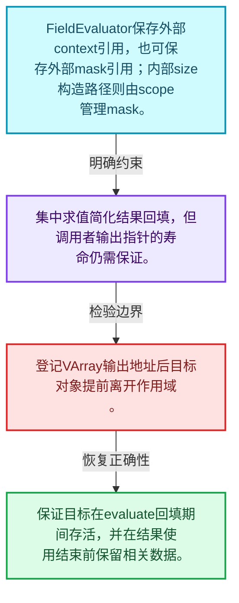
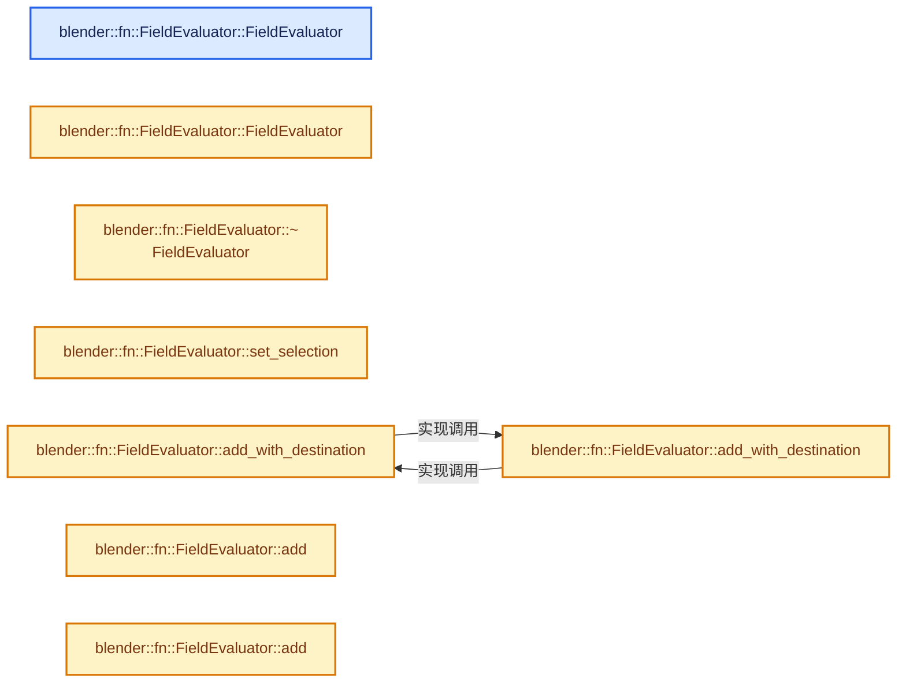
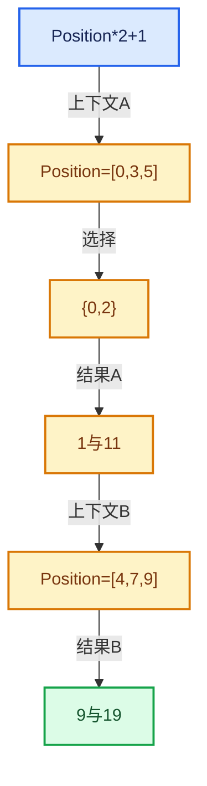

# 08-07 FieldEvaluator接口与使用

[方向导航](README.md) · [总目录](../README.md) · [实现索引](../%E7%AC%A6%E5%8F%B7%E4%BE%9D%E8%B5%96%E4%B8%8E%E5%AE%9E%E7%8E%B0%E7%B4%A2%E5%BC%95.md)

## 从问题到实现

怎样集中求值多个Field并管理结果寿命？

求值器保存上下文和mask引用、临时资源及输出；evaluate只能按其契约调用，结果视图受相关存储寿命约束。

**数据模型**

FieldEvaluator保存外部context引用，也可保存外部mask引用；内部size构造路径则由scope管理mask。

**设计取舍**

集中求值简化结果回填，但调用者输出指针的寿命仍需保证。

**最小反例**

登记VArray输出地址后目标对象提前离开作用域。

**推导**

保证目标在evaluate回填期间存活，并在结果使用结束前保留相关数据。

## 阅读地图与执行推演








图中的数值推演是本方向的教学模型；实际函数之间的调用边与概念分析边分别标注，不能把概念关系当作运行时调度顺序。

## 完整源码单元与就地讲解

中文讲解直接放在相关代码旁，复杂机制在代码下展开。原文折叠区保留基准行号；不需要在行号表和函数之间来回查找。类布局可分段展示，函数实现不按固定行数切开。

### 类型布局、声明与编译条件 · FN_field_evaluation.hh L1—L42

<a id="t-1c0e2274be2d"></a>

`FieldEvaluator`在这里声明的数据成员：

- `ResourceScope scope_`
- `FieldContext context_`
- `IndexMask mask_`
- `Vector<GField> fields_to_evaluate_`
- `Vector<GVMutableArray> dst_varrays_`
- `Vector<GVArray> evaluated_varrays_`：保存表达式的结果表示，不保证每项都是独立拥有的连续数组。
- `Vector<OutputPointerInfo> output_pointer_infos_`
- `bool is_evaluated_`：提交求值阶段状态；只有结果与外部回填完成后才能视为已求值。
- `std::optional<Field<bool>> selection_field_`
- `IndexMask selection_mask_`：保存最终处理集合，它由原始mask与selection共同决定。

<a id="t-31d5b3f0bc64"></a>

`OutputPointerInfo`在这里声明的数据成员：

- `void dst`
- `void set`

<!-- annotated:14257c03421388 -->

```cpp
/* SPDX-FileCopyrightText: 2026 Blender Authors
 *
 * SPDX-License-Identifier: GPL-2.0-or-later */

/** \file
 * \ingroup fn
 */

#pragma once

#include "BLI_generic_virtual_array.hh"
#include "BLI_vector.hh"

#include "FN_field.hh"

namespace blender::fn {

/**
 * Utility class that makes it easier to evaluate fields.
 */
class FieldEvaluator : NonMovable, NonCopyable {
  struct OutputPointerInfo {
    void *dst = nullptr;
    /* When a destination virtual array is provided for an input, this is
     * unnecessary, otherwise this is used to construct the required virtual array. */
    void (*set)(void *dst, const GVArray &varray, ResourceScope &scope) = nullptr;
  };

  ResourceScope scope_;
  const FieldContext &context_;
  const IndexMask &mask_;
  Vector<GField> fields_to_evaluate_;
  Vector<GVMutableArray> dst_varrays_;
  Vector<GVArray> evaluated_varrays_;
  Vector<OutputPointerInfo> output_pointer_infos_;
  bool is_evaluated_ = false;

  std::optional<Field<bool>> selection_field_;
  IndexMask selection_mask_;

 public:
  /** Takes #mask by pointer because the mask has to live longer than the evaluator. */
```

<details>
<summary>核对原始源码：source/blender/functions/FN_field_evaluation.hh · L1—L42</summary>

<!-- original:14257c03421388:source/blender/functions/FN_field_evaluation.hh:1:42 -->

```cpp
/* SPDX-FileCopyrightText: 2026 Blender Authors
 *
 * SPDX-License-Identifier: GPL-2.0-or-later */

/** \file
 * \ingroup fn
 */

#pragma once

#include "BLI_generic_virtual_array.hh"
#include "BLI_vector.hh"

#include "FN_field.hh"

namespace blender::fn {

/**
 * Utility class that makes it easier to evaluate fields.
 */
class FieldEvaluator : NonMovable, NonCopyable {
  struct OutputPointerInfo {
    void *dst = nullptr;
    /* When a destination virtual array is provided for an input, this is
     * unnecessary, otherwise this is used to construct the required virtual array. */
    void (*set)(void *dst, const GVArray &varray, ResourceScope &scope) = nullptr;
  };

  ResourceScope scope_;
  const FieldContext &context_;
  const IndexMask &mask_;
  Vector<GField> fields_to_evaluate_;
  Vector<GVMutableArray> dst_varrays_;
  Vector<GVArray> evaluated_varrays_;
  Vector<OutputPointerInfo> output_pointer_infos_;
  bool is_evaluated_ = false;

  std::optional<Field<bool>> selection_field_;
  IndexMask selection_mask_;

 public:
  /** Takes #mask by pointer because the mask has to live longer than the evaluator. */
```

</details>

<a id="f-c627a114b465253f"></a>

### `blender::fn::FieldEvaluator::FieldEvaluator`

实现位置：[source/blender/functions/FN_field_evaluation.hh](../../../../../source/blender/functions/FN_field_evaluation.hh) · L43—L46。

接口参数：

- `const FieldContext &context`
- `const IndexMask *mask`

**教学注释版**

<!-- annotated:9838aa6c51da45 -->

```cpp
  FieldEvaluator(const FieldContext &context, const IndexMask *mask)
      : context_(context), mask_(*mask)
  {
  }
```

<details>
<summary>核对原始源码：source/blender/functions/FN_field_evaluation.hh · L43—L46</summary>

<!-- original:9838aa6c51da45:source/blender/functions/FN_field_evaluation.hh:43:46 -->

```cpp
  FieldEvaluator(const FieldContext &context, const IndexMask *mask)
      : context_(context), mask_(*mask)
  {
  }
```

</details>

**继续追踪实现**

本实现没有需要继续展开的显式调用；检查返回表达式、对象转换和调用者前置条件。

### 类型布局、声明与编译条件 · FN_field_evaluation.hh L47—L48

<!-- annotated:8301d1780a7fdb -->

```cpp

  /** Construct a field evaluator for all indices less than #size. */
```

<details>
<summary>核对原始源码：source/blender/functions/FN_field_evaluation.hh · L47—L48</summary>

<!-- original:8301d1780a7fdb:source/blender/functions/FN_field_evaluation.hh:47:48 -->

```cpp

  /** Construct a field evaluator for all indices less than #size. */
```

</details>

<a id="f-56bba9a765ca15e0"></a>

### `blender::fn::FieldEvaluator::FieldEvaluator`

实现位置：[source/blender/functions/FN_field_evaluation.hh](../../../../../source/blender/functions/FN_field_evaluation.hh) · L49—L52。

接口参数：

- `const FieldContext &context`
- `const int64_t size`

**教学注释版**

<!-- annotated:9df4b5e418e0a0 -->

```cpp
  FieldEvaluator(const FieldContext &context, const int64_t size)
      : context_(context), mask_(scope_.construct<IndexMask>(size))
  {
  }
```

<details>
<summary>核对原始源码：source/blender/functions/FN_field_evaluation.hh · L49—L52</summary>

<!-- original:9df4b5e418e0a0:source/blender/functions/FN_field_evaluation.hh:49:52 -->

```cpp
  FieldEvaluator(const FieldContext &context, const int64_t size)
      : context_(context), mask_(scope_.construct<IndexMask>(size))
  {
  }
```

</details>

**继续追踪实现**

本实现没有需要继续展开的显式调用；检查返回表达式、对象转换和调用者前置条件。

<!-- annotated:51125ce4884e2d -->

```cpp

```

<details>
<summary>核对原始源码：source/blender/functions/FN_field_evaluation.hh · L53—L53</summary>

<!-- original:51125ce4884e2d:source/blender/functions/FN_field_evaluation.hh:53:53 -->

```cpp

```

</details>

<a id="f-2a349afc7707ddf4"></a>

### `blender::fn::FieldEvaluator::~FieldEvaluator`

实现位置：[source/blender/functions/FN_field_evaluation.hh](../../../../../source/blender/functions/FN_field_evaluation.hh) · L54—L59。

**教学注释版**

<!-- annotated:673f9d9340536d -->

```cpp
  ~FieldEvaluator()
  {
    /* While this assert isn't strictly necessary, and could be replaced with a warning,
     * it will catch cases where someone forgets to call #evaluate(). */
    BLI_assert(is_evaluated_);
  }
```

<details>
<summary>核对原始源码：source/blender/functions/FN_field_evaluation.hh · L54—L59</summary>

<!-- original:673f9d9340536d:source/blender/functions/FN_field_evaluation.hh:54:59 -->

```cpp
  ~FieldEvaluator()
  {
    /* While this assert isn't strictly necessary, and could be replaced with a warning,
     * it will catch cases where someone forgets to call #evaluate(). */
    BLI_assert(is_evaluated_);
  }
```

</details>

**继续追踪实现**

- `BLI_assert` → [BLI_assert · L48](../01-%E5%9F%BA%E7%A1%80%E5%AE%B9%E5%99%A8%E4%B8%8E%E7%8E%B0%E4%BB%A3CPP/%E4%BE%9D%E8%B5%96-BLI_assert-cc98e8.md#m-57a88495704d)；[BLI_assert · L63](../01-%E5%9F%BA%E7%A1%80%E5%AE%B9%E5%99%A8%E4%B8%8E%E7%8E%B0%E4%BB%A3CPP/%E4%BE%9D%E8%B5%96-BLI_assert-cc98e8.md#m-d07050020cb5)。宏定义由构建条件选择。

### 类型布局、声明与编译条件 · FN_field_evaluation.hh L60—L67

<!-- annotated:74fa22a2007047 -->

```cpp

  /**
   * The selection field is evaluated first to determine which indices of the other fields should
   * be evaluated. Calling this method multiple times will just replace the previously set
   * selection field. Only the elements selected by both this selection and the selection provided
   * in the constructor are calculated. If no selection field is set, it is assumed that all
   * indices passed to the constructor are selected.
   */
```

<details>
<summary>核对原始源码：source/blender/functions/FN_field_evaluation.hh · L60—L67</summary>

<!-- original:74fa22a2007047:source/blender/functions/FN_field_evaluation.hh:60:67 -->

```cpp

  /**
   * The selection field is evaluated first to determine which indices of the other fields should
   * be evaluated. Calling this method multiple times will just replace the previously set
   * selection field. Only the elements selected by both this selection and the selection provided
   * in the constructor are calculated. If no selection field is set, it is assumed that all
   * indices passed to the constructor are selected.
   */
```

</details>

<a id="f-1d38e812a1e29e63"></a>

### `blender::fn::FieldEvaluator::set_selection`

登记本轮选择表达式。

实现位置：[source/blender/functions/FN_field_evaluation.hh](../../../../../source/blender/functions/FN_field_evaluation.hh) · L68—L71。

接口参数：

- `Field<bool> selection`

**教学注释版**

<!-- annotated:b917be7ab92a8f -->

```cpp
  void set_selection(Field<bool> selection)
  {
    // [讲解] std::move：把表达式转换成可供移动重载选择的值类别；不保证真的移动，不结束源对象寿命，对const值可能选择复制。
    selection_field_ = std::move(selection);
  }
```

<details>
<summary>核对原始源码：source/blender/functions/FN_field_evaluation.hh · L68—L71</summary>

<!-- original:b917be7ab92a8f:source/blender/functions/FN_field_evaluation.hh:68:71 -->

```cpp
  void set_selection(Field<bool> selection)
  {
    selection_field_ = std::move(selection);
  }
```

</details>

**接口与不变量**

选择先在原mask上求值，再限制其他输出的求值集合。

**沿实际写入检查状态**

- `selection_field_ = std::move(selection);`

**继续追踪实现**

- `std::move` → [外部契约](https://eel.is/c++draft/utility.forward)：把表达式转换成可供移动重载选择的值类别；不保证真的移动，不结束源对象寿命，对const值可能选择复制。

### 类型布局、声明与编译条件 · FN_field_evaluation.hh L72—L79

<!-- annotated:6367d55db77cf9 -->

```cpp

  /**
   * \param field: Field to add to the evaluator.
   * \param dst: Mutable virtual array that the evaluated result for this field is be written into.
   */
  int add_with_destination(GField field, GVMutableArray dst);

  /** Same as #add_with_destination but typed. */
```

<details>
<summary>核对原始源码：source/blender/functions/FN_field_evaluation.hh · L72—L79</summary>

<!-- original:6367d55db77cf9:source/blender/functions/FN_field_evaluation.hh:72:79 -->

```cpp

  /**
   * \param field: Field to add to the evaluator.
   * \param dst: Mutable virtual array that the evaluated result for this field is be written into.
   */
  int add_with_destination(GField field, GVMutableArray dst);

  /** Same as #add_with_destination but typed. */
```

</details>

<a id="f-3edfceb249cb5cad"></a>

### `blender::fn::FieldEvaluator::add_with_destination`

登记表达式和可选的结果目标。

实现位置：[source/blender/functions/FN_field_evaluation.hh](../../../../../source/blender/functions/FN_field_evaluation.hh) · L80—L83。

接口参数：

- `Field<T> field`
- `VMutableArray<T> dst`

**教学注释版**

<!-- annotated:7447621d96d6f6 -->

```cpp
  template<typename T> int add_with_destination(Field<T> field, VMutableArray<T> dst)
  {
    // [讲解] this->add_with_destination：登记表达式和可选的结果目标。
    return this->add_with_destination(GField(std::move(field)), GVMutableArray(std::move(dst)));
  }
```

<details>
<summary>核对原始源码：source/blender/functions/FN_field_evaluation.hh · L80—L83</summary>

<!-- original:7447621d96d6f6:source/blender/functions/FN_field_evaluation.hh:80:83 -->

```cpp
  template<typename T> int add_with_destination(Field<T> field, VMutableArray<T> dst)
  {
    return this->add_with_destination(GField(std::move(field)), GVMutableArray(std::move(dst)));
  }
```

</details>

**接口与不变量**

登记不等于已经求值；外部目标地址必须覆盖evaluate回填期间。

**结果出口**

- `return this->add_with_destination(GField(std::move(field)), GVMutableArray(std::move(dst)));`

**继续追踪实现**

- `this->add_with_destination` → [blender::fn::FieldEvaluator::add_with_destination · L80](07-FieldEvaluator%E6%8E%A5%E5%8F%A3%E4%B8%8E%E4%BD%BF%E7%94%A8.md#f-3edfceb249cb5cad)；[blender::fn::FieldEvaluator::add_with_destination · L99](07-FieldEvaluator%E6%8E%A5%E5%8F%A3%E4%B8%8E%E4%BD%BF%E7%94%A8.md#f-03289f589afbd469)。同名重载需按实参类型选择。
- `GField` → [blender::fn::GField::GField · L121](02-GField%E5%AD%98%E5%82%A8%E8%A1%A8%E7%A4%BA.md#f-05b8cf641fd81420)；[blender::fn::GField::GField · L450](05-FieldOperation%E8%BF%90%E7%AE%97%E8%8A%82%E7%82%B9.md#f-211db26b169f2f41)；[blender::fn::GField::GField · L454](05-FieldOperation%E8%BF%90%E7%AE%97%E8%8A%82%E7%82%B9.md#f-7fdb26f58de14966)；[blender::fn::GField::GField · L455](05-FieldOperation%E8%BF%90%E7%AE%97%E8%8A%82%E7%82%B9.md#f-0f8304d195c6e071)；[blender::fn::GField::GField · L456](05-FieldOperation%E8%BF%90%E7%AE%97%E8%8A%82%E7%82%B9.md#f-49cf4fb08737a047)。同名重载需按实参类型选择。
- `std::move` → [外部契约](https://eel.is/c++draft/utility.forward)：把表达式转换成可供移动重载选择的值类别；不保证真的移动，不结束源对象寿命，对const值可能选择复制。
- `GVMutableArray` → [blender::GVMutableArray::GVMutableArray · L201](../04-%E8%99%9A%E6%8B%9F%E6%95%B0%E7%BB%84%E4%B8%8E%E7%B4%A2%E5%BC%95%E9%80%89%E6%8B%A9/05-GVArray%E8%BF%90%E8%A1%8C%E6%97%B6%E7%B1%BB%E5%9E%8B.md#f-755e1cf8dfa41c20)；[blender::GVMutableArray::GVMutableArray · L957](../04-%E8%99%9A%E6%8B%9F%E6%95%B0%E7%BB%84%E4%B8%8E%E7%B4%A2%E5%BC%95%E9%80%89%E6%8B%A9/05-GVArray%E8%BF%90%E8%A1%8C%E6%97%B6%E7%B1%BB%E5%9E%8B.md#f-f8e068df1e409cfc)；[blender::GVMutableArray::GVMutableArray · L672](../04-%E8%99%9A%E6%8B%9F%E6%95%B0%E7%BB%84%E4%B8%8E%E7%B4%A2%E5%BC%95%E9%80%89%E6%8B%A9/05-GVArray%E8%BF%90%E8%A1%8C%E6%97%B6%E7%B1%BB%E5%9E%8B.md#f-e40ab62ee36c8354)；[blender::GVMutableArray::GVMutableArray · L674](../04-%E8%99%9A%E6%8B%9F%E6%95%B0%E7%BB%84%E4%B8%8E%E7%B4%A2%E5%BC%95%E9%80%89%E6%8B%A9/05-GVArray%E8%BF%90%E8%A1%8C%E6%97%B6%E7%B1%BB%E5%9E%8B.md#f-1da1448a133440b8)。同名重载需按实参类型选择。

### 类型布局、声明与编译条件 · FN_field_evaluation.hh L84—L98

<!-- annotated:56f1b358b02775 -->

```cpp

  /**
   * \param field: Field to add to the evaluator.
   * \param dst: Mutable span that the evaluated result for this field is be written into.
   * \note When the output may only be used as a single value, the version of this function with
   * a virtual array result array should be used.
   */
  int add_with_destination(GField field, GMutableSpan dst);

  /**
   * \param field: Field to add to the evaluator.
   * \param dst: Mutable span that the evaluated result for this field is be written into.
   * \note When the output may only be used as a single value, the version of this function with
   * a virtual array result array should be used.
   */
```

<details>
<summary>核对原始源码：source/blender/functions/FN_field_evaluation.hh · L84—L98</summary>

<!-- original:56f1b358b02775:source/blender/functions/FN_field_evaluation.hh:84:98 -->

```cpp

  /**
   * \param field: Field to add to the evaluator.
   * \param dst: Mutable span that the evaluated result for this field is be written into.
   * \note When the output may only be used as a single value, the version of this function with
   * a virtual array result array should be used.
   */
  int add_with_destination(GField field, GMutableSpan dst);

  /**
   * \param field: Field to add to the evaluator.
   * \param dst: Mutable span that the evaluated result for this field is be written into.
   * \note When the output may only be used as a single value, the version of this function with
   * a virtual array result array should be used.
   */
```

</details>

<a id="f-03289f589afbd469"></a>

### `blender::fn::FieldEvaluator::add_with_destination`

登记表达式和可选的结果目标。

实现位置：[source/blender/functions/FN_field_evaluation.hh](../../../../../source/blender/functions/FN_field_evaluation.hh) · L99—L102。

接口参数：

- `Field<T> field`
- `MutableSpan<T> dst`

**教学注释版**

<!-- annotated:741f0107e9e0df -->

```cpp
  template<typename T> int add_with_destination(Field<T> field, MutableSpan<T> dst)
  {
    // [讲解] this->add_with_destination：登记表达式和可选的结果目标。
    return this->add_with_destination(std::move(field), VMutableArray<T>::from_span(dst));
  }
```

<details>
<summary>核对原始源码：source/blender/functions/FN_field_evaluation.hh · L99—L102</summary>

<!-- original:741f0107e9e0df:source/blender/functions/FN_field_evaluation.hh:99:102 -->

```cpp
  template<typename T> int add_with_destination(Field<T> field, MutableSpan<T> dst)
  {
    return this->add_with_destination(std::move(field), VMutableArray<T>::from_span(dst));
  }
```

</details>

**接口与不变量**

登记不等于已经求值；外部目标地址必须覆盖evaluate回填期间。

**结果出口**

- `return this->add_with_destination(std::move(field), VMutableArray<T>::from_span(dst));`

**继续追踪实现**

- `this->add_with_destination` → [blender::fn::FieldEvaluator::add_with_destination · L80](07-FieldEvaluator%E6%8E%A5%E5%8F%A3%E4%B8%8E%E4%BD%BF%E7%94%A8.md#f-3edfceb249cb5cad)；[blender::fn::FieldEvaluator::add_with_destination · L99](07-FieldEvaluator%E6%8E%A5%E5%8F%A3%E4%B8%8E%E4%BD%BF%E7%94%A8.md#f-03289f589afbd469)。同名重载需按实参类型选择。
- `std::move` → [外部契约](https://eel.is/c++draft/utility.forward)：把表达式转换成可供移动重载选择的值类别；不保证真的移动，不结束源对象寿命，对const值可能选择复制。
- `VMutableArray<T>::from_span` → [blender::GVMutableArray::from_span · L679](../04-%E8%99%9A%E6%8B%9F%E6%95%B0%E7%BB%84%E4%B8%8E%E7%B4%A2%E5%BC%95%E9%80%89%E6%8B%A9/05-GVArray%E8%BF%90%E8%A1%8C%E6%97%B6%E7%B1%BB%E5%9E%8B.md#f-ad97783cbbc9da66)；[blender::VMutableArray::from_span · L843](../04-%E8%99%9A%E6%8B%9F%E6%95%B0%E7%BB%84%E4%B8%8E%E7%B4%A2%E5%BC%95%E9%80%89%E6%8B%A9/03-%E5%8D%95%E5%80%BC%E4%B8%8ESpan%E8%A1%A8%E7%A4%BA.md#f-242830d588dac107)。同名重载需按实参类型选择。

### 类型布局、声明与编译条件 · FN_field_evaluation.hh L103—L111

<!-- annotated:f8b4c4c8b34bb4 -->

```cpp

  int add(GField field, GVArray *varray_ptr);

  /**
   * \param field: Field to add to the evaluator.
   * \param varray_ptr: Once #evaluate is called, the resulting virtual array will be will be
   *   assigned to the given position.
   * \return Index of the field in the evaluator which can be used in the #get_evaluated methods.
   */
```

<details>
<summary>核对原始源码：source/blender/functions/FN_field_evaluation.hh · L103—L111</summary>

<!-- original:f8b4c4c8b34bb4:source/blender/functions/FN_field_evaluation.hh:103:111 -->

```cpp

  int add(GField field, GVArray *varray_ptr);

  /**
   * \param field: Field to add to the evaluator.
   * \param varray_ptr: Once #evaluate is called, the resulting virtual array will be will be
   *   assigned to the given position.
   * \return Index of the field in the evaluator which can be used in the #get_evaluated methods.
   */
```

</details>

<a id="f-ab31e309cff56785"></a>

### `blender::fn::FieldEvaluator::add`

登记表达式和可选的结果目标。

实现位置：[source/blender/functions/FN_field_evaluation.hh](../../../../../source/blender/functions/FN_field_evaluation.hh) · L112—L121。

接口参数：

- `Field<T> field`
- `VArray<T> *varray_ptr`

**教学注释版**

<!-- annotated:0d26cf203963b2 -->

```cpp
  template<typename T> int add(Field<T> field, VArray<T> *varray_ptr)
  {
    // [讲解] fields_to_evaluate_.append_and_get_index：在尾部建立新元素，必要时先扩大存储。
    const int field_index = fields_to_evaluate_.append_and_get_index(std::move(field));
    // [讲解] dst_varrays_.append：在尾部建立新元素，必要时先扩大存储。
    dst_varrays_.append({});
    output_pointer_infos_.append(OutputPointerInfo{
        varray_ptr, [](void *dst, const GVArray &varray, ResourceScope & /*scope*/) {
          *static_cast<VArray<T> *>(dst) = varray.typed<T>();
        }});
    return field_index;
  }
```

<details>
<summary>核对原始源码：source/blender/functions/FN_field_evaluation.hh · L112—L121</summary>

<!-- original:0d26cf203963b2:source/blender/functions/FN_field_evaluation.hh:112:121 -->

```cpp
  template<typename T> int add(Field<T> field, VArray<T> *varray_ptr)
  {
    const int field_index = fields_to_evaluate_.append_and_get_index(std::move(field));
    dst_varrays_.append({});
    output_pointer_infos_.append(OutputPointerInfo{
        varray_ptr, [](void *dst, const GVArray &varray, ResourceScope & /*scope*/) {
          *static_cast<VArray<T> *>(dst) = varray.typed<T>();
        }});
    return field_index;
  }
```

</details>

**接口与不变量**

登记不等于已经求值；外部目标地址必须覆盖evaluate回填期间。

**结果出口**

- `return field_index;`

**继续追踪实现**

- `fields_to_evaluate_.append_and_get_index` → [blender::Vector::append_and_get_index · L517](../01-%E5%9F%BA%E7%A1%80%E5%AE%B9%E5%99%A8%E4%B8%8E%E7%8E%B0%E4%BB%A3CPP/11-Vector%E6%8F%92%E5%85%A5%E5%88%A0%E9%99%A4%E4%B8%8E%E9%87%8D%E6%8E%92.md#f-1de78b06c3aa90cd)；[blender::Vector::append_and_get_index · L521](../01-%E5%9F%BA%E7%A1%80%E5%AE%B9%E5%99%A8%E4%B8%8E%E7%8E%B0%E4%BB%A3CPP/11-Vector%E6%8F%92%E5%85%A5%E5%88%A0%E9%99%A4%E4%B8%8E%E9%87%8D%E6%8E%92.md#f-91413faf22574850)。同名重载需按实参类型选择。
- `std::move` → [外部契约](https://eel.is/c++draft/utility.forward)：把表达式转换成可供移动重载选择的值类别；不保证真的移动，不结束源对象寿命，对const值可能选择复制。
- `dst_varrays_.append` → [blender::Vector::append · L498](../01-%E5%9F%BA%E7%A1%80%E5%AE%B9%E5%99%A8%E4%B8%8E%E7%8E%B0%E4%BB%A3CPP/11-Vector%E6%8F%92%E5%85%A5%E5%88%A0%E9%99%A4%E4%B8%8E%E9%87%8D%E6%8E%92.md#f-5bde268a69e443ec)；[blender::Vector::append · L502](../01-%E5%9F%BA%E7%A1%80%E5%AE%B9%E5%99%A8%E4%B8%8E%E7%8E%B0%E4%BB%A3CPP/11-Vector%E6%8F%92%E5%85%A5%E5%88%A0%E9%99%A4%E4%B8%8E%E9%87%8D%E6%8E%92.md#f-591e0b15e6308532)。同名重载需按实参类型选择。
- `output_pointer_infos_.append` → [blender::Vector::append · L498](../01-%E5%9F%BA%E7%A1%80%E5%AE%B9%E5%99%A8%E4%B8%8E%E7%8E%B0%E4%BB%A3CPP/11-Vector%E6%8F%92%E5%85%A5%E5%88%A0%E9%99%A4%E4%B8%8E%E9%87%8D%E6%8E%92.md#f-5bde268a69e443ec)；[blender::Vector::append · L502](../01-%E5%9F%BA%E7%A1%80%E5%AE%B9%E5%99%A8%E4%B8%8E%E7%8E%B0%E4%BB%A3CPP/11-Vector%E6%8F%92%E5%85%A5%E5%88%A0%E9%99%A4%E4%B8%8E%E9%87%8D%E6%8E%92.md#f-591e0b15e6308532)。同名重载需按实参类型选择。
- `varray.typed<T>` → [blender::GVArray::typed · L913](../04-%E8%99%9A%E6%8B%9F%E6%95%B0%E7%BB%84%E4%B8%8E%E7%B4%A2%E5%BC%95%E9%80%89%E6%8B%A9/05-GVArray%E8%BF%90%E8%A1%8C%E6%97%B6%E7%B1%BB%E5%9E%8B.md#f-c17d1cd75ef41a17)。

<!-- annotated:adee6afc6f07aa -->

```cpp

```

<details>
<summary>核对原始源码：source/blender/functions/FN_field_evaluation.hh · L122—L122</summary>

<!-- original:adee6afc6f07aa:source/blender/functions/FN_field_evaluation.hh:122:122 -->

```cpp

```

</details>

<a id="f-d1fd1566630f59d2"></a>

### `blender::fn::FieldEvaluator::add`

登记表达式和可选的结果目标。

实现位置：[source/blender/functions/FN_field_evaluation.hh](../../../../../source/blender/functions/FN_field_evaluation.hh) · L123—L132。

接口参数：

- `Field<T> field`
- `VArraySpan<T> *varray_span_ptr`

**教学注释版**

<!-- annotated:a0d588899ec70b -->

```cpp
  template<typename T> int add(Field<T> field, VArraySpan<T> *varray_span_ptr)
  {
    // [讲解] fields_to_evaluate_.append_and_get_index：在尾部建立新元素，必要时先扩大存储。
    const int field_index = fields_to_evaluate_.append_and_get_index(std::move(field));
    // [讲解] dst_varrays_.append：在尾部建立新元素，必要时先扩大存储。
    dst_varrays_.append({});
    output_pointer_infos_.append(OutputPointerInfo{
        varray_span_ptr, [](void *dst, const GVArray &varray, ResourceScope & /*scope*/) {
          *static_cast<VArraySpan<T> *>(dst) = varray.typed<T>();
        }});
    return field_index;
  }
```

<details>
<summary>核对原始源码：source/blender/functions/FN_field_evaluation.hh · L123—L132</summary>

<!-- original:a0d588899ec70b:source/blender/functions/FN_field_evaluation.hh:123:132 -->

```cpp
  template<typename T> int add(Field<T> field, VArraySpan<T> *varray_span_ptr)
  {
    const int field_index = fields_to_evaluate_.append_and_get_index(std::move(field));
    dst_varrays_.append({});
    output_pointer_infos_.append(OutputPointerInfo{
        varray_span_ptr, [](void *dst, const GVArray &varray, ResourceScope & /*scope*/) {
          *static_cast<VArraySpan<T> *>(dst) = varray.typed<T>();
        }});
    return field_index;
  }
```

</details>

**接口与不变量**

登记不等于已经求值；外部目标地址必须覆盖evaluate回填期间。

**结果出口**

- `return field_index;`

**继续追踪实现**

- `fields_to_evaluate_.append_and_get_index` → [blender::Vector::append_and_get_index · L517](../01-%E5%9F%BA%E7%A1%80%E5%AE%B9%E5%99%A8%E4%B8%8E%E7%8E%B0%E4%BB%A3CPP/11-Vector%E6%8F%92%E5%85%A5%E5%88%A0%E9%99%A4%E4%B8%8E%E9%87%8D%E6%8E%92.md#f-1de78b06c3aa90cd)；[blender::Vector::append_and_get_index · L521](../01-%E5%9F%BA%E7%A1%80%E5%AE%B9%E5%99%A8%E4%B8%8E%E7%8E%B0%E4%BB%A3CPP/11-Vector%E6%8F%92%E5%85%A5%E5%88%A0%E9%99%A4%E4%B8%8E%E9%87%8D%E6%8E%92.md#f-91413faf22574850)。同名重载需按实参类型选择。
- `std::move` → [外部契约](https://eel.is/c++draft/utility.forward)：把表达式转换成可供移动重载选择的值类别；不保证真的移动，不结束源对象寿命，对const值可能选择复制。
- `dst_varrays_.append` → [blender::Vector::append · L498](../01-%E5%9F%BA%E7%A1%80%E5%AE%B9%E5%99%A8%E4%B8%8E%E7%8E%B0%E4%BB%A3CPP/11-Vector%E6%8F%92%E5%85%A5%E5%88%A0%E9%99%A4%E4%B8%8E%E9%87%8D%E6%8E%92.md#f-5bde268a69e443ec)；[blender::Vector::append · L502](../01-%E5%9F%BA%E7%A1%80%E5%AE%B9%E5%99%A8%E4%B8%8E%E7%8E%B0%E4%BB%A3CPP/11-Vector%E6%8F%92%E5%85%A5%E5%88%A0%E9%99%A4%E4%B8%8E%E9%87%8D%E6%8E%92.md#f-591e0b15e6308532)。同名重载需按实参类型选择。
- `output_pointer_infos_.append` → [blender::Vector::append · L498](../01-%E5%9F%BA%E7%A1%80%E5%AE%B9%E5%99%A8%E4%B8%8E%E7%8E%B0%E4%BB%A3CPP/11-Vector%E6%8F%92%E5%85%A5%E5%88%A0%E9%99%A4%E4%B8%8E%E9%87%8D%E6%8E%92.md#f-5bde268a69e443ec)；[blender::Vector::append · L502](../01-%E5%9F%BA%E7%A1%80%E5%AE%B9%E5%99%A8%E4%B8%8E%E7%8E%B0%E4%BB%A3CPP/11-Vector%E6%8F%92%E5%85%A5%E5%88%A0%E9%99%A4%E4%B8%8E%E9%87%8D%E6%8E%92.md#f-591e0b15e6308532)。同名重载需按实参类型选择。
- `varray.typed<T>` → [blender::GVArray::typed · L913](../04-%E8%99%9A%E6%8B%9F%E6%95%B0%E7%BB%84%E4%B8%8E%E7%B4%A2%E5%BC%95%E9%80%89%E6%8B%A9/05-GVArray%E8%BF%90%E8%A1%8C%E6%97%B6%E7%B1%BB%E5%9E%8B.md#f-c17d1cd75ef41a17)。

### 类型布局、声明与编译条件 · FN_field_evaluation.hh L133—L143

<!-- annotated:c148d850de0597 -->

```cpp

  /**
   * \return Index of the field in the evaluator which can be used in the #get_evaluated methods.
   */
  int add(GField field);

  /**
   * Evaluate all fields on the evaluator. This can only be called once.
   */
  void evaluate();

```

<details>
<summary>核对原始源码：source/blender/functions/FN_field_evaluation.hh · L133—L143</summary>

<!-- original:c148d850de0597:source/blender/functions/FN_field_evaluation.hh:133:143 -->

```cpp

  /**
   * \return Index of the field in the evaluator which can be used in the #get_evaluated methods.
   */
  int add(GField field);

  /**
   * Evaluate all fields on the evaluator. This can only be called once.
   */
  void evaluate();

```

</details>

<a id="f-57a3012b0391bad8"></a>

### `blender::fn::FieldEvaluator::get_evaluated`

读取已完成的求值结果或选择。

实现位置：[source/blender/functions/FN_field_evaluation.hh](../../../../../source/blender/functions/FN_field_evaluation.hh) · L144—L148。

接口参数：

- `const int field_index`

**教学注释版**

<!-- annotated:f73a20ee96b84a -->

```cpp
  const GVArray &get_evaluated(const int field_index) const
  {
    BLI_assert(is_evaluated_);
    return evaluated_varrays_[field_index];
  }
```

<details>
<summary>核对原始源码：source/blender/functions/FN_field_evaluation.hh · L144—L148</summary>

<!-- original:f73a20ee96b84a:source/blender/functions/FN_field_evaluation.hh:144:148 -->

```cpp
  const GVArray &get_evaluated(const int field_index) const
  {
    BLI_assert(is_evaluated_);
    return evaluated_varrays_[field_index];
  }
```

</details>

**接口与不变量**

evaluate前不可按已计算结果使用；虚拟数组可能继续借用作用域临时存储。

**结果出口**

- `return evaluated_varrays_[field_index];`

**继续追踪实现**

- `BLI_assert` → [BLI_assert · L48](../01-%E5%9F%BA%E7%A1%80%E5%AE%B9%E5%99%A8%E4%B8%8E%E7%8E%B0%E4%BB%A3CPP/%E4%BE%9D%E8%B5%96-BLI_assert-cc98e8.md#m-57a88495704d)；[BLI_assert · L63](../01-%E5%9F%BA%E7%A1%80%E5%AE%B9%E5%99%A8%E4%B8%8E%E7%8E%B0%E4%BB%A3CPP/%E4%BE%9D%E8%B5%96-BLI_assert-cc98e8.md#m-d07050020cb5)。宏定义由构建条件选择。

<!-- annotated:ba19dfc05902db -->

```cpp

```

<details>
<summary>核对原始源码：source/blender/functions/FN_field_evaluation.hh · L149—L149</summary>

<!-- original:ba19dfc05902db:source/blender/functions/FN_field_evaluation.hh:149:149 -->

```cpp

```

</details>

<a id="f-65bbf8d4b675d2cc"></a>

### `blender::fn::FieldEvaluator::get_evaluated`

读取已完成的求值结果或选择。

实现位置：[source/blender/functions/FN_field_evaluation.hh](../../../../../source/blender/functions/FN_field_evaluation.hh) · L150—L153。

接口参数：

- `const int field_index`

**教学注释版**

<!-- annotated:e134b38e4c4434 -->

```cpp
  template<typename T> VArray<T> get_evaluated(const int field_index) const
  {
    // [讲解] this->get_evaluated：读取已完成的求值结果或选择。
    return this->get_evaluated(field_index).typed<T>();
  }
```

<details>
<summary>核对原始源码：source/blender/functions/FN_field_evaluation.hh · L150—L153</summary>

<!-- original:e134b38e4c4434:source/blender/functions/FN_field_evaluation.hh:150:153 -->

```cpp
  template<typename T> VArray<T> get_evaluated(const int field_index) const
  {
    return this->get_evaluated(field_index).typed<T>();
  }
```

</details>

**接口与不变量**

evaluate前不可按已计算结果使用；虚拟数组可能继续借用作用域临时存储。

**结果出口**

- `return this->get_evaluated(field_index).typed<T>();`

**继续追踪实现**

- `this->get_evaluated(field_index).typed<T>` → [调用协议](../%E6%A8%A1%E6%9D%BF%E5%AE%8F%E4%B8%8E%E5%8A%A8%E6%80%81%E5%88%86%E6%B4%BE%E5%8D%8F%E8%AE%AE.md)：接收对象类型依赖auto、返回值或模板实例；不按同名猜测目标。调用位置L152。
- `this->get_evaluated` → [blender::fn::FieldEvaluator::get_evaluated · L144](07-FieldEvaluator%E6%8E%A5%E5%8F%A3%E4%B8%8E%E4%BD%BF%E7%94%A8.md#f-57a3012b0391bad8)；[blender::fn::FieldEvaluator::get_evaluated · L150](07-FieldEvaluator%E6%8E%A5%E5%8F%A3%E4%B8%8E%E4%BD%BF%E7%94%A8.md#f-65bbf8d4b675d2cc)。同名重载需按实参类型选择。

### 类型布局、声明与编译条件 · FN_field_evaluation.hh L154—L163

<!-- annotated:1ba76caac11720 -->

```cpp

  IndexMask get_evaluated_selection_as_mask() const;

  /**
   * Retrieve the output of an evaluated boolean field and convert it to a mask, which can be used
   * to avoid calculations for unnecessary elements later on. The evaluator will own the indices in
   * some cases, so it must live at least as long as the returned mask.
   */
  IndexMask get_evaluated_as_mask(int field_index);

```

<details>
<summary>核对原始源码：source/blender/functions/FN_field_evaluation.hh · L154—L163</summary>

<!-- original:1ba76caac11720:source/blender/functions/FN_field_evaluation.hh:154:163 -->

```cpp

  IndexMask get_evaluated_selection_as_mask() const;

  /**
   * Retrieve the output of an evaluated boolean field and convert it to a mask, which can be used
   * to avoid calculations for unnecessary elements later on. The evaluator will own the indices in
   * some cases, so it must live at least as long as the returned mask.
   */
  IndexMask get_evaluated_as_mask(int field_index);

```

</details>

<a id="f-3ae13f43436a7406"></a>

### `blender::fn::FieldEvaluator::evaluation_mask`

实现位置：[source/blender/functions/FN_field_evaluation.hh](../../../../../source/blender/functions/FN_field_evaluation.hh) · L164—L167。

**教学注释版**

<!-- annotated:ead35e51bccf9b -->

```cpp
  const IndexMask &evaluation_mask() const
  {
    return mask_;
  }
```

<details>
<summary>核对原始源码：source/blender/functions/FN_field_evaluation.hh · L164—L167</summary>

<!-- original:ead35e51bccf9b:source/blender/functions/FN_field_evaluation.hh:164:167 -->

```cpp
  const IndexMask &evaluation_mask() const
  {
    return mask_;
  }
```

</details>

**结果出口**

- `return mask_;`

**继续追踪实现**

本实现没有需要继续展开的显式调用；检查返回表达式、对象转换和调用者前置条件。

### 类型布局、声明与编译条件 · FN_field_evaluation.hh L168—L199

<!-- annotated:80e965305b07e3 -->

```cpp
};

/**
 * Evaluate fields in the given context. If possible, multiple fields should be evaluated together,
 * because that can be more efficient when they share common sub-fields.
 *
 * \param scope: The resource scope that owns data that makes up the output virtual arrays. Make
 *   sure the scope is not destructed when the output virtual arrays are still used.
 * \param fields_to_evaluate: The fields that should be evaluated together.
 * \param mask: Determines which indices are computed. The mask may be referenced by the returned
 *   virtual arrays. So the underlying indices (if applicable) should live longer then #scope.
 * \param context: The context that the field is evaluated in. Used to retrieve data from each
 *   #FieldInput in the field network.
 * \param dst_varrays: If provided, the computed data will be written into those virtual arrays
 *   instead of into newly created ones. That allows making the computed data live longer than
 *   #scope and is more efficient when the data will be written into those virtual arrays
 *   later anyway.
 * \return The computed virtual arrays for each provided field. If #dst_varrays is passed, the
 *   provided virtual arrays are returned.
 */
Vector<GVArray> evaluate_fields(ResourceScope &scope,
                                Span<GFieldRef> fields_to_evaluate,
                                const IndexMask &mask,
                                const FieldContext &context,
                                Span<GVMutableArray> dst_varrays = {});

/* -------------------------------------------------------------------- */
/** \name Utility functions for simple field creation and evaluation
 * \{ */

void evaluate_constant_field(const GField &field, void *r_value);

```

<details>
<summary>核对原始源码：source/blender/functions/FN_field_evaluation.hh · L168—L199</summary>

<!-- original:80e965305b07e3:source/blender/functions/FN_field_evaluation.hh:168:199 -->

```cpp
};

/**
 * Evaluate fields in the given context. If possible, multiple fields should be evaluated together,
 * because that can be more efficient when they share common sub-fields.
 *
 * \param scope: The resource scope that owns data that makes up the output virtual arrays. Make
 *   sure the scope is not destructed when the output virtual arrays are still used.
 * \param fields_to_evaluate: The fields that should be evaluated together.
 * \param mask: Determines which indices are computed. The mask may be referenced by the returned
 *   virtual arrays. So the underlying indices (if applicable) should live longer then #scope.
 * \param context: The context that the field is evaluated in. Used to retrieve data from each
 *   #FieldInput in the field network.
 * \param dst_varrays: If provided, the computed data will be written into those virtual arrays
 *   instead of into newly created ones. That allows making the computed data live longer than
 *   #scope and is more efficient when the data will be written into those virtual arrays
 *   later anyway.
 * \return The computed virtual arrays for each provided field. If #dst_varrays is passed, the
 *   provided virtual arrays are returned.
 */
Vector<GVArray> evaluate_fields(ResourceScope &scope,
                                Span<GFieldRef> fields_to_evaluate,
                                const IndexMask &mask,
                                const FieldContext &context,
                                Span<GVMutableArray> dst_varrays = {});

/* -------------------------------------------------------------------- */
/** \name Utility functions for simple field creation and evaluation
 * \{ */

void evaluate_constant_field(const GField &field, void *r_value);

```

</details>

<a id="f-643b2a9dabb93260"></a>

### `blender::fn::evaluate_constant_field`

实现位置：[source/blender/functions/FN_field_evaluation.hh](../../../../../source/blender/functions/FN_field_evaluation.hh) · L200—L206。

接口参数：

- `const Field<T> &field`

**教学注释版**

<!-- annotated:63a331e749ee66 -->

```cpp
template<typename T> T evaluate_constant_field(const Field<T> &field)
{
  T value;
  value.~T();
  evaluate_constant_field(field, &value);
  return value;
}
```

<details>
<summary>核对原始源码：source/blender/functions/FN_field_evaluation.hh · L200—L206</summary>

<!-- original:63a331e749ee66:source/blender/functions/FN_field_evaluation.hh:200:206 -->

```cpp
template<typename T> T evaluate_constant_field(const Field<T> &field)
{
  T value;
  value.~T();
  evaluate_constant_field(field, &value);
  return value;
}
```

</details>

**结果出口**

- `return value;`

**继续追踪实现**

- `value.~T` → [调用协议](../%E6%A8%A1%E6%9D%BF%E5%AE%8F%E4%B8%8E%E5%8A%A8%E6%80%81%E5%88%86%E6%B4%BE%E5%8D%8F%E8%AE%AE.md)：T模板参数提供的操作协议。调用位置L203。
- `evaluate_constant_field` → [blender::fn::evaluate_constant_field · L200](07-FieldEvaluator%E6%8E%A5%E5%8F%A3%E4%B8%8E%E4%BD%BF%E7%94%A8.md#f-643b2a9dabb93260)。

### 类型布局、声明与编译条件 · FN_field_evaluation.hh L207—L221

<!-- annotated:a2cc6dac5ccbf5 -->

```cpp

/**
 * If the field depends on some input, the same field is returned.
 * Otherwise the field is evaluated and a new field is created that just computes this constant.
 *
 * Making the field constant has two benefits:
 * - The field-tree becomes a single node, which is more efficient when the field is evaluated many
 *   times.
 * - Memory of the input fields may be freed.
 */
GField make_field_constant_if_possible(GField field);

/** \} */

}  // namespace blender::fn
```

<details>
<summary>核对原始源码：source/blender/functions/FN_field_evaluation.hh · L207—L221</summary>

<!-- original:a2cc6dac5ccbf5:source/blender/functions/FN_field_evaluation.hh:207:221 -->

```cpp

/**
 * If the field depends on some input, the same field is returned.
 * Otherwise the field is evaluated and a new field is created that just computes this constant.
 *
 * Making the field constant has two benefits:
 * - The field-tree becomes a single node, which is more efficient when the field is evaluated many
 *   times.
 * - Memory of the input fields may be freed.
 */
GField make_field_constant_if_possible(GField field);

/** \} */

}  // namespace blender::fn
```

</details>

## 语法与相关类型

### 模板 template

模板把类型或常量作为生成实现的参数。读声明时先列出类型参数、非类型参数和默认值，再看使用者实际实例化了什么。模板声明本身不意味着每种T都支持其全部成员。

把T替换为int、string、只能移动的类型，分别检查每个被调用操作是否成立。

### 依赖名称 typename

typename既可引入类型模板参数，也可告诉编译器某个依赖名称是类型。它不创建运行时对象；解析期确认语法类别与实例化期检查具体类型是不同阶段。

区分typename T::value_type和T::size()，前者标记类型，后者是表达式。

### 只读限定 const

const约束当前访问路径可做的修改。const指针、指向const的指针、const视图对象、const元素是不同位置的限定；其他别名可能仍可修改原对象。

分别写T* const、const T*与const T* const，并画出不可修改的层次。

### 移动转换 std::move

std::move把表达式转换为可供移动重载选择的值类别，实际资源转移发生在被选中的构造或赋值中。对const对象move可能仍调用复制，对视图move也不会获得底层数据所有权。

记录移动构造调用次数，不用变量名或std::move的出现次数替代测量。

### 显式静态转换 static_cast

static_cast表达编译期允许的转换，不会自动验证运行时真实类型、指针寿命或索引边界。由void指针恢复T指针时，调用者仍须保证实际存储中确有合法T对象。

标出转换前后的类型以及正确性依据来自哪里。

### 运行时多态 virtual

虚调用根据实际动态类型选择实现；经基类指针销毁对象时通常需要相应虚析构契约。每元素虚调用和循环外一次分派有不同开销。

找出虚接口的实现类和调用频率，再讨论是否值得去虚拟化。

### 可选值 optional

optional把不存在与存在的T区分开，T的构造和析构跟随engaged状态变化。访问前应由has_value或条件分支证明存在。

把空Field状态与合法常量零区分，不能用某个普通值代替不存在。

### 构造与new表达式

普通new可能分配并构造；placement new在给定地址构造，存储由其他机制提供。失败回滚应区分两类责任。

追踪地址来自哪里、构造何时成功、由谁析构、由谁释放。

### 内部断言 assert

断言表达开发者预期成立的内部契约，发布构建可能关闭。它不能替代对不可信输入的完整错误处理，也不保证后续操作被运行时保护。

对每条断言构造违反条件的输入，区分调用者错误与应向用户报告的错误。

## 实现练习与验证

设置selection后添加两个输出，追踪构造mask和最终selection的交集。

参考推理：保证目标在evaluate回填期间存活，并在结果使用结束前保留相关数据。

结果与直接计算一致；多个输出共享子表达式时不改变语义；深链构造、执行、销毁三个阶段分别检查。

## 历史、跨库比较与证据

与表达式模板、AST和闭包比较：Field可在运行时组合并对不同上下文批量求值；不要把Field对象误当作固定几何的结果数组。

[历史提交索引](../%E5%8E%86%E5%8F%B2%E6%8F%90%E4%BA%A4%E4%B8%8E%E8%AE%BE%E8%AE%A1%E6%BC%94%E5%8C%96%E7%B4%A2%E5%BC%95.md) · [源码基准](../%E6%BA%90%E7%A0%81%E7%89%88%E6%9C%AC%E4%B8%8E%E8%A6%86%E7%9B%96%E7%B4%A2%E5%BC%95.md) · [验收报告](../%E9%AA%8C%E6%94%B6%E6%8A%A5%E5%91%8A.md)
