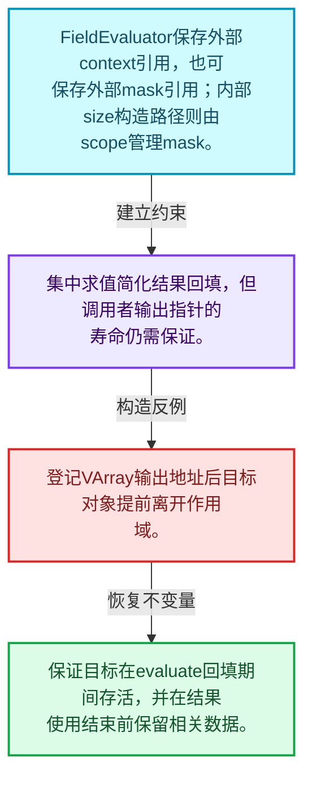
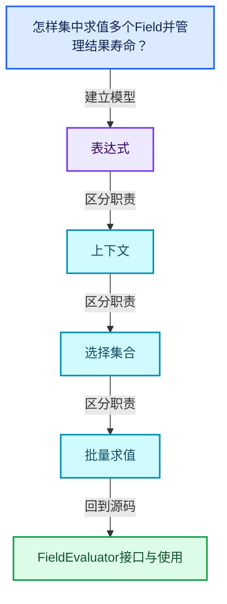
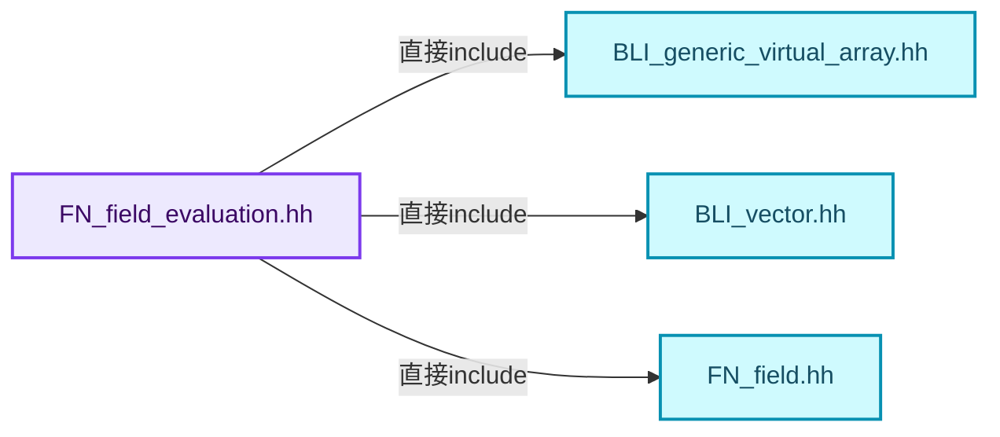
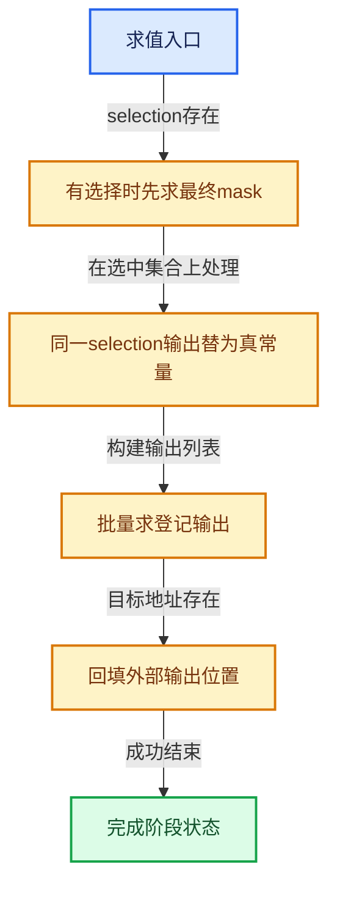
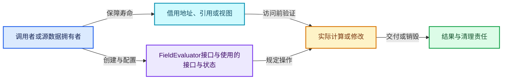
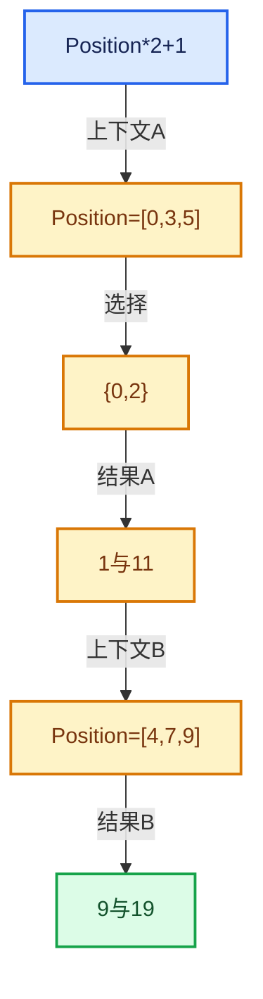

# 08-07 FieldEvaluator接口与使用

[方向导航](README.md) · [总目录](../README.md) · [覆盖索引](../%E6%BA%90%E7%A0%81%E7%89%88%E6%9C%AC%E4%B8%8E%E8%A6%86%E7%9B%96%E7%B4%A2%E5%BC%95.md)

> 阅读顺序：问题与数据模型 → 语法与类型 → 源码逐行 → 调用线索 → 历史与取舍 → 推演和练习。

- 基准 HEAD：`cbda6b96c26c0dee3c3b5cbb93960c4ac06a6b30`。
- 记录日期：2026-10-14。
- 教学示例状态：正文中的推演不是本机性能实测；已运行练习见验收报告。

## 一、从问题到设计

怎样集中求值多个Field并管理结果寿命？

求值器保存上下文和mask引用、临时资源及输出；evaluate只能按其契约调用，结果视图受相关存储寿命约束。

本篇把语法、数据语义和系统取舍连接起来。Field表达式、求值上下文、mask与结果存储各自有独立职责和生命周期。

### 本篇独立模型与设计推理

FieldEvaluator保存外部context引用，也可保存外部mask引用；内部size构造路径则由scope管理mask。

设计取舍：集中求值简化结果回填，但调用者输出指针的寿命仍需保证。

最小反例：登记VArray输出地址后目标对象提前离开作用域。

推导与处理：保证目标在evaluate回填期间存活，并在结果使用结束前保留相关数据。



### 源码范围与相邻篇章

| 文件 | 本篇逐行范围 | 基准SHA-256 |
|---|---|---|
| [source/blender/functions/FN_field_evaluation.hh](../../../../../source/blender/functions/FN_field_evaluation.hh) | L1—L221 | `04d5d49917e657e97c39a8dfbb279d8ce194c277916e618f98df836ac5288015` |

同一主讲文件可能分多篇覆盖；超出本篇范围的符号通过覆盖索引定位。空行与纯注释保留在源码摘录中，逐行表解释有效语句与语法边界；许可证头统一保留。

前篇：[FieldContext上下文](06-FieldContext%E4%B8%8A%E4%B8%8B%E6%96%87.md).

后篇：[表达式分析与共享子图](08-%E8%A1%A8%E8%BE%BE%E5%BC%8F%E5%88%86%E6%9E%90%E4%B8%8E%E5%85%B1%E4%BA%AB%E5%AD%90%E5%9B%BE.md).

## 二、类型、数据与阅读地图



这是概念依赖图，边表示阅读关系，不声称是运行时调用顺序。

### 直接编译依赖



箭头只表示头文件包含关系；完整调用线索见后面的符号定位表。

## 三、关键词、语法与类型角色

### 模板 template

模板把类型或常量作为生成实现的参数。读声明时先列出类型参数、非类型参数和默认值，再看使用者实际实例化了什么。模板声明本身不意味着每种T都支持其全部成员。

具体检查：把T替换为int、string、只能移动的类型，分别检查每个被调用操作是否成立。

### 依赖名称 typename

typename既可引入类型模板参数，也可告诉编译器某个依赖名称是类型。它不创建运行时对象；解析期确认语法类别与实例化期检查具体类型是不同阶段。

具体检查：区分typename T::value_type和T::size()，前者标记类型，后者是表达式。

### 只读限定 const

const约束当前访问路径可做的修改。const指针、指向const的指针、const视图对象、const元素是不同位置的限定；其他别名可能仍可修改原对象。

具体检查：分别写T* const、const T*与const T* const，并画出不可修改的层次。

### 移动转换 std::move

std::move把表达式转换为可供移动重载选择的值类别，实际资源转移发生在被选中的构造或赋值中。对const对象move可能仍调用复制，对视图move也不会获得底层数据所有权。

具体检查：记录移动构造调用次数，不用变量名或std::move的出现次数替代测量。

### 显式静态转换 static_cast

static_cast表达编译期允许的转换，不会自动验证运行时真实类型、指针寿命或索引边界。由void指针恢复T指针时，调用者仍须保证实际存储中确有合法T对象。

具体检查：标出转换前后的类型以及正确性依据来自哪里。

### 运行时多态 virtual

虚调用根据实际动态类型选择实现；经基类指针销毁对象时通常需要相应虚析构契约。每元素虚调用和循环外一次分派有不同开销。

具体检查：找出虚接口的实现类和调用频率，再讨论是否值得去虚拟化。

### 可选值 optional

optional把不存在与存在的T区分开，T的构造和析构跟随engaged状态变化。访问前应由has_value或条件分支证明存在。

具体检查：把空Field状态与合法常量零区分，不能用某个普通值代替不存在。

### 构造与new表达式

普通new可能分配并构造；placement new在给定地址构造，存储由其他机制提供。失败回滚应区分两类责任。

具体检查：追踪地址来自哪里、构造何时成功、由谁析构、由谁释放。

### 内部断言 assert

断言表达开发者预期成立的内部契约，发布构建可能关闭。它不能替代对不可信输入的完整错误处理，也不保证后续操作被运行时保护。

具体检查：对每条断言构造违反条件的输入，区分调用者错误与应向用户报告的错误。

### FieldEvaluator的四个重要寿命

1. context_是引用，求值器不拥有用户的FieldContext。
2. 接收mask指针的构造器把解引用结果保存成引用，外部mask必须活得足够久。
3. 接收size的构造器通过scope_构造IndexMask，使内部引用指向作用域管理对象。
4. 对外结果可能引用scope_管理的临时数组，因此不能仅保存一个VArray外壳就假定数据永久存在。

### evaluate的实际步骤

先断言尚未求值，随后求selection；没有selection时直接使用原mask。
构造GFieldRef列表时，如果某个输出就是selection，在已选中集合上可以用真常量替代重复求值。
这不是把selection在原始全部元素上改成真，而是利用最终mask只包含selection为真的位置。
之后evaluate_fields处理全部输出，结果数量与登记数量保持对应。
最后通过OutputPointerInfo回填外部目标，并把is_evaluated_设为true。
如果外部目标提前销毁，内部回填函数即使类型正确也无法弥补悬空地址。

### 三个元素的选择推演

输入mask为`{0,1,2}`，selection结果为`[true,false,true]`。
最终selection_mask为`{0,2}`。
对于输出`Position*2+1`，Position为`[0,3,5]`，本轮要求结果0为1、结果2为11。
结果1不应被读作已经按本轮要求计算的值。
如果另一个输出就是同一selection，它在最终mask上的值都是true。

## 四、真实源码与逐行讲解

源码块保持原行内容，原始行号由小节标题及逐行表给出。表中的调用定位是静态阅读辅助；重载、模板实例化、宏展开和虚调用需结合完整声明，不能仅凭词法出现证明动态调用。

### FN_field_evaluation.hh：L1—L46

<!-- source:source/blender/functions/FN_field_evaluation.hh:1:46 -->

```cpp
/* SPDX-FileCopyrightText: 2026 Blender Authors
 *
 * SPDX-License-Identifier: GPL-2.0-or-later */

/** \file
 * \ingroup fn
 */

#pragma once

#include "BLI_generic_virtual_array.hh"
#include "BLI_vector.hh"

#include "FN_field.hh"

namespace blender::fn {

/**
 * Utility class that makes it easier to evaluate fields.
 */
class FieldEvaluator : NonMovable, NonCopyable {
  struct OutputPointerInfo {
    void *dst = nullptr;
    /* When a destination virtual array is provided for an input, this is
     * unnecessary, otherwise this is used to construct the required virtual array. */
    void (*set)(void *dst, const GVArray &varray, ResourceScope &scope) = nullptr;
  };

  ResourceScope scope_;
  const FieldContext &context_;
  const IndexMask &mask_;
  Vector<GField> fields_to_evaluate_;
  Vector<GVMutableArray> dst_varrays_;
  Vector<GVArray> evaluated_varrays_;
  Vector<OutputPointerInfo> output_pointer_infos_;
  bool is_evaluated_ = false;

  std::optional<Field<bool>> selection_field_;
  IndexMask selection_mask_;

 public:
  /** Takes #mask by pointer because the mask has to live longer than the evaluator. */
  FieldEvaluator(const FieldContext &context, const IndexMask *mask)
      : context_(context), mask_(*mask)
  {
  }
```

本段语义重点：

- `scope_`：求值或资源作用域，负责相应临时存储及清理。
- `context_`：求值环境字段；FieldEvaluator以引用借用，其他类须按实际成员类型确认拥有关系。
- `mask_`：索引集合字段；在FieldEvaluator中引用构造时允许处理的集合，其他上下文以声明为准。
- `selection_mask_`：选择Field与输入mask共同确定的最终处理集合。
- `selection_field_`：可选的布尔选择表达式，不是已经得到的选择数组。

| 原始行 | 语义、约束与检查 |
|---|---|
| L9 | 防止同一头文件在一个翻译单元中重复展开；不控制多个源文件之间的链接或对象寿命。 |
| L11 | 引入编译依赖 "BLI_generic_virtual_array.hh"；这是声明可见性关系，不表示运行时一定调用该文件的所有接口。 |
| L12 | 引入编译依赖 "BLI_vector.hh"；这是声明可见性关系，不表示运行时一定调用该文件的所有接口。 |
| L14 | 引入编译依赖 "FN_field.hh"；这是声明可见性关系，不表示运行时一定调用该文件的所有接口。 |
| L16 | 把后续声明放入 blender::fn 命名空间，影响名称查找和符号归属，不创建运行时对象。 |
| L21 | 声明或定义类型 `class FieldEvaluator : NonMovable, NonCopyable`。结合继承、访问权限和成员布局确认接口与拥有关系；前向声明本身没有完整对象布局。 |
| L22 | 声明或定义类型 `struct OutputPointerInfo`。结合继承、访问权限和成员布局确认接口与拥有关系；前向声明本身没有完整对象布局。 |
| L23 | 把右侧 `nullptr` 用于初始化或更新左侧 `void *dst`。声明初始化与已有对象赋值应按上下文区分；有资源的类型会调用相应特殊成员。 |
| L26 | 把右侧 `nullptr` 用于初始化或更新左侧 `void (*set)(void *dst, const GVArray &varray, ResourceScope &scope)`。声明初始化与已有对象赋值应按上下文区分；有资源的类型会调用相应特殊成员。 |
| L27 | 结束当前语法单元。局部自动对象在离开其作用域时按规则销毁；这不等于所有被引用的外部数据也被释放。 |
| L29 | 本行涉及 `scope_`：求值或资源作用域，负责相应临时存储及清理。按此语义解读 `ResourceScope scope_`，不要把地址、数量或状态混用。 |
| L30 | 本行涉及 `context_`：求值环境字段；FieldEvaluator以引用借用，其他类须按实际成员类型确认拥有关系。按此语义解读 `const FieldContext &context_`，不要把地址、数量或状态混用。 |
| L31 | 本行涉及 `mask_`：索引集合字段；在FieldEvaluator中引用构造时允许处理的集合，其他上下文以声明为准。按此语义解读 `const IndexMask &mask_`，不要把地址、数量或状态混用。 |
| L32 | 本行涉及 `fields_to_evaluate_`：登记的待求值表达式，顺序与结果索引对应。按此语义解读 `Vector<GField> fields_to_evaluate_`，不要把地址、数量或状态混用。 |
| L33 | 本行涉及 `dst_varrays_`：由调用者提供的目标数组描述，元素初始化约定需匹配接口。按此语义解读 `Vector<GVMutableArray> dst_varrays_`，不要把地址、数量或状态混用。 |
| L34 | 本行涉及 `evaluated_varrays_`：求值完成后的结果表示，可能不是独立拥有的连续数组。按此语义解读 `Vector<GVArray> evaluated_varrays_`，不要把地址、数量或状态混用。 |
| L35 | 本行涉及 `output_pointer_infos_`：记录外部输出地址与赋值桥接操作，外部地址须在回填时有效。按此语义解读 `Vector<OutputPointerInfo> output_pointer_infos_`，不要把地址、数量或状态混用。 |
| L36 | 建立或更新 `is_evaluated_`：求值阶段标记，防止未求值读取以及不合法的重复求值。本行的具体值关系为 `bool is_evaluated_ = false`；对照更新前后相应范围或状态是否一致。 |
| L38 | 本行涉及 `selection_field_`：可选的布尔选择表达式，不是已经得到的选择数组。按此语义解读 `std::optional<Field<bool>> selection_field_`，不要把地址、数量或状态混用。 |
| L39 | 本行涉及 `selection_mask_`：选择Field与输入mask共同确定的最终处理集合。按此语义解读 `IndexMask selection_mask_`，不要把地址、数量或状态混用。 |
| L41 | 切换成员访问权限为 public；它是编译期接口边界，不是线程同步或内存保护。 |
| L43 | 出现调用或函数声明 `FieldEvaluator`，对应表达式为 `FieldEvaluator(const FieldContext &context, const IndexMask *mask)`。参数求值、返回类型与重载需结合前后完整语句；静态文本引用不能证明动态目标。 |
| L44 | 本行涉及 `context_`：求值环境字段；FieldEvaluator以引用借用，其他类须按实际成员类型确认拥有关系。按此语义解读 `: context_(context), mask_(*mask)`，不要把地址、数量或状态混用。 |
| L45 | 连接上一行的声明或控制结构与其语句块；后续行在这个作用域中执行或声明。 |
| L46 | 结束当前语法单元。局部自动对象在离开其作用域时按规则销毁；这不等于所有被引用的外部数据也被释放。 |

### FN_field_evaluation.hh：L47—L91

<!-- source:source/blender/functions/FN_field_evaluation.hh:47:91 -->

```cpp

  /** Construct a field evaluator for all indices less than #size. */
  FieldEvaluator(const FieldContext &context, const int64_t size)
      : context_(context), mask_(scope_.construct<IndexMask>(size))
  {
  }

  ~FieldEvaluator()
  {
    /* While this assert isn't strictly necessary, and could be replaced with a warning,
     * it will catch cases where someone forgets to call #evaluate(). */
    BLI_assert(is_evaluated_);
  }

  /**
   * The selection field is evaluated first to determine which indices of the other fields should
   * be evaluated. Calling this method multiple times will just replace the previously set
   * selection field. Only the elements selected by both this selection and the selection provided
   * in the constructor are calculated. If no selection field is set, it is assumed that all
   * indices passed to the constructor are selected.
   */
  void set_selection(Field<bool> selection)
  {
    selection_field_ = std::move(selection);
  }

  /**
   * \param field: Field to add to the evaluator.
   * \param dst: Mutable virtual array that the evaluated result for this field is be written into.
   */
  int add_with_destination(GField field, GVMutableArray dst);

  /** Same as #add_with_destination but typed. */
  template<typename T> int add_with_destination(Field<T> field, VMutableArray<T> dst)
  {
    return this->add_with_destination(GField(std::move(field)), GVMutableArray(std::move(dst)));
  }

  /**
   * \param field: Field to add to the evaluator.
   * \param dst: Mutable span that the evaluated result for this field is be written into.
   * \note When the output may only be used as a single value, the version of this function with
   * a virtual array result array should be used.
   */
  int add_with_destination(GField field, GMutableSpan dst);
```

本段语义重点：

- `scope_`：求值或资源作用域，负责相应临时存储及清理。
- `context_`：求值环境字段；FieldEvaluator以引用借用，其他类须按实际成员类型确认拥有关系。
- `mask_`：索引集合字段；在FieldEvaluator中引用构造时允许处理的集合，其他上下文以声明为准。
- `selection_field_`：可选的布尔选择表达式，不是已经得到的选择数组。
- `is_evaluated_`：求值阶段标记，防止未求值读取以及不合法的重复求值。

| 原始行 | 语义、约束与检查 |
|---|---|
| L49 | 出现调用或函数声明 `FieldEvaluator`，对应表达式为 `FieldEvaluator(const FieldContext &context, const int64_t size)`。参数求值、返回类型与重载需结合前后完整语句；静态文本引用不能证明动态目标。 |
| L50 | 本行涉及 `scope_`：求值或资源作用域，负责相应临时存储及清理。按此语义解读 `: context_(context), mask_(scope_.construct<IndexMask>(size))`，不要把地址、数量或状态混用。 |
| L51 | 连接上一行的声明或控制结构与其语句块；后续行在这个作用域中执行或声明。 |
| L52 | 结束当前语法单元。局部自动对象在离开其作用域时按规则销毁；这不等于所有被引用的外部数据也被释放。 |
| L54 | 涉及析构接口或显式析构：`~FieldEvaluator()`。检查目标对象已成功构造，且资源不会在另一条清理路径再次销毁。 |
| L55 | 连接上一行的声明或控制结构与其语句块；后续行在这个作用域中执行或声明。 |
| L58 | 断言约束 `BLI_assert(is_evaluated_);`。条件是后续访问的内部前置条件；发布构建可能不执行，不能把断言当作输入修复。 |
| L59 | 结束当前语法单元。局部自动对象在离开其作用域时按规则销毁；这不等于所有被引用的外部数据也被释放。 |
| L68 | 出现调用或函数声明 `set_selection`，对应表达式为 `void set_selection(Field<bool> selection)`。参数求值、返回类型与重载需结合前后完整语句；静态文本引用不能证明动态目标。 |
| L69 | 连接上一行的声明或控制结构与其语句块；后续行在这个作用域中执行或声明。 |
| L70 | 建立或更新 `selection_field_`：可选的布尔选择表达式，不是已经得到的选择数组。本行的具体值关系为 `selection_field_ = std::move(selection)`；对照更新前后相应范围或状态是否一致。 |
| L71 | 结束当前语法单元。局部自动对象在离开其作用域时按规则销毁；这不等于所有被引用的外部数据也被释放。 |
| L77 | 声明接口 `int add_with_destination(GField field, GVMutableArray dst)`，本行没有对应函数体；返回类型、参数限定和const/noexcept共同组成调用契约，实际行为需继续定位实现。 |
| L80 | 声明模板参数 `template<typename T> int add_with_destination(Field<T> field, VMutableArray<T> dst)`。类型参数决定生成操作的类型，非类型参数可决定内嵌容量或编译期分支。 |
| L81 | 连接上一行的声明或控制结构与其语句块；后续行在这个作用域中执行或声明。 |
| L82 | 返回表达式 `this->add_with_destination(GField(std::move(field)), GVMutableArray(std::move(dst)))`。 |
| L83 | 结束当前语法单元。局部自动对象在离开其作用域时按规则销毁；这不等于所有被引用的外部数据也被释放。 |
| L91 | 声明接口 `int add_with_destination(GField field, GMutableSpan dst)`，本行没有对应函数体；返回类型、参数限定和const/noexcept共同组成调用契约，实际行为需继续定位实现。 |

### FN_field_evaluation.hh：L92—L137

<!-- source:source/blender/functions/FN_field_evaluation.hh:92:137 -->

```cpp

  /**
   * \param field: Field to add to the evaluator.
   * \param dst: Mutable span that the evaluated result for this field is be written into.
   * \note When the output may only be used as a single value, the version of this function with
   * a virtual array result array should be used.
   */
  template<typename T> int add_with_destination(Field<T> field, MutableSpan<T> dst)
  {
    return this->add_with_destination(std::move(field), VMutableArray<T>::from_span(dst));
  }

  int add(GField field, GVArray *varray_ptr);

  /**
   * \param field: Field to add to the evaluator.
   * \param varray_ptr: Once #evaluate is called, the resulting virtual array will be will be
   *   assigned to the given position.
   * \return Index of the field in the evaluator which can be used in the #get_evaluated methods.
   */
  template<typename T> int add(Field<T> field, VArray<T> *varray_ptr)
  {
    const int field_index = fields_to_evaluate_.append_and_get_index(std::move(field));
    dst_varrays_.append({});
    output_pointer_infos_.append(OutputPointerInfo{
        varray_ptr, [](void *dst, const GVArray &varray, ResourceScope & /*scope*/) {
          *static_cast<VArray<T> *>(dst) = varray.typed<T>();
        }});
    return field_index;
  }

  template<typename T> int add(Field<T> field, VArraySpan<T> *varray_span_ptr)
  {
    const int field_index = fields_to_evaluate_.append_and_get_index(std::move(field));
    dst_varrays_.append({});
    output_pointer_infos_.append(OutputPointerInfo{
        varray_span_ptr, [](void *dst, const GVArray &varray, ResourceScope & /*scope*/) {
          *static_cast<VArraySpan<T> *>(dst) = varray.typed<T>();
        }});
    return field_index;
  }

  /**
   * \return Index of the field in the evaluator which can be used in the #get_evaluated methods.
   */
  int add(GField field);
```

本段语义重点：

- `fields_to_evaluate_`：登记的待求值表达式，顺序与结果索引对应。
- `dst_varrays_`：由调用者提供的目标数组描述，元素初始化约定需匹配接口。
- `output_pointer_infos_`：记录外部输出地址与赋值桥接操作，外部地址须在回填时有效。

| 原始行 | 语义、约束与检查 |
|---|---|
| L99 | 声明模板参数 `template<typename T> int add_with_destination(Field<T> field, MutableSpan<T> dst)`。类型参数决定生成操作的类型，非类型参数可决定内嵌容量或编译期分支。 |
| L100 | 连接上一行的声明或控制结构与其语句块；后续行在这个作用域中执行或声明。 |
| L101 | 返回表达式 `this->add_with_destination(std::move(field), VMutableArray<T>::from_span(dst))`。 |
| L102 | 结束当前语法单元。局部自动对象在离开其作用域时按规则销毁；这不等于所有被引用的外部数据也被释放。 |
| L104 | 声明接口 `int add(GField field, GVArray *varray_ptr)`，本行没有对应函数体；返回类型、参数限定和const/noexcept共同组成调用契约，实际行为需继续定位实现。 |
| L112 | 声明模板参数 `template<typename T> int add(Field<T> field, VArray<T> *varray_ptr)`。类型参数决定生成操作的类型，非类型参数可决定内嵌容量或编译期分支。 |
| L113 | 连接上一行的声明或控制结构与其语句块；后续行在这个作用域中执行或声明。 |
| L114 | 建立或更新 `fields_to_evaluate_`：登记的待求值表达式，顺序与结果索引对应。本行的具体值关系为 `const int field_index = fields_to_evaluate_.append_and_get_index(std::move(field))`；对照更新前后相应范围或状态是否一致。 |
| L115 | 本行涉及 `dst_varrays_`：由调用者提供的目标数组描述，元素初始化约定需匹配接口。按此语义解读 `dst_varrays_.append({})`，不要把地址、数量或状态混用。 |
| L116 | 本行涉及 `output_pointer_infos_`：记录外部输出地址与赋值桥接操作，外部地址须在回填时有效。按此语义解读 `output_pointer_infos_.append(OutputPointerInfo{`，不要把地址、数量或状态混用。 |
| L117 | 本行是连续声明或表达式的一部分：`varray_ptr, [](void *dst, const GVArray &varray, ResourceScope & ) {`。与本段前后行合读；逗号、括号和限定符决定它属于参数、初始化列表还是实际计算。 |
| L118 | 把右侧 `varray.typed<T>()` 用于初始化或更新左侧 `*static_cast<VArray<T> *>(dst)`。声明初始化与已有对象赋值应按上下文区分；有资源的类型会调用相应特殊成员。 |
| L119 | 声明成员、局部对象或完成语句 `}})`。若为指针或引用，它本身不说明拥有；若为值对象，其构造析构由所在作用域或外层对象管理。 |
| L120 | 返回表达式 `field_index`。 |
| L121 | 结束当前语法单元。局部自动对象在离开其作用域时按规则销毁；这不等于所有被引用的外部数据也被释放。 |
| L123 | 声明模板参数 `template<typename T> int add(Field<T> field, VArraySpan<T> *varray_span_ptr)`。类型参数决定生成操作的类型，非类型参数可决定内嵌容量或编译期分支。 |
| L124 | 连接上一行的声明或控制结构与其语句块；后续行在这个作用域中执行或声明。 |
| L125 | 建立或更新 `fields_to_evaluate_`：登记的待求值表达式，顺序与结果索引对应。本行的具体值关系为 `const int field_index = fields_to_evaluate_.append_and_get_index(std::move(field))`；对照更新前后相应范围或状态是否一致。 |
| L126 | 本行涉及 `dst_varrays_`：由调用者提供的目标数组描述，元素初始化约定需匹配接口。按此语义解读 `dst_varrays_.append({})`，不要把地址、数量或状态混用。 |
| L127 | 本行涉及 `output_pointer_infos_`：记录外部输出地址与赋值桥接操作，外部地址须在回填时有效。按此语义解读 `output_pointer_infos_.append(OutputPointerInfo{`，不要把地址、数量或状态混用。 |
| L128 | 本行是连续声明或表达式的一部分：`varray_span_ptr, [](void *dst, const GVArray &varray, ResourceScope & ) {`。与本段前后行合读；逗号、括号和限定符决定它属于参数、初始化列表还是实际计算。 |
| L129 | 把右侧 `varray.typed<T>()` 用于初始化或更新左侧 `*static_cast<VArraySpan<T> *>(dst)`。声明初始化与已有对象赋值应按上下文区分；有资源的类型会调用相应特殊成员。 |
| L130 | 声明成员、局部对象或完成语句 `}})`。若为指针或引用，它本身不说明拥有；若为值对象，其构造析构由所在作用域或外层对象管理。 |
| L131 | 返回表达式 `field_index`。 |
| L132 | 结束当前语法单元。局部自动对象在离开其作用域时按规则销毁；这不等于所有被引用的外部数据也被释放。 |
| L137 | 声明接口 `int add(GField field)`，本行没有对应函数体；返回类型、参数限定和const/noexcept共同组成调用契约，实际行为需继续定位实现。 |

### FN_field_evaluation.hh：L138—L192

<!-- source:source/blender/functions/FN_field_evaluation.hh:138:192 -->

```cpp

  /**
   * Evaluate all fields on the evaluator. This can only be called once.
   */
  void evaluate();

  const GVArray &get_evaluated(const int field_index) const
  {
    BLI_assert(is_evaluated_);
    return evaluated_varrays_[field_index];
  }

  template<typename T> VArray<T> get_evaluated(const int field_index) const
  {
    return this->get_evaluated(field_index).typed<T>();
  }

  IndexMask get_evaluated_selection_as_mask() const;

  /**
   * Retrieve the output of an evaluated boolean field and convert it to a mask, which can be used
   * to avoid calculations for unnecessary elements later on. The evaluator will own the indices in
   * some cases, so it must live at least as long as the returned mask.
   */
  IndexMask get_evaluated_as_mask(int field_index);

  const IndexMask &evaluation_mask() const
  {
    return mask_;
  }
};

/**
 * Evaluate fields in the given context. If possible, multiple fields should be evaluated together,
 * because that can be more efficient when they share common sub-fields.
 *
 * \param scope: The resource scope that owns data that makes up the output virtual arrays. Make
 *   sure the scope is not destructed when the output virtual arrays are still used.
 * \param fields_to_evaluate: The fields that should be evaluated together.
 * \param mask: Determines which indices are computed. The mask may be referenced by the returned
 *   virtual arrays. So the underlying indices (if applicable) should live longer then #scope.
 * \param context: The context that the field is evaluated in. Used to retrieve data from each
 *   #FieldInput in the field network.
 * \param dst_varrays: If provided, the computed data will be written into those virtual arrays
 *   instead of into newly created ones. That allows making the computed data live longer than
 *   #scope and is more efficient when the data will be written into those virtual arrays
 *   later anyway.
 * \return The computed virtual arrays for each provided field. If #dst_varrays is passed, the
 *   provided virtual arrays are returned.
 */
Vector<GVArray> evaluate_fields(ResourceScope &scope,
                                Span<GFieldRef> fields_to_evaluate,
                                const IndexMask &mask,
                                const FieldContext &context,
                                Span<GVMutableArray> dst_varrays = {});
```

本段语义重点：

- `evaluate_fields`：批量求值一组表达式，结合上下文、mask和可选目标数组；结果表示可以继续保持虚拟。
- `mask_`：索引集合字段；在FieldEvaluator中引用构造时允许处理的集合，其他上下文以声明为准。
- `evaluated_varrays_`：求值完成后的结果表示，可能不是独立拥有的连续数组。
- `is_evaluated_`：求值阶段标记，防止未求值读取以及不合法的重复求值。

| 原始行 | 语义、约束与检查 |
|---|---|
| L142 | 声明接口 `void evaluate()`，本行没有对应函数体；返回类型、参数限定和const/noexcept共同组成调用契约，实际行为需继续定位实现。 |
| L144 | 出现调用或函数声明 `get_evaluated`，对应表达式为 `const GVArray &get_evaluated(const int field_index) const`。参数求值、返回类型与重载需结合前后完整语句；静态文本引用不能证明动态目标。 |
| L145 | 连接上一行的声明或控制结构与其语句块；后续行在这个作用域中执行或声明。 |
| L146 | 断言约束 `BLI_assert(is_evaluated_);`。条件是后续访问的内部前置条件；发布构建可能不执行，不能把断言当作输入修复。 |
| L147 | 返回表达式 `evaluated_varrays_[field_index]`。 |
| L148 | 结束当前语法单元。局部自动对象在离开其作用域时按规则销毁；这不等于所有被引用的外部数据也被释放。 |
| L150 | 声明模板参数 `template<typename T> VArray<T> get_evaluated(const int field_index) const`。类型参数决定生成操作的类型，非类型参数可决定内嵌容量或编译期分支。 |
| L151 | 连接上一行的声明或控制结构与其语句块；后续行在这个作用域中执行或声明。 |
| L152 | 返回表达式 `this->get_evaluated(field_index).typed<T>()`。 |
| L153 | 结束当前语法单元。局部自动对象在离开其作用域时按规则销毁；这不等于所有被引用的外部数据也被释放。 |
| L155 | 声明接口 `IndexMask get_evaluated_selection_as_mask() const`，本行没有对应函数体；返回类型、参数限定和const/noexcept共同组成调用契约，实际行为需继续定位实现。 |
| L162 | 出现调用或函数声明 `get_evaluated_as_mask`，对应表达式为 `IndexMask get_evaluated_as_mask(int field_index);`。参数求值、返回类型与重载需结合前后完整语句；静态文本引用不能证明动态目标。 |
| L164 | 出现调用或函数声明 `evaluation_mask`，对应表达式为 `const IndexMask &evaluation_mask() const`。参数求值、返回类型与重载需结合前后完整语句；静态文本引用不能证明动态目标。 |
| L165 | 连接上一行的声明或控制结构与其语句块；后续行在这个作用域中执行或声明。 |
| L166 | 返回表达式 `mask_`。 |
| L167 | 结束当前语法单元。局部自动对象在离开其作用域时按规则销毁；这不等于所有被引用的外部数据也被释放。 |
| L168 | 结束当前语法单元。局部自动对象在离开其作用域时按规则销毁；这不等于所有被引用的外部数据也被释放。 |
| L188 | 出现调用或函数声明 `evaluate_fields`，对应表达式为 `Vector<GVArray> evaluate_fields(ResourceScope &scope,`。参数求值、返回类型与重载需结合前后完整语句；静态文本引用不能证明动态目标。 |
| L189 | 本行是连续声明或表达式的一部分：`Span<GFieldRef> fields_to_evaluate,`。与本段前后行合读；逗号、括号和限定符决定它属于参数、初始化列表还是实际计算。 |
| L190 | 本行是连续声明或表达式的一部分：`const IndexMask &mask,`。与本段前后行合读；逗号、括号和限定符决定它属于参数、初始化列表还是实际计算。 |
| L191 | 本行是连续声明或表达式的一部分：`const FieldContext &context,`。与本段前后行合读；逗号、括号和限定符决定它属于参数、初始化列表还是实际计算。 |
| L192 | 把右侧 `{})` 用于初始化或更新左侧 `Span<GVMutableArray> dst_varrays`。声明初始化与已有对象赋值应按上下文区分；有资源的类型会调用相应特殊成员。 |

### FN_field_evaluation.hh：L193—L221

<!-- source:source/blender/functions/FN_field_evaluation.hh:193:221 -->

```cpp

/* -------------------------------------------------------------------- */
/** \name Utility functions for simple field creation and evaluation
 * \{ */

void evaluate_constant_field(const GField &field, void *r_value);

template<typename T> T evaluate_constant_field(const Field<T> &field)
{
  T value;
  value.~T();
  evaluate_constant_field(field, &value);
  return value;
}

/**
 * If the field depends on some input, the same field is returned.
 * Otherwise the field is evaluated and a new field is created that just computes this constant.
 *
 * Making the field constant has two benefits:
 * - The field-tree becomes a single node, which is more efficient when the field is evaluated many
 *   times.
 * - Memory of the input fields may be freed.
 */
GField make_field_constant_if_possible(GField field);

/** \} */

}  // namespace blender::fn
```

| 原始行 | 语义、约束与检查 |
|---|---|
| L198 | 声明接口 `void evaluate_constant_field(const GField &field, void *r_value)`，本行没有对应函数体；返回类型、参数限定和const/noexcept共同组成调用契约，实际行为需继续定位实现。 |
| L200 | 声明模板参数 `template<typename T> T evaluate_constant_field(const Field<T> &field)`。类型参数决定生成操作的类型，非类型参数可决定内嵌容量或编译期分支。 |
| L201 | 连接上一行的声明或控制结构与其语句块；后续行在这个作用域中执行或声明。 |
| L202 | 声明成员、局部对象或完成语句 `T value`。若为指针或引用，它本身不说明拥有；若为值对象，其构造析构由所在作用域或外层对象管理。 |
| L203 | 涉及析构接口或显式析构：`value.~T();`。检查目标对象已成功构造，且资源不会在另一条清理路径再次销毁。 |
| L204 | 出现调用或函数声明 `evaluate_constant_field`，对应表达式为 `evaluate_constant_field(field, &value);`。参数求值、返回类型与重载需结合前后完整语句；静态文本引用不能证明动态目标。 |
| L205 | 返回表达式 `value`。结合函数声明检查返回值是否借用原存储，借用值不会自动延长其寿命。 |
| L206 | 结束当前语法单元。局部自动对象在离开其作用域时按规则销毁；这不等于所有被引用的外部数据也被释放。 |
| L217 | 出现调用或函数声明 `make_field_constant_if_possible`，对应表达式为 `GField make_field_constant_if_possible(GField field);`。参数求值、返回类型与重载需结合前后完整语句；静态文本引用不能证明动态目标。 |
| L221 | 结束当前语法单元。局部自动对象在离开其作用域时按规则销毁；这不等于所有被引用的外部数据也被释放。 |

## 五、接口定位、调用线索与生命周期

### FieldEvaluator的真实求值阶段



没有selection时直接用mask。不是每个输出都进入真常量分支，也不是每个输出都有外部目标；图上的条件要与实际if一起读。

| 阶段 | 源码证据位置 | 实际语句定位 |
|---|---|---|
| 求值入口 | field_evaluation.cc [L590](../../../../../source/blender/functions/intern/field_evaluation.cc#L590) | `void FieldEvaluator::evaluate()` |
| 有选择时先求最终mask | field_evaluation.cc [L595](../../../../../source/blender/functions/intern/field_evaluation.cc#L595) | `evaluate_selection(*selection_field_` |
| 同一selection输出替为真常量 | field_evaluation.cc [L605](../../../../../source/blender/functions/intern/field_evaluation.cc#L605) | `fields.append(GFieldRef::from_constant` |
| 批量求登记输出 | field_evaluation.cc [L611](../../../../../source/blender/functions/intern/field_evaluation.cc#L611) | `evaluated_varrays_ = evaluate_fields` |
| 回填外部输出位置 | field_evaluation.cc [L616](../../../../../source/blender/functions/intern/field_evaluation.cc#L616) | `info.set(info.dst, evaluated_varrays_[i]` |
| 完成阶段状态 | field_evaluation.cc [L619](../../../../../source/blender/functions/intern/field_evaluation.cc#L619) | `is_evaluated_ = true` |

图中的条件边必须与对应if、异常路径和提前返回合读；不把未展示分支当作不存在。

### 本篇声明与实现入口

| 源码位置 | 实际声明片段 |
|---|---|
| [FN_field_evaluation.hh:L21](../../../../../source/blender/functions/FN_field_evaluation.hh#L21) | `class FieldEvaluator : NonMovable, NonCopyable` |
| [FN_field_evaluation.hh:L22](../../../../../source/blender/functions/FN_field_evaluation.hh#L22) | `struct OutputPointerInfo` |
| [FN_field_evaluation.hh:L43](../../../../../source/blender/functions/FN_field_evaluation.hh#L43) | `FieldEvaluator(const FieldContext &context, const IndexMask *mask)` |
| [FN_field_evaluation.hh:L44](../../../../../source/blender/functions/FN_field_evaluation.hh#L44) | `: context_(context), mask_(*mask)` |
| [FN_field_evaluation.hh:L49](../../../../../source/blender/functions/FN_field_evaluation.hh#L49) | `FieldEvaluator(const FieldContext &context, const int64_t size)` |
| [FN_field_evaluation.hh:L50](../../../../../source/blender/functions/FN_field_evaluation.hh#L50) | `: context_(context), mask_(scope_.construct<IndexMask>(size))` |
| [FN_field_evaluation.hh:L68](../../../../../source/blender/functions/FN_field_evaluation.hh#L68) | `void set_selection(Field<bool> selection)` |
| [FN_field_evaluation.hh:L77](../../../../../source/blender/functions/FN_field_evaluation.hh#L77) | `int add_with_destination(GField field, GVMutableArray dst);` |
| [FN_field_evaluation.hh:L80](../../../../../source/blender/functions/FN_field_evaluation.hh#L80) | `template<typename T> int add_with_destination(Field<T> field, VMutableArray<T> dst)` |
| [FN_field_evaluation.hh:L91](../../../../../source/blender/functions/FN_field_evaluation.hh#L91) | `int add_with_destination(GField field, GMutableSpan dst);` |
| [FN_field_evaluation.hh:L99](../../../../../source/blender/functions/FN_field_evaluation.hh#L99) | `template<typename T> int add_with_destination(Field<T> field, MutableSpan<T> dst)` |
| [FN_field_evaluation.hh:L104](../../../../../source/blender/functions/FN_field_evaluation.hh#L104) | `int add(GField field, GVArray *varray_ptr);` |
| [FN_field_evaluation.hh:L112](../../../../../source/blender/functions/FN_field_evaluation.hh#L112) | `template<typename T> int add(Field<T> field, VArray<T> *varray_ptr)` |
| [FN_field_evaluation.hh:L123](../../../../../source/blender/functions/FN_field_evaluation.hh#L123) | `template<typename T> int add(Field<T> field, VArraySpan<T> *varray_span_ptr)` |
| [FN_field_evaluation.hh:L137](../../../../../source/blender/functions/FN_field_evaluation.hh#L137) | `int add(GField field);` |
| [FN_field_evaluation.hh:L142](../../../../../source/blender/functions/FN_field_evaluation.hh#L142) | `void evaluate();` |
| [FN_field_evaluation.hh:L144](../../../../../source/blender/functions/FN_field_evaluation.hh#L144) | `const GVArray &get_evaluated(const int field_index) const` |
| [FN_field_evaluation.hh:L150](../../../../../source/blender/functions/FN_field_evaluation.hh#L150) | `template<typename T> VArray<T> get_evaluated(const int field_index) const` |
| [FN_field_evaluation.hh:L155](../../../../../source/blender/functions/FN_field_evaluation.hh#L155) | `IndexMask get_evaluated_selection_as_mask() const;` |
| [FN_field_evaluation.hh:L162](../../../../../source/blender/functions/FN_field_evaluation.hh#L162) | `IndexMask get_evaluated_as_mask(int field_index);` |
| [FN_field_evaluation.hh:L164](../../../../../source/blender/functions/FN_field_evaluation.hh#L164) | `const IndexMask &evaluation_mask() const` |
| [FN_field_evaluation.hh:L188](../../../../../source/blender/functions/FN_field_evaluation.hh#L188) | `Vector<GVArray> evaluate_fields(ResourceScope &scope,` |
| [FN_field_evaluation.hh:L198](../../../../../source/blender/functions/FN_field_evaluation.hh#L198) | `void evaluate_constant_field(const GField &field, void *r_value);` |
| [FN_field_evaluation.hh:L200](../../../../../source/blender/functions/FN_field_evaluation.hh#L200) | `template<typename T> T evaluate_constant_field(const Field<T> &field)` |
| [FN_field_evaluation.hh:L217](../../../../../source/blender/functions/FN_field_evaluation.hh#L217) | `GField make_field_constant_if_possible(GField field);` |

### 同名符号出现位置

以下表提供跨文件阅读入口，包含声明、调用或测试使用；没有经过完整C++名称解析，不把它命名为已证明的运行时调用图。

| 符号 | 位置 | 文本证据 |
|---|---|---|
| `context_` | [NOD_geometry_nodes_lazy_function.hh:L528](../../../../../source/blender/nodes/NOD_geometry_nodes_lazy_function.hh#L528) | `ScopedComputeContextTimer(lf::Context &entered_context) : context_(entered_context)` |
| `context_` | [NOD_geometry_nodes_lazy_function.hh:L557](../../../../../source/blender/nodes/NOD_geometry_nodes_lazy_function.hh#L557) | `ScopedNodeTimer(const lf::Context &context, const bNode &node) : context_(context), node_(node)` |
| `set_selection` | [geometry_fields.cc:L1017](../../../../../source/blender/blenkernel/intern/geometry_fields.cc#L1017) | `evaluator.set_selection(selection);` |
| `set_selection` | [node_geo_set_position.cc:L112](../../../../../source/blender/nodes/geometry/nodes/node_geo_set_position.cc#L112) | `evaluator.set_selection(selection_field);` |
| `add_with_destination` | [geometry_fields.cc:L810](../../../../../source/blender/blenkernel/intern/geometry_fields.cc#L810) | `value_evaluator.add_with_destination(src_field_, values.as_mutable_span());` |
| `add_with_destination` | [geometry_fields.cc:L1087](../../../../../source/blender/blenkernel/intern/geometry_fields.cc#L1087) | `evaluator.add_with_destination(field, dst);` |
| `add_with_destination` | [field_evaluation.cc:L548](../../../../../source/blender/functions/intern/field_evaluation.cc#L548) | `int FieldEvaluator::add_with_destination(GField field, GVMutableArray dst)` |
| `add` | [BKE_attribute.hh:L769](../../../../../source/blender/blenkernel/BKE_attribute.hh#L769) | `bool add(const StringRef name,` |
| `add` | [BKE_attribute.hh:L783](../../../../../source/blender/blenkernel/BKE_attribute.hh#L783) | `return fn_->add(owner_, name, domain, data_type, initializer);` |
| `add` | [BKE_attribute.hh:L786](../../../../../source/blender/blenkernel/BKE_attribute.hh#L786) | `bool add(const StringRef name, const AttrDomain domain, const AttributeInit &initializer)` |
| `evaluate` | [geometry_fields.cc:L648](../../../../../source/blender/blenkernel/intern/geometry_fields.cc#L648) | `value_evaluator.evaluate();` |
| `evaluate` | [geometry_fields.cc:L653](../../../../../source/blender/blenkernel/intern/geometry_fields.cc#L653) | `index_evaluator.evaluate();` |
| `evaluate` | [geometry_fields.cc:L731](../../../../../source/blender/blenkernel/intern/geometry_fields.cc#L731) | `evaluator_->evaluate();` |
| `get_evaluated` | [geometry_fields.cc:L649](../../../../../source/blender/blenkernel/intern/geometry_fields.cc#L649) | `const GVArray &values = value_evaluator.get_evaluated(0);` |
| `get_evaluated` | [geometry_fields.cc:L732](../../../../../source/blender/blenkernel/intern/geometry_fields.cc#L732) | `src_data_ = &evaluator_->get_evaluated(0);` |
| `get_evaluated` | [geometry_fields.cc:L793](../../../../../source/blender/blenkernel/intern/geometry_fields.cc#L793) | `const GVArray &values = value_evaluator.get_evaluated(0);` |
| `get_evaluated_selection_as_mask` | [geometry_fields.cc:L1098](../../../../../source/blender/blenkernel/intern/geometry_fields.cc#L1098) | `const IndexMask &mask = evaluator.get_evaluated_selection_as_mask();` |
| `get_evaluated_selection_as_mask` | [field_evaluation.cc:L635](../../../../../source/blender/functions/intern/field_evaluation.cc#L635) | `IndexMask FieldEvaluator::get_evaluated_selection_as_mask() const` |
| `get_evaluated_selection_as_mask` | [node_geo_set_position.cc:L121](../../../../../source/blender/nodes/geometry/nodes/node_geo_set_position.cc#L121) | `const IndexMask selection = evaluator.get_evaluated_selection_as_mask();` |
| `get_evaluated_as_mask` | [field_evaluation.cc:L622](../../../../../source/blender/functions/intern/field_evaluation.cc#L622) | `IndexMask FieldEvaluator::get_evaluated_as_mask(const int field_index)` |
| `evaluate_fields` | [field_evaluation.cc:L300](../../../../../source/blender/functions/intern/field_evaluation.cc#L300) | `Vector<GVArray> evaluate_fields(ResourceScope &scope,` |
| `evaluate_fields` | [field_evaluation.cc:L518](../../../../../source/blender/functions/intern/field_evaluation.cc#L518) | `Vector<GVArray> varrays = evaluate_fields(scope, {field}, IndexRange(1), context);` |
| `evaluate_fields` | [field_evaluation.cc:L586](../../../../../source/blender/functions/intern/field_evaluation.cc#L586) | `evaluate_fields(scope, {selection_field}, full_mask, context)[0].typed<bool>();` |
| `evaluate_constant_field` | [geometry_fields.cc:L1020](../../../../../source/blender/blenkernel/intern/geometry_fields.cc#L1020) | `fn::evaluate_constant_field(selection);` |
| `evaluate_constant_field` | [geometry_fields.cc:L1092](../../../../../source/blender/blenkernel/intern/geometry_fields.cc#L1092) | `fn::evaluate_constant_field(field, value);` |
| `evaluate_constant_field` | [field_evaluation.cc:L507](../../../../../source/blender/functions/intern/field_evaluation.cc#L507) | `void evaluate_constant_field(const GField &field, void *r_value)` |
| `make_field_constant_if_possible` | [field_evaluation.cc:L522](../../../../../source/blender/functions/intern/field_evaluation.cc#L522) | `GField make_field_constant_if_possible(GField field)` |

### 生命周期推理图



这是审查生命周期的通用模型。具体类是否拥有数据由本篇成员、构造、析构和调用者一起证明；任何箭头都不自动代表shared_ptr。

## 六、把代码放进具体数据中推演

本方向的共同数值模型如下。本篇的专门检查是：设置selection后添加两个输出，追踪构造mask和最终selection的交集。

| 步骤 | 数据或状态 | 为什么需要这一步 |
|---|---|---|
| 表达式 | Position*2+1 | 尚未绑定具体数组 |
| 上下文A | Position=[0,3,5] | 输入有3个元素 |
| 选择 | {0,2} | 只要求元素0和2 |
| 结果A | 1与11 | 元素1不属于本轮要求 |
| 上下文B | Position=[4,7,9] | 复用表达式而改变环境 |
| 结果B | 9与19 | 结果由表达式和上下文共同决定 |



图是教学推演模型；精确分支与状态更新以本篇摘录及调用契约为准。

### 本篇独立练习与参考思路

设置selection后添加两个输出，追踪构造mask和最终selection的交集。

参考思路：求值器保存上下文和mask引用、临时资源及输出；evaluate只能按其契约调用，结果视图受相关存储寿命约束。

将输入、预期结果和资源责任分成三张清单。先用最直接的实现给出可核对的答案，再替换成对应源码使用的表示；比较结果不变的条件，而不是只比较接口名字。

验收依据：结果与直接计算一致；多个输出共享子表达式时不改变语义；深链构造、执行、销毁三个阶段分别检查。

## 七、复杂度、设计取舍与其他基础库

与表达式模板、AST和闭包比较：Field可在运行时组合并对不同上下文批量求值；不要把Field对象误当作固定几何的结果数组。

本篇的具体取舍：求值器保存上下文和mask引用、临时资源及输出；evaluate只能按其契约调用，结果视图受相关存储寿命约束。

| 观察维度 | 从源码取得证据的方法 | 本篇要避免的误判 |
|---|---|---|
| 时间 | 对循环次数、分派次数和重建频率分别计数 | 看到单次常数操作就断定整个操作序列是常数成本 |
| 内存 | 区分对象本体、容量存储、间接资源和共享控制块 | 用sizeof代替总内存 |
| 安全 | 沿构造、失败回滚、销毁与失效逐路径检查 | 把断言或非空指针当作完整安全证明 |
| 并发 | 逐字段确认锁、发布顺序和借用寿命 | 把引用计数线程安全等同数据读写线程安全 |

相关一手资料：

- [C++公开工作草案](https://eel.is/c++draft/)：持续更新的工作草案；语言与标准库语义以相应章节为准。
- [Blender依赖图设计](https://developer.blender.org/docs/features/core/depsgraph/)：包含历史设计背景，当前行为以本地源码为准。

资料用于核对契约和进一步阅读；这里没有声称外部库与Blender实现相同，也没有把上游性能数字当作本机实测。

## 八、历史提交与设计演化

### 2026-04-02 · Jacques Lucke

[Refactor: Functions: update field storage and API](https://projects.blender.org/blender/blender/commit/66bee9561ba6b7ce89f0f95f4ed0420360c69924)

完整哈希：`66bee9561ba6b7ce89f0f95f4ed0420360c69924`。提交标题与作者日期来自本地Git对象。

提交说明原文（历史证据，不能直接作为当前API说明）：

```text
Refactor: Functions: update field storage and API

This reimplements the entire field API. Large parts of the API surface is the
same, but how a field is stored has change significantly.

The main motivating goals for this refactor were:
* Support storing single value fields without doing an allocation.
* Support referencing common fields without doing reference counting (e.g. the
  position field).

On top of these goals, a few other improvements were done:
* Field types are not nullable anymore. So one needs to use `std::optional` in
  such cases. This also implies that `GField` can't be default-constructed
  anymore because then it wouldn't have a type.
* Field comparisons are shallow now. Previously one could easily do a deep
  comparison of nested field inputs.
* `GField` now stores a `std::variant` to support different internal storage
  types, making it more easily extensible.

In my test file that is adapted from #156308 I get a speedup from 60ms to 54ms
of the modifier evaluation time.

Pull Request: https://projects.blender.org/blender/blender/pulls/156723
```

阅读任务：先根据说明复述旧问题，提出一个自己的修复方案，再对照diff。结合本篇重点“怎样集中求值多个Field并管理结果寿命？”判断方案改变的是表示、接口、生命周期还是调度。

## 九、反例、测试入口与掌握标准

需要实际构造的反例：

- 空输入或没有结果需求：确认接口允许的空状态与不允许访问的操作。
- 边界位置和退化结构：把长度为1、末尾位置、重复值或深链代入真实分支。
- 生命周期结束或修改之后：检查保存的指针、引用、结果视图是否仍有效。
- 与本篇核心不变量相冲突的输入：设置selection后添加两个输出，追踪构造mask和最终selection的交集。

### 可运行的教学参考程序

[reference_exercises.cc](../_tools/reference_exercises.cc)包含独立于Blender的C++20参考检查：视图、简化SmallVector、异常回滚、哈希碰撞与删除、偏移数组、拓扑映射、共享缓存、表达式、惰性分支、闭包和暴力最近邻。

参考程序有意省略生产实现的完整能力。例如SmallVector禁止复制移动容器，不支持只能移动的元素，并禁止append参数别名到自身元素；TinyMap固定8槽，不提供增长。程序通过不能替代Blender实现测试。实际运行结果、编译器与命令见验收报告。

掌握标准：离开源码解释“怎样集中求值多个Field并管理结果寿命？”；独立完成上述练习；能指出一个会破坏表达式相关约束的最小反例，并用具体代码行说明检查或修复应放在哪里。
