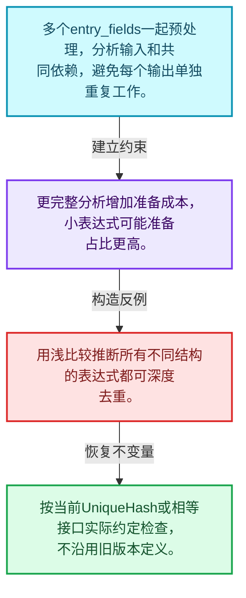
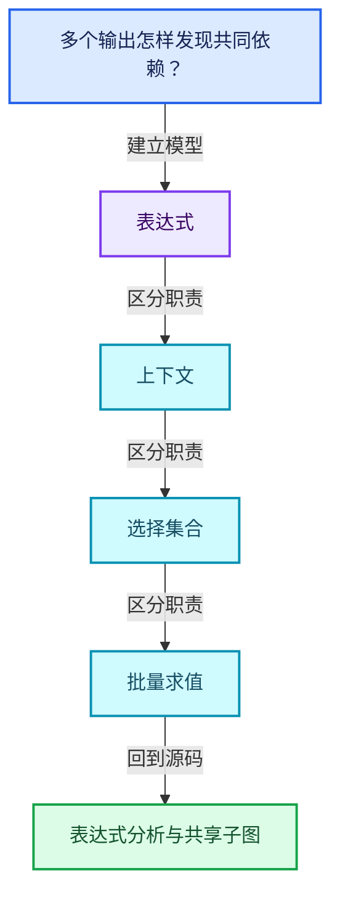
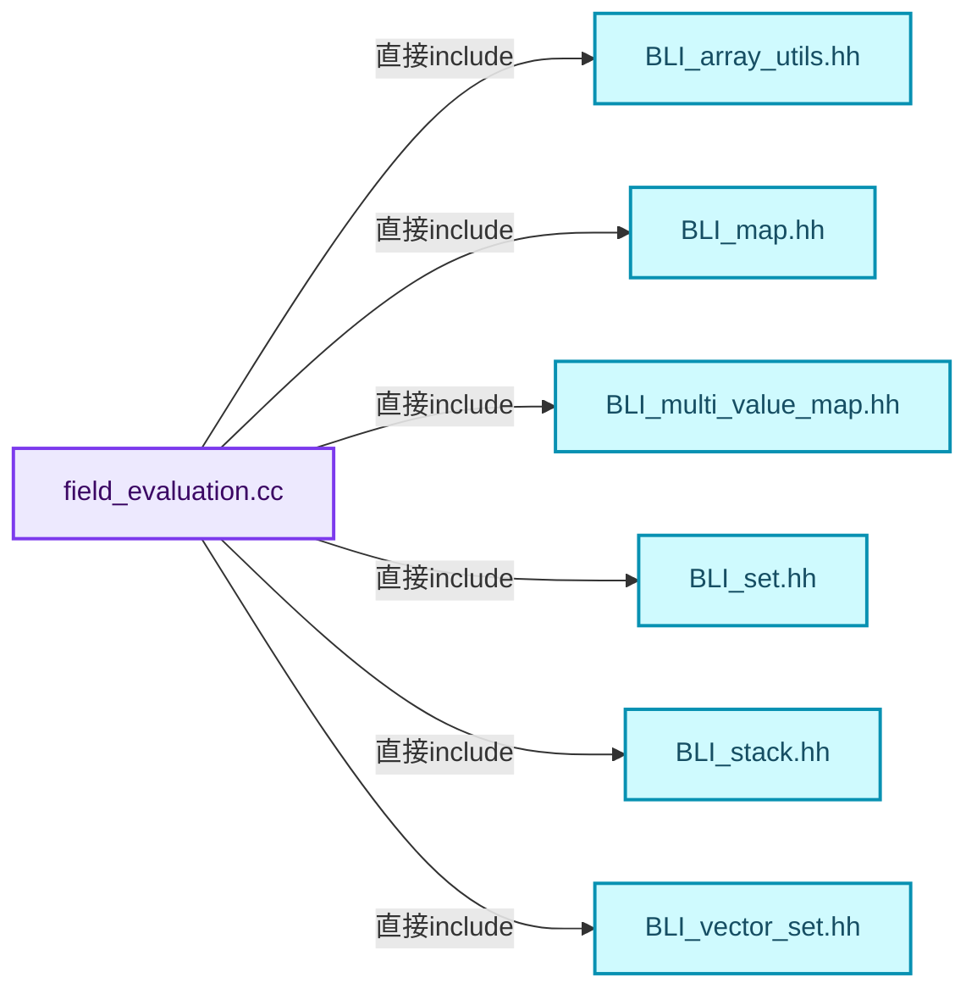
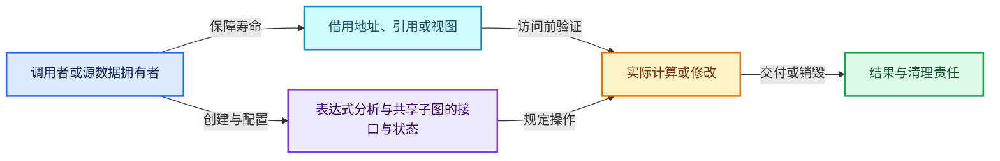
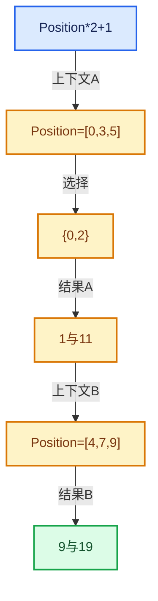

# 08-08 表达式分析与共享子图

[方向导航](README.md) · [总目录](../README.md) · [覆盖索引](../%E6%BA%90%E7%A0%81%E7%89%88%E6%9C%AC%E4%B8%8E%E8%A6%86%E7%9B%96%E7%B4%A2%E5%BC%95.md)

> 阅读顺序：问题与数据模型 → 语法与类型 → 源码逐行 → 调用线索 → 历史与取舍 → 推演和练习。

- 基准 HEAD：`cbda6b96c26c0dee3c3b5cbb93960c4ac06a6b30`。
- 记录日期：2026-10-14。
- 教学示例状态：正文中的推演不是本机性能实测；已运行练习见验收报告。

## 一、从问题到设计

多个输出怎样发现共同依赖？

一起分析输出有机会共享子表达式；相等、身份与哈希的定义决定去重边界。

本篇把语法、数据语义和系统取舍连接起来。Field表达式、求值上下文、mask与结果存储各自有独立职责和生命周期。

### 本篇独立模型与设计推理

多个entry_fields一起预处理，分析输入和共同依赖，避免每个输出单独重复工作。

设计取舍：更完整分析增加准备成本，小表达式可能准备占比更高。

最小反例：用浅比较推断所有不同结构的表达式都可深度去重。

推导与处理：按当前UniqueHash或相等接口实际约定检查，不沿用旧版本定义。



### 源码范围与相邻篇章

| 文件 | 本篇逐行范围 | 基准SHA-256 |
|---|---|---|
| [source/blender/functions/intern/field_evaluation.cc](../../../../../source/blender/functions/intern/field_evaluation.cc) | L1—L298 | `e20be0a19eb6f025c5123b8ed1493b0549c35aecbbb0ff090d65f3595ad3d0af` |

同一主讲文件可能分多篇覆盖；超出本篇范围的符号通过覆盖索引定位。空行与纯注释保留在源码摘录中，逐行表解释有效语句与语法边界；许可证头统一保留。

前篇：[FieldEvaluator接口与使用](07-FieldEvaluator%E6%8E%A5%E5%8F%A3%E4%B8%8E%E4%BD%BF%E7%94%A8.md).

后篇：[生成Procedure与执行](09-%E7%94%9F%E6%88%90Procedure%E4%B8%8E%E6%89%A7%E8%A1%8C.md).

## 二、类型、数据与阅读地图



这是概念依赖图，边表示阅读关系，不声称是运行时调用顺序。

### 直接编译依赖



箭头只表示头文件包含关系；完整调用线索见后面的符号定位表。

## 三、关键词、语法与类型角色

### 依赖名称 typename

typename既可引入类型模板参数，也可告诉编译器某个依赖名称是类型。它不创建运行时对象；解析期确认语法类别与实例化期检查具体类型是不同阶段。

具体检查：区分typename T::value_type和T::size()，前者标记类型，后者是表达式。

### 常量求值 constexpr

constexpr声明允许相应实体参与常量求值，但constexpr函数仍可以在运行时执行。是否常量求值由调用场景和表达式合法性共同决定。

具体检查：比较constexpr变量初始化和从运行时输入调用同一函数。

### 只读限定 const

const约束当前访问路径可做的修改。const指针、指向const的指针、const视图对象、const元素是不同位置的限定；其他别名可能仍可修改原对象。

具体检查：分别写T* const、const T*与const T* const，并画出不可修改的层次。

### 移动转换 std::move

std::move把表达式转换为可供移动重载选择的值类别，实际资源转移发生在被选中的构造或赋值中。对const对象move可能仍调用复制，对视图move也不会获得底层数据所有权。

具体检查：记录移动构造调用次数，不用变量名或std::move的出现次数替代测量。

### 异常边界 try与catch

try定义异常传播的局部边界。失败路径需要销毁已经成功构造的部分并释放相应存储；未构造的对象不能被析构。

具体检查：在第k次构造失败，列出已经存在的对象集合与待释放缓冲。

### 构造与new表达式

普通new可能分配并构造；placement new在给定地址构造，存储由其他机制提供。失败回滚应区分两类责任。

具体检查：追踪地址来自哪里、构造何时成功、由谁析构、由谁释放。

### 内部断言 assert

断言表达开发者预期成立的内部契约，发布构建可能关闭。它不能替代对不可信输入的完整错误处理，也不保证后续操作被运行时保护。

具体检查：对每条断言构造违反条件的输入，区分调用者错误与应向用户报告的错误。

### 编译期分支 if constexpr

条件在实例化时决定被保留的分支，这常用于不同类型的合法操作选择。它与运行时if有不同的实例化检查规则。

具体检查：找出每个分支依赖哪些类型特征，再使用满足与不满足条件的类型。

## 四、真实源码与逐行讲解

源码块保持原行内容，原始行号由小节标题及逐行表给出。表中的调用定位是静态阅读辅助；重载、模板实例化、宏展开和虚调用需结合完整声明，不能仅凭词法出现证明动态调用。

### field_evaluation.cc：L1—L44

<!-- source:source/blender/functions/intern/field_evaluation.cc:1:44 -->

```cpp
/* SPDX-FileCopyrightText: 2023 Blender Authors
 *
 * SPDX-License-Identifier: GPL-2.0-or-later */

/** \file
 * \ingroup fn
 */

#include "BLI_array_utils.hh"
#include "BLI_map.hh"
#include "BLI_multi_value_map.hh"
#include "BLI_set.hh"
#include "BLI_stack.hh"
#include "BLI_vector_set.hh"

#include "FN_field_evaluation.hh"
#include "FN_multi_function.hh"
#include "FN_multi_function_builder.hh"
#include "FN_multi_function_procedure.hh"
#include "FN_multi_function_procedure_builder.hh"
#include "FN_multi_function_procedure_executor.hh"
#include "FN_multi_function_procedure_optimization.hh"

namespace blender::fn {

/* -------------------------------------------------------------------- */
/** \name Field Evaluation
 * \{ */

struct FieldTreeInfo {
  FieldHashDeep deep_hashes;
  /**
   * When fields are built, they only have references to the fields that they depend on. This map
   * allows traversal of fields in the opposite direction. So for every field it stores the other
   * fields that depend on it directly.
   */
  MultiValueMap<UniqueHash, UniqueHash> field_users;
  /**
   * The same field input may exist in the field tree as separate nodes due to the way
   * the tree is constructed. This set contains every different input only once.
   */
  VectorSet<UniqueHash> deduplicated_input_hashes;
  Vector<GFieldRef> deduplicated_inputs;
};
```

| 原始行 | 语义、约束与检查 |
|---|---|
| L9 | 引入编译依赖 "BLI_array_utils.hh"；这是声明可见性关系，不表示运行时一定调用该文件的所有接口。 |
| L10 | 引入编译依赖 "BLI_map.hh"；这是声明可见性关系，不表示运行时一定调用该文件的所有接口。 |
| L11 | 引入编译依赖 "BLI_multi_value_map.hh"；这是声明可见性关系，不表示运行时一定调用该文件的所有接口。 |
| L12 | 引入编译依赖 "BLI_set.hh"；这是声明可见性关系，不表示运行时一定调用该文件的所有接口。 |
| L13 | 引入编译依赖 "BLI_stack.hh"；这是声明可见性关系，不表示运行时一定调用该文件的所有接口。 |
| L14 | 引入编译依赖 "BLI_vector_set.hh"；这是声明可见性关系，不表示运行时一定调用该文件的所有接口。 |
| L16 | 引入编译依赖 "FN_field_evaluation.hh"；这是声明可见性关系，不表示运行时一定调用该文件的所有接口。 |
| L17 | 引入编译依赖 "FN_multi_function.hh"；这是声明可见性关系，不表示运行时一定调用该文件的所有接口。 |
| L18 | 引入编译依赖 "FN_multi_function_builder.hh"；这是声明可见性关系，不表示运行时一定调用该文件的所有接口。 |
| L19 | 引入编译依赖 "FN_multi_function_procedure.hh"；这是声明可见性关系，不表示运行时一定调用该文件的所有接口。 |
| L20 | 引入编译依赖 "FN_multi_function_procedure_builder.hh"；这是声明可见性关系，不表示运行时一定调用该文件的所有接口。 |
| L21 | 引入编译依赖 "FN_multi_function_procedure_executor.hh"；这是声明可见性关系，不表示运行时一定调用该文件的所有接口。 |
| L22 | 引入编译依赖 "FN_multi_function_procedure_optimization.hh"；这是声明可见性关系，不表示运行时一定调用该文件的所有接口。 |
| L24 | 把后续声明放入 blender::fn 命名空间，影响名称查找和符号归属，不创建运行时对象。 |
| L30 | 声明或定义类型 `struct FieldTreeInfo`。结合继承、访问权限和成员布局确认接口与拥有关系；前向声明本身没有完整对象布局。 |
| L31 | 声明成员、局部对象或完成语句 `FieldHashDeep deep_hashes`。若为指针或引用，它本身不说明拥有；若为值对象，其构造析构由所在作用域或外层对象管理。 |
| L37 | 声明成员、局部对象或完成语句 `MultiValueMap<UniqueHash, UniqueHash> field_users`。若为指针或引用，它本身不说明拥有；若为值对象，其构造析构由所在作用域或外层对象管理。 |
| L42 | 声明成员、局部对象或完成语句 `VectorSet<UniqueHash> deduplicated_input_hashes`。若为指针或引用，它本身不说明拥有；若为值对象，其构造析构由所在作用域或外层对象管理。 |
| L43 | 声明成员、局部对象或完成语句 `Vector<GFieldRef> deduplicated_inputs`。若为指针或引用，它本身不说明拥有；若为值对象，其构造析构由所在作用域或外层对象管理。 |
| L44 | 结束当前语法单元。局部自动对象在离开其作用域时按规则销毁；这不等于所有被引用的外部数据也被释放。 |

### field_evaluation.cc：L45—L93

<!-- source:source/blender/functions/intern/field_evaluation.cc:45:93 -->

```cpp

/**
 * Collects some information from the field tree that is required by later steps.
 */
static FieldTreeInfo preprocess_field_tree(Span<GFieldRef> entry_fields)
{
  PRF_scope(ProfileCategory::Default);
  FieldTreeInfo field_tree_info;

  Stack<GFieldRef> fields_to_check;
  Set<GFieldRef> handled_fields;

  for (GFieldRef field : entry_fields) {
    if (handled_fields.add(field)) {
      fields_to_check.push(field);
    }
  }

  while (!fields_to_check.is_empty()) {
    const GFieldRef &field = fields_to_check.pop();
    const GFieldRef::Variant &field_variant = field.variant();
    const UniqueHash hash = field_tree_info.deep_hashes.ensure(field);
    std::visit(
        [&]<typename T>(const T &v) {
          if constexpr (std::is_same_v<T, GFieldRef::Input>) {
            if (field_tree_info.deduplicated_input_hashes.add(hash)) {
              field_tree_info.deduplicated_inputs.append(field);
            }
          }
          else if constexpr (std::is_same_v<T, GFieldRef::MultiFn>) {
            for (const GField &input_field : v.node->inputs()) {
              const UniqueHash input_hash = field_tree_info.deep_hashes.lookup(input_field);
              field_tree_info.field_users.add(input_hash, hash);
              if (handled_fields.add(input_field)) {
                fields_to_check.push(input_field);
              }
            }
          }
          else if constexpr (std::is_same_v<T, GFieldRef::Value>) {
            /* Nothing to do. */
          }
          else {
            BLI_assert_unreachable_static_t(T);
          }
        },
        field_variant);
  }
  return field_tree_info;
}
```

本段语义重点：

- `std::visit`：根据variant当前活动类型执行对应操作；每个候选分支都必须满足访客约定。

| 原始行 | 语义、约束与检查 |
|---|---|
| L49 | 出现调用或函数声明 `preprocess_field_tree`，对应表达式为 `static FieldTreeInfo preprocess_field_tree(Span<GFieldRef> entry_fields)`。参数求值、返回类型与重载需结合前后完整语句；静态文本引用不能证明动态目标。 |
| L50 | 连接上一行的声明或控制结构与其语句块；后续行在这个作用域中执行或声明。 |
| L51 | 出现调用或函数声明 `PRF_scope`，对应表达式为 `PRF_scope(ProfileCategory::Default);`。参数求值、返回类型与重载需结合前后完整语句；静态文本引用不能证明动态目标。 |
| L52 | 声明成员、局部对象或完成语句 `FieldTreeInfo field_tree_info`。若为指针或引用，它本身不说明拥有；若为值对象，其构造析构由所在作用域或外层对象管理。 |
| L54 | 声明成员、局部对象或完成语句 `Stack<GFieldRef> fields_to_check`。若为指针或引用，它本身不说明拥有；若为值对象，其构造析构由所在作用域或外层对象管理。 |
| L55 | 声明成员、局部对象或完成语句 `Set<GFieldRef> handled_fields`。若为指针或引用，它本身不说明拥有；若为值对象，其构造析构由所在作用域或外层对象管理。 |
| L57 | 按 `for (GFieldRef field : entry_fields)` 指定的范围或条件重复执行。对照循环变量与真实元素编号；循环内调用成本乘以实际迭代次数。 |
| L58 | 判断 `handled_fields.add(field)`，成立时进入本分支，否则继续后续路径。 |
| L59 | 出现调用或函数声明 `push`，对应表达式为 `fields_to_check.push(field);`。参数求值、返回类型与重载需结合前后完整语句；静态文本引用不能证明动态目标。 |
| L60 | 结束当前语法单元。局部自动对象在离开其作用域时按规则销毁；这不等于所有被引用的外部数据也被释放。 |
| L61 | 结束当前语法单元。局部自动对象在离开其作用域时按规则销毁；这不等于所有被引用的外部数据也被释放。 |
| L63 | 按 `while (!fields_to_check.is_empty())` 指定的范围或条件重复执行。对照循环变量与真实元素编号；循环内调用成本乘以实际迭代次数。 |
| L64 | 把右侧 `fields_to_check.pop()` 用于初始化或更新左侧 `const GFieldRef &field`。声明初始化与已有对象赋值应按上下文区分；有资源的类型会调用相应特殊成员。 |
| L65 | 把右侧 `field.variant()` 用于初始化或更新左侧 `const GFieldRef::Variant &field_variant`。声明初始化与已有对象赋值应按上下文区分；有资源的类型会调用相应特殊成员。 |
| L66 | 把右侧 `field_tree_info.deep_hashes.ensure(field)` 用于初始化或更新左侧 `const UniqueHash hash`。声明初始化与已有对象赋值应按上下文区分；有资源的类型会调用相应特殊成员。 |
| L67 | 本行使用 `std::visit`：根据variant当前活动类型执行对应操作；每个候选分支都必须满足访客约定。 |
| L68 | 本行是连续声明或表达式的一部分：`[&]<typename T>(const T &v) {`。与本段前后行合读；逗号、括号和限定符决定它属于参数、初始化列表还是实际计算。 |
| L69 | 编译期条件分支 `if constexpr (std::is_same_v<T, GFieldRef::Input>)`。按实例化类型选择相应实现；被舍弃分支和运行期if具有不同检查规则，不能当作运行时输入验证。 |
| L70 | 判断 `field_tree_info.deduplicated_input_hashes.add(hash)`，成立时进入本分支，否则继续后续路径。 |
| L71 | 出现调用或函数声明 `append`，对应表达式为 `field_tree_info.deduplicated_inputs.append(field);`。参数求值、返回类型与重载需结合前后完整语句；静态文本引用不能证明动态目标。 |
| L72 | 结束当前语法单元。局部自动对象在离开其作用域时按规则销毁；这不等于所有被引用的外部数据也被释放。 |
| L73 | 结束当前语法单元。局部自动对象在离开其作用域时按规则销毁；这不等于所有被引用的外部数据也被释放。 |
| L74 | 出现调用或函数声明 `constexpr`，对应表达式为 `else if constexpr (std::is_same_v<T, GFieldRef::MultiFn>) {`。参数求值、返回类型与重载需结合前后完整语句；静态文本引用不能证明动态目标。 |
| L75 | 按 `for (const GField &input_field : v.node->inputs())` 指定的范围或条件重复执行。对照循环变量与真实元素编号；循环内调用成本乘以实际迭代次数。 |
| L76 | 把右侧 `field_tree_info.deep_hashes.lookup(input_field)` 用于初始化或更新左侧 `const UniqueHash input_hash`。声明初始化与已有对象赋值应按上下文区分；有资源的类型会调用相应特殊成员。 |
| L77 | 出现调用或函数声明 `add`，对应表达式为 `field_tree_info.field_users.add(input_hash, hash);`。参数求值、返回类型与重载需结合前后完整语句；静态文本引用不能证明动态目标。 |
| L78 | 判断 `handled_fields.add(input_field)`，成立时进入本分支，否则继续后续路径。 |
| L79 | 出现调用或函数声明 `push`，对应表达式为 `fields_to_check.push(input_field);`。参数求值、返回类型与重载需结合前后完整语句；静态文本引用不能证明动态目标。 |
| L80 | 结束当前语法单元。局部自动对象在离开其作用域时按规则销毁；这不等于所有被引用的外部数据也被释放。 |
| L81 | 结束当前语法单元。局部自动对象在离开其作用域时按规则销毁；这不等于所有被引用的外部数据也被释放。 |
| L82 | 结束当前语法单元。局部自动对象在离开其作用域时按规则销毁；这不等于所有被引用的外部数据也被释放。 |
| L83 | 出现调用或函数声明 `constexpr`，对应表达式为 `else if constexpr (std::is_same_v<T, GFieldRef::Value>) {`。参数求值、返回类型与重载需结合前后完整语句；静态文本引用不能证明动态目标。 |
| L85 | 结束当前语法单元。局部自动对象在离开其作用域时按规则销毁；这不等于所有被引用的外部数据也被释放。 |
| L86 | 处理前一条件不成立的互补路径。比较两条路径最后是否恢复同一不变量，以及是否产生不同的资源责任。 |
| L87 | 断言约束 `BLI_assert_unreachable_static_t(T);`。条件是后续访问的内部前置条件；发布构建可能不执行，不能把断言当作输入修复。 |
| L88 | 结束当前语法单元。局部自动对象在离开其作用域时按规则销毁；这不等于所有被引用的外部数据也被释放。 |
| L89 | 结束当前语法单元。局部自动对象在离开其作用域时按规则销毁；这不等于所有被引用的外部数据也被释放。 |
| L90 | 声明成员、局部对象或完成语句 `field_variant)`。若为指针或引用，它本身不说明拥有；若为值对象，其构造析构由所在作用域或外层对象管理。 |
| L91 | 结束当前语法单元。局部自动对象在离开其作用域时按规则销毁；这不等于所有被引用的外部数据也被释放。 |
| L92 | 返回表达式 `field_tree_info`。 |
| L93 | 结束当前语法单元。局部自动对象在离开其作用域时按规则销毁；这不等于所有被引用的外部数据也被释放。 |

### field_evaluation.cc：L94—L150

<!-- source:source/blender/functions/intern/field_evaluation.cc:94:150 -->

```cpp

/**
 * Retrieves the data from the context that is passed as input into the field.
 */
static Vector<GVArray> get_field_context_inputs(ResourceScope &scope,
                                                const IndexMask &mask,
                                                const FieldContext &context,
                                                const Span<GFieldRef> field_inputs)
{
  Vector<GVArray> field_context_inputs;
  for (const GFieldRef &input_field : field_inputs) {
    const FieldInput &field_input = *std::get<GFieldRef::Input>(input_field.variant()).node;
    GVArray varray = context.get_varray_for_input(field_input, mask, scope);
    if (!varray) {
      const CPPType &type = field_input.cpp_type();
      varray = GVArray::from_single_default(type, mask.min_array_size());
    }
    field_context_inputs.append(std::move(varray));
  }
  return field_context_inputs;
}

/**
 * \return A set that contains all fields from the field tree that depend on an input that varies
 * for different indices.
 */
static Set<UniqueHash> find_varying_fields(const FieldTreeInfo &field_tree_info,
                                           const Span<GVArray> field_context_inputs)
{
  Set<UniqueHash> found_fields;
  Stack<UniqueHash> fields_to_check;

  /* The varying fields are the ones that depend on inputs that are not constant. Therefore we
   * start the tree search at the non-constant input fields and traverse through all fields that
   * depend on them. */
  for (const int input_i : field_tree_info.deduplicated_inputs.index_range()) {
    const GVArray &varray = field_context_inputs[input_i];
    if (varray.is_single()) {
      continue;
    }
    const UniqueHash &field = field_tree_info.deduplicated_input_hashes[input_i];
    for (const UniqueHash &user : field_tree_info.field_users.lookup(field)) {
      if (found_fields.add(user)) {
        fields_to_check.push(user);
      }
    }
  }
  while (!fields_to_check.is_empty()) {
    const UniqueHash &field = fields_to_check.pop();
    for (const UniqueHash &user : field_tree_info.field_users.lookup(field)) {
      if (found_fields.add(user)) {
        fields_to_check.push(user);
      }
    }
  }
  return found_fields;
}
```

本段语义重点：

- 分支证据 `!varray)`：分别推演条件成立与不成立，核对相同出口处的状态。
- 分支证据 `varray.is_single())`：分别推演条件成立与不成立，核对相同出口处的状态。

| 原始行 | 语义、约束与检查 |
|---|---|
| L98 | 出现调用或函数声明 `get_field_context_inputs`，对应表达式为 `static Vector<GVArray> get_field_context_inputs(ResourceScope &scope,`。参数求值、返回类型与重载需结合前后完整语句；静态文本引用不能证明动态目标。 |
| L99 | 本行是连续声明或表达式的一部分：`const IndexMask &mask,`。与本段前后行合读；逗号、括号和限定符决定它属于参数、初始化列表还是实际计算。 |
| L100 | 本行是连续声明或表达式的一部分：`const FieldContext &context,`。与本段前后行合读；逗号、括号和限定符决定它属于参数、初始化列表还是实际计算。 |
| L101 | 本行是连续声明或表达式的一部分：`const Span<GFieldRef> field_inputs)`。与本段前后行合读；逗号、括号和限定符决定它属于参数、初始化列表还是实际计算。 |
| L102 | 连接上一行的声明或控制结构与其语句块；后续行在这个作用域中执行或声明。 |
| L103 | 声明成员、局部对象或完成语句 `Vector<GVArray> field_context_inputs`。若为指针或引用，它本身不说明拥有；若为值对象，其构造析构由所在作用域或外层对象管理。 |
| L104 | 按 `for (const GFieldRef &input_field : field_inputs)` 指定的范围或条件重复执行。对照循环变量与真实元素编号；循环内调用成本乘以实际迭代次数。 |
| L105 | 把右侧 `*std::get<GFieldRef::Input>(input_field.variant()).node` 用于初始化或更新左侧 `const FieldInput &field_input`。声明初始化与已有对象赋值应按上下文区分；有资源的类型会调用相应特殊成员。 |
| L106 | 把右侧 `context.get_varray_for_input(field_input, mask, scope)` 用于初始化或更新左侧 `GVArray varray`。声明初始化与已有对象赋值应按上下文区分；有资源的类型会调用相应特殊成员。 |
| L107 | 判断 `!varray`，成立时进入本分支，否则继续后续路径。 |
| L108 | 把右侧 `field_input.cpp_type()` 用于初始化或更新左侧 `const CPPType &type`。声明初始化与已有对象赋值应按上下文区分；有资源的类型会调用相应特殊成员。 |
| L109 | 把右侧 `GVArray::from_single_default(type, mask.min_array_size())` 用于初始化或更新左侧 `varray`。声明初始化与已有对象赋值应按上下文区分；有资源的类型会调用相应特殊成员。 |
| L110 | 结束当前语法单元。局部自动对象在离开其作用域时按规则销毁；这不等于所有被引用的外部数据也被释放。 |
| L111 | 出现调用或函数声明 `append`，对应表达式为 `field_context_inputs.append(std::move(varray));`。参数求值、返回类型与重载需结合前后完整语句；静态文本引用不能证明动态目标。 |
| L112 | 结束当前语法单元。局部自动对象在离开其作用域时按规则销毁；这不等于所有被引用的外部数据也被释放。 |
| L113 | 返回表达式 `field_context_inputs`。 |
| L114 | 结束当前语法单元。局部自动对象在离开其作用域时按规则销毁；这不等于所有被引用的外部数据也被释放。 |
| L120 | 出现调用或函数声明 `find_varying_fields`，对应表达式为 `static Set<UniqueHash> find_varying_fields(const FieldTreeInfo &field_tree_info,`。参数求值、返回类型与重载需结合前后完整语句；静态文本引用不能证明动态目标。 |
| L121 | 本行是连续声明或表达式的一部分：`const Span<GVArray> field_context_inputs)`。与本段前后行合读；逗号、括号和限定符决定它属于参数、初始化列表还是实际计算。 |
| L122 | 连接上一行的声明或控制结构与其语句块；后续行在这个作用域中执行或声明。 |
| L123 | 声明成员、局部对象或完成语句 `Set<UniqueHash> found_fields`。若为指针或引用，它本身不说明拥有；若为值对象，其构造析构由所在作用域或外层对象管理。 |
| L124 | 声明成员、局部对象或完成语句 `Stack<UniqueHash> fields_to_check`。若为指针或引用，它本身不说明拥有；若为值对象，其构造析构由所在作用域或外层对象管理。 |
| L129 | 按 `for (const int input_i : field_tree_info.deduplicated_inputs.index_range())` 指定的范围或条件重复执行。对照循环变量与真实元素编号；循环内调用成本乘以实际迭代次数。 |
| L130 | 把右侧 `field_context_inputs[input_i]` 用于初始化或更新左侧 `const GVArray &varray`。声明初始化与已有对象赋值应按上下文区分；有资源的类型会调用相应特殊成员。 |
| L131 | 判断 `varray.is_single()`，成立时进入本分支，否则继续后续路径。单值表示可以避免逐元素读取，仍须保留逻辑长度。 |
| L132 | 结束本轮循环并进入下一轮；核对本轮已经取得的资源是否由作用域或显式代码清理。 |
| L133 | 结束当前语法单元。局部自动对象在离开其作用域时按规则销毁；这不等于所有被引用的外部数据也被释放。 |
| L134 | 把右侧 `field_tree_info.deduplicated_input_hashes[input_i]` 用于初始化或更新左侧 `const UniqueHash &field`。声明初始化与已有对象赋值应按上下文区分；有资源的类型会调用相应特殊成员。 |
| L135 | 按 `for (const UniqueHash &user : field_tree_info.field_users.lookup(field))` 指定的范围或条件重复执行。对照循环变量与真实元素编号；循环内调用成本乘以实际迭代次数。 |
| L136 | 判断 `found_fields.add(user)`，成立时进入本分支，否则继续后续路径。 |
| L137 | 出现调用或函数声明 `push`，对应表达式为 `fields_to_check.push(user);`。参数求值、返回类型与重载需结合前后完整语句；静态文本引用不能证明动态目标。 |
| L138 | 结束当前语法单元。局部自动对象在离开其作用域时按规则销毁；这不等于所有被引用的外部数据也被释放。 |
| L139 | 结束当前语法单元。局部自动对象在离开其作用域时按规则销毁；这不等于所有被引用的外部数据也被释放。 |
| L140 | 结束当前语法单元。局部自动对象在离开其作用域时按规则销毁；这不等于所有被引用的外部数据也被释放。 |
| L141 | 按 `while (!fields_to_check.is_empty())` 指定的范围或条件重复执行。对照循环变量与真实元素编号；循环内调用成本乘以实际迭代次数。 |
| L142 | 把右侧 `fields_to_check.pop()` 用于初始化或更新左侧 `const UniqueHash &field`。声明初始化与已有对象赋值应按上下文区分；有资源的类型会调用相应特殊成员。 |
| L143 | 按 `for (const UniqueHash &user : field_tree_info.field_users.lookup(field))` 指定的范围或条件重复执行。对照循环变量与真实元素编号；循环内调用成本乘以实际迭代次数。 |
| L144 | 判断 `found_fields.add(user)`，成立时进入本分支，否则继续后续路径。 |
| L145 | 出现调用或函数声明 `push`，对应表达式为 `fields_to_check.push(user);`。参数求值、返回类型与重载需结合前后完整语句；静态文本引用不能证明动态目标。 |
| L146 | 结束当前语法单元。局部自动对象在离开其作用域时按规则销毁；这不等于所有被引用的外部数据也被释放。 |
| L147 | 结束当前语法单元。局部自动对象在离开其作用域时按规则销毁；这不等于所有被引用的外部数据也被释放。 |
| L148 | 结束当前语法单元。局部自动对象在离开其作用域时按规则销毁；这不等于所有被引用的外部数据也被释放。 |
| L149 | 返回表达式 `found_fields`。 |
| L150 | 结束当前语法单元。局部自动对象在离开其作用域时按规则销毁；这不等于所有被引用的外部数据也被释放。 |

### field_evaluation.cc：L151—L298

<!-- source:source/blender/functions/intern/field_evaluation.cc:151:298 -->

```cpp

/**
 * Builds the #procedure so that it computes the fields.
 */
static void build_multi_function_procedure_for_fields(mf::Procedure &procedure,
                                                      ResourceScope &scope,
                                                      const FieldTreeInfo &field_tree_info,
                                                      Span<GFieldRef> output_fields)
{
  PRF_scope(ProfileCategory::Default);
  mf::ProcedureBuilder builder{procedure};
  /* Every input, intermediate and output field corresponds to a variable in the procedure. */
  Map<UniqueHash, mf::Variable *> variable_by_field;

  /* Start by adding the field inputs as parameters to the procedure. */
  for (const GFieldRef &input_field : field_tree_info.deduplicated_inputs) {
    const UniqueHash input_hash = field_tree_info.deep_hashes.lookup(input_field);
    const FieldInput &field_input = *std::get<GFieldRef::Input>(input_field.variant()).node;
    mf::Variable &variable = builder.add_input_parameter(
        mf::DataType::ForSingle(field_input.cpp_type()), field_input.debug_name());
    variable_by_field.add_new(input_hash, &variable);
  }

  /* Utility struct that is used to do proper depth first search traversal of the tree below. */
  struct FieldWithIndex {
    GFieldRef field;
    int current_input_index = 0;
  };

  for (GFieldRef field : output_fields) {
    /* We start a new stack for each output field to make sure that a field pushed later to the
     * stack never depends on a field that was pushed before. */
    Stack<FieldWithIndex> fields_to_check;
    fields_to_check.push({field, 0});
    while (!fields_to_check.is_empty()) {
      FieldWithIndex &field_with_index = fields_to_check.peek();
      const GFieldRef &field = field_with_index.field;
      const UniqueHash field_hash = field_tree_info.deep_hashes.lookup(field);
      if (variable_by_field.contains(field_hash)) {
        /* The field has been handled already. */
        fields_to_check.pop();
        continue;
      }
      const GFieldRef::Variant &field_variant = field.variant();
      std::visit(
          [&]<typename T>(const T &v) {
            if constexpr (std::is_same_v<T, GFieldRef::Input>) {
              /* Variables for inputs are added above. */
            }
            else if constexpr (std::is_same_v<T, GFieldRef::MultiFn>) {
              const FieldOperation &field_multi_fn = *v.node;
              const Span<GField> fn_inputs = field_multi_fn.inputs();

              if (field_with_index.current_input_index < fn_inputs.size()) {
                /* Not all inputs are handled yet. Push the next input field to the stack and
                 * increment the input index. */
                fields_to_check.push({fn_inputs[field_with_index.current_input_index]});
                field_with_index.current_input_index++;
              }
              else {
                /* All inputs variables are ready, now gather all variables that are used by the
                 * function and call it. */
                const mf::MultiFunction &multi_function = field_multi_fn.multi_function();
                Array<mf::Variable *, 8> variables(multi_function.param_amount());

                int param_input_index = 0;
                int param_output_index = 0;
                for (const int param_index : multi_function.param_indices()) {
                  const mf::ParamType param_type = multi_function.param_type(param_index);
                  const mf::ParamType::InterfaceType interface_type = param_type.interface_type();
                  if (interface_type == mf::ParamType::Input) {
                    const GField &input_field = fn_inputs[param_input_index];
                    const UniqueHash input_hash = field_tree_info.deep_hashes.lookup(input_field);
                    variables[param_index] = variable_by_field.lookup(input_hash);
                    param_input_index++;
                  }
                  else if (interface_type == mf::ParamType::Output) {
                    const GFieldRef output_field{field_multi_fn, param_output_index};
                    /* NOTE: This abuses the deep hash cache as a set of the fields in the tree. At
                     * the cost of either hashing this output field or building a separate set of
                     * visited GFieldRefs, we wouldn't have to use the cache in this way. */
                    if (!field_tree_info.deep_hashes.contains(output_field)) {
                      /* Ignored outputs don't need a variable. */
                      variables[param_index] = nullptr;
                    }
                    else {
                      /* Create a new variable for used outputs. */
                      mf::Variable &new_variable = procedure.new_variable(param_type.data_type());
                      variables[param_index] = &new_variable;
                      const UniqueHash output_hash = field_tree_info.deep_hashes.lookup(
                          output_field);
                      variable_by_field.add_new(output_hash, &new_variable);
                    }
                    param_output_index++;
                  }
                  else {
                    BLI_assert_unreachable();
                  }
                }
                builder.add_call_with_all_variables(multi_function, variables);
              }
            }
            else if constexpr (std::is_same_v<T, GFieldRef::Value>) {
              const mf::MultiFunction &fn =
                  procedure.construct_function<mf::CustomMF_GenericConstant>(
                      *v.type, v.value, false);
              mf::Variable &new_variable = *builder.add_call<1>(fn)[0];
              variable_by_field.add_new(field_hash, &new_variable);
            }
            else {
              BLI_assert_unreachable_static_t(T);
            }
          },
          field_variant);
    }
  }

  /* Add output parameters to the procedure. */
  Set<mf::Variable *> output_variables;
  for (const GFieldRef &field : output_fields) {
    const UniqueHash field_hash = field_tree_info.deep_hashes.lookup(field);
    mf::Variable *variable = variable_by_field.lookup(field_hash);
    if (!output_variables.add(variable)) {
      /* One variable can be output at most once. To output the same value twice, we have to make
       * a copy first. */
      const mf::MultiFunction &copy_fn = scope.construct<mf::CustomMF_GenericCopy>(
          variable->data_type());
      variable = builder.add_call<1>(copy_fn, {variable})[0];
      output_variables.add(variable);
    }
    builder.add_output_parameter(*variable);
  }

  for (mf::Variable *variable : procedure.variables()) {
    if (!output_variables.contains(variable)) {
      builder.add_destruct(*variable);
    }
  }

  mf::ReturnInstruction &return_instr = builder.add_return();

  mf::procedure_optimization::move_destructs_up(procedure, return_instr);

  procedure.prepare_for_execution();

  // std::cout << procedure.to_dot() << "\n";
  BLI_assert(procedure.validate());
}
```

本段语义重点：

- `std::visit`：根据variant当前活动类型执行对应操作；每个候选分支都必须满足访客约定。

| 原始行 | 语义、约束与检查 |
|---|---|
| L155 | 出现调用或函数声明 `build_multi_function_procedure_for_fields`，对应表达式为 `static void build_multi_function_procedure_for_fields(mf::Procedure &procedure,`。参数求值、返回类型与重载需结合前后完整语句；静态文本引用不能证明动态目标。 |
| L156 | 本行是连续声明或表达式的一部分：`ResourceScope &scope,`。与本段前后行合读；逗号、括号和限定符决定它属于参数、初始化列表还是实际计算。 |
| L157 | 本行是连续声明或表达式的一部分：`const FieldTreeInfo &field_tree_info,`。与本段前后行合读；逗号、括号和限定符决定它属于参数、初始化列表还是实际计算。 |
| L158 | 本行是连续声明或表达式的一部分：`Span<GFieldRef> output_fields)`。与本段前后行合读；逗号、括号和限定符决定它属于参数、初始化列表还是实际计算。 |
| L159 | 连接上一行的声明或控制结构与其语句块；后续行在这个作用域中执行或声明。 |
| L160 | 出现调用或函数声明 `PRF_scope`，对应表达式为 `PRF_scope(ProfileCategory::Default);`。参数求值、返回类型与重载需结合前后完整语句；静态文本引用不能证明动态目标。 |
| L161 | 声明成员、局部对象或完成语句 `mf::ProcedureBuilder builder{procedure}`。若为指针或引用，它本身不说明拥有；若为值对象，其构造析构由所在作用域或外层对象管理。 |
| L163 | 声明成员、局部对象或完成语句 `Map<UniqueHash, mf::Variable *> variable_by_field`。若为指针或引用，它本身不说明拥有；若为值对象，其构造析构由所在作用域或外层对象管理。 |
| L166 | 按 `for (const GFieldRef &input_field : field_tree_info.deduplicated_inputs)` 指定的范围或条件重复执行。对照循环变量与真实元素编号；循环内调用成本乘以实际迭代次数。 |
| L167 | 把右侧 `field_tree_info.deep_hashes.lookup(input_field)` 用于初始化或更新左侧 `const UniqueHash input_hash`。声明初始化与已有对象赋值应按上下文区分；有资源的类型会调用相应特殊成员。 |
| L168 | 把右侧 `*std::get<GFieldRef::Input>(input_field.variant()).node` 用于初始化或更新左侧 `const FieldInput &field_input`。声明初始化与已有对象赋值应按上下文区分；有资源的类型会调用相应特殊成员。 |
| L169 | 把右侧 `builder.add_input_parameter(` 用于初始化或更新左侧 `mf::Variable &variable`。声明初始化与已有对象赋值应按上下文区分；有资源的类型会调用相应特殊成员。 |
| L170 | 出现调用或函数声明 `mf::DataType::ForSingle`，对应表达式为 `mf::DataType::ForSingle(field_input.cpp_type()), field_input.debug_name());`。参数求值、返回类型与重载需结合前后完整语句；静态文本引用不能证明动态目标。 |
| L171 | 出现调用或函数声明 `add_new`，对应表达式为 `variable_by_field.add_new(input_hash, &variable);`。参数求值、返回类型与重载需结合前后完整语句；静态文本引用不能证明动态目标。 |
| L172 | 结束当前语法单元。局部自动对象在离开其作用域时按规则销毁；这不等于所有被引用的外部数据也被释放。 |
| L175 | 声明或定义类型 `struct FieldWithIndex`。结合继承、访问权限和成员布局确认接口与拥有关系；前向声明本身没有完整对象布局。 |
| L176 | 声明成员、局部对象或完成语句 `GFieldRef field`。若为指针或引用，它本身不说明拥有；若为值对象，其构造析构由所在作用域或外层对象管理。 |
| L177 | 把右侧 `0` 用于初始化或更新左侧 `int current_input_index`。声明初始化与已有对象赋值应按上下文区分；有资源的类型会调用相应特殊成员。 |
| L178 | 结束当前语法单元。局部自动对象在离开其作用域时按规则销毁；这不等于所有被引用的外部数据也被释放。 |
| L180 | 按 `for (GFieldRef field : output_fields)` 指定的范围或条件重复执行。对照循环变量与真实元素编号；循环内调用成本乘以实际迭代次数。 |
| L183 | 声明成员、局部对象或完成语句 `Stack<FieldWithIndex> fields_to_check`。若为指针或引用，它本身不说明拥有；若为值对象，其构造析构由所在作用域或外层对象管理。 |
| L184 | 出现调用或函数声明 `push`，对应表达式为 `fields_to_check.push({field, 0});`。参数求值、返回类型与重载需结合前后完整语句；静态文本引用不能证明动态目标。 |
| L185 | 按 `while (!fields_to_check.is_empty())` 指定的范围或条件重复执行。对照循环变量与真实元素编号；循环内调用成本乘以实际迭代次数。 |
| L186 | 把右侧 `fields_to_check.peek()` 用于初始化或更新左侧 `FieldWithIndex &field_with_index`。声明初始化与已有对象赋值应按上下文区分；有资源的类型会调用相应特殊成员。 |
| L187 | 把右侧 `field_with_index.field` 用于初始化或更新左侧 `const GFieldRef &field`。声明初始化与已有对象赋值应按上下文区分；有资源的类型会调用相应特殊成员。 |
| L188 | 把右侧 `field_tree_info.deep_hashes.lookup(field)` 用于初始化或更新左侧 `const UniqueHash field_hash`。声明初始化与已有对象赋值应按上下文区分；有资源的类型会调用相应特殊成员。 |
| L189 | 判断 `variable_by_field.contains(field_hash)`，成立时进入本分支，否则继续后续路径。 |
| L191 | 出现调用或函数声明 `pop`，对应表达式为 `fields_to_check.pop();`。参数求值、返回类型与重载需结合前后完整语句；静态文本引用不能证明动态目标。 |
| L192 | 结束本轮循环并进入下一轮；核对本轮已经取得的资源是否由作用域或显式代码清理。 |
| L193 | 结束当前语法单元。局部自动对象在离开其作用域时按规则销毁；这不等于所有被引用的外部数据也被释放。 |
| L194 | 把右侧 `field.variant()` 用于初始化或更新左侧 `const GFieldRef::Variant &field_variant`。声明初始化与已有对象赋值应按上下文区分；有资源的类型会调用相应特殊成员。 |
| L195 | 本行使用 `std::visit`：根据variant当前活动类型执行对应操作；每个候选分支都必须满足访客约定。 |
| L196 | 本行是连续声明或表达式的一部分：`[&]<typename T>(const T &v) {`。与本段前后行合读；逗号、括号和限定符决定它属于参数、初始化列表还是实际计算。 |
| L197 | 编译期条件分支 `if constexpr (std::is_same_v<T, GFieldRef::Input>)`。按实例化类型选择相应实现；被舍弃分支和运行期if具有不同检查规则，不能当作运行时输入验证。 |
| L199 | 结束当前语法单元。局部自动对象在离开其作用域时按规则销毁；这不等于所有被引用的外部数据也被释放。 |
| L200 | 出现调用或函数声明 `constexpr`，对应表达式为 `else if constexpr (std::is_same_v<T, GFieldRef::MultiFn>) {`。参数求值、返回类型与重载需结合前后完整语句；静态文本引用不能证明动态目标。 |
| L201 | 把右侧 `*v.node` 用于初始化或更新左侧 `const FieldOperation &field_multi_fn`。声明初始化与已有对象赋值应按上下文区分；有资源的类型会调用相应特殊成员。 |
| L202 | 把右侧 `field_multi_fn.inputs()` 用于初始化或更新左侧 `const Span<GField> fn_inputs`。声明初始化与已有对象赋值应按上下文区分；有资源的类型会调用相应特殊成员。 |
| L204 | 判断 `field_with_index.current_input_index < fn_inputs.size()`，成立时进入本分支，否则继续后续路径。该边界影响可访问元素或可用容量，两者要按各变量的定义区分。 |
| L207 | 出现调用或函数声明 `push`，对应表达式为 `fields_to_check.push({fn_inputs[field_with_index.current_input_index]});`。参数求值、返回类型与重载需结合前后完整语句；静态文本引用不能证明动态目标。 |
| L208 | 递增或递减现有状态：`field_with_index.current_input_index++;`。这改变计数或游标；检查边界、计数单位，以及并发访问是否有相应保护。 |
| L209 | 结束当前语法单元。局部自动对象在离开其作用域时按规则销毁；这不等于所有被引用的外部数据也被释放。 |
| L210 | 处理前一条件不成立的互补路径。比较两条路径最后是否恢复同一不变量，以及是否产生不同的资源责任。 |
| L213 | 把右侧 `field_multi_fn.multi_function()` 用于初始化或更新左侧 `const mf::MultiFunction &multi_function`。声明初始化与已有对象赋值应按上下文区分；有资源的类型会调用相应特殊成员。 |
| L214 | 出现调用或函数声明 `variables`，对应表达式为 `Array<mf::Variable *, 8> variables(multi_function.param_amount());`。参数求值、返回类型与重载需结合前后完整语句；静态文本引用不能证明动态目标。 |
| L216 | 把右侧 `0` 用于初始化或更新左侧 `int param_input_index`。声明初始化与已有对象赋值应按上下文区分；有资源的类型会调用相应特殊成员。 |
| L217 | 把右侧 `0` 用于初始化或更新左侧 `int param_output_index`。声明初始化与已有对象赋值应按上下文区分；有资源的类型会调用相应特殊成员。 |
| L218 | 按 `for (const int param_index : multi_function.param_indices())` 指定的范围或条件重复执行。对照循环变量与真实元素编号；循环内调用成本乘以实际迭代次数。 |
| L219 | 把右侧 `multi_function.param_type(param_index)` 用于初始化或更新左侧 `const mf::ParamType param_type`。声明初始化与已有对象赋值应按上下文区分；有资源的类型会调用相应特殊成员。 |
| L220 | 把右侧 `param_type.interface_type()` 用于初始化或更新左侧 `const mf::ParamType::InterfaceType interface_type`。声明初始化与已有对象赋值应按上下文区分；有资源的类型会调用相应特殊成员。 |
| L221 | 判断 `interface_type == mf::ParamType::Input`，成立时进入本分支，否则继续后续路径。 |
| L222 | 把右侧 `fn_inputs[param_input_index]` 用于初始化或更新左侧 `const GField &input_field`。声明初始化与已有对象赋值应按上下文区分；有资源的类型会调用相应特殊成员。 |
| L223 | 把右侧 `field_tree_info.deep_hashes.lookup(input_field)` 用于初始化或更新左侧 `const UniqueHash input_hash`。声明初始化与已有对象赋值应按上下文区分；有资源的类型会调用相应特殊成员。 |
| L224 | 把右侧 `variable_by_field.lookup(input_hash)` 用于初始化或更新左侧 `variables[param_index]`。声明初始化与已有对象赋值应按上下文区分；有资源的类型会调用相应特殊成员。 |
| L225 | 递增或递减现有状态：`param_input_index++;`。这改变计数或游标；检查边界、计数单位，以及并发访问是否有相应保护。 |
| L226 | 结束当前语法单元。局部自动对象在离开其作用域时按规则销毁；这不等于所有被引用的外部数据也被释放。 |
| L227 | 判断 `interface_type == mf::ParamType::Output`，成立时进入本分支，否则继续后续路径。 |
| L228 | 声明成员、局部对象或完成语句 `const GFieldRef output_field{field_multi_fn, param_output_index}`。若为指针或引用，它本身不说明拥有；若为值对象，其构造析构由所在作用域或外层对象管理。 |
| L232 | 判断 `!field_tree_info.deep_hashes.contains(output_field)`，成立时进入本分支，否则继续后续路径。 |
| L234 | 把右侧 `nullptr` 用于初始化或更新左侧 `variables[param_index]`。声明初始化与已有对象赋值应按上下文区分；有资源的类型会调用相应特殊成员。 |
| L235 | 结束当前语法单元。局部自动对象在离开其作用域时按规则销毁；这不等于所有被引用的外部数据也被释放。 |
| L236 | 处理前一条件不成立的互补路径。比较两条路径最后是否恢复同一不变量，以及是否产生不同的资源责任。 |
| L238 | 把右侧 `procedure.new_variable(param_type.data_type())` 用于初始化或更新左侧 `mf::Variable &new_variable`。声明初始化与已有对象赋值应按上下文区分；有资源的类型会调用相应特殊成员。 |
| L239 | 把右侧 `&new_variable` 用于初始化或更新左侧 `variables[param_index]`。声明初始化与已有对象赋值应按上下文区分；有资源的类型会调用相应特殊成员。 |
| L240 | 把右侧 `field_tree_info.deep_hashes.lookup(` 用于初始化或更新左侧 `const UniqueHash output_hash`。声明初始化与已有对象赋值应按上下文区分；有资源的类型会调用相应特殊成员。 |
| L241 | 声明成员、局部对象或完成语句 `output_field)`。若为指针或引用，它本身不说明拥有；若为值对象，其构造析构由所在作用域或外层对象管理。 |
| L242 | 出现调用或函数声明 `add_new`，对应表达式为 `variable_by_field.add_new(output_hash, &new_variable);`。参数求值、返回类型与重载需结合前后完整语句；静态文本引用不能证明动态目标。 |
| L243 | 结束当前语法单元。局部自动对象在离开其作用域时按规则销毁；这不等于所有被引用的外部数据也被释放。 |
| L244 | 递增或递减现有状态：`param_output_index++;`。这改变计数或游标；检查边界、计数单位，以及并发访问是否有相应保护。 |
| L245 | 结束当前语法单元。局部自动对象在离开其作用域时按规则销毁；这不等于所有被引用的外部数据也被释放。 |
| L246 | 处理前一条件不成立的互补路径。比较两条路径最后是否恢复同一不变量，以及是否产生不同的资源责任。 |
| L247 | 断言约束 `BLI_assert_unreachable();`。条件是后续访问的内部前置条件；发布构建可能不执行，不能把断言当作输入修复。 |
| L248 | 结束当前语法单元。局部自动对象在离开其作用域时按规则销毁；这不等于所有被引用的外部数据也被释放。 |
| L249 | 结束当前语法单元。局部自动对象在离开其作用域时按规则销毁；这不等于所有被引用的外部数据也被释放。 |
| L250 | 出现调用或函数声明 `add_call_with_all_variables`，对应表达式为 `builder.add_call_with_all_variables(multi_function, variables);`。参数求值、返回类型与重载需结合前后完整语句；静态文本引用不能证明动态目标。 |
| L251 | 结束当前语法单元。局部自动对象在离开其作用域时按规则销毁；这不等于所有被引用的外部数据也被释放。 |
| L252 | 结束当前语法单元。局部自动对象在离开其作用域时按规则销毁；这不等于所有被引用的外部数据也被释放。 |
| L253 | 出现调用或函数声明 `constexpr`，对应表达式为 `else if constexpr (std::is_same_v<T, GFieldRef::Value>) {`。参数求值、返回类型与重载需结合前后完整语句；静态文本引用不能证明动态目标。 |
| L254 | 把右侧 `` 用于初始化或更新左侧 `const mf::MultiFunction &fn`。声明初始化与已有对象赋值应按上下文区分；有资源的类型会调用相应特殊成员。 |
| L255 | 出现调用或函数声明 `construct_function`，对应表达式为 `procedure.construct_function<mf::CustomMF_GenericConstant>(`。参数求值、返回类型与重载需结合前后完整语句；静态文本引用不能证明动态目标。 |
| L256 | 声明成员、局部对象或完成语句 `*v.type, v.value, false)`。若为指针或引用，它本身不说明拥有；若为值对象，其构造析构由所在作用域或外层对象管理。 |
| L257 | 把右侧 `*builder.add_call<1>(fn)[0]` 用于初始化或更新左侧 `mf::Variable &new_variable`。声明初始化与已有对象赋值应按上下文区分；有资源的类型会调用相应特殊成员。 |
| L258 | 出现调用或函数声明 `add_new`，对应表达式为 `variable_by_field.add_new(field_hash, &new_variable);`。参数求值、返回类型与重载需结合前后完整语句；静态文本引用不能证明动态目标。 |
| L259 | 结束当前语法单元。局部自动对象在离开其作用域时按规则销毁；这不等于所有被引用的外部数据也被释放。 |
| L260 | 处理前一条件不成立的互补路径。比较两条路径最后是否恢复同一不变量，以及是否产生不同的资源责任。 |
| L261 | 断言约束 `BLI_assert_unreachable_static_t(T);`。条件是后续访问的内部前置条件；发布构建可能不执行，不能把断言当作输入修复。 |
| L262 | 结束当前语法单元。局部自动对象在离开其作用域时按规则销毁；这不等于所有被引用的外部数据也被释放。 |
| L263 | 结束当前语法单元。局部自动对象在离开其作用域时按规则销毁；这不等于所有被引用的外部数据也被释放。 |
| L264 | 声明成员、局部对象或完成语句 `field_variant)`。若为指针或引用，它本身不说明拥有；若为值对象，其构造析构由所在作用域或外层对象管理。 |
| L265 | 结束当前语法单元。局部自动对象在离开其作用域时按规则销毁；这不等于所有被引用的外部数据也被释放。 |
| L266 | 结束当前语法单元。局部自动对象在离开其作用域时按规则销毁；这不等于所有被引用的外部数据也被释放。 |
| L269 | 声明成员、局部对象或完成语句 `Set<mf::Variable *> output_variables`。若为指针或引用，它本身不说明拥有；若为值对象，其构造析构由所在作用域或外层对象管理。 |
| L270 | 按 `for (const GFieldRef &field : output_fields)` 指定的范围或条件重复执行。对照循环变量与真实元素编号；循环内调用成本乘以实际迭代次数。 |
| L271 | 把右侧 `field_tree_info.deep_hashes.lookup(field)` 用于初始化或更新左侧 `const UniqueHash field_hash`。声明初始化与已有对象赋值应按上下文区分；有资源的类型会调用相应特殊成员。 |
| L272 | 把右侧 `variable_by_field.lookup(field_hash)` 用于初始化或更新左侧 `mf::Variable *variable`。声明初始化与已有对象赋值应按上下文区分；有资源的类型会调用相应特殊成员。 |
| L273 | 判断 `!output_variables.add(variable)`，成立时进入本分支，否则继续后续路径。 |
| L276 | 把右侧 `scope.construct<mf::CustomMF_GenericCopy>(` 用于初始化或更新左侧 `const mf::MultiFunction &copy_fn`。声明初始化与已有对象赋值应按上下文区分；有资源的类型会调用相应特殊成员。 |
| L277 | 出现调用或函数声明 `data_type`，对应表达式为 `variable->data_type());`。参数求值、返回类型与重载需结合前后完整语句；静态文本引用不能证明动态目标。 |
| L278 | 把右侧 `builder.add_call<1>(copy_fn, {variable})[0]` 用于初始化或更新左侧 `variable`。声明初始化与已有对象赋值应按上下文区分；有资源的类型会调用相应特殊成员。 |
| L279 | 出现调用或函数声明 `add`，对应表达式为 `output_variables.add(variable);`。参数求值、返回类型与重载需结合前后完整语句；静态文本引用不能证明动态目标。 |
| L280 | 结束当前语法单元。局部自动对象在离开其作用域时按规则销毁；这不等于所有被引用的外部数据也被释放。 |
| L281 | 出现调用或函数声明 `add_output_parameter`，对应表达式为 `builder.add_output_parameter(*variable);`。参数求值、返回类型与重载需结合前后完整语句；静态文本引用不能证明动态目标。 |
| L282 | 结束当前语法单元。局部自动对象在离开其作用域时按规则销毁；这不等于所有被引用的外部数据也被释放。 |
| L284 | 按 `for (mf::Variable *variable : procedure.variables())` 指定的范围或条件重复执行。对照循环变量与真实元素编号；循环内调用成本乘以实际迭代次数。 |
| L285 | 判断 `!output_variables.contains(variable)`，成立时进入本分支，否则继续后续路径。 |
| L286 | 出现调用或函数声明 `add_destruct`，对应表达式为 `builder.add_destruct(*variable);`。参数求值、返回类型与重载需结合前后完整语句；静态文本引用不能证明动态目标。 |
| L287 | 结束当前语法单元。局部自动对象在离开其作用域时按规则销毁；这不等于所有被引用的外部数据也被释放。 |
| L288 | 结束当前语法单元。局部自动对象在离开其作用域时按规则销毁；这不等于所有被引用的外部数据也被释放。 |
| L290 | 把右侧 `builder.add_return()` 用于初始化或更新左侧 `mf::ReturnInstruction &return_instr`。声明初始化与已有对象赋值应按上下文区分；有资源的类型会调用相应特殊成员。 |
| L292 | 出现调用或函数声明 `mf::procedure_optimization::move_destructs_up`，对应表达式为 `mf::procedure_optimization::move_destructs_up(procedure, return_instr);`。参数求值、返回类型与重载需结合前后完整语句；静态文本引用不能证明动态目标。 |
| L294 | 出现调用或函数声明 `prepare_for_execution`，对应表达式为 `procedure.prepare_for_execution();`。参数求值、返回类型与重载需结合前后完整语句；静态文本引用不能证明动态目标。 |
| L297 | 断言约束 `BLI_assert(procedure.validate());`。条件是后续访问的内部前置条件；发布构建可能不执行，不能把断言当作输入修复。 |
| L298 | 结束当前语法单元。局部自动对象在离开其作用域时按规则销毁；这不等于所有被引用的外部数据也被释放。 |

## 五、接口定位、调用线索与生命周期

### 本篇声明与实现入口

| 源码位置 | 实际声明片段 |
|---|---|
| [field_evaluation.cc:L30](../../../../../source/blender/functions/intern/field_evaluation.cc#L30) | `struct FieldTreeInfo` |
| [field_evaluation.cc:L49](../../../../../source/blender/functions/intern/field_evaluation.cc#L49) | `static FieldTreeInfo preprocess_field_tree(Span<GFieldRef> entry_fields)` |
| [field_evaluation.cc:L51](../../../../../source/blender/functions/intern/field_evaluation.cc#L51) | `PRF_scope(ProfileCategory::Default);` |
| [field_evaluation.cc:L74](../../../../../source/blender/functions/intern/field_evaluation.cc#L74) | `else if constexpr (std::is_same_v<T, GFieldRef::MultiFn>)` |
| [field_evaluation.cc:L83](../../../../../source/blender/functions/intern/field_evaluation.cc#L83) | `else if constexpr (std::is_same_v<T, GFieldRef::Value>)` |
| [field_evaluation.cc:L98](../../../../../source/blender/functions/intern/field_evaluation.cc#L98) | `static Vector<GVArray> get_field_context_inputs(ResourceScope &scope,` |
| [field_evaluation.cc:L120](../../../../../source/blender/functions/intern/field_evaluation.cc#L120) | `static Set<UniqueHash> find_varying_fields(const FieldTreeInfo &field_tree_info,` |
| [field_evaluation.cc:L155](../../../../../source/blender/functions/intern/field_evaluation.cc#L155) | `static void build_multi_function_procedure_for_fields(mf::Procedure &procedure,` |
| [field_evaluation.cc:L160](../../../../../source/blender/functions/intern/field_evaluation.cc#L160) | `PRF_scope(ProfileCategory::Default);` |
| [field_evaluation.cc:L175](../../../../../source/blender/functions/intern/field_evaluation.cc#L175) | `struct FieldWithIndex` |
| [field_evaluation.cc:L200](../../../../../source/blender/functions/intern/field_evaluation.cc#L200) | `else if constexpr (std::is_same_v<T, GFieldRef::MultiFn>)` |
| [field_evaluation.cc:L227](../../../../../source/blender/functions/intern/field_evaluation.cc#L227) | `else if (interface_type == mf::ParamType::Output)` |
| [field_evaluation.cc:L253](../../../../../source/blender/functions/intern/field_evaluation.cc#L253) | `else if constexpr (std::is_same_v<T, GFieldRef::Value>)` |

### 同名符号出现位置

以下表提供跨文件阅读入口，包含声明、调用或测试使用；没有经过完整C++名称解析，不把它命名为已证明的运行时调用图。

| 符号 | 位置 | 文本证据 |
|---|---|---|
| `PRF_scope` | [mesh_normals.cc:L185](../../../../../source/blender/blenkernel/intern/mesh_normals.cc#L185) | `PRF_scope(ProfileCategory::Default);` |
| `PRF_scope` | [mesh_normals.cc:L201](../../../../../source/blender/blenkernel/intern/mesh_normals.cc#L201) | `PRF_scope(ProfileCategory::Default);` |
| `PRF_scope` | [mesh_normals.cc:L235](../../../../../source/blender/blenkernel/intern/mesh_normals.cc#L235) | `PRF_scope(ProfileCategory::Default);` |
| `constexpr` | [BKE_curves.hh:L846](../../../../../source/blender/blenkernel/BKE_curves.hh#L846) | `if constexpr (is_same_any_v<T, float, float2, float3>) {` |
| `constexpr` | [BLI_any.hh:L156](../../../../../source/blender/blenlib/BLI_any.hh#L156) | `if constexpr (is_inline_v<DecayT>) {` |
| `constexpr` | [BLI_any.hh:L244](../../../../../source/blender/blenlib/BLI_any.hh#L244) | `if constexpr (is_same_any_v<T>) {` |

### 生命周期推理图



这是审查生命周期的通用模型。具体类是否拥有数据由本篇成员、构造、析构和调用者一起证明；任何箭头都不自动代表shared_ptr。

## 六、把代码放进具体数据中推演

本方向的共同数值模型如下。本篇的专门检查是：对共享和看似相同但独立的子图比较实际分析路径。

| 步骤 | 数据或状态 | 为什么需要这一步 |
|---|---|---|
| 表达式 | Position*2+1 | 尚未绑定具体数组 |
| 上下文A | Position=[0,3,5] | 输入有3个元素 |
| 选择 | {0,2} | 只要求元素0和2 |
| 结果A | 1与11 | 元素1不属于本轮要求 |
| 上下文B | Position=[4,7,9] | 复用表达式而改变环境 |
| 结果B | 9与19 | 结果由表达式和上下文共同决定 |



图是教学推演模型；精确分支与状态更新以本篇摘录及调用契约为准。

### 本篇独立练习与参考思路

对共享和看似相同但独立的子图比较实际分析路径。

参考思路：一起分析输出有机会共享子表达式；相等、身份与哈希的定义决定去重边界。

将输入、预期结果和资源责任分成三张清单。先用最直接的实现给出可核对的答案，再替换成对应源码使用的表示；比较结果不变的条件，而不是只比较接口名字。

验收依据：结果与直接计算一致；多个输出共享子表达式时不改变语义；深链构造、执行、销毁三个阶段分别检查。

## 七、复杂度、设计取舍与其他基础库

与表达式模板、AST和闭包比较：Field可在运行时组合并对不同上下文批量求值；不要把Field对象误当作固定几何的结果数组。

本篇的具体取舍：一起分析输出有机会共享子表达式；相等、身份与哈希的定义决定去重边界。

| 观察维度 | 从源码取得证据的方法 | 本篇要避免的误判 |
|---|---|---|
| 时间 | 对循环次数、分派次数和重建频率分别计数 | 看到单次常数操作就断定整个操作序列是常数成本 |
| 内存 | 区分对象本体、容量存储、间接资源和共享控制块 | 用sizeof代替总内存 |
| 安全 | 沿构造、失败回滚、销毁与失效逐路径检查 | 把断言或非空指针当作完整安全证明 |
| 并发 | 逐字段确认锁、发布顺序和借用寿命 | 把引用计数线程安全等同数据读写线程安全 |

相关一手资料：

- [C++公开工作草案](https://eel.is/c++draft/)：持续更新的工作草案；语言与标准库语义以相应章节为准。
- [Blender依赖图设计](https://developer.blender.org/docs/features/core/depsgraph/)：包含历史设计背景，当前行为以本地源码为准。

资料用于核对契约和进一步阅读；这里没有声称外部库与Blender实现相同，也没有把上游性能数字当作本机实测。

## 八、历史提交与设计演化

### 2026-04-02 · Jacques Lucke

[Refactor: Functions: update field storage and API](https://projects.blender.org/blender/blender/commit/66bee9561ba6b7ce89f0f95f4ed0420360c69924)

完整哈希：`66bee9561ba6b7ce89f0f95f4ed0420360c69924`。提交标题与作者日期来自本地Git对象。

提交说明原文（历史证据，不能直接作为当前API说明）：

```text
Refactor: Functions: update field storage and API

This reimplements the entire field API. Large parts of the API surface is the
same, but how a field is stored has change significantly.

The main motivating goals for this refactor were:
* Support storing single value fields without doing an allocation.
* Support referencing common fields without doing reference counting (e.g. the
  position field).

On top of these goals, a few other improvements were done:
* Field types are not nullable anymore. So one needs to use `std::optional` in
  such cases. This also implies that `GField` can't be default-constructed
  anymore because then it wouldn't have a type.
* Field comparisons are shallow now. Previously one could easily do a deep
  comparison of nested field inputs.
* `GField` now stores a `std::variant` to support different internal storage
  types, making it more easily extensible.

In my test file that is adapted from #156308 I get a speedup from 60ms to 54ms
of the modifier evaluation time.

Pull Request: https://projects.blender.org/blender/blender/pulls/156723
```

阅读任务：先根据说明复述旧问题，提出一个自己的修复方案，再对照diff。结合本篇重点“多个输出怎样发现共同依赖？”判断方案改变的是表示、接口、生命周期还是调度。

## 九、反例、测试入口与掌握标准

需要实际构造的反例：

- 空输入或没有结果需求：确认接口允许的空状态与不允许访问的操作。
- 边界位置和退化结构：把长度为1、末尾位置、重复值或深链代入真实分支。
- 生命周期结束或修改之后：检查保存的指针、引用、结果视图是否仍有效。
- 与本篇核心不变量相冲突的输入：对共享和看似相同但独立的子图比较实际分析路径。

### 可运行的教学参考程序

[reference_exercises.cc](../_tools/reference_exercises.cc)包含独立于Blender的C++20参考检查：视图、简化SmallVector、异常回滚、哈希碰撞与删除、偏移数组、拓扑映射、共享缓存、表达式、惰性分支、闭包和暴力最近邻。

参考程序有意省略生产实现的完整能力。例如SmallVector禁止复制移动容器，不支持只能移动的元素，并禁止append参数别名到自身元素；TinyMap固定8槽，不提供增长。程序通过不能替代Blender实现测试。实际运行结果、编译器与命令见验收报告。

掌握标准：离开源码解释“多个输出怎样发现共同依赖？”；独立完成上述练习；能指出一个会破坏表达式相关约束的最小反例，并用具体代码行说明检查或修复应放在哪里。
