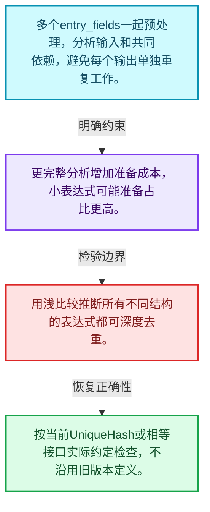
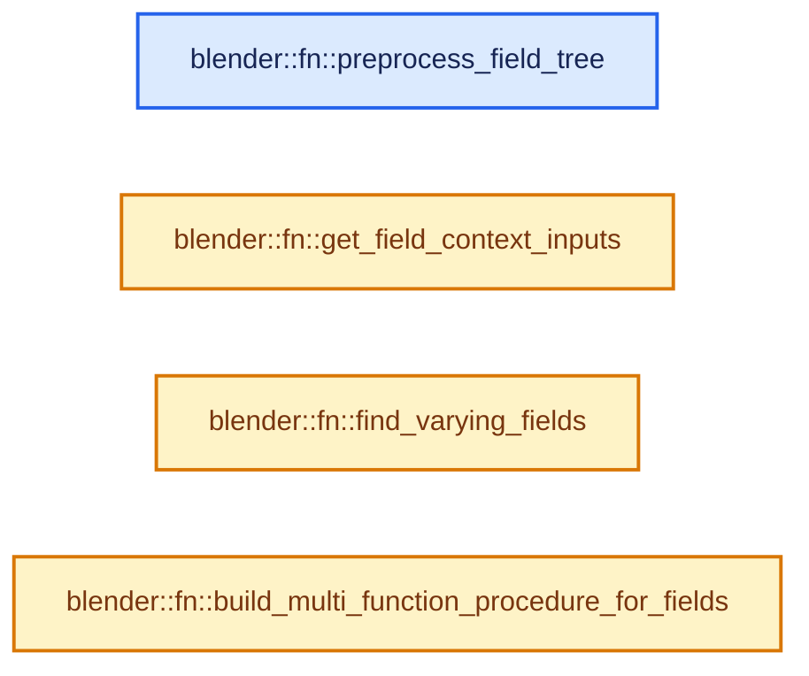
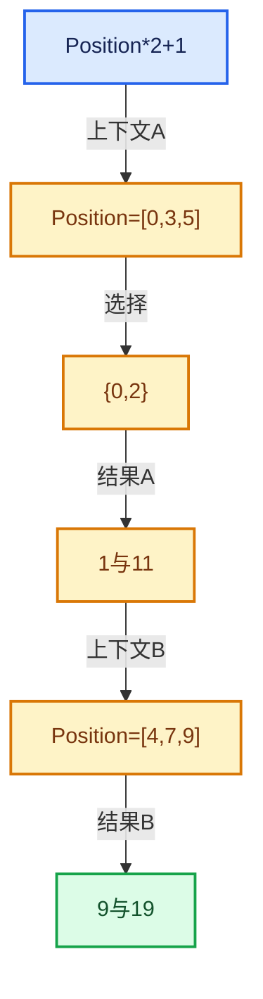

# 08-08 表达式分析与共享子图

[方向导航](README.md) · [总目录](../README.md) · [实现索引](../%E7%AC%A6%E5%8F%B7%E4%BE%9D%E8%B5%96%E4%B8%8E%E5%AE%9E%E7%8E%B0%E7%B4%A2%E5%BC%95.md)

## 从问题到实现

多个输出怎样发现共同依赖？

一起分析输出有机会共享子表达式；相等、身份与哈希的定义决定去重边界。

**数据模型**

多个entry_fields一起预处理，分析输入和共同依赖，避免每个输出单独重复工作。

**设计取舍**

更完整分析增加准备成本，小表达式可能准备占比更高。

**最小反例**

用浅比较推断所有不同结构的表达式都可深度去重。

**推导**

按当前UniqueHash或相等接口实际约定检查，不沿用旧版本定义。

## 阅读地图与执行推演








图中的数值推演是本方向的教学模型；实际函数之间的调用边与概念分析边分别标注，不能把概念关系当作运行时调度顺序。

## 完整源码单元与就地讲解

中文讲解直接放在相关代码旁，复杂机制在代码下展开。原文折叠区保留基准行号；不需要在行号表和函数之间来回查找。类布局可分段展示，函数实现不按固定行数切开。

### 类型布局、声明与编译条件 · field_evaluation.cc L1—L48

<a id="t-e18af62979af"></a>

`FieldTreeInfo`在这里声明的数据成员：

- `FieldHashDeep deep_hashes`
- `MultiValueMap<UniqueHash, UniqueHash> field_users`
- `VectorSet<UniqueHash> deduplicated_input_hashes`
- `Vector<GFieldRef> deduplicated_inputs`

<!-- annotated:7208e4a37fa72c -->

```cpp
/* SPDX-FileCopyrightText: 2023 Blender Authors
 *
 * SPDX-License-Identifier: GPL-2.0-or-later */

/** \file
 * \ingroup fn
 */

#include "BLI_array_utils.hh"
#include "BLI_map.hh"
#include "BLI_multi_value_map.hh"
#include "BLI_set.hh"
#include "BLI_stack.hh"
#include "BLI_vector_set.hh"

#include "FN_field_evaluation.hh"
#include "FN_multi_function.hh"
#include "FN_multi_function_builder.hh"
#include "FN_multi_function_procedure.hh"
#include "FN_multi_function_procedure_builder.hh"
#include "FN_multi_function_procedure_executor.hh"
#include "FN_multi_function_procedure_optimization.hh"

namespace blender::fn {

/* -------------------------------------------------------------------- */
/** \name Field Evaluation
 * \{ */

struct FieldTreeInfo {
  FieldHashDeep deep_hashes;
  /**
   * When fields are built, they only have references to the fields that they depend on. This map
   * allows traversal of fields in the opposite direction. So for every field it stores the other
   * fields that depend on it directly.
   */
  MultiValueMap<UniqueHash, UniqueHash> field_users;
  /**
   * The same field input may exist in the field tree as separate nodes due to the way
   * the tree is constructed. This set contains every different input only once.
   */
  VectorSet<UniqueHash> deduplicated_input_hashes;
  Vector<GFieldRef> deduplicated_inputs;
};

/**
 * Collects some information from the field tree that is required by later steps.
 */
```

<details>
<summary>核对原始源码：source/blender/functions/intern/field_evaluation.cc · L1—L48</summary>

<!-- original:7208e4a37fa72c:source/blender/functions/intern/field_evaluation.cc:1:48 -->

```cpp
/* SPDX-FileCopyrightText: 2023 Blender Authors
 *
 * SPDX-License-Identifier: GPL-2.0-or-later */

/** \file
 * \ingroup fn
 */

#include "BLI_array_utils.hh"
#include "BLI_map.hh"
#include "BLI_multi_value_map.hh"
#include "BLI_set.hh"
#include "BLI_stack.hh"
#include "BLI_vector_set.hh"

#include "FN_field_evaluation.hh"
#include "FN_multi_function.hh"
#include "FN_multi_function_builder.hh"
#include "FN_multi_function_procedure.hh"
#include "FN_multi_function_procedure_builder.hh"
#include "FN_multi_function_procedure_executor.hh"
#include "FN_multi_function_procedure_optimization.hh"

namespace blender::fn {

/* -------------------------------------------------------------------- */
/** \name Field Evaluation
 * \{ */

struct FieldTreeInfo {
  FieldHashDeep deep_hashes;
  /**
   * When fields are built, they only have references to the fields that they depend on. This map
   * allows traversal of fields in the opposite direction. So for every field it stores the other
   * fields that depend on it directly.
   */
  MultiValueMap<UniqueHash, UniqueHash> field_users;
  /**
   * The same field input may exist in the field tree as separate nodes due to the way
   * the tree is constructed. This set contains every different input only once.
   */
  VectorSet<UniqueHash> deduplicated_input_hashes;
  Vector<GFieldRef> deduplicated_inputs;
};

/**
 * Collects some information from the field tree that is required by later steps.
 */
```

</details>

<a id="f-0c09d982cd4a9565"></a>

### `blender::fn::preprocess_field_tree`

实现位置：[source/blender/functions/intern/field_evaluation.cc](../../../../../source/blender/functions/intern/field_evaluation.cc) · L49—L93。

接口参数：

- `Span<GFieldRef> entry_fields`

**教学注释版**

<!-- annotated:26678c6c54a118 -->

```cpp
static FieldTreeInfo preprocess_field_tree(Span<GFieldRef> entry_fields)
{
  PRF_scope(ProfileCategory::Default);
  FieldTreeInfo field_tree_info;

  Stack<GFieldRef> fields_to_check;
  Set<GFieldRef> handled_fields;

  for (GFieldRef field : entry_fields) {
    // [讲解] handled_fields.add：按哈希与相等关系加入键或键值。
    if (handled_fields.add(field)) {
      fields_to_check.push(field);
    }
  }

  while (!fields_to_check.is_empty()) {
    const GFieldRef &field = fields_to_check.pop();
    const GFieldRef::Variant &field_variant = field.variant();
    const UniqueHash hash = field_tree_info.deep_hashes.ensure(field);
    // [讲解] std::visit：按variant当前活动分支调用访客；所有候选分支的类型要求需满足，不能读取非活动分支的对象表示。
    std::visit(
        [&]<typename T>(const T &v) {
          if constexpr (std::is_same_v<T, GFieldRef::Input>) {
            if (field_tree_info.deduplicated_input_hashes.add(hash)) {
              field_tree_info.deduplicated_inputs.append(field);
            }
          }
          else if constexpr (std::is_same_v<T, GFieldRef::MultiFn>) {
            for (const GField &input_field : v.node->inputs()) {
              const UniqueHash input_hash = field_tree_info.deep_hashes.lookup(input_field);
              field_tree_info.field_users.add(input_hash, hash);
              if (handled_fields.add(input_field)) {
                fields_to_check.push(input_field);
              }
            }
          }
          else if constexpr (std::is_same_v<T, GFieldRef::Value>) {
            /* Nothing to do. */
          }
          else {
            BLI_assert_unreachable_static_t(T);
          }
        },
        field_variant);
  }
  return field_tree_info;
}
```

<details>
<summary>核对原始源码：source/blender/functions/intern/field_evaluation.cc · L49—L93</summary>

<!-- original:26678c6c54a118:source/blender/functions/intern/field_evaluation.cc:49:93 -->

```cpp
static FieldTreeInfo preprocess_field_tree(Span<GFieldRef> entry_fields)
{
  PRF_scope(ProfileCategory::Default);
  FieldTreeInfo field_tree_info;

  Stack<GFieldRef> fields_to_check;
  Set<GFieldRef> handled_fields;

  for (GFieldRef field : entry_fields) {
    if (handled_fields.add(field)) {
      fields_to_check.push(field);
    }
  }

  while (!fields_to_check.is_empty()) {
    const GFieldRef &field = fields_to_check.pop();
    const GFieldRef::Variant &field_variant = field.variant();
    const UniqueHash hash = field_tree_info.deep_hashes.ensure(field);
    std::visit(
        [&]<typename T>(const T &v) {
          if constexpr (std::is_same_v<T, GFieldRef::Input>) {
            if (field_tree_info.deduplicated_input_hashes.add(hash)) {
              field_tree_info.deduplicated_inputs.append(field);
            }
          }
          else if constexpr (std::is_same_v<T, GFieldRef::MultiFn>) {
            for (const GField &input_field : v.node->inputs()) {
              const UniqueHash input_hash = field_tree_info.deep_hashes.lookup(input_field);
              field_tree_info.field_users.add(input_hash, hash);
              if (handled_fields.add(input_field)) {
                fields_to_check.push(input_field);
              }
            }
          }
          else if constexpr (std::is_same_v<T, GFieldRef::Value>) {
            /* Nothing to do. */
          }
          else {
            BLI_assert_unreachable_static_t(T);
          }
        },
        field_variant);
  }
  return field_tree_info;
}
```

</details>

**结果出口**

- `return field_tree_info;`

**继续追踪实现**

- `PRF_scope` → [PRF_scope · L51](../05-%E5%87%A0%E4%BD%95%E5%AD%98%E5%82%A8%E4%B8%8E%E6%8B%93%E6%89%91%E6%98%A0%E5%B0%84/%E4%BE%9D%E8%B5%96-PRF_profile-5a3577.md#m-9f5e4ea0487b)；[PRF_scope · L90](../05-%E5%87%A0%E4%BD%95%E5%AD%98%E5%82%A8%E4%B8%8E%E6%8B%93%E6%89%91%E6%98%A0%E5%B0%84/%E4%BE%9D%E8%B5%96-PRF_profile-5a3577.md#m-8fc74ae4419e)。宏定义由构建条件选择。
- `handled_fields.add` → [blender::Set::add · L248](../02-%E5%93%88%E5%B8%8C%E8%A1%A8%E4%B8%8E%E5%85%B3%E8%81%94%E6%95%B0%E6%8D%AE%E7%BB%93%E6%9E%84/08-Set%E4%B8%8E%E9%9B%86%E5%90%88%E8%AF%AD%E4%B9%89.md#f-c7498809c2327fba)；[blender::Set::add · L252](../02-%E5%93%88%E5%B8%8C%E8%A1%A8%E4%B8%8E%E5%85%B3%E8%81%94%E6%95%B0%E6%8D%AE%E7%BB%93%E6%9E%84/08-Set%E4%B8%8E%E9%9B%86%E5%90%88%E8%AF%AD%E4%B9%89.md#f-e3ac8d1c52c03c2b)。同名重载需按实参类型选择。
- `fields_to_check.push` → [blender::Stack::push · L215](../01-%E5%9F%BA%E7%A1%80%E5%AE%B9%E5%99%A8%E4%B8%8E%E7%8E%B0%E4%BB%A3CPP/13-Stack%E4%B8%8E%E6%A0%88%E6%8E%A5%E5%8F%A3.md#f-4e2f52822df4658e)；[blender::Stack::push · L219](../01-%E5%9F%BA%E7%A1%80%E5%AE%B9%E5%99%A8%E4%B8%8E%E7%8E%B0%E4%BB%A3CPP/13-Stack%E4%B8%8E%E6%A0%88%E6%8E%A5%E5%8F%A3.md#f-6eb0d6a78e38b4e8)。同名重载需按实参类型选择。
- `fields_to_check.is_empty` → [blender::Stack::is_empty · L310](../01-%E5%9F%BA%E7%A1%80%E5%AE%B9%E5%99%A8%E4%B8%8E%E7%8E%B0%E4%BB%A3CPP/13-Stack%E4%B8%8E%E6%A0%88%E6%8E%A5%E5%8F%A3.md#f-0dbc636232316093)。
- `fields_to_check.pop` → [blender::Stack::pop · L244](../01-%E5%9F%BA%E7%A1%80%E5%AE%B9%E5%99%A8%E4%B8%8E%E7%8E%B0%E4%BB%A3CPP/13-Stack%E4%B8%8E%E6%A0%88%E6%8E%A5%E5%8F%A3.md#f-6ef6c36a2a0aa986)。
- `field.variant` → [blender::fn::GFieldRef::variant · L678](05-FieldOperation%E8%BF%90%E7%AE%97%E8%8A%82%E7%82%B9.md#f-0658bc405899b72d)。
- `field_tree_info.deep_hashes.ensure` → [调用协议](../%E6%A8%A1%E6%9D%BF%E5%AE%8F%E4%B8%8E%E5%8A%A8%E6%80%81%E5%88%86%E6%B4%BE%E5%8D%8F%E8%AE%AE.md)：接收对象类型依赖auto、返回值或模板实例；不按同名猜测目标。调用位置L66。
- `std::visit` → [外部契约](https://eel.is/c++draft/variant.visit)：按variant当前活动分支调用访客；所有候选分支的类型要求需满足，不能读取非活动分支的对象表示。
- `field_tree_info.deduplicated_input_hashes.add` → [调用协议](../%E6%A8%A1%E6%9D%BF%E5%AE%8F%E4%B8%8E%E5%8A%A8%E6%80%81%E5%88%86%E6%B4%BE%E5%8D%8F%E8%AE%AE.md)：接收对象类型依赖auto、返回值或模板实例；不按同名猜测目标。调用位置L70。
- `field_tree_info.deduplicated_inputs.append` → [调用协议](../%E6%A8%A1%E6%9D%BF%E5%AE%8F%E4%B8%8E%E5%8A%A8%E6%80%81%E5%88%86%E6%B4%BE%E5%8D%8F%E8%AE%AE.md)：接收对象类型依赖auto、返回值或模板实例；不按同名猜测目标。调用位置L71。
- `v.node->inputs` → [调用协议](../%E6%A8%A1%E6%9D%BF%E5%AE%8F%E4%B8%8E%E5%8A%A8%E6%80%81%E5%88%86%E6%B4%BE%E5%8D%8F%E8%AE%AE.md)：接收对象类型依赖auto、返回值或模板实例；不按同名猜测目标。调用位置L75。
- `field_tree_info.deep_hashes.lookup` → [调用协议](../%E6%A8%A1%E6%9D%BF%E5%AE%8F%E4%B8%8E%E5%8A%A8%E6%80%81%E5%88%86%E6%B4%BE%E5%8D%8F%E8%AE%AE.md)：接收对象类型依赖auto、返回值或模板实例；不按同名猜测目标。调用位置L76。
- `field_tree_info.field_users.add` → [调用协议](../%E6%A8%A1%E6%9D%BF%E5%AE%8F%E4%B8%8E%E5%8A%A8%E6%80%81%E5%88%86%E6%B4%BE%E5%8D%8F%E8%AE%AE.md)：接收对象类型依赖auto、返回值或模板实例；不按同名猜测目标。调用位置L77。
- `BLI_assert_unreachable_static_t` → [BLI_assert_unreachable_static_t · L99](../01-%E5%9F%BA%E7%A1%80%E5%AE%B9%E5%99%A8%E4%B8%8E%E7%8E%B0%E4%BB%A3CPP/%E4%BE%9D%E8%B5%96-BLI_assert-cc98e8.md#m-368120c7952b)。宏定义由构建条件选择。

### 类型布局、声明与编译条件 · field_evaluation.cc L94—L97

<!-- annotated:5020d0165d45dc -->

```cpp

/**
 * Retrieves the data from the context that is passed as input into the field.
 */
```

<details>
<summary>核对原始源码：source/blender/functions/intern/field_evaluation.cc · L94—L97</summary>

<!-- original:5020d0165d45dc:source/blender/functions/intern/field_evaluation.cc:94:97 -->

```cpp

/**
 * Retrieves the data from the context that is passed as input into the field.
 */
```

</details>

<a id="f-f4c46e3a6eef3e08"></a>

### `blender::fn::get_field_context_inputs`

实现位置：[source/blender/functions/intern/field_evaluation.cc](../../../../../source/blender/functions/intern/field_evaluation.cc) · L98—L114。

接口参数：

- `ResourceScope &scope`
- `const IndexMask &mask`
- `const FieldContext &context`
- `const Span<GFieldRef> field_inputs`

**教学注释版**

<!-- annotated:fb70296924ff05 -->

```cpp
static Vector<GVArray> get_field_context_inputs(ResourceScope &scope,
                                                const IndexMask &mask,
                                                const FieldContext &context,
                                                const Span<GFieldRef> field_inputs)
{
  Vector<GVArray> field_context_inputs;
  for (const GFieldRef &input_field : field_inputs) {
    const FieldInput &field_input = *std::get<GFieldRef::Input>(input_field.variant()).node;
    GVArray varray = context.get_varray_for_input(field_input, mask, scope);
    if (!varray) {
      // [讲解] field_input.cpp_type：取得表达式结果的类型信息。
      const CPPType &type = field_input.cpp_type();
      varray = GVArray::from_single_default(type, mask.min_array_size());
    }
    // [讲解] field_context_inputs.append：在尾部建立新元素，必要时先扩大存储。
    field_context_inputs.append(std::move(varray));
  }
  return field_context_inputs;
}
```

<details>
<summary>核对原始源码：source/blender/functions/intern/field_evaluation.cc · L98—L114</summary>

<!-- original:fb70296924ff05:source/blender/functions/intern/field_evaluation.cc:98:114 -->

```cpp
static Vector<GVArray> get_field_context_inputs(ResourceScope &scope,
                                                const IndexMask &mask,
                                                const FieldContext &context,
                                                const Span<GFieldRef> field_inputs)
{
  Vector<GVArray> field_context_inputs;
  for (const GFieldRef &input_field : field_inputs) {
    const FieldInput &field_input = *std::get<GFieldRef::Input>(input_field.variant()).node;
    GVArray varray = context.get_varray_for_input(field_input, mask, scope);
    if (!varray) {
      const CPPType &type = field_input.cpp_type();
      varray = GVArray::from_single_default(type, mask.min_array_size());
    }
    field_context_inputs.append(std::move(varray));
  }
  return field_context_inputs;
}
```

</details>

**沿实际写入检查状态**

- `varray = GVArray::from_single_default(type, mask.min_array_size());`

**结果出口**

- `return field_context_inputs;`

**继续追踪实现**

- `std::get<GFieldRef::Input>` → [外部契约](https://eel.is/c++draft/)：这个边界按实际表达式及所属类型核对参数、返回值、寿命与失败行为。这里提供接口入口，不声称已解释该第三方版本的内部实现。
- `input_field.variant` → [调用协议](../%E6%A8%A1%E6%9D%BF%E5%AE%8F%E4%B8%8E%E5%8A%A8%E6%80%81%E5%88%86%E6%B4%BE%E5%8D%8F%E8%AE%AE.md)：接收对象类型依赖auto、返回值或模板实例；不按同名猜测目标。调用位置L105。
- `context.get_varray_for_input` → [blender::fn::FieldContext::get_varray_for_input · L525](12-Field%E9%87%8D%E6%9E%84%E4%B8%8E%E6%B7%B1%E9%93%BE%E9%94%80%E6%AF%81.md#f-fa717bcd9d8a17b6)。
- `field_input.cpp_type` → [blender::fn::FieldInput::cpp_type · L559](05-FieldOperation%E8%BF%90%E7%AE%97%E8%8A%82%E7%82%B9.md#f-fd32b5474fd78eee)。
- `GVArray::from_single_default` → [blender::GVArray::from_single_default · L890](../04-%E8%99%9A%E6%8B%9F%E6%95%B0%E7%BB%84%E4%B8%8E%E7%B4%A2%E5%BC%95%E9%80%89%E6%8B%A9/05-GVArray%E8%BF%90%E8%A1%8C%E6%97%B6%E7%B1%BB%E5%9E%8B.md#f-c4a824ac76fa9b56)。
- `mask.min_array_size` → [blender::index_mask::IndexMask::min_array_size · L782](../04-%E8%99%9A%E6%8B%9F%E6%95%B0%E7%BB%84%E4%B8%8E%E7%B4%A2%E5%BC%95%E9%80%89%E6%8B%A9/09-%E5%88%86%E6%AE%B5%E5%AD%98%E5%82%A8%E4%B8%8E%E9%81%8D%E5%8E%86.md#f-f3a460d74b4fc7d6)。
- `field_context_inputs.append` → [blender::Vector::append · L498](../01-%E5%9F%BA%E7%A1%80%E5%AE%B9%E5%99%A8%E4%B8%8E%E7%8E%B0%E4%BB%A3CPP/11-Vector%E6%8F%92%E5%85%A5%E5%88%A0%E9%99%A4%E4%B8%8E%E9%87%8D%E6%8E%92.md#f-5bde268a69e443ec)；[blender::Vector::append · L502](../01-%E5%9F%BA%E7%A1%80%E5%AE%B9%E5%99%A8%E4%B8%8E%E7%8E%B0%E4%BB%A3CPP/11-Vector%E6%8F%92%E5%85%A5%E5%88%A0%E9%99%A4%E4%B8%8E%E9%87%8D%E6%8E%92.md#f-591e0b15e6308532)。同名重载需按实参类型选择。
- `std::move` → [外部契约](https://eel.is/c++draft/utility.forward)：把表达式转换成可供移动重载选择的值类别；不保证真的移动，不结束源对象寿命，对const值可能选择复制。

### 类型布局、声明与编译条件 · field_evaluation.cc L115—L119

<!-- annotated:3ce7fd573647f1 -->

```cpp

/**
 * \return A set that contains all fields from the field tree that depend on an input that varies
 * for different indices.
 */
```

<details>
<summary>核对原始源码：source/blender/functions/intern/field_evaluation.cc · L115—L119</summary>

<!-- original:3ce7fd573647f1:source/blender/functions/intern/field_evaluation.cc:115:119 -->

```cpp

/**
 * \return A set that contains all fields from the field tree that depend on an input that varies
 * for different indices.
 */
```

</details>

<a id="f-5438415425419f77"></a>

### `blender::fn::find_varying_fields`

实现位置：[source/blender/functions/intern/field_evaluation.cc](../../../../../source/blender/functions/intern/field_evaluation.cc) · L120—L150。

接口参数：

- `const FieldTreeInfo &field_tree_info`
- `const Span<GVArray> field_context_inputs`

**教学注释版**

<!-- annotated:b5b45fcb23e8e1 -->

```cpp
static Set<UniqueHash> find_varying_fields(const FieldTreeInfo &field_tree_info,
                                           const Span<GVArray> field_context_inputs)
{
  Set<UniqueHash> found_fields;
  Stack<UniqueHash> fields_to_check;

  /* The varying fields are the ones that depend on inputs that are not constant. Therefore we
   * start the tree search at the non-constant input fields and traverse through all fields that
   * depend on them. */
  for (const int input_i : field_tree_info.deduplicated_inputs.index_range()) {
    const GVArray &varray = field_context_inputs[input_i];
    if (varray.is_single()) {
      continue;
    }
    const UniqueHash &field = field_tree_info.deduplicated_input_hashes[input_i];
    for (const UniqueHash &user : field_tree_info.field_users.lookup(field)) {
      // [讲解] found_fields.add：按哈希与相等关系加入键或键值。
      if (found_fields.add(user)) {
        fields_to_check.push(user);
      }
    }
  }
  while (!fields_to_check.is_empty()) {
    const UniqueHash &field = fields_to_check.pop();
    for (const UniqueHash &user : field_tree_info.field_users.lookup(field)) {
      if (found_fields.add(user)) {
        fields_to_check.push(user);
      }
    }
  }
  return found_fields;
}
```

<details>
<summary>核对原始源码：source/blender/functions/intern/field_evaluation.cc · L120—L150</summary>

<!-- original:b5b45fcb23e8e1:source/blender/functions/intern/field_evaluation.cc:120:150 -->

```cpp
static Set<UniqueHash> find_varying_fields(const FieldTreeInfo &field_tree_info,
                                           const Span<GVArray> field_context_inputs)
{
  Set<UniqueHash> found_fields;
  Stack<UniqueHash> fields_to_check;

  /* The varying fields are the ones that depend on inputs that are not constant. Therefore we
   * start the tree search at the non-constant input fields and traverse through all fields that
   * depend on them. */
  for (const int input_i : field_tree_info.deduplicated_inputs.index_range()) {
    const GVArray &varray = field_context_inputs[input_i];
    if (varray.is_single()) {
      continue;
    }
    const UniqueHash &field = field_tree_info.deduplicated_input_hashes[input_i];
    for (const UniqueHash &user : field_tree_info.field_users.lookup(field)) {
      if (found_fields.add(user)) {
        fields_to_check.push(user);
      }
    }
  }
  while (!fields_to_check.is_empty()) {
    const UniqueHash &field = fields_to_check.pop();
    for (const UniqueHash &user : field_tree_info.field_users.lookup(field)) {
      if (found_fields.add(user)) {
        fields_to_check.push(user);
      }
    }
  }
  return found_fields;
}
```

</details>

**结果出口**

- `return found_fields;`

**继续追踪实现**

- `field_tree_info.deduplicated_inputs.index_range` → [调用协议](../%E6%A8%A1%E6%9D%BF%E5%AE%8F%E4%B8%8E%E5%8A%A8%E6%80%81%E5%88%86%E6%B4%BE%E5%8D%8F%E8%AE%AE.md)：接收对象类型依赖auto、返回值或模板实例；不按同名猜测目标。调用位置L129。
- `varray.is_single` → [调用协议](../%E6%A8%A1%E6%9D%BF%E5%AE%8F%E4%B8%8E%E5%8A%A8%E6%80%81%E5%88%86%E6%B4%BE%E5%8D%8F%E8%AE%AE.md)：由接收对象具体类型或运行时策略提供实现。调用位置L131。
- `field_tree_info.field_users.lookup` → [调用协议](../%E6%A8%A1%E6%9D%BF%E5%AE%8F%E4%B8%8E%E5%8A%A8%E6%80%81%E5%88%86%E6%B4%BE%E5%8D%8F%E8%AE%AE.md)：接收对象类型依赖auto、返回值或模板实例；不按同名猜测目标。调用位置L135。
- `found_fields.add` → [blender::Set::add · L248](../02-%E5%93%88%E5%B8%8C%E8%A1%A8%E4%B8%8E%E5%85%B3%E8%81%94%E6%95%B0%E6%8D%AE%E7%BB%93%E6%9E%84/08-Set%E4%B8%8E%E9%9B%86%E5%90%88%E8%AF%AD%E4%B9%89.md#f-c7498809c2327fba)；[blender::Set::add · L252](../02-%E5%93%88%E5%B8%8C%E8%A1%A8%E4%B8%8E%E5%85%B3%E8%81%94%E6%95%B0%E6%8D%AE%E7%BB%93%E6%9E%84/08-Set%E4%B8%8E%E9%9B%86%E5%90%88%E8%AF%AD%E4%B9%89.md#f-e3ac8d1c52c03c2b)。同名重载需按实参类型选择。
- `fields_to_check.push` → [blender::Stack::push · L215](../01-%E5%9F%BA%E7%A1%80%E5%AE%B9%E5%99%A8%E4%B8%8E%E7%8E%B0%E4%BB%A3CPP/13-Stack%E4%B8%8E%E6%A0%88%E6%8E%A5%E5%8F%A3.md#f-4e2f52822df4658e)；[blender::Stack::push · L219](../01-%E5%9F%BA%E7%A1%80%E5%AE%B9%E5%99%A8%E4%B8%8E%E7%8E%B0%E4%BB%A3CPP/13-Stack%E4%B8%8E%E6%A0%88%E6%8E%A5%E5%8F%A3.md#f-6eb0d6a78e38b4e8)。同名重载需按实参类型选择。
- `fields_to_check.is_empty` → [blender::Stack::is_empty · L310](../01-%E5%9F%BA%E7%A1%80%E5%AE%B9%E5%99%A8%E4%B8%8E%E7%8E%B0%E4%BB%A3CPP/13-Stack%E4%B8%8E%E6%A0%88%E6%8E%A5%E5%8F%A3.md#f-0dbc636232316093)。
- `fields_to_check.pop` → [blender::Stack::pop · L244](../01-%E5%9F%BA%E7%A1%80%E5%AE%B9%E5%99%A8%E4%B8%8E%E7%8E%B0%E4%BB%A3CPP/13-Stack%E4%B8%8E%E6%A0%88%E6%8E%A5%E5%8F%A3.md#f-6ef6c36a2a0aa986)。

### 类型布局、声明与编译条件 · field_evaluation.cc L151—L154

<!-- annotated:ae5a801eb103fe -->

```cpp

/**
 * Builds the #procedure so that it computes the fields.
 */
```

<details>
<summary>核对原始源码：source/blender/functions/intern/field_evaluation.cc · L151—L154</summary>

<!-- original:ae5a801eb103fe:source/blender/functions/intern/field_evaluation.cc:151:154 -->

```cpp

/**
 * Builds the #procedure so that it computes the fields.
 */
```

</details>

<a id="f-49eee4947391b8da"></a>

### `blender::fn::build_multi_function_procedure_for_fields`

实现位置：[source/blender/functions/intern/field_evaluation.cc](../../../../../source/blender/functions/intern/field_evaluation.cc) · L155—L298。

接口参数：

- `mf::Procedure &procedure`
- `ResourceScope &scope`
- `const FieldTreeInfo &field_tree_info`
- `Span<GFieldRef> output_fields`

**教学注释版**

<!-- annotated:1b6aa284b1ac0e -->

```cpp
static void build_multi_function_procedure_for_fields(mf::Procedure &procedure,
                                                      ResourceScope &scope,
                                                      const FieldTreeInfo &field_tree_info,
                                                      Span<GFieldRef> output_fields)
{
  PRF_scope(ProfileCategory::Default);
  mf::ProcedureBuilder builder{procedure};
  /* Every input, intermediate and output field corresponds to a variable in the procedure. */
  Map<UniqueHash, mf::Variable *> variable_by_field;

  /* Start by adding the field inputs as parameters to the procedure. */
  for (const GFieldRef &input_field : field_tree_info.deduplicated_inputs) {
    const UniqueHash input_hash = field_tree_info.deep_hashes.lookup(input_field);
    const FieldInput &field_input = *std::get<GFieldRef::Input>(input_field.variant()).node;
    mf::Variable &variable = builder.add_input_parameter(
        // [讲解] field_input.cpp_type：取得表达式结果的类型信息。
        mf::DataType::ForSingle(field_input.cpp_type()), field_input.debug_name());
    // [讲解] variable_by_field.add_new：按哈希与相等关系加入键或键值。
    variable_by_field.add_new(input_hash, &variable);
  }

  /* Utility struct that is used to do proper depth first search traversal of the tree below. */
  struct FieldWithIndex {
    GFieldRef field;
    int current_input_index = 0;
  };

  for (GFieldRef field : output_fields) {
    /* We start a new stack for each output field to make sure that a field pushed later to the
     * stack never depends on a field that was pushed before. */
    Stack<FieldWithIndex> fields_to_check;
    fields_to_check.push({field, 0});
    while (!fields_to_check.is_empty()) {
      FieldWithIndex &field_with_index = fields_to_check.peek();
      const GFieldRef &field = field_with_index.field;
      const UniqueHash field_hash = field_tree_info.deep_hashes.lookup(field);
      // [讲解] variable_by_field.contains：查询活项数量或键是否存在。
      if (variable_by_field.contains(field_hash)) {
        /* The field has been handled already. */
        fields_to_check.pop();
        continue;
      }
      const GFieldRef::Variant &field_variant = field.variant();
      // [讲解] std::visit：按variant当前活动分支调用访客；所有候选分支的类型要求需满足，不能读取非活动分支的对象表示。
      std::visit(
          [&]<typename T>(const T &v) {
            if constexpr (std::is_same_v<T, GFieldRef::Input>) {
              /* Variables for inputs are added above. */
            }
            else if constexpr (std::is_same_v<T, GFieldRef::MultiFn>) {
              const FieldOperation &field_multi_fn = *v.node;
              const Span<GField> fn_inputs = field_multi_fn.inputs();

              // [讲解] fn_inputs.size：查询视图长度或生成对应有效索引区间。
              if (field_with_index.current_input_index < fn_inputs.size()) {
                /* Not all inputs are handled yet. Push the next input field to the stack and
                 * increment the input index. */
                fields_to_check.push({fn_inputs[field_with_index.current_input_index]});
                field_with_index.current_input_index++;
              }
              else {
                /* All inputs variables are ready, now gather all variables that are used by the
                 * function and call it. */
                const mf::MultiFunction &multi_function = field_multi_fn.multi_function();
                Array<mf::Variable *, 8> variables(multi_function.param_amount());

                int param_input_index = 0;
                int param_output_index = 0;
                for (const int param_index : multi_function.param_indices()) {
                  const mf::ParamType param_type = multi_function.param_type(param_index);
                  const mf::ParamType::InterfaceType interface_type = param_type.interface_type();
                  if (interface_type == mf::ParamType::Input) {
                    const GField &input_field = fn_inputs[param_input_index];
                    const UniqueHash input_hash = field_tree_info.deep_hashes.lookup(input_field);
                    // [讲解] variable_by_field.lookup：按键查找对应项。
                    variables[param_index] = variable_by_field.lookup(input_hash);
                    param_input_index++;
                  }
                  else if (interface_type == mf::ParamType::Output) {
                    const GFieldRef output_field{field_multi_fn, param_output_index};
                    /* NOTE: This abuses the deep hash cache as a set of the fields in the tree. At
                     * the cost of either hashing this output field or building a separate set of
                     * visited GFieldRefs, we wouldn't have to use the cache in this way. */
                    if (!field_tree_info.deep_hashes.contains(output_field)) {
                      /* Ignored outputs don't need a variable. */
                      variables[param_index] = nullptr;
                    }
                    else {
                      /* Create a new variable for used outputs. */
                      mf::Variable &new_variable = procedure.new_variable(param_type.data_type());
                      variables[param_index] = &new_variable;
                      const UniqueHash output_hash = field_tree_info.deep_hashes.lookup(
                          output_field);
                      variable_by_field.add_new(output_hash, &new_variable);
                    }
                    param_output_index++;
                  }
                  else {
                    BLI_assert_unreachable();
                  }
                }
                builder.add_call_with_all_variables(multi_function, variables);
              }
            }
            else if constexpr (std::is_same_v<T, GFieldRef::Value>) {
              const mf::MultiFunction &fn =
                  procedure.construct_function<mf::CustomMF_GenericConstant>(
                      *v.type, v.value, false);
              mf::Variable &new_variable = *builder.add_call<1>(fn)[0];
              variable_by_field.add_new(field_hash, &new_variable);
            }
            else {
              BLI_assert_unreachable_static_t(T);
            }
          },
          field_variant);
    }
  }

  /* Add output parameters to the procedure. */
  Set<mf::Variable *> output_variables;
  for (const GFieldRef &field : output_fields) {
    const UniqueHash field_hash = field_tree_info.deep_hashes.lookup(field);
    mf::Variable *variable = variable_by_field.lookup(field_hash);
    // [讲解] output_variables.add：按哈希与相等关系加入键或键值。
    if (!output_variables.add(variable)) {
      /* One variable can be output at most once. To output the same value twice, we have to make
       * a copy first. */
      const mf::MultiFunction &copy_fn = scope.construct<mf::CustomMF_GenericCopy>(
          variable->data_type());
      variable = builder.add_call<1>(copy_fn, {variable})[0];
      output_variables.add(variable);
    }
    builder.add_output_parameter(*variable);
  }

  for (mf::Variable *variable : procedure.variables()) {
    if (!output_variables.contains(variable)) {
      builder.add_destruct(*variable);
    }
  }

  mf::ReturnInstruction &return_instr = builder.add_return();

  mf::procedure_optimization::move_destructs_up(procedure, return_instr);

  procedure.prepare_for_execution();

  // std::cout << procedure.to_dot() << "\n";
  BLI_assert(procedure.validate());
}
```

<details>
<summary>核对原始源码：source/blender/functions/intern/field_evaluation.cc · L155—L298</summary>

<!-- original:1b6aa284b1ac0e:source/blender/functions/intern/field_evaluation.cc:155:298 -->

```cpp
static void build_multi_function_procedure_for_fields(mf::Procedure &procedure,
                                                      ResourceScope &scope,
                                                      const FieldTreeInfo &field_tree_info,
                                                      Span<GFieldRef> output_fields)
{
  PRF_scope(ProfileCategory::Default);
  mf::ProcedureBuilder builder{procedure};
  /* Every input, intermediate and output field corresponds to a variable in the procedure. */
  Map<UniqueHash, mf::Variable *> variable_by_field;

  /* Start by adding the field inputs as parameters to the procedure. */
  for (const GFieldRef &input_field : field_tree_info.deduplicated_inputs) {
    const UniqueHash input_hash = field_tree_info.deep_hashes.lookup(input_field);
    const FieldInput &field_input = *std::get<GFieldRef::Input>(input_field.variant()).node;
    mf::Variable &variable = builder.add_input_parameter(
        mf::DataType::ForSingle(field_input.cpp_type()), field_input.debug_name());
    variable_by_field.add_new(input_hash, &variable);
  }

  /* Utility struct that is used to do proper depth first search traversal of the tree below. */
  struct FieldWithIndex {
    GFieldRef field;
    int current_input_index = 0;
  };

  for (GFieldRef field : output_fields) {
    /* We start a new stack for each output field to make sure that a field pushed later to the
     * stack never depends on a field that was pushed before. */
    Stack<FieldWithIndex> fields_to_check;
    fields_to_check.push({field, 0});
    while (!fields_to_check.is_empty()) {
      FieldWithIndex &field_with_index = fields_to_check.peek();
      const GFieldRef &field = field_with_index.field;
      const UniqueHash field_hash = field_tree_info.deep_hashes.lookup(field);
      if (variable_by_field.contains(field_hash)) {
        /* The field has been handled already. */
        fields_to_check.pop();
        continue;
      }
      const GFieldRef::Variant &field_variant = field.variant();
      std::visit(
          [&]<typename T>(const T &v) {
            if constexpr (std::is_same_v<T, GFieldRef::Input>) {
              /* Variables for inputs are added above. */
            }
            else if constexpr (std::is_same_v<T, GFieldRef::MultiFn>) {
              const FieldOperation &field_multi_fn = *v.node;
              const Span<GField> fn_inputs = field_multi_fn.inputs();

              if (field_with_index.current_input_index < fn_inputs.size()) {
                /* Not all inputs are handled yet. Push the next input field to the stack and
                 * increment the input index. */
                fields_to_check.push({fn_inputs[field_with_index.current_input_index]});
                field_with_index.current_input_index++;
              }
              else {
                /* All inputs variables are ready, now gather all variables that are used by the
                 * function and call it. */
                const mf::MultiFunction &multi_function = field_multi_fn.multi_function();
                Array<mf::Variable *, 8> variables(multi_function.param_amount());

                int param_input_index = 0;
                int param_output_index = 0;
                for (const int param_index : multi_function.param_indices()) {
                  const mf::ParamType param_type = multi_function.param_type(param_index);
                  const mf::ParamType::InterfaceType interface_type = param_type.interface_type();
                  if (interface_type == mf::ParamType::Input) {
                    const GField &input_field = fn_inputs[param_input_index];
                    const UniqueHash input_hash = field_tree_info.deep_hashes.lookup(input_field);
                    variables[param_index] = variable_by_field.lookup(input_hash);
                    param_input_index++;
                  }
                  else if (interface_type == mf::ParamType::Output) {
                    const GFieldRef output_field{field_multi_fn, param_output_index};
                    /* NOTE: This abuses the deep hash cache as a set of the fields in the tree. At
                     * the cost of either hashing this output field or building a separate set of
                     * visited GFieldRefs, we wouldn't have to use the cache in this way. */
                    if (!field_tree_info.deep_hashes.contains(output_field)) {
                      /* Ignored outputs don't need a variable. */
                      variables[param_index] = nullptr;
                    }
                    else {
                      /* Create a new variable for used outputs. */
                      mf::Variable &new_variable = procedure.new_variable(param_type.data_type());
                      variables[param_index] = &new_variable;
                      const UniqueHash output_hash = field_tree_info.deep_hashes.lookup(
                          output_field);
                      variable_by_field.add_new(output_hash, &new_variable);
                    }
                    param_output_index++;
                  }
                  else {
                    BLI_assert_unreachable();
                  }
                }
                builder.add_call_with_all_variables(multi_function, variables);
              }
            }
            else if constexpr (std::is_same_v<T, GFieldRef::Value>) {
              const mf::MultiFunction &fn =
                  procedure.construct_function<mf::CustomMF_GenericConstant>(
                      *v.type, v.value, false);
              mf::Variable &new_variable = *builder.add_call<1>(fn)[0];
              variable_by_field.add_new(field_hash, &new_variable);
            }
            else {
              BLI_assert_unreachable_static_t(T);
            }
          },
          field_variant);
    }
  }

  /* Add output parameters to the procedure. */
  Set<mf::Variable *> output_variables;
  for (const GFieldRef &field : output_fields) {
    const UniqueHash field_hash = field_tree_info.deep_hashes.lookup(field);
    mf::Variable *variable = variable_by_field.lookup(field_hash);
    if (!output_variables.add(variable)) {
      /* One variable can be output at most once. To output the same value twice, we have to make
       * a copy first. */
      const mf::MultiFunction &copy_fn = scope.construct<mf::CustomMF_GenericCopy>(
          variable->data_type());
      variable = builder.add_call<1>(copy_fn, {variable})[0];
      output_variables.add(variable);
    }
    builder.add_output_parameter(*variable);
  }

  for (mf::Variable *variable : procedure.variables()) {
    if (!output_variables.contains(variable)) {
      builder.add_destruct(*variable);
    }
  }

  mf::ReturnInstruction &return_instr = builder.add_return();

  mf::procedure_optimization::move_destructs_up(procedure, return_instr);

  procedure.prepare_for_execution();

  // std::cout << procedure.to_dot() << "\n";
  BLI_assert(procedure.validate());
}
```

</details>

**沿实际写入检查状态**

- `variables[param_index] = variable_by_field.lookup(input_hash);`
- `variables[param_index] = nullptr;`
- `variables[param_index] = &new_variable;`
- `variable = builder.add_call<1>(copy_fn, {variable})[0];`

**继续追踪实现**

- `PRF_scope` → [PRF_scope · L51](../05-%E5%87%A0%E4%BD%95%E5%AD%98%E5%82%A8%E4%B8%8E%E6%8B%93%E6%89%91%E6%98%A0%E5%B0%84/%E4%BE%9D%E8%B5%96-PRF_profile-5a3577.md#m-9f5e4ea0487b)；[PRF_scope · L90](../05-%E5%87%A0%E4%BD%95%E5%AD%98%E5%82%A8%E4%B8%8E%E6%8B%93%E6%89%91%E6%98%A0%E5%B0%84/%E4%BE%9D%E8%B5%96-PRF_profile-5a3577.md#m-8fc74ae4419e)。宏定义由构建条件选择。
- `field_tree_info.deep_hashes.lookup` → [调用协议](../%E6%A8%A1%E6%9D%BF%E5%AE%8F%E4%B8%8E%E5%8A%A8%E6%80%81%E5%88%86%E6%B4%BE%E5%8D%8F%E8%AE%AE.md)：接收对象类型依赖auto、返回值或模板实例；不按同名猜测目标。调用位置L167。
- `std::get<GFieldRef::Input>` → [外部契约](https://eel.is/c++draft/)：这个边界按实际表达式及所属类型核对参数、返回值、寿命与失败行为。这里提供接口入口，不声称已解释该第三方版本的内部实现。
- `input_field.variant` → [blender::fn::GField::variant · L598](05-FieldOperation%E8%BF%90%E7%AE%97%E8%8A%82%E7%82%B9.md#f-8f429c3ff862c024)。
- `builder.add_input_parameter` → [blender::fn::multi_function::ProcedureBuilder::add_input_parameter · L161](../07-MultiFunction%E4%B8%8E%E6%89%B9%E9%87%8F%E6%89%A7%E8%A1%8C/08-ProcedureBuilder.md#f-917446224552beb4)。
- `mf::DataType::ForSingle` → [blender::fn::multi_function::DataType::ForSingle · L65](../07-MultiFunction%E4%B8%8E%E6%89%B9%E9%87%8F%E6%89%A7%E8%A1%8C/03-%E5%8F%82%E6%95%B0%E7%B1%BB%E5%9E%8B%E4%B8%8E%E8%A7%92%E8%89%B2.md#f-e041e357ea765818)；[blender::fn::multi_function::DataType::ForSingle · L75](../07-MultiFunction%E4%B8%8E%E6%89%B9%E9%87%8F%E6%89%A7%E8%A1%8C/03-%E5%8F%82%E6%95%B0%E7%B1%BB%E5%9E%8B%E4%B8%8E%E8%A7%92%E8%89%B2.md#f-ffb4bc870ea750f6)。同名重载需按实参类型选择。
- `field_input.cpp_type` → [blender::fn::FieldInput::cpp_type · L559](05-FieldOperation%E8%BF%90%E7%AE%97%E8%8A%82%E7%82%B9.md#f-fd32b5474fd78eee)。
- `field_input.debug_name` → [blender::fn::FieldInput::debug_name · L569](05-FieldOperation%E8%BF%90%E7%AE%97%E8%8A%82%E7%82%B9.md#f-fa0a83004ce05d59)。
- `variable_by_field.add_new` → [blender::Map::add_new · L265](../02-%E5%93%88%E5%B8%8C%E8%A1%A8%E4%B8%8E%E5%85%B3%E8%81%94%E6%95%B0%E6%8D%AE%E7%BB%93%E6%9E%84/02-Map%E6%80%BB%E4%BD%93%E5%B8%83%E5%B1%80.md#f-521ff0865e8229d0)；[blender::Map::add_new · L269](../02-%E5%93%88%E5%B8%8C%E8%A1%A8%E4%B8%8E%E5%85%B3%E8%81%94%E6%95%B0%E6%8D%AE%E7%BB%93%E6%9E%84/02-Map%E6%80%BB%E4%BD%93%E5%B8%83%E5%B1%80.md#f-d89cee0e3d2848a0)；[blender::Map::add_new · L273](../02-%E5%93%88%E5%B8%8C%E8%A1%A8%E4%B8%8E%E5%85%B3%E8%81%94%E6%95%B0%E6%8D%AE%E7%BB%93%E6%9E%84/02-Map%E6%80%BB%E4%BD%93%E5%B8%83%E5%B1%80.md#f-c13142c32e703ebd)；[blender::Map::add_new · L277](../02-%E5%93%88%E5%B8%8C%E8%A1%A8%E4%B8%8E%E5%85%B3%E8%81%94%E6%95%B0%E6%8D%AE%E7%BB%93%E6%9E%84/04-Map%E6%9F%A5%E6%89%BE%E4%B8%8E%E9%94%AE%E8%AE%BF%E9%97%AE.md#f-da1e537f229db040)。同名重载需按实参类型选择。
- `fields_to_check.push` → [blender::Stack::push · L215](../01-%E5%9F%BA%E7%A1%80%E5%AE%B9%E5%99%A8%E4%B8%8E%E7%8E%B0%E4%BB%A3CPP/13-Stack%E4%B8%8E%E6%A0%88%E6%8E%A5%E5%8F%A3.md#f-4e2f52822df4658e)；[blender::Stack::push · L219](../01-%E5%9F%BA%E7%A1%80%E5%AE%B9%E5%99%A8%E4%B8%8E%E7%8E%B0%E4%BB%A3CPP/13-Stack%E4%B8%8E%E6%A0%88%E6%8E%A5%E5%8F%A3.md#f-6eb0d6a78e38b4e8)。同名重载需按实参类型选择。
- `fields_to_check.is_empty` → [blender::Stack::is_empty · L310](../01-%E5%9F%BA%E7%A1%80%E5%AE%B9%E5%99%A8%E4%B8%8E%E7%8E%B0%E4%BB%A3CPP/13-Stack%E4%B8%8E%E6%A0%88%E6%8E%A5%E5%8F%A3.md#f-0dbc636232316093)。
- `fields_to_check.peek` → [blender::Stack::peek · L265](../01-%E5%9F%BA%E7%A1%80%E5%AE%B9%E5%99%A8%E4%B8%8E%E7%8E%B0%E4%BB%A3CPP/13-Stack%E4%B8%8E%E6%A0%88%E6%8E%A5%E5%8F%A3.md#f-a3114651b0124209)；[blender::Stack::peek · L271](../01-%E5%9F%BA%E7%A1%80%E5%AE%B9%E5%99%A8%E4%B8%8E%E7%8E%B0%E4%BB%A3CPP/13-Stack%E4%B8%8E%E6%A0%88%E6%8E%A5%E5%8F%A3.md#f-2a790db47a49cdfc)。同名重载需按实参类型选择。
- `variable_by_field.contains` → [blender::Map::contains · L353](../02-%E5%93%88%E5%B8%8C%E8%A1%A8%E4%B8%8E%E5%85%B3%E8%81%94%E6%95%B0%E6%8D%AE%E7%BB%93%E6%9E%84/04-Map%E6%9F%A5%E6%89%BE%E4%B8%8E%E9%94%AE%E8%AE%BF%E9%97%AE.md#f-70237c86261ee04d)。
- `fields_to_check.pop` → [blender::Stack::pop · L244](../01-%E5%9F%BA%E7%A1%80%E5%AE%B9%E5%99%A8%E4%B8%8E%E7%8E%B0%E4%BB%A3CPP/13-Stack%E4%B8%8E%E6%A0%88%E6%8E%A5%E5%8F%A3.md#f-6ef6c36a2a0aa986)。
- `field.variant` → [blender::fn::GFieldRef::variant · L678](05-FieldOperation%E8%BF%90%E7%AE%97%E8%8A%82%E7%82%B9.md#f-0658bc405899b72d)。
- `std::visit` → [外部契约](https://eel.is/c++draft/variant.visit)：按variant当前活动分支调用访客；所有候选分支的类型要求需满足，不能读取非活动分支的对象表示。
- `field_multi_fn.inputs` → [blender::fn::FieldOperation::inputs · L654](05-FieldOperation%E8%BF%90%E7%AE%97%E8%8A%82%E7%82%B9.md#f-f12207436a4ae11f)。
- `fn_inputs.size` → [blender::Span::size · L256](../01-%E5%9F%BA%E7%A1%80%E5%AE%B9%E5%99%A8%E4%B8%8E%E7%8E%B0%E4%BB%A3CPP/05-Span%E5%8F%AA%E8%AF%BB%E8%BF%9E%E7%BB%AD%E8%A7%86%E5%9B%BE.md#f-5f80fa006089c998)。
- `field_multi_fn.multi_function` → [blender::fn::FieldOperation::multi_function · L708](05-FieldOperation%E8%BF%90%E7%AE%97%E8%8A%82%E7%82%B9.md#f-153d145518f644fe)。
- `multi_function.param_amount` → [blender::fn::multi_function::MultiFunction::param_amount · L62](../07-MultiFunction%E4%B8%8E%E6%89%B9%E9%87%8F%E6%89%A7%E8%A1%8C/01-%E6%89%B9%E9%87%8F%E8%AE%A1%E7%AE%97%E6%A8%A1%E5%9E%8B.md#f-dbc6d25e1e7ed8c8)。
- `multi_function.param_indices` → [blender::fn::multi_function::MultiFunction::param_indices · L67](../07-MultiFunction%E4%B8%8E%E6%89%B9%E9%87%8F%E6%89%A7%E8%A1%8C/01-%E6%89%B9%E9%87%8F%E8%AE%A1%E7%AE%97%E6%A8%A1%E5%9E%8B.md#f-e06e9cd4be7e3ea1)。
- `multi_function.param_type` → [blender::fn::multi_function::MultiFunction::param_type · L72](../07-MultiFunction%E4%B8%8E%E6%89%B9%E9%87%8F%E6%89%A7%E8%A1%8C/01-%E6%89%B9%E9%87%8F%E8%AE%A1%E7%AE%97%E6%A8%A1%E5%9E%8B.md#f-b713a5aeabff53fa)。
- `param_type.interface_type` → [blender::fn::multi_function::ParamType::interface_type · L118](../07-MultiFunction%E4%B8%8E%E6%89%B9%E9%87%8F%E6%89%A7%E8%A1%8C/03-%E5%8F%82%E6%95%B0%E7%B1%BB%E5%9E%8B%E4%B8%8E%E8%A7%92%E8%89%B2.md#f-a506dc82cef792f5)。
- `variable_by_field.lookup` → [blender::Map::lookup · L545](../02-%E5%93%88%E5%B8%8C%E8%A1%A8%E4%B8%8E%E5%85%B3%E8%81%94%E6%95%B0%E6%8D%AE%E7%BB%93%E6%9E%84/04-Map%E6%9F%A5%E6%89%BE%E4%B8%8E%E9%94%AE%E8%AE%BF%E9%97%AE.md#f-f25ef95f1454656d)；[blender::Map::lookup · L549](../02-%E5%93%88%E5%B8%8C%E8%A1%A8%E4%B8%8E%E5%85%B3%E8%81%94%E6%95%B0%E6%8D%AE%E7%BB%93%E6%9E%84/04-Map%E6%9F%A5%E6%89%BE%E4%B8%8E%E9%94%AE%E8%AE%BF%E9%97%AE.md#f-742f9454fa7ea4b9)。同名重载需按实参类型选择。
- `field_tree_info.deep_hashes.contains` → [调用协议](../%E6%A8%A1%E6%9D%BF%E5%AE%8F%E4%B8%8E%E5%8A%A8%E6%80%81%E5%88%86%E6%B4%BE%E5%8D%8F%E8%AE%AE.md)：接收对象类型依赖auto、返回值或模板实例；不按同名猜测目标。调用位置L232。
- `procedure.new_variable` → [blender::fn::multi_function::Procedure::new_variable · L182](../07-MultiFunction%E4%B8%8E%E6%89%B9%E9%87%8F%E6%89%A7%E8%A1%8C/07-Procedure%E6%8C%87%E4%BB%A4%E4%B8%8E%E6%8E%A7%E5%88%B6%E6%B5%81.md#f-97792d1ab76460f6)。
- `param_type.data_type` → [blender::fn::multi_function::ParamType::data_type · L113](../07-MultiFunction%E4%B8%8E%E6%89%B9%E9%87%8F%E6%89%A7%E8%A1%8C/03-%E5%8F%82%E6%95%B0%E7%B1%BB%E5%9E%8B%E4%B8%8E%E8%A7%92%E8%89%B2.md#f-b29743877463338d)。
- `BLI_assert_unreachable` → [BLI_assert_unreachable · L77](../01-%E5%9F%BA%E7%A1%80%E5%AE%B9%E5%99%A8%E4%B8%8E%E7%8E%B0%E4%BB%A3CPP/%E4%BE%9D%E8%B5%96-BLI_assert-cc98e8.md#m-7a2d91a67d8e)。宏定义由构建条件选择。
- `builder.add_call_with_all_variables` → [blender::fn::multi_function::ProcedureBuilder::add_call_with_all_variables · L44](../07-MultiFunction%E4%B8%8E%E6%89%B9%E9%87%8F%E6%89%A7%E8%A1%8C/08-ProcedureBuilder.md#f-76c448c2d866e629)。
- `procedure.construct_function<mf::CustomMF_GenericConstant>` → [blender::fn::multi_function::Procedure::construct_function · L525](../07-MultiFunction%E4%B8%8E%E6%89%B9%E9%87%8F%E6%89%A7%E8%A1%8C/07-Procedure%E6%8C%87%E4%BB%A4%E4%B8%8E%E6%8E%A7%E5%88%B6%E6%B5%81.md#f-528d43f69faf4a3a)。
- `BLI_assert_unreachable_static_t` → [BLI_assert_unreachable_static_t · L99](../01-%E5%9F%BA%E7%A1%80%E5%AE%B9%E5%99%A8%E4%B8%8E%E7%8E%B0%E4%BB%A3CPP/%E4%BE%9D%E8%B5%96-BLI_assert-cc98e8.md#m-368120c7952b)。宏定义由构建条件选择。
- `output_variables.add` → [blender::Set::add · L248](../02-%E5%93%88%E5%B8%8C%E8%A1%A8%E4%B8%8E%E5%85%B3%E8%81%94%E6%95%B0%E6%8D%AE%E7%BB%93%E6%9E%84/08-Set%E4%B8%8E%E9%9B%86%E5%90%88%E8%AF%AD%E4%B9%89.md#f-c7498809c2327fba)；[blender::Set::add · L252](../02-%E5%93%88%E5%B8%8C%E8%A1%A8%E4%B8%8E%E5%85%B3%E8%81%94%E6%95%B0%E6%8D%AE%E7%BB%93%E6%9E%84/08-Set%E4%B8%8E%E9%9B%86%E5%90%88%E8%AF%AD%E4%B9%89.md#f-e3ac8d1c52c03c2b)。同名重载需按实参类型选择。
- `scope.construct<mf::CustomMF_GenericCopy>` → [blender::ResourceScope::construct · L219](../03-%E5%86%85%E5%AD%98%E5%88%86%E9%85%8D%E4%B8%8E%E8%BF%90%E8%A1%8C%E6%97%B6%E7%B1%BB%E5%9E%8B/05-ResourceScope%E9%94%80%E6%AF%81%E8%B4%A3%E4%BB%BB.md#f-5b24624bb64539d5)。
- `variable->data_type` → [blender::fn::multi_function::Variable::data_type · L348](../07-MultiFunction%E4%B8%8E%E6%89%B9%E9%87%8F%E6%89%A7%E8%A1%8C/07-Procedure%E6%8C%87%E4%BB%A4%E4%B8%8E%E6%8E%A7%E5%88%B6%E6%B5%81.md#f-80356391ae1c000e)。
- `builder.add_call<1>` → [blender::fn::multi_function::ProcedureBuilder::add_call · L52](../07-MultiFunction%E4%B8%8E%E6%89%B9%E9%87%8F%E6%89%A7%E8%A1%8C/08-ProcedureBuilder.md#f-032ccba1a50f8de7)。
- `builder.add_output_parameter` → [blender::fn::multi_function::ProcedureBuilder::add_output_parameter · L178](../07-MultiFunction%E4%B8%8E%E6%89%B9%E9%87%8F%E6%89%A7%E8%A1%8C/08-ProcedureBuilder.md#f-66c3601d3b521f6b)。
- `procedure.variables` → [blender::fn::multi_function::Procedure::variables · L515](../07-MultiFunction%E4%B8%8E%E6%89%B9%E9%87%8F%E6%89%A7%E8%A1%8C/07-Procedure%E6%8C%87%E4%BB%A4%E4%B8%8E%E6%8E%A7%E5%88%B6%E6%B5%81.md#f-6adc5e63a3866c37)；[blender::fn::multi_function::Procedure::variables · L520](../07-MultiFunction%E4%B8%8E%E6%89%B9%E9%87%8F%E6%89%A7%E8%A1%8C/07-Procedure%E6%8C%87%E4%BB%A4%E4%B8%8E%E6%8E%A7%E5%88%B6%E6%B5%81.md#f-f61d930bbf9581fb)。同名重载需按实参类型选择。
- `output_variables.contains` → [blender::Set::contains · L310](../02-%E5%93%88%E5%B8%8C%E8%A1%A8%E4%B8%8E%E5%85%B3%E8%81%94%E6%95%B0%E6%8D%AE%E7%BB%93%E6%9E%84/08-Set%E4%B8%8E%E9%9B%86%E5%90%88%E8%AF%AD%E4%B9%89.md#f-af7099799494350e)。
- `builder.add_destruct` → [blender::fn::multi_function::ProcedureBuilder::add_destruct · L13](../07-MultiFunction%E4%B8%8E%E6%89%B9%E9%87%8F%E6%89%A7%E8%A1%8C/08-ProcedureBuilder.md#f-f8a8929a8bf369a7)；[blender::fn::multi_function::ProcedureBuilder::add_destruct · L21](../07-MultiFunction%E4%B8%8E%E6%89%B9%E9%87%8F%E6%89%A7%E8%A1%8C/08-ProcedureBuilder.md#f-79f7df17b8367301)。同名重载需按实参类型选择。
- `builder.add_return` → [blender::fn::multi_function::ProcedureBuilder::add_return · L28](../07-MultiFunction%E4%B8%8E%E6%89%B9%E9%87%8F%E6%89%A7%E8%A1%8C/08-ProcedureBuilder.md#f-bca07ac75a9be8d0)。
- `mf::procedure_optimization::move_destructs_up` → [blender::fn::multi_function::procedure_optimization::move_destructs_up · L13](../07-MultiFunction%E4%B8%8E%E6%89%B9%E9%87%8F%E6%89%A7%E8%A1%8C/10-%E4%BC%98%E5%8C%96%E6%B3%A8%E5%86%8C%E4%B8%8E%E5%AE%9E%E6%88%98.md#f-2cc183d1baed074d)。
- `procedure.prepare_for_execution` → [blender::fn::multi_function::Procedure::prepare_for_execution · L294](../07-MultiFunction%E4%B8%8E%E6%89%B9%E9%87%8F%E6%89%A7%E8%A1%8C/07-Procedure%E6%8C%87%E4%BB%A4%E4%B8%8E%E6%8E%A7%E5%88%B6%E6%B5%81.md#f-111e586e7f33c366)。
- `BLI_assert` → [BLI_assert · L48](../01-%E5%9F%BA%E7%A1%80%E5%AE%B9%E5%99%A8%E4%B8%8E%E7%8E%B0%E4%BB%A3CPP/%E4%BE%9D%E8%B5%96-BLI_assert-cc98e8.md#m-57a88495704d)；[BLI_assert · L63](../01-%E5%9F%BA%E7%A1%80%E5%AE%B9%E5%99%A8%E4%B8%8E%E7%8E%B0%E4%BB%A3CPP/%E4%BE%9D%E8%B5%96-BLI_assert-cc98e8.md#m-d07050020cb5)。宏定义由构建条件选择。
- `procedure.validate` → [blender::fn::multi_function::Procedure::validate · L271](../07-MultiFunction%E4%B8%8E%E6%89%B9%E9%87%8F%E6%89%A7%E8%A1%8C/07-Procedure%E6%8C%87%E4%BB%A4%E4%B8%8E%E6%8E%A7%E5%88%B6%E6%B5%81.md#f-28071fb0bda77d98)。

## 语法与相关类型

### 依赖名称 typename

typename既可引入类型模板参数，也可告诉编译器某个依赖名称是类型。它不创建运行时对象；解析期确认语法类别与实例化期检查具体类型是不同阶段。

区分typename T::value_type和T::size()，前者标记类型，后者是表达式。

### 常量求值 constexpr

constexpr声明允许相应实体参与常量求值，但constexpr函数仍可以在运行时执行。是否常量求值由调用场景和表达式合法性共同决定。

比较constexpr变量初始化和从运行时输入调用同一函数。

### 只读限定 const

const约束当前访问路径可做的修改。const指针、指向const的指针、const视图对象、const元素是不同位置的限定；其他别名可能仍可修改原对象。

分别写T* const、const T*与const T* const，并画出不可修改的层次。

### 移动转换 std::move

std::move把表达式转换为可供移动重载选择的值类别，实际资源转移发生在被选中的构造或赋值中。对const对象move可能仍调用复制，对视图move也不会获得底层数据所有权。

记录移动构造调用次数，不用变量名或std::move的出现次数替代测量。

### 异常边界 try与catch

try定义异常传播的局部边界。失败路径需要销毁已经成功构造的部分并释放相应存储；未构造的对象不能被析构。

在第k次构造失败，列出已经存在的对象集合与待释放缓冲。

### 构造与new表达式

普通new可能分配并构造；placement new在给定地址构造，存储由其他机制提供。失败回滚应区分两类责任。

追踪地址来自哪里、构造何时成功、由谁析构、由谁释放。

### 内部断言 assert

断言表达开发者预期成立的内部契约，发布构建可能关闭。它不能替代对不可信输入的完整错误处理，也不保证后续操作被运行时保护。

对每条断言构造违反条件的输入，区分调用者错误与应向用户报告的错误。

### 编译期分支 if constexpr

条件在实例化时决定被保留的分支，这常用于不同类型的合法操作选择。它与运行时if有不同的实例化检查规则。

找出每个分支依赖哪些类型特征，再使用满足与不满足条件的类型。

## 实现练习与验证

对共享和看似相同但独立的子图比较实际分析路径。

参考推理：按当前UniqueHash或相等接口实际约定检查，不沿用旧版本定义。

结果与直接计算一致；多个输出共享子表达式时不改变语义；深链构造、执行、销毁三个阶段分别检查。

## 历史、跨库比较与证据

与表达式模板、AST和闭包比较：Field可在运行时组合并对不同上下文批量求值；不要把Field对象误当作固定几何的结果数组。

[历史提交索引](../%E5%8E%86%E5%8F%B2%E6%8F%90%E4%BA%A4%E4%B8%8E%E8%AE%BE%E8%AE%A1%E6%BC%94%E5%8C%96%E7%B4%A2%E5%BC%95.md) · [源码基准](../%E6%BA%90%E7%A0%81%E7%89%88%E6%9C%AC%E4%B8%8E%E8%A6%86%E7%9B%96%E7%B4%A2%E5%BC%95.md) · [验收报告](../%E9%AA%8C%E6%94%B6%E6%8A%A5%E5%91%8A.md)
