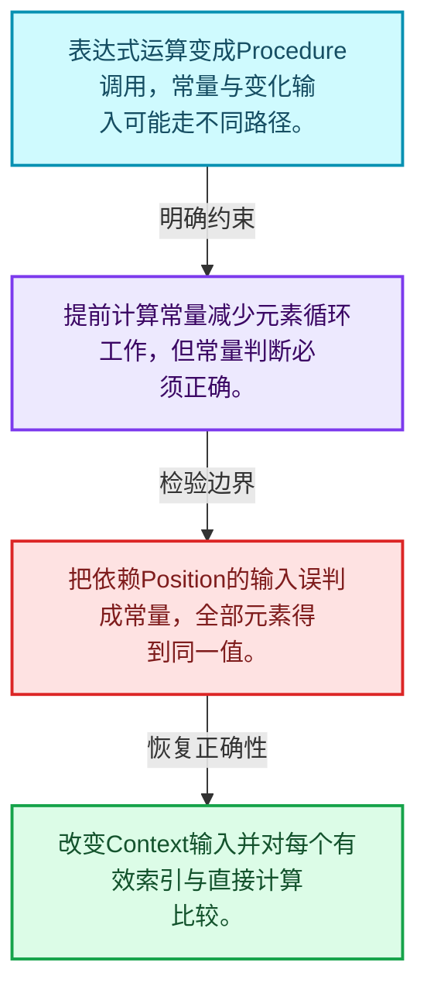
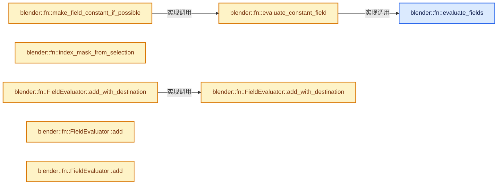
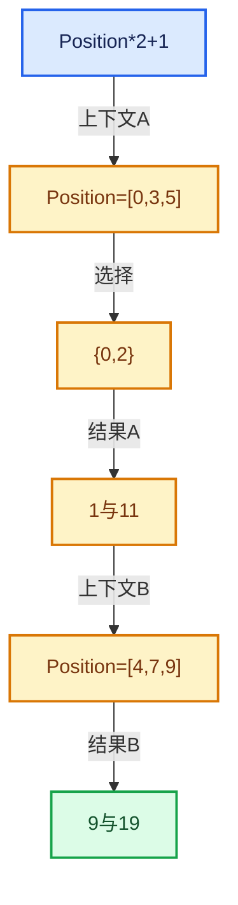

# 08-09 生成Procedure与执行

[方向导航](README.md) · [总目录](../README.md) · [实现索引](../%E7%AC%A6%E5%8F%B7%E4%BE%9D%E8%B5%96%E4%B8%8E%E5%AE%9E%E7%8E%B0%E7%B4%A2%E5%BC%95.md)

## 从问题到实现

Field求值怎样接到批量函数系统？

构建执行过程把表达式关系变成变量和指令，再在选定元素上运行；生成成本与执行成本分开计量。

**数据模型**

表达式运算变成Procedure调用，常量与变化输入可能走不同路径。

**设计取舍**

提前计算常量减少元素循环工作，但常量判断必须正确。

**最小反例**

把依赖Position的输入误判成常量，全部元素得到同一值。

**推导**

改变Context输入并对每个有效索引与直接计算比较。

## 阅读地图与执行推演








图中的数值推演是本方向的教学模型；实际函数之间的调用边与概念分析边分别标注，不能把概念关系当作运行时调度顺序。

## 完整源码单元与就地讲解

中文讲解直接放在相关代码旁，复杂机制在代码下展开。原文折叠区保留基准行号；不需要在行号表和函数之间来回查找。类布局可分段展示，函数实现不按固定行数切开。

<!-- annotated:2e7780a2a5915e -->

```cpp

```

<details>
<summary>核对原始源码：source/blender/functions/intern/field_evaluation.cc · L299—L299</summary>

<!-- original:2e7780a2a5915e:source/blender/functions/intern/field_evaluation.cc:299:299 -->

```cpp

```

</details>

<a id="f-ed60dcf67b5c0771"></a>

### `blender::fn::evaluate_fields`

实现位置：[source/blender/functions/intern/field_evaluation.cc](../../../../../source/blender/functions/intern/field_evaluation.cc) · L300—L505。

接口参数：

- `ResourceScope &scope`
- `Span<GFieldRef> fields_to_evaluate`
- `const IndexMask &mask`
- `const FieldContext &context`
- `Span<GVMutableArray> dst_varrays`

**教学注释版**

<!-- annotated:b3947d1bb91c58 -->

```cpp
Vector<GVArray> evaluate_fields(ResourceScope &scope,
                                Span<GFieldRef> fields_to_evaluate,
                                const IndexMask &mask,
                                const FieldContext &context,
                                Span<GVMutableArray> dst_varrays)
{
  PRF_scope(ProfileCategory::Default);
  // [讲解] fields_to_evaluate.size：查询视图长度或生成对应有效索引区间。
  Vector<GVArray> varrays(fields_to_evaluate.size());
  Array<bool> is_output_written_to_dst(fields_to_evaluate.size(), false);
  const int array_size = mask.min_array_size();

  if (mask.is_empty()) {
    // [讲解] fields_to_evaluate.index_range：查询视图长度或生成对应有效索引区间。
    for (const int i : fields_to_evaluate.index_range()) {
      const CPPType &type = fields_to_evaluate[i].cpp_type();
      varrays[i] = GVArray::from_empty(type);
    }
    return varrays;
  }

  /* Destination arrays are optional. Create a small utility method to access them. */
  auto get_dst_varray = [&](int index) -> GVMutableArray {
    // [讲解] dst_varrays.is_empty：查询视图长度或生成对应有效索引区间。
    if (dst_varrays.is_empty()) {
      return {};
    }
    const GVMutableArray &varray = dst_varrays[index];
    if (!varray) {
      return {};
    }
    BLI_assert(varray.size() >= array_size);
    return varray;
  };

  /* Traverse the field tree and prepare some data that is used in later steps. */
  FieldTreeInfo field_tree_info = preprocess_field_tree(fields_to_evaluate);

  /* Get inputs that will be passed into the field when evaluated. */
  Vector<GVArray> field_context_inputs = get_field_context_inputs(
      scope, mask, context, field_tree_info.deduplicated_inputs);

  Set<UniqueHash> varying_fields = find_varying_fields(field_tree_info, field_context_inputs);

  /* Process fields that can output a VArray directly, and separate the rest of the fields into
   * two categories: those that are constant and need to be evaluated only once, and those that
   * need to be evaluated for every index. */
  Vector<GFieldRef> varying_fields_to_evaluate;
  Vector<int> varying_field_indices;
  Vector<GFieldRef> constant_fields_to_evaluate;
  Vector<int> constant_field_indices;
  for (const int out_index : fields_to_evaluate.index_range()) {
    const GFieldRef &field = fields_to_evaluate[out_index];
    const GFieldRef::Variant &field_variant = field.variant();
    // [讲解] std::visit：按variant当前活动分支调用访客；所有候选分支的类型要求需满足，不能读取非活动分支的对象表示。
    std::visit(
        [&]<typename T>(const T &v) {
          if constexpr (std::is_same_v<T, GFieldRef::Input>) {
            const UniqueHash hash = field_tree_info.deep_hashes.lookup(field);
            const int input_i = field_tree_info.deduplicated_input_hashes.index_of(hash);
            const GVArray &varray = field_context_inputs[input_i];
            varrays[out_index] = varray;
          }
          else if constexpr (std::is_same_v<T, GFieldRef::MultiFn>) {
            const UniqueHash hash = field_tree_info.deep_hashes.lookup(field);
            // [讲解] varying_fields.contains：查询活项数量或键是否存在。
            if (varying_fields.contains(hash)) {
              // [讲解] varying_fields_to_evaluate.append：在尾部建立新元素，必要时先扩大存储。
              varying_fields_to_evaluate.append(field);
              varying_field_indices.append(out_index);
            }
            else {
              constant_fields_to_evaluate.append(field);
              constant_field_indices.append(out_index);
            }
          }
          else if constexpr (std::is_same_v<T, GFieldRef::Value>) {
            varrays[out_index] = GVArray::from_single_ref(*v.type, mask.min_array_size(), v.value);
          }
          else {
            BLI_assert_unreachable_static_t(T);
          }
        },
        field_variant);
  }

  /* Evaluate varying fields if necessary. */
  if (!varying_fields_to_evaluate.is_empty()) {
    /* Build the procedure for those fields. */
    mf::Procedure procedure;
    build_multi_function_procedure_for_fields(
        procedure, scope, field_tree_info, varying_fields_to_evaluate);
    mf::ProcedureExecutor procedure_executor{procedure};

    mf::ParamsBuilder mf_params{procedure_executor, &mask};
    mf::ContextBuilder mf_context;

    /* Provide inputs to the procedure executor. */
    for (const GVArray &varray : field_context_inputs) {
      mf_params.add_readonly_single_input(varray);
    }

    for (const int i : varying_fields_to_evaluate.index_range()) {
      const GFieldRef &field = varying_fields_to_evaluate[i];
      const CPPType &type = field.cpp_type();
      const int out_index = varying_field_indices[i];

      /* Try to get an existing virtual array that the result should be written into. */
      GVMutableArray dst_varray = get_dst_varray(out_index);
      void *buffer;
      if (!dst_varray || !dst_varray.is_span()) {
        /* Allocate a new buffer for the computed result. */
        buffer = scope.allocator().allocate_array(type, array_size);

        if (!type.is_trivially_destructible) {
          /* Destruct values in the end. */
          scope.add_destruct_call(
              [buffer, mask, &type]() { type.destruct_indices(buffer, mask); });
        }

        varrays[out_index] = GVArray::from_span({type, buffer, array_size});
      }
      else {
        /* Write the result into the existing span. */
        buffer = dst_varray.get_internal_span().data();

        varrays[out_index] = dst_varray;
        is_output_written_to_dst[out_index] = true;
      }

      /* Pass output buffer to the procedure executor. */
      const GMutableSpan span{type, buffer, array_size};
      mf_params.add_uninitialized_single_output(span);
    }

    procedure_executor.call_auto(mask, mf_params, mf_context);
  }

  /* Evaluate constant fields if necessary. */
  if (!constant_fields_to_evaluate.is_empty()) {
    /* Build the procedure for those fields. */
    mf::Procedure procedure;
    build_multi_function_procedure_for_fields(
        procedure, scope, field_tree_info, constant_fields_to_evaluate);
    mf::ProcedureExecutor procedure_executor{procedure};
    const IndexMask mask(1);
    mf::ParamsBuilder mf_params{procedure_executor, &mask};
    mf::ContextBuilder mf_context;

    /* Provide inputs to the procedure executor. */
    for (const GVArray &varray : field_context_inputs) {
      mf_params.add_readonly_single_input(varray);
    }

    for (const int i : constant_fields_to_evaluate.index_range()) {
      const GFieldRef &field = constant_fields_to_evaluate[i];
      const CPPType &type = field.cpp_type();
      /* Allocate memory where the computed value will be stored in. */
      void *buffer = scope.allocate_owned(type);

      /* Pass output buffer to the procedure executor. */
      mf_params.add_uninitialized_single_output({type, buffer, 1});

      /* Create virtual array that can be used after the procedure has been executed below. */
      const int out_index = constant_field_indices[i];
      varrays[out_index] = GVArray::from_single_ref(type, array_size, buffer);
    }

    procedure_executor.call(mask, mf_params, mf_context);
  }

  /* Copy data to supplied destination arrays if necessary. In some cases the evaluation above
   * has written the computed data in the right place already. */
  if (!dst_varrays.is_empty()) {
    for (const int out_index : fields_to_evaluate.index_range()) {
      GVMutableArray dst_varray = get_dst_varray(out_index);
      if (!dst_varray) {
        /* Caller did not provide a destination for this output. */
        continue;
      }
      const GVArray &computed_varray = varrays[out_index];
      BLI_assert(computed_varray.type() == dst_varray.type());
      if (is_output_written_to_dst[out_index]) {
        /* The result has been written into the destination provided by the caller already. */
        continue;
      }
      /* Still have to copy over the data in the destination provided by the caller. */
      if (dst_varray.is_span()) {
        computed_varray.type().default_construct_indices(dst_varray.get_internal_span().data(),
                                                         mask);
        array_utils::copy(computed_varray,
                          mask,
                          dst_varray.get_internal_span().take_front(mask.min_array_size()));
      }
      else {
        /* Slower materialize into a different structure. */
        const CPPType &type = computed_varray.type();
        threading::parallel_for(mask.index_range(), 2048, [&](const IndexRange range) {
          BUFFER_FOR_CPP_TYPE_VALUE(type, buffer);
          mask.slice(range).foreach_segment([&](auto segment) {
            for (const int i : segment) {
              computed_varray.get_to_uninitialized(i, buffer);
              dst_varray.set_by_relocate(i, buffer);
            }
          });
        });
      }
      varrays[out_index] = dst_varray;
    }
  }
  return varrays;
}
```

<details>
<summary>核对原始源码：source/blender/functions/intern/field_evaluation.cc · L300—L505</summary>

<!-- original:b3947d1bb91c58:source/blender/functions/intern/field_evaluation.cc:300:505 -->

```cpp
Vector<GVArray> evaluate_fields(ResourceScope &scope,
                                Span<GFieldRef> fields_to_evaluate,
                                const IndexMask &mask,
                                const FieldContext &context,
                                Span<GVMutableArray> dst_varrays)
{
  PRF_scope(ProfileCategory::Default);
  Vector<GVArray> varrays(fields_to_evaluate.size());
  Array<bool> is_output_written_to_dst(fields_to_evaluate.size(), false);
  const int array_size = mask.min_array_size();

  if (mask.is_empty()) {
    for (const int i : fields_to_evaluate.index_range()) {
      const CPPType &type = fields_to_evaluate[i].cpp_type();
      varrays[i] = GVArray::from_empty(type);
    }
    return varrays;
  }

  /* Destination arrays are optional. Create a small utility method to access them. */
  auto get_dst_varray = [&](int index) -> GVMutableArray {
    if (dst_varrays.is_empty()) {
      return {};
    }
    const GVMutableArray &varray = dst_varrays[index];
    if (!varray) {
      return {};
    }
    BLI_assert(varray.size() >= array_size);
    return varray;
  };

  /* Traverse the field tree and prepare some data that is used in later steps. */
  FieldTreeInfo field_tree_info = preprocess_field_tree(fields_to_evaluate);

  /* Get inputs that will be passed into the field when evaluated. */
  Vector<GVArray> field_context_inputs = get_field_context_inputs(
      scope, mask, context, field_tree_info.deduplicated_inputs);

  Set<UniqueHash> varying_fields = find_varying_fields(field_tree_info, field_context_inputs);

  /* Process fields that can output a VArray directly, and separate the rest of the fields into
   * two categories: those that are constant and need to be evaluated only once, and those that
   * need to be evaluated for every index. */
  Vector<GFieldRef> varying_fields_to_evaluate;
  Vector<int> varying_field_indices;
  Vector<GFieldRef> constant_fields_to_evaluate;
  Vector<int> constant_field_indices;
  for (const int out_index : fields_to_evaluate.index_range()) {
    const GFieldRef &field = fields_to_evaluate[out_index];
    const GFieldRef::Variant &field_variant = field.variant();
    std::visit(
        [&]<typename T>(const T &v) {
          if constexpr (std::is_same_v<T, GFieldRef::Input>) {
            const UniqueHash hash = field_tree_info.deep_hashes.lookup(field);
            const int input_i = field_tree_info.deduplicated_input_hashes.index_of(hash);
            const GVArray &varray = field_context_inputs[input_i];
            varrays[out_index] = varray;
          }
          else if constexpr (std::is_same_v<T, GFieldRef::MultiFn>) {
            const UniqueHash hash = field_tree_info.deep_hashes.lookup(field);
            if (varying_fields.contains(hash)) {
              varying_fields_to_evaluate.append(field);
              varying_field_indices.append(out_index);
            }
            else {
              constant_fields_to_evaluate.append(field);
              constant_field_indices.append(out_index);
            }
          }
          else if constexpr (std::is_same_v<T, GFieldRef::Value>) {
            varrays[out_index] = GVArray::from_single_ref(*v.type, mask.min_array_size(), v.value);
          }
          else {
            BLI_assert_unreachable_static_t(T);
          }
        },
        field_variant);
  }

  /* Evaluate varying fields if necessary. */
  if (!varying_fields_to_evaluate.is_empty()) {
    /* Build the procedure for those fields. */
    mf::Procedure procedure;
    build_multi_function_procedure_for_fields(
        procedure, scope, field_tree_info, varying_fields_to_evaluate);
    mf::ProcedureExecutor procedure_executor{procedure};

    mf::ParamsBuilder mf_params{procedure_executor, &mask};
    mf::ContextBuilder mf_context;

    /* Provide inputs to the procedure executor. */
    for (const GVArray &varray : field_context_inputs) {
      mf_params.add_readonly_single_input(varray);
    }

    for (const int i : varying_fields_to_evaluate.index_range()) {
      const GFieldRef &field = varying_fields_to_evaluate[i];
      const CPPType &type = field.cpp_type();
      const int out_index = varying_field_indices[i];

      /* Try to get an existing virtual array that the result should be written into. */
      GVMutableArray dst_varray = get_dst_varray(out_index);
      void *buffer;
      if (!dst_varray || !dst_varray.is_span()) {
        /* Allocate a new buffer for the computed result. */
        buffer = scope.allocator().allocate_array(type, array_size);

        if (!type.is_trivially_destructible) {
          /* Destruct values in the end. */
          scope.add_destruct_call(
              [buffer, mask, &type]() { type.destruct_indices(buffer, mask); });
        }

        varrays[out_index] = GVArray::from_span({type, buffer, array_size});
      }
      else {
        /* Write the result into the existing span. */
        buffer = dst_varray.get_internal_span().data();

        varrays[out_index] = dst_varray;
        is_output_written_to_dst[out_index] = true;
      }

      /* Pass output buffer to the procedure executor. */
      const GMutableSpan span{type, buffer, array_size};
      mf_params.add_uninitialized_single_output(span);
    }

    procedure_executor.call_auto(mask, mf_params, mf_context);
  }

  /* Evaluate constant fields if necessary. */
  if (!constant_fields_to_evaluate.is_empty()) {
    /* Build the procedure for those fields. */
    mf::Procedure procedure;
    build_multi_function_procedure_for_fields(
        procedure, scope, field_tree_info, constant_fields_to_evaluate);
    mf::ProcedureExecutor procedure_executor{procedure};
    const IndexMask mask(1);
    mf::ParamsBuilder mf_params{procedure_executor, &mask};
    mf::ContextBuilder mf_context;

    /* Provide inputs to the procedure executor. */
    for (const GVArray &varray : field_context_inputs) {
      mf_params.add_readonly_single_input(varray);
    }

    for (const int i : constant_fields_to_evaluate.index_range()) {
      const GFieldRef &field = constant_fields_to_evaluate[i];
      const CPPType &type = field.cpp_type();
      /* Allocate memory where the computed value will be stored in. */
      void *buffer = scope.allocate_owned(type);

      /* Pass output buffer to the procedure executor. */
      mf_params.add_uninitialized_single_output({type, buffer, 1});

      /* Create virtual array that can be used after the procedure has been executed below. */
      const int out_index = constant_field_indices[i];
      varrays[out_index] = GVArray::from_single_ref(type, array_size, buffer);
    }

    procedure_executor.call(mask, mf_params, mf_context);
  }

  /* Copy data to supplied destination arrays if necessary. In some cases the evaluation above
   * has written the computed data in the right place already. */
  if (!dst_varrays.is_empty()) {
    for (const int out_index : fields_to_evaluate.index_range()) {
      GVMutableArray dst_varray = get_dst_varray(out_index);
      if (!dst_varray) {
        /* Caller did not provide a destination for this output. */
        continue;
      }
      const GVArray &computed_varray = varrays[out_index];
      BLI_assert(computed_varray.type() == dst_varray.type());
      if (is_output_written_to_dst[out_index]) {
        /* The result has been written into the destination provided by the caller already. */
        continue;
      }
      /* Still have to copy over the data in the destination provided by the caller. */
      if (dst_varray.is_span()) {
        computed_varray.type().default_construct_indices(dst_varray.get_internal_span().data(),
                                                         mask);
        array_utils::copy(computed_varray,
                          mask,
                          dst_varray.get_internal_span().take_front(mask.min_array_size()));
      }
      else {
        /* Slower materialize into a different structure. */
        const CPPType &type = computed_varray.type();
        threading::parallel_for(mask.index_range(), 2048, [&](const IndexRange range) {
          BUFFER_FOR_CPP_TYPE_VALUE(type, buffer);
          mask.slice(range).foreach_segment([&](auto segment) {
            for (const int i : segment) {
              computed_varray.get_to_uninitialized(i, buffer);
              dst_varray.set_by_relocate(i, buffer);
            }
          });
        });
      }
      varrays[out_index] = dst_varray;
    }
  }
  return varrays;
}
```

</details>

**沿实际写入检查状态**

- `varrays[i] = GVArray::from_empty(type);`
- `varrays[out_index] = varray;`
- `varrays[out_index] = GVArray::from_single_ref(*v.type, mask.min_array_size(), v.value);`
- `buffer = scope.allocator().allocate_array(type, array_size);`
- `varrays[out_index] = GVArray::from_span({type, buffer, array_size});`
- `buffer = dst_varray.get_internal_span().data();`
- `varrays[out_index] = dst_varray;`
- `is_output_written_to_dst[out_index] = true;`
- `varrays[out_index] = GVArray::from_single_ref(type, array_size, buffer);`

**结果出口**

- `return varrays;`
- `return {};`
- `return varray;`

**继续追踪实现**

- `PRF_scope` → [PRF_scope · L51](../05-%E5%87%A0%E4%BD%95%E5%AD%98%E5%82%A8%E4%B8%8E%E6%8B%93%E6%89%91%E6%98%A0%E5%B0%84/%E4%BE%9D%E8%B5%96-PRF_profile-5a3577.md#m-9f5e4ea0487b)；[PRF_scope · L90](../05-%E5%87%A0%E4%BD%95%E5%AD%98%E5%82%A8%E4%B8%8E%E6%8B%93%E6%89%91%E6%98%A0%E5%B0%84/%E4%BE%9D%E8%B5%96-PRF_profile-5a3577.md#m-8fc74ae4419e)。宏定义由构建条件选择。
- `fields_to_evaluate.size` → [blender::Span::size · L256](../01-%E5%9F%BA%E7%A1%80%E5%AE%B9%E5%99%A8%E4%B8%8E%E7%8E%B0%E4%BB%A3CPP/05-Span%E5%8F%AA%E8%AF%BB%E8%BF%9E%E7%BB%AD%E8%A7%86%E5%9B%BE.md#f-5f80fa006089c998)。
- `mask.min_array_size` → [blender::index_mask::IndexMask::min_array_size · L782](../04-%E8%99%9A%E6%8B%9F%E6%95%B0%E7%BB%84%E4%B8%8E%E7%B4%A2%E5%BC%95%E9%80%89%E6%8B%A9/09-%E5%88%86%E6%AE%B5%E5%AD%98%E5%82%A8%E4%B8%8E%E9%81%8D%E5%8E%86.md#f-f3a460d74b4fc7d6)。
- `mask.is_empty` → [blender::index_mask::IndexMask::is_empty · L748](../04-%E8%99%9A%E6%8B%9F%E6%95%B0%E7%BB%84%E4%B8%8E%E7%B4%A2%E5%BC%95%E9%80%89%E6%8B%A9/09-%E5%88%86%E6%AE%B5%E5%AD%98%E5%82%A8%E4%B8%8E%E9%81%8D%E5%8E%86.md#f-190ac996386064f4)。
- `fields_to_evaluate.index_range` → [blender::Span::index_range · L405](../01-%E5%9F%BA%E7%A1%80%E5%AE%B9%E5%99%A8%E4%B8%8E%E7%8E%B0%E4%BB%A3CPP/05-Span%E5%8F%AA%E8%AF%BB%E8%BF%9E%E7%BB%AD%E8%A7%86%E5%9B%BE.md#f-caaa9b06e13e53e0)。
- `fields_to_evaluate[i].cpp_type` → [调用协议](../%E6%A8%A1%E6%9D%BF%E5%AE%8F%E4%B8%8E%E5%8A%A8%E6%80%81%E5%88%86%E6%B4%BE%E5%8D%8F%E8%AE%AE.md)：接收对象类型依赖auto、返回值或模板实例；不按同名猜测目标。调用位置L313。
- `GVArray::from_empty` → [blender::GVArray::from_empty · L900](../04-%E8%99%9A%E6%8B%9F%E6%95%B0%E7%BB%84%E4%B8%8E%E7%B4%A2%E5%BC%95%E9%80%89%E6%8B%A9/05-GVArray%E8%BF%90%E8%A1%8C%E6%97%B6%E7%B1%BB%E5%9E%8B.md#f-91ae3fb22624bee4)。
- `dst_varrays.is_empty` → [blender::Span::is_empty · L264](../01-%E5%9F%BA%E7%A1%80%E5%AE%B9%E5%99%A8%E4%B8%8E%E7%8E%B0%E4%BB%A3CPP/05-Span%E5%8F%AA%E8%AF%BB%E8%BF%9E%E7%BB%AD%E8%A7%86%E5%9B%BE.md#f-8cc1d7ba8feb50e6)。
- `BLI_assert` → [BLI_assert · L48](../01-%E5%9F%BA%E7%A1%80%E5%AE%B9%E5%99%A8%E4%B8%8E%E7%8E%B0%E4%BB%A3CPP/%E4%BE%9D%E8%B5%96-BLI_assert-cc98e8.md#m-57a88495704d)；[BLI_assert · L63](../01-%E5%9F%BA%E7%A1%80%E5%AE%B9%E5%99%A8%E4%B8%8E%E7%8E%B0%E4%BB%A3CPP/%E4%BE%9D%E8%B5%96-BLI_assert-cc98e8.md#m-d07050020cb5)。宏定义由构建条件选择。
- `varray.size` → [调用协议](../%E6%A8%A1%E6%9D%BF%E5%AE%8F%E4%B8%8E%E5%8A%A8%E6%80%81%E5%88%86%E6%B4%BE%E5%8D%8F%E8%AE%AE.md)：由接收对象具体类型或运行时策略提供实现。调用位置L328。
- `preprocess_field_tree` → [blender::fn::preprocess_field_tree · L49](08-%E8%A1%A8%E8%BE%BE%E5%BC%8F%E5%88%86%E6%9E%90%E4%B8%8E%E5%85%B1%E4%BA%AB%E5%AD%90%E5%9B%BE.md#f-0c09d982cd4a9565)。
- `get_field_context_inputs` → [blender::fn::get_field_context_inputs · L98](08-%E8%A1%A8%E8%BE%BE%E5%BC%8F%E5%88%86%E6%9E%90%E4%B8%8E%E5%85%B1%E4%BA%AB%E5%AD%90%E5%9B%BE.md#f-f4c46e3a6eef3e08)。
- `find_varying_fields` → [blender::fn::find_varying_fields · L120](08-%E8%A1%A8%E8%BE%BE%E5%BC%8F%E5%88%86%E6%9E%90%E4%B8%8E%E5%85%B1%E4%BA%AB%E5%AD%90%E5%9B%BE.md#f-5438415425419f77)。
- `field.variant` → [blender::fn::GFieldRef::variant · L678](05-FieldOperation%E8%BF%90%E7%AE%97%E8%8A%82%E7%82%B9.md#f-0658bc405899b72d)。
- `std::visit` → [外部契约](https://eel.is/c++draft/variant.visit)：按variant当前活动分支调用访客；所有候选分支的类型要求需满足，不能读取非活动分支的对象表示。
- `field_tree_info.deep_hashes.lookup` → [调用协议](../%E6%A8%A1%E6%9D%BF%E5%AE%8F%E4%B8%8E%E5%8A%A8%E6%80%81%E5%88%86%E6%B4%BE%E5%8D%8F%E8%AE%AE.md)：接收对象类型依赖auto、返回值或模板实例；不按同名猜测目标。调用位置L354。
- `field_tree_info.deduplicated_input_hashes.index_of` → [调用协议](../%E6%A8%A1%E6%9D%BF%E5%AE%8F%E4%B8%8E%E5%8A%A8%E6%80%81%E5%88%86%E6%B4%BE%E5%8D%8F%E8%AE%AE.md)：接收对象类型依赖auto、返回值或模板实例；不按同名猜测目标。调用位置L355。
- `varying_fields.contains` → [blender::Set::contains · L310](../02-%E5%93%88%E5%B8%8C%E8%A1%A8%E4%B8%8E%E5%85%B3%E8%81%94%E6%95%B0%E6%8D%AE%E7%BB%93%E6%9E%84/08-Set%E4%B8%8E%E9%9B%86%E5%90%88%E8%AF%AD%E4%B9%89.md#f-af7099799494350e)。
- `varying_fields_to_evaluate.append` → [blender::Vector::append · L498](../01-%E5%9F%BA%E7%A1%80%E5%AE%B9%E5%99%A8%E4%B8%8E%E7%8E%B0%E4%BB%A3CPP/11-Vector%E6%8F%92%E5%85%A5%E5%88%A0%E9%99%A4%E4%B8%8E%E9%87%8D%E6%8E%92.md#f-5bde268a69e443ec)；[blender::Vector::append · L502](../01-%E5%9F%BA%E7%A1%80%E5%AE%B9%E5%99%A8%E4%B8%8E%E7%8E%B0%E4%BB%A3CPP/11-Vector%E6%8F%92%E5%85%A5%E5%88%A0%E9%99%A4%E4%B8%8E%E9%87%8D%E6%8E%92.md#f-591e0b15e6308532)。同名重载需按实参类型选择。
- `varying_field_indices.append` → [blender::Vector::append · L498](../01-%E5%9F%BA%E7%A1%80%E5%AE%B9%E5%99%A8%E4%B8%8E%E7%8E%B0%E4%BB%A3CPP/11-Vector%E6%8F%92%E5%85%A5%E5%88%A0%E9%99%A4%E4%B8%8E%E9%87%8D%E6%8E%92.md#f-5bde268a69e443ec)；[blender::Vector::append · L502](../01-%E5%9F%BA%E7%A1%80%E5%AE%B9%E5%99%A8%E4%B8%8E%E7%8E%B0%E4%BB%A3CPP/11-Vector%E6%8F%92%E5%85%A5%E5%88%A0%E9%99%A4%E4%B8%8E%E9%87%8D%E6%8E%92.md#f-591e0b15e6308532)。同名重载需按实参类型选择。
- `constant_fields_to_evaluate.append` → [blender::Vector::append · L498](../01-%E5%9F%BA%E7%A1%80%E5%AE%B9%E5%99%A8%E4%B8%8E%E7%8E%B0%E4%BB%A3CPP/11-Vector%E6%8F%92%E5%85%A5%E5%88%A0%E9%99%A4%E4%B8%8E%E9%87%8D%E6%8E%92.md#f-5bde268a69e443ec)；[blender::Vector::append · L502](../01-%E5%9F%BA%E7%A1%80%E5%AE%B9%E5%99%A8%E4%B8%8E%E7%8E%B0%E4%BB%A3CPP/11-Vector%E6%8F%92%E5%85%A5%E5%88%A0%E9%99%A4%E4%B8%8E%E9%87%8D%E6%8E%92.md#f-591e0b15e6308532)。同名重载需按实参类型选择。
- `constant_field_indices.append` → [blender::Vector::append · L498](../01-%E5%9F%BA%E7%A1%80%E5%AE%B9%E5%99%A8%E4%B8%8E%E7%8E%B0%E4%BB%A3CPP/11-Vector%E6%8F%92%E5%85%A5%E5%88%A0%E9%99%A4%E4%B8%8E%E9%87%8D%E6%8E%92.md#f-5bde268a69e443ec)；[blender::Vector::append · L502](../01-%E5%9F%BA%E7%A1%80%E5%AE%B9%E5%99%A8%E4%B8%8E%E7%8E%B0%E4%BB%A3CPP/11-Vector%E6%8F%92%E5%85%A5%E5%88%A0%E9%99%A4%E4%B8%8E%E9%87%8D%E6%8E%92.md#f-591e0b15e6308532)。同名重载需按实参类型选择。
- `GVArray::from_single_ref` → [blender::GVArray::from_single_ref · L885](../04-%E8%99%9A%E6%8B%9F%E6%95%B0%E7%BB%84%E4%B8%8E%E7%B4%A2%E5%BC%95%E9%80%89%E6%8B%A9/05-GVArray%E8%BF%90%E8%A1%8C%E6%97%B6%E7%B1%BB%E5%9E%8B.md#f-8208f854554701e4)。
- `BLI_assert_unreachable_static_t` → [BLI_assert_unreachable_static_t · L99](../01-%E5%9F%BA%E7%A1%80%E5%AE%B9%E5%99%A8%E4%B8%8E%E7%8E%B0%E4%BB%A3CPP/%E4%BE%9D%E8%B5%96-BLI_assert-cc98e8.md#m-368120c7952b)。宏定义由构建条件选择。
- `varying_fields_to_evaluate.is_empty` → [blender::Vector::is_empty · L792](../01-%E5%9F%BA%E7%A1%80%E5%AE%B9%E5%99%A8%E4%B8%8E%E7%8E%B0%E4%BB%A3CPP/11-Vector%E6%8F%92%E5%85%A5%E5%88%A0%E9%99%A4%E4%B8%8E%E9%87%8D%E6%8E%92.md#f-937bbd9cb80bdcc8)。
- `build_multi_function_procedure_for_fields` → [blender::fn::build_multi_function_procedure_for_fields · L155](08-%E8%A1%A8%E8%BE%BE%E5%BC%8F%E5%88%86%E6%9E%90%E4%B8%8E%E5%85%B1%E4%BA%AB%E5%AD%90%E5%9B%BE.md#f-49eee4947391b8da)。
- `mf_params.add_readonly_single_input` → [blender::fn::multi_function::ParamsBuilder::add_readonly_single_input · L156](../07-MultiFunction%E4%B8%8E%E6%89%B9%E9%87%8F%E6%89%A7%E8%A1%8C/04-%E5%8F%82%E6%95%B0%E8%AE%BF%E9%97%AE%E4%B8%8E%E8%BE%93%E5%87%BA%E6%9E%84%E9%80%A0.md#f-5ef65d99e991c3f8)；[blender::fn::multi_function::ParamsBuilder::add_readonly_single_input · L167](../07-MultiFunction%E4%B8%8E%E6%89%B9%E9%87%8F%E6%89%A7%E8%A1%8C/04-%E5%8F%82%E6%95%B0%E8%AE%BF%E9%97%AE%E4%B8%8E%E8%BE%93%E5%87%BA%E6%9E%84%E9%80%A0.md#f-39d85bcf8f1eb606)；[blender::fn::multi_function::ParamsBuilder::add_readonly_single_input · L174](../07-MultiFunction%E4%B8%8E%E6%89%B9%E9%87%8F%E6%89%A7%E8%A1%8C/04-%E5%8F%82%E6%95%B0%E8%AE%BF%E9%97%AE%E4%B8%8E%E8%BE%93%E5%87%BA%E6%9E%84%E9%80%A0.md#f-b4224f26d95311ed)；[blender::fn::multi_function::ParamsBuilder::add_readonly_single_input · L184](../07-MultiFunction%E4%B8%8E%E6%89%B9%E9%87%8F%E6%89%A7%E8%A1%8C/04-%E5%8F%82%E6%95%B0%E8%AE%BF%E9%97%AE%E4%B8%8E%E8%BE%93%E5%87%BA%E6%9E%84%E9%80%A0.md#f-c9ee081fd1fae167)。同名重载需按实参类型选择。
- `varying_fields_to_evaluate.index_range` → [blender::Vector::index_range · L1026](../01-%E5%9F%BA%E7%A1%80%E5%AE%B9%E5%99%A8%E4%B8%8E%E7%8E%B0%E4%BB%A3CPP/12-Vector%E5%BC%82%E5%B8%B8%E5%AE%89%E5%85%A8%E4%B8%8E%E8%BE%B9%E7%95%8C.md#f-ac29cf36ef185ab9)。
- `field.cpp_type` → [blender::fn::GFieldRef::cpp_type · L683](05-FieldOperation%E8%BF%90%E7%AE%97%E8%8A%82%E7%82%B9.md#f-1aef155d79027564)。
- `get_dst_varray` → [调用协议](../%E6%A8%A1%E6%9D%BF%E5%AE%8F%E4%B8%8E%E5%8A%A8%E6%80%81%E5%88%86%E6%B4%BE%E5%8D%8F%E8%AE%AE.md)：局部可调用对象，须结合其初始化与捕获环境。调用位置L402。
- `dst_varray.is_span` → [调用协议](../%E6%A8%A1%E6%9D%BF%E5%AE%8F%E4%B8%8E%E5%8A%A8%E6%80%81%E5%88%86%E6%B4%BE%E5%8D%8F%E8%AE%AE.md)：由接收对象具体类型或运行时策略提供实现。调用位置L404。
- `scope.allocator().allocate_array` → [调用协议](../%E6%A8%A1%E6%9D%BF%E5%AE%8F%E4%B8%8E%E5%8A%A8%E6%80%81%E5%88%86%E6%B4%BE%E5%8D%8F%E8%AE%AE.md)：接收对象类型依赖auto、返回值或模板实例；不按同名猜测目标。调用位置L406。
- `scope.allocator` → [blender::ResourceScope::allocator · L236](../03-%E5%86%85%E5%AD%98%E5%88%86%E9%85%8D%E4%B8%8E%E8%BF%90%E8%A1%8C%E6%97%B6%E7%B1%BB%E5%9E%8B/05-ResourceScope%E9%94%80%E6%AF%81%E8%B4%A3%E4%BB%BB.md#f-7ccba69e393aa150)。
- `scope.add_destruct_call` → [blender::ResourceScope::add_destruct_call · L212](../03-%E5%86%85%E5%AD%98%E5%88%86%E9%85%8D%E4%B8%8E%E8%BF%90%E8%A1%8C%E6%97%B6%E7%B1%BB%E5%9E%8B/05-ResourceScope%E9%94%80%E6%AF%81%E8%B4%A3%E4%BB%BB.md#f-086b76d60c137c86)。
- `type.destruct_indices` → [blender::CPPType::destruct_indices · L567](../03-%E5%86%85%E5%AD%98%E5%88%86%E9%85%8D%E4%B8%8E%E8%BF%90%E8%A1%8C%E6%97%B6%E7%B1%BB%E5%9E%8B/09-CPPType%E5%A4%8D%E5%88%B6%E7%A7%BB%E5%8A%A8%E9%87%8D%E5%AE%9A%E4%BD%8D.md#f-399974b7f6ab3ceb)。
- `GVArray::from_span` → [blender::GVArray::from_span · L895](../04-%E8%99%9A%E6%8B%9F%E6%95%B0%E7%BB%84%E4%B8%8E%E7%B4%A2%E5%BC%95%E9%80%89%E6%8B%A9/05-GVArray%E8%BF%90%E8%A1%8C%E6%97%B6%E7%B1%BB%E5%9E%8B.md#f-e8b978ca15febb67)。
- `dst_varray.get_internal_span().data` → [调用协议](../%E6%A8%A1%E6%9D%BF%E5%AE%8F%E4%B8%8E%E5%8A%A8%E6%80%81%E5%88%86%E6%B4%BE%E5%8D%8F%E8%AE%AE.md)：接收对象类型依赖auto、返回值或模板实例；不按同名猜测目标。调用位置L418。
- `dst_varray.get_internal_span` → [blender::GVMutableArray::get_internal_span · L703](../04-%E8%99%9A%E6%8B%9F%E6%95%B0%E7%BB%84%E4%B8%8E%E7%B4%A2%E5%BC%95%E9%80%89%E6%8B%A9/05-GVArray%E8%BF%90%E8%A1%8C%E6%97%B6%E7%B1%BB%E5%9E%8B.md#f-1f2931ad1abf0605)。
- `mf_params.add_uninitialized_single_output` → [blender::fn::multi_function::ParamsBuilder::add_uninitialized_single_output · L215](../07-MultiFunction%E4%B8%8E%E6%89%B9%E9%87%8F%E6%89%A7%E8%A1%8C/04-%E5%8F%82%E6%95%B0%E8%AE%BF%E9%97%AE%E4%B8%8E%E8%BE%93%E5%87%BA%E6%9E%84%E9%80%A0.md#f-1faa1a496d7da36b)；[blender::fn::multi_function::ParamsBuilder::add_uninitialized_single_output · L221](../07-MultiFunction%E4%B8%8E%E6%89%B9%E9%87%8F%E6%89%A7%E8%A1%8C/04-%E5%8F%82%E6%95%B0%E8%AE%BF%E9%97%AE%E4%B8%8E%E8%BE%93%E5%87%BA%E6%9E%84%E9%80%A0.md#f-1466d69a4fff0159)。同名重载需按实参类型选择。
- `procedure_executor.call_auto` → [blender::fn::multi_function::MultiFunction::call_auto · L130](../07-MultiFunction%E4%B8%8E%E6%89%B9%E9%87%8F%E6%89%A7%E8%A1%8C/01-%E6%89%B9%E9%87%8F%E8%AE%A1%E7%AE%97%E6%A8%A1%E5%9E%8B.md#f-003a5b189ca0aabc)。
- `constant_fields_to_evaluate.is_empty` → [blender::Vector::is_empty · L792](../01-%E5%9F%BA%E7%A1%80%E5%AE%B9%E5%99%A8%E4%B8%8E%E7%8E%B0%E4%BB%A3CPP/11-Vector%E6%8F%92%E5%85%A5%E5%88%A0%E9%99%A4%E4%B8%8E%E9%87%8D%E6%8E%92.md#f-937bbd9cb80bdcc8)。
- `constant_fields_to_evaluate.index_range` → [blender::Vector::index_range · L1026](../01-%E5%9F%BA%E7%A1%80%E5%AE%B9%E5%99%A8%E4%B8%8E%E7%8E%B0%E4%BB%A3CPP/12-Vector%E5%BC%82%E5%B8%B8%E5%AE%89%E5%85%A8%E4%B8%8E%E8%BE%B9%E7%95%8C.md#f-ac29cf36ef185ab9)。
- `scope.allocate_owned` → [blender::ResourceScope::allocate_owned · L227](../03-%E5%86%85%E5%AD%98%E5%88%86%E9%85%8D%E4%B8%8E%E8%BF%90%E8%A1%8C%E6%97%B6%E7%B1%BB%E5%9E%8B/05-ResourceScope%E9%94%80%E6%AF%81%E8%B4%A3%E4%BB%BB.md#f-09d5097dca8b32ae)。
- `procedure_executor.call` → [blender::fn::multi_function::ProcedureExecutor::call · L1164](../07-MultiFunction%E4%B8%8E%E6%89%B9%E9%87%8F%E6%89%A7%E8%A1%8C/09-%E6%89%A7%E8%A1%8C%E5%99%A8%E4%B8%8E%E5%86%85%E5%AD%98%E5%A4%8D%E7%94%A8.md#f-7c940e46e6fc4dae)。
- `computed_varray.type` → [调用协议](../%E6%A8%A1%E6%9D%BF%E5%AE%8F%E4%B8%8E%E5%8A%A8%E6%80%81%E5%88%86%E6%B4%BE%E5%8D%8F%E8%AE%AE.md)：由接收对象具体类型或运行时策略提供实现。调用位置L475。
- `dst_varray.type` → [调用协议](../%E6%A8%A1%E6%9D%BF%E5%AE%8F%E4%B8%8E%E5%8A%A8%E6%80%81%E5%88%86%E6%B4%BE%E5%8D%8F%E8%AE%AE.md)：由接收对象具体类型或运行时策略提供实现。调用位置L475。
- `computed_varray.type().default_construct_indices` → [调用协议](../%E6%A8%A1%E6%9D%BF%E5%AE%8F%E4%B8%8E%E5%8A%A8%E6%80%81%E5%88%86%E6%B4%BE%E5%8D%8F%E8%AE%AE.md)：接收对象类型依赖auto、返回值或模板实例；不按同名猜测目标。调用位置L482。
- `array_utils::copy` → [blender::array_utils::copy · L54](../01-%E5%9F%BA%E7%A1%80%E5%AE%B9%E5%99%A8%E4%B8%8E%E7%8E%B0%E4%BB%A3CPP/20-%E5%AE%B9%E5%99%A8%E9%80%89%E6%8B%A9%E4%B8%8E%E7%8B%AC%E7%AB%8B%E5%AE%9E%E7%8E%B0.md#f-82e21acdac93f91c)；[blender::array_utils::copy · L72](../01-%E5%9F%BA%E7%A1%80%E5%AE%B9%E5%99%A8%E4%B8%8E%E7%8E%B0%E4%BB%A3CPP/20-%E5%AE%B9%E5%99%A8%E9%80%89%E6%8B%A9%E4%B8%8E%E7%8B%AC%E7%AB%8B%E5%AE%9E%E7%8E%B0.md#f-ee9c17de026a6c9a)；[blender::array_utils::copy · L98](../01-%E5%9F%BA%E7%A1%80%E5%AE%B9%E5%99%A8%E4%B8%8E%E7%8E%B0%E4%BB%A3CPP/20-%E5%AE%B9%E5%99%A8%E9%80%89%E6%8B%A9%E4%B8%8E%E7%8B%AC%E7%AB%8B%E5%AE%9E%E7%8E%B0.md#f-ec9fd099c7280717)；[blender::array_utils::copy · L27](../01-%E5%9F%BA%E7%A1%80%E5%AE%B9%E5%99%A8%E4%B8%8E%E7%8E%B0%E4%BB%A3CPP/%E4%BE%9D%E8%B5%96-array_utils-cbb70f.md#f-245f7c23437cf35f)；[blender::array_utils::copy · L43](../01-%E5%9F%BA%E7%A1%80%E5%AE%B9%E5%99%A8%E4%B8%8E%E7%8E%B0%E4%BB%A3CPP/%E4%BE%9D%E8%B5%96-array_utils-cbb70f.md#f-6170524934215b36)。同名重载需按实参类型选择。
- `dst_varray.get_internal_span().take_front` → [调用协议](../%E6%A8%A1%E6%9D%BF%E5%AE%8F%E4%B8%8E%E5%8A%A8%E6%80%81%E5%88%86%E6%B4%BE%E5%8D%8F%E8%AE%AE.md)：接收对象类型依赖auto、返回值或模板实例；不按同名猜测目标。调用位置L486。
- `threading::parallel_for` → [blender::threading::parallel_for · L68](../11-Depsgraph%E4%B8%8E%E5%B9%B6%E8%A1%8C%E4%BB%BB%E5%8A%A1%E7%B3%BB%E7%BB%9F/07-%E4%BB%BB%E5%8A%A1%E6%B1%A0%E4%B8%8ETBB%E6%8E%A5%E5%85%A5.md#f-838294754c24426c)。
- `mask.index_range` → [blender::index_mask::IndexMask::index_range · L753](../04-%E8%99%9A%E6%8B%9F%E6%95%B0%E7%BB%84%E4%B8%8E%E7%B4%A2%E5%BC%95%E9%80%89%E6%8B%A9/09-%E5%88%86%E6%AE%B5%E5%AD%98%E5%82%A8%E4%B8%8E%E9%81%8D%E5%8E%86.md#f-749c399cf5bc4035)。
- `BUFFER_FOR_CPP_TYPE_VALUE` → [BUFFER_FOR_CPP_TYPE_VALUE · L460](../03-%E5%86%85%E5%AD%98%E5%88%86%E9%85%8D%E4%B8%8E%E8%BF%90%E8%A1%8C%E6%97%B6%E7%B1%BB%E5%9E%8B/%E4%BE%9D%E8%B5%96-BLI_cpp_type-7649cc.md#m-ef0157733591)。宏定义由构建条件选择。
- `mask.slice(range).foreach_segment` → [调用协议](../%E6%A8%A1%E6%9D%BF%E5%AE%8F%E4%B8%8E%E5%8A%A8%E6%80%81%E5%88%86%E6%B4%BE%E5%8D%8F%E8%AE%AE.md)：接收对象类型依赖auto、返回值或模板实例；不按同名猜测目标。调用位置L493。
- `mask.slice` → [blender::index_mask::IndexMask::slice · L845](../04-%E8%99%9A%E6%8B%9F%E6%95%B0%E7%BB%84%E4%B8%8E%E7%B4%A2%E5%BC%95%E9%80%89%E6%8B%A9/09-%E5%88%86%E6%AE%B5%E5%AD%98%E5%82%A8%E4%B8%8E%E9%81%8D%E5%8E%86.md#f-8c3ef56b66c5f123)；[blender::index_mask::IndexMask::slice · L125](../04-%E8%99%9A%E6%8B%9F%E6%95%B0%E7%BB%84%E4%B8%8E%E7%B4%A2%E5%BC%95%E9%80%89%E6%8B%A9/10-IndexMask%E6%9E%84%E5%BB%BA%E4%B8%8E%E5%B9%B6%E8%A1%8C.md#f-ff79fd755a945991)；[blender::index_mask::IndexMask::slice · L144](../04-%E8%99%9A%E6%8B%9F%E6%95%B0%E7%BB%84%E4%B8%8E%E7%B4%A2%E5%BC%95%E9%80%89%E6%8B%A9/10-IndexMask%E6%9E%84%E5%BB%BA%E4%B8%8E%E5%B9%B6%E8%A1%8C.md#f-c8b1c9029be81481)。同名重载需按实参类型选择。
- `computed_varray.get_to_uninitialized` → [调用协议](../%E6%A8%A1%E6%9D%BF%E5%AE%8F%E4%B8%8E%E5%8A%A8%E6%80%81%E5%88%86%E6%B4%BE%E5%8D%8F%E8%AE%AE.md)：由接收对象具体类型或运行时策略提供实现。调用位置L495。
- `dst_varray.set_by_relocate` → [blender::GVMutableArray::set_by_relocate · L676](../04-%E8%99%9A%E6%8B%9F%E6%95%B0%E7%BB%84%E4%B8%8E%E7%B4%A2%E5%BC%95%E9%80%89%E6%8B%A9/05-GVArray%E8%BF%90%E8%A1%8C%E6%97%B6%E7%B1%BB%E5%9E%8B.md#f-82717e356f72d9d0)。

<!-- annotated:1bc5bb5acc2f45 -->

```cpp

```

<details>
<summary>核对原始源码：source/blender/functions/intern/field_evaluation.cc · L506—L506</summary>

<!-- original:1bc5bb5acc2f45:source/blender/functions/intern/field_evaluation.cc:506:506 -->

```cpp

```

</details>

<a id="f-6d8b2700cb0e9775"></a>

### `blender::fn::evaluate_constant_field`

实现位置：[source/blender/functions/intern/field_evaluation.cc](../../../../../source/blender/functions/intern/field_evaluation.cc) · L507—L520。

接口参数：

- `const GField &field`
- `void *r_value`

**教学注释版**

<!-- annotated:e6348cfabd3da2 -->

```cpp
void evaluate_constant_field(const GField &field, void *r_value)
{
  if (field.depends_on_input()) {
    // [讲解] field.cpp_type：取得表达式结果的类型信息。
    const CPPType &type = field.cpp_type();
    type.value_initialize(r_value);
    return;
  }

  AlignedBuffer<512, 64> local_buffer;
  ResourceScope scope(local_buffer);
  FieldContext context;
  Vector<GVArray> varrays = evaluate_fields(scope, {field}, IndexRange(1), context);
  varrays[0].get_to_uninitialized(0, r_value);
}
```

<details>
<summary>核对原始源码：source/blender/functions/intern/field_evaluation.cc · L507—L520</summary>

<!-- original:e6348cfabd3da2:source/blender/functions/intern/field_evaluation.cc:507:520 -->

```cpp
void evaluate_constant_field(const GField &field, void *r_value)
{
  if (field.depends_on_input()) {
    const CPPType &type = field.cpp_type();
    type.value_initialize(r_value);
    return;
  }

  AlignedBuffer<512, 64> local_buffer;
  ResourceScope scope(local_buffer);
  FieldContext context;
  Vector<GVArray> varrays = evaluate_fields(scope, {field}, IndexRange(1), context);
  varrays[0].get_to_uninitialized(0, r_value);
}
```

</details>

**继续追踪实现**

- `field.depends_on_input` → [blender::fn::GField::depends_on_input · L614](05-FieldOperation%E8%BF%90%E7%AE%97%E8%8A%82%E7%82%B9.md#f-f9ec31f757d56a15)。
- `field.cpp_type` → [blender::fn::GField::cpp_type · L518](05-FieldOperation%E8%BF%90%E7%AE%97%E8%8A%82%E7%82%B9.md#f-284e6a7a85c0110e)。
- `type.value_initialize` → [blender::CPPType::value_initialize · L542](../03-%E5%86%85%E5%AD%98%E5%88%86%E9%85%8D%E4%B8%8E%E8%BF%90%E8%A1%8C%E6%97%B6%E7%B1%BB%E5%9E%8B/09-CPPType%E5%A4%8D%E5%88%B6%E7%A7%BB%E5%8A%A8%E9%87%8D%E5%AE%9A%E4%BD%8D.md#f-fbcaf2a7fa47e6a2)。
- `evaluate_fields` → [blender::fn::evaluate_fields · L300](09-%E7%94%9F%E6%88%90Procedure%E4%B8%8E%E6%89%A7%E8%A1%8C.md#f-ed60dcf67b5c0771)。
- `IndexRange` → [blender::IndexRange](../01-%E5%9F%BA%E7%A1%80%E5%AE%B9%E5%99%A8%E4%B8%8E%E7%8E%B0%E4%BB%A3CPP/%E4%BE%9D%E8%B5%96-BLI_index_range-7d7cc5.md#t-caa3466d6776)；[blender::gpu::shader::parser::IndexRange](../05-%E5%87%A0%E4%BD%95%E5%AD%98%E5%82%A8%E4%B8%8E%E6%8B%93%E6%89%91%E6%98%A0%E5%B0%84/%E4%BE%9D%E8%B5%96-utils-06433d.md#t-82d2bd4ea71c)；[blender::IndexRange](../05-%E5%87%A0%E4%BD%95%E5%AD%98%E5%82%A8%E4%B8%8E%E6%8B%93%E6%89%91%E6%98%A0%E5%B0%84/%E4%BE%9D%E8%B5%96-DNA_node_types-6708b9.md#t-0448cc889d39)。
- `varrays[0].get_to_uninitialized` → [调用协议](../%E6%A8%A1%E6%9D%BF%E5%AE%8F%E4%B8%8E%E5%8A%A8%E6%80%81%E5%88%86%E6%B4%BE%E5%8D%8F%E8%AE%AE.md)：接收对象类型依赖auto、返回值或模板实例；不按同名猜测目标。调用位置L519。

<!-- annotated:5a6edf3920bc0e -->

```cpp

```

<details>
<summary>核对原始源码：source/blender/functions/intern/field_evaluation.cc · L521—L521</summary>

<!-- original:5a6edf3920bc0e:source/blender/functions/intern/field_evaluation.cc:521:521 -->

```cpp

```

</details>

<a id="f-5d1ff41b2db0ee4c"></a>

### `blender::fn::make_field_constant_if_possible`

实现位置：[source/blender/functions/intern/field_evaluation.cc](../../../../../source/blender/functions/intern/field_evaluation.cc) · L522—L533。

接口参数：

- `GField field`

**教学注释版**

<!-- annotated:efaf5b9ca8f79d -->

```cpp
GField make_field_constant_if_possible(GField field)
{
  if (field.depends_on_input()) {
    return field;
  }
  // [讲解] field.cpp_type：取得表达式结果的类型信息。
  const CPPType &type = field.cpp_type();
  BUFFER_FOR_CPP_TYPE_VALUE(type, buffer);
  evaluate_constant_field(field, buffer);
  // [讲解] GField::from_constant：建立运算、常量或借用表示。
  GField new_field = GField::from_constant(type, buffer);
  type.destruct(buffer);
  return new_field;
}
```

<details>
<summary>核对原始源码：source/blender/functions/intern/field_evaluation.cc · L522—L533</summary>

<!-- original:efaf5b9ca8f79d:source/blender/functions/intern/field_evaluation.cc:522:533 -->

```cpp
GField make_field_constant_if_possible(GField field)
{
  if (field.depends_on_input()) {
    return field;
  }
  const CPPType &type = field.cpp_type();
  BUFFER_FOR_CPP_TYPE_VALUE(type, buffer);
  evaluate_constant_field(field, buffer);
  GField new_field = GField::from_constant(type, buffer);
  type.destruct(buffer);
  return new_field;
}
```

</details>

**结果出口**

- `return field;`
- `return new_field;`

**继续追踪实现**

- `field.depends_on_input` → [blender::fn::GField::depends_on_input · L614](05-FieldOperation%E8%BF%90%E7%AE%97%E8%8A%82%E7%82%B9.md#f-f9ec31f757d56a15)。
- `field.cpp_type` → [blender::fn::GField::cpp_type · L518](05-FieldOperation%E8%BF%90%E7%AE%97%E8%8A%82%E7%82%B9.md#f-284e6a7a85c0110e)。
- `BUFFER_FOR_CPP_TYPE_VALUE` → [BUFFER_FOR_CPP_TYPE_VALUE · L460](../03-%E5%86%85%E5%AD%98%E5%88%86%E9%85%8D%E4%B8%8E%E8%BF%90%E8%A1%8C%E6%97%B6%E7%B1%BB%E5%9E%8B/%E4%BE%9D%E8%B5%96-BLI_cpp_type-7649cc.md#m-ef0157733591)。宏定义由构建条件选择。
- `evaluate_constant_field` → [blender::fn::evaluate_constant_field · L507](09-%E7%94%9F%E6%88%90Procedure%E4%B8%8E%E6%89%A7%E8%A1%8C.md#f-6d8b2700cb0e9775)。
- `GField::from_constant` → [blender::fn::GField::from_constant · L24](06-FieldContext%E4%B8%8A%E4%B8%8B%E6%96%87.md#f-5d89d09beb3c6aa2)。
- `type.destruct` → [blender::CPPType::destruct · L557](../03-%E5%86%85%E5%AD%98%E5%88%86%E9%85%8D%E4%B8%8E%E8%BF%90%E8%A1%8C%E6%97%B6%E7%B1%BB%E5%9E%8B/09-CPPType%E5%A4%8D%E5%88%B6%E7%A7%BB%E5%8A%A8%E9%87%8D%E5%AE%9A%E4%BD%8D.md#f-85f4f006e822b3c7)。

### 类型布局、声明与编译条件 · field_evaluation.cc L534—L540

<!-- annotated:7b7cdd35a39ff4 -->

```cpp

/** \} */

/* -------------------------------------------------------------------- */
/** \name #FieldEvaluator
 * \{ */

```

<details>
<summary>核对原始源码：source/blender/functions/intern/field_evaluation.cc · L534—L540</summary>

<!-- original:7b7cdd35a39ff4:source/blender/functions/intern/field_evaluation.cc:534:540 -->

```cpp

/** \} */

/* -------------------------------------------------------------------- */
/** \name #FieldEvaluator
 * \{ */

```

</details>

<a id="f-f7d68505ac28e904"></a>

### `blender::fn::index_mask_from_selection`

实现位置：[source/blender/functions/intern/field_evaluation.cc](../../../../../source/blender/functions/intern/field_evaluation.cc) · L541—L546。

接口参数：

- `const IndexMask full_mask`
- `const VArray<bool> &selection`
- `ResourceScope &scope`

**教学注释版**

<!-- annotated:d47c9dee05a9c7 -->

```cpp
static IndexMask index_mask_from_selection(const IndexMask full_mask,
                                           const VArray<bool> &selection,
                                           ResourceScope &scope)
{
  return IndexMask::from_bools(full_mask, selection, scope.allocator());
}
```

<details>
<summary>核对原始源码：source/blender/functions/intern/field_evaluation.cc · L541—L546</summary>

<!-- original:d47c9dee05a9c7:source/blender/functions/intern/field_evaluation.cc:541:546 -->

```cpp
static IndexMask index_mask_from_selection(const IndexMask full_mask,
                                           const VArray<bool> &selection,
                                           ResourceScope &scope)
{
  return IndexMask::from_bools(full_mask, selection, scope.allocator());
}
```

</details>

**结果出口**

- `return IndexMask::from_bools(full_mask, selection, scope.allocator());`

**继续追踪实现**

- `IndexMask::from_bools` → [blender::index_mask::IndexMask::from_bools · L593](../04-%E8%99%9A%E6%8B%9F%E6%95%B0%E7%BB%84%E4%B8%8E%E7%B4%A2%E5%BC%95%E9%80%89%E6%8B%A9/10-IndexMask%E6%9E%84%E5%BB%BA%E4%B8%8E%E5%B9%B6%E8%A1%8C.md#f-1eccbfd39b11c6bc)；[blender::index_mask::IndexMask::from_bools · L598](../04-%E8%99%9A%E6%8B%9F%E6%95%B0%E7%BB%84%E4%B8%8E%E7%B4%A2%E5%BC%95%E9%80%89%E6%8B%A9/10-IndexMask%E6%9E%84%E5%BB%BA%E4%B8%8E%E5%B9%B6%E8%A1%8C.md#f-3962fd5fd5aee616)；[blender::index_mask::IndexMask::from_bools · L613](../04-%E8%99%9A%E6%8B%9F%E6%95%B0%E7%BB%84%E4%B8%8E%E7%B4%A2%E5%BC%95%E9%80%89%E6%8B%A9/10-IndexMask%E6%9E%84%E5%BB%BA%E4%B8%8E%E5%B9%B6%E8%A1%8C.md#f-5f32581e6bbdca9e)；[blender::index_mask::IndexMask::from_bools · L649](../04-%E8%99%9A%E6%8B%9F%E6%95%B0%E7%BB%84%E4%B8%8E%E7%B4%A2%E5%BC%95%E9%80%89%E6%8B%A9/10-IndexMask%E6%9E%84%E5%BB%BA%E4%B8%8E%E5%B9%B6%E8%A1%8C.md#f-89ee3d007144c267)。同名重载需按实参类型选择。
- `scope.allocator` → [blender::ResourceScope::allocator · L236](../03-%E5%86%85%E5%AD%98%E5%88%86%E9%85%8D%E4%B8%8E%E8%BF%90%E8%A1%8C%E6%97%B6%E7%B1%BB%E5%9E%8B/05-ResourceScope%E9%94%80%E6%AF%81%E8%B4%A3%E4%BB%BB.md#f-7ccba69e393aa150)。

<!-- annotated:e6226224474ef6 -->

```cpp

```

<details>
<summary>核对原始源码：source/blender/functions/intern/field_evaluation.cc · L547—L547</summary>

<!-- original:e6226224474ef6:source/blender/functions/intern/field_evaluation.cc:547:547 -->

```cpp

```

</details>

<a id="f-165e23b00ea43ee4"></a>

### `blender::fn::FieldEvaluator::add_with_destination`

登记表达式和可选的结果目标。

实现位置：[source/blender/functions/intern/field_evaluation.cc](../../../../../source/blender/functions/intern/field_evaluation.cc) · L548—L554。

接口参数：

- `GField field`
- `GVMutableArray dst`

**教学注释版**

<!-- annotated:341c0da5e31d3e -->

```cpp
int FieldEvaluator::add_with_destination(GField field, GVMutableArray dst)
{
  // [讲解] std::move：把表达式转换成可供移动重载选择的值类别；不保证真的移动，不结束源对象寿命，对const值可能选择复制。
  const int field_index = fields_to_evaluate_.append_and_get_index(std::move(field));
  dst_varrays_.append(dst);
  output_pointer_infos_.append({});
  return field_index;
}
```

<details>
<summary>核对原始源码：source/blender/functions/intern/field_evaluation.cc · L548—L554</summary>

<!-- original:341c0da5e31d3e:source/blender/functions/intern/field_evaluation.cc:548:554 -->

```cpp
int FieldEvaluator::add_with_destination(GField field, GVMutableArray dst)
{
  const int field_index = fields_to_evaluate_.append_and_get_index(std::move(field));
  dst_varrays_.append(dst);
  output_pointer_infos_.append({});
  return field_index;
}
```

</details>

**接口与不变量**

登记不等于已经求值；外部目标地址必须覆盖evaluate回填期间。

**结果出口**

- `return field_index;`

**继续追踪实现**

- `fields_to_evaluate_.append_and_get_index` → [调用协议](../%E6%A8%A1%E6%9D%BF%E5%AE%8F%E4%B8%8E%E5%8A%A8%E6%80%81%E5%88%86%E6%B4%BE%E5%8D%8F%E8%AE%AE.md)：接收对象类型依赖auto、返回值或模板实例；不按同名猜测目标。调用位置L550。
- `std::move` → [外部契约](https://eel.is/c++draft/utility.forward)：把表达式转换成可供移动重载选择的值类别；不保证真的移动，不结束源对象寿命，对const值可能选择复制。
- `dst_varrays_.append` → [调用协议](../%E6%A8%A1%E6%9D%BF%E5%AE%8F%E4%B8%8E%E5%8A%A8%E6%80%81%E5%88%86%E6%B4%BE%E5%8D%8F%E8%AE%AE.md)：接收对象类型依赖auto、返回值或模板实例；不按同名猜测目标。调用位置L551。
- `output_pointer_infos_.append` → [调用协议](../%E6%A8%A1%E6%9D%BF%E5%AE%8F%E4%B8%8E%E5%8A%A8%E6%80%81%E5%88%86%E6%B4%BE%E5%8D%8F%E8%AE%AE.md)：接收对象类型依赖auto、返回值或模板实例；不按同名猜测目标。调用位置L552。

<!-- annotated:d7c2a66cc6043a -->

```cpp

```

<details>
<summary>核对原始源码：source/blender/functions/intern/field_evaluation.cc · L555—L555</summary>

<!-- original:d7c2a66cc6043a:source/blender/functions/intern/field_evaluation.cc:555:555 -->

```cpp

```

</details>

<a id="f-79ade07d74d08d73"></a>

### `blender::fn::FieldEvaluator::add_with_destination`

登记表达式和可选的结果目标。

实现位置：[source/blender/functions/intern/field_evaluation.cc](../../../../../source/blender/functions/intern/field_evaluation.cc) · L556—L559。

接口参数：

- `GField field`
- `GMutableSpan dst`

**教学注释版**

<!-- annotated:63b6d6fc7292d9 -->

```cpp
int FieldEvaluator::add_with_destination(GField field, GMutableSpan dst)
{
  // [讲解] this->add_with_destination：登记表达式和可选的结果目标。
  return this->add_with_destination(std::move(field), GVMutableArray::from_span(dst));
}
```

<details>
<summary>核对原始源码：source/blender/functions/intern/field_evaluation.cc · L556—L559</summary>

<!-- original:63b6d6fc7292d9:source/blender/functions/intern/field_evaluation.cc:556:559 -->

```cpp
int FieldEvaluator::add_with_destination(GField field, GMutableSpan dst)
{
  return this->add_with_destination(std::move(field), GVMutableArray::from_span(dst));
}
```

</details>

**接口与不变量**

登记不等于已经求值；外部目标地址必须覆盖evaluate回填期间。

**结果出口**

- `return this->add_with_destination(std::move(field), GVMutableArray::from_span(dst));`

**继续追踪实现**

- `this->add_with_destination` → [blender::fn::FieldEvaluator::add_with_destination · L548](09-%E7%94%9F%E6%88%90Procedure%E4%B8%8E%E6%89%A7%E8%A1%8C.md#f-165e23b00ea43ee4)；[blender::fn::FieldEvaluator::add_with_destination · L556](09-%E7%94%9F%E6%88%90Procedure%E4%B8%8E%E6%89%A7%E8%A1%8C.md#f-79ade07d74d08d73)。同名重载需按实参类型选择。
- `std::move` → [外部契约](https://eel.is/c++draft/utility.forward)：把表达式转换成可供移动重载选择的值类别；不保证真的移动，不结束源对象寿命，对const值可能选择复制。
- `GVMutableArray::from_span` → [blender::GVMutableArray::from_span · L679](../04-%E8%99%9A%E6%8B%9F%E6%95%B0%E7%BB%84%E4%B8%8E%E7%B4%A2%E5%BC%95%E9%80%89%E6%8B%A9/05-GVArray%E8%BF%90%E8%A1%8C%E6%97%B6%E7%B1%BB%E5%9E%8B.md#f-ad97783cbbc9da66)。

<!-- annotated:a92aeeb4cc50c9 -->

```cpp

```

<details>
<summary>核对原始源码：source/blender/functions/intern/field_evaluation.cc · L560—L560</summary>

<!-- original:a92aeeb4cc50c9:source/blender/functions/intern/field_evaluation.cc:560:560 -->

```cpp

```

</details>

<a id="f-0095e095e744d86b"></a>

### `blender::fn::FieldEvaluator::add`

登记表达式和可选的结果目标。

实现位置：[source/blender/functions/intern/field_evaluation.cc](../../../../../source/blender/functions/intern/field_evaluation.cc) · L561—L570。

接口参数：

- `GField field`
- `GVArray *varray_ptr`

**教学注释版**

<!-- annotated:7a54ba9d671cb5 -->

```cpp
int FieldEvaluator::add(GField field, GVArray *varray_ptr)
{
  // [讲解] std::move：把表达式转换成可供移动重载选择的值类别；不保证真的移动，不结束源对象寿命，对const值可能选择复制。
  const int field_index = fields_to_evaluate_.append_and_get_index(std::move(field));
  dst_varrays_.append(nullptr);
  output_pointer_infos_.append(OutputPointerInfo{
      varray_ptr, [](void *dst, const GVArray &varray, ResourceScope & /*scope*/) {
        *static_cast<GVArray *>(dst) = varray;
      }});
  return field_index;
}
```

<details>
<summary>核对原始源码：source/blender/functions/intern/field_evaluation.cc · L561—L570</summary>

<!-- original:7a54ba9d671cb5:source/blender/functions/intern/field_evaluation.cc:561:570 -->

```cpp
int FieldEvaluator::add(GField field, GVArray *varray_ptr)
{
  const int field_index = fields_to_evaluate_.append_and_get_index(std::move(field));
  dst_varrays_.append(nullptr);
  output_pointer_infos_.append(OutputPointerInfo{
      varray_ptr, [](void *dst, const GVArray &varray, ResourceScope & /*scope*/) {
        *static_cast<GVArray *>(dst) = varray;
      }});
  return field_index;
}
```

</details>

**接口与不变量**

登记不等于已经求值；外部目标地址必须覆盖evaluate回填期间。

**结果出口**

- `return field_index;`

**继续追踪实现**

- `fields_to_evaluate_.append_and_get_index` → [调用协议](../%E6%A8%A1%E6%9D%BF%E5%AE%8F%E4%B8%8E%E5%8A%A8%E6%80%81%E5%88%86%E6%B4%BE%E5%8D%8F%E8%AE%AE.md)：接收对象类型依赖auto、返回值或模板实例；不按同名猜测目标。调用位置L563。
- `std::move` → [外部契约](https://eel.is/c++draft/utility.forward)：把表达式转换成可供移动重载选择的值类别；不保证真的移动，不结束源对象寿命，对const值可能选择复制。
- `dst_varrays_.append` → [调用协议](../%E6%A8%A1%E6%9D%BF%E5%AE%8F%E4%B8%8E%E5%8A%A8%E6%80%81%E5%88%86%E6%B4%BE%E5%8D%8F%E8%AE%AE.md)：接收对象类型依赖auto、返回值或模板实例；不按同名猜测目标。调用位置L564。
- `output_pointer_infos_.append` → [调用协议](../%E6%A8%A1%E6%9D%BF%E5%AE%8F%E4%B8%8E%E5%8A%A8%E6%80%81%E5%88%86%E6%B4%BE%E5%8D%8F%E8%AE%AE.md)：接收对象类型依赖auto、返回值或模板实例；不按同名猜测目标。调用位置L565。

<!-- annotated:423adb326e8407 -->

```cpp

```

<details>
<summary>核对原始源码：source/blender/functions/intern/field_evaluation.cc · L571—L571</summary>

<!-- original:423adb326e8407:source/blender/functions/intern/field_evaluation.cc:571:571 -->

```cpp

```

</details>

<a id="f-fa52050946072c2f"></a>

### `blender::fn::FieldEvaluator::add`

登记表达式和可选的结果目标。

实现位置：[source/blender/functions/intern/field_evaluation.cc](../../../../../source/blender/functions/intern/field_evaluation.cc) · L572—L578。

接口参数：

- `GField field`

**教学注释版**

<!-- annotated:e1ae2aba0b4a75 -->

```cpp
int FieldEvaluator::add(GField field)
{
  // [讲解] std::move：把表达式转换成可供移动重载选择的值类别；不保证真的移动，不结束源对象寿命，对const值可能选择复制。
  const int field_index = fields_to_evaluate_.append_and_get_index(std::move(field));
  dst_varrays_.append(nullptr);
  output_pointer_infos_.append({});
  return field_index;
}
```

<details>
<summary>核对原始源码：source/blender/functions/intern/field_evaluation.cc · L572—L578</summary>

<!-- original:e1ae2aba0b4a75:source/blender/functions/intern/field_evaluation.cc:572:578 -->

```cpp
int FieldEvaluator::add(GField field)
{
  const int field_index = fields_to_evaluate_.append_and_get_index(std::move(field));
  dst_varrays_.append(nullptr);
  output_pointer_infos_.append({});
  return field_index;
}
```

</details>

**接口与不变量**

登记不等于已经求值；外部目标地址必须覆盖evaluate回填期间。

**结果出口**

- `return field_index;`

**继续追踪实现**

- `fields_to_evaluate_.append_and_get_index` → [调用协议](../%E6%A8%A1%E6%9D%BF%E5%AE%8F%E4%B8%8E%E5%8A%A8%E6%80%81%E5%88%86%E6%B4%BE%E5%8D%8F%E8%AE%AE.md)：接收对象类型依赖auto、返回值或模板实例；不按同名猜测目标。调用位置L574。
- `std::move` → [外部契约](https://eel.is/c++draft/utility.forward)：把表达式转换成可供移动重载选择的值类别；不保证真的移动，不结束源对象寿命，对const值可能选择复制。
- `dst_varrays_.append` → [调用协议](../%E6%A8%A1%E6%9D%BF%E5%AE%8F%E4%B8%8E%E5%8A%A8%E6%80%81%E5%88%86%E6%B4%BE%E5%8D%8F%E8%AE%AE.md)：接收对象类型依赖auto、返回值或模板实例；不按同名猜测目标。调用位置L575。
- `output_pointer_infos_.append` → [调用协议](../%E6%A8%A1%E6%9D%BF%E5%AE%8F%E4%B8%8E%E5%8A%A8%E6%80%81%E5%88%86%E6%B4%BE%E5%8D%8F%E8%AE%AE.md)：接收对象类型依赖auto、返回值或模板实例；不按同名猜测目标。调用位置L576。

<!-- annotated:14d1e541ac8df7 -->

```cpp

```

<details>
<summary>核对原始源码：source/blender/functions/intern/field_evaluation.cc · L579—L579</summary>

<!-- original:14d1e541ac8df7:source/blender/functions/intern/field_evaluation.cc:579:579 -->

```cpp

```

</details>

<a id="f-47ad6c5e5521a900"></a>

### `blender::fn::evaluate_selection`

实现位置：[source/blender/functions/intern/field_evaluation.cc](../../../../../source/blender/functions/intern/field_evaluation.cc) · L580—L588。

接口参数：

- `const Field<bool> &selection_field`
- `const FieldContext &context`
- `const IndexMask &full_mask`
- `ResourceScope &scope`

**教学注释版**

<!-- annotated:3f185c04782d8b -->

```cpp
static IndexMask evaluate_selection(const Field<bool> &selection_field,
                                    const FieldContext &context,
                                    const IndexMask &full_mask,
                                    ResourceScope &scope)
{
  VArray<bool> selection =
      evaluate_fields(scope, {selection_field}, full_mask, context)[0].typed<bool>();
  return index_mask_from_selection(full_mask, selection, scope);
}
```

<details>
<summary>核对原始源码：source/blender/functions/intern/field_evaluation.cc · L580—L588</summary>

<!-- original:3f185c04782d8b:source/blender/functions/intern/field_evaluation.cc:580:588 -->

```cpp
static IndexMask evaluate_selection(const Field<bool> &selection_field,
                                    const FieldContext &context,
                                    const IndexMask &full_mask,
                                    ResourceScope &scope)
{
  VArray<bool> selection =
      evaluate_fields(scope, {selection_field}, full_mask, context)[0].typed<bool>();
  return index_mask_from_selection(full_mask, selection, scope);
}
```

</details>

**结果出口**

- `return index_mask_from_selection(full_mask, selection, scope);`

**继续追踪实现**

- `evaluate_fields(scope, {selection_field}, full_mask, context)[0].typed<bool>` → [调用协议](../%E6%A8%A1%E6%9D%BF%E5%AE%8F%E4%B8%8E%E5%8A%A8%E6%80%81%E5%88%86%E6%B4%BE%E5%8D%8F%E8%AE%AE.md)：接收对象类型依赖auto、返回值或模板实例；不按同名猜测目标。调用位置L586。
- `evaluate_fields` → [blender::fn::evaluate_fields · L300](09-%E7%94%9F%E6%88%90Procedure%E4%B8%8E%E6%89%A7%E8%A1%8C.md#f-ed60dcf67b5c0771)。
- `index_mask_from_selection` → [blender::fn::index_mask_from_selection · L541](09-%E7%94%9F%E6%88%90Procedure%E4%B8%8E%E6%89%A7%E8%A1%8C.md#f-f7d68505ac28e904)。

<!-- annotated:11d70209bcae49 -->

```cpp

```

<details>
<summary>核对原始源码：source/blender/functions/intern/field_evaluation.cc · L589—L589</summary>

<!-- original:11d70209bcae49:source/blender/functions/intern/field_evaluation.cc:589:589 -->

```cpp

```

</details>

<a id="f-d2c4933d17ec204c"></a>

### `blender::fn::FieldEvaluator::evaluate`

先确定selection，再求所有输出并回填调用者位置。

实现位置：[source/blender/functions/intern/field_evaluation.cc](../../../../../source/blender/functions/intern/field_evaluation.cc) · L590—L620。

**教学注释版**

<!-- annotated:611ad8ebd53116 -->

```cpp
void FieldEvaluator::evaluate()
{
  BLI_assert_msg(!is_evaluated_, "Cannot evaluate fields twice.");

  // [讲解] 先求选择，后面的输出只在最终集合上计算。
  selection_mask_ = selection_field_ ?
                        evaluate_selection(*selection_field_, context_, mask_, scope_) :
                        mask_;

  Vector<GFieldRef> fields;
  // [讲解] fields.reserve：确保可容纳至少min_capacity个元素；当前size和已有元素值不因容量请求本身而增加。
  fields.reserve(fields_to_evaluate_.size());
  static constexpr bool true_value = true;
  for (const int i : fields_to_evaluate_.index_range()) {
    const GField &field = fields_to_evaluate_[i];
    if (field == selection_field_) {
      /* Avoid evaluating the selection field again. */
      // [讲解] 同一selection在已选集合上必为true，因此复用常量而不重复求值。
      fields.append(GFieldRef::from_constant(CPPType::get<bool>(), &true_value));
    }
    else {
      // [讲解] fields.append：在尾部建立新元素，必要时先扩大存储。
      fields.append(field);
    }
  }
  // [讲解] 把表达式、上下文、选择和目标数组一起交给批量求值实现。
  evaluated_varrays_ = evaluate_fields(scope_, fields, selection_mask_, context_, dst_varrays_);
  BLI_assert(fields_to_evaluate_.size() == evaluated_varrays_.size());
  for (const int i : fields_to_evaluate_.index_range()) {
    OutputPointerInfo &info = output_pointer_infos_[i];
    if (info.dst != nullptr) {
      // [讲解] 回填调用者登记的输出对象；非空地址还必须有合法寿命。
      info.set(info.dst, evaluated_varrays_[i], scope_);
    }
  }
  // [讲解] 所有本轮求值与回填成功后才标记完成。
  is_evaluated_ = true;
}
```

<details>
<summary>核对原始源码：source/blender/functions/intern/field_evaluation.cc · L590—L620</summary>

<!-- original:611ad8ebd53116:source/blender/functions/intern/field_evaluation.cc:590:620 -->

```cpp
void FieldEvaluator::evaluate()
{
  BLI_assert_msg(!is_evaluated_, "Cannot evaluate fields twice.");

  selection_mask_ = selection_field_ ?
                        evaluate_selection(*selection_field_, context_, mask_, scope_) :
                        mask_;

  Vector<GFieldRef> fields;
  fields.reserve(fields_to_evaluate_.size());
  static constexpr bool true_value = true;
  for (const int i : fields_to_evaluate_.index_range()) {
    const GField &field = fields_to_evaluate_[i];
    if (field == selection_field_) {
      /* Avoid evaluating the selection field again. */
      fields.append(GFieldRef::from_constant(CPPType::get<bool>(), &true_value));
    }
    else {
      fields.append(field);
    }
  }
  evaluated_varrays_ = evaluate_fields(scope_, fields, selection_mask_, context_, dst_varrays_);
  BLI_assert(fields_to_evaluate_.size() == evaluated_varrays_.size());
  for (const int i : fields_to_evaluate_.index_range()) {
    OutputPointerInfo &info = output_pointer_infos_[i];
    if (info.dst != nullptr) {
      info.set(info.dst, evaluated_varrays_[i], scope_);
    }
  }
  is_evaluated_ = true;
}
```

</details>

**机制与执行推导**

selection_mask_是本轮真正处理集合。对同一个selection表达式的输出，在这个集合上可以用真常量替代重复计算。

替换只对最终已选集合成立，不是把原几何所有元素的selection都变成true。

输出指针必须在回填时有效，结果虚拟数组的底层临时存储仍受scope_寿命约束。

**沿实际写入检查状态**

- `selection_mask_ = selection_field_ ?`：保存最终处理集合，它由原始mask与selection共同决定。
- `evaluated_varrays_ = evaluate_fields(scope_, fields, selection_mask_, context_, dst_varrays_);`：保存表达式的结果表示，不保证每项都是独立拥有的连续数组。
- `is_evaluated_ = true;`：提交求值阶段状态；只有结果与外部回填完成后才能视为已求值。

**继续追踪实现**

- `BLI_assert_msg` → [BLI_assert_msg · L55](../01-%E5%9F%BA%E7%A1%80%E5%AE%B9%E5%99%A8%E4%B8%8E%E7%8E%B0%E4%BB%A3CPP/%E4%BE%9D%E8%B5%96-BLI_assert-cc98e8.md#m-695eed20dceb)；[BLI_assert_msg · L64](../01-%E5%9F%BA%E7%A1%80%E5%AE%B9%E5%99%A8%E4%B8%8E%E7%8E%B0%E4%BB%A3CPP/%E4%BE%9D%E8%B5%96-BLI_assert-cc98e8.md#m-7de5563de4db)。宏定义由构建条件选择。
- `evaluate_selection` → [blender::fn::evaluate_selection · L580](09-%E7%94%9F%E6%88%90Procedure%E4%B8%8E%E6%89%A7%E8%A1%8C.md#f-47ad6c5e5521a900)。
- `fields.reserve` → [blender::Vector::reserve · L405](../01-%E5%9F%BA%E7%A1%80%E5%AE%B9%E5%99%A8%E4%B8%8E%E7%8E%B0%E4%BB%A3CPP/10-Vector%E6%89%A9%E5%AE%B9%E4%B8%8E%E5%A2%9E%E9%95%BF.md#f-4cf9c0f00e01102e)。
- `fields_to_evaluate_.size` → [调用协议](../%E6%A8%A1%E6%9D%BF%E5%AE%8F%E4%B8%8E%E5%8A%A8%E6%80%81%E5%88%86%E6%B4%BE%E5%8D%8F%E8%AE%AE.md)：接收对象类型依赖auto、返回值或模板实例；不按同名猜测目标。调用位置L599。
- `fields_to_evaluate_.index_range` → [调用协议](../%E6%A8%A1%E6%9D%BF%E5%AE%8F%E4%B8%8E%E5%8A%A8%E6%80%81%E5%88%86%E6%B4%BE%E5%8D%8F%E8%AE%AE.md)：接收对象类型依赖auto、返回值或模板实例；不按同名猜测目标。调用位置L601。
- `fields.append` → [blender::Vector::append · L498](../01-%E5%9F%BA%E7%A1%80%E5%AE%B9%E5%99%A8%E4%B8%8E%E7%8E%B0%E4%BB%A3CPP/11-Vector%E6%8F%92%E5%85%A5%E5%88%A0%E9%99%A4%E4%B8%8E%E9%87%8D%E6%8E%92.md#f-5bde268a69e443ec)；[blender::Vector::append · L502](../01-%E5%9F%BA%E7%A1%80%E5%AE%B9%E5%99%A8%E4%B8%8E%E7%8E%B0%E4%BB%A3CPP/11-Vector%E6%8F%92%E5%85%A5%E5%88%A0%E9%99%A4%E4%B8%8E%E9%87%8D%E6%8E%92.md#f-591e0b15e6308532)。同名重载需按实参类型选择。
- `GFieldRef::from_constant` → [blender::fn::GFieldRef::from_constant · L668](05-FieldOperation%E8%BF%90%E7%AE%97%E8%8A%82%E7%82%B9.md#f-a6b928050c1a3157)。
- `CPPType::get<bool>` → [blender::CPPType::get · L481](../03-%E5%86%85%E5%AD%98%E5%88%86%E9%85%8D%E4%B8%8E%E8%BF%90%E8%A1%8C%E6%97%B6%E7%B1%BB%E5%9E%8B/08-CPPType%E6%9E%84%E9%80%A0%E4%B8%8E%E6%9E%90%E6%9E%84.md#f-0cc10a3783d6abdb)。
- `evaluate_fields` → [blender::fn::evaluate_fields · L300](09-%E7%94%9F%E6%88%90Procedure%E4%B8%8E%E6%89%A7%E8%A1%8C.md#f-ed60dcf67b5c0771)。
- `BLI_assert` → [BLI_assert · L48](../01-%E5%9F%BA%E7%A1%80%E5%AE%B9%E5%99%A8%E4%B8%8E%E7%8E%B0%E4%BB%A3CPP/%E4%BE%9D%E8%B5%96-BLI_assert-cc98e8.md#m-57a88495704d)；[BLI_assert · L63](../01-%E5%9F%BA%E7%A1%80%E5%AE%B9%E5%99%A8%E4%B8%8E%E7%8E%B0%E4%BB%A3CPP/%E4%BE%9D%E8%B5%96-BLI_assert-cc98e8.md#m-d07050020cb5)。宏定义由构建条件选择。
- `evaluated_varrays_.size` → [调用协议](../%E6%A8%A1%E6%9D%BF%E5%AE%8F%E4%B8%8E%E5%8A%A8%E6%80%81%E5%88%86%E6%B4%BE%E5%8D%8F%E8%AE%AE.md)：接收对象类型依赖auto、返回值或模板实例；不按同名猜测目标。调用位置L612。
- `info.set` → [调用协议](../%E6%A8%A1%E6%9D%BF%E5%AE%8F%E4%B8%8E%E5%8A%A8%E6%80%81%E5%88%86%E6%B4%BE%E5%8D%8F%E8%AE%AE.md)：由接收对象具体类型或运行时策略提供实现。调用位置L616。

<!-- annotated:1ee79d25875206 -->

```cpp

```

<details>
<summary>核对原始源码：source/blender/functions/intern/field_evaluation.cc · L621—L621</summary>

<!-- original:1ee79d25875206:source/blender/functions/intern/field_evaluation.cc:621:621 -->

```cpp

```

</details>

<a id="f-cfd7e1245f4592f5"></a>

### `blender::fn::FieldEvaluator::get_evaluated_as_mask`

读取已完成的求值结果或选择。

实现位置：[source/blender/functions/intern/field_evaluation.cc](../../../../../source/blender/functions/intern/field_evaluation.cc) · L622—L633。

接口参数：

- `const int field_index`

**教学注释版**

<!-- annotated:df95ae3d2781a1 -->

```cpp
IndexMask FieldEvaluator::get_evaluated_as_mask(const int field_index)
{
  // [讲解] this->get_evaluated：读取已完成的求值结果或选择。
  VArray<bool> varray = this->get_evaluated(field_index).typed<bool>();

  if (varray.is_single()) {
    if (varray.get_internal_single()) {
      return IndexRange(varray.size());
    }
    return IndexRange(0);
  }
  return index_mask_from_selection(mask_, varray, scope_);
}
```

<details>
<summary>核对原始源码：source/blender/functions/intern/field_evaluation.cc · L622—L633</summary>

<!-- original:df95ae3d2781a1:source/blender/functions/intern/field_evaluation.cc:622:633 -->

```cpp
IndexMask FieldEvaluator::get_evaluated_as_mask(const int field_index)
{
  VArray<bool> varray = this->get_evaluated(field_index).typed<bool>();

  if (varray.is_single()) {
    if (varray.get_internal_single()) {
      return IndexRange(varray.size());
    }
    return IndexRange(0);
  }
  return index_mask_from_selection(mask_, varray, scope_);
}
```

</details>

**接口与不变量**

evaluate前不可按已计算结果使用；虚拟数组可能继续借用作用域临时存储。

**结果出口**

- `return IndexRange(varray.size());`
- `return IndexRange(0);`
- `return index_mask_from_selection(mask_, varray, scope_);`

**继续追踪实现**

- `this->get_evaluated(field_index).typed<bool>` → [调用协议](../%E6%A8%A1%E6%9D%BF%E5%AE%8F%E4%B8%8E%E5%8A%A8%E6%80%81%E5%88%86%E6%B4%BE%E5%8D%8F%E8%AE%AE.md)：接收对象类型依赖auto、返回值或模板实例；不按同名猜测目标。调用位置L624。
- `this->get_evaluated` → [blender::fn::FieldEvaluator::get_evaluated · L144](07-FieldEvaluator%E6%8E%A5%E5%8F%A3%E4%B8%8E%E4%BD%BF%E7%94%A8.md#f-57a3012b0391bad8)；[blender::fn::FieldEvaluator::get_evaluated · L150](07-FieldEvaluator%E6%8E%A5%E5%8F%A3%E4%B8%8E%E4%BD%BF%E7%94%A8.md#f-65bbf8d4b675d2cc)。同名重载需按实参类型选择。
- `varray.is_single` → [调用协议](../%E6%A8%A1%E6%9D%BF%E5%AE%8F%E4%B8%8E%E5%8A%A8%E6%80%81%E5%88%86%E6%B4%BE%E5%8D%8F%E8%AE%AE.md)：由接收对象具体类型或运行时策略提供实现。调用位置L626。
- `varray.get_internal_single` → [调用协议](../%E6%A8%A1%E6%9D%BF%E5%AE%8F%E4%B8%8E%E5%8A%A8%E6%80%81%E5%88%86%E6%B4%BE%E5%8D%8F%E8%AE%AE.md)：由接收对象具体类型或运行时策略提供实现。调用位置L627。
- `IndexRange` → [blender::IndexRange](../01-%E5%9F%BA%E7%A1%80%E5%AE%B9%E5%99%A8%E4%B8%8E%E7%8E%B0%E4%BB%A3CPP/%E4%BE%9D%E8%B5%96-BLI_index_range-7d7cc5.md#t-caa3466d6776)；[blender::gpu::shader::parser::IndexRange](../05-%E5%87%A0%E4%BD%95%E5%AD%98%E5%82%A8%E4%B8%8E%E6%8B%93%E6%89%91%E6%98%A0%E5%B0%84/%E4%BE%9D%E8%B5%96-utils-06433d.md#t-82d2bd4ea71c)；[blender::IndexRange](../05-%E5%87%A0%E4%BD%95%E5%AD%98%E5%82%A8%E4%B8%8E%E6%8B%93%E6%89%91%E6%98%A0%E5%B0%84/%E4%BE%9D%E8%B5%96-DNA_node_types-6708b9.md#t-0448cc889d39)。
- `varray.size` → [调用协议](../%E6%A8%A1%E6%9D%BF%E5%AE%8F%E4%B8%8E%E5%8A%A8%E6%80%81%E5%88%86%E6%B4%BE%E5%8D%8F%E8%AE%AE.md)：由接收对象具体类型或运行时策略提供实现。调用位置L628。
- `index_mask_from_selection` → [blender::fn::index_mask_from_selection · L541](09-%E7%94%9F%E6%88%90Procedure%E4%B8%8E%E6%89%A7%E8%A1%8C.md#f-f7d68505ac28e904)。

<!-- annotated:94f0282aec33f3 -->

```cpp

```

<details>
<summary>核对原始源码：source/blender/functions/intern/field_evaluation.cc · L634—L634</summary>

<!-- original:94f0282aec33f3:source/blender/functions/intern/field_evaluation.cc:634:634 -->

```cpp

```

</details>

<a id="f-fcf42f8a6ea87efa"></a>

### `blender::fn::FieldEvaluator::get_evaluated_selection_as_mask`

读取已完成的求值结果或选择。

实现位置：[source/blender/functions/intern/field_evaluation.cc](../../../../../source/blender/functions/intern/field_evaluation.cc) · L635—L639。

**教学注释版**

<!-- annotated:696e31a0201ed2 -->

```cpp
IndexMask FieldEvaluator::get_evaluated_selection_as_mask() const
{
  BLI_assert(is_evaluated_);
  return selection_mask_;
}
```

<details>
<summary>核对原始源码：source/blender/functions/intern/field_evaluation.cc · L635—L639</summary>

<!-- original:696e31a0201ed2:source/blender/functions/intern/field_evaluation.cc:635:639 -->

```cpp
IndexMask FieldEvaluator::get_evaluated_selection_as_mask() const
{
  BLI_assert(is_evaluated_);
  return selection_mask_;
}
```

</details>

**接口与不变量**

evaluate前不可按已计算结果使用；虚拟数组可能继续借用作用域临时存储。

**结果出口**

- `return selection_mask_;`

**继续追踪实现**

- `BLI_assert` → [BLI_assert · L48](../01-%E5%9F%BA%E7%A1%80%E5%AE%B9%E5%99%A8%E4%B8%8E%E7%8E%B0%E4%BB%A3CPP/%E4%BE%9D%E8%B5%96-BLI_assert-cc98e8.md#m-57a88495704d)；[BLI_assert · L63](../01-%E5%9F%BA%E7%A1%80%E5%AE%B9%E5%99%A8%E4%B8%8E%E7%8E%B0%E4%BB%A3CPP/%E4%BE%9D%E8%B5%96-BLI_assert-cc98e8.md#m-d07050020cb5)。宏定义由构建条件选择。

### 类型布局、声明与编译条件 · field_evaluation.cc L640—L643

<!-- annotated:941a5877b0cfb5 -->

```cpp

/** \} */

}  // namespace blender::fn
```

<details>
<summary>核对原始源码：source/blender/functions/intern/field_evaluation.cc · L640—L643</summary>

<!-- original:941a5877b0cfb5:source/blender/functions/intern/field_evaluation.cc:640:643 -->

```cpp

/** \} */

}  // namespace blender::fn
```

</details>

## 语法与相关类型

### 依赖名称 typename

typename既可引入类型模板参数，也可告诉编译器某个依赖名称是类型。它不创建运行时对象；解析期确认语法类别与实例化期检查具体类型是不同阶段。

区分typename T::value_type和T::size()，前者标记类型，后者是表达式。

### 常量求值 constexpr

constexpr声明允许相应实体参与常量求值，但constexpr函数仍可以在运行时执行。是否常量求值由调用场景和表达式合法性共同决定。

比较constexpr变量初始化和从运行时输入调用同一函数。

### 只读限定 const

const约束当前访问路径可做的修改。const指针、指向const的指针、const视图对象、const元素是不同位置的限定；其他别名可能仍可修改原对象。

分别写T* const、const T*与const T* const，并画出不可修改的层次。

### 移动转换 std::move

std::move把表达式转换为可供移动重载选择的值类别，实际资源转移发生在被选中的构造或赋值中。对const对象move可能仍调用复制，对视图move也不会获得底层数据所有权。

记录移动构造调用次数，不用变量名或std::move的出现次数替代测量。

### 显式静态转换 static_cast

static_cast表达编译期允许的转换，不会自动验证运行时真实类型、指针寿命或索引边界。由void指针恢复T指针时，调用者仍须保证实际存储中确有合法T对象。

标出转换前后的类型以及正确性依据来自哪里。

### 运行时多态 virtual

虚调用根据实际动态类型选择实现；经基类指针销毁对象时通常需要相应虚析构契约。每元素虚调用和循环外一次分派有不同开销。

找出虚接口的实现类和调用频率，再讨论是否值得去虚拟化。

### 构造与new表达式

普通new可能分配并构造；placement new在给定地址构造，存储由其他机制提供。失败回滚应区分两类责任。

追踪地址来自哪里、构造何时成功、由谁析构、由谁释放。

### 内部断言 assert

断言表达开发者预期成立的内部契约，发布构建可能关闭。它不能替代对不可信输入的完整错误处理，也不保证后续操作被运行时保护。

对每条断言构造违反条件的输入，区分调用者错误与应向用户报告的错误。

### 编译期分支 if constexpr

条件在实例化时决定被保留的分支，这常用于不同类型的合法操作选择。它与运行时if有不同的实例化检查规则。

找出每个分支依赖哪些类型特征，再使用满足与不满足条件的类型。

## 实现练习与验证

绘制表达式节点到Procedure变量的对应表。

参考推理：改变Context输入并对每个有效索引与直接计算比较。

结果与直接计算一致；多个输出共享子表达式时不改变语义；深链构造、执行、销毁三个阶段分别检查。

## 历史、跨库比较与证据

与表达式模板、AST和闭包比较：Field可在运行时组合并对不同上下文批量求值；不要把Field对象误当作固定几何的结果数组。

[历史提交索引](../%E5%8E%86%E5%8F%B2%E6%8F%90%E4%BA%A4%E4%B8%8E%E8%AE%BE%E8%AE%A1%E6%BC%94%E5%8C%96%E7%B4%A2%E5%BC%95.md) · [源码基准](../%E6%BA%90%E7%A0%81%E7%89%88%E6%9C%AC%E4%B8%8E%E8%A6%86%E7%9B%96%E7%B4%A2%E5%BC%95.md) · [验收报告](../%E9%AA%8C%E6%94%B6%E6%8A%A5%E5%91%8A.md)
