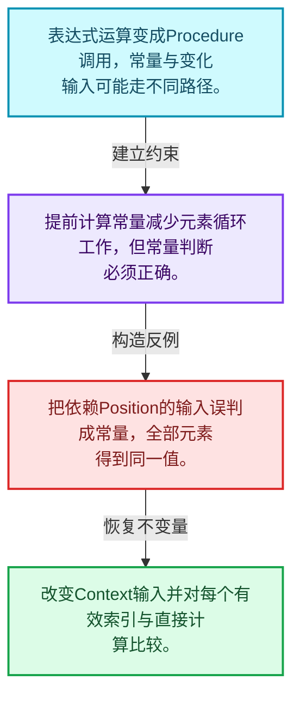
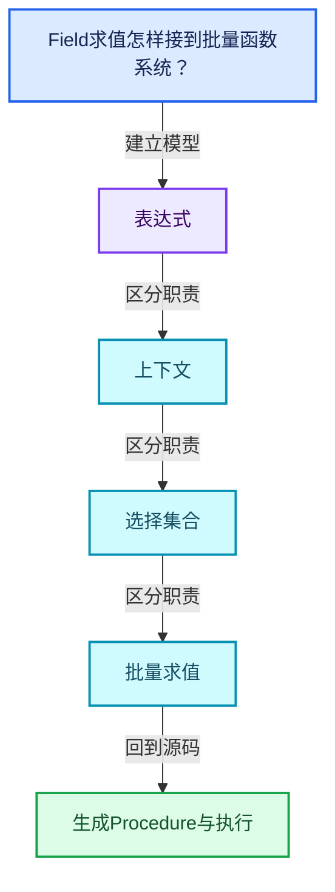
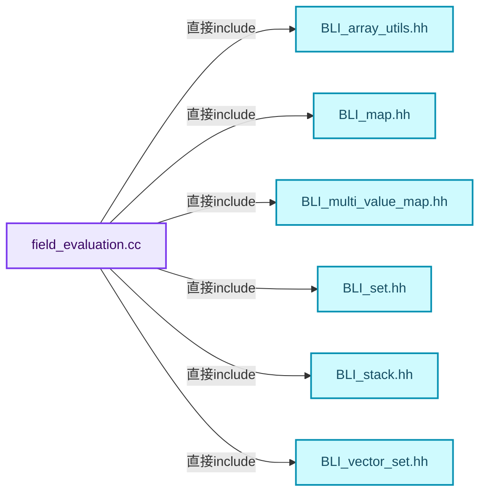
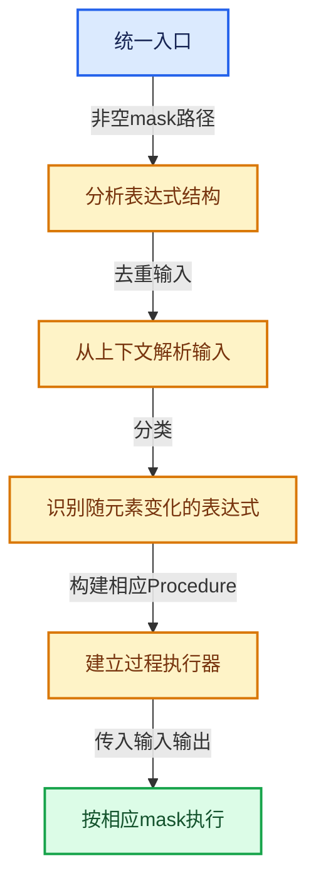
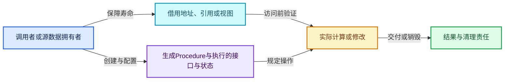
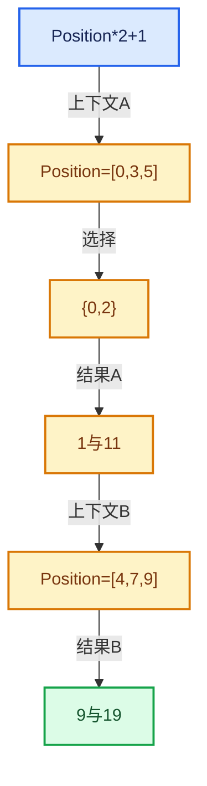

# 08-09 生成Procedure与执行

[方向导航](README.md) · [总目录](../README.md) · [覆盖索引](../%E6%BA%90%E7%A0%81%E7%89%88%E6%9C%AC%E4%B8%8E%E8%A6%86%E7%9B%96%E7%B4%A2%E5%BC%95.md)

> 阅读顺序：问题与数据模型 → 语法与类型 → 源码逐行 → 调用线索 → 历史与取舍 → 推演和练习。

- 基准 HEAD：`cbda6b96c26c0dee3c3b5cbb93960c4ac06a6b30`。
- 记录日期：2026-10-14。
- 教学示例状态：正文中的推演不是本机性能实测；已运行练习见验收报告。

## 一、从问题到设计

Field求值怎样接到批量函数系统？

构建执行过程把表达式关系变成变量和指令，再在选定元素上运行；生成成本与执行成本分开计量。

本篇把语法、数据语义和系统取舍连接起来。Field表达式、求值上下文、mask与结果存储各自有独立职责和生命周期。

### 本篇独立模型与设计推理

表达式运算变成Procedure调用，常量与变化输入可能走不同路径。

设计取舍：提前计算常量减少元素循环工作，但常量判断必须正确。

最小反例：把依赖Position的输入误判成常量，全部元素得到同一值。

推导与处理：改变Context输入并对每个有效索引与直接计算比较。



### 源码范围与相邻篇章

| 文件 | 本篇逐行范围 | 基准SHA-256 |
|---|---|---|
| [source/blender/functions/intern/field_evaluation.cc](../../../../../source/blender/functions/intern/field_evaluation.cc) | L299—L643 | `e20be0a19eb6f025c5123b8ed1493b0549c35aecbbb0ff090d65f3595ad3d0af` |

同一主讲文件可能分多篇覆盖；超出本篇范围的符号通过覆盖索引定位。空行与纯注释保留在源码摘录中，逐行表解释有效语句与语法边界；许可证头统一保留。

前篇：[表达式分析与共享子图](08-%E8%A1%A8%E8%BE%BE%E5%BC%8F%E5%88%86%E6%9E%90%E4%B8%8E%E5%85%B1%E4%BA%AB%E5%AD%90%E5%9B%BE.md).

后篇：[几何上下文与属性域](10-%E5%87%A0%E4%BD%95%E4%B8%8A%E4%B8%8B%E6%96%87%E4%B8%8E%E5%B1%9E%E6%80%A7%E5%9F%9F.md).

## 二、类型、数据与阅读地图



这是概念依赖图，边表示阅读关系，不声称是运行时调用顺序。

### 直接编译依赖



箭头只表示头文件包含关系；完整调用线索见后面的符号定位表。

## 三、关键词、语法与类型角色

### 依赖名称 typename

typename既可引入类型模板参数，也可告诉编译器某个依赖名称是类型。它不创建运行时对象；解析期确认语法类别与实例化期检查具体类型是不同阶段。

具体检查：区分typename T::value_type和T::size()，前者标记类型，后者是表达式。

### 常量求值 constexpr

constexpr声明允许相应实体参与常量求值，但constexpr函数仍可以在运行时执行。是否常量求值由调用场景和表达式合法性共同决定。

具体检查：比较constexpr变量初始化和从运行时输入调用同一函数。

### 只读限定 const

const约束当前访问路径可做的修改。const指针、指向const的指针、const视图对象、const元素是不同位置的限定；其他别名可能仍可修改原对象。

具体检查：分别写T* const、const T*与const T* const，并画出不可修改的层次。

### 移动转换 std::move

std::move把表达式转换为可供移动重载选择的值类别，实际资源转移发生在被选中的构造或赋值中。对const对象move可能仍调用复制，对视图move也不会获得底层数据所有权。

具体检查：记录移动构造调用次数，不用变量名或std::move的出现次数替代测量。

### 显式静态转换 static_cast

static_cast表达编译期允许的转换，不会自动验证运行时真实类型、指针寿命或索引边界。由void指针恢复T指针时，调用者仍须保证实际存储中确有合法T对象。

具体检查：标出转换前后的类型以及正确性依据来自哪里。

### 运行时多态 virtual

虚调用根据实际动态类型选择实现；经基类指针销毁对象时通常需要相应虚析构契约。每元素虚调用和循环外一次分派有不同开销。

具体检查：找出虚接口的实现类和调用频率，再讨论是否值得去虚拟化。

### 构造与new表达式

普通new可能分配并构造；placement new在给定地址构造，存储由其他机制提供。失败回滚应区分两类责任。

具体检查：追踪地址来自哪里、构造何时成功、由谁析构、由谁释放。

### 内部断言 assert

断言表达开发者预期成立的内部契约，发布构建可能关闭。它不能替代对不可信输入的完整错误处理，也不保证后续操作被运行时保护。

具体检查：对每条断言构造违反条件的输入，区分调用者错误与应向用户报告的错误。

### 编译期分支 if constexpr

条件在实例化时决定被保留的分支，这常用于不同类型的合法操作选择。它与运行时if有不同的实例化检查规则。

具体检查：找出每个分支依赖哪些类型特征，再使用满足与不满足条件的类型。

## 四、真实源码与逐行讲解

源码块保持原行内容，原始行号由小节标题及逐行表给出。表中的调用定位是静态阅读辅助；重载、模板实例化、宏展开和虚调用需结合完整声明，不能仅凭词法出现证明动态调用。

### field_evaluation.cc：L299—L505

<!-- source:source/blender/functions/intern/field_evaluation.cc:299:505 -->

```cpp

Vector<GVArray> evaluate_fields(ResourceScope &scope,
                                Span<GFieldRef> fields_to_evaluate,
                                const IndexMask &mask,
                                const FieldContext &context,
                                Span<GVMutableArray> dst_varrays)
{
  PRF_scope(ProfileCategory::Default);
  Vector<GVArray> varrays(fields_to_evaluate.size());
  Array<bool> is_output_written_to_dst(fields_to_evaluate.size(), false);
  const int array_size = mask.min_array_size();

  if (mask.is_empty()) {
    for (const int i : fields_to_evaluate.index_range()) {
      const CPPType &type = fields_to_evaluate[i].cpp_type();
      varrays[i] = GVArray::from_empty(type);
    }
    return varrays;
  }

  /* Destination arrays are optional. Create a small utility method to access them. */
  auto get_dst_varray = [&](int index) -> GVMutableArray {
    if (dst_varrays.is_empty()) {
      return {};
    }
    const GVMutableArray &varray = dst_varrays[index];
    if (!varray) {
      return {};
    }
    BLI_assert(varray.size() >= array_size);
    return varray;
  };

  /* Traverse the field tree and prepare some data that is used in later steps. */
  FieldTreeInfo field_tree_info = preprocess_field_tree(fields_to_evaluate);

  /* Get inputs that will be passed into the field when evaluated. */
  Vector<GVArray> field_context_inputs = get_field_context_inputs(
      scope, mask, context, field_tree_info.deduplicated_inputs);

  Set<UniqueHash> varying_fields = find_varying_fields(field_tree_info, field_context_inputs);

  /* Process fields that can output a VArray directly, and separate the rest of the fields into
   * two categories: those that are constant and need to be evaluated only once, and those that
   * need to be evaluated for every index. */
  Vector<GFieldRef> varying_fields_to_evaluate;
  Vector<int> varying_field_indices;
  Vector<GFieldRef> constant_fields_to_evaluate;
  Vector<int> constant_field_indices;
  for (const int out_index : fields_to_evaluate.index_range()) {
    const GFieldRef &field = fields_to_evaluate[out_index];
    const GFieldRef::Variant &field_variant = field.variant();
    std::visit(
        [&]<typename T>(const T &v) {
          if constexpr (std::is_same_v<T, GFieldRef::Input>) {
            const UniqueHash hash = field_tree_info.deep_hashes.lookup(field);
            const int input_i = field_tree_info.deduplicated_input_hashes.index_of(hash);
            const GVArray &varray = field_context_inputs[input_i];
            varrays[out_index] = varray;
          }
          else if constexpr (std::is_same_v<T, GFieldRef::MultiFn>) {
            const UniqueHash hash = field_tree_info.deep_hashes.lookup(field);
            if (varying_fields.contains(hash)) {
              varying_fields_to_evaluate.append(field);
              varying_field_indices.append(out_index);
            }
            else {
              constant_fields_to_evaluate.append(field);
              constant_field_indices.append(out_index);
            }
          }
          else if constexpr (std::is_same_v<T, GFieldRef::Value>) {
            varrays[out_index] = GVArray::from_single_ref(*v.type, mask.min_array_size(), v.value);
          }
          else {
            BLI_assert_unreachable_static_t(T);
          }
        },
        field_variant);
  }

  /* Evaluate varying fields if necessary. */
  if (!varying_fields_to_evaluate.is_empty()) {
    /* Build the procedure for those fields. */
    mf::Procedure procedure;
    build_multi_function_procedure_for_fields(
        procedure, scope, field_tree_info, varying_fields_to_evaluate);
    mf::ProcedureExecutor procedure_executor{procedure};

    mf::ParamsBuilder mf_params{procedure_executor, &mask};
    mf::ContextBuilder mf_context;

    /* Provide inputs to the procedure executor. */
    for (const GVArray &varray : field_context_inputs) {
      mf_params.add_readonly_single_input(varray);
    }

    for (const int i : varying_fields_to_evaluate.index_range()) {
      const GFieldRef &field = varying_fields_to_evaluate[i];
      const CPPType &type = field.cpp_type();
      const int out_index = varying_field_indices[i];

      /* Try to get an existing virtual array that the result should be written into. */
      GVMutableArray dst_varray = get_dst_varray(out_index);
      void *buffer;
      if (!dst_varray || !dst_varray.is_span()) {
        /* Allocate a new buffer for the computed result. */
        buffer = scope.allocator().allocate_array(type, array_size);

        if (!type.is_trivially_destructible) {
          /* Destruct values in the end. */
          scope.add_destruct_call(
              [buffer, mask, &type]() { type.destruct_indices(buffer, mask); });
        }

        varrays[out_index] = GVArray::from_span({type, buffer, array_size});
      }
      else {
        /* Write the result into the existing span. */
        buffer = dst_varray.get_internal_span().data();

        varrays[out_index] = dst_varray;
        is_output_written_to_dst[out_index] = true;
      }

      /* Pass output buffer to the procedure executor. */
      const GMutableSpan span{type, buffer, array_size};
      mf_params.add_uninitialized_single_output(span);
    }

    procedure_executor.call_auto(mask, mf_params, mf_context);
  }

  /* Evaluate constant fields if necessary. */
  if (!constant_fields_to_evaluate.is_empty()) {
    /* Build the procedure for those fields. */
    mf::Procedure procedure;
    build_multi_function_procedure_for_fields(
        procedure, scope, field_tree_info, constant_fields_to_evaluate);
    mf::ProcedureExecutor procedure_executor{procedure};
    const IndexMask mask(1);
    mf::ParamsBuilder mf_params{procedure_executor, &mask};
    mf::ContextBuilder mf_context;

    /* Provide inputs to the procedure executor. */
    for (const GVArray &varray : field_context_inputs) {
      mf_params.add_readonly_single_input(varray);
    }

    for (const int i : constant_fields_to_evaluate.index_range()) {
      const GFieldRef &field = constant_fields_to_evaluate[i];
      const CPPType &type = field.cpp_type();
      /* Allocate memory where the computed value will be stored in. */
      void *buffer = scope.allocate_owned(type);

      /* Pass output buffer to the procedure executor. */
      mf_params.add_uninitialized_single_output({type, buffer, 1});

      /* Create virtual array that can be used after the procedure has been executed below. */
      const int out_index = constant_field_indices[i];
      varrays[out_index] = GVArray::from_single_ref(type, array_size, buffer);
    }

    procedure_executor.call(mask, mf_params, mf_context);
  }

  /* Copy data to supplied destination arrays if necessary. In some cases the evaluation above
   * has written the computed data in the right place already. */
  if (!dst_varrays.is_empty()) {
    for (const int out_index : fields_to_evaluate.index_range()) {
      GVMutableArray dst_varray = get_dst_varray(out_index);
      if (!dst_varray) {
        /* Caller did not provide a destination for this output. */
        continue;
      }
      const GVArray &computed_varray = varrays[out_index];
      BLI_assert(computed_varray.type() == dst_varray.type());
      if (is_output_written_to_dst[out_index]) {
        /* The result has been written into the destination provided by the caller already. */
        continue;
      }
      /* Still have to copy over the data in the destination provided by the caller. */
      if (dst_varray.is_span()) {
        computed_varray.type().default_construct_indices(dst_varray.get_internal_span().data(),
                                                         mask);
        array_utils::copy(computed_varray,
                          mask,
                          dst_varray.get_internal_span().take_front(mask.min_array_size()));
      }
      else {
        /* Slower materialize into a different structure. */
        const CPPType &type = computed_varray.type();
        threading::parallel_for(mask.index_range(), 2048, [&](const IndexRange range) {
          BUFFER_FOR_CPP_TYPE_VALUE(type, buffer);
          mask.slice(range).foreach_segment([&](auto segment) {
            for (const int i : segment) {
              computed_varray.get_to_uninitialized(i, buffer);
              dst_varray.set_by_relocate(i, buffer);
            }
          });
        });
      }
      varrays[out_index] = dst_varray;
    }
  }
  return varrays;
}
```

本段语义重点：

- `evaluate_fields`：批量求值一组表达式，结合上下文、mask和可选目标数组；结果表示可以继续保持虚拟。
- `std::visit`：根据variant当前活动类型执行对应操作；每个候选分支都必须满足访客约定。

| 原始行 | 语义、约束与检查 |
|---|---|
| L300 | 出现调用或函数声明 `evaluate_fields`，对应表达式为 `Vector<GVArray> evaluate_fields(ResourceScope &scope,`。参数求值、返回类型与重载需结合前后完整语句；静态文本引用不能证明动态目标。 |
| L301 | 本行是连续声明或表达式的一部分：`Span<GFieldRef> fields_to_evaluate,`。与本段前后行合读；逗号、括号和限定符决定它属于参数、初始化列表还是实际计算。 |
| L302 | 本行是连续声明或表达式的一部分：`const IndexMask &mask,`。与本段前后行合读；逗号、括号和限定符决定它属于参数、初始化列表还是实际计算。 |
| L303 | 本行是连续声明或表达式的一部分：`const FieldContext &context,`。与本段前后行合读；逗号、括号和限定符决定它属于参数、初始化列表还是实际计算。 |
| L304 | 本行是连续声明或表达式的一部分：`Span<GVMutableArray> dst_varrays)`。与本段前后行合读；逗号、括号和限定符决定它属于参数、初始化列表还是实际计算。 |
| L305 | 连接上一行的声明或控制结构与其语句块；后续行在这个作用域中执行或声明。 |
| L306 | 出现调用或函数声明 `PRF_scope`，对应表达式为 `PRF_scope(ProfileCategory::Default);`。参数求值、返回类型与重载需结合前后完整语句；静态文本引用不能证明动态目标。 |
| L307 | 出现调用或函数声明 `varrays`，对应表达式为 `Vector<GVArray> varrays(fields_to_evaluate.size());`。参数求值、返回类型与重载需结合前后完整语句；静态文本引用不能证明动态目标。 |
| L308 | 出现调用或函数声明 `is_output_written_to_dst`，对应表达式为 `Array<bool> is_output_written_to_dst(fields_to_evaluate.size(), false);`。参数求值、返回类型与重载需结合前后完整语句；静态文本引用不能证明动态目标。 |
| L309 | 把右侧 `mask.min_array_size()` 用于初始化或更新左侧 `const int array_size`。声明初始化与已有对象赋值应按上下文区分；有资源的类型会调用相应特殊成员。 |
| L311 | 判断 `mask.is_empty()`，成立时进入本分支，否则继续后续路径。 |
| L312 | 按 `for (const int i : fields_to_evaluate.index_range())` 指定的范围或条件重复执行。对照循环变量与真实元素编号；循环内调用成本乘以实际迭代次数。 |
| L313 | 把右侧 `fields_to_evaluate[i].cpp_type()` 用于初始化或更新左侧 `const CPPType &type`。声明初始化与已有对象赋值应按上下文区分；有资源的类型会调用相应特殊成员。 |
| L314 | 把右侧 `GVArray::from_empty(type)` 用于初始化或更新左侧 `varrays[i]`。声明初始化与已有对象赋值应按上下文区分；有资源的类型会调用相应特殊成员。 |
| L315 | 结束当前语法单元。局部自动对象在离开其作用域时按规则销毁；这不等于所有被引用的外部数据也被释放。 |
| L316 | 返回表达式 `varrays`。 |
| L317 | 结束当前语法单元。局部自动对象在离开其作用域时按规则销毁；这不等于所有被引用的外部数据也被释放。 |
| L320 | 把右侧 `[&](int index) -> GVMutableArray {` 用于初始化或更新左侧 `auto get_dst_varray`。声明初始化与已有对象赋值应按上下文区分；有资源的类型会调用相应特殊成员。 |
| L321 | 判断 `dst_varrays.is_empty()`，成立时进入本分支，否则继续后续路径。 |
| L322 | 返回表达式 `{}`。 |
| L323 | 结束当前语法单元。局部自动对象在离开其作用域时按规则销毁；这不等于所有被引用的外部数据也被释放。 |
| L324 | 把右侧 `dst_varrays[index]` 用于初始化或更新左侧 `const GVMutableArray &varray`。声明初始化与已有对象赋值应按上下文区分；有资源的类型会调用相应特殊成员。 |
| L325 | 判断 `!varray`，成立时进入本分支，否则继续后续路径。 |
| L326 | 返回表达式 `{}`。 |
| L327 | 结束当前语法单元。局部自动对象在离开其作用域时按规则销毁；这不等于所有被引用的外部数据也被释放。 |
| L328 | 断言约束 `BLI_assert(varray.size() >= array_size);`。条件是后续访问的内部前置条件；发布构建可能不执行，不能把断言当作输入修复。 |
| L329 | 返回表达式 `varray`。 |
| L330 | 结束当前语法单元。局部自动对象在离开其作用域时按规则销毁；这不等于所有被引用的外部数据也被释放。 |
| L333 | 把右侧 `preprocess_field_tree(fields_to_evaluate)` 用于初始化或更新左侧 `FieldTreeInfo field_tree_info`。声明初始化与已有对象赋值应按上下文区分；有资源的类型会调用相应特殊成员。 |
| L336 | 把右侧 `get_field_context_inputs(` 用于初始化或更新左侧 `Vector<GVArray> field_context_inputs`。声明初始化与已有对象赋值应按上下文区分；有资源的类型会调用相应特殊成员。 |
| L337 | 声明成员、局部对象或完成语句 `scope, mask, context, field_tree_info.deduplicated_inputs)`。若为指针或引用，它本身不说明拥有；若为值对象，其构造析构由所在作用域或外层对象管理。 |
| L339 | 把右侧 `find_varying_fields(field_tree_info, field_context_inputs)` 用于初始化或更新左侧 `Set<UniqueHash> varying_fields`。声明初始化与已有对象赋值应按上下文区分；有资源的类型会调用相应特殊成员。 |
| L344 | 声明成员、局部对象或完成语句 `Vector<GFieldRef> varying_fields_to_evaluate`。若为指针或引用，它本身不说明拥有；若为值对象，其构造析构由所在作用域或外层对象管理。 |
| L345 | 声明成员、局部对象或完成语句 `Vector<int> varying_field_indices`。若为指针或引用，它本身不说明拥有；若为值对象，其构造析构由所在作用域或外层对象管理。 |
| L346 | 声明成员、局部对象或完成语句 `Vector<GFieldRef> constant_fields_to_evaluate`。若为指针或引用，它本身不说明拥有；若为值对象，其构造析构由所在作用域或外层对象管理。 |
| L347 | 声明成员、局部对象或完成语句 `Vector<int> constant_field_indices`。若为指针或引用，它本身不说明拥有；若为值对象，其构造析构由所在作用域或外层对象管理。 |
| L348 | 按 `for (const int out_index : fields_to_evaluate.index_range())` 指定的范围或条件重复执行。对照循环变量与真实元素编号；循环内调用成本乘以实际迭代次数。 |
| L349 | 把右侧 `fields_to_evaluate[out_index]` 用于初始化或更新左侧 `const GFieldRef &field`。声明初始化与已有对象赋值应按上下文区分；有资源的类型会调用相应特殊成员。 |
| L350 | 把右侧 `field.variant()` 用于初始化或更新左侧 `const GFieldRef::Variant &field_variant`。声明初始化与已有对象赋值应按上下文区分；有资源的类型会调用相应特殊成员。 |
| L351 | 本行使用 `std::visit`：根据variant当前活动类型执行对应操作；每个候选分支都必须满足访客约定。 |
| L352 | 本行是连续声明或表达式的一部分：`[&]<typename T>(const T &v) {`。与本段前后行合读；逗号、括号和限定符决定它属于参数、初始化列表还是实际计算。 |
| L353 | 编译期条件分支 `if constexpr (std::is_same_v<T, GFieldRef::Input>)`。按实例化类型选择相应实现；被舍弃分支和运行期if具有不同检查规则，不能当作运行时输入验证。 |
| L354 | 把右侧 `field_tree_info.deep_hashes.lookup(field)` 用于初始化或更新左侧 `const UniqueHash hash`。声明初始化与已有对象赋值应按上下文区分；有资源的类型会调用相应特殊成员。 |
| L355 | 把右侧 `field_tree_info.deduplicated_input_hashes.index_of(hash)` 用于初始化或更新左侧 `const int input_i`。声明初始化与已有对象赋值应按上下文区分；有资源的类型会调用相应特殊成员。 |
| L356 | 把右侧 `field_context_inputs[input_i]` 用于初始化或更新左侧 `const GVArray &varray`。声明初始化与已有对象赋值应按上下文区分；有资源的类型会调用相应特殊成员。 |
| L357 | 把右侧 `varray` 用于初始化或更新左侧 `varrays[out_index]`。声明初始化与已有对象赋值应按上下文区分；有资源的类型会调用相应特殊成员。 |
| L358 | 结束当前语法单元。局部自动对象在离开其作用域时按规则销毁；这不等于所有被引用的外部数据也被释放。 |
| L359 | 出现调用或函数声明 `constexpr`，对应表达式为 `else if constexpr (std::is_same_v<T, GFieldRef::MultiFn>) {`。参数求值、返回类型与重载需结合前后完整语句；静态文本引用不能证明动态目标。 |
| L360 | 把右侧 `field_tree_info.deep_hashes.lookup(field)` 用于初始化或更新左侧 `const UniqueHash hash`。声明初始化与已有对象赋值应按上下文区分；有资源的类型会调用相应特殊成员。 |
| L361 | 判断 `varying_fields.contains(hash)`，成立时进入本分支，否则继续后续路径。 |
| L362 | 出现调用或函数声明 `append`，对应表达式为 `varying_fields_to_evaluate.append(field);`。参数求值、返回类型与重载需结合前后完整语句；静态文本引用不能证明动态目标。 |
| L363 | 出现调用或函数声明 `append`，对应表达式为 `varying_field_indices.append(out_index);`。参数求值、返回类型与重载需结合前后完整语句；静态文本引用不能证明动态目标。 |
| L364 | 结束当前语法单元。局部自动对象在离开其作用域时按规则销毁；这不等于所有被引用的外部数据也被释放。 |
| L365 | 处理前一条件不成立的互补路径。比较两条路径最后是否恢复同一不变量，以及是否产生不同的资源责任。 |
| L366 | 出现调用或函数声明 `append`，对应表达式为 `constant_fields_to_evaluate.append(field);`。参数求值、返回类型与重载需结合前后完整语句；静态文本引用不能证明动态目标。 |
| L367 | 出现调用或函数声明 `append`，对应表达式为 `constant_field_indices.append(out_index);`。参数求值、返回类型与重载需结合前后完整语句；静态文本引用不能证明动态目标。 |
| L368 | 结束当前语法单元。局部自动对象在离开其作用域时按规则销毁；这不等于所有被引用的外部数据也被释放。 |
| L369 | 结束当前语法单元。局部自动对象在离开其作用域时按规则销毁；这不等于所有被引用的外部数据也被释放。 |
| L370 | 出现调用或函数声明 `constexpr`，对应表达式为 `else if constexpr (std::is_same_v<T, GFieldRef::Value>) {`。参数求值、返回类型与重载需结合前后完整语句；静态文本引用不能证明动态目标。 |
| L371 | 把右侧 `GVArray::from_single_ref(*v.type, mask.min_array_size(), v.value)` 用于初始化或更新左侧 `varrays[out_index]`。声明初始化与已有对象赋值应按上下文区分；有资源的类型会调用相应特殊成员。 |
| L372 | 结束当前语法单元。局部自动对象在离开其作用域时按规则销毁；这不等于所有被引用的外部数据也被释放。 |
| L373 | 处理前一条件不成立的互补路径。比较两条路径最后是否恢复同一不变量，以及是否产生不同的资源责任。 |
| L374 | 断言约束 `BLI_assert_unreachable_static_t(T);`。条件是后续访问的内部前置条件；发布构建可能不执行，不能把断言当作输入修复。 |
| L375 | 结束当前语法单元。局部自动对象在离开其作用域时按规则销毁；这不等于所有被引用的外部数据也被释放。 |
| L376 | 结束当前语法单元。局部自动对象在离开其作用域时按规则销毁；这不等于所有被引用的外部数据也被释放。 |
| L377 | 声明成员、局部对象或完成语句 `field_variant)`。若为指针或引用，它本身不说明拥有；若为值对象，其构造析构由所在作用域或外层对象管理。 |
| L378 | 结束当前语法单元。局部自动对象在离开其作用域时按规则销毁；这不等于所有被引用的外部数据也被释放。 |
| L381 | 判断 `!varying_fields_to_evaluate.is_empty()`，成立时进入本分支，否则继续后续路径。 |
| L383 | 声明成员、局部对象或完成语句 `mf::Procedure procedure`。若为指针或引用，它本身不说明拥有；若为值对象，其构造析构由所在作用域或外层对象管理。 |
| L384 | 出现调用或函数声明 `build_multi_function_procedure_for_fields`，对应表达式为 `build_multi_function_procedure_for_fields(`。参数求值、返回类型与重载需结合前后完整语句；静态文本引用不能证明动态目标。 |
| L385 | 声明成员、局部对象或完成语句 `procedure, scope, field_tree_info, varying_fields_to_evaluate)`。若为指针或引用，它本身不说明拥有；若为值对象，其构造析构由所在作用域或外层对象管理。 |
| L386 | 声明成员、局部对象或完成语句 `mf::ProcedureExecutor procedure_executor{procedure}`。若为指针或引用，它本身不说明拥有；若为值对象，其构造析构由所在作用域或外层对象管理。 |
| L388 | 声明成员、局部对象或完成语句 `mf::ParamsBuilder mf_params{procedure_executor, &mask}`。若为指针或引用，它本身不说明拥有；若为值对象，其构造析构由所在作用域或外层对象管理。 |
| L389 | 声明成员、局部对象或完成语句 `mf::ContextBuilder mf_context`。若为指针或引用，它本身不说明拥有；若为值对象，其构造析构由所在作用域或外层对象管理。 |
| L392 | 按 `for (const GVArray &varray : field_context_inputs)` 指定的范围或条件重复执行。对照循环变量与真实元素编号；循环内调用成本乘以实际迭代次数。 |
| L393 | 出现调用或函数声明 `add_readonly_single_input`，对应表达式为 `mf_params.add_readonly_single_input(varray);`。参数求值、返回类型与重载需结合前后完整语句；静态文本引用不能证明动态目标。 |
| L394 | 结束当前语法单元。局部自动对象在离开其作用域时按规则销毁；这不等于所有被引用的外部数据也被释放。 |
| L396 | 按 `for (const int i : varying_fields_to_evaluate.index_range())` 指定的范围或条件重复执行。对照循环变量与真实元素编号；循环内调用成本乘以实际迭代次数。 |
| L397 | 把右侧 `varying_fields_to_evaluate[i]` 用于初始化或更新左侧 `const GFieldRef &field`。声明初始化与已有对象赋值应按上下文区分；有资源的类型会调用相应特殊成员。 |
| L398 | 把右侧 `field.cpp_type()` 用于初始化或更新左侧 `const CPPType &type`。声明初始化与已有对象赋值应按上下文区分；有资源的类型会调用相应特殊成员。 |
| L399 | 把右侧 `varying_field_indices[i]` 用于初始化或更新左侧 `const int out_index`。声明初始化与已有对象赋值应按上下文区分；有资源的类型会调用相应特殊成员。 |
| L402 | 把右侧 `get_dst_varray(out_index)` 用于初始化或更新左侧 `GVMutableArray dst_varray`。声明初始化与已有对象赋值应按上下文区分；有资源的类型会调用相应特殊成员。 |
| L403 | 声明成员、局部对象或完成语句 `void *buffer`。若为指针或引用，它本身不说明拥有；若为值对象，其构造析构由所在作用域或外层对象管理。 |
| L404 | 判断 `!dst_varray &#124;&#124; !dst_varray.is_span()`，成立时进入本分支，否则继续后续路径。 |
| L406 | 把右侧 `scope.allocator().allocate_array(type, array_size)` 用于初始化或更新左侧 `buffer`。声明初始化与已有对象赋值应按上下文区分；有资源的类型会调用相应特殊成员。 |
| L408 | 判断 `!type.is_trivially_destructible`，成立时进入本分支，否则继续后续路径。 |
| L410 | 出现调用或函数声明 `add_destruct_call`，对应表达式为 `scope.add_destruct_call(`。参数求值、返回类型与重载需结合前后完整语句；静态文本引用不能证明动态目标。 |
| L411 | 出现调用或函数声明 `destruct_indices`，对应表达式为 `[buffer, mask, &type]() { type.destruct_indices(buffer, mask); });`。参数求值、返回类型与重载需结合前后完整语句；静态文本引用不能证明动态目标。 |
| L412 | 结束当前语法单元。局部自动对象在离开其作用域时按规则销毁；这不等于所有被引用的外部数据也被释放。 |
| L414 | 把右侧 `GVArray::from_span({type, buffer, array_size})` 用于初始化或更新左侧 `varrays[out_index]`。声明初始化与已有对象赋值应按上下文区分；有资源的类型会调用相应特殊成员。 |
| L415 | 结束当前语法单元。局部自动对象在离开其作用域时按规则销毁；这不等于所有被引用的外部数据也被释放。 |
| L416 | 处理前一条件不成立的互补路径。比较两条路径最后是否恢复同一不变量，以及是否产生不同的资源责任。 |
| L418 | 把右侧 `dst_varray.get_internal_span().data()` 用于初始化或更新左侧 `buffer`。声明初始化与已有对象赋值应按上下文区分；有资源的类型会调用相应特殊成员。 |
| L420 | 把右侧 `dst_varray` 用于初始化或更新左侧 `varrays[out_index]`。声明初始化与已有对象赋值应按上下文区分；有资源的类型会调用相应特殊成员。 |
| L421 | 把右侧 `true` 用于初始化或更新左侧 `is_output_written_to_dst[out_index]`。声明初始化与已有对象赋值应按上下文区分；有资源的类型会调用相应特殊成员。 |
| L422 | 结束当前语法单元。局部自动对象在离开其作用域时按规则销毁；这不等于所有被引用的外部数据也被释放。 |
| L425 | 声明成员、局部对象或完成语句 `const GMutableSpan span{type, buffer, array_size}`。若为指针或引用，它本身不说明拥有；若为值对象，其构造析构由所在作用域或外层对象管理。 |
| L426 | 出现调用或函数声明 `add_uninitialized_single_output`，对应表达式为 `mf_params.add_uninitialized_single_output(span);`。参数求值、返回类型与重载需结合前后完整语句；静态文本引用不能证明动态目标。 |
| L427 | 结束当前语法单元。局部自动对象在离开其作用域时按规则销毁；这不等于所有被引用的外部数据也被释放。 |
| L429 | 出现调用或函数声明 `call_auto`，对应表达式为 `procedure_executor.call_auto(mask, mf_params, mf_context);`。参数求值、返回类型与重载需结合前后完整语句；静态文本引用不能证明动态目标。 |
| L430 | 结束当前语法单元。局部自动对象在离开其作用域时按规则销毁；这不等于所有被引用的外部数据也被释放。 |
| L433 | 判断 `!constant_fields_to_evaluate.is_empty()`，成立时进入本分支，否则继续后续路径。 |
| L435 | 声明成员、局部对象或完成语句 `mf::Procedure procedure`。若为指针或引用，它本身不说明拥有；若为值对象，其构造析构由所在作用域或外层对象管理。 |
| L436 | 出现调用或函数声明 `build_multi_function_procedure_for_fields`，对应表达式为 `build_multi_function_procedure_for_fields(`。参数求值、返回类型与重载需结合前后完整语句；静态文本引用不能证明动态目标。 |
| L437 | 声明成员、局部对象或完成语句 `procedure, scope, field_tree_info, constant_fields_to_evaluate)`。若为指针或引用，它本身不说明拥有；若为值对象，其构造析构由所在作用域或外层对象管理。 |
| L438 | 声明成员、局部对象或完成语句 `mf::ProcedureExecutor procedure_executor{procedure}`。若为指针或引用，它本身不说明拥有；若为值对象，其构造析构由所在作用域或外层对象管理。 |
| L439 | 声明接口 `const IndexMask mask(1)`，本行没有对应函数体；返回类型、参数限定和const/noexcept共同组成调用契约，实际行为需继续定位实现。 |
| L440 | 声明成员、局部对象或完成语句 `mf::ParamsBuilder mf_params{procedure_executor, &mask}`。若为指针或引用，它本身不说明拥有；若为值对象，其构造析构由所在作用域或外层对象管理。 |
| L441 | 声明成员、局部对象或完成语句 `mf::ContextBuilder mf_context`。若为指针或引用，它本身不说明拥有；若为值对象，其构造析构由所在作用域或外层对象管理。 |
| L444 | 按 `for (const GVArray &varray : field_context_inputs)` 指定的范围或条件重复执行。对照循环变量与真实元素编号；循环内调用成本乘以实际迭代次数。 |
| L445 | 出现调用或函数声明 `add_readonly_single_input`，对应表达式为 `mf_params.add_readonly_single_input(varray);`。参数求值、返回类型与重载需结合前后完整语句；静态文本引用不能证明动态目标。 |
| L446 | 结束当前语法单元。局部自动对象在离开其作用域时按规则销毁；这不等于所有被引用的外部数据也被释放。 |
| L448 | 按 `for (const int i : constant_fields_to_evaluate.index_range())` 指定的范围或条件重复执行。对照循环变量与真实元素编号；循环内调用成本乘以实际迭代次数。 |
| L449 | 把右侧 `constant_fields_to_evaluate[i]` 用于初始化或更新左侧 `const GFieldRef &field`。声明初始化与已有对象赋值应按上下文区分；有资源的类型会调用相应特殊成员。 |
| L450 | 把右侧 `field.cpp_type()` 用于初始化或更新左侧 `const CPPType &type`。声明初始化与已有对象赋值应按上下文区分；有资源的类型会调用相应特殊成员。 |
| L452 | 把右侧 `scope.allocate_owned(type)` 用于初始化或更新左侧 `void *buffer`。声明初始化与已有对象赋值应按上下文区分；有资源的类型会调用相应特殊成员。 |
| L455 | 出现调用或函数声明 `add_uninitialized_single_output`，对应表达式为 `mf_params.add_uninitialized_single_output({type, buffer, 1});`。参数求值、返回类型与重载需结合前后完整语句；静态文本引用不能证明动态目标。 |
| L458 | 把右侧 `constant_field_indices[i]` 用于初始化或更新左侧 `const int out_index`。声明初始化与已有对象赋值应按上下文区分；有资源的类型会调用相应特殊成员。 |
| L459 | 把右侧 `GVArray::from_single_ref(type, array_size, buffer)` 用于初始化或更新左侧 `varrays[out_index]`。声明初始化与已有对象赋值应按上下文区分；有资源的类型会调用相应特殊成员。 |
| L460 | 结束当前语法单元。局部自动对象在离开其作用域时按规则销毁；这不等于所有被引用的外部数据也被释放。 |
| L462 | 出现调用或函数声明 `call`，对应表达式为 `procedure_executor.call(mask, mf_params, mf_context);`。参数求值、返回类型与重载需结合前后完整语句；静态文本引用不能证明动态目标。 |
| L463 | 结束当前语法单元。局部自动对象在离开其作用域时按规则销毁；这不等于所有被引用的外部数据也被释放。 |
| L467 | 判断 `!dst_varrays.is_empty()`，成立时进入本分支，否则继续后续路径。 |
| L468 | 按 `for (const int out_index : fields_to_evaluate.index_range())` 指定的范围或条件重复执行。对照循环变量与真实元素编号；循环内调用成本乘以实际迭代次数。 |
| L469 | 把右侧 `get_dst_varray(out_index)` 用于初始化或更新左侧 `GVMutableArray dst_varray`。声明初始化与已有对象赋值应按上下文区分；有资源的类型会调用相应特殊成员。 |
| L470 | 判断 `!dst_varray`，成立时进入本分支，否则继续后续路径。 |
| L472 | 结束本轮循环并进入下一轮；核对本轮已经取得的资源是否由作用域或显式代码清理。 |
| L473 | 结束当前语法单元。局部自动对象在离开其作用域时按规则销毁；这不等于所有被引用的外部数据也被释放。 |
| L474 | 把右侧 `varrays[out_index]` 用于初始化或更新左侧 `const GVArray &computed_varray`。声明初始化与已有对象赋值应按上下文区分；有资源的类型会调用相应特殊成员。 |
| L475 | 断言约束 `BLI_assert(computed_varray.type() == dst_varray.type());`。条件是后续访问的内部前置条件；发布构建可能不执行，不能把断言当作输入修复。 |
| L476 | 判断 `is_output_written_to_dst[out_index]`，成立时进入本分支，否则继续后续路径。 |
| L478 | 结束本轮循环并进入下一轮；核对本轮已经取得的资源是否由作用域或显式代码清理。 |
| L479 | 结束当前语法单元。局部自动对象在离开其作用域时按规则销毁；这不等于所有被引用的外部数据也被释放。 |
| L481 | 判断 `dst_varray.is_span()`，成立时进入本分支，否则继续后续路径。 |
| L482 | 出现调用或函数声明 `type`，对应表达式为 `computed_varray.type().default_construct_indices(dst_varray.get_internal_span().data(),`。参数求值、返回类型与重载需结合前后完整语句；静态文本引用不能证明动态目标。 |
| L483 | 声明成员、局部对象或完成语句 `mask)`。若为指针或引用，它本身不说明拥有；若为值对象，其构造析构由所在作用域或外层对象管理。 |
| L484 | 出现调用或函数声明 `array_utils::copy`，对应表达式为 `array_utils::copy(computed_varray,`。参数求值、返回类型与重载需结合前后完整语句；静态文本引用不能证明动态目标。 |
| L485 | 本行是连续声明或表达式的一部分：`mask,`。与本段前后行合读；逗号、括号和限定符决定它属于参数、初始化列表还是实际计算。 |
| L486 | 出现调用或函数声明 `get_internal_span`，对应表达式为 `dst_varray.get_internal_span().take_front(mask.min_array_size()));`。参数求值、返回类型与重载需结合前后完整语句；静态文本引用不能证明动态目标。 |
| L487 | 结束当前语法单元。局部自动对象在离开其作用域时按规则销毁；这不等于所有被引用的外部数据也被释放。 |
| L488 | 处理前一条件不成立的互补路径。比较两条路径最后是否恢复同一不变量，以及是否产生不同的资源责任。 |
| L490 | 把右侧 `computed_varray.type()` 用于初始化或更新左侧 `const CPPType &type`。声明初始化与已有对象赋值应按上下文区分；有资源的类型会调用相应特殊成员。 |
| L491 | 出现调用或函数声明 `threading::parallel_for`，对应表达式为 `threading::parallel_for(mask.index_range(), 2048, [&](const IndexRange range) {`。参数求值、返回类型与重载需结合前后完整语句；静态文本引用不能证明动态目标。 |
| L492 | 出现调用或函数声明 `BUFFER_FOR_CPP_TYPE_VALUE`，对应表达式为 `BUFFER_FOR_CPP_TYPE_VALUE(type, buffer);`。参数求值、返回类型与重载需结合前后完整语句；静态文本引用不能证明动态目标。 |
| L493 | 出现调用或函数声明 `slice`，对应表达式为 `mask.slice(range).foreach_segment([&](auto segment) {`。参数求值、返回类型与重载需结合前后完整语句；静态文本引用不能证明动态目标。 |
| L494 | 按 `for (const int i : segment)` 指定的范围或条件重复执行。对照循环变量与真实元素编号；循环内调用成本乘以实际迭代次数。 |
| L495 | 出现调用或函数声明 `get_to_uninitialized`，对应表达式为 `computed_varray.get_to_uninitialized(i, buffer);`。参数求值、返回类型与重载需结合前后完整语句；静态文本引用不能证明动态目标。 |
| L496 | 出现调用或函数声明 `set_by_relocate`，对应表达式为 `dst_varray.set_by_relocate(i, buffer);`。参数求值、返回类型与重载需结合前后完整语句；静态文本引用不能证明动态目标。 |
| L497 | 结束当前语法单元。局部自动对象在离开其作用域时按规则销毁；这不等于所有被引用的外部数据也被释放。 |
| L498 | 结束当前语法单元。局部自动对象在离开其作用域时按规则销毁；这不等于所有被引用的外部数据也被释放。 |
| L499 | 结束当前语法单元。局部自动对象在离开其作用域时按规则销毁；这不等于所有被引用的外部数据也被释放。 |
| L500 | 结束当前语法单元。局部自动对象在离开其作用域时按规则销毁；这不等于所有被引用的外部数据也被释放。 |
| L501 | 把右侧 `dst_varray` 用于初始化或更新左侧 `varrays[out_index]`。声明初始化与已有对象赋值应按上下文区分；有资源的类型会调用相应特殊成员。 |
| L502 | 结束当前语法单元。局部自动对象在离开其作用域时按规则销毁；这不等于所有被引用的外部数据也被释放。 |
| L503 | 结束当前语法单元。局部自动对象在离开其作用域时按规则销毁；这不等于所有被引用的外部数据也被释放。 |
| L504 | 返回表达式 `varrays`。 |
| L505 | 结束当前语法单元。局部自动对象在离开其作用域时按规则销毁；这不等于所有被引用的外部数据也被释放。 |

### field_evaluation.cc：L506—L554

<!-- source:source/blender/functions/intern/field_evaluation.cc:506:554 -->

```cpp

void evaluate_constant_field(const GField &field, void *r_value)
{
  if (field.depends_on_input()) {
    const CPPType &type = field.cpp_type();
    type.value_initialize(r_value);
    return;
  }

  AlignedBuffer<512, 64> local_buffer;
  ResourceScope scope(local_buffer);
  FieldContext context;
  Vector<GVArray> varrays = evaluate_fields(scope, {field}, IndexRange(1), context);
  varrays[0].get_to_uninitialized(0, r_value);
}

GField make_field_constant_if_possible(GField field)
{
  if (field.depends_on_input()) {
    return field;
  }
  const CPPType &type = field.cpp_type();
  BUFFER_FOR_CPP_TYPE_VALUE(type, buffer);
  evaluate_constant_field(field, buffer);
  GField new_field = GField::from_constant(type, buffer);
  type.destruct(buffer);
  return new_field;
}

/** \} */

/* -------------------------------------------------------------------- */
/** \name #FieldEvaluator
 * \{ */

static IndexMask index_mask_from_selection(const IndexMask full_mask,
                                           const VArray<bool> &selection,
                                           ResourceScope &scope)
{
  return IndexMask::from_bools(full_mask, selection, scope.allocator());
}

int FieldEvaluator::add_with_destination(GField field, GVMutableArray dst)
{
  const int field_index = fields_to_evaluate_.append_and_get_index(std::move(field));
  dst_varrays_.append(dst);
  output_pointer_infos_.append({});
  return field_index;
}
```

本段语义重点：

- `evaluate_fields`：批量求值一组表达式，结合上下文、mask和可选目标数组；结果表示可以继续保持虚拟。
- `index_mask_from_selection`：把布尔结果转换成有序选择集合；只能读取相应有效元素。
- `fields_to_evaluate_`：登记的待求值表达式，顺序与结果索引对应。
- `dst_varrays_`：由调用者提供的目标数组描述，元素初始化约定需匹配接口。
- `output_pointer_infos_`：记录外部输出地址与赋值桥接操作，外部地址须在回填时有效。

| 原始行 | 语义、约束与检查 |
|---|---|
| L507 | 出现调用或函数声明 `evaluate_constant_field`，对应表达式为 `void evaluate_constant_field(const GField &field, void *r_value)`。参数求值、返回类型与重载需结合前后完整语句；静态文本引用不能证明动态目标。 |
| L508 | 连接上一行的声明或控制结构与其语句块；后续行在这个作用域中执行或声明。 |
| L509 | 判断 `field.depends_on_input()`，成立时进入本分支，否则继续后续路径。 |
| L510 | 把右侧 `field.cpp_type()` 用于初始化或更新左侧 `const CPPType &type`。声明初始化与已有对象赋值应按上下文区分；有资源的类型会调用相应特殊成员。 |
| L511 | 出现调用或函数声明 `value_initialize`，对应表达式为 `type.value_initialize(r_value);`。参数求值、返回类型与重载需结合前后完整语句；静态文本引用不能证明动态目标。 |
| L512 | 结束当前函数，本路径不再执行后续语句；局部对象按作用域规则清理。 |
| L513 | 结束当前语法单元。局部自动对象在离开其作用域时按规则销毁；这不等于所有被引用的外部数据也被释放。 |
| L515 | 声明成员、局部对象或完成语句 `AlignedBuffer<512, 64> local_buffer`。若为指针或引用，它本身不说明拥有；若为值对象，其构造析构由所在作用域或外层对象管理。 |
| L516 | 出现调用或函数声明 `scope`，对应表达式为 `ResourceScope scope(local_buffer);`。参数求值、返回类型与重载需结合前后完整语句；静态文本引用不能证明动态目标。 |
| L517 | 声明成员、局部对象或完成语句 `FieldContext context`。若为指针或引用，它本身不说明拥有；若为值对象，其构造析构由所在作用域或外层对象管理。 |
| L518 | 本行使用 `evaluate_fields`：批量求值一组表达式，结合上下文、mask和可选目标数组；结果表示可以继续保持虚拟。 |
| L519 | 出现调用或函数声明 `get_to_uninitialized`，对应表达式为 `varrays[0].get_to_uninitialized(0, r_value);`。参数求值、返回类型与重载需结合前后完整语句；静态文本引用不能证明动态目标。 |
| L520 | 结束当前语法单元。局部自动对象在离开其作用域时按规则销毁；这不等于所有被引用的外部数据也被释放。 |
| L522 | 出现调用或函数声明 `make_field_constant_if_possible`，对应表达式为 `GField make_field_constant_if_possible(GField field)`。参数求值、返回类型与重载需结合前后完整语句；静态文本引用不能证明动态目标。 |
| L523 | 连接上一行的声明或控制结构与其语句块；后续行在这个作用域中执行或声明。 |
| L524 | 判断 `field.depends_on_input()`，成立时进入本分支，否则继续后续路径。 |
| L525 | 返回表达式 `field`。 |
| L526 | 结束当前语法单元。局部自动对象在离开其作用域时按规则销毁；这不等于所有被引用的外部数据也被释放。 |
| L527 | 把右侧 `field.cpp_type()` 用于初始化或更新左侧 `const CPPType &type`。声明初始化与已有对象赋值应按上下文区分；有资源的类型会调用相应特殊成员。 |
| L528 | 出现调用或函数声明 `BUFFER_FOR_CPP_TYPE_VALUE`，对应表达式为 `BUFFER_FOR_CPP_TYPE_VALUE(type, buffer);`。参数求值、返回类型与重载需结合前后完整语句；静态文本引用不能证明动态目标。 |
| L529 | 出现调用或函数声明 `evaluate_constant_field`，对应表达式为 `evaluate_constant_field(field, buffer);`。参数求值、返回类型与重载需结合前后完整语句；静态文本引用不能证明动态目标。 |
| L530 | 把右侧 `GField::from_constant(type, buffer)` 用于初始化或更新左侧 `GField new_field`。声明初始化与已有对象赋值应按上下文区分；有资源的类型会调用相应特殊成员。 |
| L531 | 出现调用或函数声明 `destruct`，对应表达式为 `type.destruct(buffer);`。参数求值、返回类型与重载需结合前后完整语句；静态文本引用不能证明动态目标。 |
| L532 | 返回表达式 `new_field`。 |
| L533 | 结束当前语法单元。局部自动对象在离开其作用域时按规则销毁；这不等于所有被引用的外部数据也被释放。 |
| L541 | 出现调用或函数声明 `index_mask_from_selection`，对应表达式为 `static IndexMask index_mask_from_selection(const IndexMask full_mask,`。参数求值、返回类型与重载需结合前后完整语句；静态文本引用不能证明动态目标。 |
| L542 | 本行是连续声明或表达式的一部分：`const VArray<bool> &selection,`。与本段前后行合读；逗号、括号和限定符决定它属于参数、初始化列表还是实际计算。 |
| L543 | 本行是连续声明或表达式的一部分：`ResourceScope &scope)`。与本段前后行合读；逗号、括号和限定符决定它属于参数、初始化列表还是实际计算。 |
| L544 | 连接上一行的声明或控制结构与其语句块；后续行在这个作用域中执行或声明。 |
| L545 | 返回表达式 `IndexMask::from_bools(full_mask, selection, scope.allocator())`。 |
| L546 | 结束当前语法单元。局部自动对象在离开其作用域时按规则销毁；这不等于所有被引用的外部数据也被释放。 |
| L548 | 出现调用或函数声明 `FieldEvaluator::add_with_destination`，对应表达式为 `int FieldEvaluator::add_with_destination(GField field, GVMutableArray dst)`。参数求值、返回类型与重载需结合前后完整语句；静态文本引用不能证明动态目标。 |
| L549 | 连接上一行的声明或控制结构与其语句块；后续行在这个作用域中执行或声明。 |
| L550 | 建立或更新 `fields_to_evaluate_`：登记的待求值表达式，顺序与结果索引对应。本行的具体值关系为 `const int field_index = fields_to_evaluate_.append_and_get_index(std::move(field))`；对照更新前后相应范围或状态是否一致。 |
| L551 | 本行涉及 `dst_varrays_`：由调用者提供的目标数组描述，元素初始化约定需匹配接口。按此语义解读 `dst_varrays_.append(dst)`，不要把地址、数量或状态混用。 |
| L552 | 本行涉及 `output_pointer_infos_`：记录外部输出地址与赋值桥接操作，外部地址须在回填时有效。按此语义解读 `output_pointer_infos_.append({})`，不要把地址、数量或状态混用。 |
| L553 | 返回表达式 `field_index`。 |
| L554 | 结束当前语法单元。局部自动对象在离开其作用域时按规则销毁；这不等于所有被引用的外部数据也被释放。 |

### field_evaluation.cc：L555—L588

<!-- source:source/blender/functions/intern/field_evaluation.cc:555:588 -->

```cpp

int FieldEvaluator::add_with_destination(GField field, GMutableSpan dst)
{
  return this->add_with_destination(std::move(field), GVMutableArray::from_span(dst));
}

int FieldEvaluator::add(GField field, GVArray *varray_ptr)
{
  const int field_index = fields_to_evaluate_.append_and_get_index(std::move(field));
  dst_varrays_.append(nullptr);
  output_pointer_infos_.append(OutputPointerInfo{
      varray_ptr, [](void *dst, const GVArray &varray, ResourceScope & /*scope*/) {
        *static_cast<GVArray *>(dst) = varray;
      }});
  return field_index;
}

int FieldEvaluator::add(GField field)
{
  const int field_index = fields_to_evaluate_.append_and_get_index(std::move(field));
  dst_varrays_.append(nullptr);
  output_pointer_infos_.append({});
  return field_index;
}

static IndexMask evaluate_selection(const Field<bool> &selection_field,
                                    const FieldContext &context,
                                    const IndexMask &full_mask,
                                    ResourceScope &scope)
{
  VArray<bool> selection =
      evaluate_fields(scope, {selection_field}, full_mask, context)[0].typed<bool>();
  return index_mask_from_selection(full_mask, selection, scope);
}
```

本段语义重点：

- `evaluate_fields`：批量求值一组表达式，结合上下文、mask和可选目标数组；结果表示可以继续保持虚拟。
- `evaluate_selection`：先求布尔选择，再与构造时允许的索引集合结合形成实际选择。
- `index_mask_from_selection`：把布尔结果转换成有序选择集合；只能读取相应有效元素。
- `fields_to_evaluate_`：登记的待求值表达式，顺序与结果索引对应。
- `dst_varrays_`：由调用者提供的目标数组描述，元素初始化约定需匹配接口。

| 原始行 | 语义、约束与检查 |
|---|---|
| L556 | 出现调用或函数声明 `FieldEvaluator::add_with_destination`，对应表达式为 `int FieldEvaluator::add_with_destination(GField field, GMutableSpan dst)`。参数求值、返回类型与重载需结合前后完整语句；静态文本引用不能证明动态目标。 |
| L557 | 连接上一行的声明或控制结构与其语句块；后续行在这个作用域中执行或声明。 |
| L558 | 返回表达式 `this->add_with_destination(std::move(field), GVMutableArray::from_span(dst))`。 |
| L559 | 结束当前语法单元。局部自动对象在离开其作用域时按规则销毁；这不等于所有被引用的外部数据也被释放。 |
| L561 | 出现调用或函数声明 `FieldEvaluator::add`，对应表达式为 `int FieldEvaluator::add(GField field, GVArray *varray_ptr)`。参数求值、返回类型与重载需结合前后完整语句；静态文本引用不能证明动态目标。 |
| L562 | 连接上一行的声明或控制结构与其语句块；后续行在这个作用域中执行或声明。 |
| L563 | 建立或更新 `fields_to_evaluate_`：登记的待求值表达式，顺序与结果索引对应。本行的具体值关系为 `const int field_index = fields_to_evaluate_.append_and_get_index(std::move(field))`；对照更新前后相应范围或状态是否一致。 |
| L564 | 本行涉及 `dst_varrays_`：由调用者提供的目标数组描述，元素初始化约定需匹配接口。按此语义解读 `dst_varrays_.append(nullptr)`，不要把地址、数量或状态混用。 |
| L565 | 本行涉及 `output_pointer_infos_`：记录外部输出地址与赋值桥接操作，外部地址须在回填时有效。按此语义解读 `output_pointer_infos_.append(OutputPointerInfo{`，不要把地址、数量或状态混用。 |
| L566 | 本行是连续声明或表达式的一部分：`varray_ptr, [](void *dst, const GVArray &varray, ResourceScope & ) {`。与本段前后行合读；逗号、括号和限定符决定它属于参数、初始化列表还是实际计算。 |
| L567 | 把右侧 `varray` 用于初始化或更新左侧 `*static_cast<GVArray *>(dst)`。声明初始化与已有对象赋值应按上下文区分；有资源的类型会调用相应特殊成员。 |
| L568 | 声明成员、局部对象或完成语句 `}})`。若为指针或引用，它本身不说明拥有；若为值对象，其构造析构由所在作用域或外层对象管理。 |
| L569 | 返回表达式 `field_index`。 |
| L570 | 结束当前语法单元。局部自动对象在离开其作用域时按规则销毁；这不等于所有被引用的外部数据也被释放。 |
| L572 | 出现调用或函数声明 `FieldEvaluator::add`，对应表达式为 `int FieldEvaluator::add(GField field)`。参数求值、返回类型与重载需结合前后完整语句；静态文本引用不能证明动态目标。 |
| L573 | 连接上一行的声明或控制结构与其语句块；后续行在这个作用域中执行或声明。 |
| L574 | 建立或更新 `fields_to_evaluate_`：登记的待求值表达式，顺序与结果索引对应。本行的具体值关系为 `const int field_index = fields_to_evaluate_.append_and_get_index(std::move(field))`；对照更新前后相应范围或状态是否一致。 |
| L575 | 本行涉及 `dst_varrays_`：由调用者提供的目标数组描述，元素初始化约定需匹配接口。按此语义解读 `dst_varrays_.append(nullptr)`，不要把地址、数量或状态混用。 |
| L576 | 本行涉及 `output_pointer_infos_`：记录外部输出地址与赋值桥接操作，外部地址须在回填时有效。按此语义解读 `output_pointer_infos_.append({})`，不要把地址、数量或状态混用。 |
| L577 | 返回表达式 `field_index`。 |
| L578 | 结束当前语法单元。局部自动对象在离开其作用域时按规则销毁；这不等于所有被引用的外部数据也被释放。 |
| L580 | 出现调用或函数声明 `evaluate_selection`，对应表达式为 `static IndexMask evaluate_selection(const Field<bool> &selection_field,`。参数求值、返回类型与重载需结合前后完整语句；静态文本引用不能证明动态目标。 |
| L581 | 本行是连续声明或表达式的一部分：`const FieldContext &context,`。与本段前后行合读；逗号、括号和限定符决定它属于参数、初始化列表还是实际计算。 |
| L582 | 本行是连续声明或表达式的一部分：`const IndexMask &full_mask,`。与本段前后行合读；逗号、括号和限定符决定它属于参数、初始化列表还是实际计算。 |
| L583 | 本行是连续声明或表达式的一部分：`ResourceScope &scope)`。与本段前后行合读；逗号、括号和限定符决定它属于参数、初始化列表还是实际计算。 |
| L584 | 连接上一行的声明或控制结构与其语句块；后续行在这个作用域中执行或声明。 |
| L585 | 把右侧 `` 用于初始化或更新左侧 `VArray<bool> selection`。声明初始化与已有对象赋值应按上下文区分；有资源的类型会调用相应特殊成员。 |
| L586 | 本行使用 `evaluate_fields`：批量求值一组表达式，结合上下文、mask和可选目标数组；结果表示可以继续保持虚拟。 |
| L587 | 返回表达式 `index_mask_from_selection(full_mask, selection, scope)`。 |
| L588 | 结束当前语法单元。局部自动对象在离开其作用域时按规则销毁；这不等于所有被引用的外部数据也被释放。 |

### field_evaluation.cc：L589—L643

<!-- source:source/blender/functions/intern/field_evaluation.cc:589:643 -->

```cpp

void FieldEvaluator::evaluate()
{
  BLI_assert_msg(!is_evaluated_, "Cannot evaluate fields twice.");

  selection_mask_ = selection_field_ ?
                        evaluate_selection(*selection_field_, context_, mask_, scope_) :
                        mask_;

  Vector<GFieldRef> fields;
  fields.reserve(fields_to_evaluate_.size());
  static constexpr bool true_value = true;
  for (const int i : fields_to_evaluate_.index_range()) {
    const GField &field = fields_to_evaluate_[i];
    if (field == selection_field_) {
      /* Avoid evaluating the selection field again. */
      fields.append(GFieldRef::from_constant(CPPType::get<bool>(), &true_value));
    }
    else {
      fields.append(field);
    }
  }
  evaluated_varrays_ = evaluate_fields(scope_, fields, selection_mask_, context_, dst_varrays_);
  BLI_assert(fields_to_evaluate_.size() == evaluated_varrays_.size());
  for (const int i : fields_to_evaluate_.index_range()) {
    OutputPointerInfo &info = output_pointer_infos_[i];
    if (info.dst != nullptr) {
      info.set(info.dst, evaluated_varrays_[i], scope_);
    }
  }
  is_evaluated_ = true;
}

IndexMask FieldEvaluator::get_evaluated_as_mask(const int field_index)
{
  VArray<bool> varray = this->get_evaluated(field_index).typed<bool>();

  if (varray.is_single()) {
    if (varray.get_internal_single()) {
      return IndexRange(varray.size());
    }
    return IndexRange(0);
  }
  return index_mask_from_selection(mask_, varray, scope_);
}

IndexMask FieldEvaluator::get_evaluated_selection_as_mask() const
{
  BLI_assert(is_evaluated_);
  return selection_mask_;
}

/** \} */

}  // namespace blender::fn
```

本段语义重点：

- `evaluate_fields`：批量求值一组表达式，结合上下文、mask和可选目标数组；结果表示可以继续保持虚拟。
- `evaluate_selection`：先求布尔选择，再与构造时允许的索引集合结合形成实际选择。
- `index_mask_from_selection`：把布尔结果转换成有序选择集合；只能读取相应有效元素。
- `scope_`：求值或资源作用域，负责相应临时存储及清理。
- `context_`：求值环境字段；FieldEvaluator以引用借用，其他类须按实际成员类型确认拥有关系。

| 原始行 | 语义、约束与检查 |
|---|---|
| L590 | 出现调用或函数声明 `FieldEvaluator::evaluate`，对应表达式为 `void FieldEvaluator::evaluate()`。参数求值、返回类型与重载需结合前后完整语句；静态文本引用不能证明动态目标。 |
| L591 | 连接上一行的声明或控制结构与其语句块；后续行在这个作用域中执行或声明。 |
| L592 | 断言约束 `BLI_assert_msg(!is_evaluated_, "Cannot evaluate fields twice.");`。条件是后续访问的内部前置条件；发布构建可能不执行，不能把断言当作输入修复。 |
| L594 | 建立或更新 `selection_mask_`：选择Field与输入mask共同确定的最终处理集合。本行的具体值关系为 `selection_mask_ = selection_field_ ?`；对照更新前后相应范围或状态是否一致。 |
| L595 | 本行使用 `evaluate_selection`：先求布尔选择，再与构造时允许的索引集合结合形成实际选择。 |
| L596 | 本行涉及 `mask_`：索引集合字段；在FieldEvaluator中引用构造时允许处理的集合，其他上下文以声明为准。按此语义解读 `mask_`，不要把地址、数量或状态混用。 |
| L598 | 声明成员、局部对象或完成语句 `Vector<GFieldRef> fields`。若为指针或引用，它本身不说明拥有；若为值对象，其构造析构由所在作用域或外层对象管理。 |
| L599 | 本行涉及 `fields_to_evaluate_`：登记的待求值表达式，顺序与结果索引对应。按此语义解读 `fields.reserve(fields_to_evaluate_.size())`，不要把地址、数量或状态混用。 |
| L600 | 建立或更新 `true_value`：布尔真常量；选中集合内部的selection结果可以直接引用真值。本行的具体值关系为 `static constexpr bool true_value = true`；对照更新前后相应范围或状态是否一致。 |
| L601 | 按 `for (const int i : fields_to_evaluate_.index_range())` 指定的范围或条件重复执行。对照循环变量与真实元素编号；循环内调用成本乘以实际迭代次数。 |
| L602 | 建立或更新 `fields_to_evaluate_`：登记的待求值表达式，顺序与结果索引对应。本行的具体值关系为 `const GField &field = fields_to_evaluate_[i]`；对照更新前后相应范围或状态是否一致。 |
| L603 | 判断 `field == selection_field_`，成立时进入本分支，否则继续后续路径。 |
| L605 | 本行涉及 `true_value`：布尔真常量；选中集合内部的selection结果可以直接引用真值。按此语义解读 `fields.append(GFieldRef::from_constant(CPPType::get<bool>(), &true_value))`，不要把地址、数量或状态混用。 |
| L606 | 结束当前语法单元。局部自动对象在离开其作用域时按规则销毁；这不等于所有被引用的外部数据也被释放。 |
| L607 | 处理前一条件不成立的互补路径。比较两条路径最后是否恢复同一不变量，以及是否产生不同的资源责任。 |
| L608 | 出现调用或函数声明 `append`，对应表达式为 `fields.append(field);`。参数求值、返回类型与重载需结合前后完整语句；静态文本引用不能证明动态目标。 |
| L609 | 结束当前语法单元。局部自动对象在离开其作用域时按规则销毁；这不等于所有被引用的外部数据也被释放。 |
| L610 | 结束当前语法单元。局部自动对象在离开其作用域时按规则销毁；这不等于所有被引用的外部数据也被释放。 |
| L611 | 本行使用 `evaluate_fields`：批量求值一组表达式，结合上下文、mask和可选目标数组；结果表示可以继续保持虚拟。 |
| L612 | 断言约束 `BLI_assert(fields_to_evaluate_.size() == evaluated_varrays_.size());`。条件是后续访问的内部前置条件；发布构建可能不执行，不能把断言当作输入修复。 |
| L613 | 按 `for (const int i : fields_to_evaluate_.index_range())` 指定的范围或条件重复执行。对照循环变量与真实元素编号；循环内调用成本乘以实际迭代次数。 |
| L614 | 建立或更新 `output_pointer_infos_`：记录外部输出地址与赋值桥接操作，外部地址须在回填时有效。本行的具体值关系为 `OutputPointerInfo &info = output_pointer_infos_[i]`；对照更新前后相应范围或状态是否一致。 |
| L615 | 判断 `info.dst != nullptr`，成立时进入本分支，否则继续后续路径。这里区分空地址与可用地址，但非空本身仍不能证明对象存活。 |
| L616 | 本行涉及 `scope_`：求值或资源作用域，负责相应临时存储及清理。按此语义解读 `info.set(info.dst, evaluated_varrays_[i], scope_)`，不要把地址、数量或状态混用。 |
| L617 | 结束当前语法单元。局部自动对象在离开其作用域时按规则销毁；这不等于所有被引用的外部数据也被释放。 |
| L618 | 结束当前语法单元。局部自动对象在离开其作用域时按规则销毁；这不等于所有被引用的外部数据也被释放。 |
| L619 | 建立或更新 `is_evaluated_`：求值阶段标记，防止未求值读取以及不合法的重复求值。本行的具体值关系为 `is_evaluated_ = true`；对照更新前后相应范围或状态是否一致。 |
| L620 | 结束当前语法单元。局部自动对象在离开其作用域时按规则销毁；这不等于所有被引用的外部数据也被释放。 |
| L622 | 出现调用或函数声明 `FieldEvaluator::get_evaluated_as_mask`，对应表达式为 `IndexMask FieldEvaluator::get_evaluated_as_mask(const int field_index)`。参数求值、返回类型与重载需结合前后完整语句；静态文本引用不能证明动态目标。 |
| L623 | 连接上一行的声明或控制结构与其语句块；后续行在这个作用域中执行或声明。 |
| L624 | 把右侧 `this->get_evaluated(field_index).typed<bool>()` 用于初始化或更新左侧 `VArray<bool> varray`。声明初始化与已有对象赋值应按上下文区分；有资源的类型会调用相应特殊成员。 |
| L626 | 判断 `varray.is_single()`，成立时进入本分支，否则继续后续路径。单值表示可以避免逐元素读取，仍须保留逻辑长度。 |
| L627 | 判断 `varray.get_internal_single()`，成立时进入本分支，否则继续后续路径。 |
| L628 | 返回表达式 `IndexRange(varray.size())`。 |
| L629 | 结束当前语法单元。局部自动对象在离开其作用域时按规则销毁；这不等于所有被引用的外部数据也被释放。 |
| L630 | 返回表达式 `IndexRange(0)`。 |
| L631 | 结束当前语法单元。局部自动对象在离开其作用域时按规则销毁；这不等于所有被引用的外部数据也被释放。 |
| L632 | 返回表达式 `index_mask_from_selection(mask_, varray, scope_)`。 |
| L633 | 结束当前语法单元。局部自动对象在离开其作用域时按规则销毁；这不等于所有被引用的外部数据也被释放。 |
| L635 | 出现调用或函数声明 `FieldEvaluator::get_evaluated_selection_as_mask`，对应表达式为 `IndexMask FieldEvaluator::get_evaluated_selection_as_mask() const`。参数求值、返回类型与重载需结合前后完整语句；静态文本引用不能证明动态目标。 |
| L636 | 连接上一行的声明或控制结构与其语句块；后续行在这个作用域中执行或声明。 |
| L637 | 断言约束 `BLI_assert(is_evaluated_);`。条件是后续访问的内部前置条件；发布构建可能不执行，不能把断言当作输入修复。 |
| L638 | 返回表达式 `selection_mask_`。 |
| L639 | 结束当前语法单元。局部自动对象在离开其作用域时按规则销毁；这不等于所有被引用的外部数据也被释放。 |
| L643 | 结束当前语法单元。局部自动对象在离开其作用域时按规则销毁；这不等于所有被引用的外部数据也被释放。 |

## 五、接口定位、调用线索与生命周期

### Field表达式到批量执行过程



常量与变化字段分开求值；常量过程可以只执行一个元素，再以单值表示提供结果。空mask会更早返回，不能套用这条完整链。

| 阶段 | 源码证据位置 | 实际语句定位 |
|---|---|---|
| 统一入口 | field_evaluation.cc [L300](../../../../../source/blender/functions/intern/field_evaluation.cc#L300) | `Vector<GVArray> evaluate_fields(` |
| 分析表达式结构 | field_evaluation.cc [L333](../../../../../source/blender/functions/intern/field_evaluation.cc#L333) | `preprocess_field_tree(fields_to_evaluate)` |
| 从上下文解析输入 | field_evaluation.cc [L98](../../../../../source/blender/functions/intern/field_evaluation.cc#L98)、[L336](../../../../../source/blender/functions/intern/field_evaluation.cc#L336) | `get_field_context_inputs(` |
| 识别随元素变化的表达式 | field_evaluation.cc [L339](../../../../../source/blender/functions/intern/field_evaluation.cc#L339) | `Set<UniqueHash> varying_fields` |
| 建立过程执行器 | field_evaluation.cc [L386](../../../../../source/blender/functions/intern/field_evaluation.cc#L386)、[L438](../../../../../source/blender/functions/intern/field_evaluation.cc#L438) | `mf::ProcedureExecutor procedure_executor{procedure}` |
| 按相应mask执行 | field_evaluation.cc [L429](../../../../../source/blender/functions/intern/field_evaluation.cc#L429) | `procedure_executor.call_auto(mask, mf_params, mf_context)` |

图中的条件边必须与对应if、异常路径和提前返回合读；不把未展示分支当作不存在。

### 本篇声明与实现入口

| 源码位置 | 实际声明片段 |
|---|---|
| [field_evaluation.cc:L300](../../../../../source/blender/functions/intern/field_evaluation.cc#L300) | `Vector<GVArray> evaluate_fields(ResourceScope &scope,` |
| [field_evaluation.cc:L306](../../../../../source/blender/functions/intern/field_evaluation.cc#L306) | `PRF_scope(ProfileCategory::Default);` |
| [field_evaluation.cc:L307](../../../../../source/blender/functions/intern/field_evaluation.cc#L307) | `Vector<GVArray> varrays(fields_to_evaluate.size());` |
| [field_evaluation.cc:L308](../../../../../source/blender/functions/intern/field_evaluation.cc#L308) | `Array<bool> is_output_written_to_dst(fields_to_evaluate.size(), false);` |
| [field_evaluation.cc:L359](../../../../../source/blender/functions/intern/field_evaluation.cc#L359) | `else if constexpr (std::is_same_v<T, GFieldRef::MultiFn>)` |
| [field_evaluation.cc:L370](../../../../../source/blender/functions/intern/field_evaluation.cc#L370) | `else if constexpr (std::is_same_v<T, GFieldRef::Value>)` |
| [field_evaluation.cc:L439](../../../../../source/blender/functions/intern/field_evaluation.cc#L439) | `const IndexMask mask(1);` |
| [field_evaluation.cc:L492](../../../../../source/blender/functions/intern/field_evaluation.cc#L492) | `BUFFER_FOR_CPP_TYPE_VALUE(type, buffer);` |
| [field_evaluation.cc:L507](../../../../../source/blender/functions/intern/field_evaluation.cc#L507) | `void evaluate_constant_field(const GField &field, void *r_value)` |
| [field_evaluation.cc:L516](../../../../../source/blender/functions/intern/field_evaluation.cc#L516) | `ResourceScope scope(local_buffer);` |
| [field_evaluation.cc:L522](../../../../../source/blender/functions/intern/field_evaluation.cc#L522) | `GField make_field_constant_if_possible(GField field)` |
| [field_evaluation.cc:L528](../../../../../source/blender/functions/intern/field_evaluation.cc#L528) | `BUFFER_FOR_CPP_TYPE_VALUE(type, buffer);` |
| [field_evaluation.cc:L541](../../../../../source/blender/functions/intern/field_evaluation.cc#L541) | `static IndexMask index_mask_from_selection(const IndexMask full_mask,` |
| [field_evaluation.cc:L548](../../../../../source/blender/functions/intern/field_evaluation.cc#L548) | `int FieldEvaluator::add_with_destination(GField field, GVMutableArray dst)` |
| [field_evaluation.cc:L556](../../../../../source/blender/functions/intern/field_evaluation.cc#L556) | `int FieldEvaluator::add_with_destination(GField field, GMutableSpan dst)` |
| [field_evaluation.cc:L561](../../../../../source/blender/functions/intern/field_evaluation.cc#L561) | `int FieldEvaluator::add(GField field, GVArray *varray_ptr)` |
| [field_evaluation.cc:L572](../../../../../source/blender/functions/intern/field_evaluation.cc#L572) | `int FieldEvaluator::add(GField field)` |
| [field_evaluation.cc:L580](../../../../../source/blender/functions/intern/field_evaluation.cc#L580) | `static IndexMask evaluate_selection(const Field<bool> &selection_field,` |
| [field_evaluation.cc:L590](../../../../../source/blender/functions/intern/field_evaluation.cc#L590) | `void FieldEvaluator::evaluate()` |
| [field_evaluation.cc:L622](../../../../../source/blender/functions/intern/field_evaluation.cc#L622) | `IndexMask FieldEvaluator::get_evaluated_as_mask(const int field_index)` |
| [field_evaluation.cc:L635](../../../../../source/blender/functions/intern/field_evaluation.cc#L635) | `IndexMask FieldEvaluator::get_evaluated_selection_as_mask() const` |

### 同名符号出现位置

以下表提供跨文件阅读入口，包含声明、调用或测试使用；没有经过完整C++名称解析，不把它命名为已证明的运行时调用图。

| 符号 | 位置 | 文本证据 |
|---|---|---|
| `evaluate_fields` | [FN_field_evaluation.hh:L188](../../../../../source/blender/functions/FN_field_evaluation.hh#L188) | `Vector<GVArray> evaluate_fields(ResourceScope &scope,` |
| `PRF_scope` | [mesh_normals.cc:L185](../../../../../source/blender/blenkernel/intern/mesh_normals.cc#L185) | `PRF_scope(ProfileCategory::Default);` |
| `PRF_scope` | [mesh_normals.cc:L201](../../../../../source/blender/blenkernel/intern/mesh_normals.cc#L201) | `PRF_scope(ProfileCategory::Default);` |
| `PRF_scope` | [mesh_normals.cc:L235](../../../../../source/blender/blenkernel/intern/mesh_normals.cc#L235) | `PRF_scope(ProfileCategory::Default);` |
| `constexpr` | [BKE_curves.hh:L846](../../../../../source/blender/blenkernel/BKE_curves.hh#L846) | `if constexpr (is_same_any_v<T, float, float2, float3>) {` |
| `constexpr` | [BLI_any.hh:L156](../../../../../source/blender/blenlib/BLI_any.hh#L156) | `if constexpr (is_inline_v<DecayT>) {` |
| `constexpr` | [BLI_any.hh:L244](../../../../../source/blender/blenlib/BLI_any.hh#L244) | `if constexpr (is_same_any_v<T>) {` |
| `mask` | [multi_function_procedure_executor.cc:L1086](../../../../../source/blender/functions/intern/multi_function_procedure_executor.cc#L1086) | `const IndexMask &mask() const` |
| `mask` | [multi_function_procedure_executor.cc:L1097](../../../../../source/blender/functions/intern/multi_function_procedure_executor.cc#L1097) | `const IndexMask &mask() const` |
| `mask` | [multi_function_procedure_executor.cc:L1099](../../../../../source/blender/functions/intern/multi_function_procedure_executor.cc#L1099) | `return this->indices.mask();` |
| `BUFFER_FOR_CPP_TYPE_VALUE` | [geometry_fields.cc:L439](../../../../../source/blender/blenkernel/intern/geometry_fields.cc#L439) | `BUFFER_FOR_CPP_TYPE_VALUE(cpp_type, value);` |
| `BUFFER_FOR_CPP_TYPE_VALUE` | [geometry_fields.cc:L795](../../../../../source/blender/blenkernel/intern/geometry_fields.cc#L795) | `BUFFER_FOR_CPP_TYPE_VALUE(cpp_type, value);` |
| `BUFFER_FOR_CPP_TYPE_VALUE` | [BLI_cpp_type.hh:L460](../../../../../source/blender/blenlib/BLI_cpp_type.hh#L460) | `#define BUFFER_FOR_CPP_TYPE_VALUE(type, variable_name) \` |
| `evaluate_constant_field` | [geometry_fields.cc:L1020](../../../../../source/blender/blenkernel/intern/geometry_fields.cc#L1020) | `fn::evaluate_constant_field(selection);` |
| `evaluate_constant_field` | [geometry_fields.cc:L1092](../../../../../source/blender/blenkernel/intern/geometry_fields.cc#L1092) | `fn::evaluate_constant_field(field, value);` |
| `evaluate_constant_field` | [FN_field_evaluation.hh:L198](../../../../../source/blender/functions/FN_field_evaluation.hh#L198) | `void evaluate_constant_field(const GField &field, void *r_value);` |
| `make_field_constant_if_possible` | [FN_field_evaluation.hh:L217](../../../../../source/blender/functions/FN_field_evaluation.hh#L217) | `GField make_field_constant_if_possible(GField field);` |
| `add_with_destination` | [geometry_fields.cc:L810](../../../../../source/blender/blenkernel/intern/geometry_fields.cc#L810) | `value_evaluator.add_with_destination(src_field_, values.as_mutable_span());` |
| `add_with_destination` | [geometry_fields.cc:L1087](../../../../../source/blender/blenkernel/intern/geometry_fields.cc#L1087) | `evaluator.add_with_destination(field, dst);` |
| `add_with_destination` | [FN_field_evaluation.hh:L77](../../../../../source/blender/functions/FN_field_evaluation.hh#L77) | `int add_with_destination(GField field, GVMutableArray dst);` |
| `add` | [BKE_attribute.hh:L769](../../../../../source/blender/blenkernel/BKE_attribute.hh#L769) | `bool add(const StringRef name,` |
| `add` | [BKE_attribute.hh:L783](../../../../../source/blender/blenkernel/BKE_attribute.hh#L783) | `return fn_->add(owner_, name, domain, data_type, initializer);` |
| `add` | [BKE_attribute.hh:L786](../../../../../source/blender/blenkernel/BKE_attribute.hh#L786) | `bool add(const StringRef name, const AttrDomain domain, const AttributeInit &initializer)` |
| `evaluate` | [geometry_fields.cc:L648](../../../../../source/blender/blenkernel/intern/geometry_fields.cc#L648) | `value_evaluator.evaluate();` |
| `evaluate` | [geometry_fields.cc:L653](../../../../../source/blender/blenkernel/intern/geometry_fields.cc#L653) | `index_evaluator.evaluate();` |
| `evaluate` | [geometry_fields.cc:L731](../../../../../source/blender/blenkernel/intern/geometry_fields.cc#L731) | `evaluator_->evaluate();` |
| `get_evaluated_as_mask` | [FN_field_evaluation.hh:L162](../../../../../source/blender/functions/FN_field_evaluation.hh#L162) | `IndexMask get_evaluated_as_mask(int field_index);` |
| `get_evaluated_selection_as_mask` | [geometry_fields.cc:L1098](../../../../../source/blender/blenkernel/intern/geometry_fields.cc#L1098) | `const IndexMask &mask = evaluator.get_evaluated_selection_as_mask();` |
| `get_evaluated_selection_as_mask` | [FN_field_evaluation.hh:L155](../../../../../source/blender/functions/FN_field_evaluation.hh#L155) | `IndexMask get_evaluated_selection_as_mask() const;` |
| `get_evaluated_selection_as_mask` | [node_geo_set_position.cc:L121](../../../../../source/blender/nodes/geometry/nodes/node_geo_set_position.cc#L121) | `const IndexMask selection = evaluator.get_evaluated_selection_as_mask();` |

### 生命周期推理图



这是审查生命周期的通用模型。具体类是否拥有数据由本篇成员、构造、析构和调用者一起证明；任何箭头都不自动代表shared_ptr。

## 六、把代码放进具体数据中推演

本方向的共同数值模型如下。本篇的专门检查是：绘制表达式节点到Procedure变量的对应表。

| 步骤 | 数据或状态 | 为什么需要这一步 |
|---|---|---|
| 表达式 | Position*2+1 | 尚未绑定具体数组 |
| 上下文A | Position=[0,3,5] | 输入有3个元素 |
| 选择 | {0,2} | 只要求元素0和2 |
| 结果A | 1与11 | 元素1不属于本轮要求 |
| 上下文B | Position=[4,7,9] | 复用表达式而改变环境 |
| 结果B | 9与19 | 结果由表达式和上下文共同决定 |



图是教学推演模型；精确分支与状态更新以本篇摘录及调用契约为准。

### 本篇独立练习与参考思路

绘制表达式节点到Procedure变量的对应表。

参考思路：构建执行过程把表达式关系变成变量和指令，再在选定元素上运行；生成成本与执行成本分开计量。

将输入、预期结果和资源责任分成三张清单。先用最直接的实现给出可核对的答案，再替换成对应源码使用的表示；比较结果不变的条件，而不是只比较接口名字。

验收依据：结果与直接计算一致；多个输出共享子表达式时不改变语义；深链构造、执行、销毁三个阶段分别检查。

## 七、复杂度、设计取舍与其他基础库

与表达式模板、AST和闭包比较：Field可在运行时组合并对不同上下文批量求值；不要把Field对象误当作固定几何的结果数组。

本篇的具体取舍：构建执行过程把表达式关系变成变量和指令，再在选定元素上运行；生成成本与执行成本分开计量。

| 观察维度 | 从源码取得证据的方法 | 本篇要避免的误判 |
|---|---|---|
| 时间 | 对循环次数、分派次数和重建频率分别计数 | 看到单次常数操作就断定整个操作序列是常数成本 |
| 内存 | 区分对象本体、容量存储、间接资源和共享控制块 | 用sizeof代替总内存 |
| 安全 | 沿构造、失败回滚、销毁与失效逐路径检查 | 把断言或非空指针当作完整安全证明 |
| 并发 | 逐字段确认锁、发布顺序和借用寿命 | 把引用计数线程安全等同数据读写线程安全 |

相关一手资料：

- [C++公开工作草案](https://eel.is/c++draft/)：持续更新的工作草案；语言与标准库语义以相应章节为准。
- [Blender依赖图设计](https://developer.blender.org/docs/features/core/depsgraph/)：包含历史设计背景，当前行为以本地源码为准。

资料用于核对契约和进一步阅读；这里没有声称外部库与Blender实现相同，也没有把上游性能数字当作本机实测。

## 八、历史提交与设计演化

### 2026-04-02 · Jacques Lucke

[Refactor: Functions: update field storage and API](https://projects.blender.org/blender/blender/commit/66bee9561ba6b7ce89f0f95f4ed0420360c69924)

完整哈希：`66bee9561ba6b7ce89f0f95f4ed0420360c69924`。提交标题与作者日期来自本地Git对象。

提交说明原文（历史证据，不能直接作为当前API说明）：

```text
Refactor: Functions: update field storage and API

This reimplements the entire field API. Large parts of the API surface is the
same, but how a field is stored has change significantly.

The main motivating goals for this refactor were:
* Support storing single value fields without doing an allocation.
* Support referencing common fields without doing reference counting (e.g. the
  position field).

On top of these goals, a few other improvements were done:
* Field types are not nullable anymore. So one needs to use `std::optional` in
  such cases. This also implies that `GField` can't be default-constructed
  anymore because then it wouldn't have a type.
* Field comparisons are shallow now. Previously one could easily do a deep
  comparison of nested field inputs.
* `GField` now stores a `std::variant` to support different internal storage
  types, making it more easily extensible.

In my test file that is adapted from #156308 I get a speedup from 60ms to 54ms
of the modifier evaluation time.

Pull Request: https://projects.blender.org/blender/blender/pulls/156723
```

阅读任务：先根据说明复述旧问题，提出一个自己的修复方案，再对照diff。结合本篇重点“Field求值怎样接到批量函数系统？”判断方案改变的是表示、接口、生命周期还是调度。

## 九、反例、测试入口与掌握标准

需要实际构造的反例：

- 空输入或没有结果需求：确认接口允许的空状态与不允许访问的操作。
- 边界位置和退化结构：把长度为1、末尾位置、重复值或深链代入真实分支。
- 生命周期结束或修改之后：检查保存的指针、引用、结果视图是否仍有效。
- 与本篇核心不变量相冲突的输入：绘制表达式节点到Procedure变量的对应表。

### 可运行的教学参考程序

[reference_exercises.cc](../_tools/reference_exercises.cc)包含独立于Blender的C++20参考检查：视图、简化SmallVector、异常回滚、哈希碰撞与删除、偏移数组、拓扑映射、共享缓存、表达式、惰性分支、闭包和暴力最近邻。

参考程序有意省略生产实现的完整能力。例如SmallVector禁止复制移动容器，不支持只能移动的元素，并禁止append参数别名到自身元素；TinyMap固定8槽，不提供增长。程序通过不能替代Blender实现测试。实际运行结果、编译器与命令见验收报告。

掌握标准：离开源码解释“Field求值怎样接到批量函数系统？”；独立完成上述练习；能指出一个会破坏表达式相关约束的最小反例，并用具体代码行说明检查或修复应放在哪里。
