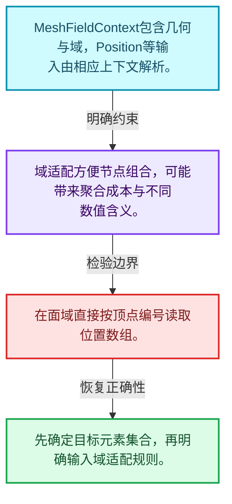
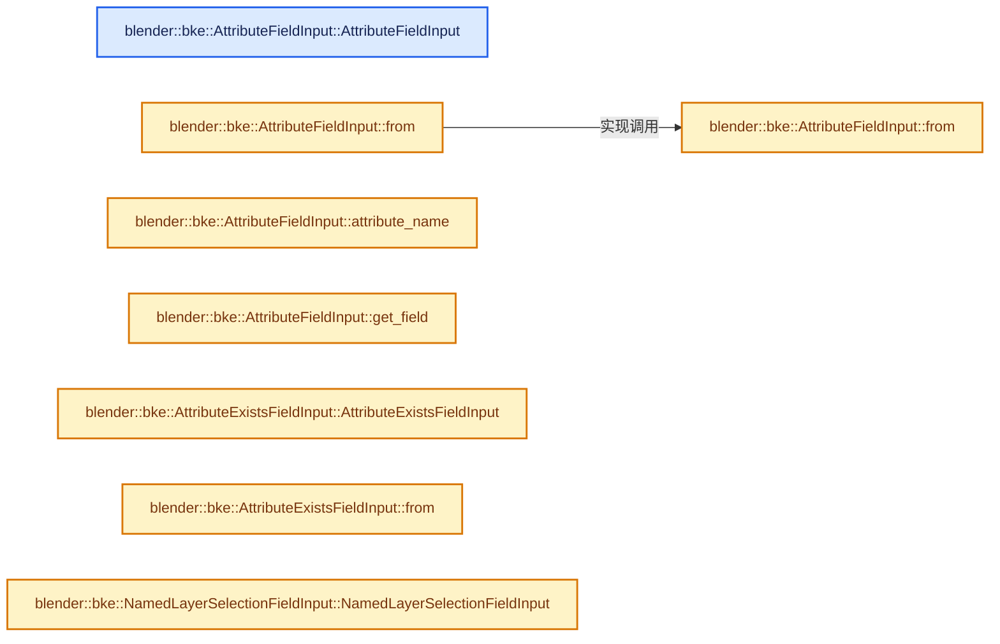
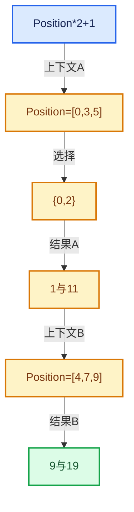

# 08-10 几何上下文与属性域

[方向导航](README.md) · [总目录](../README.md) · [实现索引](../00-课程指南/02-源码与提交索引/符号依赖与实现索引.md)

## 从问题到实现

Position在点域和面域为何不能直接共用同一数组解释？

几何上下文指定组件与域，输入解析与域适配决定元素语义；结果长度必须与目标域一致。

**数据模型**

MeshFieldContext包含几何与域，Position等输入由相应上下文解析。

**设计取舍**

域适配方便节点组合，可能带来聚合成本与不同数值含义。

**最小反例**

在面域直接按顶点编号读取位置数组。

**推导**

先确定目标元素集合，再明确输入域适配规则。

## 阅读地图与执行推演








图中的数值推演是本方向的教学模型；实际函数之间的调用边与概念分析边分别标注，不能把概念关系当作运行时调度顺序。

## 完整源码单元与就地讲解

中文讲解直接放在相关代码旁，复杂机制在代码下展开。原文折叠区保留基准行号；不需要在行号表和函数之间来回查找。类布局可分段展示，函数实现不按固定行数切开。

<a id="f-6051ebac4d517bf5"></a>

### `blender::bke::AttributeFieldInput::AttributeFieldInput`

实现位置：[source/blender/blenkernel/BKE_geometry_fields.hh](../../../../../source/blender/blenkernel/BKE_geometry_fields.hh) · L315—L322。

接口参数：

- `std::string name`
- `const CPPType &type`
- `std::optional<std::string> socket_inspection_name = std::nullopt`

**教学注释版**

<!-- annotated:de85914bb4981a -->

```cpp
  AttributeFieldInput(std::string name,
                      const CPPType &type,
                      std::optional<std::string> socket_inspection_name = std::nullopt)
      : GeometryFieldInput(type, name),
        name_(std::move(name)),
        socket_inspection_name_(std::move(socket_inspection_name))
  {
  }
```

<details>
<summary>核对原始源码：source/blender/blenkernel/BKE_geometry_fields.hh · L315—L322</summary>

<!-- original:de85914bb4981a:source/blender/blenkernel/BKE_geometry_fields.hh:315:322 -->

```cpp
  AttributeFieldInput(std::string name,
                      const CPPType &type,
                      std::optional<std::string> socket_inspection_name = std::nullopt)
      : GeometryFieldInput(type, name),
        name_(std::move(name)),
        socket_inspection_name_(std::move(socket_inspection_name))
  {
  }
```

</details>

**继续追踪实现**

本实现没有需要继续展开的显式调用；检查返回表达式、对象转换和调用者前置条件。

<!-- annotated:043d5100c95074 -->

```cpp

```

<details>
<summary>核对原始源码：source/blender/blenkernel/BKE_geometry_fields.hh · L323—L323</summary>

<!-- original:043d5100c95074:source/blender/blenkernel/BKE_geometry_fields.hh:323:323 -->

```cpp

```

</details>

<a id="f-f6704d8eed37d4e0"></a>

### `blender::bke::AttributeFieldInput::from`

实现位置：[source/blender/blenkernel/BKE_geometry_fields.hh](../../../../../source/blender/blenkernel/BKE_geometry_fields.hh) · L324—L330。

接口参数：

- `std::string name`
- `const CPPType &type`
- `std::optional<std::string> socket_inspection_name = std::nullopt`

**教学注释版**

<!-- annotated:aae2c78fb227d3 -->

```cpp
  static fn::GField from(std::string name,
                         const CPPType &type,
                         std::optional<std::string> socket_inspection_name = std::nullopt)
  {
    return fn::GField::from_input<AttributeFieldInput>(
        // [讲解] std::move：把表达式转换成可供移动重载选择的值类别；不保证真的移动，不结束源对象寿命，对const值可能选择复制。
        std::move(name), type, std::move(socket_inspection_name));
  }
```

<details>
<summary>核对原始源码：source/blender/blenkernel/BKE_geometry_fields.hh · L324—L330</summary>

<!-- original:aae2c78fb227d3:source/blender/blenkernel/BKE_geometry_fields.hh:324:330 -->

```cpp
  static fn::GField from(std::string name,
                         const CPPType &type,
                         std::optional<std::string> socket_inspection_name = std::nullopt)
  {
    return fn::GField::from_input<AttributeFieldInput>(
        std::move(name), type, std::move(socket_inspection_name));
  }
```

</details>

**结果出口**

- `return fn::GField::from_input<AttributeFieldInput>(`

**继续追踪实现**

- `fn::GField::from_input<AttributeFieldInput>` → [blender::fn::GField::from_input · L482](05-FieldOperation运算节点.md#f-53eedc63fedfa749)。
- `std::move` → [外部契约](https://eel.is/c++draft/utility.forward)：把表达式转换成可供移动重载选择的值类别；不保证真的移动，不结束源对象寿命，对const值可能选择复制。

<a id="f-f4484f9c40661b54"></a>

### `blender::bke::AttributeFieldInput::from`

实现位置：[source/blender/blenkernel/BKE_geometry_fields.hh](../../../../../source/blender/blenkernel/BKE_geometry_fields.hh) · L331—L337。

接口参数：

- `std::string name`
- `std::optional<std::string> socket_inspection_name = std::nullopt`

**教学注释版**

<!-- annotated:627dbaca484717 -->

```cpp
  template<typename T>
  static fn::Field<T> from(std::string name,
                           std::optional<std::string> socket_inspection_name = std::nullopt)
  {
    // [讲解] std::move：把表达式转换成可供移动重载选择的值类别；不保证真的移动，不结束源对象寿命，对const值可能选择复制。
    return from(std::move(name), CPPType::get<T>(), std::move(socket_inspection_name))
        .template typed<T>();
  }
```

<details>
<summary>核对原始源码：source/blender/blenkernel/BKE_geometry_fields.hh · L331—L337</summary>

<!-- original:627dbaca484717:source/blender/blenkernel/BKE_geometry_fields.hh:331:337 -->

```cpp
  template<typename T>
  static fn::Field<T> from(std::string name,
                           std::optional<std::string> socket_inspection_name = std::nullopt)
  {
    return from(std::move(name), CPPType::get<T>(), std::move(socket_inspection_name))
        .template typed<T>();
  }
```

</details>

**结果出口**

- `return from(std::move(name), CPPType::get<T>(), std::move(socket_inspection_name))`

**继续追踪实现**

- `from(std::move(name), CPPType::get<T>(), std::move(socket_inspection_name)) .template typed<T>` → [调用协议](../00-课程指南/01-路线与规范/模板宏与动态分派协议.md)：接收对象类型依赖auto、返回值或模板实例；不按同名猜测目标。调用位置L335。
- `from` → [blender::bke::AttributeFieldInput::from · L324](10-几何上下文与属性域.md#f-f6704d8eed37d4e0)；[blender::bke::AttributeFieldInput::from · L331](10-几何上下文与属性域.md#f-f4484f9c40661b54)。同名重载需按实参类型选择。
- `std::move` → [外部契约](https://eel.is/c++draft/utility.forward)：把表达式转换成可供移动重载选择的值类别；不保证真的移动，不结束源对象寿命，对const值可能选择复制。
- `CPPType::get<T>` → [blender::CPPType::get · L481](../03-内存分配与运行时类型/08-CPPType构造与析构.md#f-0cc10a3783d6abdb)。

<!-- annotated:a2cd171d927213 -->

```cpp

```

<details>
<summary>核对原始源码：source/blender/blenkernel/BKE_geometry_fields.hh · L338—L338</summary>

<!-- original:a2cd171d927213:source/blender/blenkernel/BKE_geometry_fields.hh:338:338 -->

```cpp

```

</details>

<a id="f-e19557951c22465a"></a>

### `blender::bke::AttributeFieldInput::attribute_name`

实现位置：[source/blender/blenkernel/BKE_geometry_fields.hh](../../../../../source/blender/blenkernel/BKE_geometry_fields.hh) · L339—L342。

**教学注释版**

<!-- annotated:5a01fe77cbb9e1 -->

```cpp
  StringRefNull attribute_name() const
  {
    return name_;
  }
```

<details>
<summary>核对原始源码：source/blender/blenkernel/BKE_geometry_fields.hh · L339—L342</summary>

<!-- original:5a01fe77cbb9e1:source/blender/blenkernel/BKE_geometry_fields.hh:339:342 -->

```cpp
  StringRefNull attribute_name() const
  {
    return name_;
  }
```

</details>

**结果出口**

- `return name_;`

**继续追踪实现**

本实现没有需要继续展开的显式调用；检查返回表达式、对象转换和调用者前置条件。

### 类型布局、声明与编译条件 · BKE_geometry_fields.hh L343—L352

<!-- annotated:1ba90a3035e803 -->

```cpp

  GVArray get_varray_for_context(const GeometryFieldContext &context,
                                 const IndexMask &mask) const override;

  std::string socket_inspection_name() const override;

  void hash_unique(UniqueHashBytes &hash, fn::FieldHashDeep &deep_hash_cache) const override;
  std::optional<AttrDomain> preferred_domain(const GeometryComponent &component) const override;
  NativeFieldDomain native_domain_info(const GeometryComponent &component) const override;

```

<details>
<summary>核对原始源码：source/blender/blenkernel/BKE_geometry_fields.hh · L343—L352</summary>

<!-- original:1ba90a3035e803:source/blender/blenkernel/BKE_geometry_fields.hh:343:352 -->

```cpp

  GVArray get_varray_for_context(const GeometryFieldContext &context,
                                 const IndexMask &mask) const override;

  std::string socket_inspection_name() const override;

  void hash_unique(UniqueHashBytes &hash, fn::FieldHashDeep &deep_hash_cache) const override;
  std::optional<AttrDomain> preferred_domain(const GeometryComponent &component) const override;
  NativeFieldDomain native_domain_info(const GeometryComponent &component) const override;

```

</details>

<a id="f-f06c472d9ae4678e"></a>

### `blender::bke::AttributeFieldInput::get_field`

实现位置：[source/blender/blenkernel/BKE_geometry_fields.hh](../../../../../source/blender/blenkernel/BKE_geometry_fields.hh) · L353—L360。

**教学注释版**

<!-- annotated:30b0ce7221d060 -->

```cpp
  template<typename T, FixedString FStr> static const fn::Field<T> &get_field()
  {
    static const auto field = fn::Field<T>::template from_input<AttributeFieldInput>(
        FStr.data, CPPType::get<T>());
    /* Use a non-owning wrapper to avoid unnecessary reference counting of a static field. */
    static const auto field_ref = fn::Field<T>::from_non_owning_ref(field);
    return field_ref;
  }
```

<details>
<summary>核对原始源码：source/blender/blenkernel/BKE_geometry_fields.hh · L353—L360</summary>

<!-- original:30b0ce7221d060:source/blender/blenkernel/BKE_geometry_fields.hh:353:360 -->

```cpp
  template<typename T, FixedString FStr> static const fn::Field<T> &get_field()
  {
    static const auto field = fn::Field<T>::template from_input<AttributeFieldInput>(
        FStr.data, CPPType::get<T>());
    /* Use a non-owning wrapper to avoid unnecessary reference counting of a static field. */
    static const auto field_ref = fn::Field<T>::from_non_owning_ref(field);
    return field_ref;
  }
```

</details>

**结果出口**

- `return field_ref;`

**继续追踪实现**

- `fn::Field<T>::template from_input<AttributeFieldInput>` → [blender::fn::Field<T>::Field · L495](05-FieldOperation运算节点.md#f-0b2f3f4cecd8c44a)；[blender::fn::Field<T>::Field · L603](05-FieldOperation运算节点.md#f-6fbbe0144f689448)；[blender::fn::Field<T>::Field · L605](05-FieldOperation运算节点.md#f-b9fadbb0d8465bfe)；[blender::fn::Field<T>::Field · L608](05-FieldOperation运算节点.md#f-be75a0525262720c)。同名重载需按实参类型选择。
- `CPPType::get<T>` → [blender::CPPType::get · L481](../03-内存分配与运行时类型/08-CPPType构造与析构.md#f-0cc10a3783d6abdb)。
- `fn::Field<T>::from_non_owning_ref` → [调用协议](../00-课程指南/01-路线与规范/模板宏与动态分派协议.md)：函数指针、局部可调用对象或未展开的宏；必须结合调用者环境。调用位置L358。

### 类型布局、声明与编译条件 · BKE_geometry_fields.hh L361—L367

<a id="t-51de636127fc"></a>

`AttributeExistsFieldInput`在这里声明的数据成员：

- `std::string name_`

<!-- annotated:8df7e1e61374c8 -->

```cpp
};

class AttributeExistsFieldInput final : public bke::GeometryFieldInput {
 private:
  std::string name_;

 public:
```

<details>
<summary>核对原始源码：source/blender/blenkernel/BKE_geometry_fields.hh · L361—L367</summary>

<!-- original:8df7e1e61374c8:source/blender/blenkernel/BKE_geometry_fields.hh:361:367 -->

```cpp
};

class AttributeExistsFieldInput final : public bke::GeometryFieldInput {
 private:
  std::string name_;

 public:
```

</details>

<a id="f-8a80496d63e6cb64"></a>

### `blender::bke::AttributeExistsFieldInput::AttributeExistsFieldInput`

实现位置：[source/blender/blenkernel/BKE_geometry_fields.hh](../../../../../source/blender/blenkernel/BKE_geometry_fields.hh) · L368—L371。

接口参数：

- `std::string name`
- `const CPPType &type`

**教学注释版**

<!-- annotated:37a471b8ece102 -->

```cpp
  AttributeExistsFieldInput(std::string name, const CPPType &type)
      : GeometryFieldInput(type, name), name_(std::move(name))
  {
  }
```

<details>
<summary>核对原始源码：source/blender/blenkernel/BKE_geometry_fields.hh · L368—L371</summary>

<!-- original:37a471b8ece102:source/blender/blenkernel/BKE_geometry_fields.hh:368:371 -->

```cpp
  AttributeExistsFieldInput(std::string name, const CPPType &type)
      : GeometryFieldInput(type, name), name_(std::move(name))
  {
  }
```

</details>

**继续追踪实现**

本实现没有需要继续展开的显式调用；检查返回表达式、对象转换和调用者前置条件。

<!-- annotated:dbea731c39a70a -->

```cpp

```

<details>
<summary>核对原始源码：source/blender/blenkernel/BKE_geometry_fields.hh · L372—L372</summary>

<!-- original:dbea731c39a70a:source/blender/blenkernel/BKE_geometry_fields.hh:372:372 -->

```cpp

```

</details>

<a id="f-7e9f013809ed41c8"></a>

### `blender::bke::AttributeExistsFieldInput::from`

实现位置：[source/blender/blenkernel/BKE_geometry_fields.hh](../../../../../source/blender/blenkernel/BKE_geometry_fields.hh) · L373—L377。

接口参数：

- `std::string name`

**教学注释版**

<!-- annotated:036e41d57910a5 -->

```cpp
  static fn::Field<bool> from(std::string name)
  {
    const CPPType &type = CPPType::get<bool>();
    // [讲解] std::move：把表达式转换成可供移动重载选择的值类别；不保证真的移动，不结束源对象寿命，对const值可能选择复制。
    return fn::GField::from_input<AttributeExistsFieldInput>(std::move(name), type).typed<bool>();
  }
```

<details>
<summary>核对原始源码：source/blender/blenkernel/BKE_geometry_fields.hh · L373—L377</summary>

<!-- original:036e41d57910a5:source/blender/blenkernel/BKE_geometry_fields.hh:373:377 -->

```cpp
  static fn::Field<bool> from(std::string name)
  {
    const CPPType &type = CPPType::get<bool>();
    return fn::GField::from_input<AttributeExistsFieldInput>(std::move(name), type).typed<bool>();
  }
```

</details>

**结果出口**

- `return fn::GField::from_input<AttributeExistsFieldInput>(std::move(name), type).typed<bool>();`

**继续追踪实现**

- `CPPType::get<bool>` → [blender::CPPType::get · L481](../03-内存分配与运行时类型/08-CPPType构造与析构.md#f-0cc10a3783d6abdb)。
- `fn::GField::from_input<AttributeExistsFieldInput>(std::move(name), type).typed<bool>` → [调用协议](../00-课程指南/01-路线与规范/模板宏与动态分派协议.md)：接收对象类型依赖auto、返回值或模板实例；不按同名猜测目标。调用位置L376。
- `fn::GField::from_input<AttributeExistsFieldInput>` → [blender::fn::GField::from_input · L482](05-FieldOperation运算节点.md#f-53eedc63fedfa749)。
- `std::move` → [外部契约](https://eel.is/c++draft/utility.forward)：把表达式转换成可供移动重载选择的值类别；不保证真的移动，不结束源对象寿命，对const值可能选择复制。

### 类型布局、声明与编译条件 · BKE_geometry_fields.hh L378—L389

<a id="t-14394d0cd5b1"></a>

`NamedLayerSelectionFieldInput`在这里声明的数据成员：

- `std::string layer_name_`

<!-- annotated:5e0e8a337968ea -->

```cpp

  GVArray get_varray_for_context(const bke::GeometryFieldContext &context,
                                 const IndexMask &mask) const final;
  void hash_unique(UniqueHashBytes &hash, fn::FieldHashDeep &deep_hash_cache) const override;
  NativeFieldDomain native_domain_info(const GeometryComponent &component) const override;
};

class NamedLayerSelectionFieldInput final : public bke::GeometryFieldInput {
 private:
  std::string layer_name_;

 public:
```

<details>
<summary>核对原始源码：source/blender/blenkernel/BKE_geometry_fields.hh · L378—L389</summary>

<!-- original:5e0e8a337968ea:source/blender/blenkernel/BKE_geometry_fields.hh:378:389 -->

```cpp

  GVArray get_varray_for_context(const bke::GeometryFieldContext &context,
                                 const IndexMask &mask) const final;
  void hash_unique(UniqueHashBytes &hash, fn::FieldHashDeep &deep_hash_cache) const override;
  NativeFieldDomain native_domain_info(const GeometryComponent &component) const override;
};

class NamedLayerSelectionFieldInput final : public bke::GeometryFieldInput {
 private:
  std::string layer_name_;

 public:
```

</details>

<a id="f-87a66492eb242c51"></a>

### `blender::bke::NamedLayerSelectionFieldInput::NamedLayerSelectionFieldInput`

实现位置：[source/blender/blenkernel/BKE_geometry_fields.hh](../../../../../source/blender/blenkernel/BKE_geometry_fields.hh) · L390—L394。

接口参数：

- `std::string layer_name`

**教学注释版**

<!-- annotated:b49514f6c37590 -->

```cpp
  NamedLayerSelectionFieldInput(std::string layer_name)
      : bke::GeometryFieldInput(CPPType::get<bool>(), "Named Layer node"),
        layer_name_(std::move(layer_name))
  {
  }
```

<details>
<summary>核对原始源码：source/blender/blenkernel/BKE_geometry_fields.hh · L390—L394</summary>

<!-- original:b49514f6c37590:source/blender/blenkernel/BKE_geometry_fields.hh:390:394 -->

```cpp
  NamedLayerSelectionFieldInput(std::string layer_name)
      : bke::GeometryFieldInput(CPPType::get<bool>(), "Named Layer node"),
        layer_name_(std::move(layer_name))
  {
  }
```

</details>

**继续追踪实现**

本实现没有需要继续展开的显式调用；检查返回表达式、对象转换和调用者前置条件。

### 类型布局、声明与编译条件 · BKE_geometry_fields.hh L395—L403

<a id="t-d3dddcc26793"></a>

<!-- annotated:c689868cd83a74 -->

```cpp

  GVArray get_varray_for_context(const bke::GeometryFieldContext &context,
                                 const IndexMask &mask) const final;
  void hash_unique(UniqueHashBytes &hash, fn::FieldHashDeep &deep_hash_cache) const override;
  std::optional<AttrDomain> preferred_domain(const GeometryComponent &component) const override;
};

class IDAttributeFieldInput : public GeometryFieldInput {
 public:
```

<details>
<summary>核对原始源码：source/blender/blenkernel/BKE_geometry_fields.hh · L395—L403</summary>

<!-- original:c689868cd83a74:source/blender/blenkernel/BKE_geometry_fields.hh:395:403 -->

```cpp

  GVArray get_varray_for_context(const bke::GeometryFieldContext &context,
                                 const IndexMask &mask) const final;
  void hash_unique(UniqueHashBytes &hash, fn::FieldHashDeep &deep_hash_cache) const override;
  std::optional<AttrDomain> preferred_domain(const GeometryComponent &component) const override;
};

class IDAttributeFieldInput : public GeometryFieldInput {
 public:
```

</details>

<a id="f-38d5bd76369418ac"></a>

### `blender::bke::IDAttributeFieldInput::IDAttributeFieldInput`

实现位置：[source/blender/blenkernel/BKE_geometry_fields.hh](../../../../../source/blender/blenkernel/BKE_geometry_fields.hh) · L404—L404。

**教学注释版**

<!-- annotated:775fe8fa790bb8 -->

```cpp
  IDAttributeFieldInput() : GeometryFieldInput(CPPType::get<int>()) {}
```

<details>
<summary>核对原始源码：source/blender/blenkernel/BKE_geometry_fields.hh · L404—L404</summary>

<!-- original:775fe8fa790bb8:source/blender/blenkernel/BKE_geometry_fields.hh:404:404 -->

```cpp
  IDAttributeFieldInput() : GeometryFieldInput(CPPType::get<int>()) {}
```

</details>

**继续追踪实现**

本实现没有需要继续展开的显式调用；检查返回表达式、对象转换和调用者前置条件。

### 类型布局、声明与编译条件 · BKE_geometry_fields.hh L405—L429

<a id="t-555759c0b083"></a>

`NormalFieldInput`在这里声明的数据成员：

- `bool legacy_corner_normals_`
- `bool true_normals_`

<!-- annotated:a42305fbbdf438 -->

```cpp

  GVArray get_varray_for_context(const GeometryFieldContext &context,
                                 const IndexMask &mask) const override;

  std::string socket_inspection_name() const override;

  void hash_unique(UniqueHashBytes &hash, fn::FieldHashDeep &deep_hash_cache) const override;

  /** Cached  field to avoid allocating a new one every time. */
  static const fn::Field<int> &get_field();
};

VArray<float3> curve_normals_varray(const CurvesGeometry &curves, AttrDomain domain);

VArray<float3> mesh_normals_varray(const Mesh &mesh,
                                   const IndexMask &mask,
                                   AttrDomain domain,
                                   bool no_corner_normals = false,
                                   bool true_normals = false);

class NormalFieldInput : public GeometryFieldInput {
  bool legacy_corner_normals_ = false;
  bool true_normals_ = false;

 public:
```

<details>
<summary>核对原始源码：source/blender/blenkernel/BKE_geometry_fields.hh · L405—L429</summary>

<!-- original:a42305fbbdf438:source/blender/blenkernel/BKE_geometry_fields.hh:405:429 -->

```cpp

  GVArray get_varray_for_context(const GeometryFieldContext &context,
                                 const IndexMask &mask) const override;

  std::string socket_inspection_name() const override;

  void hash_unique(UniqueHashBytes &hash, fn::FieldHashDeep &deep_hash_cache) const override;

  /** Cached  field to avoid allocating a new one every time. */
  static const fn::Field<int> &get_field();
};

VArray<float3> curve_normals_varray(const CurvesGeometry &curves, AttrDomain domain);

VArray<float3> mesh_normals_varray(const Mesh &mesh,
                                   const IndexMask &mask,
                                   AttrDomain domain,
                                   bool no_corner_normals = false,
                                   bool true_normals = false);

class NormalFieldInput : public GeometryFieldInput {
  bool legacy_corner_normals_ = false;
  bool true_normals_ = false;

 public:
```

</details>

<a id="f-806247809f1cf5e4"></a>

### `blender::bke::NormalFieldInput::NormalFieldInput`

实现位置：[source/blender/blenkernel/BKE_geometry_fields.hh](../../../../../source/blender/blenkernel/BKE_geometry_fields.hh) · L430—L435。

接口参数：

- `const bool legacy_corner_normals = false`
- `const bool true_normals = false`

**教学注释版**

<!-- annotated:2994fb4ada05bf -->

```cpp
  NormalFieldInput(const bool legacy_corner_normals = false, const bool true_normals = false)
      : GeometryFieldInput(CPPType::get<float3>()),
        legacy_corner_normals_(legacy_corner_normals),
        true_normals_(true_normals)
  {
  }
```

<details>
<summary>核对原始源码：source/blender/blenkernel/BKE_geometry_fields.hh · L430—L435</summary>

<!-- original:2994fb4ada05bf:source/blender/blenkernel/BKE_geometry_fields.hh:430:435 -->

```cpp
  NormalFieldInput(const bool legacy_corner_normals = false, const bool true_normals = false)
      : GeometryFieldInput(CPPType::get<float3>()),
        legacy_corner_normals_(legacy_corner_normals),
        true_normals_(true_normals)
  {
  }
```

</details>

**继续追踪实现**

本实现没有需要继续展开的显式调用；检查返回表达式、对象转换和调用者前置条件。

### 类型布局、声明与编译条件 · BKE_geometry_fields.hh L436—L473

<a id="t-75f83573c9fd"></a>

`CurveLengthFieldInput`在这里声明的数据成员：

- `GVArray get_varray_for_context`
- `void hash_unique`
- `std::optional<AttrDomain> preferred_domain`

<a id="t-744ab1f0e304"></a>

`EvaluateAtIndexInput`在这里声明的数据成员：

- `fn::Field<int> index_field_`
- `fn::GField value_field_`
- `AttrDomain value_field_domain_`
- `GVArray get_varray_for_context`
- `void hash_unique`

<!-- annotated:dbc82332fa7bec -->

```cpp

  GVArray get_varray_for_context(const GeometryFieldContext &context,
                                 const IndexMask &mask) const override;

  std::string socket_inspection_name() const override;

  void hash_unique(UniqueHashBytes &hash, fn::FieldHashDeep &deep_hash_cache) const override;

  NativeFieldDomain native_domain_info(const GeometryComponent &component) const override;

  /** Cached normal field to avoid allocating a new one every time. */
  static const fn::Field<float3> &get_field();
};

class CurveLengthFieldInput final : public CurvesFieldInput {
 public:
  CurveLengthFieldInput();
  GVArray get_varray_for_context(const CurvesGeometry &curves,
                                 AttrDomain domain,
                                 const IndexMask &mask) const final;
  void hash_unique(UniqueHashBytes &hash, fn::FieldHashDeep &deep_hash_cache) const override;
  std::optional<AttrDomain> preferred_domain(const bke::CurvesGeometry &curves) const final;
};

class EvaluateAtIndexInput final : public bke::GeometryFieldInput {
 private:
  fn::Field<int> index_field_;
  fn::GField value_field_;
  AttrDomain value_field_domain_;

 public:
  EvaluateAtIndexInput(fn::Field<int> index_field,
                       fn::GField value_field,
                       AttrDomain value_field_domain);

  GVArray get_varray_for_context(const bke::GeometryFieldContext &context,
                                 const IndexMask &mask) const final;
  void hash_unique(UniqueHashBytes &hash, fn::FieldHashDeep &deep_hash_cache) const override;
```

<details>
<summary>核对原始源码：source/blender/blenkernel/BKE_geometry_fields.hh · L436—L473</summary>

<!-- original:dbc82332fa7bec:source/blender/blenkernel/BKE_geometry_fields.hh:436:473 -->

```cpp

  GVArray get_varray_for_context(const GeometryFieldContext &context,
                                 const IndexMask &mask) const override;

  std::string socket_inspection_name() const override;

  void hash_unique(UniqueHashBytes &hash, fn::FieldHashDeep &deep_hash_cache) const override;

  NativeFieldDomain native_domain_info(const GeometryComponent &component) const override;

  /** Cached normal field to avoid allocating a new one every time. */
  static const fn::Field<float3> &get_field();
};

class CurveLengthFieldInput final : public CurvesFieldInput {
 public:
  CurveLengthFieldInput();
  GVArray get_varray_for_context(const CurvesGeometry &curves,
                                 AttrDomain domain,
                                 const IndexMask &mask) const final;
  void hash_unique(UniqueHashBytes &hash, fn::FieldHashDeep &deep_hash_cache) const override;
  std::optional<AttrDomain> preferred_domain(const bke::CurvesGeometry &curves) const final;
};

class EvaluateAtIndexInput final : public bke::GeometryFieldInput {
 private:
  fn::Field<int> index_field_;
  fn::GField value_field_;
  AttrDomain value_field_domain_;

 public:
  EvaluateAtIndexInput(fn::Field<int> index_field,
                       fn::GField value_field,
                       AttrDomain value_field_domain);

  GVArray get_varray_for_context(const bke::GeometryFieldContext &context,
                                 const IndexMask &mask) const final;
  void hash_unique(UniqueHashBytes &hash, fn::FieldHashDeep &deep_hash_cache) const override;
```

</details>

<a id="f-24ba42b964e01ae6"></a>

### `blender::bke::EvaluateAtIndexInput::preferred_domain`

实现位置：[source/blender/blenkernel/BKE_geometry_fields.hh](../../../../../source/blender/blenkernel/BKE_geometry_fields.hh) · L474—L477。

接口参数：

- `const GeometryComponent &`

**教学注释版**

<!-- annotated:5464260e78dbc1 -->

```cpp
  std::optional<AttrDomain> preferred_domain(const GeometryComponent & /*component*/) const final
  {
    return value_field_domain_;
  }
```

<details>
<summary>核对原始源码：source/blender/blenkernel/BKE_geometry_fields.hh · L474—L477</summary>

<!-- original:5464260e78dbc1:source/blender/blenkernel/BKE_geometry_fields.hh:474:477 -->

```cpp
  std::optional<AttrDomain> preferred_domain(const GeometryComponent & /*component*/) const final
  {
    return value_field_domain_;
  }
```

</details>

**结果出口**

- `return value_field_domain_;`

**继续追踪实现**

本实现没有需要继续展开的显式调用；检查返回表达式、对象转换和调用者前置条件。

### 类型布局、声明与编译条件 · BKE_geometry_fields.hh L478—L526

<a id="t-9daaab9b7cac"></a>

`SampleIndexFunction`在这里声明的数据成员：

- `GeometrySet src_geometry_`
- `fn::GField src_field_`
- `AttrDomain domain_`
- `mf::Signature signature_`
- `CacheMutex mutex_`
- `std::optional<bke::GeometryFieldContext> geometry_context_`
- `std::unique_ptr<fn::FieldEvaluator> evaluator_`
- `GVArray src_data_`
- `void prepare_for_execution`
- `void call`
- `void hash_unique`
- `GeometryComponent find_source_component`

<a id="t-006bea99bf61"></a>

`EvaluateOnDomainInput`在这里声明的数据成员：

- `fn::GField src_field_`
- `AttrDomain src_domain_`
- `GVArray get_varray_for_context`
- `void hash_unique`
- `void foreach_recursive_field`
- `std::optional<AttrDomain> preferred_domain`
- `NativeFieldDomain native_domain_info`

<!-- annotated:78fda4971f3ff6 -->

```cpp
};

class SampleIndexFunction : public mf::MultiFunction {
  GeometrySet src_geometry_;
  fn::GField src_field_;
  AttrDomain domain_;

  mf::Signature signature_;

  mutable CacheMutex mutex_;
  mutable std::optional<bke::GeometryFieldContext> geometry_context_;
  mutable std::unique_ptr<fn::FieldEvaluator> evaluator_;
  mutable const GVArray *src_data_ = nullptr;

 public:
  SampleIndexFunction(GeometrySet geometry, fn::GField src_field, AttrDomain domain);
  void prepare_for_execution() const override;
  void call(const IndexMask &mask, mf::Params params, mf::Context /*context*/) const override;
  void hash_unique(UniqueHashBytes &hash) const override;

  static const GeometryComponent *find_source_component(const GeometrySet &geometry,
                                                        AttrDomain domain);
};

class EvaluateOnDomainInput final : public bke::GeometryFieldInput {
 private:
  fn::GField src_field_;
  AttrDomain src_domain_;

 public:
  EvaluateOnDomainInput(fn::GField field, AttrDomain domain);

  GVArray get_varray_for_context(const bke::GeometryFieldContext &context,
                                 const IndexMask & /*mask*/) const final;
  void hash_unique(UniqueHashBytes &hash, fn::FieldHashDeep &deep_hash_cache) const override;
  void foreach_recursive_field(FunctionRef<void(const fn::GField &)> fn) const override;

  std::optional<AttrDomain> preferred_domain(
      const GeometryComponent & /*component*/) const override;
  NativeFieldDomain native_domain_info(const GeometryComponent & /*component*/) const override;
};

bool try_capture_fields_on_geometry(MutableAttributeAccessor attributes,
                                    const fn::FieldContext &field_context,
                                    Span<StringRef> names,
                                    AttrDomain domain,
                                    const fn::Field<bool> &selection,
                                    Span<fn::GField> fields);

```

<details>
<summary>核对原始源码：source/blender/blenkernel/BKE_geometry_fields.hh · L478—L526</summary>

<!-- original:78fda4971f3ff6:source/blender/blenkernel/BKE_geometry_fields.hh:478:526 -->

```cpp
};

class SampleIndexFunction : public mf::MultiFunction {
  GeometrySet src_geometry_;
  fn::GField src_field_;
  AttrDomain domain_;

  mf::Signature signature_;

  mutable CacheMutex mutex_;
  mutable std::optional<bke::GeometryFieldContext> geometry_context_;
  mutable std::unique_ptr<fn::FieldEvaluator> evaluator_;
  mutable const GVArray *src_data_ = nullptr;

 public:
  SampleIndexFunction(GeometrySet geometry, fn::GField src_field, AttrDomain domain);
  void prepare_for_execution() const override;
  void call(const IndexMask &mask, mf::Params params, mf::Context /*context*/) const override;
  void hash_unique(UniqueHashBytes &hash) const override;

  static const GeometryComponent *find_source_component(const GeometrySet &geometry,
                                                        AttrDomain domain);
};

class EvaluateOnDomainInput final : public bke::GeometryFieldInput {
 private:
  fn::GField src_field_;
  AttrDomain src_domain_;

 public:
  EvaluateOnDomainInput(fn::GField field, AttrDomain domain);

  GVArray get_varray_for_context(const bke::GeometryFieldContext &context,
                                 const IndexMask & /*mask*/) const final;
  void hash_unique(UniqueHashBytes &hash, fn::FieldHashDeep &deep_hash_cache) const override;
  void foreach_recursive_field(FunctionRef<void(const fn::GField &)> fn) const override;

  std::optional<AttrDomain> preferred_domain(
      const GeometryComponent & /*component*/) const override;
  NativeFieldDomain native_domain_info(const GeometryComponent & /*component*/) const override;
};

bool try_capture_fields_on_geometry(MutableAttributeAccessor attributes,
                                    const fn::FieldContext &field_context,
                                    Span<StringRef> names,
                                    AttrDomain domain,
                                    const fn::Field<bool> &selection,
                                    Span<fn::GField> fields);

```

</details>

<a id="f-72eacdaeb9630253"></a>

### `blender::bke::try_capture_field_on_geometry`

实现位置：[source/blender/blenkernel/BKE_geometry_fields.hh](../../../../../source/blender/blenkernel/BKE_geometry_fields.hh) · L527—L536。

接口参数：

- `MutableAttributeAccessor attributes`
- `const fn::FieldContext &field_context`
- `const StringRef name`
- `AttrDomain domain`
- `const fn::Field<bool> &selection`
- `const fn::GField &field`

**教学注释版**

<!-- annotated:25c503315be5dc -->

```cpp
inline bool try_capture_field_on_geometry(MutableAttributeAccessor attributes,
                                          const fn::FieldContext &field_context,
                                          const StringRef name,
                                          AttrDomain domain,
                                          const fn::Field<bool> &selection,
                                          const fn::GField &field)
{
  return try_capture_fields_on_geometry(
      attributes, field_context, {name}, domain, selection, {field});
}
```

<details>
<summary>核对原始源码：source/blender/blenkernel/BKE_geometry_fields.hh · L527—L536</summary>

<!-- original:25c503315be5dc:source/blender/blenkernel/BKE_geometry_fields.hh:527:536 -->

```cpp
inline bool try_capture_field_on_geometry(MutableAttributeAccessor attributes,
                                          const fn::FieldContext &field_context,
                                          const StringRef name,
                                          AttrDomain domain,
                                          const fn::Field<bool> &selection,
                                          const fn::GField &field)
{
  return try_capture_fields_on_geometry(
      attributes, field_context, {name}, domain, selection, {field});
}
```

</details>

**结果出口**

- `return try_capture_fields_on_geometry(`

**继续追踪实现**

- `try_capture_fields_on_geometry` → [blender::bke::try_capture_fields_on_geometry · L998](../05-几何存储与拓扑映射/09-属性域与转换.md#f-53d2a58a397bf570)；[blender::bke::try_capture_fields_on_geometry · L1144](../05-几何存储与拓扑映射/09-属性域与转换.md#f-5d358ef05cd2c31e)；[blender::bke::try_capture_fields_on_geometry · L1193](../05-几何存储与拓扑映射/09-属性域与转换.md#f-acecccde14dde369)。同名重载需按实参类型选择。

### 类型布局、声明与编译条件 · BKE_geometry_fields.hh L537—L542

<!-- annotated:05849b733a092d -->

```cpp

bool try_capture_fields_on_geometry(GeometryComponent &component,
                                    Span<StringRef> names,
                                    AttrDomain domain,
                                    Span<fn::GField> fields);

```

<details>
<summary>核对原始源码：source/blender/blenkernel/BKE_geometry_fields.hh · L537—L542</summary>

<!-- original:05849b733a092d:source/blender/blenkernel/BKE_geometry_fields.hh:537:542 -->

```cpp

bool try_capture_fields_on_geometry(GeometryComponent &component,
                                    Span<StringRef> names,
                                    AttrDomain domain,
                                    Span<fn::GField> fields);

```

</details>

<a id="f-4232bd6552082375"></a>

### `blender::bke::try_capture_field_on_geometry`

实现位置：[source/blender/blenkernel/BKE_geometry_fields.hh](../../../../../source/blender/blenkernel/BKE_geometry_fields.hh) · L543—L549。

接口参数：

- `GeometryComponent &component`
- `const StringRef name`
- `AttrDomain domain`
- `const fn::GField &field`

**教学注释版**

<!-- annotated:a25dce83734751 -->

```cpp
inline bool try_capture_field_on_geometry(GeometryComponent &component,
                                          const StringRef name,
                                          AttrDomain domain,
                                          const fn::GField &field)
{
  return try_capture_fields_on_geometry(component, {name}, domain, {field});
}
```

<details>
<summary>核对原始源码：source/blender/blenkernel/BKE_geometry_fields.hh · L543—L549</summary>

<!-- original:a25dce83734751:source/blender/blenkernel/BKE_geometry_fields.hh:543:549 -->

```cpp
inline bool try_capture_field_on_geometry(GeometryComponent &component,
                                          const StringRef name,
                                          AttrDomain domain,
                                          const fn::GField &field)
{
  return try_capture_fields_on_geometry(component, {name}, domain, {field});
}
```

</details>

**结果出口**

- `return try_capture_fields_on_geometry(component, {name}, domain, {field});`

**继续追踪实现**

- `try_capture_fields_on_geometry` → [blender::bke::try_capture_fields_on_geometry · L998](../05-几何存储与拓扑映射/09-属性域与转换.md#f-53d2a58a397bf570)；[blender::bke::try_capture_fields_on_geometry · L1144](../05-几何存储与拓扑映射/09-属性域与转换.md#f-5d358ef05cd2c31e)；[blender::bke::try_capture_fields_on_geometry · L1193](../05-几何存储与拓扑映射/09-属性域与转换.md#f-acecccde14dde369)。同名重载需按实参类型选择。

### 类型布局、声明与编译条件 · BKE_geometry_fields.hh L550—L556

<!-- annotated:6d08d05f380fbf -->

```cpp

bool try_capture_fields_on_geometry(GeometryComponent &component,
                                    Span<StringRef> names,
                                    AttrDomain domain,
                                    const fn::Field<bool> &selection,
                                    Span<fn::GField> fields);

```

<details>
<summary>核对原始源码：source/blender/blenkernel/BKE_geometry_fields.hh · L550—L556</summary>

<!-- original:6d08d05f380fbf:source/blender/blenkernel/BKE_geometry_fields.hh:550:556 -->

```cpp

bool try_capture_fields_on_geometry(GeometryComponent &component,
                                    Span<StringRef> names,
                                    AttrDomain domain,
                                    const fn::Field<bool> &selection,
                                    Span<fn::GField> fields);

```

</details>

<a id="f-e9f28624aa26ddc4"></a>

### `blender::bke::try_capture_field_on_geometry`

实现位置：[source/blender/blenkernel/BKE_geometry_fields.hh](../../../../../source/blender/blenkernel/BKE_geometry_fields.hh) · L557—L564。

接口参数：

- `GeometryComponent &component`
- `const StringRef name`
- `AttrDomain domain`
- `const fn::Field<bool> &selection`
- `const fn::GField &field`

**教学注释版**

<!-- annotated:c11ef83071e9af -->

```cpp
inline bool try_capture_field_on_geometry(GeometryComponent &component,
                                          const StringRef name,
                                          AttrDomain domain,
                                          const fn::Field<bool> &selection,
                                          const fn::GField &field)
{
  return try_capture_fields_on_geometry(component, {name}, domain, selection, {field});
}
```

<details>
<summary>核对原始源码：source/blender/blenkernel/BKE_geometry_fields.hh · L557—L564</summary>

<!-- original:c11ef83071e9af:source/blender/blenkernel/BKE_geometry_fields.hh:557:564 -->

```cpp
inline bool try_capture_field_on_geometry(GeometryComponent &component,
                                          const StringRef name,
                                          AttrDomain domain,
                                          const fn::Field<bool> &selection,
                                          const fn::GField &field)
{
  return try_capture_fields_on_geometry(component, {name}, domain, selection, {field});
}
```

</details>

**结果出口**

- `return try_capture_fields_on_geometry(component, {name}, domain, selection, {field});`

**继续追踪实现**

- `try_capture_fields_on_geometry` → [blender::bke::try_capture_fields_on_geometry · L998](../05-几何存储与拓扑映射/09-属性域与转换.md#f-53d2a58a397bf570)；[blender::bke::try_capture_fields_on_geometry · L1144](../05-几何存储与拓扑映射/09-属性域与转换.md#f-5d358ef05cd2c31e)；[blender::bke::try_capture_fields_on_geometry · L1193](../05-几何存储与拓扑映射/09-属性域与转换.md#f-acecccde14dde369)。同名重载需按实参类型选择。

### 类型布局、声明与编译条件 · BKE_geometry_fields.hh L565—L582

<!-- annotated:ef787fee02e7bc -->

```cpp

/**
 * Try to find the geometry domain that the field should be evaluated on. If it is not obvious
 * which domain is correct, none is returned.
 */
std::optional<AttrDomain> try_detect_field_domain(const GeometryComponent &component,
                                                  const fn::GField &field);

/**
 * Try to detect the domain that the field's inputs represent. If any field may depend on the
 * order of the domain, none is returned, and if the fields will give the same value regardless of
 * the domain, none is also returned.
 */
std::optional<AttrDomain> try_detect_native_field_domain(const GeometryComponent &component,
                                                         const fn::GField &field);

}  // namespace bke
}  // namespace blender
```

<details>
<summary>核对原始源码：source/blender/blenkernel/BKE_geometry_fields.hh · L565—L582</summary>

<!-- original:ef787fee02e7bc:source/blender/blenkernel/BKE_geometry_fields.hh:565:582 -->

```cpp

/**
 * Try to find the geometry domain that the field should be evaluated on. If it is not obvious
 * which domain is correct, none is returned.
 */
std::optional<AttrDomain> try_detect_field_domain(const GeometryComponent &component,
                                                  const fn::GField &field);

/**
 * Try to detect the domain that the field's inputs represent. If any field may depend on the
 * order of the domain, none is returned, and if the fields will give the same value regardless of
 * the domain, none is also returned.
 */
std::optional<AttrDomain> try_detect_native_field_domain(const GeometryComponent &component,
                                                         const fn::GField &field);

}  // namespace bke
}  // namespace blender
```

</details>

## 语法与相关类型

### 模板 template

模板把类型或常量作为生成实现的参数。读声明时先列出类型参数、非类型参数和默认值，再看使用者实际实例化了什么。模板声明本身不意味着每种T都支持其全部成员。

把T替换为int、string、只能移动的类型，分别检查每个被调用操作是否成立。

### 依赖名称 typename

typename既可引入类型模板参数，也可告诉编译器某个依赖名称是类型。它不创建运行时对象；解析期确认语法类别与实例化期检查具体类型是不同阶段。

区分typename T::value_type和T::size()，前者标记类型，后者是表达式。

### 只读限定 const

const约束当前访问路径可做的修改。const指针、指向const的指针、const视图对象、const元素是不同位置的限定；其他别名可能仍可修改原对象。

分别写T* const、const T*与const T* const，并画出不可修改的层次。

### 移动转换 std::move

std::move把表达式转换为可供移动重载选择的值类别，实际资源转移发生在被选中的构造或赋值中。对const对象move可能仍调用复制，对视图move也不会获得底层数据所有权。

记录移动构造调用次数，不用变量名或std::move的出现次数替代测量。

### 异常边界 try与catch

try定义异常传播的局部边界。失败路径需要销毁已经成功构造的部分并释放相应存储；未构造的对象不能被析构。

在第k次构造失败，列出已经存在的对象集合与待释放缓冲。

### 覆写检查 override

override要求函数确实覆盖基类虚函数，可捕获参数类型和const限定不匹配。它不改变基类规定的生命周期或线程约束。

故意改变一个参数或const，观察编译器如何拒绝误写的新函数。

### 可选值 optional

optional把不存在与存在的T区分开，T的构造和析构跟随engaged状态变化。访问前应由has_value或条件分支证明存在。

把空Field状态与合法常量零区分，不能用某个普通值代替不存在。

### 构造与new表达式

普通new可能分配并构造；placement new在给定地址构造，存储由其他机制提供。失败回滚应区分两类责任。

追踪地址来自哪里、构造何时成功、由谁析构、由谁释放。

### 独占拥有 unique_ptr

unique_ptr通过移动转移拥有关系，默认删除策略必须与资源来源匹配。get返回借用指针，release交出责任而不销毁。

区分move、get、release和reset后谁负责销毁。

## 实现练习与验证

对两三角形网格分别标出顶点与面求值的元素集合。

参考推理：先确定目标元素集合，再明确输入域适配规则。

结果与直接计算一致；多个输出共享子表达式时不改变语义；深链构造、执行、销毁三个阶段分别检查。

## 历史、跨库比较与证据

与表达式模板、AST和闭包比较：Field可在运行时组合并对不同上下文批量求值；不要把Field对象误当作固定几何的结果数组。

[历史提交索引](../00-课程指南/02-源码与提交索引/历史提交与设计演化索引.md) · [源码基准](../00-课程指南/02-源码与提交索引/源码版本与覆盖索引.md) · [验收报告](../00-课程指南/03-验收报告/验收报告.md)
