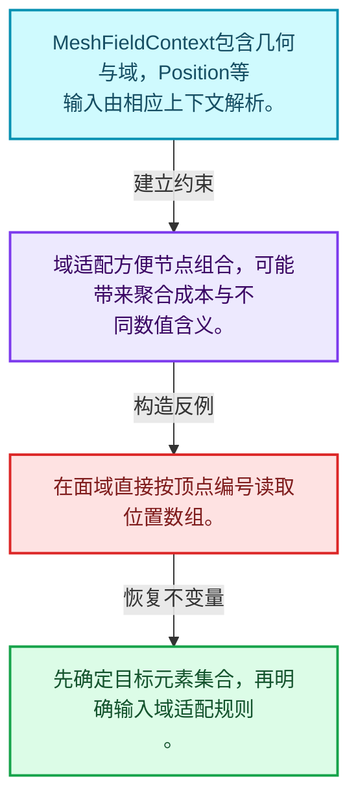
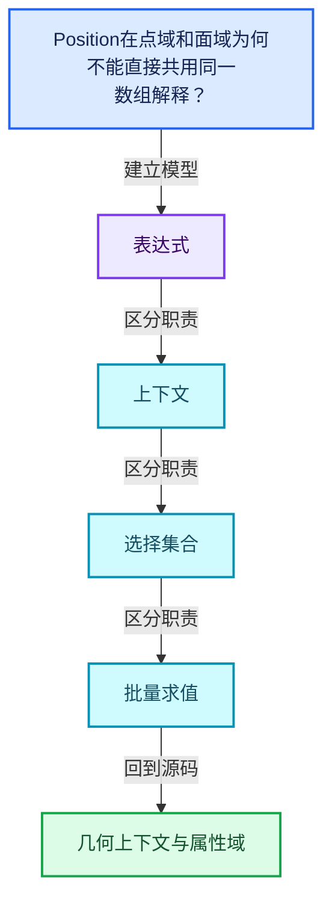
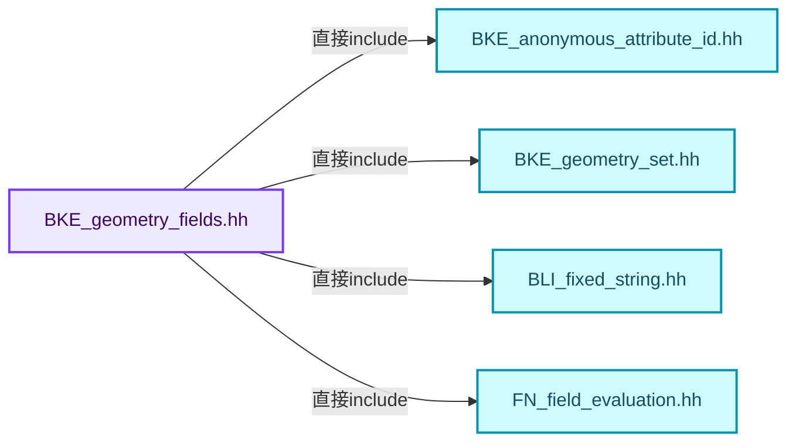
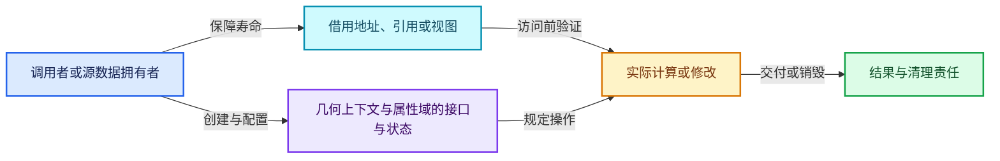
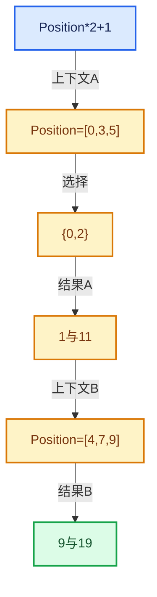

# 08-10 几何上下文与属性域

[方向导航](README.md) · [总目录](../README.md) · [覆盖索引](../%E6%BA%90%E7%A0%81%E7%89%88%E6%9C%AC%E4%B8%8E%E8%A6%86%E7%9B%96%E7%B4%A2%E5%BC%95.md)

> 阅读顺序：问题与数据模型 → 语法与类型 → 源码逐行 → 调用线索 → 历史与取舍 → 推演和练习。

- 基准 HEAD：`cbda6b96c26c0dee3c3b5cbb93960c4ac06a6b30`。
- 记录日期：2026-10-14。
- 教学示例状态：正文中的推演不是本机性能实测；已运行练习见验收报告。

## 一、从问题到设计

Position在点域和面域为何不能直接共用同一数组解释？

几何上下文指定组件与域，输入解析与域适配决定元素语义；结果长度必须与目标域一致。

本篇把语法、数据语义和系统取舍连接起来。Field表达式、求值上下文、mask与结果存储各自有独立职责和生命周期。

### 本篇独立模型与设计推理

MeshFieldContext包含几何与域，Position等输入由相应上下文解析。

设计取舍：域适配方便节点组合，可能带来聚合成本与不同数值含义。

最小反例：在面域直接按顶点编号读取位置数组。

推导与处理：先确定目标元素集合，再明确输入域适配规则。



### 源码范围与相邻篇章

| 文件 | 本篇逐行范围 | 基准SHA-256 |
|---|---|---|
| [source/blender/blenkernel/BKE_geometry_fields.hh](../../../../../source/blender/blenkernel/BKE_geometry_fields.hh) | L292—L582 | `23e2b6a146f5da9d01a534b36122fcd0b339265a3896ff8b03d15cad5891fc44` |

同一主讲文件可能分多篇覆盖；超出本篇范围的符号通过覆盖索引定位。空行与纯注释保留在源码摘录中，逐行表解释有效语句与语法边界；许可证头统一保留。

前篇：[生成Procedure与执行](09-%E7%94%9F%E6%88%90Procedure%E4%B8%8E%E6%89%A7%E8%A1%8C.md).

后篇：[SetPosition完整调用链](11-SetPosition%E5%AE%8C%E6%95%B4%E8%B0%83%E7%94%A8%E9%93%BE.md).

## 二、类型、数据与阅读地图



这是概念依赖图，边表示阅读关系，不声称是运行时调用顺序。

### 直接编译依赖



箭头只表示头文件包含关系；完整调用线索见后面的符号定位表。

## 三、关键词、语法与类型角色

### 模板 template

模板把类型或常量作为生成实现的参数。读声明时先列出类型参数、非类型参数和默认值，再看使用者实际实例化了什么。模板声明本身不意味着每种T都支持其全部成员。

具体检查：把T替换为int、string、只能移动的类型，分别检查每个被调用操作是否成立。

### 依赖名称 typename

typename既可引入类型模板参数，也可告诉编译器某个依赖名称是类型。它不创建运行时对象；解析期确认语法类别与实例化期检查具体类型是不同阶段。

具体检查：区分typename T::value_type和T::size()，前者标记类型，后者是表达式。

### 只读限定 const

const约束当前访问路径可做的修改。const指针、指向const的指针、const视图对象、const元素是不同位置的限定；其他别名可能仍可修改原对象。

具体检查：分别写T* const、const T*与const T* const，并画出不可修改的层次。

### 移动转换 std::move

std::move把表达式转换为可供移动重载选择的值类别，实际资源转移发生在被选中的构造或赋值中。对const对象move可能仍调用复制，对视图move也不会获得底层数据所有权。

具体检查：记录移动构造调用次数，不用变量名或std::move的出现次数替代测量。

### 异常边界 try与catch

try定义异常传播的局部边界。失败路径需要销毁已经成功构造的部分并释放相应存储；未构造的对象不能被析构。

具体检查：在第k次构造失败，列出已经存在的对象集合与待释放缓冲。

### 运行时多态 virtual

虚调用根据实际动态类型选择实现；经基类指针销毁对象时通常需要相应虚析构契约。每元素虚调用和循环外一次分派有不同开销。

具体检查：找出虚接口的实现类和调用频率，再讨论是否值得去虚拟化。

### 覆写检查 override

override要求函数确实覆盖基类虚函数，可捕获参数类型和const限定不匹配。它不改变基类规定的生命周期或线程约束。

具体检查：故意改变一个参数或const，观察编译器如何拒绝误写的新函数。

### 可选值 optional

optional把不存在与存在的T区分开，T的构造和析构跟随engaged状态变化。访问前应由has_value或条件分支证明存在。

具体检查：把空Field状态与合法常量零区分，不能用某个普通值代替不存在。

### 构造与new表达式

普通new可能分配并构造；placement new在给定地址构造，存储由其他机制提供。失败回滚应区分两类责任。

具体检查：追踪地址来自哪里、构造何时成功、由谁析构、由谁释放。

### 独占拥有 unique_ptr

unique_ptr通过移动转移拥有关系，默认删除策略必须与资源来源匹配。get返回借用指针，release交出责任而不销毁。

具体检查：区分move、get、release和reset后谁负责销毁。

### 类型别名 using

类型别名为已有类型建立名字，不创建运行期对象。它常把模板内部使用的类型统一暴露给泛型调用者。

具体检查：展开别名直到基础类型，区分类型别名和变量声明。

## 四、真实源码与逐行讲解

源码块保持原行内容，原始行号由小节标题及逐行表给出。表中的调用定位是静态阅读辅助；重载、模板实例化、宏展开和虚调用需结合完整声明，不能仅凭词法出现证明动态调用。

### BKE_geometry_fields.hh：L292—L337

<!-- source:source/blender/blenkernel/BKE_geometry_fields.hh:292:337 -->

```cpp
  GVArray get_varray_for_context(const fn::FieldContext &context,
                                 const IndexMask &mask,
                                 ResourceScope &scope) const override;
  virtual GVArray get_varray_for_context(const PointCloud &pointcloud,
                                         const IndexMask &mask) const = 0;
};

class InstancesFieldInput : public fn::FieldInput {
 public:
  using fn::FieldInput::FieldInput;
  GVArray get_varray_for_context(const fn::FieldContext &context,
                                 const IndexMask &mask,
                                 ResourceScope &scope) const override;
  virtual GVArray get_varray_for_context(const Instances &instances,
                                         const IndexMask &mask) const = 0;
};

class AttributeFieldInput : public GeometryFieldInput {
 private:
  std::string name_;
  std::optional<std::string> socket_inspection_name_;

 public:
  AttributeFieldInput(std::string name,
                      const CPPType &type,
                      std::optional<std::string> socket_inspection_name = std::nullopt)
      : GeometryFieldInput(type, name),
        name_(std::move(name)),
        socket_inspection_name_(std::move(socket_inspection_name))
  {
  }

  static fn::GField from(std::string name,
                         const CPPType &type,
                         std::optional<std::string> socket_inspection_name = std::nullopt)
  {
    return fn::GField::from_input<AttributeFieldInput>(
        std::move(name), type, std::move(socket_inspection_name));
  }
  template<typename T>
  static fn::Field<T> from(std::string name,
                           std::optional<std::string> socket_inspection_name = std::nullopt)
  {
    return from(std::move(name), CPPType::get<T>(), std::move(socket_inspection_name))
        .template typed<T>();
  }
```

| 原始行 | 语义、约束与检查 |
|---|---|
| L292 | 出现调用或函数声明 `get_varray_for_context`，对应表达式为 `GVArray get_varray_for_context(const fn::FieldContext &context,`。参数求值、返回类型与重载需结合前后完整语句；静态文本引用不能证明动态目标。 |
| L293 | 本行是连续声明或表达式的一部分：`const IndexMask &mask,`。与本段前后行合读；逗号、括号和限定符决定它属于参数、初始化列表还是实际计算。 |
| L294 | 声明成员、局部对象或完成语句 `ResourceScope &scope) const override`。若为指针或引用，它本身不说明拥有；若为值对象，其构造析构由所在作用域或外层对象管理。 |
| L295 | 出现调用或函数声明 `get_varray_for_context`，对应表达式为 `virtual GVArray get_varray_for_context(const PointCloud &pointcloud,`。参数求值、返回类型与重载需结合前后完整语句；静态文本引用不能证明动态目标。 |
| L296 | 把右侧 `0` 用于初始化或更新左侧 `const IndexMask &mask) const`。声明初始化与已有对象赋值应按上下文区分；有资源的类型会调用相应特殊成员。 |
| L297 | 结束当前语法单元。局部自动对象在离开其作用域时按规则销毁；这不等于所有被引用的外部数据也被释放。 |
| L299 | 声明或定义类型 `class InstancesFieldInput : public fn::FieldInput`。结合继承、访问权限和成员布局确认接口与拥有关系；前向声明本身没有完整对象布局。 |
| L300 | 切换成员访问权限为 public；它是编译期接口边界，不是线程同步或内存保护。 |
| L301 | 定义类型别名 `using fn::FieldInput::FieldInput`，为模板接口或内部实现统一命名；本行不分配该类型对象。 |
| L302 | 出现调用或函数声明 `get_varray_for_context`，对应表达式为 `GVArray get_varray_for_context(const fn::FieldContext &context,`。参数求值、返回类型与重载需结合前后完整语句；静态文本引用不能证明动态目标。 |
| L303 | 本行是连续声明或表达式的一部分：`const IndexMask &mask,`。与本段前后行合读；逗号、括号和限定符决定它属于参数、初始化列表还是实际计算。 |
| L304 | 声明成员、局部对象或完成语句 `ResourceScope &scope) const override`。若为指针或引用，它本身不说明拥有；若为值对象，其构造析构由所在作用域或外层对象管理。 |
| L305 | 出现调用或函数声明 `get_varray_for_context`，对应表达式为 `virtual GVArray get_varray_for_context(const Instances &instances,`。参数求值、返回类型与重载需结合前后完整语句；静态文本引用不能证明动态目标。 |
| L306 | 把右侧 `0` 用于初始化或更新左侧 `const IndexMask &mask) const`。声明初始化与已有对象赋值应按上下文区分；有资源的类型会调用相应特殊成员。 |
| L307 | 结束当前语法单元。局部自动对象在离开其作用域时按规则销毁；这不等于所有被引用的外部数据也被释放。 |
| L309 | 声明或定义类型 `class AttributeFieldInput : public GeometryFieldInput`。结合继承、访问权限和成员布局确认接口与拥有关系；前向声明本身没有完整对象布局。 |
| L310 | 切换成员访问权限为 private；它是编译期接口边界，不是线程同步或内存保护。 |
| L311 | 声明成员、局部对象或完成语句 `std::string name_`。若为指针或引用，它本身不说明拥有；若为值对象，其构造析构由所在作用域或外层对象管理。 |
| L312 | 声明成员、局部对象或完成语句 `std::optional<std::string> socket_inspection_name_`。若为指针或引用，它本身不说明拥有；若为值对象，其构造析构由所在作用域或外层对象管理。 |
| L314 | 切换成员访问权限为 public；它是编译期接口边界，不是线程同步或内存保护。 |
| L315 | 出现调用或函数声明 `AttributeFieldInput`，对应表达式为 `AttributeFieldInput(std::string name,`。参数求值、返回类型与重载需结合前后完整语句；静态文本引用不能证明动态目标。 |
| L316 | 本行是连续声明或表达式的一部分：`const CPPType &type,`。与本段前后行合读；逗号、括号和限定符决定它属于参数、初始化列表还是实际计算。 |
| L317 | 把右侧 `std::nullopt)` 用于初始化或更新左侧 `std::optional<std::string> socket_inspection_name`。声明初始化与已有对象赋值应按上下文区分；有资源的类型会调用相应特殊成员。 |
| L318 | 出现调用或函数声明 `GeometryFieldInput`，对应表达式为 `: GeometryFieldInput(type, name),`。参数求值、返回类型与重载需结合前后完整语句；静态文本引用不能证明动态目标。 |
| L319 | 出现调用或函数声明 `name_`，对应表达式为 `name_(std::move(name)),`。参数求值、返回类型与重载需结合前后完整语句；静态文本引用不能证明动态目标。 |
| L320 | 出现调用或函数声明 `socket_inspection_name_`，对应表达式为 `socket_inspection_name_(std::move(socket_inspection_name))`。参数求值、返回类型与重载需结合前后完整语句；静态文本引用不能证明动态目标。 |
| L321 | 连接上一行的声明或控制结构与其语句块；后续行在这个作用域中执行或声明。 |
| L322 | 结束当前语法单元。局部自动对象在离开其作用域时按规则销毁；这不等于所有被引用的外部数据也被释放。 |
| L324 | 出现调用或函数声明 `from`，对应表达式为 `static fn::GField from(std::string name,`。参数求值、返回类型与重载需结合前后完整语句；静态文本引用不能证明动态目标。 |
| L325 | 本行是连续声明或表达式的一部分：`const CPPType &type,`。与本段前后行合读；逗号、括号和限定符决定它属于参数、初始化列表还是实际计算。 |
| L326 | 把右侧 `std::nullopt)` 用于初始化或更新左侧 `std::optional<std::string> socket_inspection_name`。声明初始化与已有对象赋值应按上下文区分；有资源的类型会调用相应特殊成员。 |
| L327 | 连接上一行的声明或控制结构与其语句块；后续行在这个作用域中执行或声明。 |
| L328 | 返回表达式 `fn::GField::from_input<AttributeFieldInput>(`。 |
| L329 | 出现调用或函数声明 `std::move`，对应表达式为 `std::move(name), type, std::move(socket_inspection_name));`。参数求值、返回类型与重载需结合前后完整语句；静态文本引用不能证明动态目标。 |
| L330 | 结束当前语法单元。局部自动对象在离开其作用域时按规则销毁；这不等于所有被引用的外部数据也被释放。 |
| L331 | 声明模板参数 `template<typename T>`。类型参数决定生成操作的类型，非类型参数可决定内嵌容量或编译期分支。 |
| L332 | 出现调用或函数声明 `from`，对应表达式为 `static fn::Field<T> from(std::string name,`。参数求值、返回类型与重载需结合前后完整语句；静态文本引用不能证明动态目标。 |
| L333 | 把右侧 `std::nullopt)` 用于初始化或更新左侧 `std::optional<std::string> socket_inspection_name`。声明初始化与已有对象赋值应按上下文区分；有资源的类型会调用相应特殊成员。 |
| L334 | 连接上一行的声明或控制结构与其语句块；后续行在这个作用域中执行或声明。 |
| L335 | 返回表达式 `from(std::move(name), CPPType::get<T>(), std::move(socket_inspection_name))`。 |
| L336 | 出现调用或函数声明 `typed`，对应表达式为 `.template typed<T>();`。参数求值、返回类型与重载需结合前后完整语句；静态文本引用不能证明动态目标。 |
| L337 | 结束当前语法单元。局部自动对象在离开其作用域时按规则销毁；这不等于所有被引用的外部数据也被释放。 |

### BKE_geometry_fields.hh：L338—L386

<!-- source:source/blender/blenkernel/BKE_geometry_fields.hh:338:386 -->

```cpp

  StringRefNull attribute_name() const
  {
    return name_;
  }

  GVArray get_varray_for_context(const GeometryFieldContext &context,
                                 const IndexMask &mask) const override;

  std::string socket_inspection_name() const override;

  void hash_unique(UniqueHashBytes &hash, fn::FieldHashDeep &deep_hash_cache) const override;
  std::optional<AttrDomain> preferred_domain(const GeometryComponent &component) const override;
  NativeFieldDomain native_domain_info(const GeometryComponent &component) const override;

  template<typename T, FixedString FStr> static const fn::Field<T> &get_field()
  {
    static const auto field = fn::Field<T>::template from_input<AttributeFieldInput>(
        FStr.data, CPPType::get<T>());
    /* Use a non-owning wrapper to avoid unnecessary reference counting of a static field. */
    static const auto field_ref = fn::Field<T>::from_non_owning_ref(field);
    return field_ref;
  }
};

class AttributeExistsFieldInput final : public bke::GeometryFieldInput {
 private:
  std::string name_;

 public:
  AttributeExistsFieldInput(std::string name, const CPPType &type)
      : GeometryFieldInput(type, name), name_(std::move(name))
  {
  }

  static fn::Field<bool> from(std::string name)
  {
    const CPPType &type = CPPType::get<bool>();
    return fn::GField::from_input<AttributeExistsFieldInput>(std::move(name), type).typed<bool>();
  }

  GVArray get_varray_for_context(const bke::GeometryFieldContext &context,
                                 const IndexMask &mask) const final;
  void hash_unique(UniqueHashBytes &hash, fn::FieldHashDeep &deep_hash_cache) const override;
  NativeFieldDomain native_domain_info(const GeometryComponent &component) const override;
};

class NamedLayerSelectionFieldInput final : public bke::GeometryFieldInput {
 private:
```

| 原始行 | 语义、约束与检查 |
|---|---|
| L339 | 出现调用或函数声明 `attribute_name`，对应表达式为 `StringRefNull attribute_name() const`。参数求值、返回类型与重载需结合前后完整语句；静态文本引用不能证明动态目标。 |
| L340 | 连接上一行的声明或控制结构与其语句块；后续行在这个作用域中执行或声明。 |
| L341 | 返回表达式 `name_`。 |
| L342 | 结束当前语法单元。局部自动对象在离开其作用域时按规则销毁；这不等于所有被引用的外部数据也被释放。 |
| L344 | 出现调用或函数声明 `get_varray_for_context`，对应表达式为 `GVArray get_varray_for_context(const GeometryFieldContext &context,`。参数求值、返回类型与重载需结合前后完整语句；静态文本引用不能证明动态目标。 |
| L345 | 声明成员、局部对象或完成语句 `const IndexMask &mask) const override`。若为指针或引用，它本身不说明拥有；若为值对象，其构造析构由所在作用域或外层对象管理。 |
| L347 | 声明接口 `std::string socket_inspection_name() const override`，本行没有对应函数体；返回类型、参数限定和const/noexcept共同组成调用契约，实际行为需继续定位实现。 |
| L349 | 声明接口 `void hash_unique(UniqueHashBytes &hash, fn::FieldHashDeep &deep_hash_cache) const override`，本行没有对应函数体；返回类型、参数限定和const/noexcept共同组成调用契约，实际行为需继续定位实现。 |
| L350 | 声明接口 `std::optional<AttrDomain> preferred_domain(const GeometryComponent &component) const override`，本行没有对应函数体；返回类型、参数限定和const/noexcept共同组成调用契约，实际行为需继续定位实现。 |
| L351 | 声明接口 `NativeFieldDomain native_domain_info(const GeometryComponent &component) const override`，本行没有对应函数体；返回类型、参数限定和const/noexcept共同组成调用契约，实际行为需继续定位实现。 |
| L353 | 声明模板参数 `template<typename T, FixedString FStr> static const fn::Field<T> &get_field()`。类型参数决定生成操作的类型，非类型参数可决定内嵌容量或编译期分支。 |
| L354 | 连接上一行的声明或控制结构与其语句块；后续行在这个作用域中执行或声明。 |
| L355 | 把右侧 `fn::Field<T>::template from_input<AttributeFieldInput>(` 用于初始化或更新左侧 `static const auto field`。声明初始化与已有对象赋值应按上下文区分；有资源的类型会调用相应特殊成员。 |
| L356 | 出现调用或函数声明 `CPPType::get`，对应表达式为 `FStr.data, CPPType::get<T>());`。参数求值、返回类型与重载需结合前后完整语句；静态文本引用不能证明动态目标。 |
| L358 | 把右侧 `fn::Field<T>::from_non_owning_ref(field)` 用于初始化或更新左侧 `static const auto field_ref`。声明初始化与已有对象赋值应按上下文区分；有资源的类型会调用相应特殊成员。 |
| L359 | 返回表达式 `field_ref`。 |
| L360 | 结束当前语法单元。局部自动对象在离开其作用域时按规则销毁；这不等于所有被引用的外部数据也被释放。 |
| L361 | 结束当前语法单元。局部自动对象在离开其作用域时按规则销毁；这不等于所有被引用的外部数据也被释放。 |
| L363 | 声明或定义类型 `class AttributeExistsFieldInput final : public bke::GeometryFieldInput`。结合继承、访问权限和成员布局确认接口与拥有关系；前向声明本身没有完整对象布局。 |
| L364 | 切换成员访问权限为 private；它是编译期接口边界，不是线程同步或内存保护。 |
| L365 | 声明成员、局部对象或完成语句 `std::string name_`。若为指针或引用，它本身不说明拥有；若为值对象，其构造析构由所在作用域或外层对象管理。 |
| L367 | 切换成员访问权限为 public；它是编译期接口边界，不是线程同步或内存保护。 |
| L368 | 出现调用或函数声明 `AttributeExistsFieldInput`，对应表达式为 `AttributeExistsFieldInput(std::string name, const CPPType &type)`。参数求值、返回类型与重载需结合前后完整语句；静态文本引用不能证明动态目标。 |
| L369 | 出现调用或函数声明 `GeometryFieldInput`，对应表达式为 `: GeometryFieldInput(type, name), name_(std::move(name))`。参数求值、返回类型与重载需结合前后完整语句；静态文本引用不能证明动态目标。 |
| L370 | 连接上一行的声明或控制结构与其语句块；后续行在这个作用域中执行或声明。 |
| L371 | 结束当前语法单元。局部自动对象在离开其作用域时按规则销毁；这不等于所有被引用的外部数据也被释放。 |
| L373 | 出现调用或函数声明 `from`，对应表达式为 `static fn::Field<bool> from(std::string name)`。参数求值、返回类型与重载需结合前后完整语句；静态文本引用不能证明动态目标。 |
| L374 | 连接上一行的声明或控制结构与其语句块；后续行在这个作用域中执行或声明。 |
| L375 | 把右侧 `CPPType::get<bool>()` 用于初始化或更新左侧 `const CPPType &type`。声明初始化与已有对象赋值应按上下文区分；有资源的类型会调用相应特殊成员。 |
| L376 | 返回表达式 `fn::GField::from_input<AttributeExistsFieldInput>(std::move(name), type).typed<bool>()`。结合函数声明检查返回值是否借用原存储，借用值不会自动延长其寿命。 |
| L377 | 结束当前语法单元。局部自动对象在离开其作用域时按规则销毁；这不等于所有被引用的外部数据也被释放。 |
| L379 | 出现调用或函数声明 `get_varray_for_context`，对应表达式为 `GVArray get_varray_for_context(const bke::GeometryFieldContext &context,`。参数求值、返回类型与重载需结合前后完整语句；静态文本引用不能证明动态目标。 |
| L380 | 声明成员、局部对象或完成语句 `const IndexMask &mask) const final`。若为指针或引用，它本身不说明拥有；若为值对象，其构造析构由所在作用域或外层对象管理。 |
| L381 | 声明接口 `void hash_unique(UniqueHashBytes &hash, fn::FieldHashDeep &deep_hash_cache) const override`，本行没有对应函数体；返回类型、参数限定和const/noexcept共同组成调用契约，实际行为需继续定位实现。 |
| L382 | 声明接口 `NativeFieldDomain native_domain_info(const GeometryComponent &component) const override`，本行没有对应函数体；返回类型、参数限定和const/noexcept共同组成调用契约，实际行为需继续定位实现。 |
| L383 | 结束当前语法单元。局部自动对象在离开其作用域时按规则销毁；这不等于所有被引用的外部数据也被释放。 |
| L385 | 声明或定义类型 `class NamedLayerSelectionFieldInput final : public bke::GeometryFieldInput`。结合继承、访问权限和成员布局确认接口与拥有关系；前向声明本身没有完整对象布局。 |
| L386 | 切换成员访问权限为 private；它是编译期接口边界，不是线程同步或内存保护。 |

### BKE_geometry_fields.hh：L387—L435

<!-- source:source/blender/blenkernel/BKE_geometry_fields.hh:387:435 -->

```cpp
  std::string layer_name_;

 public:
  NamedLayerSelectionFieldInput(std::string layer_name)
      : bke::GeometryFieldInput(CPPType::get<bool>(), "Named Layer node"),
        layer_name_(std::move(layer_name))
  {
  }

  GVArray get_varray_for_context(const bke::GeometryFieldContext &context,
                                 const IndexMask &mask) const final;
  void hash_unique(UniqueHashBytes &hash, fn::FieldHashDeep &deep_hash_cache) const override;
  std::optional<AttrDomain> preferred_domain(const GeometryComponent &component) const override;
};

class IDAttributeFieldInput : public GeometryFieldInput {
 public:
  IDAttributeFieldInput() : GeometryFieldInput(CPPType::get<int>()) {}

  GVArray get_varray_for_context(const GeometryFieldContext &context,
                                 const IndexMask &mask) const override;

  std::string socket_inspection_name() const override;

  void hash_unique(UniqueHashBytes &hash, fn::FieldHashDeep &deep_hash_cache) const override;

  /** Cached  field to avoid allocating a new one every time. */
  static const fn::Field<int> &get_field();
};

VArray<float3> curve_normals_varray(const CurvesGeometry &curves, AttrDomain domain);

VArray<float3> mesh_normals_varray(const Mesh &mesh,
                                   const IndexMask &mask,
                                   AttrDomain domain,
                                   bool no_corner_normals = false,
                                   bool true_normals = false);

class NormalFieldInput : public GeometryFieldInput {
  bool legacy_corner_normals_ = false;
  bool true_normals_ = false;

 public:
  NormalFieldInput(const bool legacy_corner_normals = false, const bool true_normals = false)
      : GeometryFieldInput(CPPType::get<float3>()),
        legacy_corner_normals_(legacy_corner_normals),
        true_normals_(true_normals)
  {
  }
```

| 原始行 | 语义、约束与检查 |
|---|---|
| L387 | 声明成员、局部对象或完成语句 `std::string layer_name_`。若为指针或引用，它本身不说明拥有；若为值对象，其构造析构由所在作用域或外层对象管理。 |
| L389 | 切换成员访问权限为 public；它是编译期接口边界，不是线程同步或内存保护。 |
| L390 | 出现调用或函数声明 `NamedLayerSelectionFieldInput`，对应表达式为 `NamedLayerSelectionFieldInput(std::string layer_name)`。参数求值、返回类型与重载需结合前后完整语句；静态文本引用不能证明动态目标。 |
| L391 | 出现调用或函数声明 `bke::GeometryFieldInput`，对应表达式为 `: bke::GeometryFieldInput(CPPType::get<bool>(), "Named Layer node"),`。参数求值、返回类型与重载需结合前后完整语句；静态文本引用不能证明动态目标。 |
| L392 | 出现调用或函数声明 `layer_name_`，对应表达式为 `layer_name_(std::move(layer_name))`。参数求值、返回类型与重载需结合前后完整语句；静态文本引用不能证明动态目标。 |
| L393 | 连接上一行的声明或控制结构与其语句块；后续行在这个作用域中执行或声明。 |
| L394 | 结束当前语法单元。局部自动对象在离开其作用域时按规则销毁；这不等于所有被引用的外部数据也被释放。 |
| L396 | 出现调用或函数声明 `get_varray_for_context`，对应表达式为 `GVArray get_varray_for_context(const bke::GeometryFieldContext &context,`。参数求值、返回类型与重载需结合前后完整语句；静态文本引用不能证明动态目标。 |
| L397 | 声明成员、局部对象或完成语句 `const IndexMask &mask) const final`。若为指针或引用，它本身不说明拥有；若为值对象，其构造析构由所在作用域或外层对象管理。 |
| L398 | 声明接口 `void hash_unique(UniqueHashBytes &hash, fn::FieldHashDeep &deep_hash_cache) const override`，本行没有对应函数体；返回类型、参数限定和const/noexcept共同组成调用契约，实际行为需继续定位实现。 |
| L399 | 声明接口 `std::optional<AttrDomain> preferred_domain(const GeometryComponent &component) const override`，本行没有对应函数体；返回类型、参数限定和const/noexcept共同组成调用契约，实际行为需继续定位实现。 |
| L400 | 结束当前语法单元。局部自动对象在离开其作用域时按规则销毁；这不等于所有被引用的外部数据也被释放。 |
| L402 | 声明或定义类型 `class IDAttributeFieldInput : public GeometryFieldInput`。结合继承、访问权限和成员布局确认接口与拥有关系；前向声明本身没有完整对象布局。 |
| L403 | 切换成员访问权限为 public；它是编译期接口边界，不是线程同步或内存保护。 |
| L404 | 出现调用或函数声明 `IDAttributeFieldInput`，对应表达式为 `IDAttributeFieldInput() : GeometryFieldInput(CPPType::get<int>()) {}`。参数求值、返回类型与重载需结合前后完整语句；静态文本引用不能证明动态目标。 |
| L406 | 出现调用或函数声明 `get_varray_for_context`，对应表达式为 `GVArray get_varray_for_context(const GeometryFieldContext &context,`。参数求值、返回类型与重载需结合前后完整语句；静态文本引用不能证明动态目标。 |
| L407 | 声明成员、局部对象或完成语句 `const IndexMask &mask) const override`。若为指针或引用，它本身不说明拥有；若为值对象，其构造析构由所在作用域或外层对象管理。 |
| L409 | 声明接口 `std::string socket_inspection_name() const override`，本行没有对应函数体；返回类型、参数限定和const/noexcept共同组成调用契约，实际行为需继续定位实现。 |
| L411 | 声明接口 `void hash_unique(UniqueHashBytes &hash, fn::FieldHashDeep &deep_hash_cache) const override`，本行没有对应函数体；返回类型、参数限定和const/noexcept共同组成调用契约，实际行为需继续定位实现。 |
| L414 | 声明接口 `static const fn::Field<int> &get_field()`，本行没有对应函数体；返回类型、参数限定和const/noexcept共同组成调用契约，实际行为需继续定位实现。 |
| L415 | 结束当前语法单元。局部自动对象在离开其作用域时按规则销毁；这不等于所有被引用的外部数据也被释放。 |
| L417 | 出现调用或函数声明 `curve_normals_varray`，对应表达式为 `VArray<float3> curve_normals_varray(const CurvesGeometry &curves, AttrDomain domain);`。参数求值、返回类型与重载需结合前后完整语句；静态文本引用不能证明动态目标。 |
| L419 | 出现调用或函数声明 `mesh_normals_varray`，对应表达式为 `VArray<float3> mesh_normals_varray(const Mesh &mesh,`。参数求值、返回类型与重载需结合前后完整语句；静态文本引用不能证明动态目标。 |
| L420 | 本行是连续声明或表达式的一部分：`const IndexMask &mask,`。与本段前后行合读；逗号、括号和限定符决定它属于参数、初始化列表还是实际计算。 |
| L421 | 本行是连续声明或表达式的一部分：`AttrDomain domain,`。与本段前后行合读；逗号、括号和限定符决定它属于参数、初始化列表还是实际计算。 |
| L422 | 把右侧 `false,` 用于初始化或更新左侧 `bool no_corner_normals`。声明初始化与已有对象赋值应按上下文区分；有资源的类型会调用相应特殊成员。 |
| L423 | 把右侧 `false)` 用于初始化或更新左侧 `bool true_normals`。声明初始化与已有对象赋值应按上下文区分；有资源的类型会调用相应特殊成员。 |
| L425 | 声明或定义类型 `class NormalFieldInput : public GeometryFieldInput`。结合继承、访问权限和成员布局确认接口与拥有关系；前向声明本身没有完整对象布局。 |
| L426 | 把右侧 `false` 用于初始化或更新左侧 `bool legacy_corner_normals_`。声明初始化与已有对象赋值应按上下文区分；有资源的类型会调用相应特殊成员。 |
| L427 | 把右侧 `false` 用于初始化或更新左侧 `bool true_normals_`。声明初始化与已有对象赋值应按上下文区分；有资源的类型会调用相应特殊成员。 |
| L429 | 切换成员访问权限为 public；它是编译期接口边界，不是线程同步或内存保护。 |
| L430 | 把右侧 `false, const bool true_normals = false)` 用于初始化或更新左侧 `NormalFieldInput(const bool legacy_corner_normals`。声明初始化与已有对象赋值应按上下文区分；有资源的类型会调用相应特殊成员。 |
| L431 | 出现调用或函数声明 `GeometryFieldInput`，对应表达式为 `: GeometryFieldInput(CPPType::get<float3>()),`。参数求值、返回类型与重载需结合前后完整语句；静态文本引用不能证明动态目标。 |
| L432 | 出现调用或函数声明 `legacy_corner_normals_`，对应表达式为 `legacy_corner_normals_(legacy_corner_normals),`。参数求值、返回类型与重载需结合前后完整语句；静态文本引用不能证明动态目标。 |
| L433 | 出现调用或函数声明 `true_normals_`，对应表达式为 `true_normals_(true_normals)`。参数求值、返回类型与重载需结合前后完整语句；静态文本引用不能证明动态目标。 |
| L434 | 连接上一行的声明或控制结构与其语句块；后续行在这个作用域中执行或声明。 |
| L435 | 结束当前语法单元。局部自动对象在离开其作用域时按规则销毁；这不等于所有被引用的外部数据也被释放。 |

### BKE_geometry_fields.hh：L436—L483

<!-- source:source/blender/blenkernel/BKE_geometry_fields.hh:436:483 -->

```cpp

  GVArray get_varray_for_context(const GeometryFieldContext &context,
                                 const IndexMask &mask) const override;

  std::string socket_inspection_name() const override;

  void hash_unique(UniqueHashBytes &hash, fn::FieldHashDeep &deep_hash_cache) const override;

  NativeFieldDomain native_domain_info(const GeometryComponent &component) const override;

  /** Cached normal field to avoid allocating a new one every time. */
  static const fn::Field<float3> &get_field();
};

class CurveLengthFieldInput final : public CurvesFieldInput {
 public:
  CurveLengthFieldInput();
  GVArray get_varray_for_context(const CurvesGeometry &curves,
                                 AttrDomain domain,
                                 const IndexMask &mask) const final;
  void hash_unique(UniqueHashBytes &hash, fn::FieldHashDeep &deep_hash_cache) const override;
  std::optional<AttrDomain> preferred_domain(const bke::CurvesGeometry &curves) const final;
};

class EvaluateAtIndexInput final : public bke::GeometryFieldInput {
 private:
  fn::Field<int> index_field_;
  fn::GField value_field_;
  AttrDomain value_field_domain_;

 public:
  EvaluateAtIndexInput(fn::Field<int> index_field,
                       fn::GField value_field,
                       AttrDomain value_field_domain);

  GVArray get_varray_for_context(const bke::GeometryFieldContext &context,
                                 const IndexMask &mask) const final;
  void hash_unique(UniqueHashBytes &hash, fn::FieldHashDeep &deep_hash_cache) const override;
  std::optional<AttrDomain> preferred_domain(const GeometryComponent & /*component*/) const final
  {
    return value_field_domain_;
  }
};

class SampleIndexFunction : public mf::MultiFunction {
  GeometrySet src_geometry_;
  fn::GField src_field_;
  AttrDomain domain_;
```

| 原始行 | 语义、约束与检查 |
|---|---|
| L437 | 出现调用或函数声明 `get_varray_for_context`，对应表达式为 `GVArray get_varray_for_context(const GeometryFieldContext &context,`。参数求值、返回类型与重载需结合前后完整语句；静态文本引用不能证明动态目标。 |
| L438 | 声明成员、局部对象或完成语句 `const IndexMask &mask) const override`。若为指针或引用，它本身不说明拥有；若为值对象，其构造析构由所在作用域或外层对象管理。 |
| L440 | 声明接口 `std::string socket_inspection_name() const override`，本行没有对应函数体；返回类型、参数限定和const/noexcept共同组成调用契约，实际行为需继续定位实现。 |
| L442 | 声明接口 `void hash_unique(UniqueHashBytes &hash, fn::FieldHashDeep &deep_hash_cache) const override`，本行没有对应函数体；返回类型、参数限定和const/noexcept共同组成调用契约，实际行为需继续定位实现。 |
| L444 | 声明接口 `NativeFieldDomain native_domain_info(const GeometryComponent &component) const override`，本行没有对应函数体；返回类型、参数限定和const/noexcept共同组成调用契约，实际行为需继续定位实现。 |
| L447 | 声明接口 `static const fn::Field<float3> &get_field()`，本行没有对应函数体；返回类型、参数限定和const/noexcept共同组成调用契约，实际行为需继续定位实现。 |
| L448 | 结束当前语法单元。局部自动对象在离开其作用域时按规则销毁；这不等于所有被引用的外部数据也被释放。 |
| L450 | 声明或定义类型 `class CurveLengthFieldInput final : public CurvesFieldInput`。结合继承、访问权限和成员布局确认接口与拥有关系；前向声明本身没有完整对象布局。 |
| L451 | 切换成员访问权限为 public；它是编译期接口边界，不是线程同步或内存保护。 |
| L452 | 出现调用或函数声明 `CurveLengthFieldInput`，对应表达式为 `CurveLengthFieldInput();`。参数求值、返回类型与重载需结合前后完整语句；静态文本引用不能证明动态目标。 |
| L453 | 出现调用或函数声明 `get_varray_for_context`，对应表达式为 `GVArray get_varray_for_context(const CurvesGeometry &curves,`。参数求值、返回类型与重载需结合前后完整语句；静态文本引用不能证明动态目标。 |
| L454 | 本行是连续声明或表达式的一部分：`AttrDomain domain,`。与本段前后行合读；逗号、括号和限定符决定它属于参数、初始化列表还是实际计算。 |
| L455 | 声明成员、局部对象或完成语句 `const IndexMask &mask) const final`。若为指针或引用，它本身不说明拥有；若为值对象，其构造析构由所在作用域或外层对象管理。 |
| L456 | 声明接口 `void hash_unique(UniqueHashBytes &hash, fn::FieldHashDeep &deep_hash_cache) const override`，本行没有对应函数体；返回类型、参数限定和const/noexcept共同组成调用契约，实际行为需继续定位实现。 |
| L457 | 声明接口 `std::optional<AttrDomain> preferred_domain(const bke::CurvesGeometry &curves) const final`，本行没有对应函数体；返回类型、参数限定和const/noexcept共同组成调用契约，实际行为需继续定位实现。 |
| L458 | 结束当前语法单元。局部自动对象在离开其作用域时按规则销毁；这不等于所有被引用的外部数据也被释放。 |
| L460 | 声明或定义类型 `class EvaluateAtIndexInput final : public bke::GeometryFieldInput`。结合继承、访问权限和成员布局确认接口与拥有关系；前向声明本身没有完整对象布局。 |
| L461 | 切换成员访问权限为 private；它是编译期接口边界，不是线程同步或内存保护。 |
| L462 | 声明成员、局部对象或完成语句 `fn::Field<int> index_field_`。若为指针或引用，它本身不说明拥有；若为值对象，其构造析构由所在作用域或外层对象管理。 |
| L463 | 声明成员、局部对象或完成语句 `fn::GField value_field_`。若为指针或引用，它本身不说明拥有；若为值对象，其构造析构由所在作用域或外层对象管理。 |
| L464 | 声明成员、局部对象或完成语句 `AttrDomain value_field_domain_`。若为指针或引用，它本身不说明拥有；若为值对象，其构造析构由所在作用域或外层对象管理。 |
| L466 | 切换成员访问权限为 public；它是编译期接口边界，不是线程同步或内存保护。 |
| L467 | 出现调用或函数声明 `EvaluateAtIndexInput`，对应表达式为 `EvaluateAtIndexInput(fn::Field<int> index_field,`。参数求值、返回类型与重载需结合前后完整语句；静态文本引用不能证明动态目标。 |
| L468 | 本行是连续声明或表达式的一部分：`fn::GField value_field,`。与本段前后行合读；逗号、括号和限定符决定它属于参数、初始化列表还是实际计算。 |
| L469 | 声明成员、局部对象或完成语句 `AttrDomain value_field_domain)`。若为指针或引用，它本身不说明拥有；若为值对象，其构造析构由所在作用域或外层对象管理。 |
| L471 | 出现调用或函数声明 `get_varray_for_context`，对应表达式为 `GVArray get_varray_for_context(const bke::GeometryFieldContext &context,`。参数求值、返回类型与重载需结合前后完整语句；静态文本引用不能证明动态目标。 |
| L472 | 声明成员、局部对象或完成语句 `const IndexMask &mask) const final`。若为指针或引用，它本身不说明拥有；若为值对象，其构造析构由所在作用域或外层对象管理。 |
| L473 | 声明接口 `void hash_unique(UniqueHashBytes &hash, fn::FieldHashDeep &deep_hash_cache) const override`，本行没有对应函数体；返回类型、参数限定和const/noexcept共同组成调用契约，实际行为需继续定位实现。 |
| L474 | 出现调用或函数声明 `preferred_domain`，对应表达式为 `std::optional<AttrDomain> preferred_domain(const GeometryComponent & ) const final`。参数求值、返回类型与重载需结合前后完整语句；静态文本引用不能证明动态目标。 |
| L475 | 连接上一行的声明或控制结构与其语句块；后续行在这个作用域中执行或声明。 |
| L476 | 返回表达式 `value_field_domain_`。 |
| L477 | 结束当前语法单元。局部自动对象在离开其作用域时按规则销毁；这不等于所有被引用的外部数据也被释放。 |
| L478 | 结束当前语法单元。局部自动对象在离开其作用域时按规则销毁；这不等于所有被引用的外部数据也被释放。 |
| L480 | 声明或定义类型 `class SampleIndexFunction : public mf::MultiFunction`。结合继承、访问权限和成员布局确认接口与拥有关系；前向声明本身没有完整对象布局。 |
| L481 | 声明成员、局部对象或完成语句 `GeometrySet src_geometry_`。若为指针或引用，它本身不说明拥有；若为值对象，其构造析构由所在作用域或外层对象管理。 |
| L482 | 声明成员、局部对象或完成语句 `fn::GField src_field_`。若为指针或引用，它本身不说明拥有；若为值对象，其构造析构由所在作用域或外层对象管理。 |
| L483 | 声明成员、局部对象或完成语句 `AttrDomain domain_`。若为指针或引用，它本身不说明拥有；若为值对象，其构造析构由所在作用域或外层对象管理。 |

### BKE_geometry_fields.hh：L484—L536

<!-- source:source/blender/blenkernel/BKE_geometry_fields.hh:484:536 -->

```cpp

  mf::Signature signature_;

  mutable CacheMutex mutex_;
  mutable std::optional<bke::GeometryFieldContext> geometry_context_;
  mutable std::unique_ptr<fn::FieldEvaluator> evaluator_;
  mutable const GVArray *src_data_ = nullptr;

 public:
  SampleIndexFunction(GeometrySet geometry, fn::GField src_field, AttrDomain domain);
  void prepare_for_execution() const override;
  void call(const IndexMask &mask, mf::Params params, mf::Context /*context*/) const override;
  void hash_unique(UniqueHashBytes &hash) const override;

  static const GeometryComponent *find_source_component(const GeometrySet &geometry,
                                                        AttrDomain domain);
};

class EvaluateOnDomainInput final : public bke::GeometryFieldInput {
 private:
  fn::GField src_field_;
  AttrDomain src_domain_;

 public:
  EvaluateOnDomainInput(fn::GField field, AttrDomain domain);

  GVArray get_varray_for_context(const bke::GeometryFieldContext &context,
                                 const IndexMask & /*mask*/) const final;
  void hash_unique(UniqueHashBytes &hash, fn::FieldHashDeep &deep_hash_cache) const override;
  void foreach_recursive_field(FunctionRef<void(const fn::GField &)> fn) const override;

  std::optional<AttrDomain> preferred_domain(
      const GeometryComponent & /*component*/) const override;
  NativeFieldDomain native_domain_info(const GeometryComponent & /*component*/) const override;
};

bool try_capture_fields_on_geometry(MutableAttributeAccessor attributes,
                                    const fn::FieldContext &field_context,
                                    Span<StringRef> names,
                                    AttrDomain domain,
                                    const fn::Field<bool> &selection,
                                    Span<fn::GField> fields);

inline bool try_capture_field_on_geometry(MutableAttributeAccessor attributes,
                                          const fn::FieldContext &field_context,
                                          const StringRef name,
                                          AttrDomain domain,
                                          const fn::Field<bool> &selection,
                                          const fn::GField &field)
{
  return try_capture_fields_on_geometry(
      attributes, field_context, {name}, domain, selection, {field});
}
```

| 原始行 | 语义、约束与检查 |
|---|---|
| L485 | 声明成员、局部对象或完成语句 `mf::Signature signature_`。若为指针或引用，它本身不说明拥有；若为值对象，其构造析构由所在作用域或外层对象管理。 |
| L487 | 声明成员、局部对象或完成语句 `mutable CacheMutex mutex_`。若为指针或引用，它本身不说明拥有；若为值对象，其构造析构由所在作用域或外层对象管理。 |
| L488 | 声明成员、局部对象或完成语句 `mutable std::optional<bke::GeometryFieldContext> geometry_context_`。若为指针或引用，它本身不说明拥有；若为值对象，其构造析构由所在作用域或外层对象管理。 |
| L489 | 声明成员、局部对象或完成语句 `mutable std::unique_ptr<fn::FieldEvaluator> evaluator_`。若为指针或引用，它本身不说明拥有；若为值对象，其构造析构由所在作用域或外层对象管理。 |
| L490 | 把右侧 `nullptr` 用于初始化或更新左侧 `mutable const GVArray *src_data_`。声明初始化与已有对象赋值应按上下文区分；有资源的类型会调用相应特殊成员。 |
| L492 | 切换成员访问权限为 public；它是编译期接口边界，不是线程同步或内存保护。 |
| L493 | 出现调用或函数声明 `SampleIndexFunction`，对应表达式为 `SampleIndexFunction(GeometrySet geometry, fn::GField src_field, AttrDomain domain);`。参数求值、返回类型与重载需结合前后完整语句；静态文本引用不能证明动态目标。 |
| L494 | 声明接口 `void prepare_for_execution() const override`，本行没有对应函数体；返回类型、参数限定和const/noexcept共同组成调用契约，实际行为需继续定位实现。 |
| L495 | 声明接口 `void call(const IndexMask &mask, mf::Params params, mf::Context ) const override`，本行没有对应函数体；返回类型、参数限定和const/noexcept共同组成调用契约，实际行为需继续定位实现。 |
| L496 | 声明接口 `void hash_unique(UniqueHashBytes &hash) const override`，本行没有对应函数体；返回类型、参数限定和const/noexcept共同组成调用契约，实际行为需继续定位实现。 |
| L498 | 出现调用或函数声明 `find_source_component`，对应表达式为 `static const GeometryComponent *find_source_component(const GeometrySet &geometry,`。参数求值、返回类型与重载需结合前后完整语句；静态文本引用不能证明动态目标。 |
| L499 | 声明成员、局部对象或完成语句 `AttrDomain domain)`。若为指针或引用，它本身不说明拥有；若为值对象，其构造析构由所在作用域或外层对象管理。 |
| L500 | 结束当前语法单元。局部自动对象在离开其作用域时按规则销毁；这不等于所有被引用的外部数据也被释放。 |
| L502 | 声明或定义类型 `class EvaluateOnDomainInput final : public bke::GeometryFieldInput`。结合继承、访问权限和成员布局确认接口与拥有关系；前向声明本身没有完整对象布局。 |
| L503 | 切换成员访问权限为 private；它是编译期接口边界，不是线程同步或内存保护。 |
| L504 | 声明成员、局部对象或完成语句 `fn::GField src_field_`。若为指针或引用，它本身不说明拥有；若为值对象，其构造析构由所在作用域或外层对象管理。 |
| L505 | 声明成员、局部对象或完成语句 `AttrDomain src_domain_`。若为指针或引用，它本身不说明拥有；若为值对象，其构造析构由所在作用域或外层对象管理。 |
| L507 | 切换成员访问权限为 public；它是编译期接口边界，不是线程同步或内存保护。 |
| L508 | 出现调用或函数声明 `EvaluateOnDomainInput`，对应表达式为 `EvaluateOnDomainInput(fn::GField field, AttrDomain domain);`。参数求值、返回类型与重载需结合前后完整语句；静态文本引用不能证明动态目标。 |
| L510 | 出现调用或函数声明 `get_varray_for_context`，对应表达式为 `GVArray get_varray_for_context(const bke::GeometryFieldContext &context,`。参数求值、返回类型与重载需结合前后完整语句；静态文本引用不能证明动态目标。 |
| L511 | 声明成员、局部对象或完成语句 `const IndexMask & ) const final`。若为指针或引用，它本身不说明拥有；若为值对象，其构造析构由所在作用域或外层对象管理。 |
| L512 | 声明接口 `void hash_unique(UniqueHashBytes &hash, fn::FieldHashDeep &deep_hash_cache) const override`，本行没有对应函数体；返回类型、参数限定和const/noexcept共同组成调用契约，实际行为需继续定位实现。 |
| L513 | 声明接口 `void foreach_recursive_field(FunctionRef<void(const fn::GField &)> fn) const override`，本行没有对应函数体；返回类型、参数限定和const/noexcept共同组成调用契约，实际行为需继续定位实现。 |
| L515 | 出现调用或函数声明 `preferred_domain`，对应表达式为 `std::optional<AttrDomain> preferred_domain(`。参数求值、返回类型与重载需结合前后完整语句；静态文本引用不能证明动态目标。 |
| L516 | 声明成员、局部对象或完成语句 `const GeometryComponent & ) const override`。若为指针或引用，它本身不说明拥有；若为值对象，其构造析构由所在作用域或外层对象管理。 |
| L517 | 声明接口 `NativeFieldDomain native_domain_info(const GeometryComponent & ) const override`，本行没有对应函数体；返回类型、参数限定和const/noexcept共同组成调用契约，实际行为需继续定位实现。 |
| L518 | 结束当前语法单元。局部自动对象在离开其作用域时按规则销毁；这不等于所有被引用的外部数据也被释放。 |
| L520 | 出现调用或函数声明 `try_capture_fields_on_geometry`，对应表达式为 `bool try_capture_fields_on_geometry(MutableAttributeAccessor attributes,`。参数求值、返回类型与重载需结合前后完整语句；静态文本引用不能证明动态目标。 |
| L521 | 本行是连续声明或表达式的一部分：`const fn::FieldContext &field_context,`。与本段前后行合读；逗号、括号和限定符决定它属于参数、初始化列表还是实际计算。 |
| L522 | 本行是连续声明或表达式的一部分：`Span<StringRef> names,`。与本段前后行合读；逗号、括号和限定符决定它属于参数、初始化列表还是实际计算。 |
| L523 | 本行是连续声明或表达式的一部分：`AttrDomain domain,`。与本段前后行合读；逗号、括号和限定符决定它属于参数、初始化列表还是实际计算。 |
| L524 | 本行是连续声明或表达式的一部分：`const fn::Field<bool> &selection,`。与本段前后行合读；逗号、括号和限定符决定它属于参数、初始化列表还是实际计算。 |
| L525 | 声明成员、局部对象或完成语句 `Span<fn::GField> fields)`。若为指针或引用，它本身不说明拥有；若为值对象，其构造析构由所在作用域或外层对象管理。 |
| L527 | 出现调用或函数声明 `try_capture_field_on_geometry`，对应表达式为 `inline bool try_capture_field_on_geometry(MutableAttributeAccessor attributes,`。参数求值、返回类型与重载需结合前后完整语句；静态文本引用不能证明动态目标。 |
| L528 | 本行是连续声明或表达式的一部分：`const fn::FieldContext &field_context,`。与本段前后行合读；逗号、括号和限定符决定它属于参数、初始化列表还是实际计算。 |
| L529 | 本行是连续声明或表达式的一部分：`const StringRef name,`。与本段前后行合读；逗号、括号和限定符决定它属于参数、初始化列表还是实际计算。 |
| L530 | 本行是连续声明或表达式的一部分：`AttrDomain domain,`。与本段前后行合读；逗号、括号和限定符决定它属于参数、初始化列表还是实际计算。 |
| L531 | 本行是连续声明或表达式的一部分：`const fn::Field<bool> &selection,`。与本段前后行合读；逗号、括号和限定符决定它属于参数、初始化列表还是实际计算。 |
| L532 | 本行是连续声明或表达式的一部分：`const fn::GField &field)`。与本段前后行合读；逗号、括号和限定符决定它属于参数、初始化列表还是实际计算。 |
| L533 | 连接上一行的声明或控制结构与其语句块；后续行在这个作用域中执行或声明。 |
| L534 | 返回表达式 `try_capture_fields_on_geometry(`。 |
| L535 | 声明成员、局部对象或完成语句 `attributes, field_context, {name}, domain, selection, {field})`。若为指针或引用，它本身不说明拥有；若为值对象，其构造析构由所在作用域或外层对象管理。 |
| L536 | 结束当前语法单元。局部自动对象在离开其作用域时按规则销毁；这不等于所有被引用的外部数据也被释放。 |

### BKE_geometry_fields.hh：L537—L582

<!-- source:source/blender/blenkernel/BKE_geometry_fields.hh:537:582 -->

```cpp

bool try_capture_fields_on_geometry(GeometryComponent &component,
                                    Span<StringRef> names,
                                    AttrDomain domain,
                                    Span<fn::GField> fields);

inline bool try_capture_field_on_geometry(GeometryComponent &component,
                                          const StringRef name,
                                          AttrDomain domain,
                                          const fn::GField &field)
{
  return try_capture_fields_on_geometry(component, {name}, domain, {field});
}

bool try_capture_fields_on_geometry(GeometryComponent &component,
                                    Span<StringRef> names,
                                    AttrDomain domain,
                                    const fn::Field<bool> &selection,
                                    Span<fn::GField> fields);

inline bool try_capture_field_on_geometry(GeometryComponent &component,
                                          const StringRef name,
                                          AttrDomain domain,
                                          const fn::Field<bool> &selection,
                                          const fn::GField &field)
{
  return try_capture_fields_on_geometry(component, {name}, domain, selection, {field});
}

/**
 * Try to find the geometry domain that the field should be evaluated on. If it is not obvious
 * which domain is correct, none is returned.
 */
std::optional<AttrDomain> try_detect_field_domain(const GeometryComponent &component,
                                                  const fn::GField &field);

/**
 * Try to detect the domain that the field's inputs represent. If any field may depend on the
 * order of the domain, none is returned, and if the fields will give the same value regardless of
 * the domain, none is also returned.
 */
std::optional<AttrDomain> try_detect_native_field_domain(const GeometryComponent &component,
                                                         const fn::GField &field);

}  // namespace bke
}  // namespace blender
```

| 原始行 | 语义、约束与检查 |
|---|---|
| L538 | 出现调用或函数声明 `try_capture_fields_on_geometry`，对应表达式为 `bool try_capture_fields_on_geometry(GeometryComponent &component,`。参数求值、返回类型与重载需结合前后完整语句；静态文本引用不能证明动态目标。 |
| L539 | 本行是连续声明或表达式的一部分：`Span<StringRef> names,`。与本段前后行合读；逗号、括号和限定符决定它属于参数、初始化列表还是实际计算。 |
| L540 | 本行是连续声明或表达式的一部分：`AttrDomain domain,`。与本段前后行合读；逗号、括号和限定符决定它属于参数、初始化列表还是实际计算。 |
| L541 | 声明成员、局部对象或完成语句 `Span<fn::GField> fields)`。若为指针或引用，它本身不说明拥有；若为值对象，其构造析构由所在作用域或外层对象管理。 |
| L543 | 出现调用或函数声明 `try_capture_field_on_geometry`，对应表达式为 `inline bool try_capture_field_on_geometry(GeometryComponent &component,`。参数求值、返回类型与重载需结合前后完整语句；静态文本引用不能证明动态目标。 |
| L544 | 本行是连续声明或表达式的一部分：`const StringRef name,`。与本段前后行合读；逗号、括号和限定符决定它属于参数、初始化列表还是实际计算。 |
| L545 | 本行是连续声明或表达式的一部分：`AttrDomain domain,`。与本段前后行合读；逗号、括号和限定符决定它属于参数、初始化列表还是实际计算。 |
| L546 | 本行是连续声明或表达式的一部分：`const fn::GField &field)`。与本段前后行合读；逗号、括号和限定符决定它属于参数、初始化列表还是实际计算。 |
| L547 | 连接上一行的声明或控制结构与其语句块；后续行在这个作用域中执行或声明。 |
| L548 | 返回表达式 `try_capture_fields_on_geometry(component, {name}, domain, {field})`。 |
| L549 | 结束当前语法单元。局部自动对象在离开其作用域时按规则销毁；这不等于所有被引用的外部数据也被释放。 |
| L551 | 出现调用或函数声明 `try_capture_fields_on_geometry`，对应表达式为 `bool try_capture_fields_on_geometry(GeometryComponent &component,`。参数求值、返回类型与重载需结合前后完整语句；静态文本引用不能证明动态目标。 |
| L552 | 本行是连续声明或表达式的一部分：`Span<StringRef> names,`。与本段前后行合读；逗号、括号和限定符决定它属于参数、初始化列表还是实际计算。 |
| L553 | 本行是连续声明或表达式的一部分：`AttrDomain domain,`。与本段前后行合读；逗号、括号和限定符决定它属于参数、初始化列表还是实际计算。 |
| L554 | 本行是连续声明或表达式的一部分：`const fn::Field<bool> &selection,`。与本段前后行合读；逗号、括号和限定符决定它属于参数、初始化列表还是实际计算。 |
| L555 | 声明成员、局部对象或完成语句 `Span<fn::GField> fields)`。若为指针或引用，它本身不说明拥有；若为值对象，其构造析构由所在作用域或外层对象管理。 |
| L557 | 出现调用或函数声明 `try_capture_field_on_geometry`，对应表达式为 `inline bool try_capture_field_on_geometry(GeometryComponent &component,`。参数求值、返回类型与重载需结合前后完整语句；静态文本引用不能证明动态目标。 |
| L558 | 本行是连续声明或表达式的一部分：`const StringRef name,`。与本段前后行合读；逗号、括号和限定符决定它属于参数、初始化列表还是实际计算。 |
| L559 | 本行是连续声明或表达式的一部分：`AttrDomain domain,`。与本段前后行合读；逗号、括号和限定符决定它属于参数、初始化列表还是实际计算。 |
| L560 | 本行是连续声明或表达式的一部分：`const fn::Field<bool> &selection,`。与本段前后行合读；逗号、括号和限定符决定它属于参数、初始化列表还是实际计算。 |
| L561 | 本行是连续声明或表达式的一部分：`const fn::GField &field)`。与本段前后行合读；逗号、括号和限定符决定它属于参数、初始化列表还是实际计算。 |
| L562 | 连接上一行的声明或控制结构与其语句块；后续行在这个作用域中执行或声明。 |
| L563 | 返回表达式 `try_capture_fields_on_geometry(component, {name}, domain, selection, {field})`。 |
| L564 | 结束当前语法单元。局部自动对象在离开其作用域时按规则销毁；这不等于所有被引用的外部数据也被释放。 |
| L570 | 出现调用或函数声明 `try_detect_field_domain`，对应表达式为 `std::optional<AttrDomain> try_detect_field_domain(const GeometryComponent &component,`。参数求值、返回类型与重载需结合前后完整语句；静态文本引用不能证明动态目标。 |
| L571 | 声明成员、局部对象或完成语句 `const fn::GField &field)`。若为指针或引用，它本身不说明拥有；若为值对象，其构造析构由所在作用域或外层对象管理。 |
| L578 | 出现调用或函数声明 `try_detect_native_field_domain`，对应表达式为 `std::optional<AttrDomain> try_detect_native_field_domain(const GeometryComponent &component,`。参数求值、返回类型与重载需结合前后完整语句；静态文本引用不能证明动态目标。 |
| L579 | 声明成员、局部对象或完成语句 `const fn::GField &field)`。若为指针或引用，它本身不说明拥有；若为值对象，其构造析构由所在作用域或外层对象管理。 |
| L581 | 结束当前语法单元。局部自动对象在离开其作用域时按规则销毁；这不等于所有被引用的外部数据也被释放。 |
| L582 | 结束当前语法单元。局部自动对象在离开其作用域时按规则销毁；这不等于所有被引用的外部数据也被释放。 |

## 五、接口定位、调用线索与生命周期

### 本篇声明与实现入口

| 源码位置 | 实际声明片段 |
|---|---|
| [BKE_geometry_fields.hh:L292](../../../../../source/blender/blenkernel/BKE_geometry_fields.hh#L292) | `GVArray get_varray_for_context(const fn::FieldContext &context,` |
| [BKE_geometry_fields.hh:L295](../../../../../source/blender/blenkernel/BKE_geometry_fields.hh#L295) | `virtual GVArray get_varray_for_context(const PointCloud &pointcloud,` |
| [BKE_geometry_fields.hh:L299](../../../../../source/blender/blenkernel/BKE_geometry_fields.hh#L299) | `class InstancesFieldInput : public fn::FieldInput` |
| [BKE_geometry_fields.hh:L302](../../../../../source/blender/blenkernel/BKE_geometry_fields.hh#L302) | `GVArray get_varray_for_context(const fn::FieldContext &context,` |
| [BKE_geometry_fields.hh:L305](../../../../../source/blender/blenkernel/BKE_geometry_fields.hh#L305) | `virtual GVArray get_varray_for_context(const Instances &instances,` |
| [BKE_geometry_fields.hh:L309](../../../../../source/blender/blenkernel/BKE_geometry_fields.hh#L309) | `class AttributeFieldInput : public GeometryFieldInput` |
| [BKE_geometry_fields.hh:L315](../../../../../source/blender/blenkernel/BKE_geometry_fields.hh#L315) | `AttributeFieldInput(std::string name,` |
| [BKE_geometry_fields.hh:L318](../../../../../source/blender/blenkernel/BKE_geometry_fields.hh#L318) | `: GeometryFieldInput(type, name),` |
| [BKE_geometry_fields.hh:L324](../../../../../source/blender/blenkernel/BKE_geometry_fields.hh#L324) | `static fn::GField from(std::string name,` |
| [BKE_geometry_fields.hh:L332](../../../../../source/blender/blenkernel/BKE_geometry_fields.hh#L332) | `static fn::Field<T> from(std::string name,` |
| [BKE_geometry_fields.hh:L339](../../../../../source/blender/blenkernel/BKE_geometry_fields.hh#L339) | `StringRefNull attribute_name() const` |
| [BKE_geometry_fields.hh:L344](../../../../../source/blender/blenkernel/BKE_geometry_fields.hh#L344) | `GVArray get_varray_for_context(const GeometryFieldContext &context,` |
| [BKE_geometry_fields.hh:L347](../../../../../source/blender/blenkernel/BKE_geometry_fields.hh#L347) | `std::string socket_inspection_name() const override;` |
| [BKE_geometry_fields.hh:L349](../../../../../source/blender/blenkernel/BKE_geometry_fields.hh#L349) | `void hash_unique(UniqueHashBytes &hash, fn::FieldHashDeep &deep_hash_cache) const override;` |
| [BKE_geometry_fields.hh:L350](../../../../../source/blender/blenkernel/BKE_geometry_fields.hh#L350) | `std::optional<AttrDomain> preferred_domain(const GeometryComponent &component) const override;` |
| [BKE_geometry_fields.hh:L351](../../../../../source/blender/blenkernel/BKE_geometry_fields.hh#L351) | `NativeFieldDomain native_domain_info(const GeometryComponent &component) const override;` |
| [BKE_geometry_fields.hh:L363](../../../../../source/blender/blenkernel/BKE_geometry_fields.hh#L363) | `class AttributeExistsFieldInput final : public bke::GeometryFieldInput` |
| [BKE_geometry_fields.hh:L368](../../../../../source/blender/blenkernel/BKE_geometry_fields.hh#L368) | `AttributeExistsFieldInput(std::string name, const CPPType &type)` |
| [BKE_geometry_fields.hh:L369](../../../../../source/blender/blenkernel/BKE_geometry_fields.hh#L369) | `: GeometryFieldInput(type, name), name_(std::move(name))` |
| [BKE_geometry_fields.hh:L373](../../../../../source/blender/blenkernel/BKE_geometry_fields.hh#L373) | `static fn::Field<bool> from(std::string name)` |
| [BKE_geometry_fields.hh:L379](../../../../../source/blender/blenkernel/BKE_geometry_fields.hh#L379) | `GVArray get_varray_for_context(const bke::GeometryFieldContext &context,` |
| [BKE_geometry_fields.hh:L381](../../../../../source/blender/blenkernel/BKE_geometry_fields.hh#L381) | `void hash_unique(UniqueHashBytes &hash, fn::FieldHashDeep &deep_hash_cache) const override;` |
| [BKE_geometry_fields.hh:L382](../../../../../source/blender/blenkernel/BKE_geometry_fields.hh#L382) | `NativeFieldDomain native_domain_info(const GeometryComponent &component) const override;` |
| [BKE_geometry_fields.hh:L385](../../../../../source/blender/blenkernel/BKE_geometry_fields.hh#L385) | `class NamedLayerSelectionFieldInput final : public bke::GeometryFieldInput` |
| [BKE_geometry_fields.hh:L390](../../../../../source/blender/blenkernel/BKE_geometry_fields.hh#L390) | `NamedLayerSelectionFieldInput(std::string layer_name)` |
| [BKE_geometry_fields.hh:L391](../../../../../source/blender/blenkernel/BKE_geometry_fields.hh#L391) | `: bke::GeometryFieldInput(CPPType::get<bool>(), "Named Layer node"),` |
| [BKE_geometry_fields.hh:L396](../../../../../source/blender/blenkernel/BKE_geometry_fields.hh#L396) | `GVArray get_varray_for_context(const bke::GeometryFieldContext &context,` |
| [BKE_geometry_fields.hh:L398](../../../../../source/blender/blenkernel/BKE_geometry_fields.hh#L398) | `void hash_unique(UniqueHashBytes &hash, fn::FieldHashDeep &deep_hash_cache) const override;` |
| [BKE_geometry_fields.hh:L399](../../../../../source/blender/blenkernel/BKE_geometry_fields.hh#L399) | `std::optional<AttrDomain> preferred_domain(const GeometryComponent &component) const override;` |
| [BKE_geometry_fields.hh:L402](../../../../../source/blender/blenkernel/BKE_geometry_fields.hh#L402) | `class IDAttributeFieldInput : public GeometryFieldInput` |
| [BKE_geometry_fields.hh:L404](../../../../../source/blender/blenkernel/BKE_geometry_fields.hh#L404) | `IDAttributeFieldInput() : GeometryFieldInput(CPPType::get<int>()) {}` |
| [BKE_geometry_fields.hh:L406](../../../../../source/blender/blenkernel/BKE_geometry_fields.hh#L406) | `GVArray get_varray_for_context(const GeometryFieldContext &context,` |
| [BKE_geometry_fields.hh:L409](../../../../../source/blender/blenkernel/BKE_geometry_fields.hh#L409) | `std::string socket_inspection_name() const override;` |
| [BKE_geometry_fields.hh:L411](../../../../../source/blender/blenkernel/BKE_geometry_fields.hh#L411) | `void hash_unique(UniqueHashBytes &hash, fn::FieldHashDeep &deep_hash_cache) const override;` |
| [BKE_geometry_fields.hh:L414](../../../../../source/blender/blenkernel/BKE_geometry_fields.hh#L414) | `static const fn::Field<int> &get_field();` |
| [BKE_geometry_fields.hh:L417](../../../../../source/blender/blenkernel/BKE_geometry_fields.hh#L417) | `VArray<float3> curve_normals_varray(const CurvesGeometry &curves, AttrDomain domain);` |
| [BKE_geometry_fields.hh:L419](../../../../../source/blender/blenkernel/BKE_geometry_fields.hh#L419) | `VArray<float3> mesh_normals_varray(const Mesh &mesh,` |
| [BKE_geometry_fields.hh:L425](../../../../../source/blender/blenkernel/BKE_geometry_fields.hh#L425) | `class NormalFieldInput : public GeometryFieldInput` |
| [BKE_geometry_fields.hh:L430](../../../../../source/blender/blenkernel/BKE_geometry_fields.hh#L430) | `NormalFieldInput(const bool legacy_corner_normals = false, const bool true_normals = false)` |
| [BKE_geometry_fields.hh:L431](../../../../../source/blender/blenkernel/BKE_geometry_fields.hh#L431) | `: GeometryFieldInput(CPPType::get<float3>()),` |
| [BKE_geometry_fields.hh:L437](../../../../../source/blender/blenkernel/BKE_geometry_fields.hh#L437) | `GVArray get_varray_for_context(const GeometryFieldContext &context,` |
| [BKE_geometry_fields.hh:L440](../../../../../source/blender/blenkernel/BKE_geometry_fields.hh#L440) | `std::string socket_inspection_name() const override;` |
| [BKE_geometry_fields.hh:L442](../../../../../source/blender/blenkernel/BKE_geometry_fields.hh#L442) | `void hash_unique(UniqueHashBytes &hash, fn::FieldHashDeep &deep_hash_cache) const override;` |
| [BKE_geometry_fields.hh:L444](../../../../../source/blender/blenkernel/BKE_geometry_fields.hh#L444) | `NativeFieldDomain native_domain_info(const GeometryComponent &component) const override;` |
| [BKE_geometry_fields.hh:L447](../../../../../source/blender/blenkernel/BKE_geometry_fields.hh#L447) | `static const fn::Field<float3> &get_field();` |
| [BKE_geometry_fields.hh:L450](../../../../../source/blender/blenkernel/BKE_geometry_fields.hh#L450) | `class CurveLengthFieldInput final : public CurvesFieldInput` |
| [BKE_geometry_fields.hh:L452](../../../../../source/blender/blenkernel/BKE_geometry_fields.hh#L452) | `CurveLengthFieldInput();` |
| [BKE_geometry_fields.hh:L453](../../../../../source/blender/blenkernel/BKE_geometry_fields.hh#L453) | `GVArray get_varray_for_context(const CurvesGeometry &curves,` |
| [BKE_geometry_fields.hh:L456](../../../../../source/blender/blenkernel/BKE_geometry_fields.hh#L456) | `void hash_unique(UniqueHashBytes &hash, fn::FieldHashDeep &deep_hash_cache) const override;` |
| [BKE_geometry_fields.hh:L457](../../../../../source/blender/blenkernel/BKE_geometry_fields.hh#L457) | `std::optional<AttrDomain> preferred_domain(const bke::CurvesGeometry &curves) const final;` |
| [BKE_geometry_fields.hh:L460](../../../../../source/blender/blenkernel/BKE_geometry_fields.hh#L460) | `class EvaluateAtIndexInput final : public bke::GeometryFieldInput` |
| [BKE_geometry_fields.hh:L467](../../../../../source/blender/blenkernel/BKE_geometry_fields.hh#L467) | `EvaluateAtIndexInput(fn::Field<int> index_field,` |
| [BKE_geometry_fields.hh:L471](../../../../../source/blender/blenkernel/BKE_geometry_fields.hh#L471) | `GVArray get_varray_for_context(const bke::GeometryFieldContext &context,` |
| [BKE_geometry_fields.hh:L473](../../../../../source/blender/blenkernel/BKE_geometry_fields.hh#L473) | `void hash_unique(UniqueHashBytes &hash, fn::FieldHashDeep &deep_hash_cache) const override;` |
| [BKE_geometry_fields.hh:L474](../../../../../source/blender/blenkernel/BKE_geometry_fields.hh#L474) | `std::optional<AttrDomain> preferred_domain(const GeometryComponent & /*component*/) const final` |
| [BKE_geometry_fields.hh:L480](../../../../../source/blender/blenkernel/BKE_geometry_fields.hh#L480) | `class SampleIndexFunction : public mf::MultiFunction` |
| [BKE_geometry_fields.hh:L493](../../../../../source/blender/blenkernel/BKE_geometry_fields.hh#L493) | `SampleIndexFunction(GeometrySet geometry, fn::GField src_field, AttrDomain domain);` |
| [BKE_geometry_fields.hh:L494](../../../../../source/blender/blenkernel/BKE_geometry_fields.hh#L494) | `void prepare_for_execution() const override;` |
| [BKE_geometry_fields.hh:L495](../../../../../source/blender/blenkernel/BKE_geometry_fields.hh#L495) | `void call(const IndexMask &mask, mf::Params params, mf::Context /*context*/) const override;` |
| [BKE_geometry_fields.hh:L496](../../../../../source/blender/blenkernel/BKE_geometry_fields.hh#L496) | `void hash_unique(UniqueHashBytes &hash) const override;` |
| [BKE_geometry_fields.hh:L498](../../../../../source/blender/blenkernel/BKE_geometry_fields.hh#L498) | `static const GeometryComponent *find_source_component(const GeometrySet &geometry,` |
| [BKE_geometry_fields.hh:L502](../../../../../source/blender/blenkernel/BKE_geometry_fields.hh#L502) | `class EvaluateOnDomainInput final : public bke::GeometryFieldInput` |
| [BKE_geometry_fields.hh:L508](../../../../../source/blender/blenkernel/BKE_geometry_fields.hh#L508) | `EvaluateOnDomainInput(fn::GField field, AttrDomain domain);` |
| [BKE_geometry_fields.hh:L510](../../../../../source/blender/blenkernel/BKE_geometry_fields.hh#L510) | `GVArray get_varray_for_context(const bke::GeometryFieldContext &context,` |
| [BKE_geometry_fields.hh:L512](../../../../../source/blender/blenkernel/BKE_geometry_fields.hh#L512) | `void hash_unique(UniqueHashBytes &hash, fn::FieldHashDeep &deep_hash_cache) const override;` |
| [BKE_geometry_fields.hh:L513](../../../../../source/blender/blenkernel/BKE_geometry_fields.hh#L513) | `void foreach_recursive_field(FunctionRef<void(const fn::GField &)> fn) const override;` |
| [BKE_geometry_fields.hh:L515](../../../../../source/blender/blenkernel/BKE_geometry_fields.hh#L515) | `std::optional<AttrDomain> preferred_domain(` |
| [BKE_geometry_fields.hh:L517](../../../../../source/blender/blenkernel/BKE_geometry_fields.hh#L517) | `NativeFieldDomain native_domain_info(const GeometryComponent & /*component*/) const override;` |
| [BKE_geometry_fields.hh:L520](../../../../../source/blender/blenkernel/BKE_geometry_fields.hh#L520) | `bool try_capture_fields_on_geometry(MutableAttributeAccessor attributes,` |
| [BKE_geometry_fields.hh:L527](../../../../../source/blender/blenkernel/BKE_geometry_fields.hh#L527) | `inline bool try_capture_field_on_geometry(MutableAttributeAccessor attributes,` |
| [BKE_geometry_fields.hh:L538](../../../../../source/blender/blenkernel/BKE_geometry_fields.hh#L538) | `bool try_capture_fields_on_geometry(GeometryComponent &component,` |
| [BKE_geometry_fields.hh:L543](../../../../../source/blender/blenkernel/BKE_geometry_fields.hh#L543) | `inline bool try_capture_field_on_geometry(GeometryComponent &component,` |
| [BKE_geometry_fields.hh:L551](../../../../../source/blender/blenkernel/BKE_geometry_fields.hh#L551) | `bool try_capture_fields_on_geometry(GeometryComponent &component,` |
| [BKE_geometry_fields.hh:L557](../../../../../source/blender/blenkernel/BKE_geometry_fields.hh#L557) | `inline bool try_capture_field_on_geometry(GeometryComponent &component,` |
| [BKE_geometry_fields.hh:L570](../../../../../source/blender/blenkernel/BKE_geometry_fields.hh#L570) | `std::optional<AttrDomain> try_detect_field_domain(const GeometryComponent &component,` |
| [BKE_geometry_fields.hh:L578](../../../../../source/blender/blenkernel/BKE_geometry_fields.hh#L578) | `std::optional<AttrDomain> try_detect_native_field_domain(const GeometryComponent &component,` |

### 同名符号出现位置

以下表提供跨文件阅读入口，包含声明、调用或测试使用；没有经过完整C++名称解析，不把它命名为已证明的运行时调用图。

| 符号 | 位置 | 文本证据 |
|---|---|---|
| `get_varray_for_context` | [geometry_fields.cc:L62](../../../../../source/blender/blenkernel/intern/geometry_fields.cc#L62) | `return curves_field_input->get_varray_for_context(context, mask, scope);` |
| `get_varray_for_context` | [geometry_fields.cc:L67](../../../../../source/blender/blenkernel/intern/geometry_fields.cc#L67) | `return field_input.get_varray_for_context(*this, mask, scope);` |
| `get_varray_for_context` | [geometry_fields.cc:L306](../../../../../source/blender/blenkernel/intern/geometry_fields.cc#L306) | `GVArray GeometryFieldInput::get_varray_for_context(const fn::FieldContext &context,` |
| `GeometryFieldInput` | [geometry_fields.cc:L630](../../../../../source/blender/blenkernel/intern/geometry_fields.cc#L630) | `: bke::GeometryFieldInput(value_field.cpp_type(), "Evaluate at Index"),` |
| `GeometryFieldInput` | [geometry_fields.cc:L767](../../../../../source/blender/blenkernel/intern/geometry_fields.cc#L767) | `: bke::GeometryFieldInput(field.cpp_type(), "Evaluate on Domain"),` |
| `from` | [BLI_generic_virtual_array.hh:L176](../../../../../source/blender/blenlib/BLI_generic_virtual_array.hh#L176) | `template<typename ImplT, typename... Args> static GVArray from(Args &&...args);` |
| `from` | [BLI_generic_virtual_array.hh:L208](../../../../../source/blender/blenlib/BLI_generic_virtual_array.hh#L208) | `template<typename ImplT, typename... Args> static GVMutableArray from(Args &&...args);` |
| `from` | [BLI_generic_virtual_array.hh:L840](../../../../../source/blender/blenlib/BLI_generic_virtual_array.hh#L840) | `template<typename ImplT, typename... Args> inline GVArray GVArray::from(Args &&...args)` |
| `attribute_name` | [geometry_fields.cc:L910](../../../../../source/blender/blenkernel/intern/geometry_fields.cc#L910) | `return attribute_input->attribute_name();` |
| `attribute_name` | [geometry_nodes_lazy_function.cc:L1453](../../../../../source/blender/nodes/intern/geometry_nodes_lazy_function.cc#L1453) | `const StringRef name = attr_field_input->attribute_name();` |
| `socket_inspection_name` | [geometry_fields.cc:L494](../../../../../source/blender/blenkernel/intern/geometry_fields.cc#L494) | `std::string AttributeFieldInput::socket_inspection_name() const` |
| `socket_inspection_name` | [geometry_fields.cc:L562](../../../../../source/blender/blenkernel/intern/geometry_fields.cc#L562) | `std::string IDAttributeFieldInput::socket_inspection_name() const` |
| `socket_inspection_name` | [geometry_fields.cc:L862](../../../../../source/blender/blenkernel/intern/geometry_fields.cc#L862) | `std::string NormalFieldInput::socket_inspection_name() const` |
| `hash_unique` | [geometry_fields.cc:L480](../../../../../source/blender/blenkernel/intern/geometry_fields.cc#L480) | `void AttributeExistsFieldInput::hash_unique(UniqueHashBytes &hash,` |
| `hash_unique` | [geometry_fields.cc:L502](../../../../../source/blender/blenkernel/intern/geometry_fields.cc#L502) | `void AttributeFieldInput::hash_unique(UniqueHashBytes &hash,` |
| `hash_unique` | [geometry_fields.cc:L567](../../../../../source/blender/blenkernel/intern/geometry_fields.cc#L567) | `void IDAttributeFieldInput::hash_unique(UniqueHashBytes &hash,` |
| `preferred_domain` | [geometry_fields.cc:L318](../../../../../source/blender/blenkernel/intern/geometry_fields.cc#L318) | `std::optional<AttrDomain> GeometryFieldInput::preferred_domain(` |
| `preferred_domain` | [geometry_fields.cc:L347](../../../../../source/blender/blenkernel/intern/geometry_fields.cc#L347) | `std::optional<AttrDomain> MeshFieldInput::preferred_domain(const Mesh & ) const` |
| `preferred_domain` | [geometry_fields.cc:L376](../../../../../source/blender/blenkernel/intern/geometry_fields.cc#L376) | `std::optional<AttrDomain> CurvesFieldInput::preferred_domain(` |
| `native_domain_info` | [geometry_fields.cc:L324](../../../../../source/blender/blenkernel/intern/geometry_fields.cc#L324) | `NativeFieldDomain GeometryFieldInput::native_domain_info(` |
| `native_domain_info` | [geometry_fields.cc:L352](../../../../../source/blender/blenkernel/intern/geometry_fields.cc#L352) | `NativeFieldDomain MeshFieldInput::native_domain_info(const Mesh & ) const` |
| `native_domain_info` | [geometry_fields.cc:L488](../../../../../source/blender/blenkernel/intern/geometry_fields.cc#L488) | `NativeFieldDomain AttributeExistsFieldInput::native_domain_info(` |
| `get_field` | [geometry_fields.cc:L574](../../../../../source/blender/blenkernel/intern/geometry_fields.cc#L574) | `const fn::Field<int> &IDAttributeFieldInput::get_field()` |
| `get_field` | [geometry_fields.cc:L900](../../../../../source/blender/blenkernel/intern/geometry_fields.cc#L900) | `const fn::Field<float3> &NormalFieldInput::get_field()` |
| `get_field` | [FN_field.hh:L443](../../../../../source/blender/functions/FN_field.hh#L443) | `static const Field<int> &get_field();` |
| `curve_normals_varray` | [geometry_fields.cc:L857](../../../../../source/blender/blenkernel/intern/geometry_fields.cc#L857) | `return curve_normals_varray(*curves, context.domain());` |
| `mesh_normals_varray` | [geometry_fields.cc:L853](../../../../../source/blender/blenkernel/intern/geometry_fields.cc#L853) | `return mesh_normals_varray(` |
| `EvaluateAtIndexInput` | [geometry_fields.cc:L627](../../../../../source/blender/blenkernel/intern/geometry_fields.cc#L627) | `EvaluateAtIndexInput::EvaluateAtIndexInput(fn::Field<int> index_field,` |
| `SampleIndexFunction` | [geometry_fields.cc:L707](../../../../../source/blender/blenkernel/intern/geometry_fields.cc#L707) | `SampleIndexFunction::SampleIndexFunction(GeometrySet geometry,` |
| `prepare_for_execution` | [geometry_fields.cc:L720](../../../../../source/blender/blenkernel/intern/geometry_fields.cc#L720) | `void SampleIndexFunction::prepare_for_execution() const` |
| `prepare_for_execution` | [FN_multi_function.hh:L126](../../../../../source/blender/functions/FN_multi_function.hh#L126) | `virtual void prepare_for_execution() const {}` |
| `prepare_for_execution` | [FN_multi_function_procedure.hh:L281](../../../../../source/blender/functions/FN_multi_function_procedure.hh#L281) | `void prepare_for_execution();` |

### 生命周期推理图



这是审查生命周期的通用模型。具体类是否拥有数据由本篇成员、构造、析构和调用者一起证明；任何箭头都不自动代表shared_ptr。

## 六、把代码放进具体数据中推演

本方向的共同数值模型如下。本篇的专门检查是：对两三角形网格分别标出顶点与面求值的元素集合。

| 步骤 | 数据或状态 | 为什么需要这一步 |
|---|---|---|
| 表达式 | Position*2+1 | 尚未绑定具体数组 |
| 上下文A | Position=[0,3,5] | 输入有3个元素 |
| 选择 | {0,2} | 只要求元素0和2 |
| 结果A | 1与11 | 元素1不属于本轮要求 |
| 上下文B | Position=[4,7,9] | 复用表达式而改变环境 |
| 结果B | 9与19 | 结果由表达式和上下文共同决定 |



图是教学推演模型；精确分支与状态更新以本篇摘录及调用契约为准。

### 本篇独立练习与参考思路

对两三角形网格分别标出顶点与面求值的元素集合。

参考思路：几何上下文指定组件与域，输入解析与域适配决定元素语义；结果长度必须与目标域一致。

将输入、预期结果和资源责任分成三张清单。先用最直接的实现给出可核对的答案，再替换成对应源码使用的表示；比较结果不变的条件，而不是只比较接口名字。

验收依据：结果与直接计算一致；多个输出共享子表达式时不改变语义；深链构造、执行、销毁三个阶段分别检查。

## 七、复杂度、设计取舍与其他基础库

与表达式模板、AST和闭包比较：Field可在运行时组合并对不同上下文批量求值；不要把Field对象误当作固定几何的结果数组。

本篇的具体取舍：几何上下文指定组件与域，输入解析与域适配决定元素语义；结果长度必须与目标域一致。

| 观察维度 | 从源码取得证据的方法 | 本篇要避免的误判 |
|---|---|---|
| 时间 | 对循环次数、分派次数和重建频率分别计数 | 看到单次常数操作就断定整个操作序列是常数成本 |
| 内存 | 区分对象本体、容量存储、间接资源和共享控制块 | 用sizeof代替总内存 |
| 安全 | 沿构造、失败回滚、销毁与失效逐路径检查 | 把断言或非空指针当作完整安全证明 |
| 并发 | 逐字段确认锁、发布顺序和借用寿命 | 把引用计数线程安全等同数据读写线程安全 |

相关一手资料：

- [C++公开工作草案](https://eel.is/c++draft/)：持续更新的工作草案；语言与标准库语义以相应章节为准。
- [Blender依赖图设计](https://developer.blender.org/docs/features/core/depsgraph/)：包含历史设计背景，当前行为以本地源码为准。

资料用于核对契约和进一步阅读；这里没有声称外部库与Blender实现相同，也没有把上游性能数字当作本机实测。

## 八、历史提交与设计演化

### 2026-04-02 · Jacques Lucke

[Refactor: Functions: update field storage and API](https://projects.blender.org/blender/blender/commit/66bee9561ba6b7ce89f0f95f4ed0420360c69924)

完整哈希：`66bee9561ba6b7ce89f0f95f4ed0420360c69924`。提交标题与作者日期来自本地Git对象。

提交说明原文（历史证据，不能直接作为当前API说明）：

```text
Refactor: Functions: update field storage and API

This reimplements the entire field API. Large parts of the API surface is the
same, but how a field is stored has change significantly.

The main motivating goals for this refactor were:
* Support storing single value fields without doing an allocation.
* Support referencing common fields without doing reference counting (e.g. the
  position field).

On top of these goals, a few other improvements were done:
* Field types are not nullable anymore. So one needs to use `std::optional` in
  such cases. This also implies that `GField` can't be default-constructed
  anymore because then it wouldn't have a type.
* Field comparisons are shallow now. Previously one could easily do a deep
  comparison of nested field inputs.
* `GField` now stores a `std::variant` to support different internal storage
  types, making it more easily extensible.

In my test file that is adapted from #156308 I get a speedup from 60ms to 54ms
of the modifier evaluation time.

Pull Request: https://projects.blender.org/blender/blender/pulls/156723
```

阅读任务：先根据说明复述旧问题，提出一个自己的修复方案，再对照diff。结合本篇重点“Position在点域和面域为何不能直接共用同一数组解释？”判断方案改变的是表示、接口、生命周期还是调度。

## 九、反例、测试入口与掌握标准

需要实际构造的反例：

- 空输入或没有结果需求：确认接口允许的空状态与不允许访问的操作。
- 边界位置和退化结构：把长度为1、末尾位置、重复值或深链代入真实分支。
- 生命周期结束或修改之后：检查保存的指针、引用、结果视图是否仍有效。
- 与本篇核心不变量相冲突的输入：对两三角形网格分别标出顶点与面求值的元素集合。

### 可运行的教学参考程序

[reference_exercises.cc](../_tools/reference_exercises.cc)包含独立于Blender的C++20参考检查：视图、简化SmallVector、异常回滚、哈希碰撞与删除、偏移数组、拓扑映射、共享缓存、表达式、惰性分支、闭包和暴力最近邻。

参考程序有意省略生产实现的完整能力。例如SmallVector禁止复制移动容器，不支持只能移动的元素，并禁止append参数别名到自身元素；TinyMap固定8槽，不提供增长。程序通过不能替代Blender实现测试。实际运行结果、编译器与命令见验收报告。

掌握标准：离开源码解释“Position在点域和面域为何不能直接共用同一数组解释？”；独立完成上述练习；能指出一个会破坏表达式相关约束的最小反例，并用具体代码行说明检查或修复应放在哪里。
