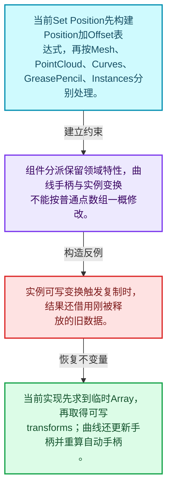
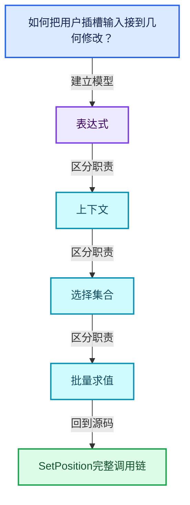
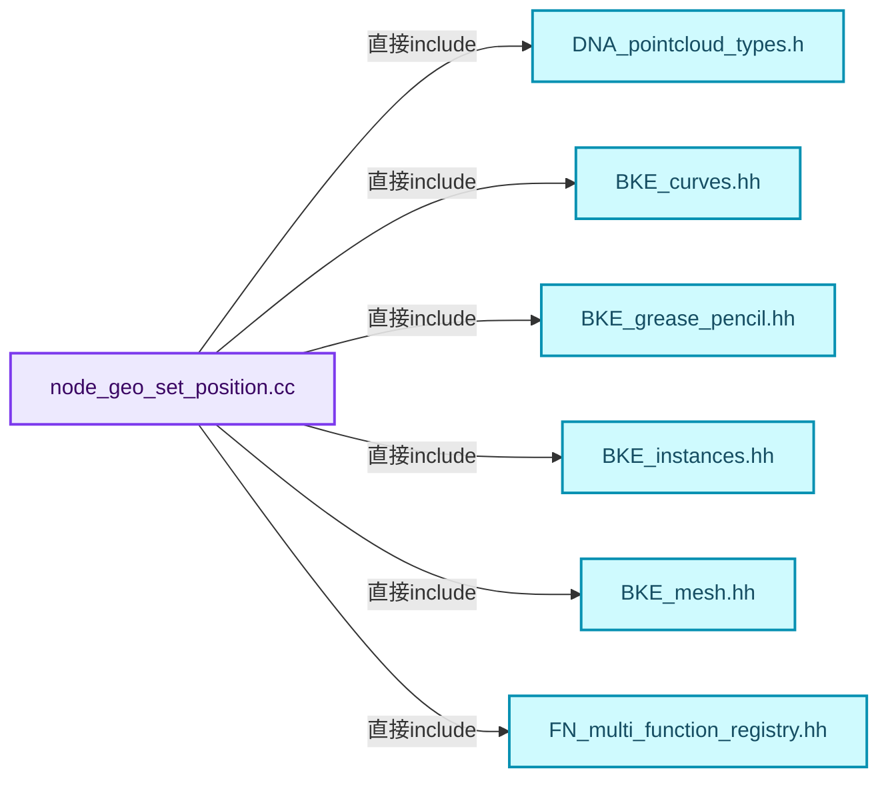
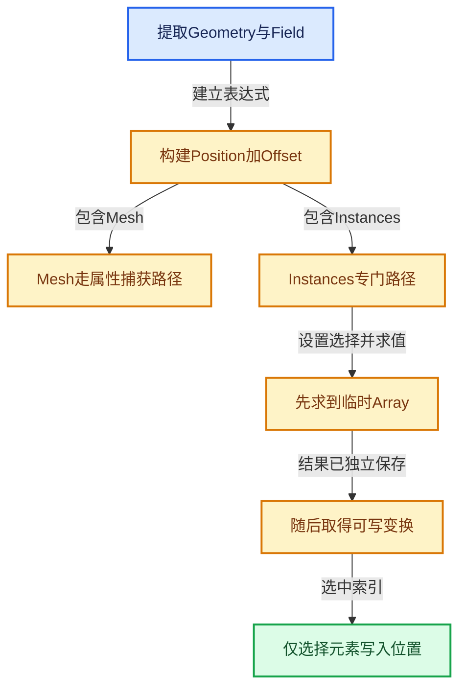
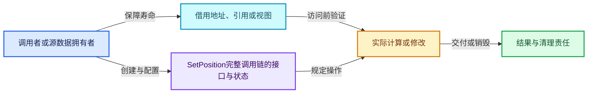
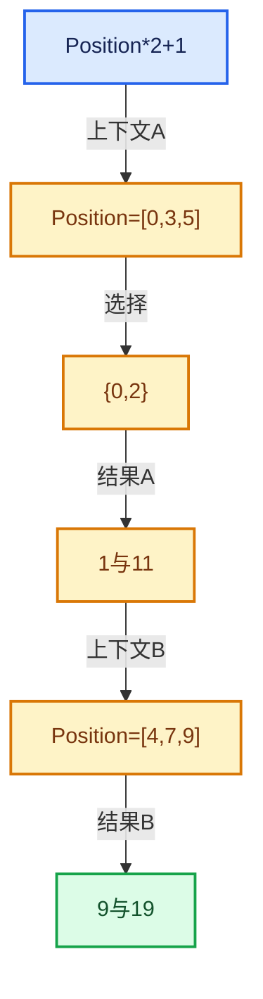

# 08-11 SetPosition完整调用链

[方向导航](README.md) · [总目录](../README.md) · [覆盖索引](../%E6%BA%90%E7%A0%81%E7%89%88%E6%9C%AC%E4%B8%8E%E8%A6%86%E7%9B%96%E7%B4%A2%E5%BC%95.md)

> 阅读顺序：问题与数据模型 → 语法与类型 → 源码逐行 → 调用线索 → 历史与取舍 → 推演和练习。

- 基准 HEAD：`cbda6b96c26c0dee3c3b5cbb93960c4ac06a6b30`。
- 记录日期：2026-10-14。
- 教学示例状态：正文中的推演不是本机性能实测；已运行练习见验收报告。

## 一、从问题到设计

如何把用户插槽输入接到几何修改？

节点取得Field并在几何上下文求值，选择、位置与偏移共同决定写入；访问可变几何前须满足共享语义。

本篇把语法、数据语义和系统取舍连接起来。Field表达式、求值上下文、mask与结果存储各自有独立职责和生命周期。

### 本篇独立模型与设计推理

当前Set Position先构建Position加Offset表达式，再按Mesh、PointCloud、Curves、GreasePencil、Instances分别处理。

设计取舍：组件分派保留领域特性，曲线手柄与实例变换不能按普通点数组一概修改。

最小反例：实例可写变换触发复制时，结果还借用刚被释放的旧数据。

推导与处理：当前实现先求到临时Array，再取得可写transforms；曲线还更新手柄并重算自动手柄。



### 源码范围与相邻篇章

| 文件 | 本篇逐行范围 | 基准SHA-256 |
|---|---|---|
| [source/blender/nodes/geometry/nodes/node_geo_set_position.cc](../../../../../source/blender/nodes/geometry/nodes/node_geo_set_position.cc) | L1—L181 | `a57eb7e24da02013adfa5ebbd68ed5907679fd4e996f6fe62d6a370c16bb5d0b` |

同一主讲文件可能分多篇覆盖；超出本篇范围的符号通过覆盖索引定位。空行与纯注释保留在源码摘录中，逐行表解释有效语句与语法边界；许可证头统一保留。

前篇：[几何上下文与属性域](10-%E5%87%A0%E4%BD%95%E4%B8%8A%E4%B8%8B%E6%96%87%E4%B8%8E%E5%B1%9E%E6%80%A7%E5%9F%9F.md).

后篇：[Field重构与深链销毁](12-Field%E9%87%8D%E6%9E%84%E4%B8%8E%E6%B7%B1%E9%93%BE%E9%94%80%E6%AF%81.md).

## 二、类型、数据与阅读地图



这是概念依赖图，边表示阅读关系，不声称是运行时调用顺序。

### 直接编译依赖



箭头只表示头文件包含关系；完整调用线索见后面的符号定位表。

## 三、关键词、语法与类型角色

### 只读限定 const

const约束当前访问路径可做的修改。const指针、指向const的指针、const视图对象、const元素是不同位置的限定；其他别名可能仍可修改原对象。

具体检查：分别写T* const、const T*与const T* const，并画出不可修改的层次。

### 移动转换 std::move

std::move把表达式转换为可供移动重载选择的值类别，实际资源转移发生在被选中的构造或赋值中。对const对象move可能仍调用复制，对视图move也不会获得底层数据所有权。

具体检查：记录移动构造调用次数，不用变量名或std::move的出现次数替代测量。

### 异常边界 try与catch

try定义异常传播的局部边界。失败路径需要销毁已经成功构造的部分并释放相应存储；未构造的对象不能被析构。

具体检查：在第k次构造失败，列出已经存在的对象集合与待释放缓冲。

### 类型别名 using

类型别名为已有类型建立名字，不创建运行期对象。它常把模板内部使用的类型统一暴露给泛型调用者。

具体检查：展开别名直到基础类型，区分类型别名和变量声明。

## 四、真实源码与逐行讲解

源码块保持原行内容，原始行号由小节标题及逐行表给出。表中的调用定位是静态阅读辅助；重载、模板实例化、宏展开和虚调用需结合完整声明，不能仅凭词法出现证明动态调用。

### node_geo_set_position.cc：L1—L44

<!-- source:source/blender/nodes/geometry/nodes/node_geo_set_position.cc:1:44 -->

```cpp
/* SPDX-FileCopyrightText: 2023 Blender Authors
 *
 * SPDX-License-Identifier: GPL-2.0-or-later */

#include "DNA_pointcloud_types.h"

#include "BKE_curves.hh"
#include "BKE_grease_pencil.hh"
#include "BKE_instances.hh"
#include "BKE_mesh.hh"

#include "FN_multi_function_registry.hh"

#include "node_geometry_util.hh"

namespace blender::nodes::node_geo_set_position_cc {

static void node_declare(NodeDeclarationBuilder &b)
{
  b.use_custom_socket_order();
  b.allow_any_socket_order();
  b.add_input<decl::Geometry>("Geometry"_ustr).description("Points to modify the positions of");
  b.add_output<decl::Geometry>("Geometry"_ustr).propagate_all_geometry().align_with_previous();
  b.add_input<decl::Bool>("Selection"_ustr)
      .default_value(true)
      .hide_value()
      .evaluated_geometry_field();
  b.add_input<decl::Vector>("Position"_ustr)
      .evaluated_geometry_field()
      .default_input_type(NODE_DEFAULT_INPUT_POSITION_FIELD);
  b.add_input<decl::Vector>("Offset"_ustr).subtype(PROP_TRANSLATION).evaluated_geometry_field();
}

static const auto &get_add_fn()
{
  static const auto &fn = fn::multi_function::registry::lookup("float3 + float3"_ustr);
  return fn;
}

static const auto &get_sub_fn()
{
  static const auto &fn = fn::multi_function::registry::lookup("float3 - float3"_ustr);
  return fn;
}
```

| 原始行 | 语义、约束与检查 |
|---|---|
| L5 | 引入编译依赖 "DNA_pointcloud_types.h"；这是声明可见性关系，不表示运行时一定调用该文件的所有接口。 |
| L7 | 引入编译依赖 "BKE_curves.hh"；这是声明可见性关系，不表示运行时一定调用该文件的所有接口。 |
| L8 | 引入编译依赖 "BKE_grease_pencil.hh"；这是声明可见性关系，不表示运行时一定调用该文件的所有接口。 |
| L9 | 引入编译依赖 "BKE_instances.hh"；这是声明可见性关系，不表示运行时一定调用该文件的所有接口。 |
| L10 | 引入编译依赖 "BKE_mesh.hh"；这是声明可见性关系，不表示运行时一定调用该文件的所有接口。 |
| L12 | 引入编译依赖 "FN_multi_function_registry.hh"；这是声明可见性关系，不表示运行时一定调用该文件的所有接口。 |
| L14 | 引入编译依赖 "node_geometry_util.hh"；这是声明可见性关系，不表示运行时一定调用该文件的所有接口。 |
| L16 | 把后续声明放入 blender::nodes::node_geo_set_position_cc 命名空间，影响名称查找和符号归属，不创建运行时对象。 |
| L18 | 出现调用或函数声明 `node_declare`，对应表达式为 `static void node_declare(NodeDeclarationBuilder &b)`。参数求值、返回类型与重载需结合前后完整语句；静态文本引用不能证明动态目标。 |
| L19 | 连接上一行的声明或控制结构与其语句块；后续行在这个作用域中执行或声明。 |
| L20 | 出现调用或函数声明 `use_custom_socket_order`，对应表达式为 `b.use_custom_socket_order();`。参数求值、返回类型与重载需结合前后完整语句；静态文本引用不能证明动态目标。 |
| L21 | 出现调用或函数声明 `allow_any_socket_order`，对应表达式为 `b.allow_any_socket_order();`。参数求值、返回类型与重载需结合前后完整语句；静态文本引用不能证明动态目标。 |
| L22 | 出现调用或函数声明 `add_input`，对应表达式为 `b.add_input<decl::Geometry>("Geometry"_ustr).description("Points to modify the positions of");`。参数求值、返回类型与重载需结合前后完整语句；静态文本引用不能证明动态目标。 |
| L23 | 出现调用或函数声明 `add_output`，对应表达式为 `b.add_output<decl::Geometry>("Geometry"_ustr).propagate_all_geometry().align_with_previous();`。参数求值、返回类型与重载需结合前后完整语句；静态文本引用不能证明动态目标。 |
| L24 | 出现调用或函数声明 `add_input`，对应表达式为 `b.add_input<decl::Bool>("Selection"_ustr)`。参数求值、返回类型与重载需结合前后完整语句；静态文本引用不能证明动态目标。 |
| L25 | 出现调用或函数声明 `default_value`，对应表达式为 `.default_value(true)`。参数求值、返回类型与重载需结合前后完整语句；静态文本引用不能证明动态目标。 |
| L26 | 出现调用或函数声明 `hide_value`，对应表达式为 `.hide_value()`。参数求值、返回类型与重载需结合前后完整语句；静态文本引用不能证明动态目标。 |
| L27 | 出现调用或函数声明 `evaluated_geometry_field`，对应表达式为 `.evaluated_geometry_field();`。参数求值、返回类型与重载需结合前后完整语句；静态文本引用不能证明动态目标。 |
| L28 | 出现调用或函数声明 `add_input`，对应表达式为 `b.add_input<decl::Vector>("Position"_ustr)`。参数求值、返回类型与重载需结合前后完整语句；静态文本引用不能证明动态目标。 |
| L29 | 出现调用或函数声明 `evaluated_geometry_field`，对应表达式为 `.evaluated_geometry_field()`。参数求值、返回类型与重载需结合前后完整语句；静态文本引用不能证明动态目标。 |
| L30 | 出现调用或函数声明 `default_input_type`，对应表达式为 `.default_input_type(NODE_DEFAULT_INPUT_POSITION_FIELD);`。参数求值、返回类型与重载需结合前后完整语句；静态文本引用不能证明动态目标。 |
| L31 | 出现调用或函数声明 `add_input`，对应表达式为 `b.add_input<decl::Vector>("Offset"_ustr).subtype(PROP_TRANSLATION).evaluated_geometry_field();`。参数求值、返回类型与重载需结合前后完整语句；静态文本引用不能证明动态目标。 |
| L32 | 结束当前语法单元。局部自动对象在离开其作用域时按规则销毁；这不等于所有被引用的外部数据也被释放。 |
| L34 | 出现调用或函数声明 `get_add_fn`，对应表达式为 `static const auto &get_add_fn()`。参数求值、返回类型与重载需结合前后完整语句；静态文本引用不能证明动态目标。 |
| L35 | 连接上一行的声明或控制结构与其语句块；后续行在这个作用域中执行或声明。 |
| L36 | 把右侧 `fn::multi_function::registry::lookup("float3 + float3"_ustr)` 用于初始化或更新左侧 `static const auto &fn`。声明初始化与已有对象赋值应按上下文区分；有资源的类型会调用相应特殊成员。 |
| L37 | 返回表达式 `fn`。结合函数声明检查返回值是否借用原存储，借用值不会自动延长其寿命。 |
| L38 | 结束当前语法单元。局部自动对象在离开其作用域时按规则销毁；这不等于所有被引用的外部数据也被释放。 |
| L40 | 出现调用或函数声明 `get_sub_fn`，对应表达式为 `static const auto &get_sub_fn()`。参数求值、返回类型与重载需结合前后完整语句；静态文本引用不能证明动态目标。 |
| L41 | 连接上一行的声明或控制结构与其语句块；后续行在这个作用域中执行或声明。 |
| L42 | 把右侧 `fn::multi_function::registry::lookup("float3 - float3"_ustr)` 用于初始化或更新左侧 `static const auto &fn`。声明初始化与已有对象赋值应按上下文区分；有资源的类型会调用相应特殊成员。 |
| L43 | 返回表达式 `fn`。结合函数声明检查返回值是否借用原存储，借用值不会自动延长其寿命。 |
| L44 | 结束当前语法单元。局部自动对象在离开其作用域时按规则销毁；这不等于所有被引用的外部数据也被释放。 |

### node_geo_set_position.cc：L45—L85

<!-- source:source/blender/nodes/geometry/nodes/node_geo_set_position.cc:45:85 -->

```cpp

static void set_points_position(bke::MutableAttributeAccessor attributes,
                                const fn::FieldContext &field_context,
                                const Field<bool> &selection_field,
                                const Field<float3> &position_field)
{
  bke::try_capture_field_on_geometry(attributes,
                                     field_context,
                                     "position",
                                     bke::AttrDomain::Point,
                                     selection_field,
                                     position_field);
}

static void set_curves_position(bke::CurvesGeometry &curves,
                                const fn::FieldContext &field_context,
                                const Field<bool> &selection_field,
                                const Field<float3> &position_field)
{
  MutableAttributeAccessor attributes = curves.attributes_for_write();

  Vector<StringRef> attribute_names;
  Vector<GField> fields;
  attribute_names.append("position");
  fields.append(position_field);

  if (attributes.contains("handle_right") && attributes.contains("handle_left")) {
    fn::Field<float3> delta(fn::FieldOperation::from(
        get_sub_fn(),
        {position_field, bke::AttributeFieldInput::get_field<float3, "position">()}));
    for (const StringRef name : {"handle_left", "handle_right"}) {
      attribute_names.append(name);
      fields.append(Field<float3>(fn::FieldOperation::from(
          get_add_fn(), {bke::AttributeFieldInput::from<float3>(name), delta})));
    }
  }

  bke::try_capture_fields_on_geometry(
      attributes, field_context, attribute_names, bke::AttrDomain::Point, selection_field, fields);
  curves.calculate_bezier_auto_handles();
}
```

本段语义重点：

- 分支证据 `attributes.contains("handle_right") && attributes.contains("handle_left"))`：分别推演条件成立与不成立，核对相同出口处的状态。

| 原始行 | 语义、约束与检查 |
|---|---|
| L46 | 出现调用或函数声明 `set_points_position`，对应表达式为 `static void set_points_position(bke::MutableAttributeAccessor attributes,`。参数求值、返回类型与重载需结合前后完整语句；静态文本引用不能证明动态目标。 |
| L47 | 本行是连续声明或表达式的一部分：`const fn::FieldContext &field_context,`。与本段前后行合读；逗号、括号和限定符决定它属于参数、初始化列表还是实际计算。 |
| L48 | 本行是连续声明或表达式的一部分：`const Field<bool> &selection_field,`。与本段前后行合读；逗号、括号和限定符决定它属于参数、初始化列表还是实际计算。 |
| L49 | 本行是连续声明或表达式的一部分：`const Field<float3> &position_field)`。与本段前后行合读；逗号、括号和限定符决定它属于参数、初始化列表还是实际计算。 |
| L50 | 连接上一行的声明或控制结构与其语句块；后续行在这个作用域中执行或声明。 |
| L51 | 出现调用或函数声明 `bke::try_capture_field_on_geometry`，对应表达式为 `bke::try_capture_field_on_geometry(attributes,`。参数求值、返回类型与重载需结合前后完整语句；静态文本引用不能证明动态目标。 |
| L52 | 本行是连续声明或表达式的一部分：`field_context,`。与本段前后行合读；逗号、括号和限定符决定它属于参数、初始化列表还是实际计算。 |
| L53 | 本行是连续声明或表达式的一部分：`"position",`。与本段前后行合读；逗号、括号和限定符决定它属于参数、初始化列表还是实际计算。 |
| L54 | 本行是连续声明或表达式的一部分：`bke::AttrDomain::Point,`。与本段前后行合读；逗号、括号和限定符决定它属于参数、初始化列表还是实际计算。 |
| L55 | 本行是连续声明或表达式的一部分：`selection_field,`。与本段前后行合读；逗号、括号和限定符决定它属于参数、初始化列表还是实际计算。 |
| L56 | 声明成员、局部对象或完成语句 `position_field)`。若为指针或引用，它本身不说明拥有；若为值对象，其构造析构由所在作用域或外层对象管理。 |
| L57 | 结束当前语法单元。局部自动对象在离开其作用域时按规则销毁；这不等于所有被引用的外部数据也被释放。 |
| L59 | 出现调用或函数声明 `set_curves_position`，对应表达式为 `static void set_curves_position(bke::CurvesGeometry &curves,`。参数求值、返回类型与重载需结合前后完整语句；静态文本引用不能证明动态目标。 |
| L60 | 本行是连续声明或表达式的一部分：`const fn::FieldContext &field_context,`。与本段前后行合读；逗号、括号和限定符决定它属于参数、初始化列表还是实际计算。 |
| L61 | 本行是连续声明或表达式的一部分：`const Field<bool> &selection_field,`。与本段前后行合读；逗号、括号和限定符决定它属于参数、初始化列表还是实际计算。 |
| L62 | 本行是连续声明或表达式的一部分：`const Field<float3> &position_field)`。与本段前后行合读；逗号、括号和限定符决定它属于参数、初始化列表还是实际计算。 |
| L63 | 连接上一行的声明或控制结构与其语句块；后续行在这个作用域中执行或声明。 |
| L64 | 把右侧 `curves.attributes_for_write()` 用于初始化或更新左侧 `MutableAttributeAccessor attributes`。声明初始化与已有对象赋值应按上下文区分；有资源的类型会调用相应特殊成员。 |
| L66 | 声明成员、局部对象或完成语句 `Vector<StringRef> attribute_names`。若为指针或引用，它本身不说明拥有；若为值对象，其构造析构由所在作用域或外层对象管理。 |
| L67 | 声明成员、局部对象或完成语句 `Vector<GField> fields`。若为指针或引用，它本身不说明拥有；若为值对象，其构造析构由所在作用域或外层对象管理。 |
| L68 | 出现调用或函数声明 `append`，对应表达式为 `attribute_names.append("position");`。参数求值、返回类型与重载需结合前后完整语句；静态文本引用不能证明动态目标。 |
| L69 | 出现调用或函数声明 `append`，对应表达式为 `fields.append(position_field);`。参数求值、返回类型与重载需结合前后完整语句；静态文本引用不能证明动态目标。 |
| L71 | 判断 `attributes.contains("handle_right") && attributes.contains("handle_left")`，成立时进入本分支，否则继续后续路径。 |
| L72 | 出现调用或函数声明 `delta`，对应表达式为 `fn::Field<float3> delta(fn::FieldOperation::from(`。参数求值、返回类型与重载需结合前后完整语句；静态文本引用不能证明动态目标。 |
| L73 | 出现调用或函数声明 `get_sub_fn`，对应表达式为 `get_sub_fn(),`。参数求值、返回类型与重载需结合前后完整语句；静态文本引用不能证明动态目标。 |
| L74 | 出现调用或函数声明 `bke::AttributeFieldInput::get_field`，对应表达式为 `{position_field, bke::AttributeFieldInput::get_field<float3, "position">()}));`。参数求值、返回类型与重载需结合前后完整语句；静态文本引用不能证明动态目标。 |
| L75 | 按 `for (const StringRef name : {"handle_left", "handle_right"})` 指定的范围或条件重复执行。对照循环变量与真实元素编号；循环内调用成本乘以实际迭代次数。 |
| L76 | 出现调用或函数声明 `append`，对应表达式为 `attribute_names.append(name);`。参数求值、返回类型与重载需结合前后完整语句；静态文本引用不能证明动态目标。 |
| L77 | 出现调用或函数声明 `append`，对应表达式为 `fields.append(Field<float3>(fn::FieldOperation::from(`。参数求值、返回类型与重载需结合前后完整语句；静态文本引用不能证明动态目标。 |
| L78 | 出现调用或函数声明 `get_add_fn`，对应表达式为 `get_add_fn(), {bke::AttributeFieldInput::from<float3>(name), delta})));`。参数求值、返回类型与重载需结合前后完整语句；静态文本引用不能证明动态目标。 |
| L79 | 结束当前语法单元。局部自动对象在离开其作用域时按规则销毁；这不等于所有被引用的外部数据也被释放。 |
| L80 | 结束当前语法单元。局部自动对象在离开其作用域时按规则销毁；这不等于所有被引用的外部数据也被释放。 |
| L82 | 出现调用或函数声明 `bke::try_capture_fields_on_geometry`，对应表达式为 `bke::try_capture_fields_on_geometry(`。参数求值、返回类型与重载需结合前后完整语句；静态文本引用不能证明动态目标。 |
| L83 | 声明成员、局部对象或完成语句 `attributes, field_context, attribute_names, bke::AttrDomain::Point, selection_field, fields)`。若为指针或引用，它本身不说明拥有；若为值对象，其构造析构由所在作用域或外层对象管理。 |
| L84 | 出现调用或函数声明 `calculate_bezier_auto_handles`，对应表达式为 `curves.calculate_bezier_auto_handles();`。参数求值、返回类型与重载需结合前后完整语句；静态文本引用不能证明动态目标。 |
| L85 | 结束当前语法单元。局部自动对象在离开其作用域时按规则销毁；这不等于所有被引用的外部数据也被释放。 |

### node_geo_set_position.cc：L86—L126

<!-- source:source/blender/nodes/geometry/nodes/node_geo_set_position.cc:86:126 -->

```cpp

static void set_position_in_grease_pencil(GreasePencil &grease_pencil,
                                          const Field<bool> &selection_field,
                                          const Field<float3> &position_field)
{
  using namespace blender::bke::greasepencil;
  for (const int layer_index : grease_pencil.layers().index_range()) {
    Drawing *drawing = grease_pencil.get_eval_drawing(grease_pencil.layer(layer_index));
    if (drawing == nullptr || drawing->strokes().is_empty()) {
      continue;
    }
    set_curves_position(
        drawing->strokes_for_write(),
        bke::GreasePencilLayerFieldContext(grease_pencil, bke::AttrDomain::Point, layer_index),
        selection_field,
        position_field);
    drawing->tag_positions_changed();
  }
}

static void set_instances_position(bke::Instances &instances,
                                   const Field<bool> &selection_field,
                                   const Field<float3> &position_field)
{
  const bke::InstancesFieldContext context(instances);
  fn::FieldEvaluator evaluator(context, instances.instances_num());
  evaluator.set_selection(selection_field);

  /* Use a temporary array for the output to avoid potentially reading from freed memory if
   * retrieving the transforms has to make a mutable copy (then we can't depend on the user count
   * of the original read-only data). */
  Array<float3> result(instances.instances_num());
  evaluator.add_with_destination(position_field, result.as_mutable_span());
  evaluator.evaluate();

  const IndexMask selection = evaluator.get_evaluated_selection_as_mask();

  MutableSpan<float4x4> transforms = instances.transforms_for_write();
  selection.foreach_index_optimized<int>(
      [&](const int i) { transforms[i].location() = result[i]; }, exec_mode::grain_size(4096));
}
```

本段语义重点：

- 分支证据 `drawing == nullptr &#124;&#124; drawing->strokes().is_empty())`：分别推演条件成立与不成立，核对相同出口处的状态。

| 原始行 | 语义、约束与检查 |
|---|---|
| L87 | 出现调用或函数声明 `set_position_in_grease_pencil`，对应表达式为 `static void set_position_in_grease_pencil(GreasePencil &grease_pencil,`。参数求值、返回类型与重载需结合前后完整语句；静态文本引用不能证明动态目标。 |
| L88 | 本行是连续声明或表达式的一部分：`const Field<bool> &selection_field,`。与本段前后行合读；逗号、括号和限定符决定它属于参数、初始化列表还是实际计算。 |
| L89 | 本行是连续声明或表达式的一部分：`const Field<float3> &position_field)`。与本段前后行合读；逗号、括号和限定符决定它属于参数、初始化列表还是实际计算。 |
| L90 | 连接上一行的声明或控制结构与其语句块；后续行在这个作用域中执行或声明。 |
| L91 | 定义类型别名 `using namespace blender::bke::greasepencil`，为模板接口或内部实现统一命名；本行不分配该类型对象。 |
| L92 | 按 `for (const int layer_index : grease_pencil.layers().index_range())` 指定的范围或条件重复执行。对照循环变量与真实元素编号；循环内调用成本乘以实际迭代次数。 |
| L93 | 把右侧 `grease_pencil.get_eval_drawing(grease_pencil.layer(layer_index))` 用于初始化或更新左侧 `Drawing *drawing`。声明初始化与已有对象赋值应按上下文区分；有资源的类型会调用相应特殊成员。 |
| L94 | 判断 `drawing == nullptr &#124;&#124; drawing->strokes().is_empty()`，成立时进入本分支，否则继续后续路径。这里区分空地址与可用地址，但非空本身仍不能证明对象存活。 |
| L95 | 结束本轮循环并进入下一轮；核对本轮已经取得的资源是否由作用域或显式代码清理。 |
| L96 | 结束当前语法单元。局部自动对象在离开其作用域时按规则销毁；这不等于所有被引用的外部数据也被释放。 |
| L97 | 出现调用或函数声明 `set_curves_position`，对应表达式为 `set_curves_position(`。参数求值、返回类型与重载需结合前后完整语句；静态文本引用不能证明动态目标。 |
| L98 | 出现调用或函数声明 `strokes_for_write`，对应表达式为 `drawing->strokes_for_write(),`。参数求值、返回类型与重载需结合前后完整语句；静态文本引用不能证明动态目标。 |
| L99 | 出现调用或函数声明 `bke::GreasePencilLayerFieldContext`，对应表达式为 `bke::GreasePencilLayerFieldContext(grease_pencil, bke::AttrDomain::Point, layer_index),`。参数求值、返回类型与重载需结合前后完整语句；静态文本引用不能证明动态目标。 |
| L100 | 本行是连续声明或表达式的一部分：`selection_field,`。与本段前后行合读；逗号、括号和限定符决定它属于参数、初始化列表还是实际计算。 |
| L101 | 声明成员、局部对象或完成语句 `position_field)`。若为指针或引用，它本身不说明拥有；若为值对象，其构造析构由所在作用域或外层对象管理。 |
| L102 | 出现调用或函数声明 `tag_positions_changed`，对应表达式为 `drawing->tag_positions_changed();`。参数求值、返回类型与重载需结合前后完整语句；静态文本引用不能证明动态目标。 |
| L103 | 结束当前语法单元。局部自动对象在离开其作用域时按规则销毁；这不等于所有被引用的外部数据也被释放。 |
| L104 | 结束当前语法单元。局部自动对象在离开其作用域时按规则销毁；这不等于所有被引用的外部数据也被释放。 |
| L106 | 出现调用或函数声明 `set_instances_position`，对应表达式为 `static void set_instances_position(bke::Instances &instances,`。参数求值、返回类型与重载需结合前后完整语句；静态文本引用不能证明动态目标。 |
| L107 | 本行是连续声明或表达式的一部分：`const Field<bool> &selection_field,`。与本段前后行合读；逗号、括号和限定符决定它属于参数、初始化列表还是实际计算。 |
| L108 | 本行是连续声明或表达式的一部分：`const Field<float3> &position_field)`。与本段前后行合读；逗号、括号和限定符决定它属于参数、初始化列表还是实际计算。 |
| L109 | 连接上一行的声明或控制结构与其语句块；后续行在这个作用域中执行或声明。 |
| L110 | 声明接口 `const bke::InstancesFieldContext context(instances)`，本行没有对应函数体；返回类型、参数限定和const/noexcept共同组成调用契约，实际行为需继续定位实现。 |
| L111 | 出现调用或函数声明 `evaluator`，对应表达式为 `fn::FieldEvaluator evaluator(context, instances.instances_num());`。参数求值、返回类型与重载需结合前后完整语句；静态文本引用不能证明动态目标。 |
| L112 | 出现调用或函数声明 `set_selection`，对应表达式为 `evaluator.set_selection(selection_field);`。参数求值、返回类型与重载需结合前后完整语句；静态文本引用不能证明动态目标。 |
| L117 | 出现调用或函数声明 `result`，对应表达式为 `Array<float3> result(instances.instances_num());`。参数求值、返回类型与重载需结合前后完整语句；静态文本引用不能证明动态目标。 |
| L118 | 出现调用或函数声明 `add_with_destination`，对应表达式为 `evaluator.add_with_destination(position_field, result.as_mutable_span());`。参数求值、返回类型与重载需结合前后完整语句；静态文本引用不能证明动态目标。 |
| L119 | 出现调用或函数声明 `evaluate`，对应表达式为 `evaluator.evaluate();`。参数求值、返回类型与重载需结合前后完整语句；静态文本引用不能证明动态目标。 |
| L121 | 把右侧 `evaluator.get_evaluated_selection_as_mask()` 用于初始化或更新左侧 `const IndexMask selection`。声明初始化与已有对象赋值应按上下文区分；有资源的类型会调用相应特殊成员。 |
| L123 | 把右侧 `instances.transforms_for_write()` 用于初始化或更新左侧 `MutableSpan<float4x4> transforms`。声明初始化与已有对象赋值应按上下文区分；有资源的类型会调用相应特殊成员。 |
| L124 | 出现调用或函数声明 `foreach_index_optimized`，对应表达式为 `selection.foreach_index_optimized<int>(`。参数求值、返回类型与重载需结合前后完整语句；静态文本引用不能证明动态目标。 |
| L125 | 把右侧 `result[i]; }, exec_mode::grain_size(4096))` 用于初始化或更新左侧 `[&](const int i) { transforms[i].location()`。声明初始化与已有对象赋值应按上下文区分；有资源的类型会调用相应特殊成员。 |
| L126 | 结束当前语法单元。局部自动对象在离开其作用域时按规则销毁；这不等于所有被引用的外部数据也被释放。 |

### node_geo_set_position.cc：L127—L181

<!-- source:source/blender/nodes/geometry/nodes/node_geo_set_position.cc:127:181 -->

```cpp

static void node_geo_exec(GeoNodeExecParams params)
{
  GeometrySet geometry = params.extract_input<GeometrySet>("Geometry"_ustr);
  const Field<bool> selection_field = params.extract_input<Field<bool>>("Selection"_ustr);
  const fn::Field<float3> position_field(
      fn::FieldOperation::from(get_add_fn(),
                               {params.extract_input<Field<float3>>("Position"_ustr),
                                params.extract_input<Field<float3>>("Offset"_ustr)}));

  if (Mesh *mesh = geometry.get_mesh_for_write()) {
    set_points_position(mesh->attributes_for_write(),
                        bke::MeshFieldContext(*mesh, bke::AttrDomain::Point),
                        selection_field,
                        position_field);
  }
  if (PointCloud *pointcloud = geometry.get_pointcloud_for_write()) {
    set_points_position(pointcloud->attributes_for_write(),
                        bke::PointCloudFieldContext(*pointcloud),
                        selection_field,
                        position_field);
  }
  if (Curves *curves_id = geometry.get_curves_for_write()) {
    bke::CurvesGeometry &curves = curves_id->geometry.wrap();
    set_curves_position(curves,
                        bke::CurvesFieldContext(*curves_id, bke::AttrDomain::Point),
                        selection_field,
                        position_field);
  }
  if (GreasePencil *grease_pencil = geometry.get_grease_pencil_for_write()) {
    set_position_in_grease_pencil(*grease_pencil, selection_field, position_field);
  }
  if (bke::Instances *instances = geometry.get_instances_for_write()) {
    set_instances_position(*instances, selection_field, position_field);
  }

  params.set_output("Geometry"_ustr, std::move(geometry));
}

static void node_register()
{
  static bke::bNodeType ntype;

  geo_node_type_base(&ntype, "GeometryNodeSetPosition"_ustr, GEO_NODE_SET_POSITION);
  ntype.ui_name = "Set Position";
  ntype.ui_description = "Set the location of each point";
  ntype.enum_name_legacy = "SET_POSITION";
  ntype.nclass = NODE_CLASS_GEOMETRY;
  ntype.geometry_node_execute = node_geo_exec;
  ntype.declare = node_declare;
  bke::node_register_type(ntype);
}
NOD_REGISTER_NODE(node_register)

}  // namespace blender::nodes::node_geo_set_position_cc
```

本段语义重点：

- `set_output`：向输出位置发布值；输出是否已构造、是否已经设置由调用约定限制。
- `extract_input`：提取输入值，可能转移其资源；重复读取的合法性取决于接口契约。

| 原始行 | 语义、约束与检查 |
|---|---|
| L128 | 出现调用或函数声明 `node_geo_exec`，对应表达式为 `static void node_geo_exec(GeoNodeExecParams params)`。参数求值、返回类型与重载需结合前后完整语句；静态文本引用不能证明动态目标。 |
| L129 | 连接上一行的声明或控制结构与其语句块；后续行在这个作用域中执行或声明。 |
| L130 | 本行使用 `extract_input`：提取输入值，可能转移其资源；重复读取的合法性取决于接口契约。 |
| L131 | 本行使用 `extract_input`：提取输入值，可能转移其资源；重复读取的合法性取决于接口契约。 |
| L132 | 出现调用或函数声明 `position_field`，对应表达式为 `const fn::Field<float3> position_field(`。参数求值、返回类型与重载需结合前后完整语句；静态文本引用不能证明动态目标。 |
| L133 | 出现调用或函数声明 `fn::FieldOperation::from`，对应表达式为 `fn::FieldOperation::from(get_add_fn(),`。参数求值、返回类型与重载需结合前后完整语句；静态文本引用不能证明动态目标。 |
| L134 | 本行使用 `extract_input`：提取输入值，可能转移其资源；重复读取的合法性取决于接口契约。 |
| L135 | 本行使用 `extract_input`：提取输入值，可能转移其资源；重复读取的合法性取决于接口契约。 |
| L137 | 判断 `Mesh *mesh = geometry.get_mesh_for_write()`，成立时进入本分支，否则继续后续路径。 |
| L138 | 出现调用或函数声明 `set_points_position`，对应表达式为 `set_points_position(mesh->attributes_for_write(),`。参数求值、返回类型与重载需结合前后完整语句；静态文本引用不能证明动态目标。 |
| L139 | 出现调用或函数声明 `bke::MeshFieldContext`，对应表达式为 `bke::MeshFieldContext(*mesh, bke::AttrDomain::Point),`。参数求值、返回类型与重载需结合前后完整语句；静态文本引用不能证明动态目标。 |
| L140 | 本行是连续声明或表达式的一部分：`selection_field,`。与本段前后行合读；逗号、括号和限定符决定它属于参数、初始化列表还是实际计算。 |
| L141 | 声明成员、局部对象或完成语句 `position_field)`。若为指针或引用，它本身不说明拥有；若为值对象，其构造析构由所在作用域或外层对象管理。 |
| L142 | 结束当前语法单元。局部自动对象在离开其作用域时按规则销毁；这不等于所有被引用的外部数据也被释放。 |
| L143 | 判断 `PointCloud *pointcloud = geometry.get_pointcloud_for_write()`，成立时进入本分支，否则继续后续路径。 |
| L144 | 出现调用或函数声明 `set_points_position`，对应表达式为 `set_points_position(pointcloud->attributes_for_write(),`。参数求值、返回类型与重载需结合前后完整语句；静态文本引用不能证明动态目标。 |
| L145 | 出现调用或函数声明 `bke::PointCloudFieldContext`，对应表达式为 `bke::PointCloudFieldContext(*pointcloud),`。参数求值、返回类型与重载需结合前后完整语句；静态文本引用不能证明动态目标。 |
| L146 | 本行是连续声明或表达式的一部分：`selection_field,`。与本段前后行合读；逗号、括号和限定符决定它属于参数、初始化列表还是实际计算。 |
| L147 | 声明成员、局部对象或完成语句 `position_field)`。若为指针或引用，它本身不说明拥有；若为值对象，其构造析构由所在作用域或外层对象管理。 |
| L148 | 结束当前语法单元。局部自动对象在离开其作用域时按规则销毁；这不等于所有被引用的外部数据也被释放。 |
| L149 | 判断 `Curves *curves_id = geometry.get_curves_for_write()`，成立时进入本分支，否则继续后续路径。 |
| L150 | 把右侧 `curves_id->geometry.wrap()` 用于初始化或更新左侧 `bke::CurvesGeometry &curves`。声明初始化与已有对象赋值应按上下文区分；有资源的类型会调用相应特殊成员。 |
| L151 | 出现调用或函数声明 `set_curves_position`，对应表达式为 `set_curves_position(curves,`。参数求值、返回类型与重载需结合前后完整语句；静态文本引用不能证明动态目标。 |
| L152 | 出现调用或函数声明 `bke::CurvesFieldContext`，对应表达式为 `bke::CurvesFieldContext(*curves_id, bke::AttrDomain::Point),`。参数求值、返回类型与重载需结合前后完整语句；静态文本引用不能证明动态目标。 |
| L153 | 本行是连续声明或表达式的一部分：`selection_field,`。与本段前后行合读；逗号、括号和限定符决定它属于参数、初始化列表还是实际计算。 |
| L154 | 声明成员、局部对象或完成语句 `position_field)`。若为指针或引用，它本身不说明拥有；若为值对象，其构造析构由所在作用域或外层对象管理。 |
| L155 | 结束当前语法单元。局部自动对象在离开其作用域时按规则销毁；这不等于所有被引用的外部数据也被释放。 |
| L156 | 判断 `GreasePencil *grease_pencil = geometry.get_grease_pencil_for_write()`，成立时进入本分支，否则继续后续路径。 |
| L157 | 出现调用或函数声明 `set_position_in_grease_pencil`，对应表达式为 `set_position_in_grease_pencil(*grease_pencil, selection_field, position_field);`。参数求值、返回类型与重载需结合前后完整语句；静态文本引用不能证明动态目标。 |
| L158 | 结束当前语法单元。局部自动对象在离开其作用域时按规则销毁；这不等于所有被引用的外部数据也被释放。 |
| L159 | 判断 `bke::Instances *instances = geometry.get_instances_for_write()`，成立时进入本分支，否则继续后续路径。 |
| L160 | 出现调用或函数声明 `set_instances_position`，对应表达式为 `set_instances_position(*instances, selection_field, position_field);`。参数求值、返回类型与重载需结合前后完整语句；静态文本引用不能证明动态目标。 |
| L161 | 结束当前语法单元。局部自动对象在离开其作用域时按规则销毁；这不等于所有被引用的外部数据也被释放。 |
| L163 | 本行使用 `set_output`：向输出位置发布值；输出是否已构造、是否已经设置由调用约定限制。 |
| L164 | 结束当前语法单元。局部自动对象在离开其作用域时按规则销毁；这不等于所有被引用的外部数据也被释放。 |
| L166 | 出现调用或函数声明 `node_register`，对应表达式为 `static void node_register()`。参数求值、返回类型与重载需结合前后完整语句；静态文本引用不能证明动态目标。 |
| L167 | 连接上一行的声明或控制结构与其语句块；后续行在这个作用域中执行或声明。 |
| L168 | 声明成员、局部对象或完成语句 `static bke::bNodeType ntype`。若为指针或引用，它本身不说明拥有；若为值对象，其构造析构由所在作用域或外层对象管理。 |
| L170 | 出现调用或函数声明 `geo_node_type_base`，对应表达式为 `geo_node_type_base(&ntype, "GeometryNodeSetPosition"_ustr, GEO_NODE_SET_POSITION);`。参数求值、返回类型与重载需结合前后完整语句；静态文本引用不能证明动态目标。 |
| L171 | 把右侧 `"Set Position"` 用于初始化或更新左侧 `ntype.ui_name`。声明初始化与已有对象赋值应按上下文区分；有资源的类型会调用相应特殊成员。 |
| L172 | 把右侧 `"Set the location of each point"` 用于初始化或更新左侧 `ntype.ui_description`。声明初始化与已有对象赋值应按上下文区分；有资源的类型会调用相应特殊成员。 |
| L173 | 把右侧 `"SET_POSITION"` 用于初始化或更新左侧 `ntype.enum_name_legacy`。声明初始化与已有对象赋值应按上下文区分；有资源的类型会调用相应特殊成员。 |
| L174 | 把右侧 `NODE_CLASS_GEOMETRY` 用于初始化或更新左侧 `ntype.nclass`。声明初始化与已有对象赋值应按上下文区分；有资源的类型会调用相应特殊成员。 |
| L175 | 把右侧 `node_geo_exec` 用于初始化或更新左侧 `ntype.geometry_node_execute`。声明初始化与已有对象赋值应按上下文区分；有资源的类型会调用相应特殊成员。 |
| L176 | 把右侧 `node_declare` 用于初始化或更新左侧 `ntype.declare`。声明初始化与已有对象赋值应按上下文区分；有资源的类型会调用相应特殊成员。 |
| L177 | 出现调用或函数声明 `bke::node_register_type`，对应表达式为 `bke::node_register_type(ntype);`。参数求值、返回类型与重载需结合前后完整语句；静态文本引用不能证明动态目标。 |
| L178 | 结束当前语法单元。局部自动对象在离开其作用域时按规则销毁；这不等于所有被引用的外部数据也被释放。 |
| L179 | 出现调用或函数声明 `NOD_REGISTER_NODE`，对应表达式为 `NOD_REGISTER_NODE(node_register)`。参数求值、返回类型与重载需结合前后完整语句；静态文本引用不能证明动态目标。 |
| L181 | 结束当前语法单元。局部自动对象在离开其作用域时按规则销毁；这不等于所有被引用的外部数据也被释放。 |

## 五、接口定位、调用线索与生命周期

### Set Position的组件分派与实例安全写入



一个GeometrySet可能同时包含多类组件，因此这些if不是互斥的else-if。Curves还要处理手柄，GreasePencil逐层处理，不能用实例路径替代全部行为。

| 阶段 | 源码证据位置 | 实际语句定位 |
|---|---|---|
| 提取Geometry与Field | node_geo_set_position.cc [L128](../../../../../source/blender/nodes/geometry/nodes/node_geo_set_position.cc#L128) | `static void node_geo_exec(` |
| 构建Position加Offset | node_geo_set_position.cc [L133](../../../../../source/blender/nodes/geometry/nodes/node_geo_set_position.cc#L133) | `fn::FieldOperation::from(get_add_fn()` |
| Mesh走属性捕获路径 | node_geo_set_position.cc [L137](../../../../../source/blender/nodes/geometry/nodes/node_geo_set_position.cc#L137) | `if (Mesh *mesh = geometry.get_mesh_for_write())` |
| Instances专门路径 | node_geo_set_position.cc [L106](../../../../../source/blender/nodes/geometry/nodes/node_geo_set_position.cc#L106) | `static void set_instances_position(` |
| 先求到临时Array | node_geo_set_position.cc [L118](../../../../../source/blender/nodes/geometry/nodes/node_geo_set_position.cc#L118) | `evaluator.add_with_destination(position_field, result.as_mutable_span())` |
| 随后取得可写变换 | node_geo_set_position.cc [L123](../../../../../source/blender/nodes/geometry/nodes/node_geo_set_position.cc#L123) | `MutableSpan<float4x4> transforms = instances.transforms_for_write()` |
| 仅选择元素写入位置 | node_geo_set_position.cc [L125](../../../../../source/blender/nodes/geometry/nodes/node_geo_set_position.cc#L125) | `transforms[i].location() = result[i]` |

图中的条件边必须与对应if、异常路径和提前返回合读；不把未展示分支当作不存在。

### 本篇声明与实现入口

| 源码位置 | 实际声明片段 |
|---|---|
| [node_geo_set_position.cc:L18](../../../../../source/blender/nodes/geometry/nodes/node_geo_set_position.cc#L18) | `static void node_declare(NodeDeclarationBuilder &b)` |
| [node_geo_set_position.cc:L34](../../../../../source/blender/nodes/geometry/nodes/node_geo_set_position.cc#L34) | `static const auto &get_add_fn()` |
| [node_geo_set_position.cc:L40](../../../../../source/blender/nodes/geometry/nodes/node_geo_set_position.cc#L40) | `static const auto &get_sub_fn()` |
| [node_geo_set_position.cc:L46](../../../../../source/blender/nodes/geometry/nodes/node_geo_set_position.cc#L46) | `static void set_points_position(bke::MutableAttributeAccessor attributes,` |
| [node_geo_set_position.cc:L59](../../../../../source/blender/nodes/geometry/nodes/node_geo_set_position.cc#L59) | `static void set_curves_position(bke::CurvesGeometry &curves,` |
| [node_geo_set_position.cc:L72](../../../../../source/blender/nodes/geometry/nodes/node_geo_set_position.cc#L72) | `fn::Field<float3> delta(fn::FieldOperation::from(` |
| [node_geo_set_position.cc:L87](../../../../../source/blender/nodes/geometry/nodes/node_geo_set_position.cc#L87) | `static void set_position_in_grease_pencil(GreasePencil &grease_pencil,` |
| [node_geo_set_position.cc:L106](../../../../../source/blender/nodes/geometry/nodes/node_geo_set_position.cc#L106) | `static void set_instances_position(bke::Instances &instances,` |
| [node_geo_set_position.cc:L110](../../../../../source/blender/nodes/geometry/nodes/node_geo_set_position.cc#L110) | `const bke::InstancesFieldContext context(instances);` |
| [node_geo_set_position.cc:L111](../../../../../source/blender/nodes/geometry/nodes/node_geo_set_position.cc#L111) | `fn::FieldEvaluator evaluator(context, instances.instances_num());` |
| [node_geo_set_position.cc:L117](../../../../../source/blender/nodes/geometry/nodes/node_geo_set_position.cc#L117) | `Array<float3> result(instances.instances_num());` |
| [node_geo_set_position.cc:L128](../../../../../source/blender/nodes/geometry/nodes/node_geo_set_position.cc#L128) | `static void node_geo_exec(GeoNodeExecParams params)` |
| [node_geo_set_position.cc:L132](../../../../../source/blender/nodes/geometry/nodes/node_geo_set_position.cc#L132) | `const fn::Field<float3> position_field(` |
| [node_geo_set_position.cc:L166](../../../../../source/blender/nodes/geometry/nodes/node_geo_set_position.cc#L166) | `static void node_register()` |
| [node_geo_set_position.cc:L179](../../../../../source/blender/nodes/geometry/nodes/node_geo_set_position.cc#L179) | `NOD_REGISTER_NODE(node_register)` |

### 同名符号出现位置

以下表提供跨文件阅读入口，包含声明、调用或测试使用；没有经过完整C++名称解析，不把它命名为已证明的运行时调用图。

| 符号 | 位置 | 文本证据 |
|---|---|---|
| `node_declare` | [node_geo_menu_switch.cc:L45](../../../../../source/blender/nodes/geometry/nodes/node_geo_menu_switch.cc#L45) | `static void node_declare(nodes::NodeDeclarationBuilder &b)` |
| `node_declare` | [node_geo_switch.cc:L30](../../../../../source/blender/nodes/geometry/nodes/node_geo_switch.cc#L30) | `static void node_declare(NodeDeclarationBuilder &b)` |
| `context` | [FN_lazy_function_execute.hh:L119](../../../../../source/blender/functions/FN_lazy_function_execute.hh#L119) | `Context context(fn.init_storage(allocator), user_data, local_user_data);` |
| `result` | [mesh.cc:L1729](../../../../../source/blender/blenkernel/intern/mesh.cc#L1729) | `Array<float3> result(mesh->verts_num);` |
| `NOD_REGISTER_NODE` | [node_geo_menu_switch.cc:L668](../../../../../source/blender/nodes/geometry/nodes/node_geo_menu_switch.cc#L668) | `NOD_REGISTER_NODE(register_node)` |
| `NOD_REGISTER_NODE` | [node_geo_switch.cc:L326](../../../../../source/blender/nodes/geometry/nodes/node_geo_switch.cc#L326) | `NOD_REGISTER_NODE(register_node)` |

### 生命周期推理图



这是审查生命周期的通用模型。具体类是否拥有数据由本篇成员、构造、析构和调用者一起证明；任何箭头都不自动代表shared_ptr。

## 六、把代码放进具体数据中推演

本方向的共同数值模型如下。本篇的专门检查是：用三个点和部分选择手算位置，再沿源码对照每一步。

| 步骤 | 数据或状态 | 为什么需要这一步 |
|---|---|---|
| 表达式 | Position*2+1 | 尚未绑定具体数组 |
| 上下文A | Position=[0,3,5] | 输入有3个元素 |
| 选择 | {0,2} | 只要求元素0和2 |
| 结果A | 1与11 | 元素1不属于本轮要求 |
| 上下文B | Position=[4,7,9] | 复用表达式而改变环境 |
| 结果B | 9与19 | 结果由表达式和上下文共同决定 |



图是教学推演模型；精确分支与状态更新以本篇摘录及调用契约为准。

### 本篇独立练习与参考思路

用三个点和部分选择手算位置，再沿源码对照每一步。

参考思路：节点取得Field并在几何上下文求值，选择、位置与偏移共同决定写入；访问可变几何前须满足共享语义。

将输入、预期结果和资源责任分成三张清单。先用最直接的实现给出可核对的答案，再替换成对应源码使用的表示；比较结果不变的条件，而不是只比较接口名字。

验收依据：结果与直接计算一致；多个输出共享子表达式时不改变语义；深链构造、执行、销毁三个阶段分别检查。

## 七、复杂度、设计取舍与其他基础库

与表达式模板、AST和闭包比较：Field可在运行时组合并对不同上下文批量求值；不要把Field对象误当作固定几何的结果数组。

本篇的具体取舍：节点取得Field并在几何上下文求值，选择、位置与偏移共同决定写入；访问可变几何前须满足共享语义。

| 观察维度 | 从源码取得证据的方法 | 本篇要避免的误判 |
|---|---|---|
| 时间 | 对循环次数、分派次数和重建频率分别计数 | 看到单次常数操作就断定整个操作序列是常数成本 |
| 内存 | 区分对象本体、容量存储、间接资源和共享控制块 | 用sizeof代替总内存 |
| 安全 | 沿构造、失败回滚、销毁与失效逐路径检查 | 把断言或非空指针当作完整安全证明 |
| 并发 | 逐字段确认锁、发布顺序和借用寿命 | 把引用计数线程安全等同数据读写线程安全 |

相关一手资料：

- [C++公开工作草案](https://eel.is/c++draft/)：持续更新的工作草案；语言与标准库语义以相应章节为准。
- [Blender依赖图设计](https://developer.blender.org/docs/features/core/depsgraph/)：包含历史设计背景，当前行为以本地源码为准。

资料用于核对契约和进一步阅读；这里没有声称外部库与Blender实现相同，也没有把上游性能数字当作本机实测。

## 八、历史提交与设计演化

### 2021-09-09 · Jacques Lucke

[Geometry Nodes: fields and anonymous attributes](https://projects.blender.org/blender/blender/commit/bf47fb40fd6f0ee9386e9936cf213a1049c55b61)

完整哈希：`bf47fb40fd6f0ee9386e9936cf213a1049c55b61`。提交标题与作者日期来自本地Git对象。

提交说明原文（历史证据，不能直接作为当前API说明）：

```text
Geometry Nodes: fields and anonymous attributes

This implements the initial core framework for fields and anonymous
attributes (also see T91274).

The new functionality is hidden behind the "Geometry Nodes Fields"
feature flag. When enabled in the user preferences, the following
new nodes become available: `Position`, `Index`, `Normal`,
`Set Position` and `Attribute Capture`.

Socket inspection has not been updated to work with fields yet.

Besides these changes at the user level, this patch contains the
ground work for:
* building and evaluating fields at run-time (`FN_fields.hh`) and
* creating and accessing anonymous attributes on geometry
  (`BKE_anonymous_attribute.h`).

For evaluating fields we use a new so called multi-function procedure
(`FN_multi_function_procedure.hh`). It allows composing multi-functions
in arbitrary ways and supports efficient evaluation as is required by
fields. See `FN_multi_function_procedure.hh` for more details on how
this evaluation mechanism can be used.

A new `AttributeIDRef` has been added which allows handling named
and anonymous attributes in the same way in many places.

Hans and I worked on this patch together.

Differential Revision: https://developer.blender.org/D12414
```

阅读任务：先根据说明复述旧问题，提出一个自己的修复方案，再对照diff。结合本篇重点“如何把用户插槽输入接到几何修改？”判断方案改变的是表示、接口、生命周期还是调度。

### 2026-04-02 · Jacques Lucke

[Refactor: Functions: update field storage and API](https://projects.blender.org/blender/blender/commit/66bee9561ba6b7ce89f0f95f4ed0420360c69924)

完整哈希：`66bee9561ba6b7ce89f0f95f4ed0420360c69924`。提交标题与作者日期来自本地Git对象。

提交说明原文（历史证据，不能直接作为当前API说明）：

```text
Refactor: Functions: update field storage and API

This reimplements the entire field API. Large parts of the API surface is the
same, but how a field is stored has change significantly.

The main motivating goals for this refactor were:
* Support storing single value fields without doing an allocation.
* Support referencing common fields without doing reference counting (e.g. the
  position field).

On top of these goals, a few other improvements were done:
* Field types are not nullable anymore. So one needs to use `std::optional` in
  such cases. This also implies that `GField` can't be default-constructed
  anymore because then it wouldn't have a type.
* Field comparisons are shallow now. Previously one could easily do a deep
  comparison of nested field inputs.
* `GField` now stores a `std::variant` to support different internal storage
  types, making it more easily extensible.

In my test file that is adapted from #156308 I get a speedup from 60ms to 54ms
of the modifier evaluation time.

Pull Request: https://projects.blender.org/blender/blender/pulls/156723
```

阅读任务：先根据说明复述旧问题，提出一个自己的修复方案，再对照diff。结合本篇重点“如何把用户插槽输入接到几何修改？”判断方案改变的是表示、接口、生命周期还是调度。

## 九、反例、测试入口与掌握标准

需要实际构造的反例：

- 空输入或没有结果需求：确认接口允许的空状态与不允许访问的操作。
- 边界位置和退化结构：把长度为1、末尾位置、重复值或深链代入真实分支。
- 生命周期结束或修改之后：检查保存的指针、引用、结果视图是否仍有效。
- 与本篇核心不变量相冲突的输入：用三个点和部分选择手算位置，再沿源码对照每一步。

### 可运行的教学参考程序

[reference_exercises.cc](../_tools/reference_exercises.cc)包含独立于Blender的C++20参考检查：视图、简化SmallVector、异常回滚、哈希碰撞与删除、偏移数组、拓扑映射、共享缓存、表达式、惰性分支、闭包和暴力最近邻。

参考程序有意省略生产实现的完整能力。例如SmallVector禁止复制移动容器，不支持只能移动的元素，并禁止append参数别名到自身元素；TinyMap固定8槽，不提供增长。程序通过不能替代Blender实现测试。实际运行结果、编译器与命令见验收报告。

掌握标准：离开源码解释“如何把用户插槽输入接到几何修改？”；独立完成上述练习；能指出一个会破坏表达式相关约束的最小反例，并用具体代码行说明检查或修复应放在哪里。
