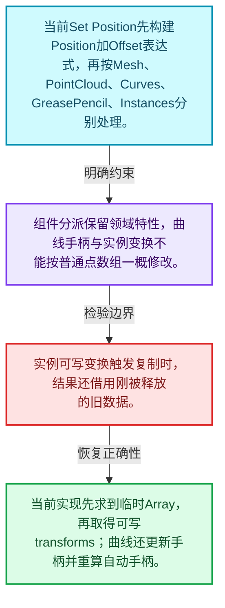
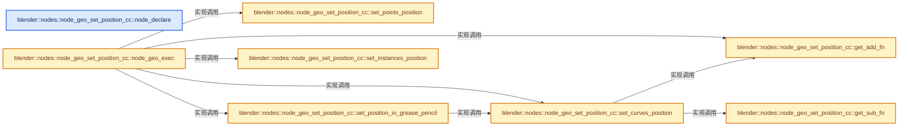
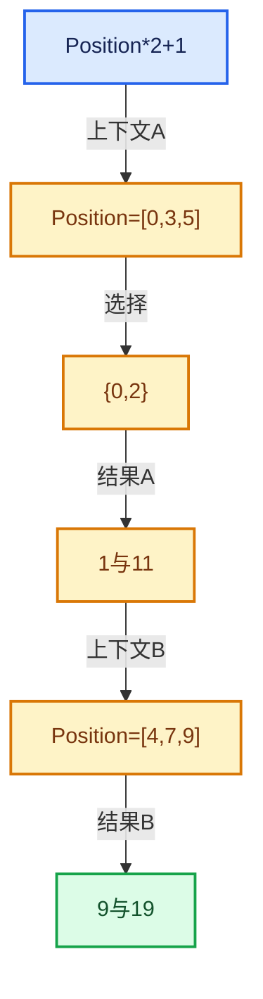

# 08-11 SetPosition完整调用链

[方向导航](README.md) · [总目录](../README.md) · [实现索引](../00-课程指南/02-源码与提交索引/符号依赖与实现索引.md)

## 从问题到实现

如何把用户插槽输入接到几何修改？

节点取得Field并在几何上下文求值，选择、位置与偏移共同决定写入；访问可变几何前须满足共享语义。

**数据模型**

当前Set Position先构建Position加Offset表达式，再按Mesh、PointCloud、Curves、GreasePencil、Instances分别处理。

**设计取舍**

组件分派保留领域特性，曲线手柄与实例变换不能按普通点数组一概修改。

**最小反例**

实例可写变换触发复制时，结果还借用刚被释放的旧数据。

**推导**

当前实现先求到临时Array，再取得可写transforms；曲线还更新手柄并重算自动手柄。

## 阅读地图与执行推演








图中的数值推演是本方向的教学模型；实际函数之间的调用边与概念分析边分别标注，不能把概念关系当作运行时调度顺序。

## 完整源码单元与就地讲解

中文讲解直接放在相关代码旁，复杂机制在代码下展开。原文折叠区保留基准行号；不需要在行号表和函数之间来回查找。类布局可分段展示，函数实现不按固定行数切开。

### 类型布局、声明与编译条件 · node_geo_set_position.cc L1—L17

<!-- annotated:6f90e5d1e09edb -->

```cpp
/* SPDX-FileCopyrightText: 2023 Blender Authors
 *
 * SPDX-License-Identifier: GPL-2.0-or-later */

#include "DNA_pointcloud_types.h"

#include "BKE_curves.hh"
#include "BKE_grease_pencil.hh"
#include "BKE_instances.hh"
#include "BKE_mesh.hh"

#include "FN_multi_function_registry.hh"

#include "node_geometry_util.hh"

namespace blender::nodes::node_geo_set_position_cc {

```

<details>
<summary>核对原始源码：source/blender/nodes/geometry/nodes/node_geo_set_position.cc · L1—L17</summary>

<!-- original:6f90e5d1e09edb:source/blender/nodes/geometry/nodes/node_geo_set_position.cc:1:17 -->

```cpp
/* SPDX-FileCopyrightText: 2023 Blender Authors
 *
 * SPDX-License-Identifier: GPL-2.0-or-later */

#include "DNA_pointcloud_types.h"

#include "BKE_curves.hh"
#include "BKE_grease_pencil.hh"
#include "BKE_instances.hh"
#include "BKE_mesh.hh"

#include "FN_multi_function_registry.hh"

#include "node_geometry_util.hh"

namespace blender::nodes::node_geo_set_position_cc {

```

</details>

<a id="f-b5caee3c577ed27a"></a>

### `blender::nodes::node_geo_set_position_cc::node_declare`

实现位置：[source/blender/nodes/geometry/nodes/node_geo_set_position.cc](../../../../../source/blender/nodes/geometry/nodes/node_geo_set_position.cc) · L18—L32。

接口参数：

- `NodeDeclarationBuilder &b`

**教学注释版**

<!-- annotated:ce206d1e8b5cea -->

```cpp
static void node_declare(NodeDeclarationBuilder &b)
{
  b.use_custom_socket_order();
  b.allow_any_socket_order();
  b.add_input<decl::Geometry>("Geometry"_ustr).description("Points to modify the positions of");
  b.add_output<decl::Geometry>("Geometry"_ustr).propagate_all_geometry().align_with_previous();
  b.add_input<decl::Bool>("Selection"_ustr)
      .default_value(true)
      .hide_value()
      .evaluated_geometry_field();
  b.add_input<decl::Vector>("Position"_ustr)
      .evaluated_geometry_field()
      .default_input_type(NODE_DEFAULT_INPUT_POSITION_FIELD);
  b.add_input<decl::Vector>("Offset"_ustr).subtype(PROP_TRANSLATION).evaluated_geometry_field();
}
```

<details>
<summary>核对原始源码：source/blender/nodes/geometry/nodes/node_geo_set_position.cc · L18—L32</summary>

<!-- original:ce206d1e8b5cea:source/blender/nodes/geometry/nodes/node_geo_set_position.cc:18:32 -->

```cpp
static void node_declare(NodeDeclarationBuilder &b)
{
  b.use_custom_socket_order();
  b.allow_any_socket_order();
  b.add_input<decl::Geometry>("Geometry"_ustr).description("Points to modify the positions of");
  b.add_output<decl::Geometry>("Geometry"_ustr).propagate_all_geometry().align_with_previous();
  b.add_input<decl::Bool>("Selection"_ustr)
      .default_value(true)
      .hide_value()
      .evaluated_geometry_field();
  b.add_input<decl::Vector>("Position"_ustr)
      .evaluated_geometry_field()
      .default_input_type(NODE_DEFAULT_INPUT_POSITION_FIELD);
  b.add_input<decl::Vector>("Offset"_ustr).subtype(PROP_TRANSLATION).evaluated_geometry_field();
}
```

</details>

**继续追踪实现**

- `b.use_custom_socket_order` → [blender::nodes::NodeDeclarationBuilder::use_custom_socket_order · L135](../90-实现依赖专题/04-Nodes节点系统/intern/node_declaration.cc.md#f-7a3e20373b6f44d0)。
- `b.allow_any_socket_order` → [blender::nodes::NodeDeclarationBuilder::allow_any_socket_order · L140](../90-实现依赖专题/04-Nodes节点系统/intern/node_declaration.cc.md#f-5440adf750141e49)。
- `b.add_input<decl::Geometry>("Geometry"_ustr).description` → [调用协议](../00-课程指南/01-路线与规范/模板宏与动态分派协议.md)：接收对象类型依赖auto、返回值或模板实例；不按同名猜测目标。调用位置L22。
- `b.add_input<decl::Geometry>` → [调用协议](../00-课程指南/01-路线与规范/模板宏与动态分派协议.md)：由接收对象具体类型或运行时策略提供实现。调用位置L22。
- `b.add_output<decl::Geometry>("Geometry"_ustr).propagate_all_geometry().align_with_previous` → [调用协议](../00-课程指南/01-路线与规范/模板宏与动态分派协议.md)：接收对象类型依赖auto、返回值或模板实例；不按同名猜测目标。调用位置L23。
- `b.add_output<decl::Geometry>("Geometry"_ustr).propagate_all_geometry` → [调用协议](../00-课程指南/01-路线与规范/模板宏与动态分派协议.md)：接收对象类型依赖auto、返回值或模板实例；不按同名猜测目标。调用位置L23。
- `b.add_output<decl::Geometry>` → [调用协议](../00-课程指南/01-路线与规范/模板宏与动态分派协议.md)：由接收对象具体类型或运行时策略提供实现。调用位置L23。
- `b.add_input<decl::Bool>("Selection"_ustr) .default_value(true) .hide_value() .evaluated_geometry_field` → [调用协议](../00-课程指南/01-路线与规范/模板宏与动态分派协议.md)：接收对象类型依赖auto、返回值或模板实例；不按同名猜测目标。调用位置L24。
- `b.add_input<decl::Bool>("Selection"_ustr) .default_value(true) .hide_value` → [调用协议](../00-课程指南/01-路线与规范/模板宏与动态分派协议.md)：接收对象类型依赖auto、返回值或模板实例；不按同名猜测目标。调用位置L24。
- `b.add_input<decl::Bool>("Selection"_ustr) .default_value` → [调用协议](../00-课程指南/01-路线与规范/模板宏与动态分派协议.md)：接收对象类型依赖auto、返回值或模板实例；不按同名猜测目标。调用位置L24。
- `b.add_input<decl::Bool>` → [调用协议](../00-课程指南/01-路线与规范/模板宏与动态分派协议.md)：由接收对象具体类型或运行时策略提供实现。调用位置L24。
- `b.add_input<decl::Vector>("Position"_ustr) .evaluated_geometry_field() .default_input_type` → [调用协议](../00-课程指南/01-路线与规范/模板宏与动态分派协议.md)：接收对象类型依赖auto、返回值或模板实例；不按同名猜测目标。调用位置L28。
- `b.add_input<decl::Vector>("Position"_ustr) .evaluated_geometry_field` → [调用协议](../00-课程指南/01-路线与规范/模板宏与动态分派协议.md)：接收对象类型依赖auto、返回值或模板实例；不按同名猜测目标。调用位置L28。
- `b.add_input<decl::Vector>` → [调用协议](../00-课程指南/01-路线与规范/模板宏与动态分派协议.md)：由接收对象具体类型或运行时策略提供实现。调用位置L28。
- `b.add_input<decl::Vector>("Offset"_ustr).subtype(PROP_TRANSLATION).evaluated_geometry_field` → [调用协议](../00-课程指南/01-路线与规范/模板宏与动态分派协议.md)：接收对象类型依赖auto、返回值或模板实例；不按同名猜测目标。调用位置L31。
- `b.add_input<decl::Vector>("Offset"_ustr).subtype` → [调用协议](../00-课程指南/01-路线与规范/模板宏与动态分派协议.md)：接收对象类型依赖auto、返回值或模板实例；不按同名猜测目标。调用位置L31。

<!-- annotated:c382532ac164d2 -->

```cpp

```

<details>
<summary>核对原始源码：source/blender/nodes/geometry/nodes/node_geo_set_position.cc · L33—L33</summary>

<!-- original:c382532ac164d2:source/blender/nodes/geometry/nodes/node_geo_set_position.cc:33:33 -->

```cpp

```

</details>

<a id="f-49d6264bf81ac0b7"></a>

### `blender::nodes::node_geo_set_position_cc::get_add_fn`

实现位置：[source/blender/nodes/geometry/nodes/node_geo_set_position.cc](../../../../../source/blender/nodes/geometry/nodes/node_geo_set_position.cc) · L34—L38。

**教学注释版**

<!-- annotated:35e542b16c6ae5 -->

```cpp
static const auto &get_add_fn()
{
  static const auto &fn = fn::multi_function::registry::lookup("float3 + float3"_ustr);
  return fn;
}
```

<details>
<summary>核对原始源码：source/blender/nodes/geometry/nodes/node_geo_set_position.cc · L34—L38</summary>

<!-- original:35e542b16c6ae5:source/blender/nodes/geometry/nodes/node_geo_set_position.cc:34:38 -->

```cpp
static const auto &get_add_fn()
{
  static const auto &fn = fn::multi_function::registry::lookup("float3 + float3"_ustr);
  return fn;
}
```

</details>

**结果出口**

- `return fn;`

**继续追踪实现**

- `fn::multi_function::registry::lookup` → [blender::fn::multi_function::registry::lookup · L46](../90-实现依赖专题/03-FN函数与求值/intern/multi_function_registry.cc.md#f-1a054f3e76280e66)。

<!-- annotated:e98ef8624aaa39 -->

```cpp

```

<details>
<summary>核对原始源码：source/blender/nodes/geometry/nodes/node_geo_set_position.cc · L39—L39</summary>

<!-- original:e98ef8624aaa39:source/blender/nodes/geometry/nodes/node_geo_set_position.cc:39:39 -->

```cpp

```

</details>

<a id="f-e548a51b73a69a7b"></a>

### `blender::nodes::node_geo_set_position_cc::get_sub_fn`

实现位置：[source/blender/nodes/geometry/nodes/node_geo_set_position.cc](../../../../../source/blender/nodes/geometry/nodes/node_geo_set_position.cc) · L40—L44。

**教学注释版**

<!-- annotated:645abe3f467b9c -->

```cpp
static const auto &get_sub_fn()
{
  static const auto &fn = fn::multi_function::registry::lookup("float3 - float3"_ustr);
  return fn;
}
```

<details>
<summary>核对原始源码：source/blender/nodes/geometry/nodes/node_geo_set_position.cc · L40—L44</summary>

<!-- original:645abe3f467b9c:source/blender/nodes/geometry/nodes/node_geo_set_position.cc:40:44 -->

```cpp
static const auto &get_sub_fn()
{
  static const auto &fn = fn::multi_function::registry::lookup("float3 - float3"_ustr);
  return fn;
}
```

</details>

**结果出口**

- `return fn;`

**继续追踪实现**

- `fn::multi_function::registry::lookup` → [blender::fn::multi_function::registry::lookup · L46](../90-实现依赖专题/03-FN函数与求值/intern/multi_function_registry.cc.md#f-1a054f3e76280e66)。

<!-- annotated:fd1b2eb41279a5 -->

```cpp

```

<details>
<summary>核对原始源码：source/blender/nodes/geometry/nodes/node_geo_set_position.cc · L45—L45</summary>

<!-- original:fd1b2eb41279a5:source/blender/nodes/geometry/nodes/node_geo_set_position.cc:45:45 -->

```cpp

```

</details>

<a id="f-a6eabddb96f18d5f"></a>

### `blender::nodes::node_geo_set_position_cc::set_points_position`

实现位置：[source/blender/nodes/geometry/nodes/node_geo_set_position.cc](../../../../../source/blender/nodes/geometry/nodes/node_geo_set_position.cc) · L46—L57。

接口参数：

- `bke::MutableAttributeAccessor attributes`
- `const fn::FieldContext &field_context`
- `const Field<bool> &selection_field`
- `const Field<float3> &position_field`

**教学注释版**

<!-- annotated:0b62003494384a -->

```cpp
static void set_points_position(bke::MutableAttributeAccessor attributes,
                                const fn::FieldContext &field_context,
                                const Field<bool> &selection_field,
                                const Field<float3> &position_field)
{
  bke::try_capture_field_on_geometry(attributes,
                                     field_context,
                                     "position",
                                     bke::AttrDomain::Point,
                                     selection_field,
                                     position_field);
}
```

<details>
<summary>核对原始源码：source/blender/nodes/geometry/nodes/node_geo_set_position.cc · L46—L57</summary>

<!-- original:0b62003494384a:source/blender/nodes/geometry/nodes/node_geo_set_position.cc:46:57 -->

```cpp
static void set_points_position(bke::MutableAttributeAccessor attributes,
                                const fn::FieldContext &field_context,
                                const Field<bool> &selection_field,
                                const Field<float3> &position_field)
{
  bke::try_capture_field_on_geometry(attributes,
                                     field_context,
                                     "position",
                                     bke::AttrDomain::Point,
                                     selection_field,
                                     position_field);
}
```

</details>

**继续追踪实现**

- `bke::try_capture_field_on_geometry` → [blender::bke::try_capture_field_on_geometry · L527](10-几何上下文与属性域.md#f-72eacdaeb9630253)；[blender::bke::try_capture_field_on_geometry · L543](10-几何上下文与属性域.md#f-4232bd6552082375)；[blender::bke::try_capture_field_on_geometry · L557](10-几何上下文与属性域.md#f-e9f28624aa26ddc4)。同名重载需按实参类型选择。

<!-- annotated:44a09a3176225b -->

```cpp

```

<details>
<summary>核对原始源码：source/blender/nodes/geometry/nodes/node_geo_set_position.cc · L58—L58</summary>

<!-- original:44a09a3176225b:source/blender/nodes/geometry/nodes/node_geo_set_position.cc:58:58 -->

```cpp

```

</details>

<a id="f-804816a7dfe0390a"></a>

### `blender::nodes::node_geo_set_position_cc::set_curves_position`

实现位置：[source/blender/nodes/geometry/nodes/node_geo_set_position.cc](../../../../../source/blender/nodes/geometry/nodes/node_geo_set_position.cc) · L59—L85。

接口参数：

- `bke::CurvesGeometry &curves`
- `const fn::FieldContext &field_context`
- `const Field<bool> &selection_field`
- `const Field<float3> &position_field`

**教学注释版**

<!-- annotated:49d75dcf9ecd40 -->

```cpp
static void set_curves_position(bke::CurvesGeometry &curves,
                                const fn::FieldContext &field_context,
                                const Field<bool> &selection_field,
                                const Field<float3> &position_field)
{
  MutableAttributeAccessor attributes = curves.attributes_for_write();

  Vector<StringRef> attribute_names;
  Vector<GField> fields;
  // [讲解] attribute_names.append：在尾部建立新元素，必要时先扩大存储。
  attribute_names.append("position");
  fields.append(position_field);

  if (attributes.contains("handle_right") && attributes.contains("handle_left")) {
    // [讲解] fn::FieldOperation::from：建立运算、常量或借用表示。
    fn::Field<float3> delta(fn::FieldOperation::from(
        get_sub_fn(),
        {position_field, bke::AttributeFieldInput::get_field<float3, "position">()}));
    for (const StringRef name : {"handle_left", "handle_right"}) {
      attribute_names.append(name);
      fields.append(Field<float3>(fn::FieldOperation::from(
          get_add_fn(), {bke::AttributeFieldInput::from<float3>(name), delta})));
    }
  }

  bke::try_capture_fields_on_geometry(
      attributes, field_context, attribute_names, bke::AttrDomain::Point, selection_field, fields);
  curves.calculate_bezier_auto_handles();
}
```

<details>
<summary>核对原始源码：source/blender/nodes/geometry/nodes/node_geo_set_position.cc · L59—L85</summary>

<!-- original:49d75dcf9ecd40:source/blender/nodes/geometry/nodes/node_geo_set_position.cc:59:85 -->

```cpp
static void set_curves_position(bke::CurvesGeometry &curves,
                                const fn::FieldContext &field_context,
                                const Field<bool> &selection_field,
                                const Field<float3> &position_field)
{
  MutableAttributeAccessor attributes = curves.attributes_for_write();

  Vector<StringRef> attribute_names;
  Vector<GField> fields;
  attribute_names.append("position");
  fields.append(position_field);

  if (attributes.contains("handle_right") && attributes.contains("handle_left")) {
    fn::Field<float3> delta(fn::FieldOperation::from(
        get_sub_fn(),
        {position_field, bke::AttributeFieldInput::get_field<float3, "position">()}));
    for (const StringRef name : {"handle_left", "handle_right"}) {
      attribute_names.append(name);
      fields.append(Field<float3>(fn::FieldOperation::from(
          get_add_fn(), {bke::AttributeFieldInput::from<float3>(name), delta})));
    }
  }

  bke::try_capture_fields_on_geometry(
      attributes, field_context, attribute_names, bke::AttrDomain::Point, selection_field, fields);
  curves.calculate_bezier_auto_handles();
}
```

</details>

**继续追踪实现**

- `curves.attributes_for_write` → [blender::bke::CurvesGeometry::attributes_for_write · L1913](../90-实现依赖专题/02-BKE几何与数据/intern/curves_geometry.cc.md#f-4930091b34fa9663)。
- `attribute_names.append` → [blender::Vector::append · L498](../01-基础容器与现代CPP/11-Vector插入删除与重排.md#f-5bde268a69e443ec)；[blender::Vector::append · L502](../01-基础容器与现代CPP/11-Vector插入删除与重排.md#f-591e0b15e6308532)。同名重载需按实参类型选择。
- `fields.append` → [blender::Vector::append · L498](../01-基础容器与现代CPP/11-Vector插入删除与重排.md#f-5bde268a69e443ec)；[blender::Vector::append · L502](../01-基础容器与现代CPP/11-Vector插入删除与重排.md#f-591e0b15e6308532)。同名重载需按实参类型选择。
- `attributes.contains` → [调用协议](../00-课程指南/01-路线与规范/模板宏与动态分派协议.md)：由接收对象具体类型或运行时策略提供实现。调用位置L71。
- `fn::FieldOperation::from` → [blender::fn::FieldOperation::from · L252](06-FieldContext上下文.md#f-d78060e8f5e1929f)；[blender::fn::FieldOperation::from · L258](06-FieldContext上下文.md#f-60a41b323ee8ceb7)。同名重载需按实参类型选择。
- `get_sub_fn` → [blender::nodes::node_geo_set_position_cc::get_sub_fn · L40](11-SetPosition完整调用链.md#f-e548a51b73a69a7b)。
- `bke::AttributeFieldInput::get_field<float3, "position">` → [blender::bke::AttributeFieldInput::get_field · L353](10-几何上下文与属性域.md#f-f06c472d9ae4678e)。
- `Field<float3>` → [blender::fn::Field<T>::Field · L495](05-FieldOperation运算节点.md#f-0b2f3f4cecd8c44a)；[blender::fn::Field<T>::Field · L603](05-FieldOperation运算节点.md#f-6fbbe0144f689448)；[blender::fn::Field<T>::Field · L605](05-FieldOperation运算节点.md#f-b9fadbb0d8465bfe)；[blender::fn::Field<T>::Field · L608](05-FieldOperation运算节点.md#f-be75a0525262720c)。同名重载需按实参类型选择。
- `get_add_fn` → [blender::nodes::node_geo_set_position_cc::get_add_fn · L34](11-SetPosition完整调用链.md#f-49d6264bf81ac0b7)。
- `bke::AttributeFieldInput::from<float3>` → [blender::bke::AttributeFieldInput::from · L324](10-几何上下文与属性域.md#f-f6704d8eed37d4e0)；[blender::bke::AttributeFieldInput::from · L331](10-几何上下文与属性域.md#f-f4484f9c40661b54)。同名重载需按实参类型选择。
- `bke::try_capture_fields_on_geometry` → [blender::bke::try_capture_fields_on_geometry · L998](../05-几何存储与拓扑映射/09-属性域与转换.md#f-53d2a58a397bf570)；[blender::bke::try_capture_fields_on_geometry · L1144](../05-几何存储与拓扑映射/09-属性域与转换.md#f-5d358ef05cd2c31e)；[blender::bke::try_capture_fields_on_geometry · L1193](../05-几何存储与拓扑映射/09-属性域与转换.md#f-acecccde14dde369)。同名重载需按实参类型选择。
- `curves.calculate_bezier_auto_handles` → [blender::bke::CurvesGeometry::calculate_bezier_auto_handles · L1288](../90-实现依赖专题/02-BKE几何与数据/intern/curves_geometry.cc.md#f-a8727708cb335e36)。

<!-- annotated:26b559e7ce19a7 -->

```cpp

```

<details>
<summary>核对原始源码：source/blender/nodes/geometry/nodes/node_geo_set_position.cc · L86—L86</summary>

<!-- original:26b559e7ce19a7:source/blender/nodes/geometry/nodes/node_geo_set_position.cc:86:86 -->

```cpp

```

</details>

<a id="f-bb0313d4e9cd1fa8"></a>

### `blender::nodes::node_geo_set_position_cc::set_position_in_grease_pencil`

实现位置：[source/blender/nodes/geometry/nodes/node_geo_set_position.cc](../../../../../source/blender/nodes/geometry/nodes/node_geo_set_position.cc) · L87—L104。

接口参数：

- `GreasePencil &grease_pencil`
- `const Field<bool> &selection_field`
- `const Field<float3> &position_field`

**教学注释版**

<!-- annotated:2002d1334c73c9 -->

```cpp
static void set_position_in_grease_pencil(GreasePencil &grease_pencil,
                                          const Field<bool> &selection_field,
                                          const Field<float3> &position_field)
{
  using namespace blender::bke::greasepencil;
  for (const int layer_index : grease_pencil.layers().index_range()) {
    Drawing *drawing = grease_pencil.get_eval_drawing(grease_pencil.layer(layer_index));
    if (drawing == nullptr || drawing->strokes().is_empty()) {
      continue;
    }
    set_curves_position(
        drawing->strokes_for_write(),
        bke::GreasePencilLayerFieldContext(grease_pencil, bke::AttrDomain::Point, layer_index),
        selection_field,
        position_field);
    drawing->tag_positions_changed();
  }
}
```

<details>
<summary>核对原始源码：source/blender/nodes/geometry/nodes/node_geo_set_position.cc · L87—L104</summary>

<!-- original:2002d1334c73c9:source/blender/nodes/geometry/nodes/node_geo_set_position.cc:87:104 -->

```cpp
static void set_position_in_grease_pencil(GreasePencil &grease_pencil,
                                          const Field<bool> &selection_field,
                                          const Field<float3> &position_field)
{
  using namespace blender::bke::greasepencil;
  for (const int layer_index : grease_pencil.layers().index_range()) {
    Drawing *drawing = grease_pencil.get_eval_drawing(grease_pencil.layer(layer_index));
    if (drawing == nullptr || drawing->strokes().is_empty()) {
      continue;
    }
    set_curves_position(
        drawing->strokes_for_write(),
        bke::GreasePencilLayerFieldContext(grease_pencil, bke::AttrDomain::Point, layer_index),
        selection_field,
        position_field);
    drawing->tag_positions_changed();
  }
}
```

</details>

**继续追踪实现**

- `grease_pencil.layers().index_range` → [调用协议](../00-课程指南/01-路线与规范/模板宏与动态分派协议.md)：接收对象类型依赖auto、返回值或模板实例；不按同名猜测目标。调用位置L92。
- `grease_pencil.layers` → [blender::GreasePencil::layers · L3983](../90-实现依赖专题/02-BKE几何与数据/intern/grease_pencil.cc.md#f-15d64ed11a2babc0)。
- `grease_pencil.get_eval_drawing` → [blender::GreasePencil::get_eval_drawing · L3877](../90-实现依赖专题/02-BKE几何与数据/intern/grease_pencil.cc.md#f-90fc4aad8697fbb6)；[blender::GreasePencil::get_eval_drawing · L3883](../90-实现依赖专题/02-BKE几何与数据/intern/grease_pencil.cc.md#f-c0c3d7e7fffac861)。同名重载需按实参类型选择。
- `grease_pencil.layer` → [blender::GreasePencil::layer · L1144](../90-实现依赖专题/02-BKE几何与数据/BKE_grease_pencil.hh.md#f-7196ac6431650af5)；[blender::GreasePencil::layer · L1148](../90-实现依赖专题/02-BKE几何与数据/BKE_grease_pencil.hh.md#f-82f7eddc62fb11fe)。同名重载需按实参类型选择。
- `drawing->strokes().is_empty` → [调用协议](../00-课程指南/01-路线与规范/模板宏与动态分派协议.md)：接收对象类型依赖auto、返回值或模板实例；不按同名猜测目标。调用位置L94。
- `drawing->strokes` → [blender::bke::greasepencil::Drawing::strokes · L1007](../90-实现依赖专题/02-BKE几何与数据/intern/grease_pencil.cc.md#f-59e6522a8e8ac409)。
- `set_curves_position` → [blender::nodes::node_geo_set_position_cc::set_curves_position · L59](11-SetPosition完整调用链.md#f-804816a7dfe0390a)。
- `drawing->strokes_for_write` → [blender::bke::greasepencil::Drawing::strokes_for_write · L1012](../90-实现依赖专题/02-BKE几何与数据/intern/grease_pencil.cc.md#f-0649333785d0aa95)。
- `bke::GreasePencilLayerFieldContext` → [blender::bke::GreasePencilLayerFieldContext::GreasePencilLayerFieldContext · L110](../05-几何存储与拓扑映射/09-属性域与转换.md#f-bd0f57d7d905998c)。
- `drawing->tag_positions_changed` → [blender::bke::greasepencil::Drawing::tag_positions_changed · L1095](../90-实现依赖专题/02-BKE几何与数据/intern/grease_pencil.cc.md#f-cc348dc1ca18c109)；[blender::bke::greasepencil::Drawing::tag_positions_changed · L1229](../90-实现依赖专题/02-BKE几何与数据/intern/grease_pencil.cc.md#f-36aaac52033b03bf)。同名重载需按实参类型选择。

<!-- annotated:735053172146dc -->

```cpp

```

<details>
<summary>核对原始源码：source/blender/nodes/geometry/nodes/node_geo_set_position.cc · L105—L105</summary>

<!-- original:735053172146dc:source/blender/nodes/geometry/nodes/node_geo_set_position.cc:105:105 -->

```cpp

```

</details>

<a id="f-b5e0b5109fe47e37"></a>

### `blender::nodes::node_geo_set_position_cc::set_instances_position`

先求位置到临时数组，再取得可写实例变换。

实现位置：[source/blender/nodes/geometry/nodes/node_geo_set_position.cc](../../../../../source/blender/nodes/geometry/nodes/node_geo_set_position.cc) · L106—L126。

接口参数：

- `bke::Instances &instances`
- `const Field<bool> &selection_field`
- `const Field<float3> &position_field`

**教学注释版**

<!-- annotated:500b8ac5276a26 -->

```cpp
static void set_instances_position(bke::Instances &instances,
                                   const Field<bool> &selection_field,
                                   const Field<float3> &position_field)
{
  const bke::InstancesFieldContext context(instances);
  fn::FieldEvaluator evaluator(context, instances.instances_num());
  // [讲解] evaluator.set_selection：登记本轮选择表达式。
  evaluator.set_selection(selection_field);

  /* Use a temporary array for the output to avoid potentially reading from freed memory if
   * retrieving the transforms has to make a mutable copy (then we can't depend on the user count
   * of the original read-only data). */
  // [讲解] 独立临时数组保存结果，避免可写分离后继续读旧共享变换。
  Array<float3> result(instances.instances_num());
  // [讲解] evaluator.add_with_destination：登记表达式和可选的结果目标。
  evaluator.add_with_destination(position_field, result.as_mutable_span());
  // [讲解] 在旧读取依赖仍有效时完成求值。
  evaluator.evaluate();

  // [讲解] evaluator.get_evaluated_selection_as_mask：读取已完成的求值结果或选择。
  const IndexMask selection = evaluator.get_evaluated_selection_as_mask();

  // [讲解] 结果已保存后再取得可写变换，允许此处进行共享分离。
  MutableSpan<float4x4> transforms = instances.transforms_for_write();
  selection.foreach_index_optimized<int>(
      [&](const int i) { transforms[i].location() = result[i]; }, exec_mode::grain_size(4096));
}
```

<details>
<summary>核对原始源码：source/blender/nodes/geometry/nodes/node_geo_set_position.cc · L106—L126</summary>

<!-- original:500b8ac5276a26:source/blender/nodes/geometry/nodes/node_geo_set_position.cc:106:126 -->

```cpp
static void set_instances_position(bke::Instances &instances,
                                   const Field<bool> &selection_field,
                                   const Field<float3> &position_field)
{
  const bke::InstancesFieldContext context(instances);
  fn::FieldEvaluator evaluator(context, instances.instances_num());
  evaluator.set_selection(selection_field);

  /* Use a temporary array for the output to avoid potentially reading from freed memory if
   * retrieving the transforms has to make a mutable copy (then we can't depend on the user count
   * of the original read-only data). */
  Array<float3> result(instances.instances_num());
  evaluator.add_with_destination(position_field, result.as_mutable_span());
  evaluator.evaluate();

  const IndexMask selection = evaluator.get_evaluated_selection_as_mask();

  MutableSpan<float4x4> transforms = instances.transforms_for_write();
  selection.foreach_index_optimized<int>(
      [&](const int i) { transforms[i].location() = result[i]; }, exec_mode::grain_size(4096));
}
```

</details>

**机制与执行推导**

取得transforms_for_write可能触发共享数据复制并释放原数据。若结果仍借用原变换，就可能悬空；临时Array把求值结果与后续写操作隔开。仅selection中的索引会写入。

**继续追踪实现**

- `instances.instances_num` → [blender::bke::Instances::instances_num · L408](../90-实现依赖专题/02-BKE几何与数据/intern/instances.cc.md#f-0284f09f6f4a3b4f)。
- `evaluator.set_selection` → [blender::fn::FieldEvaluator::set_selection · L68](07-FieldEvaluator接口与使用.md#f-1d38e812a1e29e63)。
- `evaluator.add_with_destination` → [blender::fn::FieldEvaluator::add_with_destination · L548](09-生成Procedure与执行.md#f-165e23b00ea43ee4)；[blender::fn::FieldEvaluator::add_with_destination · L556](09-生成Procedure与执行.md#f-79ade07d74d08d73)；[blender::fn::FieldEvaluator::add_with_destination · L80](07-FieldEvaluator接口与使用.md#f-3edfceb249cb5cad)；[blender::fn::FieldEvaluator::add_with_destination · L99](07-FieldEvaluator接口与使用.md#f-03289f589afbd469)。同名重载需按实参类型选择。
- `result.as_mutable_span` → [blender::Array::as_mutable_span · L259](../01-基础容器与现代CPP/08-Array复制移动与销毁.md#f-4e91de9f1337c144)。
- `evaluator.evaluate` → [blender::fn::FieldEvaluator::evaluate · L590](09-生成Procedure与执行.md#f-d2c4933d17ec204c)。
- `evaluator.get_evaluated_selection_as_mask` → [blender::fn::FieldEvaluator::get_evaluated_selection_as_mask · L635](09-生成Procedure与执行.md#f-fcf42f8a6ea87efa)。
- `instances.transforms_for_write` → [blender::bke::Instances::transforms_for_write · L242](../90-实现依赖专题/02-BKE几何与数据/intern/instances.cc.md#f-0350d6057ae379dc)。
- `selection.foreach_index_optimized<int>` → [blender::index_mask::IndexMask::foreach_index_optimized · L937](../04-虚拟数组与索引选择/12-重构历史与基准练习.md#f-a2c3e7876407eaaf)。
- `transforms[i].location` → [调用协议](../00-课程指南/01-路线与规范/模板宏与动态分派协议.md)：接收对象类型依赖auto、返回值或模板实例；不按同名猜测目标。调用位置L125。
- `exec_mode::grain_size` → [blender::exec_mode::grain_size · L79](../90-实现依赖专题/01-BLI基础库/BLI_execution_mode.hh.md#f-0b4fc2f9fa6e66e7)。

<!-- annotated:b1e2dfdbbcf7c6 -->

```cpp

```

<details>
<summary>核对原始源码：source/blender/nodes/geometry/nodes/node_geo_set_position.cc · L127—L127</summary>

<!-- original:b1e2dfdbbcf7c6:source/blender/nodes/geometry/nodes/node_geo_set_position.cc:127:127 -->

```cpp

```

</details>

<a id="f-458f69634436e36f"></a>

### `blender::nodes::node_geo_set_position_cc::node_geo_exec`

实现位置：[source/blender/nodes/geometry/nodes/node_geo_set_position.cc](../../../../../source/blender/nodes/geometry/nodes/node_geo_set_position.cc) · L128—L164。

接口参数：

- `GeoNodeExecParams params`

**教学注释版**

<!-- annotated:c2c7560680e385 -->

```cpp
static void node_geo_exec(GeoNodeExecParams params)
{
  GeometrySet geometry = params.extract_input<GeometrySet>("Geometry"_ustr);
  const Field<bool> selection_field = params.extract_input<Field<bool>>("Selection"_ustr);
  const fn::Field<float3> position_field(
      // [讲解] fn::FieldOperation::from：建立运算、常量或借用表示。
      fn::FieldOperation::from(get_add_fn(),
                               {params.extract_input<Field<float3>>("Position"_ustr),
                                params.extract_input<Field<float3>>("Offset"_ustr)}));

  if (Mesh *mesh = geometry.get_mesh_for_write()) {
    set_points_position(mesh->attributes_for_write(),
                        bke::MeshFieldContext(*mesh, bke::AttrDomain::Point),
                        selection_field,
                        position_field);
  }
  if (PointCloud *pointcloud = geometry.get_pointcloud_for_write()) {
    set_points_position(pointcloud->attributes_for_write(),
                        bke::PointCloudFieldContext(*pointcloud),
                        selection_field,
                        position_field);
  }
  if (Curves *curves_id = geometry.get_curves_for_write()) {
    bke::CurvesGeometry &curves = curves_id->geometry.wrap();
    set_curves_position(curves,
                        bke::CurvesFieldContext(*curves_id, bke::AttrDomain::Point),
                        selection_field,
                        position_field);
  }
  if (GreasePencil *grease_pencil = geometry.get_grease_pencil_for_write()) {
    set_position_in_grease_pencil(*grease_pencil, selection_field, position_field);
  }
  if (bke::Instances *instances = geometry.get_instances_for_write()) {
    // [讲解] set_instances_position：先求位置到临时数组，再取得可写实例变换。
    set_instances_position(*instances, selection_field, position_field);
  }

  // [讲解] std::move：把表达式转换成可供移动重载选择的值类别；不保证真的移动，不结束源对象寿命，对const值可能选择复制。
  params.set_output("Geometry"_ustr, std::move(geometry));
}
```

<details>
<summary>核对原始源码：source/blender/nodes/geometry/nodes/node_geo_set_position.cc · L128—L164</summary>

<!-- original:c2c7560680e385:source/blender/nodes/geometry/nodes/node_geo_set_position.cc:128:164 -->

```cpp
static void node_geo_exec(GeoNodeExecParams params)
{
  GeometrySet geometry = params.extract_input<GeometrySet>("Geometry"_ustr);
  const Field<bool> selection_field = params.extract_input<Field<bool>>("Selection"_ustr);
  const fn::Field<float3> position_field(
      fn::FieldOperation::from(get_add_fn(),
                               {params.extract_input<Field<float3>>("Position"_ustr),
                                params.extract_input<Field<float3>>("Offset"_ustr)}));

  if (Mesh *mesh = geometry.get_mesh_for_write()) {
    set_points_position(mesh->attributes_for_write(),
                        bke::MeshFieldContext(*mesh, bke::AttrDomain::Point),
                        selection_field,
                        position_field);
  }
  if (PointCloud *pointcloud = geometry.get_pointcloud_for_write()) {
    set_points_position(pointcloud->attributes_for_write(),
                        bke::PointCloudFieldContext(*pointcloud),
                        selection_field,
                        position_field);
  }
  if (Curves *curves_id = geometry.get_curves_for_write()) {
    bke::CurvesGeometry &curves = curves_id->geometry.wrap();
    set_curves_position(curves,
                        bke::CurvesFieldContext(*curves_id, bke::AttrDomain::Point),
                        selection_field,
                        position_field);
  }
  if (GreasePencil *grease_pencil = geometry.get_grease_pencil_for_write()) {
    set_position_in_grease_pencil(*grease_pencil, selection_field, position_field);
  }
  if (bke::Instances *instances = geometry.get_instances_for_write()) {
    set_instances_position(*instances, selection_field, position_field);
  }

  params.set_output("Geometry"_ustr, std::move(geometry));
}
```

</details>

**继续追踪实现**

- `params.extract_input<GeometrySet>` → [blender::nodes::GeoNodeExecParams::extract_input · L111](../90-实现依赖专题/04-Nodes节点系统/NOD_geometry_exec.hh.md#f-0ff98bdbba2e2ab6)。
- `params.extract_input<Field<bool>>` → [blender::nodes::GeoNodeExecParams::extract_input · L111](../90-实现依赖专题/04-Nodes节点系统/NOD_geometry_exec.hh.md#f-0ff98bdbba2e2ab6)。
- `fn::FieldOperation::from` → [blender::fn::FieldOperation::from · L252](06-FieldContext上下文.md#f-d78060e8f5e1929f)；[blender::fn::FieldOperation::from · L258](06-FieldContext上下文.md#f-60a41b323ee8ceb7)。同名重载需按实参类型选择。
- `get_add_fn` → [blender::nodes::node_geo_set_position_cc::get_add_fn · L34](11-SetPosition完整调用链.md#f-49d6264bf81ac0b7)。
- `params.extract_input<Field<float3>>` → [blender::nodes::GeoNodeExecParams::extract_input · L111](../90-实现依赖专题/04-Nodes节点系统/NOD_geometry_exec.hh.md#f-0ff98bdbba2e2ab6)。
- `geometry.get_mesh_for_write` → [blender::bke::GeometrySet::get_mesh_for_write · L562](../06-隐式共享与缓存系统/05-GeometrySet读写与复制.md#f-0988a6845ad4e207)。
- `set_points_position` → [blender::nodes::node_geo_set_position_cc::set_points_position · L46](11-SetPosition完整调用链.md#f-a6eabddb96f18d5f)。
- `mesh->attributes_for_write` → [Mesh::attributes_for_write · L1303](../05-几何存储与拓扑映射/03-MPoly迁移与兼容.md#f-ca7af2f1a15f0bc4)。
- `bke::MeshFieldContext` → [blender::bke::MeshFieldContext::MeshFieldContext · L32](../05-几何存储与拓扑映射/09-属性域与转换.md#f-5660a4d8efb6eaea)。
- `geometry.get_pointcloud_for_write` → [blender::bke::GeometrySet::get_pointcloud_for_write · L568](../06-隐式共享与缓存系统/05-GeometrySet读写与复制.md#f-eae41fb2ed3be0d5)。
- `pointcloud->attributes_for_write` → [blender::PointCloud::attributes_for_write · L312](../90-实现依赖专题/02-BKE几何与数据/intern/pointcloud.cc.md#f-308c3c12507fb7fb)。
- `bke::PointCloudFieldContext` → [blender::bke::PointCloudFieldContext::PointCloudFieldContext · L82](../05-几何存储与拓扑映射/09-属性域与转换.md#f-a4bb7d7ea8d7b008)。
- `geometry.get_curves_for_write` → [blender::bke::GeometrySet::get_curves_for_write · L580](../06-隐式共享与缓存系统/05-GeometrySet读写与复制.md#f-95199063db32b8f7)。
- `curves_id->geometry.wrap` → [调用协议](../00-课程指南/01-路线与规范/模板宏与动态分派协议.md)：接收对象类型依赖auto、返回值或模板实例；不按同名猜测目标。调用位置L150。
- `set_curves_position` → [blender::nodes::node_geo_set_position_cc::set_curves_position · L59](11-SetPosition完整调用链.md#f-804816a7dfe0390a)。
- `bke::CurvesFieldContext` → [blender::bke::CurvesFieldContext::CurvesFieldContext · L38](../05-几何存储与拓扑映射/09-属性域与转换.md#f-c3b22ec14276311d)；[blender::bke::CurvesFieldContext::CurvesFieldContext · L44](../05-几何存储与拓扑映射/09-属性域与转换.md#f-01111fea909d16de)。同名重载需按实参类型选择。
- `geometry.get_grease_pencil_for_write` → [blender::bke::GeometrySet::get_grease_pencil_for_write · L622](../06-隐式共享与缓存系统/05-GeometrySet读写与复制.md#f-bfc5e891a352651b)。
- `set_position_in_grease_pencil` → [blender::nodes::node_geo_set_position_cc::set_position_in_grease_pencil · L87](11-SetPosition完整调用链.md#f-bb0313d4e9cd1fa8)。
- `geometry.get_instances_for_write` → [blender::bke::GeometrySet::get_instances_for_write · L586](../06-隐式共享与缓存系统/05-GeometrySet读写与复制.md#f-e2fefbfed77f753f)。
- `set_instances_position` → [blender::nodes::node_geo_set_position_cc::set_instances_position · L106](11-SetPosition完整调用链.md#f-b5e0b5109fe47e37)。
- `params.set_output` → [blender::nodes::GeoNodeExecParams::set_output · L210](../90-实现依赖专题/04-Nodes节点系统/NOD_geometry_exec.hh.md#f-8e835b27ade93c45)。
- `std::move` → [外部契约](https://eel.is/c++draft/utility.forward)：把表达式转换成可供移动重载选择的值类别；不保证真的移动，不结束源对象寿命，对const值可能选择复制。

<!-- annotated:c989fa67ac58b2 -->

```cpp

```

<details>
<summary>核对原始源码：source/blender/nodes/geometry/nodes/node_geo_set_position.cc · L165—L165</summary>

<!-- original:c989fa67ac58b2:source/blender/nodes/geometry/nodes/node_geo_set_position.cc:165:165 -->

```cpp

```

</details>

<a id="f-1b152f6a910ccf96"></a>

### `blender::nodes::node_geo_set_position_cc::node_register`

实现位置：[source/blender/nodes/geometry/nodes/node_geo_set_position.cc](../../../../../source/blender/nodes/geometry/nodes/node_geo_set_position.cc) · L166—L178。

**教学注释版**

<!-- annotated:da1356f01e9c8a -->

```cpp
static void node_register()
{
  static bke::bNodeType ntype;

  geo_node_type_base(&ntype, "GeometryNodeSetPosition"_ustr, GEO_NODE_SET_POSITION);
  ntype.ui_name = "Set Position";
  ntype.ui_description = "Set the location of each point";
  ntype.enum_name_legacy = "SET_POSITION";
  ntype.nclass = NODE_CLASS_GEOMETRY;
  ntype.geometry_node_execute = node_geo_exec;
  ntype.declare = node_declare;
  bke::node_register_type(ntype);
}
```

<details>
<summary>核对原始源码：source/blender/nodes/geometry/nodes/node_geo_set_position.cc · L166—L178</summary>

<!-- original:da1356f01e9c8a:source/blender/nodes/geometry/nodes/node_geo_set_position.cc:166:178 -->

```cpp
static void node_register()
{
  static bke::bNodeType ntype;

  geo_node_type_base(&ntype, "GeometryNodeSetPosition"_ustr, GEO_NODE_SET_POSITION);
  ntype.ui_name = "Set Position";
  ntype.ui_description = "Set the location of each point";
  ntype.enum_name_legacy = "SET_POSITION";
  ntype.nclass = NODE_CLASS_GEOMETRY;
  ntype.geometry_node_execute = node_geo_exec;
  ntype.declare = node_declare;
  bke::node_register_type(ntype);
}
```

</details>

**沿实际写入检查状态**

- `ntype.ui_name = "Set Position";`
- `ntype.ui_description = "Set the location of each point";`
- `ntype.enum_name_legacy = "SET_POSITION";`
- `ntype.nclass = NODE_CLASS_GEOMETRY;`
- `ntype.geometry_node_execute = node_geo_exec;`
- `ntype.declare = node_declare;`

**继续追踪实现**

- `geo_node_type_base` → [blender::geo_node_type_base · L136](../90-实现依赖专题/04-Nodes节点系统/geometry/node_geometry_util.cc.md#f-86a8b4a05afc429f)。
- `bke::node_register_type` → [blender::bke::node_register_type · L2920](../90-实现依赖专题/02-BKE几何与数据/intern/node.cc.md#f-990ea2d16bb4cef1)。

### 类型布局、声明与编译条件 · node_geo_set_position.cc L179—L181

<!-- annotated:17616435e54b25 -->

```cpp
NOD_REGISTER_NODE(node_register)

}  // namespace blender::nodes::node_geo_set_position_cc
```

<details>
<summary>核对原始源码：source/blender/nodes/geometry/nodes/node_geo_set_position.cc · L179—L181</summary>

<!-- original:17616435e54b25:source/blender/nodes/geometry/nodes/node_geo_set_position.cc:179:181 -->

```cpp
NOD_REGISTER_NODE(node_register)

}  // namespace blender::nodes::node_geo_set_position_cc
```

</details>

## 语法与相关类型

### 只读限定 const

const约束当前访问路径可做的修改。const指针、指向const的指针、const视图对象、const元素是不同位置的限定；其他别名可能仍可修改原对象。

分别写T* const、const T*与const T* const，并画出不可修改的层次。

### 移动转换 std::move

std::move把表达式转换为可供移动重载选择的值类别，实际资源转移发生在被选中的构造或赋值中。对const对象move可能仍调用复制，对视图move也不会获得底层数据所有权。

记录移动构造调用次数，不用变量名或std::move的出现次数替代测量。

### 异常边界 try与catch

try定义异常传播的局部边界。失败路径需要销毁已经成功构造的部分并释放相应存储；未构造的对象不能被析构。

在第k次构造失败，列出已经存在的对象集合与待释放缓冲。

### 类型别名 using

类型别名为已有类型建立名字，不创建运行期对象。它常把模板内部使用的类型统一暴露给泛型调用者。

展开别名直到基础类型，区分类型别名和变量声明。

## 实现练习与验证

用三个点和部分选择手算位置，再沿源码对照每一步。

参考推理：当前实现先求到临时Array，再取得可写transforms；曲线还更新手柄并重算自动手柄。

结果与直接计算一致；多个输出共享子表达式时不改变语义；深链构造、执行、销毁三个阶段分别检查。

## 历史、跨库比较与证据

与表达式模板、AST和闭包比较：Field可在运行时组合并对不同上下文批量求值；不要把Field对象误当作固定几何的结果数组。

[历史提交索引](../00-课程指南/02-源码与提交索引/历史提交与设计演化索引.md) · [源码基准](../00-课程指南/02-源码与提交索引/源码版本与覆盖索引.md) · [验收报告](../00-课程指南/03-验收报告/验收报告.md)
