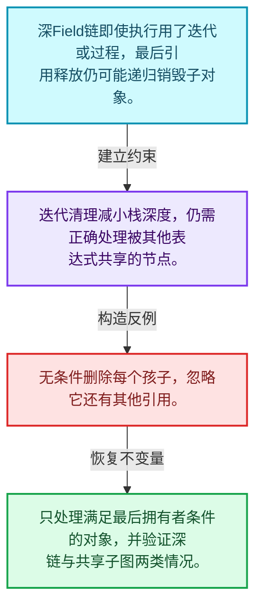
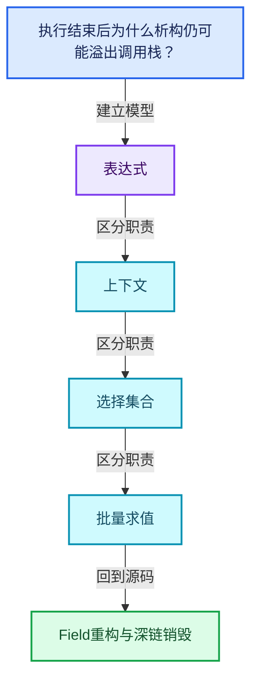
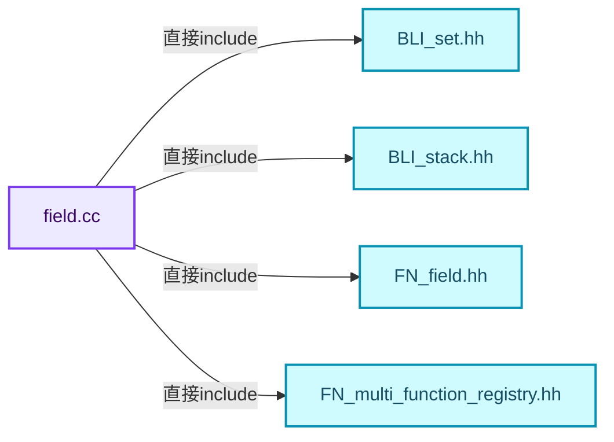
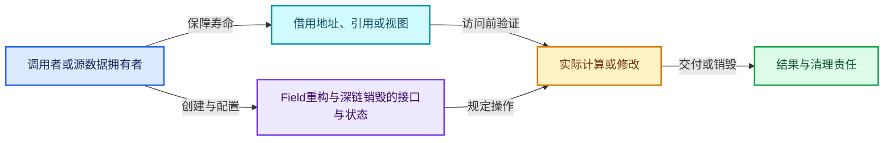
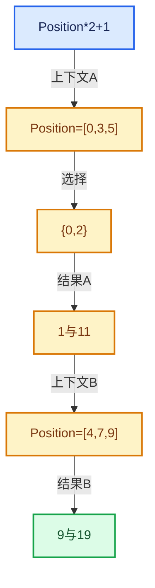

# 08-12 Field重构与深链销毁

[方向导航](README.md) · [总目录](../README.md) · [覆盖索引](../%E6%BA%90%E7%A0%81%E7%89%88%E6%9C%AC%E4%B8%8E%E8%A6%86%E7%9B%96%E7%B4%A2%E5%BC%95.md)

> 阅读顺序：问题与数据模型 → 语法与类型 → 源码逐行 → 调用线索 → 历史与取舍 → 推演和练习。

- 基准 HEAD：`cbda6b96c26c0dee3c3b5cbb93960c4ac06a6b30`。
- 记录日期：2026-10-14。
- 教学示例状态：正文中的推演不是本机性能实测；已运行练习见验收报告。

## 一、从问题到设计

执行结束后为什么析构仍可能溢出调用栈？

长所有权链可让最后引用释放触发递归销毁，迭代释放减少栈深度；执行正确不等于销毁安全。

本篇把语法、数据语义和系统取舍连接起来。Field表达式、求值上下文、mask与结果存储各自有独立职责和生命周期。

### 本篇独立模型与设计推理

深Field链即使执行用了迭代或过程，最后引用释放仍可能递归销毁子对象。

设计取舍：迭代清理减小栈深度，仍需正确处理被其他表达式共享的节点。

最小反例：无条件删除每个孩子，忽略它还有其他引用。

推导与处理：只处理满足最后拥有者条件的对象，并验证深链与共享子图两类情况。



### 源码范围与相邻篇章

| 文件 | 本篇逐行范围 | 基准SHA-256 |
|---|---|---|
| [source/blender/functions/intern/field.cc](../../../../../source/blender/functions/intern/field.cc) | L262—L571 | `b7e5a1f7396dc171501ce4ace49a569bce95dee9377adeabd565929b45e825b7` |

同一主讲文件可能分多篇覆盖；超出本篇范围的符号通过覆盖索引定位。空行与纯注释保留在源码摘录中，逐行表解释有效语句与语法边界；许可证头统一保留。

前篇：[SetPosition完整调用链](11-SetPosition%E5%AE%8C%E6%95%B4%E8%B0%83%E7%94%A8%E9%93%BE.md).

## 二、类型、数据与阅读地图



这是概念依赖图，边表示阅读关系，不声称是运行时调用顺序。

### 直接编译依赖



箭头只表示头文件包含关系；完整调用线索见后面的符号定位表。

## 三、关键词、语法与类型角色

### 依赖名称 typename

typename既可引入类型模板参数，也可告诉编译器某个依赖名称是类型。它不创建运行时对象；解析期确认语法类别与实例化期检查具体类型是不同阶段。

具体检查：区分typename T::value_type和T::size()，前者标记类型，后者是表达式。

### 常量求值 constexpr

constexpr声明允许相应实体参与常量求值，但constexpr函数仍可以在运行时执行。是否常量求值由调用场景和表达式合法性共同决定。

具体检查：比较constexpr变量初始化和从运行时输入调用同一函数。

### 只读限定 const

const约束当前访问路径可做的修改。const指针、指向const的指针、const视图对象、const元素是不同位置的限定；其他别名可能仍可修改原对象。

具体检查：分别写T* const、const T*与const T* const，并画出不可修改的层次。

### 移动转换 std::move

std::move把表达式转换为可供移动重载选择的值类别，实际资源转移发生在被选中的构造或赋值中。对const对象move可能仍调用复制，对视图move也不会获得底层数据所有权。

具体检查：记录移动构造调用次数，不用变量名或std::move的出现次数替代测量。

### 异常约定 noexcept

noexcept表达式可以依赖类型特征。违反不抛异常约定会终止程序；它不是自动捕获异常，也不是资源回滚代码。

具体检查：找出声明的条件与实际可能抛出的分配、构造操作是否一致。

### 异常边界 try与catch

try定义异常传播的局部边界。失败路径需要销毁已经成功构造的部分并释放相应存储；未构造的对象不能被析构。

具体检查：在第k次构造失败，列出已经存在的对象集合与待释放缓冲。

### 构造与new表达式

普通new可能分配并构造；placement new在给定地址构造，存储由其他机制提供。失败回滚应区分两类责任。

具体检查：追踪地址来自哪里、构造何时成功、由谁析构、由谁释放。

### 内部断言 assert

断言表达开发者预期成立的内部契约，发布构建可能关闭。它不能替代对不可信输入的完整错误处理，也不保证后续操作被运行时保护。

具体检查：对每条断言构造违反条件的输入，区分调用者错误与应向用户报告的错误。

### 编译期分支 if constexpr

条件在实例化时决定被保留的分支，这常用于不同类型的合法操作选择。它与运行时if有不同的实例化检查规则。

具体检查：找出每个分支依赖哪些类型特征，再使用满足与不满足条件的类型。

### 共享拥有 shared_ptr

shared_ptr让控制块跟踪共享寿命，不自动使被指向对象的读写线程安全；循环拥有可能阻止销毁。

具体检查：画出强引用环并考虑是否应改变所有权方向或引入弱引用。

## 四、真实源码与逐行讲解

源码块保持原行内容，原始行号由小节标题及逐行表给出。表中的调用定位是静态阅读辅助；重载、模板实例化、宏展开和虚调用需结合完整声明，不能仅凭词法出现证明动态调用。

### field.cc：L262—L319

<!-- source:source/blender/functions/intern/field.cc:262:319 -->

```cpp

/**
 * Combine the field inputs from multiple fields. If possible, nothing new is allocated.
 */
static FieldInputsPtr combine_field_inputs(const Span<GField> &fields)
{
  /* Try to find an existing #FieldInputsPtr that covers all given fields. */
  bool candidate_valid = true;
  const FieldInputsPtr *candidate = nullptr;
  for (const GField &field : fields) {
    const FieldInputsPtr &field_inputs_ptr = field.field_inputs();
    if (!field_inputs_ptr) {
      continue;
    }
    if (!candidate) {
      candidate = &field_inputs_ptr;
      continue;
    }
    if (field_inputs_ptr == *candidate) {
      continue;
    }
    const FieldInputsPtr *smaller_candidate = candidate;
    const FieldInputsPtr *larger_candidate = &field_inputs_ptr;
    if ((*smaller_candidate)->inputs.size() > (*larger_candidate)->inputs.size()) {
      std::swap(smaller_candidate, larger_candidate);
    }
    /* Check if the smaller candidate is fully contained in the larger one. */
    for (const FieldInput &field_input : (*smaller_candidate)->inputs) {
      if (!(*larger_candidate)->inputs.contains(field_input)) {
        candidate_valid = false;
        break;
      }
    }
    if (!candidate_valid) {
      break;
    }
    candidate = larger_candidate;
  }
  if (candidate_valid) {
    if (candidate) {
      return *candidate;
    }
    return {};
  }
  /* None of the existing #FieldInputs can be reused, create a new #FieldInputs and add all the
   * inputs to it. */
  FieldInputs *new_field_inputs = MEM_new<FieldInputs>(__func__);
  for (const GField &field : fields) {
    const FieldInputsPtr &field_inputs_ptr = field.field_inputs();
    if (!field_inputs_ptr) {
      continue;
    }
    for (const FieldInput &field_input : field_inputs_ptr->inputs) {
      new_field_inputs->inputs.add(field_input);
    }
  }
  return FieldInputsPtr(new_field_inputs);
}
```

本段语义重点：

- 分支证据 `!field_inputs_ptr)`：分别推演条件成立与不成立，核对相同出口处的状态。
- 分支证据 `!candidate)`：分别推演条件成立与不成立，核对相同出口处的状态。

| 原始行 | 语义、约束与检查 |
|---|---|
| L266 | 出现调用或函数声明 `combine_field_inputs`，对应表达式为 `static FieldInputsPtr combine_field_inputs(const Span<GField> &fields)`。参数求值、返回类型与重载需结合前后完整语句；静态文本引用不能证明动态目标。 |
| L267 | 连接上一行的声明或控制结构与其语句块；后续行在这个作用域中执行或声明。 |
| L269 | 把右侧 `true` 用于初始化或更新左侧 `bool candidate_valid`。声明初始化与已有对象赋值应按上下文区分；有资源的类型会调用相应特殊成员。 |
| L270 | 把右侧 `nullptr` 用于初始化或更新左侧 `const FieldInputsPtr *candidate`。声明初始化与已有对象赋值应按上下文区分；有资源的类型会调用相应特殊成员。 |
| L271 | 按 `for (const GField &field : fields)` 指定的范围或条件重复执行。对照循环变量与真实元素编号；循环内调用成本乘以实际迭代次数。 |
| L272 | 把右侧 `field.field_inputs()` 用于初始化或更新左侧 `const FieldInputsPtr &field_inputs_ptr`。声明初始化与已有对象赋值应按上下文区分；有资源的类型会调用相应特殊成员。 |
| L273 | 判断 `!field_inputs_ptr`，成立时进入本分支，否则继续后续路径。 |
| L274 | 结束本轮循环并进入下一轮；核对本轮已经取得的资源是否由作用域或显式代码清理。 |
| L275 | 结束当前语法单元。局部自动对象在离开其作用域时按规则销毁；这不等于所有被引用的外部数据也被释放。 |
| L276 | 判断 `!candidate`，成立时进入本分支，否则继续后续路径。 |
| L277 | 把右侧 `&field_inputs_ptr` 用于初始化或更新左侧 `candidate`。声明初始化与已有对象赋值应按上下文区分；有资源的类型会调用相应特殊成员。 |
| L278 | 结束本轮循环并进入下一轮；核对本轮已经取得的资源是否由作用域或显式代码清理。 |
| L279 | 结束当前语法单元。局部自动对象在离开其作用域时按规则销毁；这不等于所有被引用的外部数据也被释放。 |
| L280 | 判断 `field_inputs_ptr == *candidate`，成立时进入本分支，否则继续后续路径。 |
| L281 | 结束本轮循环并进入下一轮；核对本轮已经取得的资源是否由作用域或显式代码清理。 |
| L282 | 结束当前语法单元。局部自动对象在离开其作用域时按规则销毁；这不等于所有被引用的外部数据也被释放。 |
| L283 | 把右侧 `candidate` 用于初始化或更新左侧 `const FieldInputsPtr *smaller_candidate`。声明初始化与已有对象赋值应按上下文区分；有资源的类型会调用相应特殊成员。 |
| L284 | 把右侧 `&field_inputs_ptr` 用于初始化或更新左侧 `const FieldInputsPtr *larger_candidate`。声明初始化与已有对象赋值应按上下文区分；有资源的类型会调用相应特殊成员。 |
| L285 | 判断 `(*smaller_candidate)->inputs.size() > (*larger_candidate)->inputs.size()`，成立时进入本分支，否则继续后续路径。该边界影响可访问元素或可用容量，两者要按各变量的定义区分。 |
| L286 | 出现调用或函数声明 `std::swap`，对应表达式为 `std::swap(smaller_candidate, larger_candidate);`。参数求值、返回类型与重载需结合前后完整语句；静态文本引用不能证明动态目标。 |
| L287 | 结束当前语法单元。局部自动对象在离开其作用域时按规则销毁；这不等于所有被引用的外部数据也被释放。 |
| L289 | 按 `for (const FieldInput &field_input : (*smaller_candidate)->inputs)` 指定的范围或条件重复执行。对照循环变量与真实元素编号；循环内调用成本乘以实际迭代次数。 |
| L290 | 判断 `!(*larger_candidate)->inputs.contains(field_input)`，成立时进入本分支，否则继续后续路径。 |
| L291 | 把右侧 `false` 用于初始化或更新左侧 `candidate_valid`。声明初始化与已有对象赋值应按上下文区分；有资源的类型会调用相应特殊成员。 |
| L292 | 离开最近的循环或switch；不是离开整个函数，后续清理和提交代码可能仍会执行。 |
| L293 | 结束当前语法单元。局部自动对象在离开其作用域时按规则销毁；这不等于所有被引用的外部数据也被释放。 |
| L294 | 结束当前语法单元。局部自动对象在离开其作用域时按规则销毁；这不等于所有被引用的外部数据也被释放。 |
| L295 | 判断 `!candidate_valid`，成立时进入本分支，否则继续后续路径。 |
| L296 | 离开最近的循环或switch；不是离开整个函数，后续清理和提交代码可能仍会执行。 |
| L297 | 结束当前语法单元。局部自动对象在离开其作用域时按规则销毁；这不等于所有被引用的外部数据也被释放。 |
| L298 | 把右侧 `larger_candidate` 用于初始化或更新左侧 `candidate`。声明初始化与已有对象赋值应按上下文区分；有资源的类型会调用相应特殊成员。 |
| L299 | 结束当前语法单元。局部自动对象在离开其作用域时按规则销毁；这不等于所有被引用的外部数据也被释放。 |
| L300 | 判断 `candidate_valid`，成立时进入本分支，否则继续后续路径。 |
| L301 | 判断 `candidate`，成立时进入本分支，否则继续后续路径。 |
| L302 | 返回表达式 `*candidate`。 |
| L303 | 结束当前语法单元。局部自动对象在离开其作用域时按规则销毁；这不等于所有被引用的外部数据也被释放。 |
| L304 | 返回表达式 `{}`。 |
| L305 | 结束当前语法单元。局部自动对象在离开其作用域时按规则销毁；这不等于所有被引用的外部数据也被释放。 |
| L308 | 把右侧 `MEM_new<FieldInputs>(__func__)` 用于初始化或更新左侧 `FieldInputs *new_field_inputs`。声明初始化与已有对象赋值应按上下文区分；有资源的类型会调用相应特殊成员。 |
| L309 | 按 `for (const GField &field : fields)` 指定的范围或条件重复执行。对照循环变量与真实元素编号；循环内调用成本乘以实际迭代次数。 |
| L310 | 把右侧 `field.field_inputs()` 用于初始化或更新左侧 `const FieldInputsPtr &field_inputs_ptr`。声明初始化与已有对象赋值应按上下文区分；有资源的类型会调用相应特殊成员。 |
| L311 | 判断 `!field_inputs_ptr`，成立时进入本分支，否则继续后续路径。 |
| L312 | 结束本轮循环并进入下一轮；核对本轮已经取得的资源是否由作用域或显式代码清理。 |
| L313 | 结束当前语法单元。局部自动对象在离开其作用域时按规则销毁；这不等于所有被引用的外部数据也被释放。 |
| L314 | 按 `for (const FieldInput &field_input : field_inputs_ptr->inputs)` 指定的范围或条件重复执行。对照循环变量与真实元素编号；循环内调用成本乘以实际迭代次数。 |
| L315 | 出现调用或函数声明 `add`，对应表达式为 `new_field_inputs->inputs.add(field_input);`。参数求值、返回类型与重载需结合前后完整语句；静态文本引用不能证明动态目标。 |
| L316 | 结束当前语法单元。局部自动对象在离开其作用域时按规则销毁；这不等于所有被引用的外部数据也被释放。 |
| L317 | 结束当前语法单元。局部自动对象在离开其作用域时按规则销毁；这不等于所有被引用的外部数据也被释放。 |
| L318 | 返回表达式 `FieldInputsPtr(new_field_inputs)`。 |
| L319 | 结束当前语法单元。局部自动对象在离开其作用域时按规则销毁；这不等于所有被引用的外部数据也被释放。 |

### field.cc：L320—L371

<!-- source:source/blender/functions/intern/field.cc:320:371 -->

```cpp

GField::GField(const GField &other) : variant_(other.variant_)
{
  std::visit(
      [&]<typename T>(T &v) {
        if constexpr (std::is_same_v<T, OwnedConstant>) {
          void *new_value = MEM_new_uninitialized_aligned(
              v.type->size, v.type->alignment, "GField::GField()");
          v.type->copy_construct(v.value, new_value);
          v.value = new_value;
        }
      },
      variant_);
}

GField::GField(GField &&other) noexcept : variant_(std::move(other.variant_))
{
  const CPPType &type = this->cpp_type();
  other.variant_ = ConstantRef{&type, type.default_value()};
}

GField &GField::operator=(const GField &other)
{
  if (this == &other) {
    return *this;
  }
  this->~GField();
  new (this) GField(other);
  return *this;
}

GField &GField::operator=(GField &&other) noexcept
{
  if (this == &other) {
    return *this;
  }
  this->~GField();
  new (this) GField(std::move(other));
  return *this;
}

GField::~GField()
{
  std::visit(
      [&]<typename T>(T &v) {
        if constexpr (std::is_same_v<T, OwnedConstant>) {
          v.type->destruct(v.value);
          MEM_delete_void(v.value);
        }
      },
      variant_);
}
```

本段语义重点：

- `std::visit`：根据variant当前活动类型执行对应操作；每个候选分支都必须满足访客约定。

| 原始行 | 语义、约束与检查 |
|---|---|
| L321 | 出现调用或函数声明 `GField::GField`，对应表达式为 `GField::GField(const GField &other) : variant_(other.variant_)`。参数求值、返回类型与重载需结合前后完整语句；静态文本引用不能证明动态目标。 |
| L322 | 连接上一行的声明或控制结构与其语句块；后续行在这个作用域中执行或声明。 |
| L323 | 本行使用 `std::visit`：根据variant当前活动类型执行对应操作；每个候选分支都必须满足访客约定。 |
| L324 | 本行是连续声明或表达式的一部分：`[&]<typename T>(T &v) {`。与本段前后行合读；逗号、括号和限定符决定它属于参数、初始化列表还是实际计算。 |
| L325 | 编译期条件分支 `if constexpr (std::is_same_v<T, OwnedConstant>)`。按实例化类型选择相应实现；被舍弃分支和运行期if具有不同检查规则，不能当作运行时输入验证。 |
| L326 | 把右侧 `MEM_new_uninitialized_aligned(` 用于初始化或更新左侧 `void *new_value`。声明初始化与已有对象赋值应按上下文区分；有资源的类型会调用相应特殊成员。 |
| L327 | 出现调用或函数声明 `GField::GField`，对应表达式为 `v.type->size, v.type->alignment, "GField::GField()");`。参数求值、返回类型与重载需结合前后完整语句；静态文本引用不能证明动态目标。 |
| L328 | 出现调用或函数声明 `copy_construct`，对应表达式为 `v.type->copy_construct(v.value, new_value);`。参数求值、返回类型与重载需结合前后完整语句；静态文本引用不能证明动态目标。 |
| L329 | 把右侧 `new_value` 用于初始化或更新左侧 `v.value`。声明初始化与已有对象赋值应按上下文区分；有资源的类型会调用相应特殊成员。 |
| L330 | 结束当前语法单元。局部自动对象在离开其作用域时按规则销毁；这不等于所有被引用的外部数据也被释放。 |
| L331 | 结束当前语法单元。局部自动对象在离开其作用域时按规则销毁；这不等于所有被引用的外部数据也被释放。 |
| L332 | 声明成员、局部对象或完成语句 `variant_)`。若为指针或引用，它本身不说明拥有；若为值对象，其构造析构由所在作用域或外层对象管理。 |
| L333 | 结束当前语法单元。局部自动对象在离开其作用域时按规则销毁；这不等于所有被引用的外部数据也被释放。 |
| L335 | 出现调用或函数声明 `GField::GField`，对应表达式为 `GField::GField(GField &&other) noexcept : variant_(std::move(other.variant_))`。参数求值、返回类型与重载需结合前后完整语句；静态文本引用不能证明动态目标。 |
| L336 | 连接上一行的声明或控制结构与其语句块；后续行在这个作用域中执行或声明。 |
| L337 | 把右侧 `this->cpp_type()` 用于初始化或更新左侧 `const CPPType &type`。声明初始化与已有对象赋值应按上下文区分；有资源的类型会调用相应特殊成员。 |
| L338 | 把右侧 `ConstantRef{&type, type.default_value()}` 用于初始化或更新左侧 `other.variant_`。声明初始化与已有对象赋值应按上下文区分；有资源的类型会调用相应特殊成员。 |
| L339 | 结束当前语法单元。局部自动对象在离开其作用域时按规则销毁；这不等于所有被引用的外部数据也被释放。 |
| L341 | 运算符重载声明、定义或显式调用：`GField &GField::operator=(const GField &other)`。结合参数和返回类型判断是赋值、索引、比较还是转换；operator=声明中的等号不是在给名为operator的变量赋值。 |
| L342 | 连接上一行的声明或控制结构与其语句块；后续行在这个作用域中执行或声明。 |
| L343 | 判断 `this == &other`，成立时进入本分支，否则继续后续路径。 |
| L344 | 返回表达式 `*this`。返回当前对象；返回类型决定它是引用还是值，不能仅凭表达式假定复制。 |
| L345 | 结束当前语法单元。局部自动对象在离开其作用域时按规则销毁；这不等于所有被引用的外部数据也被释放。 |
| L346 | 涉及析构接口或显式析构：`this->~GField();`。检查目标对象已成功构造，且资源不会在另一条清理路径再次销毁。 |
| L347 | 出现调用或函数声明 `new`，对应表达式为 `new (this) GField(other);`。参数求值、返回类型与重载需结合前后完整语句；静态文本引用不能证明动态目标。 |
| L348 | 返回表达式 `*this`。返回当前对象；返回类型决定它是引用还是值，不能仅凭表达式假定复制。 |
| L349 | 结束当前语法单元。局部自动对象在离开其作用域时按规则销毁；这不等于所有被引用的外部数据也被释放。 |
| L351 | 运算符重载声明、定义或显式调用：`GField &GField::operator=(GField &&other) noexcept`。结合参数和返回类型判断是赋值、索引、比较还是转换；operator=声明中的等号不是在给名为operator的变量赋值。 |
| L352 | 连接上一行的声明或控制结构与其语句块；后续行在这个作用域中执行或声明。 |
| L353 | 判断 `this == &other`，成立时进入本分支，否则继续后续路径。 |
| L354 | 返回表达式 `*this`。返回当前对象；返回类型决定它是引用还是值，不能仅凭表达式假定复制。 |
| L355 | 结束当前语法单元。局部自动对象在离开其作用域时按规则销毁；这不等于所有被引用的外部数据也被释放。 |
| L356 | 涉及析构接口或显式析构：`this->~GField();`。检查目标对象已成功构造，且资源不会在另一条清理路径再次销毁。 |
| L357 | 出现调用或函数声明 `new`，对应表达式为 `new (this) GField(std::move(other));`。参数求值、返回类型与重载需结合前后完整语句；静态文本引用不能证明动态目标。 |
| L358 | 返回表达式 `*this`。返回当前对象；返回类型决定它是引用还是值，不能仅凭表达式假定复制。 |
| L359 | 结束当前语法单元。局部自动对象在离开其作用域时按规则销毁；这不等于所有被引用的外部数据也被释放。 |
| L361 | 涉及析构接口或显式析构：`GField::~GField()`。检查目标对象已成功构造，且资源不会在另一条清理路径再次销毁。 |
| L362 | 连接上一行的声明或控制结构与其语句块；后续行在这个作用域中执行或声明。 |
| L363 | 本行使用 `std::visit`：根据variant当前活动类型执行对应操作；每个候选分支都必须满足访客约定。 |
| L364 | 本行是连续声明或表达式的一部分：`[&]<typename T>(T &v) {`。与本段前后行合读；逗号、括号和限定符决定它属于参数、初始化列表还是实际计算。 |
| L365 | 编译期条件分支 `if constexpr (std::is_same_v<T, OwnedConstant>)`。按实例化类型选择相应实现；被舍弃分支和运行期if具有不同检查规则，不能当作运行时输入验证。 |
| L366 | 出现调用或函数声明 `destruct`，对应表达式为 `v.type->destruct(v.value);`。参数求值、返回类型与重载需结合前后完整语句；静态文本引用不能证明动态目标。 |
| L367 | 出现调用或函数声明 `MEM_delete_void`，对应表达式为 `MEM_delete_void(v.value);`。参数求值、返回类型与重载需结合前后完整语句；静态文本引用不能证明动态目标。 |
| L368 | 结束当前语法单元。局部自动对象在离开其作用域时按规则销毁；这不等于所有被引用的外部数据也被释放。 |
| L369 | 结束当前语法单元。局部自动对象在离开其作用域时按规则销毁；这不等于所有被引用的外部数据也被释放。 |
| L370 | 声明成员、局部对象或完成语句 `variant_)`。若为指针或引用，它本身不说明拥有；若为值对象，其构造析构由所在作用域或外层对象管理。 |
| L371 | 结束当前语法单元。局部自动对象在离开其作用域时按规则销毁；这不等于所有被引用的外部数据也被释放。 |

### field.cc：L372—L417

<!-- source:source/blender/functions/intern/field.cc:372:417 -->

```cpp

GFieldRef::GFieldRef(const GField &field)
    : variant_(std::visit(
          []<typename T>(const T &v) -> Variant {
            if constexpr (std::is_same_v<T, GField::Input>) {
              return Input{v.node.get()};
            }
            else if constexpr (std::is_same_v<T, GField::MultiFn>) {
              return MultiFn{v.node.get(), v.output_i};
            }
            else if constexpr (std::is_same_v<T, GField::FieldRef>) {
              /* Should not exist due to #deref_field_ref. */
              BLI_assert_unreachable();
              return Value{};
            }
            else if constexpr (GField::is_constant_value_v<T>) {
              return Value{v.type, v.value};
            }
            else {
              BLI_assert_unreachable_static_t(T);
            }
          },
          field.deref_field_ref().variant()))
{
}

const FieldInputsPtr &GFieldRef::field_inputs() const
{
  static const ImplicitSharingPtr<FieldInputs> empty_inputs;
  return std::visit(
      [&]<typename T>(const T &v) -> const FieldInputsPtr & {
        if constexpr (std::is_same_v<T, Input>) {
          return v.node->field_inputs();
        }
        else if constexpr (std::is_same_v<T, MultiFn>) {
          return v.node->field_inputs();
        }
        else if constexpr (std::is_same_v<T, Value>) {
          return empty_inputs;
        }
        else {
          BLI_assert_unreachable_static_t(T);
        }
      },
      variant_);
}
```

本段语义重点：

- `std::visit`：根据variant当前活动类型执行对应操作；每个候选分支都必须满足访客约定。

| 原始行 | 语义、约束与检查 |
|---|---|
| L373 | 出现调用或函数声明 `GFieldRef::GFieldRef`，对应表达式为 `GFieldRef::GFieldRef(const GField &field)`。参数求值、返回类型与重载需结合前后完整语句；静态文本引用不能证明动态目标。 |
| L374 | 本行使用 `std::visit`：根据variant当前活动类型执行对应操作；每个候选分支都必须满足访客约定。 |
| L375 | 本行是连续声明或表达式的一部分：`[]<typename T>(const T &v) -> Variant {`。与本段前后行合读；逗号、括号和限定符决定它属于参数、初始化列表还是实际计算。 |
| L376 | 编译期条件分支 `if constexpr (std::is_same_v<T, GField::Input>)`。按实例化类型选择相应实现；被舍弃分支和运行期if具有不同检查规则，不能当作运行时输入验证。 |
| L377 | 返回表达式 `Input{v.node.get()}`。 |
| L378 | 结束当前语法单元。局部自动对象在离开其作用域时按规则销毁；这不等于所有被引用的外部数据也被释放。 |
| L379 | 出现调用或函数声明 `constexpr`，对应表达式为 `else if constexpr (std::is_same_v<T, GField::MultiFn>) {`。参数求值、返回类型与重载需结合前后完整语句；静态文本引用不能证明动态目标。 |
| L380 | 返回表达式 `MultiFn{v.node.get(), v.output_i}`。 |
| L381 | 结束当前语法单元。局部自动对象在离开其作用域时按规则销毁；这不等于所有被引用的外部数据也被释放。 |
| L382 | 出现调用或函数声明 `constexpr`，对应表达式为 `else if constexpr (std::is_same_v<T, GField::FieldRef>) {`。参数求值、返回类型与重载需结合前后完整语句；静态文本引用不能证明动态目标。 |
| L384 | 断言约束 `BLI_assert_unreachable();`。条件是后续访问的内部前置条件；发布构建可能不执行，不能把断言当作输入修复。 |
| L385 | 返回表达式 `Value{}`。 |
| L386 | 结束当前语法单元。局部自动对象在离开其作用域时按规则销毁；这不等于所有被引用的外部数据也被释放。 |
| L387 | 出现调用或函数声明 `constexpr`，对应表达式为 `else if constexpr (GField::is_constant_value_v<T>) {`。参数求值、返回类型与重载需结合前后完整语句；静态文本引用不能证明动态目标。 |
| L388 | 返回表达式 `Value{v.type, v.value}`。 |
| L389 | 结束当前语法单元。局部自动对象在离开其作用域时按规则销毁；这不等于所有被引用的外部数据也被释放。 |
| L390 | 处理前一条件不成立的互补路径。比较两条路径最后是否恢复同一不变量，以及是否产生不同的资源责任。 |
| L391 | 断言约束 `BLI_assert_unreachable_static_t(T);`。条件是后续访问的内部前置条件；发布构建可能不执行，不能把断言当作输入修复。 |
| L392 | 结束当前语法单元。局部自动对象在离开其作用域时按规则销毁；这不等于所有被引用的外部数据也被释放。 |
| L393 | 结束当前语法单元。局部自动对象在离开其作用域时按规则销毁；这不等于所有被引用的外部数据也被释放。 |
| L394 | 出现调用或函数声明 `deref_field_ref`，对应表达式为 `field.deref_field_ref().variant()))`。参数求值、返回类型与重载需结合前后完整语句；静态文本引用不能证明动态目标。 |
| L395 | 连接上一行的声明或控制结构与其语句块；后续行在这个作用域中执行或声明。 |
| L396 | 结束当前语法单元。局部自动对象在离开其作用域时按规则销毁；这不等于所有被引用的外部数据也被释放。 |
| L398 | 出现调用或函数声明 `GFieldRef::field_inputs`，对应表达式为 `const FieldInputsPtr &GFieldRef::field_inputs() const`。参数求值、返回类型与重载需结合前后完整语句；静态文本引用不能证明动态目标。 |
| L399 | 连接上一行的声明或控制结构与其语句块；后续行在这个作用域中执行或声明。 |
| L400 | 声明成员、局部对象或完成语句 `static const ImplicitSharingPtr<FieldInputs> empty_inputs`。若为指针或引用，它本身不说明拥有；若为值对象，其构造析构由所在作用域或外层对象管理。 |
| L401 | 返回表达式 `std::visit(`。 |
| L402 | 本行是连续声明或表达式的一部分：`[&]<typename T>(const T &v) -> const FieldInputsPtr & {`。与本段前后行合读；逗号、括号和限定符决定它属于参数、初始化列表还是实际计算。 |
| L403 | 编译期条件分支 `if constexpr (std::is_same_v<T, Input>)`。按实例化类型选择相应实现；被舍弃分支和运行期if具有不同检查规则，不能当作运行时输入验证。 |
| L404 | 返回表达式 `v.node->field_inputs()`。 |
| L405 | 结束当前语法单元。局部自动对象在离开其作用域时按规则销毁；这不等于所有被引用的外部数据也被释放。 |
| L406 | 出现调用或函数声明 `constexpr`，对应表达式为 `else if constexpr (std::is_same_v<T, MultiFn>) {`。参数求值、返回类型与重载需结合前后完整语句；静态文本引用不能证明动态目标。 |
| L407 | 返回表达式 `v.node->field_inputs()`。 |
| L408 | 结束当前语法单元。局部自动对象在离开其作用域时按规则销毁；这不等于所有被引用的外部数据也被释放。 |
| L409 | 出现调用或函数声明 `constexpr`，对应表达式为 `else if constexpr (std::is_same_v<T, Value>) {`。参数求值、返回类型与重载需结合前后完整语句；静态文本引用不能证明动态目标。 |
| L410 | 返回表达式 `empty_inputs`。 |
| L411 | 结束当前语法单元。局部自动对象在离开其作用域时按规则销毁；这不等于所有被引用的外部数据也被释放。 |
| L412 | 处理前一条件不成立的互补路径。比较两条路径最后是否恢复同一不变量，以及是否产生不同的资源责任。 |
| L413 | 断言约束 `BLI_assert_unreachable_static_t(T);`。条件是后续访问的内部前置条件；发布构建可能不执行，不能把断言当作输入修复。 |
| L414 | 结束当前语法单元。局部自动对象在离开其作用域时按规则销毁；这不等于所有被引用的外部数据也被释放。 |
| L415 | 结束当前语法单元。局部自动对象在离开其作用域时按规则销毁；这不等于所有被引用的外部数据也被释放。 |
| L416 | 声明成员、局部对象或完成语句 `variant_)`。若为指针或引用，它本身不说明拥有；若为值对象，其构造析构由所在作用域或外层对象管理。 |
| L417 | 结束当前语法单元。局部自动对象在离开其作用域时按规则销毁；这不等于所有被引用的外部数据也被释放。 |

### field.cc：L418—L474

<!-- source:source/blender/functions/intern/field.cc:418:474 -->

```cpp

bool operator==(const GFieldRef &a, const GFieldRef &b)
{
  return std::visit(
      [&]<typename T>(const T &v_a) -> bool {
        if constexpr (std::is_same_v<T, GFieldRef::Value>) {
          if (const auto *v_b = std::get_if<GFieldRef::Value>(&b.variant())) {
            if (v_a.type != v_b->type) {
              return false;
            }
            if (v_a.value == v_b->value) {
              /* This may return true even if the values don't compare equal, e.g. due to NaN
               * values. */
              return true;
            }
            return v_a.type->is_equal_or_false(v_a.value, v_b->value);
          }
          return false;
        }
        else if constexpr (std::is_same_v<T, GFieldRef::Input>) {
          if (const auto *v_b = std::get_if<GFieldRef::Input>(&b.variant())) {
            return v_a.node == v_b->node;
          }
          return false;
        }
        else if constexpr (std::is_same_v<T, GFieldRef::MultiFn>) {
          if (const auto *v_b = std::get_if<GFieldRef::MultiFn>(&b.variant())) {
            return v_a.node == v_b->node && v_a.output_i == v_b->output_i;
          }
          return false;
        }
        else {
          BLI_assert_unreachable_static_t(T);
        }
      },
      a.variant());
}

uint64_t GFieldRef::hash() const
{
  return std::visit(
      [&]<typename T>(const T &v) -> uint64_t {
        if constexpr (std::is_same_v<T, Value>) {
          return v.type->hash_or_fallback(v.value, uint64_t(v.type));
        }
        else if constexpr (std::is_same_v<T, Input>) {
          return get_default_hash(v.node);
        }
        else if constexpr (std::is_same_v<T, MultiFn>) {
          return get_default_hash(v.node, v.output_i);
        }
        else {
          BLI_assert_unreachable_static_t(T);
        }
      },
      variant_);
}
```

本段语义重点：

- `std::visit`：根据variant当前活动类型执行对应操作；每个候选分支都必须满足访客约定。

| 原始行 | 语义、约束与检查 |
|---|---|
| L419 | 运算符重载声明、定义或显式调用：`bool operator==(const GFieldRef &a, const GFieldRef &b)`。结合参数和返回类型判断是赋值、索引、比较还是转换；operator=声明中的等号不是在给名为operator的变量赋值。 |
| L420 | 连接上一行的声明或控制结构与其语句块；后续行在这个作用域中执行或声明。 |
| L421 | 返回表达式 `std::visit(`。 |
| L422 | 本行是连续声明或表达式的一部分：`[&]<typename T>(const T &v_a) -> bool {`。与本段前后行合读；逗号、括号和限定符决定它属于参数、初始化列表还是实际计算。 |
| L423 | 编译期条件分支 `if constexpr (std::is_same_v<T, GFieldRef::Value>)`。按实例化类型选择相应实现；被舍弃分支和运行期if具有不同检查规则，不能当作运行时输入验证。 |
| L424 | 判断 `const auto *v_b = std::get_if<GFieldRef::Value>(&b.variant())`，成立时进入本分支，否则继续后续路径。 |
| L425 | 判断 `v_a.type != v_b->type`，成立时进入本分支，否则继续后续路径。 |
| L426 | 返回表达式 `false`。这是本路径的布尔结果，具体成功、存在或状态含义由函数接口规定。 |
| L427 | 结束当前语法单元。局部自动对象在离开其作用域时按规则销毁；这不等于所有被引用的外部数据也被释放。 |
| L428 | 判断 `v_a.value == v_b->value`，成立时进入本分支，否则继续后续路径。 |
| L431 | 返回表达式 `true`。这是本路径的布尔结果，具体成功、存在或状态含义由函数接口规定。 |
| L432 | 结束当前语法单元。局部自动对象在离开其作用域时按规则销毁；这不等于所有被引用的外部数据也被释放。 |
| L433 | 返回表达式 `v_a.type->is_equal_or_false(v_a.value, v_b->value)`。 |
| L434 | 结束当前语法单元。局部自动对象在离开其作用域时按规则销毁；这不等于所有被引用的外部数据也被释放。 |
| L435 | 返回表达式 `false`。这是本路径的布尔结果，具体成功、存在或状态含义由函数接口规定。 |
| L436 | 结束当前语法单元。局部自动对象在离开其作用域时按规则销毁；这不等于所有被引用的外部数据也被释放。 |
| L437 | 出现调用或函数声明 `constexpr`，对应表达式为 `else if constexpr (std::is_same_v<T, GFieldRef::Input>) {`。参数求值、返回类型与重载需结合前后完整语句；静态文本引用不能证明动态目标。 |
| L438 | 判断 `const auto *v_b = std::get_if<GFieldRef::Input>(&b.variant())`，成立时进入本分支，否则继续后续路径。 |
| L439 | 返回表达式 `v_a.node == v_b->node`。结合函数声明检查返回值是否借用原存储，借用值不会自动延长其寿命。 |
| L440 | 结束当前语法单元。局部自动对象在离开其作用域时按规则销毁；这不等于所有被引用的外部数据也被释放。 |
| L441 | 返回表达式 `false`。这是本路径的布尔结果，具体成功、存在或状态含义由函数接口规定。 |
| L442 | 结束当前语法单元。局部自动对象在离开其作用域时按规则销毁；这不等于所有被引用的外部数据也被释放。 |
| L443 | 出现调用或函数声明 `constexpr`，对应表达式为 `else if constexpr (std::is_same_v<T, GFieldRef::MultiFn>) {`。参数求值、返回类型与重载需结合前后完整语句；静态文本引用不能证明动态目标。 |
| L444 | 判断 `const auto *v_b = std::get_if<GFieldRef::MultiFn>(&b.variant())`，成立时进入本分支，否则继续后续路径。 |
| L445 | 返回表达式 `v_a.node == v_b->node && v_a.output_i == v_b->output_i`。结合函数声明检查返回值是否借用原存储，借用值不会自动延长其寿命。 |
| L446 | 结束当前语法单元。局部自动对象在离开其作用域时按规则销毁；这不等于所有被引用的外部数据也被释放。 |
| L447 | 返回表达式 `false`。这是本路径的布尔结果，具体成功、存在或状态含义由函数接口规定。 |
| L448 | 结束当前语法单元。局部自动对象在离开其作用域时按规则销毁；这不等于所有被引用的外部数据也被释放。 |
| L449 | 处理前一条件不成立的互补路径。比较两条路径最后是否恢复同一不变量，以及是否产生不同的资源责任。 |
| L450 | 断言约束 `BLI_assert_unreachable_static_t(T);`。条件是后续访问的内部前置条件；发布构建可能不执行，不能把断言当作输入修复。 |
| L451 | 结束当前语法单元。局部自动对象在离开其作用域时按规则销毁；这不等于所有被引用的外部数据也被释放。 |
| L452 | 结束当前语法单元。局部自动对象在离开其作用域时按规则销毁；这不等于所有被引用的外部数据也被释放。 |
| L453 | 出现调用或函数声明 `variant`，对应表达式为 `a.variant());`。参数求值、返回类型与重载需结合前后完整语句；静态文本引用不能证明动态目标。 |
| L454 | 结束当前语法单元。局部自动对象在离开其作用域时按规则销毁；这不等于所有被引用的外部数据也被释放。 |
| L456 | 出现调用或函数声明 `GFieldRef::hash`，对应表达式为 `uint64_t GFieldRef::hash() const`。参数求值、返回类型与重载需结合前后完整语句；静态文本引用不能证明动态目标。 |
| L457 | 连接上一行的声明或控制结构与其语句块；后续行在这个作用域中执行或声明。 |
| L458 | 返回表达式 `std::visit(`。 |
| L459 | 本行是连续声明或表达式的一部分：`[&]<typename T>(const T &v) -> uint64_t {`。与本段前后行合读；逗号、括号和限定符决定它属于参数、初始化列表还是实际计算。 |
| L460 | 编译期条件分支 `if constexpr (std::is_same_v<T, Value>)`。按实例化类型选择相应实现；被舍弃分支和运行期if具有不同检查规则，不能当作运行时输入验证。 |
| L461 | 返回表达式 `v.type->hash_or_fallback(v.value, uint64_t(v.type))`。 |
| L462 | 结束当前语法单元。局部自动对象在离开其作用域时按规则销毁；这不等于所有被引用的外部数据也被释放。 |
| L463 | 出现调用或函数声明 `constexpr`，对应表达式为 `else if constexpr (std::is_same_v<T, Input>) {`。参数求值、返回类型与重载需结合前后完整语句；静态文本引用不能证明动态目标。 |
| L464 | 返回表达式 `get_default_hash(v.node)`。 |
| L465 | 结束当前语法单元。局部自动对象在离开其作用域时按规则销毁；这不等于所有被引用的外部数据也被释放。 |
| L466 | 出现调用或函数声明 `constexpr`，对应表达式为 `else if constexpr (std::is_same_v<T, MultiFn>) {`。参数求值、返回类型与重载需结合前后完整语句；静态文本引用不能证明动态目标。 |
| L467 | 返回表达式 `get_default_hash(v.node, v.output_i)`。 |
| L468 | 结束当前语法单元。局部自动对象在离开其作用域时按规则销毁；这不等于所有被引用的外部数据也被释放。 |
| L469 | 处理前一条件不成立的互补路径。比较两条路径最后是否恢复同一不变量，以及是否产生不同的资源责任。 |
| L470 | 断言约束 `BLI_assert_unreachable_static_t(T);`。条件是后续访问的内部前置条件；发布构建可能不执行，不能把断言当作输入修复。 |
| L471 | 结束当前语法单元。局部自动对象在离开其作用域时按规则销毁；这不等于所有被引用的外部数据也被释放。 |
| L472 | 结束当前语法单元。局部自动对象在离开其作用域时按规则销毁；这不等于所有被引用的外部数据也被释放。 |
| L473 | 声明成员、局部对象或完成语句 `variant_)`。若为指针或引用，它本身不说明拥有；若为值对象，其构造析构由所在作用域或外层对象管理。 |
| L474 | 结束当前语法单元。局部自动对象在离开其作用域时按规则销毁；这不等于所有被引用的外部数据也被释放。 |

### field.cc：L475—L523

<!-- source:source/blender/functions/intern/field.cc:475:523 -->

```cpp

FieldOperation::FieldOperation(std::shared_ptr<const mf::MultiFunction> fn, Vector<GField> inputs)
    : FieldOperation(*fn, std::move(inputs))
{
  owned_fn_ = std::move(fn);
}

FieldOperation::FieldOperation(const mf::MultiFunction &fn, Vector<GField> inputs)
    : inputs_(inputs), fn_(&fn)
{
  field_inputs_ = combine_field_inputs(inputs_);
}

const CPPType &FieldOperation::output_cpp_type(const int output_i) const
{
  int count = 0;
  for (const int param_index : fn_->param_indices()) {
    const mf::ParamType param_type = fn_->param_type(param_index);
    if (param_type.is_output()) {
      if (count == output_i) {
        return param_type.data_type().single_type();
      }
      count++;
    }
  }
  BLI_assert_unreachable();
  return CPPType::get<float>();
}

const FieldInputsPtr &GField::field_inputs() const
{
  static const ImplicitSharingPtr<FieldInputs> empty_inputs;
  return std::visit(
      []<typename T>(const T &v) -> const FieldInputsPtr & {
        if constexpr (is_same_any_v<T, Input, MultiFn>) {
          return v.node->field_inputs();
        }
        else if constexpr (std::is_same_v<T, FieldRef>) {
          return v.field_ref->field_inputs();
        }
        else if constexpr (is_same_any_v<T, ConstantRef, TrivialInlineConstant, OwnedConstant>) {
          return empty_inputs;
        }
        else {
          BLI_assert_unreachable_static_t(T);
        }
      },
      this->variant_);
}
```

本段语义重点：

- `std::visit`：根据variant当前活动类型执行对应操作；每个候选分支都必须满足访客约定。

| 原始行 | 语义、约束与检查 |
|---|---|
| L476 | 出现调用或函数声明 `FieldOperation::FieldOperation`，对应表达式为 `FieldOperation::FieldOperation(std::shared_ptr<const mf::MultiFunction> fn, Vector<GField> inputs)`。参数求值、返回类型与重载需结合前后完整语句；静态文本引用不能证明动态目标。 |
| L477 | 出现调用或函数声明 `FieldOperation`，对应表达式为 `: FieldOperation(*fn, std::move(inputs))`。参数求值、返回类型与重载需结合前后完整语句；静态文本引用不能证明动态目标。 |
| L478 | 连接上一行的声明或控制结构与其语句块；后续行在这个作用域中执行或声明。 |
| L479 | 把右侧 `std::move(fn)` 用于初始化或更新左侧 `owned_fn_`。声明初始化与已有对象赋值应按上下文区分；有资源的类型会调用相应特殊成员。 |
| L480 | 结束当前语法单元。局部自动对象在离开其作用域时按规则销毁；这不等于所有被引用的外部数据也被释放。 |
| L482 | 出现调用或函数声明 `FieldOperation::FieldOperation`，对应表达式为 `FieldOperation::FieldOperation(const mf::MultiFunction &fn, Vector<GField> inputs)`。参数求值、返回类型与重载需结合前后完整语句；静态文本引用不能证明动态目标。 |
| L483 | 出现调用或函数声明 `inputs_`，对应表达式为 `: inputs_(inputs), fn_(&fn)`。参数求值、返回类型与重载需结合前后完整语句；静态文本引用不能证明动态目标。 |
| L484 | 连接上一行的声明或控制结构与其语句块；后续行在这个作用域中执行或声明。 |
| L485 | 把右侧 `combine_field_inputs(inputs_)` 用于初始化或更新左侧 `field_inputs_`。声明初始化与已有对象赋值应按上下文区分；有资源的类型会调用相应特殊成员。 |
| L486 | 结束当前语法单元。局部自动对象在离开其作用域时按规则销毁；这不等于所有被引用的外部数据也被释放。 |
| L488 | 出现调用或函数声明 `FieldOperation::output_cpp_type`，对应表达式为 `const CPPType &FieldOperation::output_cpp_type(const int output_i) const`。参数求值、返回类型与重载需结合前后完整语句；静态文本引用不能证明动态目标。 |
| L489 | 连接上一行的声明或控制结构与其语句块；后续行在这个作用域中执行或声明。 |
| L490 | 把右侧 `0` 用于初始化或更新左侧 `int count`。声明初始化与已有对象赋值应按上下文区分；有资源的类型会调用相应特殊成员。 |
| L491 | 按 `for (const int param_index : fn_->param_indices())` 指定的范围或条件重复执行。对照循环变量与真实元素编号；循环内调用成本乘以实际迭代次数。 |
| L492 | 把右侧 `fn_->param_type(param_index)` 用于初始化或更新左侧 `const mf::ParamType param_type`。声明初始化与已有对象赋值应按上下文区分；有资源的类型会调用相应特殊成员。 |
| L493 | 判断 `param_type.is_output()`，成立时进入本分支，否则继续后续路径。 |
| L494 | 判断 `count == output_i`，成立时进入本分支，否则继续后续路径。 |
| L495 | 返回表达式 `param_type.data_type().single_type()`。 |
| L496 | 结束当前语法单元。局部自动对象在离开其作用域时按规则销毁；这不等于所有被引用的外部数据也被释放。 |
| L497 | 递增或递减现有状态：`count++;`。这改变计数或游标；检查边界、计数单位，以及并发访问是否有相应保护。 |
| L498 | 结束当前语法单元。局部自动对象在离开其作用域时按规则销毁；这不等于所有被引用的外部数据也被释放。 |
| L499 | 结束当前语法单元。局部自动对象在离开其作用域时按规则销毁；这不等于所有被引用的外部数据也被释放。 |
| L500 | 断言约束 `BLI_assert_unreachable();`。条件是后续访问的内部前置条件；发布构建可能不执行，不能把断言当作输入修复。 |
| L501 | 返回表达式 `CPPType::get<float>()`。 |
| L502 | 结束当前语法单元。局部自动对象在离开其作用域时按规则销毁；这不等于所有被引用的外部数据也被释放。 |
| L504 | 出现调用或函数声明 `GField::field_inputs`，对应表达式为 `const FieldInputsPtr &GField::field_inputs() const`。参数求值、返回类型与重载需结合前后完整语句；静态文本引用不能证明动态目标。 |
| L505 | 连接上一行的声明或控制结构与其语句块；后续行在这个作用域中执行或声明。 |
| L506 | 声明成员、局部对象或完成语句 `static const ImplicitSharingPtr<FieldInputs> empty_inputs`。若为指针或引用，它本身不说明拥有；若为值对象，其构造析构由所在作用域或外层对象管理。 |
| L507 | 返回表达式 `std::visit(`。 |
| L508 | 本行是连续声明或表达式的一部分：`[]<typename T>(const T &v) -> const FieldInputsPtr & {`。与本段前后行合读；逗号、括号和限定符决定它属于参数、初始化列表还是实际计算。 |
| L509 | 编译期条件分支 `if constexpr (is_same_any_v<T, Input, MultiFn>)`。按实例化类型选择相应实现；被舍弃分支和运行期if具有不同检查规则，不能当作运行时输入验证。 |
| L510 | 返回表达式 `v.node->field_inputs()`。 |
| L511 | 结束当前语法单元。局部自动对象在离开其作用域时按规则销毁；这不等于所有被引用的外部数据也被释放。 |
| L512 | 出现调用或函数声明 `constexpr`，对应表达式为 `else if constexpr (std::is_same_v<T, FieldRef>) {`。参数求值、返回类型与重载需结合前后完整语句；静态文本引用不能证明动态目标。 |
| L513 | 返回表达式 `v.field_ref->field_inputs()`。 |
| L514 | 结束当前语法单元。局部自动对象在离开其作用域时按规则销毁；这不等于所有被引用的外部数据也被释放。 |
| L515 | 出现调用或函数声明 `constexpr`，对应表达式为 `else if constexpr (is_same_any_v<T, ConstantRef, TrivialInlineConstant, OwnedConstant>) {`。参数求值、返回类型与重载需结合前后完整语句；静态文本引用不能证明动态目标。 |
| L516 | 返回表达式 `empty_inputs`。 |
| L517 | 结束当前语法单元。局部自动对象在离开其作用域时按规则销毁；这不等于所有被引用的外部数据也被释放。 |
| L518 | 处理前一条件不成立的互补路径。比较两条路径最后是否恢复同一不变量，以及是否产生不同的资源责任。 |
| L519 | 断言约束 `BLI_assert_unreachable_static_t(T);`。条件是后续访问的内部前置条件；发布构建可能不执行，不能把断言当作输入修复。 |
| L520 | 结束当前语法单元。局部自动对象在离开其作用域时按规则销毁；这不等于所有被引用的外部数据也被释放。 |
| L521 | 结束当前语法单元。局部自动对象在离开其作用域时按规则销毁；这不等于所有被引用的外部数据也被释放。 |
| L522 | 声明成员、局部对象或完成语句 `this->variant_)`。若为指针或引用，它本身不说明拥有；若为值对象，其构造析构由所在作用域或外层对象管理。 |
| L523 | 结束当前语法单元。局部自动对象在离开其作用域时按规则销毁；这不等于所有被引用的外部数据也被释放。 |

### field.cc：L524—L571

<!-- source:source/blender/functions/intern/field.cc:524:571 -->

```cpp

GVArray FieldContext::get_varray_for_input(const FieldInput &field_input,
                                           const IndexMask &mask,
                                           ResourceScope &scope) const
{
  /* By default ask the field input to create the varray. Another field context might overwrite
   * the context here. */
  return field_input.get_varray_for_context(*this, mask, scope);
}

IndexFieldInput::IndexFieldInput() : FieldInput(CPPType::get<int>(), "Index") {}

GVArray IndexFieldInput::get_index_varray(const IndexMask &mask)
{
  auto index_func = [](int i) { return i; };
  return VArray<int>::from_func(mask.min_array_size(), index_func);
}

GVArray IndexFieldInput::get_varray_for_context(const fn::FieldContext & /*context*/,
                                                const IndexMask &mask,
                                                ResourceScope & /*scope*/) const
{
  /* TODO: Investigate a similar method to IndexRange::as_span() */
  return get_index_varray(mask);
}

void IndexFieldInput::hash_unique(UniqueHashBytes &hash,
                                  fn::FieldHashDeep & /*deep_hash_cache*/) const
{
  static constexpr int8_t id = 0;
  hash.add(&id);
}

const Field<int> &IndexFieldInput::get_field()
{
  static const Field<int> field = Field<int>::from_input<IndexFieldInput>();
  static const Field<int> field_ref = Field<int>::from_non_owning_ref(field);
  return field_ref;
}

Field<bool> invert_boolean_field(const Field<bool> &field)
{
  const mf::MultiFunction &not_fn = fn::multi_function::registry::lookup("!bool"_ustr);
  auto not_op = FieldOperation::from(not_fn, {field});
  return GField(not_op, 0).typed<bool>();
}

}  // namespace blender::fn
```

| 原始行 | 语义、约束与检查 |
|---|---|
| L525 | 出现调用或函数声明 `FieldContext::get_varray_for_input`，对应表达式为 `GVArray FieldContext::get_varray_for_input(const FieldInput &field_input,`。参数求值、返回类型与重载需结合前后完整语句；静态文本引用不能证明动态目标。 |
| L526 | 本行是连续声明或表达式的一部分：`const IndexMask &mask,`。与本段前后行合读；逗号、括号和限定符决定它属于参数、初始化列表还是实际计算。 |
| L527 | 本行是连续声明或表达式的一部分：`ResourceScope &scope) const`。与本段前后行合读；逗号、括号和限定符决定它属于参数、初始化列表还是实际计算。 |
| L528 | 连接上一行的声明或控制结构与其语句块；后续行在这个作用域中执行或声明。 |
| L531 | 返回表达式 `field_input.get_varray_for_context(*this, mask, scope)`。 |
| L532 | 结束当前语法单元。局部自动对象在离开其作用域时按规则销毁；这不等于所有被引用的外部数据也被释放。 |
| L534 | 出现调用或函数声明 `IndexFieldInput::IndexFieldInput`，对应表达式为 `IndexFieldInput::IndexFieldInput() : FieldInput(CPPType::get<int>(), "Index") {}`。参数求值、返回类型与重载需结合前后完整语句；静态文本引用不能证明动态目标。 |
| L536 | 出现调用或函数声明 `IndexFieldInput::get_index_varray`，对应表达式为 `GVArray IndexFieldInput::get_index_varray(const IndexMask &mask)`。参数求值、返回类型与重载需结合前后完整语句；静态文本引用不能证明动态目标。 |
| L537 | 连接上一行的声明或控制结构与其语句块；后续行在这个作用域中执行或声明。 |
| L538 | 把右侧 `[](int i) { return i; }` 用于初始化或更新左侧 `auto index_func`。声明初始化与已有对象赋值应按上下文区分；有资源的类型会调用相应特殊成员。 |
| L539 | 返回表达式 `VArray<int>::from_func(mask.min_array_size(), index_func)`。 |
| L540 | 结束当前语法单元。局部自动对象在离开其作用域时按规则销毁；这不等于所有被引用的外部数据也被释放。 |
| L542 | 出现调用或函数声明 `IndexFieldInput::get_varray_for_context`，对应表达式为 `GVArray IndexFieldInput::get_varray_for_context(const fn::FieldContext & ,`。参数求值、返回类型与重载需结合前后完整语句；静态文本引用不能证明动态目标。 |
| L543 | 本行是连续声明或表达式的一部分：`const IndexMask &mask,`。与本段前后行合读；逗号、括号和限定符决定它属于参数、初始化列表还是实际计算。 |
| L544 | 本行是连续声明或表达式的一部分：`ResourceScope & ) const`。与本段前后行合读；逗号、括号和限定符决定它属于参数、初始化列表还是实际计算。 |
| L545 | 连接上一行的声明或控制结构与其语句块；后续行在这个作用域中执行或声明。 |
| L547 | 返回表达式 `get_index_varray(mask)`。 |
| L548 | 结束当前语法单元。局部自动对象在离开其作用域时按规则销毁；这不等于所有被引用的外部数据也被释放。 |
| L550 | 出现调用或函数声明 `IndexFieldInput::hash_unique`，对应表达式为 `void IndexFieldInput::hash_unique(UniqueHashBytes &hash,`。参数求值、返回类型与重载需结合前后完整语句；静态文本引用不能证明动态目标。 |
| L551 | 本行是连续声明或表达式的一部分：`fn::FieldHashDeep & ) const`。与本段前后行合读；逗号、括号和限定符决定它属于参数、初始化列表还是实际计算。 |
| L552 | 连接上一行的声明或控制结构与其语句块；后续行在这个作用域中执行或声明。 |
| L553 | 把右侧 `0` 用于初始化或更新左侧 `static constexpr int8_t id`。声明初始化与已有对象赋值应按上下文区分；有资源的类型会调用相应特殊成员。 |
| L554 | 出现调用或函数声明 `add`，对应表达式为 `hash.add(&id);`。参数求值、返回类型与重载需结合前后完整语句；静态文本引用不能证明动态目标。 |
| L555 | 结束当前语法单元。局部自动对象在离开其作用域时按规则销毁；这不等于所有被引用的外部数据也被释放。 |
| L557 | 出现调用或函数声明 `IndexFieldInput::get_field`，对应表达式为 `const Field<int> &IndexFieldInput::get_field()`。参数求值、返回类型与重载需结合前后完整语句；静态文本引用不能证明动态目标。 |
| L558 | 连接上一行的声明或控制结构与其语句块；后续行在这个作用域中执行或声明。 |
| L559 | 把右侧 `Field<int>::from_input<IndexFieldInput>()` 用于初始化或更新左侧 `static const Field<int> field`。声明初始化与已有对象赋值应按上下文区分；有资源的类型会调用相应特殊成员。 |
| L560 | 把右侧 `Field<int>::from_non_owning_ref(field)` 用于初始化或更新左侧 `static const Field<int> field_ref`。声明初始化与已有对象赋值应按上下文区分；有资源的类型会调用相应特殊成员。 |
| L561 | 返回表达式 `field_ref`。 |
| L562 | 结束当前语法单元。局部自动对象在离开其作用域时按规则销毁；这不等于所有被引用的外部数据也被释放。 |
| L564 | 出现调用或函数声明 `invert_boolean_field`，对应表达式为 `Field<bool> invert_boolean_field(const Field<bool> &field)`。参数求值、返回类型与重载需结合前后完整语句；静态文本引用不能证明动态目标。 |
| L565 | 连接上一行的声明或控制结构与其语句块；后续行在这个作用域中执行或声明。 |
| L566 | 把右侧 `fn::multi_function::registry::lookup("!bool"_ustr)` 用于初始化或更新左侧 `const mf::MultiFunction &not_fn`。声明初始化与已有对象赋值应按上下文区分；有资源的类型会调用相应特殊成员。 |
| L567 | 把右侧 `FieldOperation::from(not_fn, {field})` 用于初始化或更新左侧 `auto not_op`。声明初始化与已有对象赋值应按上下文区分；有资源的类型会调用相应特殊成员。 |
| L568 | 返回表达式 `GField(not_op, 0).typed<bool>()`。 |
| L569 | 结束当前语法单元。局部自动对象在离开其作用域时按规则销毁；这不等于所有被引用的外部数据也被释放。 |
| L571 | 结束当前语法单元。局部自动对象在离开其作用域时按规则销毁；这不等于所有被引用的外部数据也被释放。 |

## 五、接口定位、调用线索与生命周期

### 本篇声明与实现入口

| 源码位置 | 实际声明片段 |
|---|---|
| [field.cc:L266](../../../../../source/blender/functions/intern/field.cc#L266) | `static FieldInputsPtr combine_field_inputs(const Span<GField> &fields)` |
| [field.cc:L367](../../../../../source/blender/functions/intern/field.cc#L367) | `MEM_delete_void(v.value);` |
| [field.cc:L374](../../../../../source/blender/functions/intern/field.cc#L374) | `: variant_(std::visit(` |
| [field.cc:L379](../../../../../source/blender/functions/intern/field.cc#L379) | `else if constexpr (std::is_same_v<T, GField::MultiFn>)` |
| [field.cc:L382](../../../../../source/blender/functions/intern/field.cc#L382) | `else if constexpr (std::is_same_v<T, GField::FieldRef>)` |
| [field.cc:L387](../../../../../source/blender/functions/intern/field.cc#L387) | `else if constexpr (GField::is_constant_value_v<T>)` |
| [field.cc:L398](../../../../../source/blender/functions/intern/field.cc#L398) | `const FieldInputsPtr &GFieldRef::field_inputs() const` |
| [field.cc:L406](../../../../../source/blender/functions/intern/field.cc#L406) | `else if constexpr (std::is_same_v<T, MultiFn>)` |
| [field.cc:L409](../../../../../source/blender/functions/intern/field.cc#L409) | `else if constexpr (std::is_same_v<T, Value>)` |
| [field.cc:L437](../../../../../source/blender/functions/intern/field.cc#L437) | `else if constexpr (std::is_same_v<T, GFieldRef::Input>)` |
| [field.cc:L443](../../../../../source/blender/functions/intern/field.cc#L443) | `else if constexpr (std::is_same_v<T, GFieldRef::MultiFn>)` |
| [field.cc:L456](../../../../../source/blender/functions/intern/field.cc#L456) | `uint64_t GFieldRef::hash() const` |
| [field.cc:L463](../../../../../source/blender/functions/intern/field.cc#L463) | `else if constexpr (std::is_same_v<T, Input>)` |
| [field.cc:L466](../../../../../source/blender/functions/intern/field.cc#L466) | `else if constexpr (std::is_same_v<T, MultiFn>)` |
| [field.cc:L477](../../../../../source/blender/functions/intern/field.cc#L477) | `: FieldOperation(*fn, std::move(inputs))` |
| [field.cc:L483](../../../../../source/blender/functions/intern/field.cc#L483) | `: inputs_(inputs), fn_(&fn)` |
| [field.cc:L488](../../../../../source/blender/functions/intern/field.cc#L488) | `const CPPType &FieldOperation::output_cpp_type(const int output_i) const` |
| [field.cc:L504](../../../../../source/blender/functions/intern/field.cc#L504) | `const FieldInputsPtr &GField::field_inputs() const` |
| [field.cc:L512](../../../../../source/blender/functions/intern/field.cc#L512) | `else if constexpr (std::is_same_v<T, FieldRef>)` |
| [field.cc:L515](../../../../../source/blender/functions/intern/field.cc#L515) | `else if constexpr (is_same_any_v<T, ConstantRef, TrivialInlineConstant, OwnedConstant>)` |
| [field.cc:L525](../../../../../source/blender/functions/intern/field.cc#L525) | `GVArray FieldContext::get_varray_for_input(const FieldInput &field_input,` |
| [field.cc:L536](../../../../../source/blender/functions/intern/field.cc#L536) | `GVArray IndexFieldInput::get_index_varray(const IndexMask &mask)` |
| [field.cc:L542](../../../../../source/blender/functions/intern/field.cc#L542) | `GVArray IndexFieldInput::get_varray_for_context(const fn::FieldContext & /*context*/,` |
| [field.cc:L550](../../../../../source/blender/functions/intern/field.cc#L550) | `void IndexFieldInput::hash_unique(UniqueHashBytes &hash,` |
| [field.cc:L557](../../../../../source/blender/functions/intern/field.cc#L557) | `const Field<int> &IndexFieldInput::get_field()` |
| [field.cc:L564](../../../../../source/blender/functions/intern/field.cc#L564) | `Field<bool> invert_boolean_field(const Field<bool> &field)` |

### 同名符号出现位置

以下表提供跨文件阅读入口，包含声明、调用或测试使用；没有经过完整C++名称解析，不把它命名为已证明的运行时调用图。

| 符号 | 位置 | 文本证据 |
|---|---|---|
| `MEM_delete_void` | [BLI_allocator.hh:L62](../../../../../source/blender/blenlib/BLI_allocator.hh#L62) | `MEM_delete_void(ptr);` |
| `MEM_delete_void` | [BLI_allocator.hh:L92](../../../../../source/blender/blenlib/BLI_allocator.hh#L92) | `MEM_delete_void(ptr);` |
| `MEM_delete_void` | [generic_virtual_array.cc:L250](../../../../../source/blender/blenlib/intern/generic_virtual_array.cc#L250) | `MEM_delete_void(const_cast<void *>(value_));` |
| `variant_` | [FN_field.hh:L451](../../../../../source/blender/functions/FN_field.hh#L451) | `: variant_(ConstantRef{&type, type.default_value()})` |
| `variant_` | [FN_field.hh:L454](../../../../../source/blender/functions/FN_field.hh#L454) | `inline GField::GField(FieldInputPtr node) noexcept : variant_(Input{std::move(node)}) {}` |
| `variant_` | [FN_field.hh:L455](../../../../../source/blender/functions/FN_field.hh#L455) | `inline GField::GField(Variant variant) noexcept : variant_(std::move(variant)) {}` |
| `constexpr` | [BKE_curves.hh:L846](../../../../../source/blender/blenkernel/BKE_curves.hh#L846) | `if constexpr (is_same_any_v<T, float, float2, float3>) {` |
| `constexpr` | [BLI_any.hh:L156](../../../../../source/blender/blenlib/BLI_any.hh#L156) | `if constexpr (is_inline_v<DecayT>) {` |
| `constexpr` | [BLI_any.hh:L244](../../../../../source/blender/blenlib/BLI_any.hh#L244) | `if constexpr (is_same_any_v<T>) {` |
| `field_inputs` | [geometry_fields.cc:L1205](../../../../../source/blender/blenkernel/intern/geometry_fields.cc#L1205) | `const fn::FieldInputsPtr &field_inputs = field.field_inputs();` |
| `field_inputs` | [geometry_fields.cc:L1255](../../../../../source/blender/blenkernel/intern/geometry_fields.cc#L1255) | `const fn::FieldInputsPtr &field_inputs = field.field_inputs();` |
| `field_inputs` | [FN_field.hh:L160](../../../../../source/blender/functions/FN_field.hh#L160) | `const FieldInputsPtr &field_inputs() const;` |
| `hash` | [BKE_geometry_set.hh:L470](../../../../../source/blender/blenkernel/BKE_geometry_set.hh#L470) | `uint64_t hash() const` |
| `hash` | [BLI_array.hh:L376](../../../../../source/blender/blenlib/BLI_array.hh#L376) | `uint64_t hash() const` |
| `hash` | [BLI_array.hh:L378](../../../../../source/blender/blenlib/BLI_array.hh#L378) | `return this->as_span().hash();` |
| `FieldOperation` | [FN_field.hh:L401](../../../../../source/blender/functions/FN_field.hh#L401) | `FieldOperation(std::shared_ptr<const mf::MultiFunction> fn, Vector<GField> inputs);` |
| `FieldOperation` | [FN_field.hh:L402](../../../../../source/blender/functions/FN_field.hh#L402) | `FieldOperation(const mf::MultiFunction &fn, Vector<GField> inputs);` |
| `inputs_` | [lazy_function_execute.cc:L24](../../../../../source/blender/functions/intern/lazy_function_execute.cc#L24) | `inputs_(inputs),` |
| `output_cpp_type` | [FN_field.hh:L409](../../../../../source/blender/functions/FN_field.hh#L409) | `const CPPType &output_cpp_type(int output_i) const;` |
| `output_cpp_type` | [FN_field.hh:L526](../../../../../source/blender/functions/FN_field.hh#L526) | `return v.node->output_cpp_type(v.output_i);` |
| `output_cpp_type` | [FN_field.hh:L694](../../../../../source/blender/functions/FN_field.hh#L694) | `return v.node->output_cpp_type(v.output_i);` |
| `get_varray_for_input` | [BKE_geometry_fields.hh:L132](../../../../../source/blender/blenkernel/BKE_geometry_fields.hh#L132) | `GVArray get_varray_for_input(const fn::FieldInput &field_input,` |
| `get_varray_for_input` | [geometry_fields.cc:L50](../../../../../source/blender/blenkernel/intern/geometry_fields.cc#L50) | `GVArray GreasePencilLayerFieldContext::get_varray_for_input(const fn::FieldInput &field_input,` |
| `get_varray_for_input` | [FN_field.hh:L295](../../../../../source/blender/functions/FN_field.hh#L295) | `virtual GVArray get_varray_for_input(const FieldInput &field_input,` |
| `get_index_varray` | [geometry_fields.cc:L559](../../../../../source/blender/blenkernel/intern/geometry_fields.cc#L559) | `return fn::IndexFieldInput::get_index_varray(mask);` |
| `get_index_varray` | [FN_field.hh:L434](../../../../../source/blender/functions/FN_field.hh#L434) | `static GVArray get_index_varray(const IndexMask &mask);` |
| `get_varray_for_context` | [BKE_geometry_fields.hh:L255](../../../../../source/blender/blenkernel/BKE_geometry_fields.hh#L255) | `GVArray get_varray_for_context(const fn::FieldContext &context,` |
| `get_varray_for_context` | [BKE_geometry_fields.hh:L258](../../../../../source/blender/blenkernel/BKE_geometry_fields.hh#L258) | `virtual GVArray get_varray_for_context(const GeometryFieldContext &context,` |
| `get_varray_for_context` | [BKE_geometry_fields.hh:L267](../../../../../source/blender/blenkernel/BKE_geometry_fields.hh#L267) | `GVArray get_varray_for_context(const fn::FieldContext &context,` |
| `hash_unique` | [BKE_geometry_fields.hh:L349](../../../../../source/blender/blenkernel/BKE_geometry_fields.hh#L349) | `void hash_unique(UniqueHashBytes &hash, fn::FieldHashDeep &deep_hash_cache) const override;` |
| `hash_unique` | [BKE_geometry_fields.hh:L381](../../../../../source/blender/blenkernel/BKE_geometry_fields.hh#L381) | `void hash_unique(UniqueHashBytes &hash, fn::FieldHashDeep &deep_hash_cache) const override;` |
| `hash_unique` | [BKE_geometry_fields.hh:L398](../../../../../source/blender/blenkernel/BKE_geometry_fields.hh#L398) | `void hash_unique(UniqueHashBytes &hash, fn::FieldHashDeep &deep_hash_cache) const override;` |

### 生命周期推理图



这是审查生命周期的通用模型。具体类是否拥有数据由本篇成员、构造、析构和调用者一起证明；任何箭头都不自动代表shared_ptr。

## 六、把代码放进具体数据中推演

本方向的共同数值模型如下。本篇的专门检查是：构造深表达式链并分别记录构建、执行、销毁阶段。

| 步骤 | 数据或状态 | 为什么需要这一步 |
|---|---|---|
| 表达式 | Position*2+1 | 尚未绑定具体数组 |
| 上下文A | Position=[0,3,5] | 输入有3个元素 |
| 选择 | {0,2} | 只要求元素0和2 |
| 结果A | 1与11 | 元素1不属于本轮要求 |
| 上下文B | Position=[4,7,9] | 复用表达式而改变环境 |
| 结果B | 9与19 | 结果由表达式和上下文共同决定 |



图是教学推演模型；精确分支与状态更新以本篇摘录及调用契约为准。

### 本篇独立练习与参考思路

构造深表达式链并分别记录构建、执行、销毁阶段。

参考思路：长所有权链可让最后引用释放触发递归销毁，迭代释放减少栈深度；执行正确不等于销毁安全。

将输入、预期结果和资源责任分成三张清单。先用最直接的实现给出可核对的答案，再替换成对应源码使用的表示；比较结果不变的条件，而不是只比较接口名字。

验收依据：结果与直接计算一致；多个输出共享子表达式时不改变语义；深链构造、执行、销毁三个阶段分别检查。

## 七、复杂度、设计取舍与其他基础库

与表达式模板、AST和闭包比较：Field可在运行时组合并对不同上下文批量求值；不要把Field对象误当作固定几何的结果数组。

本篇的具体取舍：长所有权链可让最后引用释放触发递归销毁，迭代释放减少栈深度；执行正确不等于销毁安全。

| 观察维度 | 从源码取得证据的方法 | 本篇要避免的误判 |
|---|---|---|
| 时间 | 对循环次数、分派次数和重建频率分别计数 | 看到单次常数操作就断定整个操作序列是常数成本 |
| 内存 | 区分对象本体、容量存储、间接资源和共享控制块 | 用sizeof代替总内存 |
| 安全 | 沿构造、失败回滚、销毁与失效逐路径检查 | 把断言或非空指针当作完整安全证明 |
| 并发 | 逐字段确认锁、发布顺序和借用寿命 | 把引用计数线程安全等同数据读写线程安全 |

相关一手资料：

- [C++公开工作草案](https://eel.is/c++draft/)：持续更新的工作草案；语言与标准库语义以相应章节为准。
- [Blender依赖图设计](https://developer.blender.org/docs/features/core/depsgraph/)：包含历史设计背景，当前行为以本地源码为准。

资料用于核对契约和进一步阅读；这里没有声称外部库与Blender实现相同，也没有把上游性能数字当作本机实测。

## 八、历史提交与设计演化

### 2021-09-09 · Jacques Lucke

[Geometry Nodes: fields and anonymous attributes](https://projects.blender.org/blender/blender/commit/bf47fb40fd6f0ee9386e9936cf213a1049c55b61)

完整哈希：`bf47fb40fd6f0ee9386e9936cf213a1049c55b61`。提交标题与作者日期来自本地Git对象。

提交说明原文（历史证据，不能直接作为当前API说明）：

```text
Geometry Nodes: fields and anonymous attributes

This implements the initial core framework for fields and anonymous
attributes (also see T91274).

The new functionality is hidden behind the "Geometry Nodes Fields"
feature flag. When enabled in the user preferences, the following
new nodes become available: `Position`, `Index`, `Normal`,
`Set Position` and `Attribute Capture`.

Socket inspection has not been updated to work with fields yet.

Besides these changes at the user level, this patch contains the
ground work for:
* building and evaluating fields at run-time (`FN_fields.hh`) and
* creating and accessing anonymous attributes on geometry
  (`BKE_anonymous_attribute.h`).

For evaluating fields we use a new so called multi-function procedure
(`FN_multi_function_procedure.hh`). It allows composing multi-functions
in arbitrary ways and supports efficient evaluation as is required by
fields. See `FN_multi_function_procedure.hh` for more details on how
this evaluation mechanism can be used.

A new `AttributeIDRef` has been added which allows handling named
and anonymous attributes in the same way in many places.

Hans and I worked on this patch together.

Differential Revision: https://developer.blender.org/D12414
```

阅读任务：先根据说明复述旧问题，提出一个自己的修复方案，再对照diff。结合本篇重点“执行结束后为什么析构仍可能溢出调用栈？”判断方案改变的是表示、接口、生命周期还是调度。

### 2026-04-02 · Jacques Lucke

[Refactor: Functions: update field storage and API](https://projects.blender.org/blender/blender/commit/66bee9561ba6b7ce89f0f95f4ed0420360c69924)

完整哈希：`66bee9561ba6b7ce89f0f95f4ed0420360c69924`。提交标题与作者日期来自本地Git对象。

提交说明原文（历史证据，不能直接作为当前API说明）：

```text
Refactor: Functions: update field storage and API

This reimplements the entire field API. Large parts of the API surface is the
same, but how a field is stored has change significantly.

The main motivating goals for this refactor were:
* Support storing single value fields without doing an allocation.
* Support referencing common fields without doing reference counting (e.g. the
  position field).

On top of these goals, a few other improvements were done:
* Field types are not nullable anymore. So one needs to use `std::optional` in
  such cases. This also implies that `GField` can't be default-constructed
  anymore because then it wouldn't have a type.
* Field comparisons are shallow now. Previously one could easily do a deep
  comparison of nested field inputs.
* `GField` now stores a `std::variant` to support different internal storage
  types, making it more easily extensible.

In my test file that is adapted from #156308 I get a speedup from 60ms to 54ms
of the modifier evaluation time.

Pull Request: https://projects.blender.org/blender/blender/pulls/156723
```

阅读任务：先根据说明复述旧问题，提出一个自己的修复方案，再对照diff。结合本篇重点“执行结束后为什么析构仍可能溢出调用栈？”判断方案改变的是表示、接口、生命周期还是调度。

### 2026-06-01 · Jacques Lucke

[Fix #157485: avoid deep recursion when freeing field trees](https://projects.blender.org/blender/blender/commit/32f550c35ab3ffd89a8e8a602e4045e4091e044c)

完整哈希：`32f550c35ab3ffd89a8e8a602e4045e4091e044c`。提交标题与作者日期来自本地Git对象。

提交说明原文（历史证据，不能直接作为当前API说明）：

```text
Fix #157485: avoid deep recursion when freeing field trees

Destructing large fields could result in deep call stacks because of
long ownership chains. This could result in stack overflows leading
to crashes. The fix is to customize the destruction code a bit so that
it becomes more iterative instead of recursive.

Pull Request: https://projects.blender.org/blender/blender/pulls/159375
```

阅读任务：先根据说明复述旧问题，提出一个自己的修复方案，再对照diff。结合本篇重点“执行结束后为什么析构仍可能溢出调用栈？”判断方案改变的是表示、接口、生命周期还是调度。

## 九、反例、测试入口与掌握标准

需要实际构造的反例：

- 空输入或没有结果需求：确认接口允许的空状态与不允许访问的操作。
- 边界位置和退化结构：把长度为1、末尾位置、重复值或深链代入真实分支。
- 生命周期结束或修改之后：检查保存的指针、引用、结果视图是否仍有效。
- 与本篇核心不变量相冲突的输入：构造深表达式链并分别记录构建、执行、销毁阶段。

### 可运行的教学参考程序

[reference_exercises.cc](../_tools/reference_exercises.cc)包含独立于Blender的C++20参考检查：视图、简化SmallVector、异常回滚、哈希碰撞与删除、偏移数组、拓扑映射、共享缓存、表达式、惰性分支、闭包和暴力最近邻。

参考程序有意省略生产实现的完整能力。例如SmallVector禁止复制移动容器，不支持只能移动的元素，并禁止append参数别名到自身元素；TinyMap固定8槽，不提供增长。程序通过不能替代Blender实现测试。实际运行结果、编译器与命令见验收报告。

掌握标准：离开源码解释“执行结束后为什么析构仍可能溢出调用栈？”；独立完成上述练习；能指出一个会破坏表达式相关约束的最小反例，并用具体代码行说明检查或修复应放在哪里。
