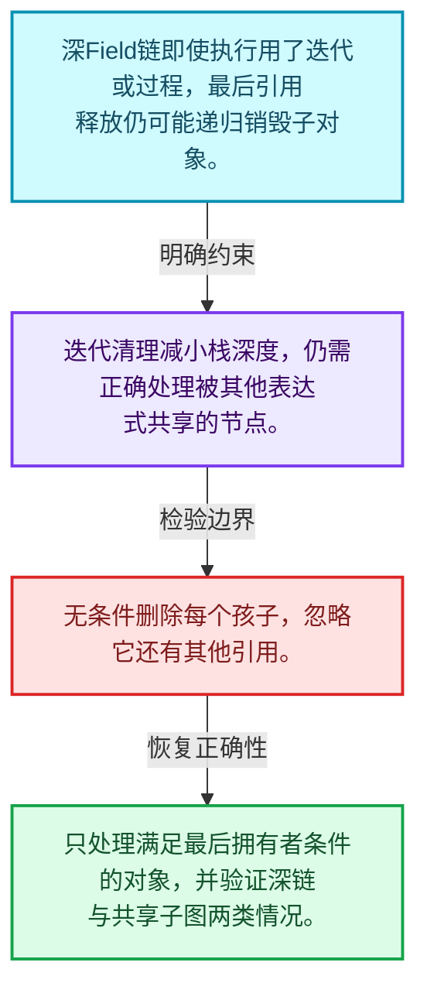
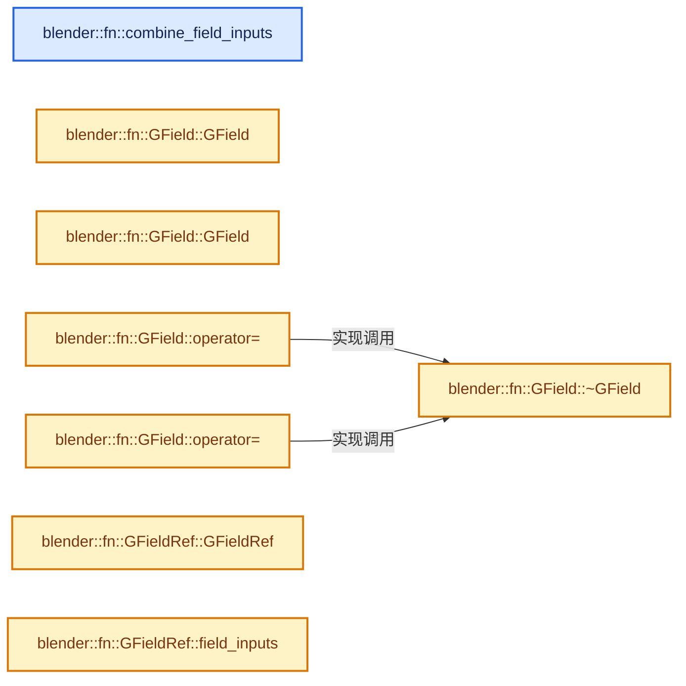
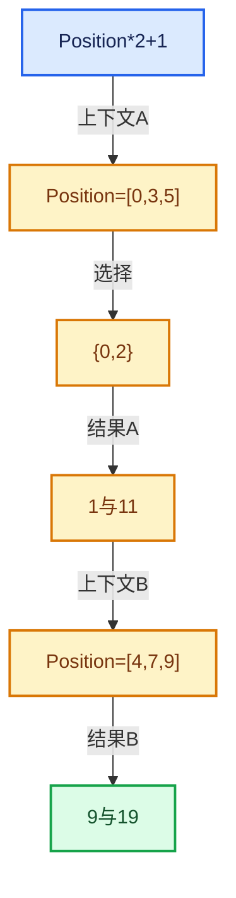

# 08-12 Field重构与深链销毁

[方向导航](README.md) · [总目录](../README.md) · [实现索引](../%E7%AC%A6%E5%8F%B7%E4%BE%9D%E8%B5%96%E4%B8%8E%E5%AE%9E%E7%8E%B0%E7%B4%A2%E5%BC%95.md)

## 从问题到实现

执行结束后为什么析构仍可能溢出调用栈？

长所有权链可让最后引用释放触发递归销毁，迭代释放减少栈深度；执行正确不等于销毁安全。

**数据模型**

深Field链即使执行用了迭代或过程，最后引用释放仍可能递归销毁子对象。

**设计取舍**

迭代清理减小栈深度，仍需正确处理被其他表达式共享的节点。

**最小反例**

无条件删除每个孩子，忽略它还有其他引用。

**推导**

只处理满足最后拥有者条件的对象，并验证深链与共享子图两类情况。

## 阅读地图与执行推演








图中的数值推演是本方向的教学模型；实际函数之间的调用边与概念分析边分别标注，不能把概念关系当作运行时调度顺序。

## 完整源码单元与就地讲解

中文讲解直接放在相关代码旁，复杂机制在代码下展开。原文折叠区保留基准行号；不需要在行号表和函数之间来回查找。类布局可分段展示，函数实现不按固定行数切开。

### 类型布局、声明与编译条件 · field.cc L262—L265

<!-- annotated:ead59c615bb61e -->

```cpp

/**
 * Combine the field inputs from multiple fields. If possible, nothing new is allocated.
 */
```

<details>
<summary>核对原始源码：source/blender/functions/intern/field.cc · L262—L265</summary>

<!-- original:ead59c615bb61e:source/blender/functions/intern/field.cc:262:265 -->

```cpp

/**
 * Combine the field inputs from multiple fields. If possible, nothing new is allocated.
 */
```

</details>

<a id="f-e3c95636989d69b5"></a>

### `blender::fn::combine_field_inputs`

实现位置：[source/blender/functions/intern/field.cc](../../../../../source/blender/functions/intern/field.cc) · L266—L319。

接口参数：

- `const Span<GField> &fields`

**教学注释版**

<!-- annotated:4c35c95454622a -->

```cpp
static FieldInputsPtr combine_field_inputs(const Span<GField> &fields)
{
  /* Try to find an existing #FieldInputsPtr that covers all given fields. */
  bool candidate_valid = true;
  const FieldInputsPtr *candidate = nullptr;
  for (const GField &field : fields) {
    const FieldInputsPtr &field_inputs_ptr = field.field_inputs();
    if (!field_inputs_ptr) {
      continue;
    }
    if (!candidate) {
      candidate = &field_inputs_ptr;
      continue;
    }
    if (field_inputs_ptr == *candidate) {
      continue;
    }
    const FieldInputsPtr *smaller_candidate = candidate;
    const FieldInputsPtr *larger_candidate = &field_inputs_ptr;
    if ((*smaller_candidate)->inputs.size() > (*larger_candidate)->inputs.size()) {
      std::swap(smaller_candidate, larger_candidate);
    }
    /* Check if the smaller candidate is fully contained in the larger one. */
    for (const FieldInput &field_input : (*smaller_candidate)->inputs) {
      if (!(*larger_candidate)->inputs.contains(field_input)) {
        candidate_valid = false;
        break;
      }
    }
    if (!candidate_valid) {
      break;
    }
    candidate = larger_candidate;
  }
  if (candidate_valid) {
    if (candidate) {
      return *candidate;
    }
    return {};
  }
  /* None of the existing #FieldInputs can be reused, create a new #FieldInputs and add all the
   * inputs to it. */
  FieldInputs *new_field_inputs = MEM_new<FieldInputs>(__func__);
  for (const GField &field : fields) {
    const FieldInputsPtr &field_inputs_ptr = field.field_inputs();
    if (!field_inputs_ptr) {
      continue;
    }
    for (const FieldInput &field_input : field_inputs_ptr->inputs) {
      new_field_inputs->inputs.add(field_input);
    }
  }
  return FieldInputsPtr(new_field_inputs);
}
```

<details>
<summary>核对原始源码：source/blender/functions/intern/field.cc · L266—L319</summary>

<!-- original:4c35c95454622a:source/blender/functions/intern/field.cc:266:319 -->

```cpp
static FieldInputsPtr combine_field_inputs(const Span<GField> &fields)
{
  /* Try to find an existing #FieldInputsPtr that covers all given fields. */
  bool candidate_valid = true;
  const FieldInputsPtr *candidate = nullptr;
  for (const GField &field : fields) {
    const FieldInputsPtr &field_inputs_ptr = field.field_inputs();
    if (!field_inputs_ptr) {
      continue;
    }
    if (!candidate) {
      candidate = &field_inputs_ptr;
      continue;
    }
    if (field_inputs_ptr == *candidate) {
      continue;
    }
    const FieldInputsPtr *smaller_candidate = candidate;
    const FieldInputsPtr *larger_candidate = &field_inputs_ptr;
    if ((*smaller_candidate)->inputs.size() > (*larger_candidate)->inputs.size()) {
      std::swap(smaller_candidate, larger_candidate);
    }
    /* Check if the smaller candidate is fully contained in the larger one. */
    for (const FieldInput &field_input : (*smaller_candidate)->inputs) {
      if (!(*larger_candidate)->inputs.contains(field_input)) {
        candidate_valid = false;
        break;
      }
    }
    if (!candidate_valid) {
      break;
    }
    candidate = larger_candidate;
  }
  if (candidate_valid) {
    if (candidate) {
      return *candidate;
    }
    return {};
  }
  /* None of the existing #FieldInputs can be reused, create a new #FieldInputs and add all the
   * inputs to it. */
  FieldInputs *new_field_inputs = MEM_new<FieldInputs>(__func__);
  for (const GField &field : fields) {
    const FieldInputsPtr &field_inputs_ptr = field.field_inputs();
    if (!field_inputs_ptr) {
      continue;
    }
    for (const FieldInput &field_input : field_inputs_ptr->inputs) {
      new_field_inputs->inputs.add(field_input);
    }
  }
  return FieldInputsPtr(new_field_inputs);
}
```

</details>

**沿实际写入检查状态**

- `candidate = &field_inputs_ptr;`
- `candidate_valid = false;`
- `candidate = larger_candidate;`

**结果出口**

- `return *candidate;`
- `return {};`
- `return FieldInputsPtr(new_field_inputs);`

**继续追踪实现**

- `field.field_inputs` → [调用协议](../%E6%A8%A1%E6%9D%BF%E5%AE%8F%E4%B8%8E%E5%8A%A8%E6%80%81%E5%88%86%E6%B4%BE%E5%8D%8F%E8%AE%AE.md)：接收对象类型依赖auto、返回值或模板实例；不按同名猜测目标。调用位置L272。
- `(*smaller_candidate)->inputs.size` → [调用协议](../%E6%A8%A1%E6%9D%BF%E5%AE%8F%E4%B8%8E%E5%8A%A8%E6%80%81%E5%88%86%E6%B4%BE%E5%8D%8F%E8%AE%AE.md)：接收对象类型依赖auto、返回值或模板实例；不按同名猜测目标。调用位置L285。
- `(*larger_candidate)->inputs.size` → [调用协议](../%E6%A8%A1%E6%9D%BF%E5%AE%8F%E4%B8%8E%E5%8A%A8%E6%80%81%E5%88%86%E6%B4%BE%E5%8D%8F%E8%AE%AE.md)：接收对象类型依赖auto、返回值或模板实例；不按同名猜测目标。调用位置L285。
- `std::swap` → [外部契约](https://eel.is/c++draft/)：这个边界按实际表达式及所属类型核对参数、返回值、寿命与失败行为。这里提供接口入口，不声称已解释该第三方版本的内部实现。
- `(*larger_candidate)->inputs.contains` → [调用协议](../%E6%A8%A1%E6%9D%BF%E5%AE%8F%E4%B8%8E%E5%8A%A8%E6%80%81%E5%88%86%E6%B4%BE%E5%8D%8F%E8%AE%AE.md)：接收对象类型依赖auto、返回值或模板实例；不按同名猜测目标。调用位置L290。
- `MEM_new<FieldInputs>` → [MEM_new · L351](../03-%E5%86%85%E5%AD%98%E5%88%86%E9%85%8D%E4%B8%8E%E8%BF%90%E8%A1%8C%E6%97%B6%E7%B1%BB%E5%9E%8B/%E4%BE%9D%E8%B5%96-MEM_guardedalloc-b54eca.md#f-115f9b6784f89912)。
- `new_field_inputs->inputs.add` → [调用协议](../%E6%A8%A1%E6%9D%BF%E5%AE%8F%E4%B8%8E%E5%8A%A8%E6%80%81%E5%88%86%E6%B4%BE%E5%8D%8F%E8%AE%AE.md)：接收对象类型依赖auto、返回值或模板实例；不按同名猜测目标。调用位置L315。
- `FieldInputsPtr` → [调用协议](../%E6%A8%A1%E6%9D%BF%E5%AE%8F%E4%B8%8E%E5%8A%A8%E6%80%81%E5%88%86%E6%B4%BE%E5%8D%8F%E8%AE%AE.md)：函数指针、局部可调用对象或未展开的宏；必须结合调用者环境。调用位置L318。

<!-- annotated:bad3a9132ea3e2 -->

```cpp

```

<details>
<summary>核对原始源码：source/blender/functions/intern/field.cc · L320—L320</summary>

<!-- original:bad3a9132ea3e2:source/blender/functions/intern/field.cc:320:320 -->

```cpp

```

</details>

<a id="f-7865e4089df6225d"></a>

### `blender::fn::GField::GField`

实现位置：[source/blender/functions/intern/field.cc](../../../../../source/blender/functions/intern/field.cc) · L321—L333。

接口参数：

- `const GField &other`

**教学注释版**

<!-- annotated:93cd14a1d629bb -->

```cpp
GField::GField(const GField &other) : variant_(other.variant_)
{
  // [讲解] std::visit：按variant当前活动分支调用访客；所有候选分支的类型要求需满足，不能读取非活动分支的对象表示。
  std::visit(
      [&]<typename T>(T &v) {
        if constexpr (std::is_same_v<T, OwnedConstant>) {
          // [讲解] MEM_new_uninitialized_aligned：把公开MEM分配接口转交给当前选择的对齐分配后端。
          void *new_value = MEM_new_uninitialized_aligned(
              v.type->size, v.type->alignment, "GField::GField()");
          v.type->copy_construct(v.value, new_value);
          v.value = new_value;
        }
      },
      variant_);
}
```

<details>
<summary>核对原始源码：source/blender/functions/intern/field.cc · L321—L333</summary>

<!-- original:93cd14a1d629bb:source/blender/functions/intern/field.cc:321:333 -->

```cpp
GField::GField(const GField &other) : variant_(other.variant_)
{
  std::visit(
      [&]<typename T>(T &v) {
        if constexpr (std::is_same_v<T, OwnedConstant>) {
          void *new_value = MEM_new_uninitialized_aligned(
              v.type->size, v.type->alignment, "GField::GField()");
          v.type->copy_construct(v.value, new_value);
          v.value = new_value;
        }
      },
      variant_);
}
```

</details>

**沿实际写入检查状态**

- `v.value = new_value;`

**继续追踪实现**

- `std::visit` → [外部契约](https://eel.is/c++draft/variant.visit)：按variant当前活动分支调用访客；所有候选分支的类型要求需满足，不能读取非活动分支的对象表示。
- `MEM_new_uninitialized_aligned` → [MEM_new_uninitialized_aligned · L134](../03-%E5%86%85%E5%AD%98%E5%88%86%E9%85%8D%E4%B8%8E%E8%BF%90%E8%A1%8C%E6%97%B6%E7%B1%BB%E5%9E%8B/%E4%BE%9D%E8%B5%96-mallocn-afdcd4.md#f-9f3d21bd7da93c68)。
- `v.type->copy_construct` → [调用协议](../%E6%A8%A1%E6%9D%BF%E5%AE%8F%E4%B8%8E%E5%8A%A8%E6%80%81%E5%88%86%E6%B4%BE%E5%8D%8F%E8%AE%AE.md)：接收对象类型依赖auto、返回值或模板实例；不按同名猜测目标。调用位置L328。

<!-- annotated:7069e465f634fe -->

```cpp

```

<details>
<summary>核对原始源码：source/blender/functions/intern/field.cc · L334—L334</summary>

<!-- original:7069e465f634fe:source/blender/functions/intern/field.cc:334:334 -->

```cpp

```

</details>

<a id="f-438a60155477a30a"></a>

### `blender::fn::GField::GField`

实现位置：[source/blender/functions/intern/field.cc](../../../../../source/blender/functions/intern/field.cc) · L335—L339。

接口参数：

- `GField &&other`

**教学注释版**

<!-- annotated:560148f90f0384 -->

```cpp
GField::GField(GField &&other) noexcept : variant_(std::move(other.variant_))
{
  // [讲解] this->cpp_type：取得表达式结果的类型信息。
  const CPPType &type = this->cpp_type();
  other.variant_ = ConstantRef{&type, type.default_value()};
}
```

<details>
<summary>核对原始源码：source/blender/functions/intern/field.cc · L335—L339</summary>

<!-- original:560148f90f0384:source/blender/functions/intern/field.cc:335:339 -->

```cpp
GField::GField(GField &&other) noexcept : variant_(std::move(other.variant_))
{
  const CPPType &type = this->cpp_type();
  other.variant_ = ConstantRef{&type, type.default_value()};
}
```

</details>

**沿实际写入检查状态**

- `other.variant_ = ConstantRef{&type, type.default_value()};`

**继续追踪实现**

- `this->cpp_type` → [blender::fn::GField::cpp_type · L518](05-FieldOperation%E8%BF%90%E7%AE%97%E8%8A%82%E7%82%B9.md#f-284e6a7a85c0110e)。
- `type.default_value` → [blender::CPPType::default_value · L743](../03-%E5%86%85%E5%AD%98%E5%88%86%E9%85%8D%E4%B8%8E%E8%BF%90%E8%A1%8C%E6%97%B6%E7%B1%BB%E5%9E%8B/09-CPPType%E5%A4%8D%E5%88%B6%E7%A7%BB%E5%8A%A8%E9%87%8D%E5%AE%9A%E4%BD%8D.md#f-95e76cbe74b383e8)。

<!-- annotated:78d876a346a62c -->

```cpp

```

<details>
<summary>核对原始源码：source/blender/functions/intern/field.cc · L340—L340</summary>

<!-- original:78d876a346a62c:source/blender/functions/intern/field.cc:340:340 -->

```cpp

```

</details>

<a id="f-3df228f92ead9063"></a>

### `blender::fn::GField::operator=`

实现位置：[source/blender/functions/intern/field.cc](../../../../../source/blender/functions/intern/field.cc) · L341—L349。

接口参数：

- `const GField &other`

**教学注释版**

<!-- annotated:62e1b72781185e -->

```cpp
GField &GField::operator=(const GField &other)
{
  if (this == &other) {
    return *this;
  }
  this->~GField();
  new (this) GField(other);
  return *this;
}
```

<details>
<summary>核对原始源码：source/blender/functions/intern/field.cc · L341—L349</summary>

<!-- original:62e1b72781185e:source/blender/functions/intern/field.cc:341:349 -->

```cpp
GField &GField::operator=(const GField &other)
{
  if (this == &other) {
    return *this;
  }
  this->~GField();
  new (this) GField(other);
  return *this;
}
```

</details>

**结果出口**

- `return *this;`

**继续追踪实现**

- `this->~GField` → [blender::fn::GField::~GField · L361](12-Field%E9%87%8D%E6%9E%84%E4%B8%8E%E6%B7%B1%E9%93%BE%E9%94%80%E6%AF%81.md#f-d51153b40c92ce28)。

<!-- annotated:55d5f3ff233ba1 -->

```cpp

```

<details>
<summary>核对原始源码：source/blender/functions/intern/field.cc · L350—L350</summary>

<!-- original:55d5f3ff233ba1:source/blender/functions/intern/field.cc:350:350 -->

```cpp

```

</details>

<a id="f-564659b6cae76dc2"></a>

### `blender::fn::GField::operator=`

实现位置：[source/blender/functions/intern/field.cc](../../../../../source/blender/functions/intern/field.cc) · L351—L359。

接口参数：

- `GField &&other`

**教学注释版**

<!-- annotated:e51f8eedf6fcbc -->

```cpp
GField &GField::operator=(GField &&other) noexcept
{
  if (this == &other) {
    return *this;
  }
  this->~GField();
  // [讲解] std::move：把表达式转换成可供移动重载选择的值类别；不保证真的移动，不结束源对象寿命，对const值可能选择复制。
  new (this) GField(std::move(other));
  return *this;
}
```

<details>
<summary>核对原始源码：source/blender/functions/intern/field.cc · L351—L359</summary>

<!-- original:e51f8eedf6fcbc:source/blender/functions/intern/field.cc:351:359 -->

```cpp
GField &GField::operator=(GField &&other) noexcept
{
  if (this == &other) {
    return *this;
  }
  this->~GField();
  new (this) GField(std::move(other));
  return *this;
}
```

</details>

**结果出口**

- `return *this;`

**继续追踪实现**

- `this->~GField` → [blender::fn::GField::~GField · L361](12-Field%E9%87%8D%E6%9E%84%E4%B8%8E%E6%B7%B1%E9%93%BE%E9%94%80%E6%AF%81.md#f-d51153b40c92ce28)。
- `std::move` → [外部契约](https://eel.is/c++draft/utility.forward)：把表达式转换成可供移动重载选择的值类别；不保证真的移动，不结束源对象寿命，对const值可能选择复制。

<!-- annotated:30d51f4d1d7a49 -->

```cpp

```

<details>
<summary>核对原始源码：source/blender/functions/intern/field.cc · L360—L360</summary>

<!-- original:30d51f4d1d7a49:source/blender/functions/intern/field.cc:360:360 -->

```cpp

```

</details>

<a id="f-d51153b40c92ce28"></a>

### `blender::fn::GField::~GField`

实现位置：[source/blender/functions/intern/field.cc](../../../../../source/blender/functions/intern/field.cc) · L361—L371。

**教学注释版**

<!-- annotated:1c854df39efc35 -->

```cpp
GField::~GField()
{
  // [讲解] std::visit：按variant当前活动分支调用访客；所有候选分支的类型要求需满足，不能读取非活动分支的对象表示。
  std::visit(
      [&]<typename T>(T &v) {
        if constexpr (std::is_same_v<T, OwnedConstant>) {
          v.type->destruct(v.value);
          // [讲解] MEM_delete_void：以原始存储释放约定调用当前后端。
          MEM_delete_void(v.value);
        }
      },
      variant_);
}
```

<details>
<summary>核对原始源码：source/blender/functions/intern/field.cc · L361—L371</summary>

<!-- original:1c854df39efc35:source/blender/functions/intern/field.cc:361:371 -->

```cpp
GField::~GField()
{
  std::visit(
      [&]<typename T>(T &v) {
        if constexpr (std::is_same_v<T, OwnedConstant>) {
          v.type->destruct(v.value);
          MEM_delete_void(v.value);
        }
      },
      variant_);
}
```

</details>

**继续追踪实现**

- `std::visit` → [外部契约](https://eel.is/c++draft/variant.visit)：按variant当前活动分支调用访客；所有候选分支的类型要求需满足，不能读取非活动分支的对象表示。
- `v.type->destruct` → [调用协议](../%E6%A8%A1%E6%9D%BF%E5%AE%8F%E4%B8%8E%E5%8A%A8%E6%80%81%E5%88%86%E6%B4%BE%E5%8D%8F%E8%AE%AE.md)：接收对象类型依赖auto、返回值或模板实例；不按同名猜测目标。调用位置L366。
- `MEM_delete_void` → [MEM_delete_void · L647](../03-%E5%86%85%E5%AD%98%E5%88%86%E9%85%8D%E4%B8%8E%E8%BF%90%E8%A1%8C%E6%97%B6%E7%B1%BB%E5%9E%8B/%E4%BE%9D%E8%B5%96-MEM_guardedalloc-b54eca.md#f-642896c7c62ff8b9)；[MEM_delete_void · L109](../03-%E5%86%85%E5%AD%98%E5%88%86%E9%85%8D%E4%B8%8E%E8%BF%90%E8%A1%8C%E6%97%B6%E7%B1%BB%E5%9E%8B/%E4%BE%9D%E8%B5%96-mallocn-afdcd4.md#f-9a07b26421f2bee6)。同名重载需按实参类型选择。

<!-- annotated:71e63ae273b7a8 -->

```cpp

```

<details>
<summary>核对原始源码：source/blender/functions/intern/field.cc · L372—L372</summary>

<!-- original:71e63ae273b7a8:source/blender/functions/intern/field.cc:372:372 -->

```cpp

```

</details>

<a id="f-bf79fe01c354a749"></a>

### `blender::fn::GFieldRef::GFieldRef`

实现位置：[source/blender/functions/intern/field.cc](../../../../../source/blender/functions/intern/field.cc) · L373—L396。

接口参数：

- `const GField &field`

**教学注释版**

<!-- annotated:a82113bb610da2 -->

```cpp
GFieldRef::GFieldRef(const GField &field)
    : variant_(std::visit(
          []<typename T>(const T &v) -> Variant {
            if constexpr (std::is_same_v<T, GField::Input>) {
              return Input{v.node.get()};
            }
            else if constexpr (std::is_same_v<T, GField::MultiFn>) {
              return MultiFn{v.node.get(), v.output_i};
            }
            else if constexpr (std::is_same_v<T, GField::FieldRef>) {
              /* Should not exist due to #deref_field_ref. */
              BLI_assert_unreachable();
              return Value{};
            }
            else if constexpr (GField::is_constant_value_v<T>) {
              return Value{v.type, v.value};
            }
            else {
              BLI_assert_unreachable_static_t(T);
            }
          },
          field.deref_field_ref().variant()))
{
}
```

<details>
<summary>核对原始源码：source/blender/functions/intern/field.cc · L373—L396</summary>

<!-- original:a82113bb610da2:source/blender/functions/intern/field.cc:373:396 -->

```cpp
GFieldRef::GFieldRef(const GField &field)
    : variant_(std::visit(
          []<typename T>(const T &v) -> Variant {
            if constexpr (std::is_same_v<T, GField::Input>) {
              return Input{v.node.get()};
            }
            else if constexpr (std::is_same_v<T, GField::MultiFn>) {
              return MultiFn{v.node.get(), v.output_i};
            }
            else if constexpr (std::is_same_v<T, GField::FieldRef>) {
              /* Should not exist due to #deref_field_ref. */
              BLI_assert_unreachable();
              return Value{};
            }
            else if constexpr (GField::is_constant_value_v<T>) {
              return Value{v.type, v.value};
            }
            else {
              BLI_assert_unreachable_static_t(T);
            }
          },
          field.deref_field_ref().variant()))
{
}
```

</details>

**继续追踪实现**

本实现没有需要继续展开的显式调用；检查返回表达式、对象转换和调用者前置条件。

<!-- annotated:bbe229d0c09ea9 -->

```cpp

```

<details>
<summary>核对原始源码：source/blender/functions/intern/field.cc · L397—L397</summary>

<!-- original:bbe229d0c09ea9:source/blender/functions/intern/field.cc:397:397 -->

```cpp

```

</details>

<a id="f-c3fc23bad9cfc7fe"></a>

### `blender::fn::GFieldRef::field_inputs`

实现位置：[source/blender/functions/intern/field.cc](../../../../../source/blender/functions/intern/field.cc) · L398—L417。

**教学注释版**

<!-- annotated:c15ee5c23b1619 -->

```cpp
const FieldInputsPtr &GFieldRef::field_inputs() const
{
  static const ImplicitSharingPtr<FieldInputs> empty_inputs;
  // [讲解] std::visit：按variant当前活动分支调用访客；所有候选分支的类型要求需满足，不能读取非活动分支的对象表示。
  return std::visit(
      [&]<typename T>(const T &v) -> const FieldInputsPtr & {
        if constexpr (std::is_same_v<T, Input>) {
          return v.node->field_inputs();
        }
        else if constexpr (std::is_same_v<T, MultiFn>) {
          return v.node->field_inputs();
        }
        else if constexpr (std::is_same_v<T, Value>) {
          return empty_inputs;
        }
        else {
          BLI_assert_unreachable_static_t(T);
        }
      },
      variant_);
}
```

<details>
<summary>核对原始源码：source/blender/functions/intern/field.cc · L398—L417</summary>

<!-- original:c15ee5c23b1619:source/blender/functions/intern/field.cc:398:417 -->

```cpp
const FieldInputsPtr &GFieldRef::field_inputs() const
{
  static const ImplicitSharingPtr<FieldInputs> empty_inputs;
  return std::visit(
      [&]<typename T>(const T &v) -> const FieldInputsPtr & {
        if constexpr (std::is_same_v<T, Input>) {
          return v.node->field_inputs();
        }
        else if constexpr (std::is_same_v<T, MultiFn>) {
          return v.node->field_inputs();
        }
        else if constexpr (std::is_same_v<T, Value>) {
          return empty_inputs;
        }
        else {
          BLI_assert_unreachable_static_t(T);
        }
      },
      variant_);
}
```

</details>

**结果出口**

- `return std::visit(`
- `return v.node->field_inputs();`
- `return empty_inputs;`

**继续追踪实现**

- `std::visit` → [外部契约](https://eel.is/c++draft/variant.visit)：按variant当前活动分支调用访客；所有候选分支的类型要求需满足，不能读取非活动分支的对象表示。
- `v.node->field_inputs` → [调用协议](../%E6%A8%A1%E6%9D%BF%E5%AE%8F%E4%B8%8E%E5%8A%A8%E6%80%81%E5%88%86%E6%B4%BE%E5%8D%8F%E8%AE%AE.md)：接收对象类型依赖auto、返回值或模板实例；不按同名猜测目标。调用位置L404。
- `BLI_assert_unreachable_static_t` → [BLI_assert_unreachable_static_t · L99](../01-%E5%9F%BA%E7%A1%80%E5%AE%B9%E5%99%A8%E4%B8%8E%E7%8E%B0%E4%BB%A3CPP/%E4%BE%9D%E8%B5%96-BLI_assert-cc98e8.md#m-368120c7952b)。宏定义由构建条件选择。

<!-- annotated:abcca6b15c5b3c -->

```cpp

```

<details>
<summary>核对原始源码：source/blender/functions/intern/field.cc · L418—L418</summary>

<!-- original:abcca6b15c5b3c:source/blender/functions/intern/field.cc:418:418 -->

```cpp

```

</details>

<a id="f-48f533c3482a0140"></a>

### `blender::fn::operator==`

实现位置：[source/blender/functions/intern/field.cc](../../../../../source/blender/functions/intern/field.cc) · L419—L454。

接口参数：

- `const GFieldRef &a`
- `const GFieldRef &b`

**教学注释版**

<!-- annotated:9693222e9accad -->

```cpp
bool operator==(const GFieldRef &a, const GFieldRef &b)
{
  // [讲解] std::visit：按variant当前活动分支调用访客；所有候选分支的类型要求需满足，不能读取非活动分支的对象表示。
  return std::visit(
      [&]<typename T>(const T &v_a) -> bool {
        if constexpr (std::is_same_v<T, GFieldRef::Value>) {
          if (const auto *v_b = std::get_if<GFieldRef::Value>(&b.variant())) {
            if (v_a.type != v_b->type) {
              return false;
            }
            if (v_a.value == v_b->value) {
              /* This may return true even if the values don't compare equal, e.g. due to NaN
               * values. */
              return true;
            }
            return v_a.type->is_equal_or_false(v_a.value, v_b->value);
          }
          return false;
        }
        else if constexpr (std::is_same_v<T, GFieldRef::Input>) {
          if (const auto *v_b = std::get_if<GFieldRef::Input>(&b.variant())) {
            return v_a.node == v_b->node;
          }
          return false;
        }
        else if constexpr (std::is_same_v<T, GFieldRef::MultiFn>) {
          if (const auto *v_b = std::get_if<GFieldRef::MultiFn>(&b.variant())) {
            return v_a.node == v_b->node && v_a.output_i == v_b->output_i;
          }
          return false;
        }
        else {
          BLI_assert_unreachable_static_t(T);
        }
      },
      a.variant());
}
```

<details>
<summary>核对原始源码：source/blender/functions/intern/field.cc · L419—L454</summary>

<!-- original:9693222e9accad:source/blender/functions/intern/field.cc:419:454 -->

```cpp
bool operator==(const GFieldRef &a, const GFieldRef &b)
{
  return std::visit(
      [&]<typename T>(const T &v_a) -> bool {
        if constexpr (std::is_same_v<T, GFieldRef::Value>) {
          if (const auto *v_b = std::get_if<GFieldRef::Value>(&b.variant())) {
            if (v_a.type != v_b->type) {
              return false;
            }
            if (v_a.value == v_b->value) {
              /* This may return true even if the values don't compare equal, e.g. due to NaN
               * values. */
              return true;
            }
            return v_a.type->is_equal_or_false(v_a.value, v_b->value);
          }
          return false;
        }
        else if constexpr (std::is_same_v<T, GFieldRef::Input>) {
          if (const auto *v_b = std::get_if<GFieldRef::Input>(&b.variant())) {
            return v_a.node == v_b->node;
          }
          return false;
        }
        else if constexpr (std::is_same_v<T, GFieldRef::MultiFn>) {
          if (const auto *v_b = std::get_if<GFieldRef::MultiFn>(&b.variant())) {
            return v_a.node == v_b->node && v_a.output_i == v_b->output_i;
          }
          return false;
        }
        else {
          BLI_assert_unreachable_static_t(T);
        }
      },
      a.variant());
}
```

</details>

**结果出口**

- `return std::visit(`
- `return false;`
- `return true;`
- `return v_a.type->is_equal_or_false(v_a.value, v_b->value);`
- `return v_a.node == v_b->node;`
- `return v_a.node == v_b->node && v_a.output_i == v_b->output_i;`

**继续追踪实现**

- `std::visit` → [外部契约](https://eel.is/c++draft/variant.visit)：按variant当前活动分支调用访客；所有候选分支的类型要求需满足，不能读取非活动分支的对象表示。
- `std::get_if<GFieldRef::Value>` → [外部契约](https://eel.is/c++draft/)：这个边界按实际表达式及所属类型核对参数、返回值、寿命与失败行为。这里提供接口入口，不声称已解释该第三方版本的内部实现。
- `b.variant` → [blender::fn::GFieldRef::variant · L678](05-FieldOperation%E8%BF%90%E7%AE%97%E8%8A%82%E7%82%B9.md#f-0658bc405899b72d)。
- `v_a.type->is_equal_or_false` → [调用协议](../%E6%A8%A1%E6%9D%BF%E5%AE%8F%E4%B8%8E%E5%8A%A8%E6%80%81%E5%88%86%E6%B4%BE%E5%8D%8F%E8%AE%AE.md)：接收对象类型依赖auto、返回值或模板实例；不按同名猜测目标。调用位置L433。
- `std::get_if<GFieldRef::Input>` → [外部契约](https://eel.is/c++draft/)：这个边界按实际表达式及所属类型核对参数、返回值、寿命与失败行为。这里提供接口入口，不声称已解释该第三方版本的内部实现。
- `std::get_if<GFieldRef::MultiFn>` → [外部契约](https://eel.is/c++draft/)：这个边界按实际表达式及所属类型核对参数、返回值、寿命与失败行为。这里提供接口入口，不声称已解释该第三方版本的内部实现。
- `BLI_assert_unreachable_static_t` → [BLI_assert_unreachable_static_t · L99](../01-%E5%9F%BA%E7%A1%80%E5%AE%B9%E5%99%A8%E4%B8%8E%E7%8E%B0%E4%BB%A3CPP/%E4%BE%9D%E8%B5%96-BLI_assert-cc98e8.md#m-368120c7952b)。宏定义由构建条件选择。
- `a.variant` → [blender::fn::GFieldRef::variant · L678](05-FieldOperation%E8%BF%90%E7%AE%97%E8%8A%82%E7%82%B9.md#f-0658bc405899b72d)。

<!-- annotated:264f9760da7ec3 -->

```cpp

```

<details>
<summary>核对原始源码：source/blender/functions/intern/field.cc · L455—L455</summary>

<!-- original:264f9760da7ec3:source/blender/functions/intern/field.cc:455:455 -->

```cpp

```

</details>

<a id="f-44e86c2115ad8061"></a>

### `blender::fn::GFieldRef::hash`

实现位置：[source/blender/functions/intern/field.cc](../../../../../source/blender/functions/intern/field.cc) · L456—L474。

**教学注释版**

<!-- annotated:573e18f3571762 -->

```cpp
uint64_t GFieldRef::hash() const
{
  // [讲解] std::visit：按variant当前活动分支调用访客；所有候选分支的类型要求需满足，不能读取非活动分支的对象表示。
  return std::visit(
      [&]<typename T>(const T &v) -> uint64_t {
        if constexpr (std::is_same_v<T, Value>) {
          return v.type->hash_or_fallback(v.value, uint64_t(v.type));
        }
        else if constexpr (std::is_same_v<T, Input>) {
          return get_default_hash(v.node);
        }
        else if constexpr (std::is_same_v<T, MultiFn>) {
          return get_default_hash(v.node, v.output_i);
        }
        else {
          BLI_assert_unreachable_static_t(T);
        }
      },
      variant_);
}
```

<details>
<summary>核对原始源码：source/blender/functions/intern/field.cc · L456—L474</summary>

<!-- original:573e18f3571762:source/blender/functions/intern/field.cc:456:474 -->

```cpp
uint64_t GFieldRef::hash() const
{
  return std::visit(
      [&]<typename T>(const T &v) -> uint64_t {
        if constexpr (std::is_same_v<T, Value>) {
          return v.type->hash_or_fallback(v.value, uint64_t(v.type));
        }
        else if constexpr (std::is_same_v<T, Input>) {
          return get_default_hash(v.node);
        }
        else if constexpr (std::is_same_v<T, MultiFn>) {
          return get_default_hash(v.node, v.output_i);
        }
        else {
          BLI_assert_unreachable_static_t(T);
        }
      },
      variant_);
}
```

</details>

**结果出口**

- `return std::visit(`
- `return v.type->hash_or_fallback(v.value, uint64_t(v.type));`
- `return get_default_hash(v.node);`
- `return get_default_hash(v.node, v.output_i);`

**继续追踪实现**

- `std::visit` → [外部契约](https://eel.is/c++draft/variant.visit)：按variant当前活动分支调用访客；所有候选分支的类型要求需满足，不能读取非活动分支的对象表示。
- `v.type->hash_or_fallback` → [调用协议](../%E6%A8%A1%E6%9D%BF%E5%AE%8F%E4%B8%8E%E5%8A%A8%E6%80%81%E5%88%86%E6%B4%BE%E5%8D%8F%E8%AE%AE.md)：接收对象类型依赖auto、返回值或模板实例；不按同名猜测目标。调用位置L461。
- `get_default_hash` → [blender::get_default_hash · L251](../02-%E5%93%88%E5%B8%8C%E8%A1%A8%E4%B8%8E%E5%85%B3%E8%81%94%E6%95%B0%E6%8D%AE%E7%BB%93%E6%9E%84/01-%E5%93%88%E5%B8%8C%E4%B8%8E%E7%9B%B8%E7%AD%89%E5%A5%91%E7%BA%A6.md#f-5f2c246aedf3dc0a)。
- `BLI_assert_unreachable_static_t` → [BLI_assert_unreachable_static_t · L99](../01-%E5%9F%BA%E7%A1%80%E5%AE%B9%E5%99%A8%E4%B8%8E%E7%8E%B0%E4%BB%A3CPP/%E4%BE%9D%E8%B5%96-BLI_assert-cc98e8.md#m-368120c7952b)。宏定义由构建条件选择。

<!-- annotated:e94b6834f12ed1 -->

```cpp

```

<details>
<summary>核对原始源码：source/blender/functions/intern/field.cc · L475—L475</summary>

<!-- original:e94b6834f12ed1:source/blender/functions/intern/field.cc:475:475 -->

```cpp

```

</details>

<a id="f-a39185e5acb73d6c"></a>

### `blender::fn::FieldOperation::FieldOperation`

实现位置：[source/blender/functions/intern/field.cc](../../../../../source/blender/functions/intern/field.cc) · L476—L480。

接口参数：

- `std::shared_ptr<const mf::MultiFunction> fn`
- `Vector<GField> inputs`

**教学注释版**

<!-- annotated:9a80b637e4777a -->

```cpp
FieldOperation::FieldOperation(std::shared_ptr<const mf::MultiFunction> fn, Vector<GField> inputs)
    : FieldOperation(*fn, std::move(inputs))
{
  // [讲解] std::move：把表达式转换成可供移动重载选择的值类别；不保证真的移动，不结束源对象寿命，对const值可能选择复制。
  owned_fn_ = std::move(fn);
}
```

<details>
<summary>核对原始源码：source/blender/functions/intern/field.cc · L476—L480</summary>

<!-- original:9a80b637e4777a:source/blender/functions/intern/field.cc:476:480 -->

```cpp
FieldOperation::FieldOperation(std::shared_ptr<const mf::MultiFunction> fn, Vector<GField> inputs)
    : FieldOperation(*fn, std::move(inputs))
{
  owned_fn_ = std::move(fn);
}
```

</details>

**沿实际写入检查状态**

- `owned_fn_ = std::move(fn);`

**继续追踪实现**

- `std::move` → [外部契约](https://eel.is/c++draft/utility.forward)：把表达式转换成可供移动重载选择的值类别；不保证真的移动，不结束源对象寿命，对const值可能选择复制。

<!-- annotated:4d0f9b279ff6a7 -->

```cpp

```

<details>
<summary>核对原始源码：source/blender/functions/intern/field.cc · L481—L481</summary>

<!-- original:4d0f9b279ff6a7:source/blender/functions/intern/field.cc:481:481 -->

```cpp

```

</details>

<a id="f-3b98c1949fb839b3"></a>

### `blender::fn::FieldOperation::FieldOperation`

实现位置：[source/blender/functions/intern/field.cc](../../../../../source/blender/functions/intern/field.cc) · L482—L486。

接口参数：

- `const mf::MultiFunction &fn`
- `Vector<GField> inputs`

**教学注释版**

<!-- annotated:b68feda5a03c8c -->

```cpp
FieldOperation::FieldOperation(const mf::MultiFunction &fn, Vector<GField> inputs)
    : inputs_(inputs), fn_(&fn)
{
  field_inputs_ = combine_field_inputs(inputs_);
}
```

<details>
<summary>核对原始源码：source/blender/functions/intern/field.cc · L482—L486</summary>

<!-- original:b68feda5a03c8c:source/blender/functions/intern/field.cc:482:486 -->

```cpp
FieldOperation::FieldOperation(const mf::MultiFunction &fn, Vector<GField> inputs)
    : inputs_(inputs), fn_(&fn)
{
  field_inputs_ = combine_field_inputs(inputs_);
}
```

</details>

**沿实际写入检查状态**

- `field_inputs_ = combine_field_inputs(inputs_);`

**继续追踪实现**

- `combine_field_inputs` → [blender::fn::combine_field_inputs · L266](12-Field%E9%87%8D%E6%9E%84%E4%B8%8E%E6%B7%B1%E9%93%BE%E9%94%80%E6%AF%81.md#f-e3c95636989d69b5)。

<!-- annotated:2a8623f3b2d085 -->

```cpp

```

<details>
<summary>核对原始源码：source/blender/functions/intern/field.cc · L487—L487</summary>

<!-- original:2a8623f3b2d085:source/blender/functions/intern/field.cc:487:487 -->

```cpp

```

</details>

<a id="f-d8a0515a193d6e7c"></a>

### `blender::fn::FieldOperation::output_cpp_type`

实现位置：[source/blender/functions/intern/field.cc](../../../../../source/blender/functions/intern/field.cc) · L488—L502。

接口参数：

- `const int output_i`

**教学注释版**

<!-- annotated:2a82a0246f09d1 -->

```cpp
const CPPType &FieldOperation::output_cpp_type(const int output_i) const
{
  int count = 0;
  for (const int param_index : fn_->param_indices()) {
    const mf::ParamType param_type = fn_->param_type(param_index);
    if (param_type.is_output()) {
      if (count == output_i) {
        return param_type.data_type().single_type();
      }
      count++;
    }
  }
  BLI_assert_unreachable();
  return CPPType::get<float>();
}
```

<details>
<summary>核对原始源码：source/blender/functions/intern/field.cc · L488—L502</summary>

<!-- original:2a82a0246f09d1:source/blender/functions/intern/field.cc:488:502 -->

```cpp
const CPPType &FieldOperation::output_cpp_type(const int output_i) const
{
  int count = 0;
  for (const int param_index : fn_->param_indices()) {
    const mf::ParamType param_type = fn_->param_type(param_index);
    if (param_type.is_output()) {
      if (count == output_i) {
        return param_type.data_type().single_type();
      }
      count++;
    }
  }
  BLI_assert_unreachable();
  return CPPType::get<float>();
}
```

</details>

**结果出口**

- `return param_type.data_type().single_type();`
- `return CPPType::get<float>();`

**继续追踪实现**

- `fn_->param_indices` → [调用协议](../%E6%A8%A1%E6%9D%BF%E5%AE%8F%E4%B8%8E%E5%8A%A8%E6%80%81%E5%88%86%E6%B4%BE%E5%8D%8F%E8%AE%AE.md)：接收对象类型依赖auto、返回值或模板实例；不按同名猜测目标。调用位置L491。
- `fn_->param_type` → [调用协议](../%E6%A8%A1%E6%9D%BF%E5%AE%8F%E4%B8%8E%E5%8A%A8%E6%80%81%E5%88%86%E6%B4%BE%E5%8D%8F%E8%AE%AE.md)：接收对象类型依赖auto、返回值或模板实例；不按同名猜测目标。调用位置L492。
- `param_type.is_output` → [blender::fn::multi_function::ParamType::is_output · L163](../07-MultiFunction%E4%B8%8E%E6%89%B9%E9%87%8F%E6%89%A7%E8%A1%8C/03-%E5%8F%82%E6%95%B0%E7%B1%BB%E5%9E%8B%E4%B8%8E%E8%A7%92%E8%89%B2.md#f-fd8eda039a304162)。
- `param_type.data_type().single_type` → [调用协议](../%E6%A8%A1%E6%9D%BF%E5%AE%8F%E4%B8%8E%E5%8A%A8%E6%80%81%E5%88%86%E6%B4%BE%E5%8D%8F%E8%AE%AE.md)：接收对象类型依赖auto、返回值或模板实例；不按同名猜测目标。调用位置L495。
- `param_type.data_type` → [blender::fn::multi_function::ParamType::data_type · L113](../07-MultiFunction%E4%B8%8E%E6%89%B9%E9%87%8F%E6%89%A7%E8%A1%8C/03-%E5%8F%82%E6%95%B0%E7%B1%BB%E5%9E%8B%E4%B8%8E%E8%A7%92%E8%89%B2.md#f-b29743877463338d)。
- `BLI_assert_unreachable` → [BLI_assert_unreachable · L77](../01-%E5%9F%BA%E7%A1%80%E5%AE%B9%E5%99%A8%E4%B8%8E%E7%8E%B0%E4%BB%A3CPP/%E4%BE%9D%E8%B5%96-BLI_assert-cc98e8.md#m-7a2d91a67d8e)。宏定义由构建条件选择。
- `CPPType::get<float>` → [blender::CPPType::get · L481](../03-%E5%86%85%E5%AD%98%E5%88%86%E9%85%8D%E4%B8%8E%E8%BF%90%E8%A1%8C%E6%97%B6%E7%B1%BB%E5%9E%8B/08-CPPType%E6%9E%84%E9%80%A0%E4%B8%8E%E6%9E%90%E6%9E%84.md#f-0cc10a3783d6abdb)。

<!-- annotated:e4121dc8d085c8 -->

```cpp

```

<details>
<summary>核对原始源码：source/blender/functions/intern/field.cc · L503—L503</summary>

<!-- original:e4121dc8d085c8:source/blender/functions/intern/field.cc:503:503 -->

```cpp

```

</details>

<a id="f-38d3beaa39d9b6e4"></a>

### `blender::fn::GField::field_inputs`

实现位置：[source/blender/functions/intern/field.cc](../../../../../source/blender/functions/intern/field.cc) · L504—L523。

**教学注释版**

<!-- annotated:703eadb968d377 -->

```cpp
const FieldInputsPtr &GField::field_inputs() const
{
  static const ImplicitSharingPtr<FieldInputs> empty_inputs;
  // [讲解] std::visit：按variant当前活动分支调用访客；所有候选分支的类型要求需满足，不能读取非活动分支的对象表示。
  return std::visit(
      []<typename T>(const T &v) -> const FieldInputsPtr & {
        if constexpr (is_same_any_v<T, Input, MultiFn>) {
          return v.node->field_inputs();
        }
        else if constexpr (std::is_same_v<T, FieldRef>) {
          return v.field_ref->field_inputs();
        }
        else if constexpr (is_same_any_v<T, ConstantRef, TrivialInlineConstant, OwnedConstant>) {
          return empty_inputs;
        }
        else {
          BLI_assert_unreachable_static_t(T);
        }
      },
      this->variant_);
}
```

<details>
<summary>核对原始源码：source/blender/functions/intern/field.cc · L504—L523</summary>

<!-- original:703eadb968d377:source/blender/functions/intern/field.cc:504:523 -->

```cpp
const FieldInputsPtr &GField::field_inputs() const
{
  static const ImplicitSharingPtr<FieldInputs> empty_inputs;
  return std::visit(
      []<typename T>(const T &v) -> const FieldInputsPtr & {
        if constexpr (is_same_any_v<T, Input, MultiFn>) {
          return v.node->field_inputs();
        }
        else if constexpr (std::is_same_v<T, FieldRef>) {
          return v.field_ref->field_inputs();
        }
        else if constexpr (is_same_any_v<T, ConstantRef, TrivialInlineConstant, OwnedConstant>) {
          return empty_inputs;
        }
        else {
          BLI_assert_unreachable_static_t(T);
        }
      },
      this->variant_);
}
```

</details>

**结果出口**

- `return std::visit(`
- `return v.node->field_inputs();`
- `return v.field_ref->field_inputs();`
- `return empty_inputs;`

**继续追踪实现**

- `std::visit` → [外部契约](https://eel.is/c++draft/variant.visit)：按variant当前活动分支调用访客；所有候选分支的类型要求需满足，不能读取非活动分支的对象表示。
- `v.node->field_inputs` → [调用协议](../%E6%A8%A1%E6%9D%BF%E5%AE%8F%E4%B8%8E%E5%8A%A8%E6%80%81%E5%88%86%E6%B4%BE%E5%8D%8F%E8%AE%AE.md)：接收对象类型依赖auto、返回值或模板实例；不按同名猜测目标。调用位置L510。
- `v.field_ref->field_inputs` → [调用协议](../%E6%A8%A1%E6%9D%BF%E5%AE%8F%E4%B8%8E%E5%8A%A8%E6%80%81%E5%88%86%E6%B4%BE%E5%8D%8F%E8%AE%AE.md)：接收对象类型依赖auto、返回值或模板实例；不按同名猜测目标。调用位置L513。
- `BLI_assert_unreachable_static_t` → [BLI_assert_unreachable_static_t · L99](../01-%E5%9F%BA%E7%A1%80%E5%AE%B9%E5%99%A8%E4%B8%8E%E7%8E%B0%E4%BB%A3CPP/%E4%BE%9D%E8%B5%96-BLI_assert-cc98e8.md#m-368120c7952b)。宏定义由构建条件选择。

<!-- annotated:578330311c9b51 -->

```cpp

```

<details>
<summary>核对原始源码：source/blender/functions/intern/field.cc · L524—L524</summary>

<!-- original:578330311c9b51:source/blender/functions/intern/field.cc:524:524 -->

```cpp

```

</details>

<a id="f-fa717bcd9d8a17b6"></a>

### `blender::fn::FieldContext::get_varray_for_input`

实现位置：[source/blender/functions/intern/field.cc](../../../../../source/blender/functions/intern/field.cc) · L525—L532。

接口参数：

- `const FieldInput &field_input`
- `const IndexMask &mask`
- `ResourceScope &scope`

**教学注释版**

<!-- annotated:14233cb0378257 -->

```cpp
GVArray FieldContext::get_varray_for_input(const FieldInput &field_input,
                                           const IndexMask &mask,
                                           ResourceScope &scope) const
{
  /* By default ask the field input to create the varray. Another field context might overwrite
   * the context here. */
  return field_input.get_varray_for_context(*this, mask, scope);
}
```

<details>
<summary>核对原始源码：source/blender/functions/intern/field.cc · L525—L532</summary>

<!-- original:14233cb0378257:source/blender/functions/intern/field.cc:525:532 -->

```cpp
GVArray FieldContext::get_varray_for_input(const FieldInput &field_input,
                                           const IndexMask &mask,
                                           ResourceScope &scope) const
{
  /* By default ask the field input to create the varray. Another field context might overwrite
   * the context here. */
  return field_input.get_varray_for_context(*this, mask, scope);
}
```

</details>

**结果出口**

- `return field_input.get_varray_for_context(*this, mask, scope);`

**继续追踪实现**

- `field_input.get_varray_for_context` → [blender::fn::IndexFieldInput::get_varray_for_context · L542](12-Field%E9%87%8D%E6%9E%84%E4%B8%8E%E6%B7%B1%E9%93%BE%E9%94%80%E6%AF%81.md#f-13983c604ac02aa7)。

<!-- annotated:0795b9cb32f7f0 -->

```cpp

```

<details>
<summary>核对原始源码：source/blender/functions/intern/field.cc · L533—L533</summary>

<!-- original:0795b9cb32f7f0:source/blender/functions/intern/field.cc:533:533 -->

```cpp

```

</details>

<a id="f-7b6767536b02e570"></a>

### `blender::fn::IndexFieldInput::IndexFieldInput`

实现位置：[source/blender/functions/intern/field.cc](../../../../../source/blender/functions/intern/field.cc) · L534—L534。

**教学注释版**

<!-- annotated:528594d11a43e7 -->

```cpp
IndexFieldInput::IndexFieldInput() : FieldInput(CPPType::get<int>(), "Index") {}
```

<details>
<summary>核对原始源码：source/blender/functions/intern/field.cc · L534—L534</summary>

<!-- original:528594d11a43e7:source/blender/functions/intern/field.cc:534:534 -->

```cpp
IndexFieldInput::IndexFieldInput() : FieldInput(CPPType::get<int>(), "Index") {}
```

</details>

**继续追踪实现**

本实现没有需要继续展开的显式调用；检查返回表达式、对象转换和调用者前置条件。

<!-- annotated:1284a5f5a2abdd -->

```cpp

```

<details>
<summary>核对原始源码：source/blender/functions/intern/field.cc · L535—L535</summary>

<!-- original:1284a5f5a2abdd:source/blender/functions/intern/field.cc:535:535 -->

```cpp

```

</details>

<a id="f-ccbff6769d817bd8"></a>

### `blender::fn::IndexFieldInput::get_index_varray`

实现位置：[source/blender/functions/intern/field.cc](../../../../../source/blender/functions/intern/field.cc) · L536—L540。

接口参数：

- `const IndexMask &mask`

**教学注释版**

<!-- annotated:c5c66135a58e50 -->

```cpp
GVArray IndexFieldInput::get_index_varray(const IndexMask &mask)
{
  auto index_func = [](int i) { return i; };
  return VArray<int>::from_func(mask.min_array_size(), index_func);
}
```

<details>
<summary>核对原始源码：source/blender/functions/intern/field.cc · L536—L540</summary>

<!-- original:c5c66135a58e50:source/blender/functions/intern/field.cc:536:540 -->

```cpp
GVArray IndexFieldInput::get_index_varray(const IndexMask &mask)
{
  auto index_func = [](int i) { return i; };
  return VArray<int>::from_func(mask.min_array_size(), index_func);
}
```

</details>

**结果出口**

- `return VArray<int>::from_func(mask.min_array_size(), index_func);`

**继续追踪实现**

- `VArray<int>::from_func` → [blender::GVArray::from_func · L935](../04-%E8%99%9A%E6%8B%9F%E6%95%B0%E7%BB%84%E4%B8%8E%E7%B4%A2%E5%BC%95%E9%80%89%E6%8B%A9/05-GVArray%E8%BF%90%E8%A1%8C%E6%97%B6%E7%B1%BB%E5%9E%8B.md#f-5284f38409debf59)；[blender::VArray::from_func · L777](../04-%E8%99%9A%E6%8B%9F%E6%95%B0%E7%BB%84%E4%B8%8E%E7%B4%A2%E5%BC%95%E9%80%89%E6%8B%A9/03-%E5%8D%95%E5%80%BC%E4%B8%8ESpan%E8%A1%A8%E7%A4%BA.md#f-960f6d3e81b7819d)。同名重载需按实参类型选择。
- `mask.min_array_size` → [blender::index_mask::IndexMask::min_array_size · L782](../04-%E8%99%9A%E6%8B%9F%E6%95%B0%E7%BB%84%E4%B8%8E%E7%B4%A2%E5%BC%95%E9%80%89%E6%8B%A9/09-%E5%88%86%E6%AE%B5%E5%AD%98%E5%82%A8%E4%B8%8E%E9%81%8D%E5%8E%86.md#f-f3a460d74b4fc7d6)。

<!-- annotated:d39dc99ec407ed -->

```cpp

```

<details>
<summary>核对原始源码：source/blender/functions/intern/field.cc · L541—L541</summary>

<!-- original:d39dc99ec407ed:source/blender/functions/intern/field.cc:541:541 -->

```cpp

```

</details>

<a id="f-13983c604ac02aa7"></a>

### `blender::fn::IndexFieldInput::get_varray_for_context`

实现位置：[source/blender/functions/intern/field.cc](../../../../../source/blender/functions/intern/field.cc) · L542—L548。

接口参数：

- `const fn::FieldContext &`
- `const IndexMask &mask`
- `ResourceScope &`

**教学注释版**

<!-- annotated:b1db7e77dd5b01 -->

```cpp
GVArray IndexFieldInput::get_varray_for_context(const fn::FieldContext & /*context*/,
                                                const IndexMask &mask,
                                                ResourceScope & /*scope*/) const
{
  /* TODO: Investigate a similar method to IndexRange::as_span() */
  return get_index_varray(mask);
}
```

<details>
<summary>核对原始源码：source/blender/functions/intern/field.cc · L542—L548</summary>

<!-- original:b1db7e77dd5b01:source/blender/functions/intern/field.cc:542:548 -->

```cpp
GVArray IndexFieldInput::get_varray_for_context(const fn::FieldContext & /*context*/,
                                                const IndexMask &mask,
                                                ResourceScope & /*scope*/) const
{
  /* TODO: Investigate a similar method to IndexRange::as_span() */
  return get_index_varray(mask);
}
```

</details>

**结果出口**

- `return get_index_varray(mask);`

**继续追踪实现**

- `get_index_varray` → [blender::fn::IndexFieldInput::get_index_varray · L536](12-Field%E9%87%8D%E6%9E%84%E4%B8%8E%E6%B7%B1%E9%93%BE%E9%94%80%E6%AF%81.md#f-ccbff6769d817bd8)。

<!-- annotated:ad73aa4ab73386 -->

```cpp

```

<details>
<summary>核对原始源码：source/blender/functions/intern/field.cc · L549—L549</summary>

<!-- original:ad73aa4ab73386:source/blender/functions/intern/field.cc:549:549 -->

```cpp

```

</details>

<a id="f-10a5489c8a9530a7"></a>

### `blender::fn::IndexFieldInput::hash_unique`

实现位置：[source/blender/functions/intern/field.cc](../../../../../source/blender/functions/intern/field.cc) · L550—L555。

接口参数：

- `UniqueHashBytes &hash`
- `fn::FieldHashDeep &`

**教学注释版**

<!-- annotated:b95925332521ac -->

```cpp
void IndexFieldInput::hash_unique(UniqueHashBytes &hash,
                                  fn::FieldHashDeep & /*deep_hash_cache*/) const
{
  static constexpr int8_t id = 0;
  hash.add(&id);
}
```

<details>
<summary>核对原始源码：source/blender/functions/intern/field.cc · L550—L555</summary>

<!-- original:b95925332521ac:source/blender/functions/intern/field.cc:550:555 -->

```cpp
void IndexFieldInput::hash_unique(UniqueHashBytes &hash,
                                  fn::FieldHashDeep & /*deep_hash_cache*/) const
{
  static constexpr int8_t id = 0;
  hash.add(&id);
}
```

</details>

**继续追踪实现**

- `hash.add` → [blender::UniqueHashBytes::add · L40](../02-%E5%93%88%E5%B8%8C%E8%A1%A8%E4%B8%8E%E5%85%B3%E8%81%94%E6%95%B0%E6%8D%AE%E7%BB%93%E6%9E%84/%E4%BE%9D%E8%B5%96-BLI_unique_hash-5663a0.md#f-12ca7cac7556bc01)。

<!-- annotated:631b1a8f7879be -->

```cpp

```

<details>
<summary>核对原始源码：source/blender/functions/intern/field.cc · L556—L556</summary>

<!-- original:631b1a8f7879be:source/blender/functions/intern/field.cc:556:556 -->

```cpp

```

</details>

<a id="f-a460860734a3f161"></a>

### `blender::fn::IndexFieldInput::get_field`

实现位置：[source/blender/functions/intern/field.cc](../../../../../source/blender/functions/intern/field.cc) · L557—L562。

**教学注释版**

<!-- annotated:be54761d99b2c8 -->

```cpp
const Field<int> &IndexFieldInput::get_field()
{
  static const Field<int> field = Field<int>::from_input<IndexFieldInput>();
  // [讲解] Field<int>::from_non_owning_ref：建立运算、常量或借用表示。
  static const Field<int> field_ref = Field<int>::from_non_owning_ref(field);
  return field_ref;
}
```

<details>
<summary>核对原始源码：source/blender/functions/intern/field.cc · L557—L562</summary>

<!-- original:be54761d99b2c8:source/blender/functions/intern/field.cc:557:562 -->

```cpp
const Field<int> &IndexFieldInput::get_field()
{
  static const Field<int> field = Field<int>::from_input<IndexFieldInput>();
  static const Field<int> field_ref = Field<int>::from_non_owning_ref(field);
  return field_ref;
}
```

</details>

**结果出口**

- `return field_ref;`

**继续追踪实现**

- `Field<int>::from_input<IndexFieldInput>` → [blender::fn::Field<T>::Field · L495](05-FieldOperation%E8%BF%90%E7%AE%97%E8%8A%82%E7%82%B9.md#f-0b2f3f4cecd8c44a)；[blender::fn::Field<T>::Field · L603](05-FieldOperation%E8%BF%90%E7%AE%97%E8%8A%82%E7%82%B9.md#f-6fbbe0144f689448)；[blender::fn::Field<T>::Field · L605](05-FieldOperation%E8%BF%90%E7%AE%97%E8%8A%82%E7%82%B9.md#f-b9fadbb0d8465bfe)；[blender::fn::Field<T>::Field · L608](05-FieldOperation%E8%BF%90%E7%AE%97%E8%8A%82%E7%82%B9.md#f-be75a0525262720c)。同名重载需按实参类型选择。
- `Field<int>::from_non_owning_ref` → [blender::fn::GField::from_non_owning_ref · L461](05-FieldOperation%E8%BF%90%E7%AE%97%E8%8A%82%E7%82%B9.md#f-3418a2faa8f1c8c6)。

<!-- annotated:56acb34baa4d03 -->

```cpp

```

<details>
<summary>核对原始源码：source/blender/functions/intern/field.cc · L563—L563</summary>

<!-- original:56acb34baa4d03:source/blender/functions/intern/field.cc:563:563 -->

```cpp

```

</details>

<a id="f-83502f6c77fa1eec"></a>

### `blender::fn::invert_boolean_field`

实现位置：[source/blender/functions/intern/field.cc](../../../../../source/blender/functions/intern/field.cc) · L564—L569。

接口参数：

- `const Field<bool> &field`

**教学注释版**

<!-- annotated:f03e0bc0a3739f -->

```cpp
Field<bool> invert_boolean_field(const Field<bool> &field)
{
  const mf::MultiFunction &not_fn = fn::multi_function::registry::lookup("!bool"_ustr);
  // [讲解] FieldOperation::from：建立运算、常量或借用表示。
  auto not_op = FieldOperation::from(not_fn, {field});
  return GField(not_op, 0).typed<bool>();
}
```

<details>
<summary>核对原始源码：source/blender/functions/intern/field.cc · L564—L569</summary>

<!-- original:f03e0bc0a3739f:source/blender/functions/intern/field.cc:564:569 -->

```cpp
Field<bool> invert_boolean_field(const Field<bool> &field)
{
  const mf::MultiFunction &not_fn = fn::multi_function::registry::lookup("!bool"_ustr);
  auto not_op = FieldOperation::from(not_fn, {field});
  return GField(not_op, 0).typed<bool>();
}
```

</details>

**结果出口**

- `return GField(not_op, 0).typed<bool>();`

**继续追踪实现**

- `fn::multi_function::registry::lookup` → [blender::fn::multi_function::registry::lookup · L46](../07-MultiFunction%E4%B8%8E%E6%89%B9%E9%87%8F%E6%89%A7%E8%A1%8C/%E4%BE%9D%E8%B5%96-multi_function_registry-020ea8.md#f-1a054f3e76280e66)。
- `FieldOperation::from` → [blender::fn::FieldOperation::from · L252](06-FieldContext%E4%B8%8A%E4%B8%8B%E6%96%87.md#f-d78060e8f5e1929f)；[blender::fn::FieldOperation::from · L258](06-FieldContext%E4%B8%8A%E4%B8%8B%E6%96%87.md#f-60a41b323ee8ceb7)。同名重载需按实参类型选择。
- `GField(not_op, 0).typed<bool>` → [调用协议](../%E6%A8%A1%E6%9D%BF%E5%AE%8F%E4%B8%8E%E5%8A%A8%E6%80%81%E5%88%86%E6%B4%BE%E5%8D%8F%E8%AE%AE.md)：接收对象类型依赖auto、返回值或模板实例；不按同名猜测目标。调用位置L568。
- `GField` → [blender::fn::GField::GField · L321](12-Field%E9%87%8D%E6%9E%84%E4%B8%8E%E6%B7%B1%E9%93%BE%E9%94%80%E6%AF%81.md#f-7865e4089df6225d)；[blender::fn::GField::GField · L335](12-Field%E9%87%8D%E6%9E%84%E4%B8%8E%E6%B7%B1%E9%93%BE%E9%94%80%E6%AF%81.md#f-438a60155477a30a)。同名重载需按实参类型选择。

### 类型布局、声明与编译条件 · field.cc L570—L571

<!-- annotated:d54ba08254dab9 -->

```cpp

}  // namespace blender::fn
```

<details>
<summary>核对原始源码：source/blender/functions/intern/field.cc · L570—L571</summary>

<!-- original:d54ba08254dab9:source/blender/functions/intern/field.cc:570:571 -->

```cpp

}  // namespace blender::fn
```

</details>

## 语法与相关类型

### 依赖名称 typename

typename既可引入类型模板参数，也可告诉编译器某个依赖名称是类型。它不创建运行时对象；解析期确认语法类别与实例化期检查具体类型是不同阶段。

区分typename T::value_type和T::size()，前者标记类型，后者是表达式。

### 常量求值 constexpr

constexpr声明允许相应实体参与常量求值，但constexpr函数仍可以在运行时执行。是否常量求值由调用场景和表达式合法性共同决定。

比较constexpr变量初始化和从运行时输入调用同一函数。

### 只读限定 const

const约束当前访问路径可做的修改。const指针、指向const的指针、const视图对象、const元素是不同位置的限定；其他别名可能仍可修改原对象。

分别写T* const、const T*与const T* const，并画出不可修改的层次。

### 移动转换 std::move

std::move把表达式转换为可供移动重载选择的值类别，实际资源转移发生在被选中的构造或赋值中。对const对象move可能仍调用复制，对视图move也不会获得底层数据所有权。

记录移动构造调用次数，不用变量名或std::move的出现次数替代测量。

### 异常约定 noexcept

noexcept表达式可以依赖类型特征。违反不抛异常约定会终止程序；它不是自动捕获异常，也不是资源回滚代码。

找出声明的条件与实际可能抛出的分配、构造操作是否一致。

### 异常边界 try与catch

try定义异常传播的局部边界。失败路径需要销毁已经成功构造的部分并释放相应存储；未构造的对象不能被析构。

在第k次构造失败，列出已经存在的对象集合与待释放缓冲。

### 构造与new表达式

普通new可能分配并构造；placement new在给定地址构造，存储由其他机制提供。失败回滚应区分两类责任。

追踪地址来自哪里、构造何时成功、由谁析构、由谁释放。

### 内部断言 assert

断言表达开发者预期成立的内部契约，发布构建可能关闭。它不能替代对不可信输入的完整错误处理，也不保证后续操作被运行时保护。

对每条断言构造违反条件的输入，区分调用者错误与应向用户报告的错误。

### 编译期分支 if constexpr

条件在实例化时决定被保留的分支，这常用于不同类型的合法操作选择。它与运行时if有不同的实例化检查规则。

找出每个分支依赖哪些类型特征，再使用满足与不满足条件的类型。

### 共享拥有 shared_ptr

shared_ptr让控制块跟踪共享寿命，不自动使被指向对象的读写线程安全；循环拥有可能阻止销毁。

画出强引用环并考虑是否应改变所有权方向或引入弱引用。

## 实现练习与验证

构造深表达式链并分别记录构建、执行、销毁阶段。

参考推理：只处理满足最后拥有者条件的对象，并验证深链与共享子图两类情况。

结果与直接计算一致；多个输出共享子表达式时不改变语义；深链构造、执行、销毁三个阶段分别检查。

## 历史、跨库比较与证据

与表达式模板、AST和闭包比较：Field可在运行时组合并对不同上下文批量求值；不要把Field对象误当作固定几何的结果数组。

[历史提交索引](../%E5%8E%86%E5%8F%B2%E6%8F%90%E4%BA%A4%E4%B8%8E%E8%AE%BE%E8%AE%A1%E6%BC%94%E5%8C%96%E7%B4%A2%E5%BC%95.md) · [源码基准](../%E6%BA%90%E7%A0%81%E7%89%88%E6%9C%AC%E4%B8%8E%E8%A6%86%E7%9B%96%E7%B4%A2%E5%BC%95.md) · [验收报告](../%E9%AA%8C%E6%94%B6%E6%8A%A5%E5%91%8A.md)
