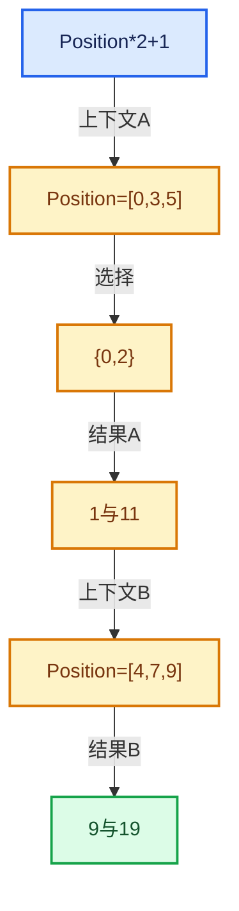

# 08-Field表达式与求值

[总目录](../README.md)

Field表达式、求值上下文、mask与结果存储各自有独立职责和生命周期。

## 前置知识与阅读层次

- [05-几何存储与拓扑映射](../05-%E5%87%A0%E4%BD%95%E5%AD%98%E5%82%A8%E4%B8%8E%E6%8B%93%E6%89%91%E6%98%A0%E5%B0%84/README.md)
- [07-MultiFunction与批量执行](../07-MultiFunction%E4%B8%8E%E6%89%B9%E9%87%8F%E6%89%A7%E8%A1%8C/README.md)

初读抓住数据模型，复读逐行检查，再完成反例和独立实现。方向间允许按实际问题回查，不要求机械线性阅读。

## 正文与源码范围

| 顺序 | 文档 | 主讲文件与范围 |
|---|---|---|
| 08-01 | [Field语义与表达式](01-Field%E8%AF%AD%E4%B9%89%E4%B8%8E%E8%A1%A8%E8%BE%BE%E5%BC%8F.md) | FN_field.hh:L1—L54 |
| 08-02 | [GField存储表示](02-GField%E5%AD%98%E5%82%A8%E8%A1%A8%E7%A4%BA.md) | FN_field.hh:L55—L202 |
| 08-03 | [Field类型接口](03-Field%E7%B1%BB%E5%9E%8B%E6%8E%A5%E5%8F%A3.md) | FN_field.hh:L203—L290 |
| 08-04 | [FieldInput输入节点](04-FieldInput%E8%BE%93%E5%85%A5%E8%8A%82%E7%82%B9.md) | FN_field.hh:L339—L386 |
| 08-05 | [FieldOperation运算节点](05-FieldOperation%E8%BF%90%E7%AE%97%E8%8A%82%E7%82%B9.md) | FN_field.hh:L387—L715 |
| 08-06 | [FieldContext上下文](06-FieldContext%E4%B8%8A%E4%B8%8B%E6%96%87.md) | field.cc:L1—L261；FN_field.hh:L291—L338 |
| 08-07 | [FieldEvaluator接口与使用](07-FieldEvaluator%E6%8E%A5%E5%8F%A3%E4%B8%8E%E4%BD%BF%E7%94%A8.md) | FN_field_evaluation.hh:L1—L221 |
| 08-08 | [表达式分析与共享子图](08-%E8%A1%A8%E8%BE%BE%E5%BC%8F%E5%88%86%E6%9E%90%E4%B8%8E%E5%85%B1%E4%BA%AB%E5%AD%90%E5%9B%BE.md) | field_evaluation.cc:L1—L298 |
| 08-09 | [生成Procedure与执行](09-%E7%94%9F%E6%88%90Procedure%E4%B8%8E%E6%89%A7%E8%A1%8C.md) | field_evaluation.cc:L299—L643 |
| 08-10 | [几何上下文与属性域](10-%E5%87%A0%E4%BD%95%E4%B8%8A%E4%B8%8B%E6%96%87%E4%B8%8E%E5%B1%9E%E6%80%A7%E5%9F%9F.md) | BKE_geometry_fields.hh:L292—L582 |
| 08-11 | [SetPosition完整调用链](11-SetPosition%E5%AE%8C%E6%95%B4%E8%B0%83%E7%94%A8%E9%93%BE.md) | node_geo_set_position.cc:L1—L181 |
| 08-12 | [Field重构与深链销毁](12-Field%E9%87%8D%E6%9E%84%E4%B8%8E%E6%B7%B1%E9%93%BE%E9%94%80%E6%AF%81.md) | field.cc:L262—L571 |

## 本方向的数据模型

## 状态推演

## 历史入口

- [Geometry Nodes: fields and anonymous attributes](https://projects.blender.org/blender/blender/commit/bf47fb40fd6f0ee9386e9936cf213a1049c55b61) · Jacques Lucke · 2021-09-09
- [Refactor: Functions: update field storage and API](https://projects.blender.org/blender/blender/commit/66bee9561ba6b7ce89f0f95f4ed0420360c69924) · Jacques Lucke · 2026-04-02
- [Fix #157485: avoid deep recursion when freeing field trees](https://projects.blender.org/blender/blender/commit/32f550c35ab3ffd89a8e8a602e4045e4091e044c) · Jacques Lucke · 2026-06-01

## 跨库比较与验收

与表达式模板、AST和闭包比较：Field可在运行时组合并对不同上下文批量求值；不要把Field对象误当作固定几何的结果数组。

结果与直接计算一致；多个输出共享子表达式时不改变语义；深链构造、执行、销毁三个阶段分别检查。

正文和源码区间已建立；自动检查结果见根目录验收报告。阅读者的掌握程度以独立练习与反例推理为准。
