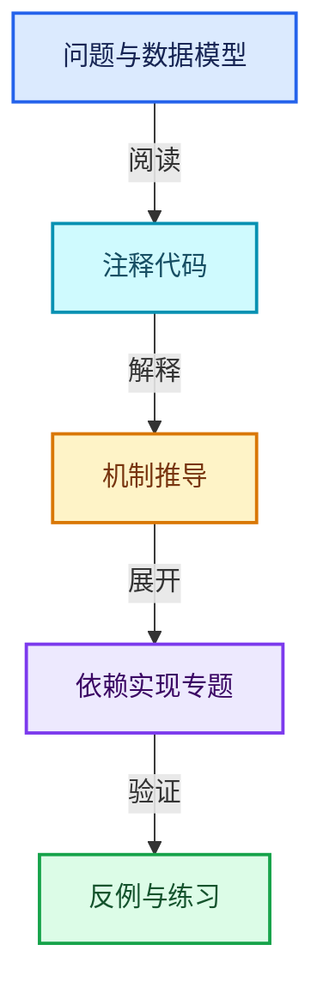
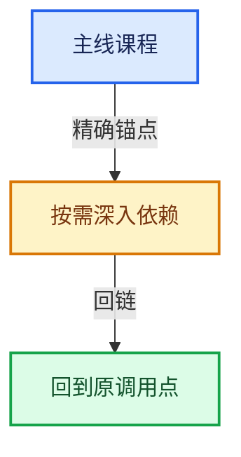

# 08-Field表达式与求值

[总目录](../README.md) · [实现索引](../%E7%AC%A6%E5%8F%B7%E4%BE%9D%E8%B5%96%E4%B8%8E%E5%AE%9E%E7%8E%B0%E7%B4%A2%E5%BC%95.md)

## 主线课程

- [08-01 Field语义与表达式](01-Field%E8%AF%AD%E4%B9%89%E4%B8%8E%E8%A1%A8%E8%BE%BE%E5%BC%8F.md)
- [08-02 GField存储表示](02-GField%E5%AD%98%E5%82%A8%E8%A1%A8%E7%A4%BA.md)
- [08-03 Field类型接口](03-Field%E7%B1%BB%E5%9E%8B%E6%8E%A5%E5%8F%A3.md)
- [08-04 FieldInput输入节点](04-FieldInput%E8%BE%93%E5%85%A5%E8%8A%82%E7%82%B9.md)
- [08-05 FieldOperation运算节点](05-FieldOperation%E8%BF%90%E7%AE%97%E8%8A%82%E7%82%B9.md)
- [08-06 FieldContext上下文](06-FieldContext%E4%B8%8A%E4%B8%8B%E6%96%87.md)
- [08-07 FieldEvaluator接口与使用](07-FieldEvaluator%E6%8E%A5%E5%8F%A3%E4%B8%8E%E4%BD%BF%E7%94%A8.md)
- [08-08 表达式分析与共享子图](08-%E8%A1%A8%E8%BE%BE%E5%BC%8F%E5%88%86%E6%9E%90%E4%B8%8E%E5%85%B1%E4%BA%AB%E5%AD%90%E5%9B%BE.md)
- [08-09 生成Procedure与执行](09-%E7%94%9F%E6%88%90Procedure%E4%B8%8E%E6%89%A7%E8%A1%8C.md)
- [08-10 几何上下文与属性域](10-%E5%87%A0%E4%BD%95%E4%B8%8A%E4%B8%8B%E6%96%87%E4%B8%8E%E5%B1%9E%E6%80%A7%E5%9F%9F.md)
- [08-11 SetPosition完整调用链](11-SetPosition%E5%AE%8C%E6%95%B4%E8%B0%83%E7%94%A8%E9%93%BE.md)
- [08-12 Field重构与深链销毁](12-Field%E9%87%8D%E6%9E%84%E4%B8%8E%E6%B7%B1%E9%93%BE%E9%94%80%E6%AF%81.md)

## 共享实现专题

- [source/blender/functions/FN_field.hh](%E4%BE%9D%E8%B5%96-FN_field-351dc0.md)

## 几何节点扩展专题

- [GN-09 几何FieldContext属性域与跨域求值](%E6%89%A9%E5%B1%9501-%E5%87%A0%E4%BD%95FieldContext%E5%B1%9E%E6%80%A7%E5%9F%9F%E4%B8%8E%E8%B7%A8%E5%9F%9F%E6%B1%82%E5%80%BC.md)
- [GN-10 SetPosition读取写入与贝塞尔控制柄](%E6%89%A9%E5%B1%9502-SetPosition%E8%AF%BB%E5%8F%96%E5%86%99%E5%85%A5%E4%B8%8E%E8%B4%9D%E5%A1%9E%E5%B0%94%E6%8E%A7%E5%88%B6%E6%9F%84.md)
- [GN-11 StoreNamedAttribute类型域与部分写入](%E6%89%A9%E5%B1%9503-StoreNamedAttribute%E7%B1%BB%E5%9E%8B%E5%9F%9F%E4%B8%8E%E9%83%A8%E5%88%86%E5%86%99%E5%85%A5.md)
