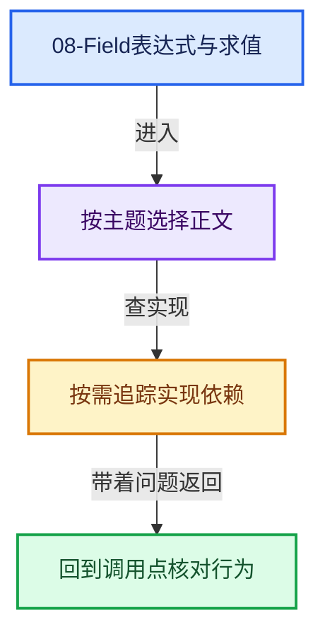
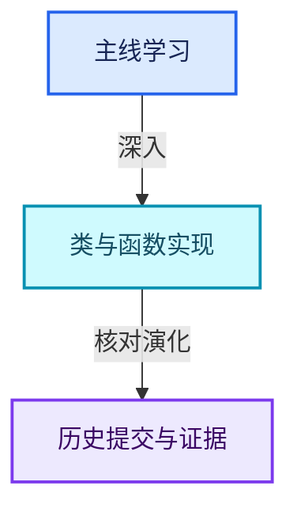

# 08-Field表达式与求值

[总入口](../README.md) · [几何节点专题](../13-几何节点专题/README.md) · [实现依赖](../90-实现依赖专题/README.md)

## 阅读顺序

- [08-01 Field语义与表达式](01-Field语义与表达式.md)
- [08-02 GField存储表示](02-GField存储表示.md)
- [08-03 Field类型接口](03-Field类型接口.md)
- [08-04 FieldInput输入节点](04-FieldInput输入节点.md)
- [08-05 FieldOperation运算节点](05-FieldOperation运算节点.md)
- [08-06 FieldContext上下文](06-FieldContext上下文.md)
- [08-07 FieldEvaluator接口与使用](07-FieldEvaluator接口与使用.md)
- [08-08 表达式分析与共享子图](08-表达式分析与共享子图.md)
- [08-09 生成Procedure与执行](09-生成Procedure与执行.md)
- [08-10 几何上下文与属性域](10-几何上下文与属性域.md)
- [08-11 SetPosition完整调用链](11-SetPosition完整调用链.md)
- [08-12 Field重构与深链销毁](12-Field重构与深链销毁.md)

