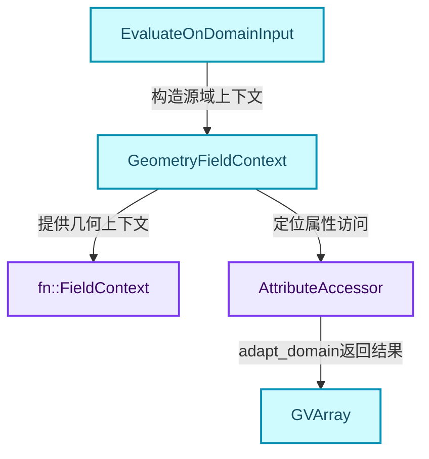
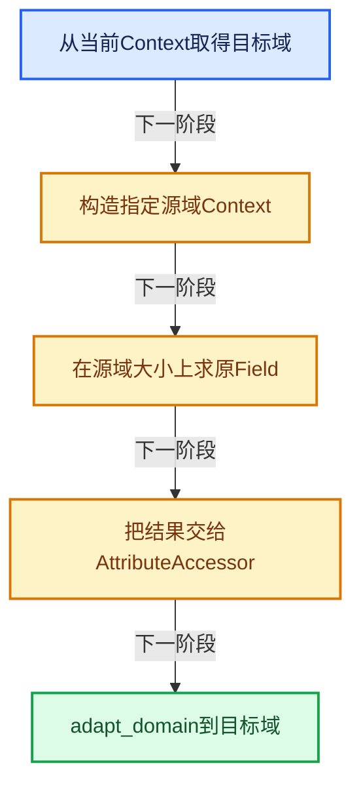
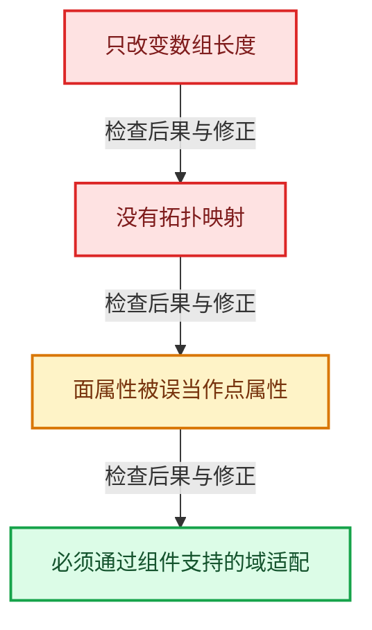

# GN-09 几何FieldContext属性域与跨域求值

[几何节点学习地图](../%E5%87%A0%E4%BD%95%E8%8A%82%E7%82%B9%E6%89%A9%E5%B1%95%E5%AD%A6%E4%B9%A0%E5%9C%B0%E5%9B%BE.md) · [方向导航](README.md) · [全局实现索引](../%E7%AC%A6%E5%8F%B7%E4%BE%9D%E8%B5%96%E4%B8%8E%E5%AE%9E%E7%8E%B0%E7%B4%A2%E5%BC%95.md)

基准：`cbda6b96c26c0dee3c3b5cbb93960c4ac06a6b30`；文件哈希及连续摘录区间记录在[新增专题证据](../_evidence/geometry-extension.json)。本篇围绕所选函数解释核心机制，辅助依赖明确列出已定位实现与尚需类型确认的边界，不宣称相关整个文件已全文复核。

## 先回答一个具体问题

Position、Index或Named Attribute没有携带数组时，怎样知道在点、面还是实例上读取？

## 相关类与数据的职责

- **`fn::FieldContext`**：表达式求值的外部输入接口。 定义入口：[source/blender/functions/FN_field.hh · L291](../../../../../source/blender/functions/FN_field.hh)。
- **`GeometryFieldContext`**：加入几何组件类型、域和层信息。 定义入口：[source/blender/blenkernel/BKE_geometry_fields.hh · L154](../../../../../source/blender/blenkernel/BKE_geometry_fields.hh)。
- **`AttributeAccessor`**：查询属性及域尺寸并执行域适配。 定义入口：[source/blender/blenkernel/BKE_attribute.hh · L493](../../../../../source/blender/blenkernel/BKE_attribute.hh)。
- **`EvaluateOnDomainInput`**：先在指定源域求值，再适配到当前域。 定义入口：[source/blender/blenkernel/BKE_geometry_fields.hh · L502](../../../../../source/blender/blenkernel/BKE_geometry_fields.hh)。
- **`GVArray`**：携带运行时类型的虚拟数组结果。 定义入口：[source/blender/blenlib/BLI_generic_virtual_array.hh · L158](../../../../../source/blender/blenlib/BLI_generic_virtual_array.hh)。



上图箭头文字区分拥有、借用、调用和数据依赖。连线不表示这些类型存在同名继承关系；只有源码明确声明的继承才按继承理解。

## 设计推导与扩展知识

### 推导1

FieldContext使表达式与具体数据集解耦。同一个属性读取表达式可以在不同几何上求值，但名称存在、域支持和默认值仍由当前上下文决定。

### 推导2

GeometryFieldContext包含组件类型与域，并对Grease Pencil携带层信息。不能只传一个元素数量就替代它，因为相同长度的点和面并不拥有相同语义。

### 推导3

EvaluateOnDomainInput不只是给Field改一个域标签。它建立源域上下文、分配源域结果、运行Evaluator，再通过adapt_domain返回目标域结果。

### 推导4

Grease Pencil中Layer与其他域的转换有专门分支：源Layer在当前层求单值后广播；反向的部分情况当前返回默认值。不要把一般Mesh插值直觉推广到所有几何类型。

### 推导5

域适配的算法取决于组件、源域、目标域和属性类型。布尔、整数、向量等未必适用同一种平均规则；具体插值实现应沿AttributeAccessor对应组件函数继续阅读。

## 实际处理阶段



这张图概括本篇所讨论的主路径；等待输入、构建失败与不同策略的分支以下方完整代码为准，不能把概括图当作每次都会执行的无条件顺序。

## 教学注释代码与分段机制

<a id="f-7ffaaec45fb8818f"></a>

### `blender::bke::get_varray_for_context` · L773—L813

分别阅读Grease Pencil特例和普通源域求值路径。

实现位置：[source/blender/blenkernel/intern/geometry_fields.cc](../../../../../source/blender/blenkernel/intern/geometry_fields.cc)。

**教学注释版**

<!-- annotated:3e52490fe0091a -->

```cpp
GVArray EvaluateOnDomainInput::get_varray_for_context(const bke::GeometryFieldContext &context,
                                                      const IndexMask & /*mask*/) const
{
  const AttrDomain dst_domain = context.domain();
  const int dst_domain_size = context.attributes()->domain_size(dst_domain);
  const CPPType &cpp_type = src_field_.cpp_type();

  if (context.type() == GeometryComponent::Type::GreasePencil &&
      (src_domain_ == AttrDomain::Layer) != (dst_domain == AttrDomain::Layer))
  {
    /* Evaluate field just for the current layer. */
    if (src_domain_ == AttrDomain::Layer) {
      const bke::GeometryFieldContext src_domain_context{context, AttrDomain::Layer};
      const int layer_index = context.grease_pencil_layer_index();

      const IndexMask single_layer_mask = IndexRange(layer_index, 1);
      fn::FieldEvaluator value_evaluator{src_domain_context, &single_layer_mask};
      value_evaluator.add(src_field_);
      value_evaluator.evaluate();

      const GVArray &values = value_evaluator.get_evaluated(0);

      BUFFER_FOR_CPP_TYPE_VALUE(cpp_type, value);
      BLI_SCOPED_DEFER([&]() { cpp_type.destruct(value); });
      values.get_to_uninitialized(layer_index, value);
      return GVArray::from_single(cpp_type, dst_domain_size, value);
    }
    /* We don't adapt from curve to layer domain currently. */
    return GVArray::from_single_default(cpp_type, dst_domain_size);
  }

  const bke::AttributeAccessor attributes = *context.attributes();

  const bke::GeometryFieldContext other_domain_context{context, src_domain_};
  const int64_t src_domain_size = attributes.domain_size(src_domain_);
  GArray<> values(cpp_type, src_domain_size);
  fn::FieldEvaluator value_evaluator{other_domain_context, src_domain_size};
  value_evaluator.add_with_destination(src_field_, values.as_mutable_span());
  value_evaluator.evaluate();
  return attributes.adapt_domain(GVArray::from_garray(std::move(values)), src_domain_, dst_domain);
}
```

<details>
<summary>核对原始源码：source/blender/blenkernel/intern/geometry_fields.cc · L773—L813</summary>

<!-- original:3e52490fe0091a:source/blender/blenkernel/intern/geometry_fields.cc:773:813 -->

```cpp
GVArray EvaluateOnDomainInput::get_varray_for_context(const bke::GeometryFieldContext &context,
                                                      const IndexMask & /*mask*/) const
{
  const AttrDomain dst_domain = context.domain();
  const int dst_domain_size = context.attributes()->domain_size(dst_domain);
  const CPPType &cpp_type = src_field_.cpp_type();

  if (context.type() == GeometryComponent::Type::GreasePencil &&
      (src_domain_ == AttrDomain::Layer) != (dst_domain == AttrDomain::Layer))
  {
    /* Evaluate field just for the current layer. */
    if (src_domain_ == AttrDomain::Layer) {
      const bke::GeometryFieldContext src_domain_context{context, AttrDomain::Layer};
      const int layer_index = context.grease_pencil_layer_index();

      const IndexMask single_layer_mask = IndexRange(layer_index, 1);
      fn::FieldEvaluator value_evaluator{src_domain_context, &single_layer_mask};
      value_evaluator.add(src_field_);
      value_evaluator.evaluate();

      const GVArray &values = value_evaluator.get_evaluated(0);

      BUFFER_FOR_CPP_TYPE_VALUE(cpp_type, value);
      BLI_SCOPED_DEFER([&]() { cpp_type.destruct(value); });
      values.get_to_uninitialized(layer_index, value);
      return GVArray::from_single(cpp_type, dst_domain_size, value);
    }
    /* We don't adapt from curve to layer domain currently. */
    return GVArray::from_single_default(cpp_type, dst_domain_size);
  }

  const bke::AttributeAccessor attributes = *context.attributes();

  const bke::GeometryFieldContext other_domain_context{context, src_domain_};
  const int64_t src_domain_size = attributes.domain_size(src_domain_);
  GArray<> values(cpp_type, src_domain_size);
  fn::FieldEvaluator value_evaluator{other_domain_context, src_domain_size};
  value_evaluator.add_with_destination(src_field_, values.as_mutable_span());
  value_evaluator.evaluate();
  return attributes.adapt_domain(GVArray::from_garray(std::move(values)), src_domain_, dst_domain);
}
```

</details>

<details>
<summary>实现依赖入口与尚需类型确认的调用</summary>

- `context.domain` → [blender::bke::GeometryFieldContext::domain · L198](../05-%E5%87%A0%E4%BD%95%E5%AD%98%E5%82%A8%E4%B8%8E%E6%8B%93%E6%89%91%E6%98%A0%E5%B0%84/09-%E5%B1%9E%E6%80%A7%E5%9F%9F%E4%B8%8E%E8%BD%AC%E6%8D%A2.md#f-e616fe8766422431)。
- `context.attributes()->domain_size`：L777的类型或分派协议；接收对象类型依赖auto、返回值或模板实例；不按同名猜测目标。
- `context.attributes` → [blender::bke::attributes · L182](%E6%89%A9%E5%B1%9501-%E5%87%A0%E4%BD%95FieldContext%E5%B1%9E%E6%80%A7%E5%9F%9F%E4%B8%8E%E8%B7%A8%E5%9F%9F%E6%B1%82%E5%80%BC.md#f-931d6ea979988cc3)。
- `src_field_.cpp_type`：L778的类型或分派协议；接收对象类型依赖auto、返回值或模板实例；不按同名猜测目标。
- `context.type` → [blender::bke::GeometryFieldContext::type · L193](../05-%E5%87%A0%E4%BD%95%E5%AD%98%E5%82%A8%E4%B8%8E%E6%8B%93%E6%89%91%E6%98%A0%E5%B0%84/09-%E5%B1%9E%E6%80%A7%E5%9F%9F%E4%B8%8E%E8%BD%AC%E6%8D%A2.md#f-48e9fe71391982f6)。
- `context.grease_pencil_layer_index` → [blender::bke::GeometryFieldContext::grease_pencil_layer_index · L203](../05-%E5%87%A0%E4%BD%95%E5%AD%98%E5%82%A8%E4%B8%8E%E6%8B%93%E6%89%91%E6%98%A0%E5%B0%84/09-%E5%B1%9E%E6%80%A7%E5%9F%9F%E4%B8%8E%E8%BD%AC%E6%8D%A2.md#f-b48faa617e8f5bee)。
- `IndexRange`：L788的类型或分派协议；构造或类型转换入口。
- `value_evaluator.add` → [blender::fn::add · L561](09-%E7%94%9F%E6%88%90Procedure%E4%B8%8E%E6%89%A7%E8%A1%8C.md#f-0095e095e744d86b)；[blender::fn::add · L572](09-%E7%94%9F%E6%88%90Procedure%E4%B8%8E%E6%89%A7%E8%A1%8C.md#f-fa52050946072c2f)；[blender::fn::FieldEvaluator::add · L112](07-FieldEvaluator%E6%8E%A5%E5%8F%A3%E4%B8%8E%E4%BD%BF%E7%94%A8.md#f-ab31e309cff56785)；[blender::fn::FieldEvaluator::add · L123](07-FieldEvaluator%E6%8E%A5%E5%8F%A3%E4%B8%8E%E4%BD%BF%E7%94%A8.md#f-d1fd1566630f59d2)。多候选需按实参和重载规则确认。
- `value_evaluator.evaluate` → [blender::fn::evaluate · L590](09-%E7%94%9F%E6%88%90Procedure%E4%B8%8E%E6%89%A7%E8%A1%8C.md#f-d2c4933d17ec204c)。
- `value_evaluator.get_evaluated` → [blender::fn::FieldEvaluator::get_evaluated · L144](07-FieldEvaluator%E6%8E%A5%E5%8F%A3%E4%B8%8E%E4%BD%BF%E7%94%A8.md#f-57a3012b0391bad8)；[blender::fn::FieldEvaluator::get_evaluated · L150](07-FieldEvaluator%E6%8E%A5%E5%8F%A3%E4%B8%8E%E4%BD%BF%E7%94%A8.md#f-65bbf8d4b675d2cc)。多候选需按实参和重载规则确认。
- `BUFFER_FOR_CPP_TYPE_VALUE`：宏定义见[source/blender/blenlib/BLI_cpp_type.hh](../../../../../source/blender/blenlib/BLI_cpp_type.hh), L460；按当前编译条件选择。
- `BLI_SCOPED_DEFER`：宏定义见[source/blender/blenlib/BLI_memory_utils.hh](../../../../../source/blender/blenlib/BLI_memory_utils.hh), L367；按当前编译条件选择。
- `cpp_type.destruct` → [blender::destruct · L557](../03-%E5%86%85%E5%AD%98%E5%88%86%E9%85%8D%E4%B8%8E%E8%BF%90%E8%A1%8C%E6%97%B6%E7%B1%BB%E5%9E%8B/09-CPPType%E5%A4%8D%E5%88%B6%E7%A7%BB%E5%8A%A8%E9%87%8D%E5%AE%9A%E4%BD%8D.md#f-85f4f006e822b3c7)。
- `values.get_to_uninitialized`：L797的类型或分派协议；由接收对象具体类型或运行时策略提供实现。
- `GVArray::from_single` → [blender::from_single · L880](../04-%E8%99%9A%E6%8B%9F%E6%95%B0%E7%BB%84%E4%B8%8E%E7%B4%A2%E5%BC%95%E9%80%89%E6%8B%A9/05-GVArray%E8%BF%90%E8%A1%8C%E6%97%B6%E7%B1%BB%E5%9E%8B.md#f-1c85e09520e47c5a)。
- `GVArray::from_single_default` → [blender::from_single_default · L890](../04-%E8%99%9A%E6%8B%9F%E6%95%B0%E7%BB%84%E4%B8%8E%E7%B4%A2%E5%BC%95%E9%80%89%E6%8B%A9/05-GVArray%E8%BF%90%E8%A1%8C%E6%97%B6%E7%B1%BB%E5%9E%8B.md#f-c4a824ac76fa9b56)。
- `attributes.domain_size` → [blender::bke::AttributeAccessor::domain_size · L549](../05-%E5%87%A0%E4%BD%95%E5%AD%98%E5%82%A8%E4%B8%8E%E6%8B%93%E6%89%91%E6%98%A0%E5%B0%84/08-AttributeAccessor%E6%8E%A5%E5%8F%A3.md#f-ef6a71571070a259)。
- `value_evaluator.add_with_destination` → [blender::fn::add_with_destination · L548](09-%E7%94%9F%E6%88%90Procedure%E4%B8%8E%E6%89%A7%E8%A1%8C.md#f-165e23b00ea43ee4)；[blender::fn::add_with_destination · L556](09-%E7%94%9F%E6%88%90Procedure%E4%B8%8E%E6%89%A7%E8%A1%8C.md#f-79ade07d74d08d73)；[blender::fn::FieldEvaluator::add_with_destination · L80](07-FieldEvaluator%E6%8E%A5%E5%8F%A3%E4%B8%8E%E4%BD%BF%E7%94%A8.md#f-3edfceb249cb5cad)；[blender::fn::FieldEvaluator::add_with_destination · L99](07-FieldEvaluator%E6%8E%A5%E5%8F%A3%E4%B8%8E%E4%BD%BF%E7%94%A8.md#f-03289f589afbd469)。多候选需按实参和重载规则确认。
- `values.as_mutable_span` → [blender::GArray::as_mutable_span · L198](../03-%E5%86%85%E5%AD%98%E5%88%86%E9%85%8D%E4%B8%8E%E8%BF%90%E8%A1%8C%E6%97%B6%E7%B1%BB%E5%9E%8B/11-GSpan%E4%B8%8EGArray.md#f-2f8508997cf678b6)。
- `attributes.adapt_domain` → [blender::bke::AttributeAccessor::adapt_domain · L665](../05-%E5%87%A0%E4%BD%95%E5%AD%98%E5%82%A8%E4%B8%8E%E6%8B%93%E6%89%91%E6%98%A0%E5%B0%84/08-AttributeAccessor%E6%8E%A5%E5%8F%A3.md#f-305741960874253d)；[blender::bke::AttributeAccessor::adapt_domain · L675](../05-%E5%87%A0%E4%BD%95%E5%AD%98%E5%82%A8%E4%B8%8E%E6%8B%93%E6%89%91%E6%98%A0%E5%B0%84/08-AttributeAccessor%E6%8E%A5%E5%8F%A3.md#f-4a5f3c263af68b9c)。多候选需按实参和重载规则确认。
- `GVArray::from_garray` → [blender::from_garray · L647](../04-%E8%99%9A%E6%8B%9F%E6%95%B0%E7%BB%84%E4%B8%8E%E7%B4%A2%E5%BC%95%E9%80%89%E6%8B%A9/05-GVArray%E8%BF%90%E8%A1%8C%E6%97%B6%E7%B1%BB%E5%9E%8B.md#f-1b814aa9b1fb3a37)。
- `std::move`：把表达式转换成可供移动重载选择的值类别；不保证真的移动，不结束源对象寿命，对const值可能选择复制。 [接口资料](https://eel.is/c++draft/utility.forward)。

</details>

<a id="f-931d6ea979988cc3"></a>

### `blender::bke::attributes` · L182—L207

按组件类型取得可用属性接口，返回optional意味着不是所有上下文都可直接访问属性。

实现位置：[source/blender/blenkernel/intern/geometry_fields.cc](../../../../../source/blender/blenkernel/intern/geometry_fields.cc)。

**教学注释版**

<!-- annotated:4701fa72b0b473 -->

```cpp
std::optional<AttributeAccessor> GeometryFieldContext::attributes() const
{
  if (const Mesh *mesh = this->mesh()) {
    return mesh->attributes();
  }
  if (const CurvesGeometry *curves = this->curves()) {
    return curves->attributes();
  }
  if (const PointCloud *pointcloud = this->pointcloud()) {
    return pointcloud->attributes();
  }
  if (const GreasePencil *grease_pencil = this->grease_pencil()) {
    if (domain_ == AttrDomain::Layer) {
      return grease_pencil->attributes();
    }
    if (const greasepencil::Drawing *drawing = grease_pencil->get_eval_drawing(
            grease_pencil->layer(grease_pencil_layer_index_)))
    {
      return drawing->strokes().attributes();
    }
  }
  if (const Instances *instances = this->instances()) {
    return instances->attributes();
  }
  return {};
}
```

<details>
<summary>核对原始源码：source/blender/blenkernel/intern/geometry_fields.cc · L182—L207</summary>

<!-- original:4701fa72b0b473:source/blender/blenkernel/intern/geometry_fields.cc:182:207 -->

```cpp
std::optional<AttributeAccessor> GeometryFieldContext::attributes() const
{
  if (const Mesh *mesh = this->mesh()) {
    return mesh->attributes();
  }
  if (const CurvesGeometry *curves = this->curves()) {
    return curves->attributes();
  }
  if (const PointCloud *pointcloud = this->pointcloud()) {
    return pointcloud->attributes();
  }
  if (const GreasePencil *grease_pencil = this->grease_pencil()) {
    if (domain_ == AttrDomain::Layer) {
      return grease_pencil->attributes();
    }
    if (const greasepencil::Drawing *drawing = grease_pencil->get_eval_drawing(
            grease_pencil->layer(grease_pencil_layer_index_)))
    {
      return drawing->strokes().attributes();
    }
  }
  if (const Instances *instances = this->instances()) {
    return instances->attributes();
  }
  return {};
}
```

</details>

<details>
<summary>实现依赖入口与尚需类型确认的调用</summary>

- `this->mesh` → [blender::bke::mesh · L209](../05-%E5%87%A0%E4%BD%95%E5%AD%98%E5%82%A8%E4%B8%8E%E6%8B%93%E6%89%91%E6%98%A0%E5%B0%84/09-%E5%B1%9E%E6%80%A7%E5%9F%9F%E4%B8%8E%E8%BD%AC%E6%8D%A2.md#f-a4e6fc3cf94a29c3)。
- `mesh->attributes` → [attributes · L1298](../05-%E5%87%A0%E4%BD%95%E5%AD%98%E5%82%A8%E4%B8%8E%E6%8B%93%E6%89%91%E6%98%A0%E5%B0%84/03-MPoly%E8%BF%81%E7%A7%BB%E4%B8%8E%E5%85%BC%E5%AE%B9.md#f-607bbfe3e57cfc7f)。
- `this->curves` → [blender::bke::curves · L214](../05-%E5%87%A0%E4%BD%95%E5%AD%98%E5%82%A8%E4%B8%8E%E6%8B%93%E6%89%91%E6%98%A0%E5%B0%84/09-%E5%B1%9E%E6%80%A7%E5%9F%9F%E4%B8%8E%E8%BD%AC%E6%8D%A2.md#f-50963d21154ea342)。
- `curves->attributes` → [blender::bke::attributes · L1908](../05-%E5%87%A0%E4%BD%95%E5%AD%98%E5%82%A8%E4%B8%8E%E6%8B%93%E6%89%91%E6%98%A0%E5%B0%84/%E4%BE%9D%E8%B5%96-curves_geometry-ad7f9f.md#f-8e24fbf758862a22)。
- `this->pointcloud` → [blender::bke::pointcloud · L220](../05-%E5%87%A0%E4%BD%95%E5%AD%98%E5%82%A8%E4%B8%8E%E6%8B%93%E6%89%91%E6%98%A0%E5%B0%84/09-%E5%B1%9E%E6%80%A7%E5%9F%9F%E4%B8%8E%E8%BD%AC%E6%8D%A2.md#f-00b35709c6c18fd9)。
- `pointcloud->attributes` → [blender::attributes · L307](../05-%E5%87%A0%E4%BD%95%E5%AD%98%E5%82%A8%E4%B8%8E%E6%8B%93%E6%89%91%E6%98%A0%E5%B0%84/%E4%BE%9D%E8%B5%96-pointcloud-49a366.md#f-bf2e5928a63a6e15)。
- `this->grease_pencil` → [blender::bke::grease_pencil · L226](../05-%E5%87%A0%E4%BD%95%E5%AD%98%E5%82%A8%E4%B8%8E%E6%8B%93%E6%89%91%E6%98%A0%E5%B0%84/09-%E5%B1%9E%E6%80%A7%E5%9F%9F%E4%B8%8E%E8%BD%AC%E6%8D%A2.md#f-2edeb11000171692)。
- `grease_pencil->attributes` → [blender::attributes · L4779](../05-%E5%87%A0%E4%BD%95%E5%AD%98%E5%82%A8%E4%B8%8E%E6%8B%93%E6%89%91%E6%98%A0%E5%B0%84/%E4%BE%9D%E8%B5%96-grease_pencil-f750d6.md#f-ec6cc4692f8712ff)。
- `grease_pencil->get_eval_drawing` → [blender::get_eval_drawing · L3877](../05-%E5%87%A0%E4%BD%95%E5%AD%98%E5%82%A8%E4%B8%8E%E6%8B%93%E6%89%91%E6%98%A0%E5%B0%84/%E4%BE%9D%E8%B5%96-grease_pencil-f750d6.md#f-90fc4aad8697fbb6)；[blender::get_eval_drawing · L3883](../05-%E5%87%A0%E4%BD%95%E5%AD%98%E5%82%A8%E4%B8%8E%E6%8B%93%E6%89%91%E6%98%A0%E5%B0%84/%E4%BE%9D%E8%B5%96-grease_pencil-f750d6.md#f-c0c3d7e7fffac861)。多候选需按实参和重载规则确认。
- `grease_pencil->layer` → [blender::layer · L1144](../05-%E5%87%A0%E4%BD%95%E5%AD%98%E5%82%A8%E4%B8%8E%E6%8B%93%E6%89%91%E6%98%A0%E5%B0%84/%E4%BE%9D%E8%B5%96-BKE_grease_pencil-42a7a1.md#f-7196ac6431650af5)；[blender::layer · L1148](../05-%E5%87%A0%E4%BD%95%E5%AD%98%E5%82%A8%E4%B8%8E%E6%8B%93%E6%89%91%E6%98%A0%E5%B0%84/%E4%BE%9D%E8%B5%96-BKE_grease_pencil-42a7a1.md#f-82f7eddc62fb11fe)。多候选需按实参和重载规则确认。
- `drawing->strokes().attributes`：L200的类型或分派协议；接收对象类型依赖auto、返回值或模板实例；不按同名猜测目标。
- `drawing->strokes` → [blender::bke::greasepencil::strokes · L1007](../05-%E5%87%A0%E4%BD%95%E5%AD%98%E5%82%A8%E4%B8%8E%E6%8B%93%E6%89%91%E6%98%A0%E5%B0%84/%E4%BE%9D%E8%B5%96-grease_pencil-f750d6.md#f-59e6522a8e8ac409)。
- `this->instances` → [blender::bke::instances · L256](../05-%E5%87%A0%E4%BD%95%E5%AD%98%E5%82%A8%E4%B8%8E%E6%8B%93%E6%89%91%E6%98%A0%E5%B0%84/09-%E5%B1%9E%E6%80%A7%E5%9F%9F%E4%B8%8E%E8%BD%AC%E6%8D%A2.md#f-467cbfb7848f00fb)。
- `instances->attributes` → [blender::bke::attributes · L68](../05-%E5%87%A0%E4%BD%95%E5%AD%98%E5%82%A8%E4%B8%8E%E6%8B%93%E6%89%91%E6%98%A0%E5%B0%84/%E4%BE%9D%E8%B5%96-instances-5b2776.md#f-41bd4f24fbbb94a0)。

</details>

## 用小数据走一遍

1. 源域Face有2个结果。
2. 目标域Point需要顶点值。
3. 先求Face Field。
4. 再按Mesh拓扑域映射适配。


这是明确输入条件下的教学推演，不是本地性能实测。对源码的验证应同时检查数值、对象寿命、输出需求和数据是否存在。

## 反例与边界

- 只改变数组长度。
- 没有拓扑映射。
- 面属性被误当作点属性。
- 必须通过组件支持的域适配。



## 历史提交阅读

本地历史阅读样本：**Hans Goudey**，2026-09-30T14:52:03+02:00。

`662905e45c1030f9244b880aa4f6ff60d5ac2486`

提交标题：Refactor: Attributes: Remove AttributeInitMoveArray

[所选文件的真实diff](../_evidence/geometry-history/GN-09.patch)。这是本地历史中匹配作者的近期样本，不冒称该系统的最初引入提交。阅读时先找变更前后的不变量，再检查新增分支与测试；本篇当前源码说明不混用历史签名。

## 独立实现与验收

用两个共享一条边的三角形画出Face到Point所需的邻接关系。

<details>
<summary>参考思路</summary>

先列每个顶点连接哪些面；再根据实际属性类型的域适配规则计算，不能把索引相同视为拓扑对应。

</details>

验收时保留一个能击穿错误设计的反例，再对照实际符号重走调用链。教学练习未在完整Blender中运行；本轮独立运行的模型验证另见新增专题验收报告。

## 继续阅读

- [GN-08 GeometrySet组件组合与写时分离](../05-%E5%87%A0%E4%BD%95%E5%AD%98%E5%82%A8%E4%B8%8E%E6%8B%93%E6%89%91%E6%98%A0%E5%B0%84/%E6%89%A9%E5%B1%9501-GeometrySet%E7%BB%84%E4%BB%B6%E7%BB%84%E5%90%88%E4%B8%8E%E5%86%99%E6%97%B6%E5%88%86%E7%A6%BB.md)
- [GN-10 SetPosition读取写入与贝塞尔控制柄](%E6%89%A9%E5%B1%9502-SetPosition%E8%AF%BB%E5%8F%96%E5%86%99%E5%85%A5%E4%B8%8E%E8%B4%9D%E5%A1%9E%E5%B0%94%E6%8E%A7%E5%88%B6%E6%9F%84.md)
- [GN-11 StoreNamedAttribute类型域与部分写入](%E6%89%A9%E5%B1%9503-StoreNamedAttribute%E7%B1%BB%E5%9E%8B%E5%9F%9F%E4%B8%8E%E9%83%A8%E5%88%86%E5%86%99%E5%85%A5.md)
