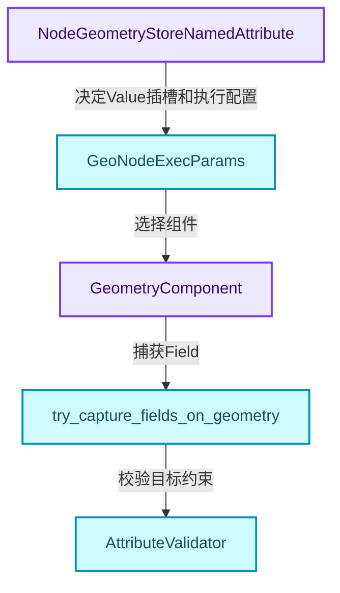
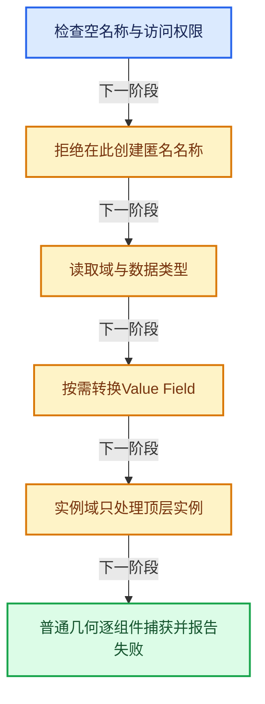
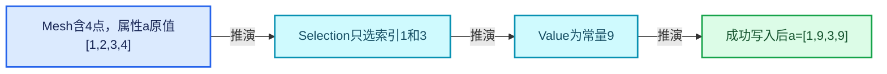
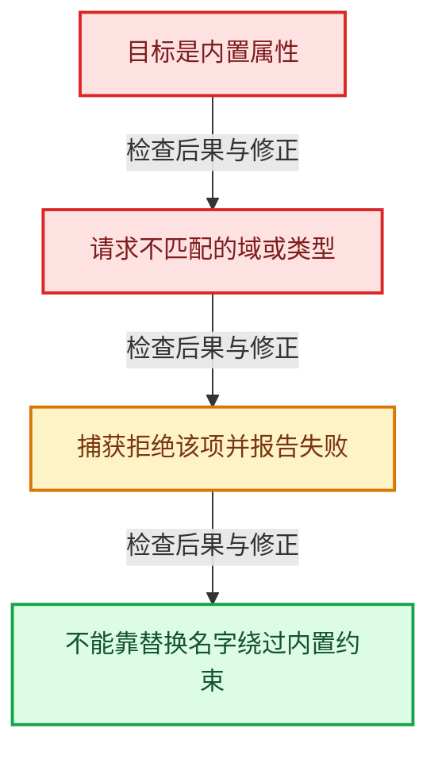

# GN-11 StoreNamedAttribute类型域与部分写入

[几何节点学习地图](../%E5%87%A0%E4%BD%95%E8%8A%82%E7%82%B9%E6%89%A9%E5%B1%95%E5%AD%A6%E4%B9%A0%E5%9C%B0%E5%9B%BE.md) · [方向导航](README.md) · [全局实现索引](../%E7%AC%A6%E5%8F%B7%E4%BE%9D%E8%B5%96%E4%B8%8E%E5%AE%9E%E7%8E%B0%E7%B4%A2%E5%BC%95.md)

基准：`cbda6b96c26c0dee3c3b5cbb93960c4ac06a6b30`；文件哈希及连续摘录区间记录在[新增专题证据](../_evidence/geometry-extension.json)。本篇围绕所选函数解释核心机制，辅助依赖明确列出已定位实现与尚需类型确认的边界，不宣称相关整个文件已全文复核。

## 先回答一个具体问题

写一个命名属性，为什么需要处理名称权限、内置属性、类型转换、空域和实例特例？

## 相关类与数据的职责

- **`NodeGeometryStoreNamedAttribute`**：保存用户选择的数据类型和域。 定义入口：[source/blender/makesdna/DNA_node_types.h · L3413](../../../../../source/blender/makesdna/DNA_node_types.h)。
- **`GeoNodeExecParams`**：提供Geometry、Name、Selection和Value。 定义入口：[source/blender/nodes/NOD_geometry_exec.hh · L80](../../../../../source/blender/nodes/NOD_geometry_exec.hh)。
- **`GeometryComponent`**：提供目标域和属性接口。 定义入口：[source/blender/blenkernel/BKE_geometry_set.hh · L69](../../../../../source/blender/blenkernel/BKE_geometry_set.hh)。
- **`try_capture_fields_on_geometry`**：协调求值、临时结果与属性提交。
- **`AttributeValidator`**：保护特殊属性允许的值与元数据约束。 定义入口：[source/blender/blenkernel/BKE_attribute.hh · L188](../../../../../source/blender/blenkernel/BKE_attribute.hh)。



上图箭头文字区分拥有、借用、调用和数据依赖。连线不表示这些类型存在同名继承关系；只有源码明确声明的继承才按继承理解。

## 设计推导与扩展知识

### 推导1

名称为空时直接转交几何；禁止程序访问或匿名属性名称时也有明确提示和早返回。这些分支说明用户输入检查在节点层完成，而不是等到数组写入才处理。

### 推导2

节点storage中选择的eCustomDataType还要映射到AttrType与CPPType。部分类型通过隐式转换表调整Field，不能将界面插槽类型、属性存储类型和计算类型默认为同一个枚举。

### 推导3

Instance域只针对顶层实例组件；普通域通过foreach_real_geometry处理实际几何及相关引用中的数据。域决定遍历语义，而不是只决定输出数组的长度。

### 推导4

实例position且类型Float3时走InstancesFieldContext与可写位置虚拟数组特例；其他属性走通用捕获接口。这体现兼容接口如何适配新的内部表示。

### 推导5

failure是原子bool，用于回调中汇总写失败；它没有保护任意属性操作免于数据竞争。节点把非空域上的失败作为需要报告的情况，不能把空组件都视为同等错误。

## 实际处理阶段



这张图概括本篇所讨论的主路径；等待输入、构建失败与不同策略的分支以下方完整代码为准，不能把概括图当作每次都会执行的无条件顺序。

## 教学注释代码与分段机制

<a id="f-f7b08c7eeed868f5"></a>

### `blender::nodes::node_geo_store_named_attribute_cc::node_declare` · L32—L53

Value插槽依据storage动态声明；node_or_null条件体现静态声明与具体节点声明的不同。

实现位置：[source/blender/nodes/geometry/nodes/node_geo_store_named_attribute.cc](../../../../../source/blender/nodes/geometry/nodes/node_geo_store_named_attribute.cc)。

**教学注释版**

<!-- annotated:ec714e0b0929f3 -->

```cpp
static void node_declare(NodeDeclarationBuilder &b)
{
  b.use_custom_socket_order();
  b.allow_any_socket_order();
  b.add_default_layout();
  const bNode *node = b.node_or_null();

  b.add_input<decl::Geometry>("Geometry"_ustr)
      .description("Geometry to store a new attribute with the given name on");
  b.add_output<decl::Geometry>("Geometry"_ustr).propagate_all_geometry().align_with_previous();
  b.add_input<decl::Bool>("Selection"_ustr)
      .default_value(true)
      .hide_value()
      .evaluated_geometry_field();
  b.add_input<decl::String>("Name"_ustr).is_attribute_name().optional_label();

  if (node != nullptr) {
    const NodeGeometryStoreNamedAttribute &storage = node_storage(*node);
    const eCustomDataType data_type = eCustomDataType(storage.data_type);
    b.add_input(data_type, "Value"_ustr).evaluated_geometry_field();
  }
}
```

<details>
<summary>核对原始源码：source/blender/nodes/geometry/nodes/node_geo_store_named_attribute.cc · L32—L53</summary>

<!-- original:ec714e0b0929f3:source/blender/nodes/geometry/nodes/node_geo_store_named_attribute.cc:32:53 -->

```cpp
static void node_declare(NodeDeclarationBuilder &b)
{
  b.use_custom_socket_order();
  b.allow_any_socket_order();
  b.add_default_layout();
  const bNode *node = b.node_or_null();

  b.add_input<decl::Geometry>("Geometry"_ustr)
      .description("Geometry to store a new attribute with the given name on");
  b.add_output<decl::Geometry>("Geometry"_ustr).propagate_all_geometry().align_with_previous();
  b.add_input<decl::Bool>("Selection"_ustr)
      .default_value(true)
      .hide_value()
      .evaluated_geometry_field();
  b.add_input<decl::String>("Name"_ustr).is_attribute_name().optional_label();

  if (node != nullptr) {
    const NodeGeometryStoreNamedAttribute &storage = node_storage(*node);
    const eCustomDataType data_type = eCustomDataType(storage.data_type);
    b.add_input(data_type, "Value"_ustr).evaluated_geometry_field();
  }
}
```

</details>

<details>
<summary>实现依赖入口与尚需类型确认的调用</summary>

本函数未纳入旧结构调用闭包；以上源码保留实际调用表达式，相关成员须按接收者类型继续定位。下方类关系入口提供对应定义。

</details>

<a id="f-197b91bac162a162"></a>

### `blender::nodes::node_geo_store_named_attribute_cc::node_geo_exec` · L117—L226

依次阅读名称检查、类型转换、Instance分支、普通几何分支与失败汇总。

实现位置：[source/blender/nodes/geometry/nodes/node_geo_store_named_attribute.cc](../../../../../source/blender/nodes/geometry/nodes/node_geo_store_named_attribute.cc)。

**教学注释版**

<!-- annotated:ce492ff425de96 -->

```cpp
static void node_geo_exec(GeoNodeExecParams params)
{
  GeometrySet geometry_set = params.extract_input<GeometrySet>("Geometry"_ustr);
  const std::string name = params.extract_input<std::string>("Name"_ustr);

  // [讲解] 空名称不创建属性，直接走几何转交的早返回路径。
  if (name.empty()) {
    params.set_output("Geometry"_ustr, std::move(geometry_set));
    return;
  }
  if (!bke::allow_procedural_attribute_access(name)) {
    params.error_message_add(NodeWarningType::Info, TIP_(bke::no_procedural_access_message));
    params.set_output("Geometry"_ustr, std::move(geometry_set));
    return;
  }
  if (bke::attribute_name_is_anonymous(name)) {
    params.error_message_add(NodeWarningType::Info,
                             TIP_("Anonymous attributes cannot be created here"));
    params.set_output("Geometry"_ustr, std::move(geometry_set));
    return;
  }

  params.used_named_attribute(name, NamedAttributeUsage::Write);

  const NodeGeometryStoreNamedAttribute &storage = node_storage(params.node());
  const eCustomDataType cd_type = eCustomDataType(storage.data_type);
  const bke::AttrType data_type = *bke::custom_data_type_to_attr_type(cd_type);
  const AttrDomain domain = AttrDomain(storage.domain);

  const Field<bool> selection = params.extract_input<Field<bool>>("Selection"_ustr);

  GField field = params.extract_input<GField>("Value"_ustr);
  if (ELEM(data_type,
           bke::AttrType::Float2,
           bke::AttrType::Float4,
           bke::AttrType::ColorByte,
           bke::AttrType::Int8))
  {
    field = *bke::get_implicit_type_conversions().try_convert(
        std::move(field), bke::attribute_type_to_cpp_type(data_type));
  }

  // [讲解] 汇总回调中的失败标记；不代表任意属性写入因此线程安全。
  std::atomic<bool> failure = false;

  /* Run on the instances component separately to only affect the top level of instances. */
  // [讲解] 实例域走顶层实例专用路径，与普通几何域遍历分开。
  if (domain == AttrDomain::Instance) {
    if (geometry_set.has_instances()) {
      GeometryComponent &component = geometry_set.get_component_for_write(
          GeometryComponent::Type::Instance);

      if (name == "position" && data_type == bke::AttrType::Float3) {
        /* Special case for "position" which is no longer an attribute on instances. */
        bke::Instances &instances = *geometry_set.get_instances_for_write();
        bke::InstancesFieldContext context(instances);
        fn::FieldEvaluator evaluator{context, instances.instances_num()};
        evaluator.set_selection(selection);
        evaluator.add_with_destination(field, bke::instance_position_varray_for_write(instances));
        // [讲解] 完成本批登记Field与Selection求值，再进入后续结果读取或提交阶段。
        evaluator.evaluate();
      }
      else {
        if (!bke::try_capture_field_on_geometry(component, name, domain, selection, field)) {
          if (component.attribute_domain_size(domain) != 0) {
            failure.store(true);
          }
        }
      }
    }
  }
  else {
    geometry::foreach_real_geometry(geometry_set, [&](GeometrySet &geometry_set) {
      for (const GeometryComponent::Type type : {GeometryComponent::Type::Mesh,
                                                 GeometryComponent::Type::PointCloud,
                                                 GeometryComponent::Type::Curve,
                                                 GeometryComponent::Type::GreasePencil})
      {
        if (geometry_set.has(type)) {
          GeometryComponent &component = geometry_set.get_component_for_write(type);
          if (bke::try_capture_field_on_geometry(component, name, domain, selection, field)) {
            if (component.type() == GeometryComponent::Type::Mesh) {
              Mesh &mesh = *geometry_set.get_mesh_for_write();
              bke::mesh_ensure_default_color_attribute_on_add(mesh, name, domain, data_type);
              bke::mesh_ensure_default_uv_attribute_on_add(mesh, name, domain, data_type);
            }
            if (component.type() == GeometryComponent::Type::GreasePencil) {
              grease_pencil_add_missing_update_tags(name, geometry_set);
            }
          }
          else if (component.attribute_domain_size(domain) != 0) {
            failure.store(true);
          }
        }
      }
    });
  }

  if (failure) {
    const char *domain_name = nullptr;
    RNA_enum_name_from_value(rna_enum_attribute_domain_items, int(domain), &domain_name);
    const char *type_name = nullptr;
    RNA_enum_name_from_value(rna_enum_attribute_type_items, cd_type, &type_name);
    const std::string message = fmt::format(
        fmt::runtime(
            RPT_("Failed to write to attribute \"{}\" with domain \"{}\" and type \"{}\"")),
        name,
        RPT_(domain_name),
        RPT_(type_name));
    params.error_message_add(NodeWarningType::Warning, message);
  }

  params.set_output("Geometry"_ustr, std::move(geometry_set));
}
```

<details>
<summary>核对原始源码：source/blender/nodes/geometry/nodes/node_geo_store_named_attribute.cc · L117—L226</summary>

<!-- original:ce492ff425de96:source/blender/nodes/geometry/nodes/node_geo_store_named_attribute.cc:117:226 -->

```cpp
static void node_geo_exec(GeoNodeExecParams params)
{
  GeometrySet geometry_set = params.extract_input<GeometrySet>("Geometry"_ustr);
  const std::string name = params.extract_input<std::string>("Name"_ustr);

  if (name.empty()) {
    params.set_output("Geometry"_ustr, std::move(geometry_set));
    return;
  }
  if (!bke::allow_procedural_attribute_access(name)) {
    params.error_message_add(NodeWarningType::Info, TIP_(bke::no_procedural_access_message));
    params.set_output("Geometry"_ustr, std::move(geometry_set));
    return;
  }
  if (bke::attribute_name_is_anonymous(name)) {
    params.error_message_add(NodeWarningType::Info,
                             TIP_("Anonymous attributes cannot be created here"));
    params.set_output("Geometry"_ustr, std::move(geometry_set));
    return;
  }

  params.used_named_attribute(name, NamedAttributeUsage::Write);

  const NodeGeometryStoreNamedAttribute &storage = node_storage(params.node());
  const eCustomDataType cd_type = eCustomDataType(storage.data_type);
  const bke::AttrType data_type = *bke::custom_data_type_to_attr_type(cd_type);
  const AttrDomain domain = AttrDomain(storage.domain);

  const Field<bool> selection = params.extract_input<Field<bool>>("Selection"_ustr);

  GField field = params.extract_input<GField>("Value"_ustr);
  if (ELEM(data_type,
           bke::AttrType::Float2,
           bke::AttrType::Float4,
           bke::AttrType::ColorByte,
           bke::AttrType::Int8))
  {
    field = *bke::get_implicit_type_conversions().try_convert(
        std::move(field), bke::attribute_type_to_cpp_type(data_type));
  }

  std::atomic<bool> failure = false;

  /* Run on the instances component separately to only affect the top level of instances. */
  if (domain == AttrDomain::Instance) {
    if (geometry_set.has_instances()) {
      GeometryComponent &component = geometry_set.get_component_for_write(
          GeometryComponent::Type::Instance);

      if (name == "position" && data_type == bke::AttrType::Float3) {
        /* Special case for "position" which is no longer an attribute on instances. */
        bke::Instances &instances = *geometry_set.get_instances_for_write();
        bke::InstancesFieldContext context(instances);
        fn::FieldEvaluator evaluator{context, instances.instances_num()};
        evaluator.set_selection(selection);
        evaluator.add_with_destination(field, bke::instance_position_varray_for_write(instances));
        evaluator.evaluate();
      }
      else {
        if (!bke::try_capture_field_on_geometry(component, name, domain, selection, field)) {
          if (component.attribute_domain_size(domain) != 0) {
            failure.store(true);
          }
        }
      }
    }
  }
  else {
    geometry::foreach_real_geometry(geometry_set, [&](GeometrySet &geometry_set) {
      for (const GeometryComponent::Type type : {GeometryComponent::Type::Mesh,
                                                 GeometryComponent::Type::PointCloud,
                                                 GeometryComponent::Type::Curve,
                                                 GeometryComponent::Type::GreasePencil})
      {
        if (geometry_set.has(type)) {
          GeometryComponent &component = geometry_set.get_component_for_write(type);
          if (bke::try_capture_field_on_geometry(component, name, domain, selection, field)) {
            if (component.type() == GeometryComponent::Type::Mesh) {
              Mesh &mesh = *geometry_set.get_mesh_for_write();
              bke::mesh_ensure_default_color_attribute_on_add(mesh, name, domain, data_type);
              bke::mesh_ensure_default_uv_attribute_on_add(mesh, name, domain, data_type);
            }
            if (component.type() == GeometryComponent::Type::GreasePencil) {
              grease_pencil_add_missing_update_tags(name, geometry_set);
            }
          }
          else if (component.attribute_domain_size(domain) != 0) {
            failure.store(true);
          }
        }
      }
    });
  }

  if (failure) {
    const char *domain_name = nullptr;
    RNA_enum_name_from_value(rna_enum_attribute_domain_items, int(domain), &domain_name);
    const char *type_name = nullptr;
    RNA_enum_name_from_value(rna_enum_attribute_type_items, cd_type, &type_name);
    const std::string message = fmt::format(
        fmt::runtime(
            RPT_("Failed to write to attribute \"{}\" with domain \"{}\" and type \"{}\"")),
        name,
        RPT_(domain_name),
        RPT_(type_name));
    params.error_message_add(NodeWarningType::Warning, message);
  }

  params.set_output("Geometry"_ustr, std::move(geometry_set));
}
```

</details>

<details>
<summary>实现依赖入口与尚需类型确认的调用</summary>

本函数未纳入旧结构调用闭包；以上源码保留实际调用表达式，相关成员须按接收者类型继续定位。下方类关系入口提供对应定义。

</details>

## 用小数据走一遍

1. Mesh含4点，属性a原值[1,2,3,4]。
2. Selection只选索引1和3。
3. Value为常量9。
4. 成功写入后a=[1,9,3,9]。



这是明确输入条件下的教学推演，不是本地性能实测。对源码的验证应同时检查数值、对象寿命、输出需求和数据是否存在。

## 反例与边界

- 目标是内置属性。
- 请求不匹配的域或类型。
- 捕获拒绝该项并报告失败。
- 不能靠替换名字绕过内置约束。



## 历史提交阅读

本地历史阅读样本：**Jacques Lucke**，2026-05-22T23:42:11+02:00。

`3871d9d9f351c025e3a8cef99d1bc5139be0ac6f`

提交标题：Refactor: Geometry Nodes: improve naming for reference lifetimes in declaration

[所选文件的真实diff](../_evidence/geometry-history/GN-11.patch)。这是本地历史中匹配作者的近期样本，不冒称该系统的最初引入提交。阅读时先找变更前后的不变量，再检查新增分支与测试；本篇当前源码说明不混用历史签名。

## 独立实现与验收

分别给空名称、非法名称、空域和部分Selection写出预期行为。

<details>
<summary>参考思路</summary>

检查几何是否原样传递、是否有提示、空域是否仅创建元数据、未选中的既有值是否保持。

</details>

验收时保留一个能击穿错误设计的反例，再对照实际符号重走调用链。教学练习未在完整Blender中运行；本轮独立运行的模型验证另见新增专题验收报告。

## 继续阅读

- [GN-09 几何FieldContext属性域与跨域求值](%E6%89%A9%E5%B1%9501-%E5%87%A0%E4%BD%95FieldContext%E5%B1%9E%E6%80%A7%E5%9F%9F%E4%B8%8E%E8%B7%A8%E5%9F%9F%E6%B1%82%E5%80%BC.md)
- [GN-10 SetPosition读取写入与贝塞尔控制柄](%E6%89%A9%E5%B1%9502-SetPosition%E8%AF%BB%E5%8F%96%E5%86%99%E5%85%A5%E4%B8%8E%E8%B4%9D%E5%A1%9E%E5%B0%94%E6%8E%A7%E5%88%B6%E6%9F%84.md)
- [GN-12 属性捕获求值暂存与提交协议](../05-%E5%87%A0%E4%BD%95%E5%AD%98%E5%82%A8%E4%B8%8E%E6%8B%93%E6%89%91%E6%98%A0%E5%B0%84/%E6%89%A9%E5%B1%9502-%E5%B1%9E%E6%80%A7%E6%8D%95%E8%8E%B7%E6%B1%82%E5%80%BC%E6%9A%82%E5%AD%98%E4%B8%8E%E6%8F%90%E4%BA%A4%E5%8D%8F%E8%AE%AE.md)
