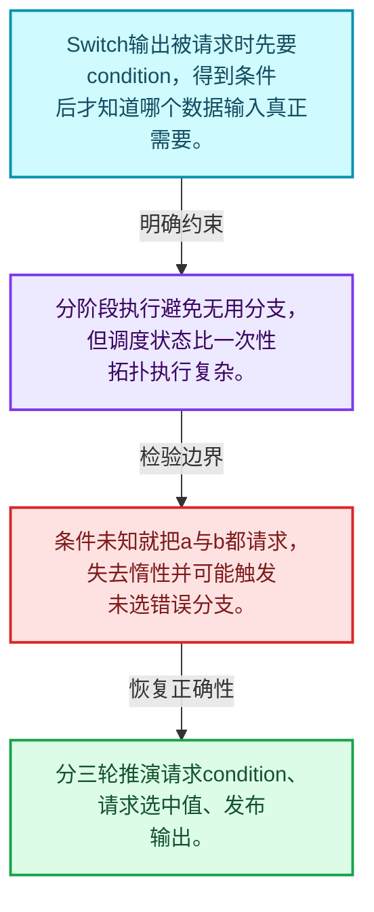
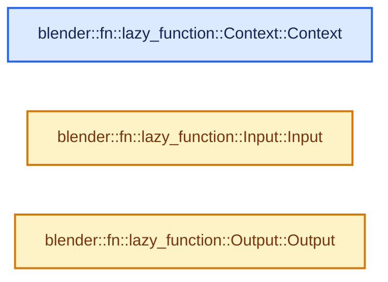
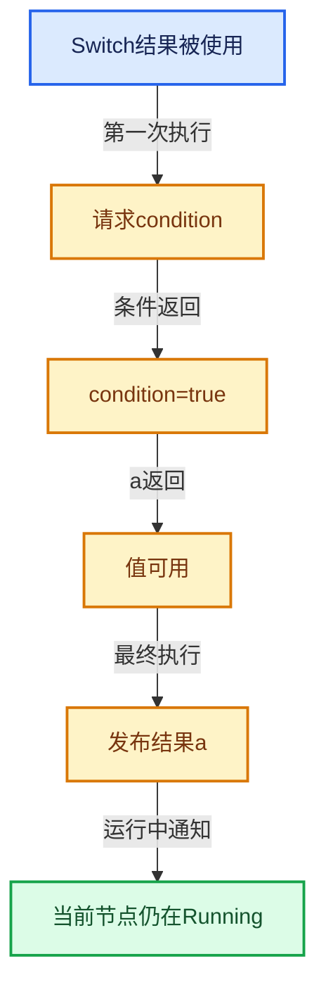

# 09-01 按需执行模型

[方向导航](README.md) · [总目录](../README.md) · [实现索引](../00-课程指南/02-源码与提交索引/符号依赖与实现索引.md)

## 从问题到实现

先知道需要哪个输出还是先计算所有输入？

输出需求和可用输入一起推动状态前进；函数可能多次执行，每次请求缺失输入或产出结果。

**数据模型**

Switch输出被请求时先要condition，得到条件后才知道哪个数据输入真正需要。

**设计取舍**

分阶段执行避免无用分支，但调度状态比一次性拓扑执行复杂。

**最小反例**

条件未知就把a与b都请求，失去惰性并可能触发未选错误分支。

**推导**

分三轮推演请求condition、请求选中值、发布输出。

## 阅读地图与执行推演








图中的数值推演是本方向的教学模型；实际函数之间的调用边与概念分析边分别标注，不能把概念关系当作运行时调度顺序。

## 完整源码单元与就地讲解

中文讲解直接放在相关代码旁，复杂机制在代码下展开。原文折叠区保留基准行号；不需要在行号表和函数之间来回查找。类布局可分段展示，函数实现不按固定行数切开。

### 类型布局、声明与编译条件 · FN_lazy_function.hh L1—L98

<a id="t-827ce5de1758"></a>

<a id="t-585d7cd4c60d"></a>

<a id="t-ddd8f8b2b9db"></a>

`Context`在这里声明的数据成员：

- `void storage`
- `UserData user_data`
- `LocalUserData local_user_data`

<!-- annotated:5563346cac90ab -->

```cpp
/* SPDX-FileCopyrightText: 2023 Blender Authors
 *
 * SPDX-License-Identifier: GPL-2.0-or-later */

#pragma once

/** \file
 * \ingroup fn
 *
 * A `LazyFunction` encapsulates a computation which has inputs, outputs and potentially side
 * effects. Most importantly, a `LazyFunction` supports laziness in its inputs and outputs:
 * - Only outputs that are actually used have to be computed.
 * - Inputs can be requested lazily based on which outputs are used or what side effects the
 *   function has.
 *
 * A lazy-function that uses laziness may be executed more than once. The most common example is
 * the geometry nodes switch node. Depending on a condition input, it decides which one of the
 * other inputs is actually used. From the perspective of the switch node, its execution works as
 * follows:
 * 1. The switch node is first executed. It sees that the output is used. Now it requests the
 *    condition input from the caller and exits.
 * 2. Once the caller is able to provide the condition input the switch node is executed again.
 *    This time it retrieves the condition and requests one of the other inputs. Then the node
 *    exits again, giving back control to the caller.
 * 3. When the caller computed the second requested input the switch node executes a last time.
 *    This time it retrieves the new input and forwards it to the output.
 *
 * In some sense, a lazy-function can be thought of like a state machine. Every time it is
 * executed, it advances its state until all required outputs are ready.
 *
 * The lazy-function interface is designed to support composition of many such functions into a new
 * lazy-functions, all while keeping the laziness working. For example, in geometry nodes a switch
 * node in a node group should still be able to decide whether a node in the parent group will be
 * executed or not. This is essential to avoid doing unnecessary work.
 *
 * The lazy-function system consists of multiple core components:
 * - The interface of a lazy-function itself including its calling convention.
 * - A graph data structure that allows composing many lazy-functions by connecting their inputs
 *   and outputs.
 * - An executor that allows multi-threaded execution or such a graph.
 */

#include "BLI_cpp_type.hh"
#include "BLI_function_ref.hh"
#include "BLI_linear_allocator.hh"
#include "BLI_vector.hh"

#include "PRF_profile.hh"

#include "FN_user_data.hh"

#ifndef NDEBUG
#  include <atomic>
#  include <thread>
#  define FN_LAZY_FUNCTION_DEBUG_THREADS
#endif

namespace blender {
namespace fn::lazy_function {

enum class ValueUsage : uint8_t {
  /**
   * The value is definitely used and therefore has to be computed.
   */
  Used,
  /**
   * It's unknown whether this value will be used or not. Computing it is ok but the result may be
   * discarded.
   */
  Maybe,
  /**
   * The value will definitely not be used. It can still be computed but the result will be
   * discarded in all cases.
   */
  Unused,
};

class LazyFunction;

/**
 * Passed to the lazy-function when it is executed.
 */
struct Context {
  /**
   * If the lazy-function has some state (which only makes sense when it is executed more than once
   * to finish its job), the state is stored here. This points to memory returned from
   * #LazyFunction::init_storage.
   */
  void *storage;
  /**
   * Custom user data that can be used in the function.
   */
  UserData *user_data;
  /**
   * Custom user data that is local to the thread that executes the lazy-function.
   */
  LocalUserData *local_user_data;

```

<details>
<summary>核对原始源码：source/blender/functions/FN_lazy_function.hh · L1—L98</summary>

<!-- original:5563346cac90ab:source/blender/functions/FN_lazy_function.hh:1:98 -->

```cpp
/* SPDX-FileCopyrightText: 2023 Blender Authors
 *
 * SPDX-License-Identifier: GPL-2.0-or-later */

#pragma once

/** \file
 * \ingroup fn
 *
 * A `LazyFunction` encapsulates a computation which has inputs, outputs and potentially side
 * effects. Most importantly, a `LazyFunction` supports laziness in its inputs and outputs:
 * - Only outputs that are actually used have to be computed.
 * - Inputs can be requested lazily based on which outputs are used or what side effects the
 *   function has.
 *
 * A lazy-function that uses laziness may be executed more than once. The most common example is
 * the geometry nodes switch node. Depending on a condition input, it decides which one of the
 * other inputs is actually used. From the perspective of the switch node, its execution works as
 * follows:
 * 1. The switch node is first executed. It sees that the output is used. Now it requests the
 *    condition input from the caller and exits.
 * 2. Once the caller is able to provide the condition input the switch node is executed again.
 *    This time it retrieves the condition and requests one of the other inputs. Then the node
 *    exits again, giving back control to the caller.
 * 3. When the caller computed the second requested input the switch node executes a last time.
 *    This time it retrieves the new input and forwards it to the output.
 *
 * In some sense, a lazy-function can be thought of like a state machine. Every time it is
 * executed, it advances its state until all required outputs are ready.
 *
 * The lazy-function interface is designed to support composition of many such functions into a new
 * lazy-functions, all while keeping the laziness working. For example, in geometry nodes a switch
 * node in a node group should still be able to decide whether a node in the parent group will be
 * executed or not. This is essential to avoid doing unnecessary work.
 *
 * The lazy-function system consists of multiple core components:
 * - The interface of a lazy-function itself including its calling convention.
 * - A graph data structure that allows composing many lazy-functions by connecting their inputs
 *   and outputs.
 * - An executor that allows multi-threaded execution or such a graph.
 */

#include "BLI_cpp_type.hh"
#include "BLI_function_ref.hh"
#include "BLI_linear_allocator.hh"
#include "BLI_vector.hh"

#include "PRF_profile.hh"

#include "FN_user_data.hh"

#ifndef NDEBUG
#  include <atomic>
#  include <thread>
#  define FN_LAZY_FUNCTION_DEBUG_THREADS
#endif

namespace blender {
namespace fn::lazy_function {

enum class ValueUsage : uint8_t {
  /**
   * The value is definitely used and therefore has to be computed.
   */
  Used,
  /**
   * It's unknown whether this value will be used or not. Computing it is ok but the result may be
   * discarded.
   */
  Maybe,
  /**
   * The value will definitely not be used. It can still be computed but the result will be
   * discarded in all cases.
   */
  Unused,
};

class LazyFunction;

/**
 * Passed to the lazy-function when it is executed.
 */
struct Context {
  /**
   * If the lazy-function has some state (which only makes sense when it is executed more than once
   * to finish its job), the state is stored here. This points to memory returned from
   * #LazyFunction::init_storage.
   */
  void *storage;
  /**
   * Custom user data that can be used in the function.
   */
  UserData *user_data;
  /**
   * Custom user data that is local to the thread that executes the lazy-function.
   */
  LocalUserData *local_user_data;

```

</details>

<a id="f-53e5df72a9d0843f"></a>

### `blender::fn::lazy_function::Context::Context`

实现位置：[source/blender/functions/FN_lazy_function.hh](../../../../../source/blender/functions/FN_lazy_function.hh) · L99—L102。

接口参数：

- `void *storage`
- `UserData *user_data`
- `LocalUserData *local_user_data`

**教学注释版**

<!-- annotated:14d62770b6bb48 -->

```cpp
  Context(void *storage, UserData *user_data, LocalUserData *local_user_data)
      : storage(storage), user_data(user_data), local_user_data(local_user_data)
  {
  }
```

<details>
<summary>核对原始源码：source/blender/functions/FN_lazy_function.hh · L99—L102</summary>

<!-- original:14d62770b6bb48:source/blender/functions/FN_lazy_function.hh:99:102 -->

```cpp
  Context(void *storage, UserData *user_data, LocalUserData *local_user_data)
      : storage(storage), user_data(user_data), local_user_data(local_user_data)
  {
  }
```

</details>

**继续追踪实现**

本实现没有需要继续展开的显式调用；检查返回表达式、对象转换和调用者前置条件。

### 类型布局、声明与编译条件 · FN_lazy_function.hh L103—L222

<a id="t-4ace0525d15e"></a>

`Params`在这里声明的数据成员：

- `LazyFunction fn_`
- `std::thread::id main_thread_id_`
- `std::atomic<bool> allow_multi_threading_`
- `void try_get_input_data_ptr`
- `void try_get_input_data_ptr_or_request`
- `void get_output_data_ptr`
- `void output_set`
- `bool output_was_set`
- `ValueUsage get_output_usage`
- `void set_input_unused`
- `bool try_enable_multi_threading`
- `void assert_valid_thread`
- `void try_get_input_data_ptr_impl`
- `void try_get_input_data_ptr_or_request_impl`
- `void get_output_data_ptr_impl`
- `void output_set_impl`
- `bool output_was_set_impl`
- `ValueUsage get_output_usage_impl`
- `void set_input_unused_impl`
- `bool try_enable_multi_threading_impl`

<a id="t-20c5dcc2489c"></a>

`Input`在这里声明的数据成员：

- `char debug_name`
- `CPPType type`
- `ValueUsage usage`

<!-- annotated:d8757b0dc28c60 -->

```cpp
};

/**
 * Defines the calling convention for a lazy-function. During execution, a lazy-function retrieves
 * its inputs and sets the outputs through #Params.
 */
class Params {
 public:
  /**
   * The lazy-function this #Params has been prepared for.
   */
  const LazyFunction &fn_;
#ifdef FN_LAZY_FUNCTION_DEBUG_THREADS
  std::thread::id main_thread_id_;
  std::atomic<bool> allow_multi_threading_;
#endif

  Params(const LazyFunction &fn, bool allow_multi_threading_initially);

  /**
   * Get a pointer to an input value if the value is available already. Otherwise null is returned.
   *
   * The #LazyFunction must leave returned object in an initialized state, but can move from it.
   */
  void *try_get_input_data_ptr(int index) const;

  /**
   * Same as #try_get_input_data_ptr, but if the data is not yet available, request it. This makes
   * sure that the data will be available in a future execution of the #LazyFunction.
   */
  void *try_get_input_data_ptr_or_request(int index);

  /**
   * Get a pointer to where the output value should be stored.
   * The value at the pointer is in an uninitialized state at first.
   * The #LazyFunction is responsible for initializing the value.
   * After the output has been initialized to its final value, #output_set has to be called.
   */
  void *get_output_data_ptr(int index);

  /**
   * Call this after the output value is initialized. After this is called, the value must not be
   * touched anymore. It may be moved or destructed immediately.
   */
  void output_set(int index);

  /**
   * Allows the #LazyFunction to check whether an output was computed already without keeping
   * track of it itself.
   */
  bool output_was_set(int index) const;

  /**
   * Can be used to detect which outputs have to be computed.
   */
  ValueUsage get_output_usage(int index) const;

  /**
   * Tell the caller of the #LazyFunction that a specific input will definitely not be used.
   * Only an input that was not #ValueUsage::Used can become unused.
   */
  void set_input_unused(int index);

  /**
   * Typed utility methods that wrap the methods above.
   */
  template<typename T> T extract_input(int index);
  template<typename T> T &get_input(int index) const;
  template<typename T> T *try_get_input_data_ptr(int index) const;
  template<typename T> T *try_get_input_data_ptr_or_request(int index);
  template<typename T> void set_output(int index, T &&value);

  /**
   * Returns true when the lazy-function is now allowed to use multi-threading when interacting
   * with this #Params. That means, it is allowed to call non-const methods from different threads.
   */
  bool try_enable_multi_threading();

 private:
  void assert_valid_thread() const;

  /**
   * Methods that need to be implemented by subclasses. Those are separate from the non-virtual
   * methods above to make it easy to insert additional debugging logic on top of the
   * implementations.
   */
  virtual void *try_get_input_data_ptr_impl(int index) const = 0;
  virtual void *try_get_input_data_ptr_or_request_impl(int index) = 0;
  virtual void *get_output_data_ptr_impl(int index) = 0;
  virtual void output_set_impl(int index) = 0;
  virtual bool output_was_set_impl(int index) const = 0;
  virtual ValueUsage get_output_usage_impl(int index) const = 0;
  virtual void set_input_unused_impl(int index) = 0;
  virtual bool try_enable_multi_threading_impl();
};

/**
 * Describes an input of a #LazyFunction.
 */
struct Input {
  /**
   * Name used for debugging purposes. The string has to be static or has to be owned by something
   * else.
   */
  const char *debug_name;
  /**
   * Data type of this input.
   */
  const CPPType *type;
  /**
   * Can be used to indicate a caller or this function if this input is used statically before
   * executing it the first time. This is technically not needed but can improve efficiency because
   * a round-trip through the `execute` method can be avoided.
   *
   * When this is #ValueUsage::Used, the caller has to ensure that the input is definitely
   * available when the #execute method is first called. The #execute method does not have to check
   * whether the value is actually available.
   */
  ValueUsage usage;

```

<details>
<summary>核对原始源码：source/blender/functions/FN_lazy_function.hh · L103—L222</summary>

<!-- original:d8757b0dc28c60:source/blender/functions/FN_lazy_function.hh:103:222 -->

```cpp
};

/**
 * Defines the calling convention for a lazy-function. During execution, a lazy-function retrieves
 * its inputs and sets the outputs through #Params.
 */
class Params {
 public:
  /**
   * The lazy-function this #Params has been prepared for.
   */
  const LazyFunction &fn_;
#ifdef FN_LAZY_FUNCTION_DEBUG_THREADS
  std::thread::id main_thread_id_;
  std::atomic<bool> allow_multi_threading_;
#endif

  Params(const LazyFunction &fn, bool allow_multi_threading_initially);

  /**
   * Get a pointer to an input value if the value is available already. Otherwise null is returned.
   *
   * The #LazyFunction must leave returned object in an initialized state, but can move from it.
   */
  void *try_get_input_data_ptr(int index) const;

  /**
   * Same as #try_get_input_data_ptr, but if the data is not yet available, request it. This makes
   * sure that the data will be available in a future execution of the #LazyFunction.
   */
  void *try_get_input_data_ptr_or_request(int index);

  /**
   * Get a pointer to where the output value should be stored.
   * The value at the pointer is in an uninitialized state at first.
   * The #LazyFunction is responsible for initializing the value.
   * After the output has been initialized to its final value, #output_set has to be called.
   */
  void *get_output_data_ptr(int index);

  /**
   * Call this after the output value is initialized. After this is called, the value must not be
   * touched anymore. It may be moved or destructed immediately.
   */
  void output_set(int index);

  /**
   * Allows the #LazyFunction to check whether an output was computed already without keeping
   * track of it itself.
   */
  bool output_was_set(int index) const;

  /**
   * Can be used to detect which outputs have to be computed.
   */
  ValueUsage get_output_usage(int index) const;

  /**
   * Tell the caller of the #LazyFunction that a specific input will definitely not be used.
   * Only an input that was not #ValueUsage::Used can become unused.
   */
  void set_input_unused(int index);

  /**
   * Typed utility methods that wrap the methods above.
   */
  template<typename T> T extract_input(int index);
  template<typename T> T &get_input(int index) const;
  template<typename T> T *try_get_input_data_ptr(int index) const;
  template<typename T> T *try_get_input_data_ptr_or_request(int index);
  template<typename T> void set_output(int index, T &&value);

  /**
   * Returns true when the lazy-function is now allowed to use multi-threading when interacting
   * with this #Params. That means, it is allowed to call non-const methods from different threads.
   */
  bool try_enable_multi_threading();

 private:
  void assert_valid_thread() const;

  /**
   * Methods that need to be implemented by subclasses. Those are separate from the non-virtual
   * methods above to make it easy to insert additional debugging logic on top of the
   * implementations.
   */
  virtual void *try_get_input_data_ptr_impl(int index) const = 0;
  virtual void *try_get_input_data_ptr_or_request_impl(int index) = 0;
  virtual void *get_output_data_ptr_impl(int index) = 0;
  virtual void output_set_impl(int index) = 0;
  virtual bool output_was_set_impl(int index) const = 0;
  virtual ValueUsage get_output_usage_impl(int index) const = 0;
  virtual void set_input_unused_impl(int index) = 0;
  virtual bool try_enable_multi_threading_impl();
};

/**
 * Describes an input of a #LazyFunction.
 */
struct Input {
  /**
   * Name used for debugging purposes. The string has to be static or has to be owned by something
   * else.
   */
  const char *debug_name;
  /**
   * Data type of this input.
   */
  const CPPType *type;
  /**
   * Can be used to indicate a caller or this function if this input is used statically before
   * executing it the first time. This is technically not needed but can improve efficiency because
   * a round-trip through the `execute` method can be avoided.
   *
   * When this is #ValueUsage::Used, the caller has to ensure that the input is definitely
   * available when the #execute method is first called. The #execute method does not have to check
   * whether the value is actually available.
   */
  ValueUsage usage;

```

</details>

<a id="f-7d4fd5cd4c7e1526"></a>

### `blender::fn::lazy_function::Input::Input`

实现位置：[source/blender/functions/FN_lazy_function.hh](../../../../../source/blender/functions/FN_lazy_function.hh) · L223—L226。

接口参数：

- `const char *debug_name`
- `const CPPType &type`
- `const ValueUsage usage = ValueUsage::Used`

**教学注释版**

<!-- annotated:d9702c397b88fc -->

```cpp
  Input(const char *debug_name, const CPPType &type, const ValueUsage usage = ValueUsage::Used)
      : debug_name(debug_name), type(&type), usage(usage)
  {
  }
```

<details>
<summary>核对原始源码：source/blender/functions/FN_lazy_function.hh · L223—L226</summary>

<!-- original:d9702c397b88fc:source/blender/functions/FN_lazy_function.hh:223:226 -->

```cpp
  Input(const char *debug_name, const CPPType &type, const ValueUsage usage = ValueUsage::Used)
      : debug_name(debug_name), type(&type), usage(usage)
  {
  }
```

</details>

**继续追踪实现**

本实现没有需要继续展开的显式调用；检查返回表达式、对象转换和调用者前置条件。

### 类型布局、声明与编译条件 · FN_lazy_function.hh L227—L239

<a id="t-fb2f410ba427"></a>

`Output`在这里声明的数据成员：

- `char debug_name`
- `CPPType type`

<!-- annotated:c5a014965577e8 -->

```cpp
};

struct Output {
  /**
   * Name used for debugging purposes. The string has to be static or has to be owned by something
   * else.
   */
  const char *debug_name;
  /**
   * Data type of this output.
   */
  const CPPType *type = nullptr;

```

<details>
<summary>核对原始源码：source/blender/functions/FN_lazy_function.hh · L227—L239</summary>

<!-- original:c5a014965577e8:source/blender/functions/FN_lazy_function.hh:227:239 -->

```cpp
};

struct Output {
  /**
   * Name used for debugging purposes. The string has to be static or has to be owned by something
   * else.
   */
  const char *debug_name;
  /**
   * Data type of this output.
   */
  const CPPType *type = nullptr;

```

</details>

<a id="f-07a9de5e9e9fcfcf"></a>

### `blender::fn::lazy_function::Output::Output`

实现位置：[source/blender/functions/FN_lazy_function.hh](../../../../../source/blender/functions/FN_lazy_function.hh) · L240—L240。

接口参数：

- `const char *debug_name`
- `const CPPType &type`

**教学注释版**

<!-- annotated:8724b34c43694f -->

```cpp
  Output(const char *debug_name, const CPPType &type) : debug_name(debug_name), type(&type) {}
```

<details>
<summary>核对原始源码：source/blender/functions/FN_lazy_function.hh · L240—L240</summary>

<!-- original:8724b34c43694f:source/blender/functions/FN_lazy_function.hh:240:240 -->

```cpp
  Output(const char *debug_name, const CPPType &type) : debug_name(debug_name), type(&type) {}
```

</details>

**继续追踪实现**

本实现没有需要继续展开的显式调用；检查返回表达式、对象转换和调用者前置条件。

## 语法与相关类型

### 模板 template

模板把类型或常量作为生成实现的参数。读声明时先列出类型参数、非类型参数和默认值，再看使用者实际实例化了什么。模板声明本身不意味着每种T都支持其全部成员。

把T替换为int、string、只能移动的类型，分别检查每个被调用操作是否成立。

### 依赖名称 typename

typename既可引入类型模板参数，也可告诉编译器某个依赖名称是类型。它不创建运行时对象；解析期确认语法类别与实例化期检查具体类型是不同阶段。

区分typename T::value_type和T::size()，前者标记类型，后者是表达式。

### 只读限定 const

const约束当前访问路径可做的修改。const指针、指向const的指针、const视图对象、const元素是不同位置的限定；其他别名可能仍可修改原对象。

分别写T* const、const T*与const T* const，并画出不可修改的层次。

### 异常边界 try与catch

try定义异常传播的局部边界。失败路径需要销毁已经成功构造的部分并释放相应存储；未构造的对象不能被析构。

在第k次构造失败，列出已经存在的对象集合与待释放缓冲。

### 运行时多态 virtual

虚调用根据实际动态类型选择实现；经基类指针销毁对象时通常需要相应虚析构契约。每元素虚调用和循环外一次分派有不同开销。

找出虚接口的实现类和调用频率，再讨论是否值得去虚拟化。

### 原子操作 atomic

原子性保护相应原子对象的访问；发布其他普通数据还要分析内存序。多个原子字段分别安全不等于复合不变量整体原子。

画出写数据、发布ready与读ready、读数据的顺序关系。

### 构造与new表达式

普通new可能分配并构造；placement new在给定地址构造，存储由其他机制提供。失败回滚应区分两类责任。

追踪地址来自哪里、构造何时成功、由谁析构、由谁释放。

### 枚举与状态模型 enum

枚举把有限状态命名；enum class避免许多隐式整数转换。状态机正确性还依赖允许的转移，不能只看有哪些枚举项。

列出每个状态的进入条件和离开条件，检查终止状态是否仍可能被调度。

## 实现练习与验证

让未选Switch分支含错误，验证它不被请求。

参考推理：分三轮推演请求condition、请求选中值、发布输出。

未选分支不执行；输出不会被非法重复构造；同一节点不同时运行两次；副作用有明确执行依据。

## 历史、跨库比较与证据

与拓扑一次求值、future和数据流调度比较：惰性函数允许执行过程中继续请求输入，同一个计算单元可分多次推进。

[历史提交索引](../00-课程指南/02-源码与提交索引/历史提交与设计演化索引.md) · [源码基准](../00-课程指南/02-源码与提交索引/源码版本与覆盖索引.md) · [验收报告](../00-课程指南/03-验收报告/验收报告.md)
