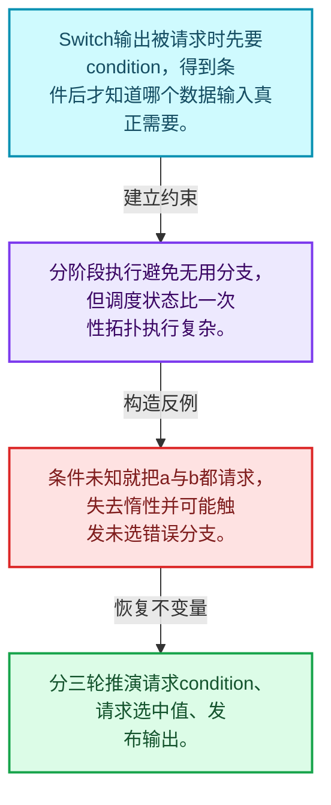
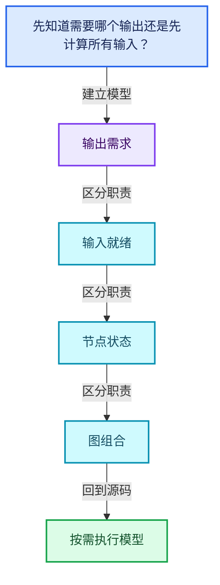
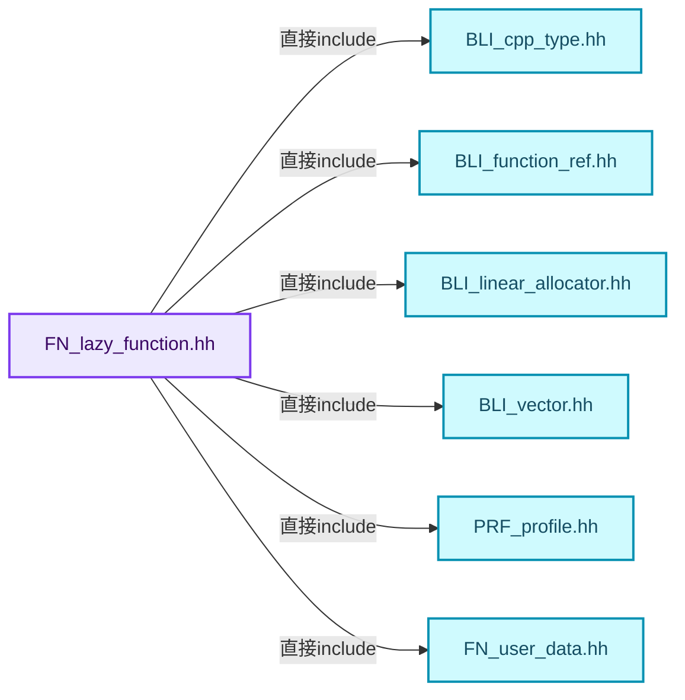
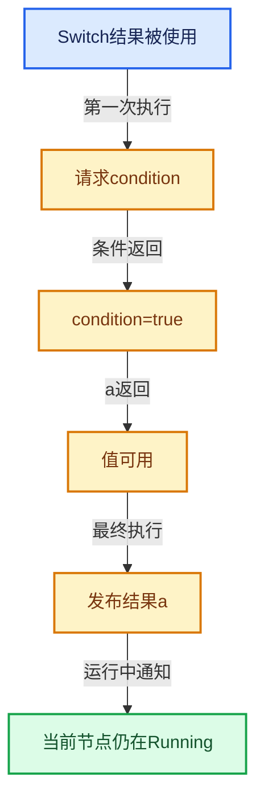

# 09-01 按需执行模型

[方向导航](README.md) · [总目录](../README.md) · [覆盖索引](../%E6%BA%90%E7%A0%81%E7%89%88%E6%9C%AC%E4%B8%8E%E8%A6%86%E7%9B%96%E7%B4%A2%E5%BC%95.md)

> 阅读顺序：问题与数据模型 → 语法与类型 → 源码逐行 → 调用线索 → 历史与取舍 → 推演和练习。

- 基准 HEAD：`cbda6b96c26c0dee3c3b5cbb93960c4ac06a6b30`。
- 记录日期：2026-10-14。
- 教学示例状态：正文中的推演不是本机性能实测；已运行练习见验收报告。

## 一、从问题到设计

先知道需要哪个输出还是先计算所有输入？

输出需求和可用输入一起推动状态前进；函数可能多次执行，每次请求缺失输入或产出结果。

本篇把语法、数据语义和系统取舍连接起来。需求与就绪是不同维度；状态只在有证据时推进，不能把未确定当作无需求。

### 本篇独立模型与设计推理

Switch输出被请求时先要condition，得到条件后才知道哪个数据输入真正需要。

设计取舍：分阶段执行避免无用分支，但调度状态比一次性拓扑执行复杂。

最小反例：条件未知就把a与b都请求，失去惰性并可能触发未选错误分支。

推导与处理：分三轮推演请求condition、请求选中值、发布输出。



### 源码范围与相邻篇章

| 文件 | 本篇逐行范围 | 基准SHA-256 |
|---|---|---|
| [source/blender/functions/FN_lazy_function.hh](../../../../../source/blender/functions/FN_lazy_function.hh) | L1—L240 | `e9d3118bf1a4e17ce7ba95bb38f545c7288277b9b378378ed80291a2011dae5e` |

同一主讲文件可能分多篇覆盖；超出本篇范围的符号通过覆盖索引定位。空行与纯注释保留在源码摘录中，逐行表解释有效语句与语法边界；许可证头统一保留。

后篇：[LazyFunction接口](02-LazyFunction%E6%8E%A5%E5%8F%A3.md).

## 二、类型、数据与阅读地图



这是概念依赖图，边表示阅读关系，不声称是运行时调用顺序。

### 直接编译依赖



箭头只表示头文件包含关系；完整调用线索见后面的符号定位表。

## 三、关键词、语法与类型角色

### 模板 template

模板把类型或常量作为生成实现的参数。读声明时先列出类型参数、非类型参数和默认值，再看使用者实际实例化了什么。模板声明本身不意味着每种T都支持其全部成员。

具体检查：把T替换为int、string、只能移动的类型，分别检查每个被调用操作是否成立。

### 依赖名称 typename

typename既可引入类型模板参数，也可告诉编译器某个依赖名称是类型。它不创建运行时对象；解析期确认语法类别与实例化期检查具体类型是不同阶段。

具体检查：区分typename T::value_type和T::size()，前者标记类型，后者是表达式。

### 只读限定 const

const约束当前访问路径可做的修改。const指针、指向const的指针、const视图对象、const元素是不同位置的限定；其他别名可能仍可修改原对象。

具体检查：分别写T* const、const T*与const T* const，并画出不可修改的层次。

### 异常边界 try与catch

try定义异常传播的局部边界。失败路径需要销毁已经成功构造的部分并释放相应存储；未构造的对象不能被析构。

具体检查：在第k次构造失败，列出已经存在的对象集合与待释放缓冲。

### 运行时多态 virtual

虚调用根据实际动态类型选择实现；经基类指针销毁对象时通常需要相应虚析构契约。每元素虚调用和循环外一次分派有不同开销。

具体检查：找出虚接口的实现类和调用频率，再讨论是否值得去虚拟化。

### 原子操作 atomic

原子性保护相应原子对象的访问；发布其他普通数据还要分析内存序。多个原子字段分别安全不等于复合不变量整体原子。

具体检查：画出写数据、发布ready与读ready、读数据的顺序关系。

### 构造与new表达式

普通new可能分配并构造；placement new在给定地址构造，存储由其他机制提供。失败回滚应区分两类责任。

具体检查：追踪地址来自哪里、构造何时成功、由谁析构、由谁释放。

### 枚举与状态模型 enum

枚举把有限状态命名；enum class避免许多隐式整数转换。状态机正确性还依赖允许的转移，不能只看有哪些枚举项。

具体检查：列出每个状态的进入条件和离开条件，检查终止状态是否仍可能被调度。

## 四、真实源码与逐行讲解

源码块保持原行内容，原始行号由小节标题及逐行表给出。表中的调用定位是静态阅读辅助；重载、模板实例化、宏展开和虚调用需结合完整声明，不能仅凭词法出现证明动态调用。

### FN_lazy_function.hh：L1—L48

<!-- source:source/blender/functions/FN_lazy_function.hh:1:48 -->

```cpp
/* SPDX-FileCopyrightText: 2023 Blender Authors
 *
 * SPDX-License-Identifier: GPL-2.0-or-later */

#pragma once

/** \file
 * \ingroup fn
 *
 * A `LazyFunction` encapsulates a computation which has inputs, outputs and potentially side
 * effects. Most importantly, a `LazyFunction` supports laziness in its inputs and outputs:
 * - Only outputs that are actually used have to be computed.
 * - Inputs can be requested lazily based on which outputs are used or what side effects the
 *   function has.
 *
 * A lazy-function that uses laziness may be executed more than once. The most common example is
 * the geometry nodes switch node. Depending on a condition input, it decides which one of the
 * other inputs is actually used. From the perspective of the switch node, its execution works as
 * follows:
 * 1. The switch node is first executed. It sees that the output is used. Now it requests the
 *    condition input from the caller and exits.
 * 2. Once the caller is able to provide the condition input the switch node is executed again.
 *    This time it retrieves the condition and requests one of the other inputs. Then the node
 *    exits again, giving back control to the caller.
 * 3. When the caller computed the second requested input the switch node executes a last time.
 *    This time it retrieves the new input and forwards it to the output.
 *
 * In some sense, a lazy-function can be thought of like a state machine. Every time it is
 * executed, it advances its state until all required outputs are ready.
 *
 * The lazy-function interface is designed to support composition of many such functions into a new
 * lazy-functions, all while keeping the laziness working. For example, in geometry nodes a switch
 * node in a node group should still be able to decide whether a node in the parent group will be
 * executed or not. This is essential to avoid doing unnecessary work.
 *
 * The lazy-function system consists of multiple core components:
 * - The interface of a lazy-function itself including its calling convention.
 * - A graph data structure that allows composing many lazy-functions by connecting their inputs
 *   and outputs.
 * - An executor that allows multi-threaded execution or such a graph.
 */

#include "BLI_cpp_type.hh"
#include "BLI_function_ref.hh"
#include "BLI_linear_allocator.hh"
#include "BLI_vector.hh"

#include "PRF_profile.hh"
```

| 原始行 | 语义、约束与检查 |
|---|---|
| L5 | 防止同一头文件在一个翻译单元中重复展开；不控制多个源文件之间的链接或对象寿命。 |
| L43 | 引入编译依赖 "BLI_cpp_type.hh"；这是声明可见性关系，不表示运行时一定调用该文件的所有接口。 |
| L44 | 引入编译依赖 "BLI_function_ref.hh"；这是声明可见性关系，不表示运行时一定调用该文件的所有接口。 |
| L45 | 引入编译依赖 "BLI_linear_allocator.hh"；这是声明可见性关系，不表示运行时一定调用该文件的所有接口。 |
| L46 | 引入编译依赖 "BLI_vector.hh"；这是声明可见性关系，不表示运行时一定调用该文件的所有接口。 |
| L48 | 引入编译依赖 "PRF_profile.hh"；这是声明可见性关系，不表示运行时一定调用该文件的所有接口。 |

### FN_lazy_function.hh：L49—L97

<!-- source:source/blender/functions/FN_lazy_function.hh:49:97 -->

```cpp

#include "FN_user_data.hh"

#ifndef NDEBUG
#  include <atomic>
#  include <thread>
#  define FN_LAZY_FUNCTION_DEBUG_THREADS
#endif

namespace blender {
namespace fn::lazy_function {

enum class ValueUsage : uint8_t {
  /**
   * The value is definitely used and therefore has to be computed.
   */
  Used,
  /**
   * It's unknown whether this value will be used or not. Computing it is ok but the result may be
   * discarded.
   */
  Maybe,
  /**
   * The value will definitely not be used. It can still be computed but the result will be
   * discarded in all cases.
   */
  Unused,
};

class LazyFunction;

/**
 * Passed to the lazy-function when it is executed.
 */
struct Context {
  /**
   * If the lazy-function has some state (which only makes sense when it is executed more than once
   * to finish its job), the state is stored here. This points to memory returned from
   * #LazyFunction::init_storage.
   */
  void *storage;
  /**
   * Custom user data that can be used in the function.
   */
  UserData *user_data;
  /**
   * Custom user data that is local to the thread that executes the lazy-function.
   */
  LocalUserData *local_user_data;
```

| 原始行 | 语义、约束与检查 |
|---|---|
| L50 | 引入编译依赖 "FN_user_data.hh"；这是声明可见性关系，不表示运行时一定调用该文件的所有接口。 |
| L52 | 预处理阶段处理 #ifndef NDEBUG。它决定哪些代码进入编译，不是运行时分支；阅读行为时必须结合实际构建宏。 |
| L53 | 本行是连续声明或表达式的一部分：`#  include <atomic>`。与本段前后行合读；逗号、括号和限定符决定它属于参数、初始化列表还是实际计算。 |
| L54 | 本行是连续声明或表达式的一部分：`#  include <thread>`。与本段前后行合读；逗号、括号和限定符决定它属于参数、初始化列表还是实际计算。 |
| L55 | 本行是连续声明或表达式的一部分：`#  define FN_LAZY_FUNCTION_DEBUG_THREADS`。与本段前后行合读；逗号、括号和限定符决定它属于参数、初始化列表还是实际计算。 |
| L56 | 预处理阶段处理 #endif。它决定哪些代码进入编译，不是运行时分支；阅读行为时必须结合实际构建宏。 |
| L58 | 把后续声明放入 blender 命名空间，影响名称查找和符号归属，不创建运行时对象。 |
| L59 | 把后续声明放入 fn::lazy_function 命名空间，影响名称查找和符号归属，不创建运行时对象。 |
| L61 | 声明或定义类型 `enum class ValueUsage : uint8_t`。结合继承、访问权限和成员布局确认接口与拥有关系；前向声明本身没有完整对象布局。 |
| L65 | 本行是连续声明或表达式的一部分：`Used,`。与本段前后行合读；逗号、括号和限定符决定它属于参数、初始化列表还是实际计算。 |
| L70 | 本行是连续声明或表达式的一部分：`Maybe,`。与本段前后行合读；逗号、括号和限定符决定它属于参数、初始化列表还是实际计算。 |
| L75 | 本行是连续声明或表达式的一部分：`Unused,`。与本段前后行合读；逗号、括号和限定符决定它属于参数、初始化列表还是实际计算。 |
| L76 | 结束当前语法单元。局部自动对象在离开其作用域时按规则销毁；这不等于所有被引用的外部数据也被释放。 |
| L78 | 声明或定义类型 `class LazyFunction`。结合继承、访问权限和成员布局确认接口与拥有关系；前向声明本身没有完整对象布局。 |
| L83 | 声明或定义类型 `struct Context`。结合继承、访问权限和成员布局确认接口与拥有关系；前向声明本身没有完整对象布局。 |
| L89 | 声明成员、局部对象或完成语句 `void *storage`。若为指针或引用，它本身不说明拥有；若为值对象，其构造析构由所在作用域或外层对象管理。 |
| L93 | 声明成员、局部对象或完成语句 `UserData *user_data`。若为指针或引用，它本身不说明拥有；若为值对象，其构造析构由所在作用域或外层对象管理。 |
| L97 | 声明成员、局部对象或完成语句 `LocalUserData *local_user_data`。若为指针或引用，它本身不说明拥有；若为值对象，其构造析构由所在作用域或外层对象管理。 |

### FN_lazy_function.hh：L98—L147

<!-- source:source/blender/functions/FN_lazy_function.hh:98:147 -->

```cpp

  Context(void *storage, UserData *user_data, LocalUserData *local_user_data)
      : storage(storage), user_data(user_data), local_user_data(local_user_data)
  {
  }
};

/**
 * Defines the calling convention for a lazy-function. During execution, a lazy-function retrieves
 * its inputs and sets the outputs through #Params.
 */
class Params {
 public:
  /**
   * The lazy-function this #Params has been prepared for.
   */
  const LazyFunction &fn_;
#ifdef FN_LAZY_FUNCTION_DEBUG_THREADS
  std::thread::id main_thread_id_;
  std::atomic<bool> allow_multi_threading_;
#endif

  Params(const LazyFunction &fn, bool allow_multi_threading_initially);

  /**
   * Get a pointer to an input value if the value is available already. Otherwise null is returned.
   *
   * The #LazyFunction must leave returned object in an initialized state, but can move from it.
   */
  void *try_get_input_data_ptr(int index) const;

  /**
   * Same as #try_get_input_data_ptr, but if the data is not yet available, request it. This makes
   * sure that the data will be available in a future execution of the #LazyFunction.
   */
  void *try_get_input_data_ptr_or_request(int index);

  /**
   * Get a pointer to where the output value should be stored.
   * The value at the pointer is in an uninitialized state at first.
   * The #LazyFunction is responsible for initializing the value.
   * After the output has been initialized to its final value, #output_set has to be called.
   */
  void *get_output_data_ptr(int index);

  /**
   * Call this after the output value is initialized. After this is called, the value must not be
   * touched anymore. It may be moved or destructed immediately.
   */
  void output_set(int index);
```

本段语义重点：

- `try_get_input`：尝试读取已可用输入；未就绪与合法空值应使用接口约定区分。

| 原始行 | 语义、约束与检查 |
|---|---|
| L99 | 出现调用或函数声明 `Context`，对应表达式为 `Context(void *storage, UserData *user_data, LocalUserData *local_user_data)`。参数求值、返回类型与重载需结合前后完整语句；静态文本引用不能证明动态目标。 |
| L100 | 出现调用或函数声明 `storage`，对应表达式为 `: storage(storage), user_data(user_data), local_user_data(local_user_data)`。参数求值、返回类型与重载需结合前后完整语句；静态文本引用不能证明动态目标。 |
| L101 | 连接上一行的声明或控制结构与其语句块；后续行在这个作用域中执行或声明。 |
| L102 | 结束当前语法单元。局部自动对象在离开其作用域时按规则销毁；这不等于所有被引用的外部数据也被释放。 |
| L103 | 结束当前语法单元。局部自动对象在离开其作用域时按规则销毁；这不等于所有被引用的外部数据也被释放。 |
| L109 | 声明或定义类型 `class Params`。结合继承、访问权限和成员布局确认接口与拥有关系；前向声明本身没有完整对象布局。 |
| L110 | 切换成员访问权限为 public；它是编译期接口边界，不是线程同步或内存保护。 |
| L114 | 声明成员、局部对象或完成语句 `const LazyFunction &fn_`。若为指针或引用，它本身不说明拥有；若为值对象，其构造析构由所在作用域或外层对象管理。 |
| L115 | 预处理阶段处理 #ifdef FN_LAZY_FUNCTION_DEBUG_THREADS。它决定哪些代码进入编译，不是运行时分支；阅读行为时必须结合实际构建宏。 |
| L116 | 声明成员、局部对象或完成语句 `std::thread::id main_thread_id_`。若为指针或引用，它本身不说明拥有；若为值对象，其构造析构由所在作用域或外层对象管理。 |
| L117 | 声明成员、局部对象或完成语句 `std::atomic<bool> allow_multi_threading_`。若为指针或引用，它本身不说明拥有；若为值对象，其构造析构由所在作用域或外层对象管理。 |
| L118 | 预处理阶段处理 #endif。它决定哪些代码进入编译，不是运行时分支；阅读行为时必须结合实际构建宏。 |
| L120 | 出现调用或函数声明 `Params`，对应表达式为 `Params(const LazyFunction &fn, bool allow_multi_threading_initially);`。参数求值、返回类型与重载需结合前后完整语句；静态文本引用不能证明动态目标。 |
| L127 | 声明接口 `void *try_get_input_data_ptr(int index) const`，本行没有对应函数体；返回类型、参数限定和const/noexcept共同组成调用契约，实际行为需继续定位实现。 |
| L133 | 声明接口 `void *try_get_input_data_ptr_or_request(int index)`，本行没有对应函数体；返回类型、参数限定和const/noexcept共同组成调用契约，实际行为需继续定位实现。 |
| L141 | 声明接口 `void *get_output_data_ptr(int index)`，本行没有对应函数体；返回类型、参数限定和const/noexcept共同组成调用契约，实际行为需继续定位实现。 |
| L147 | 声明接口 `void output_set(int index)`，本行没有对应函数体；返回类型、参数限定和const/noexcept共同组成调用契约，实际行为需继续定位实现。 |

### FN_lazy_function.hh：L148—L195

<!-- source:source/blender/functions/FN_lazy_function.hh:148:195 -->

```cpp

  /**
   * Allows the #LazyFunction to check whether an output was computed already without keeping
   * track of it itself.
   */
  bool output_was_set(int index) const;

  /**
   * Can be used to detect which outputs have to be computed.
   */
  ValueUsage get_output_usage(int index) const;

  /**
   * Tell the caller of the #LazyFunction that a specific input will definitely not be used.
   * Only an input that was not #ValueUsage::Used can become unused.
   */
  void set_input_unused(int index);

  /**
   * Typed utility methods that wrap the methods above.
   */
  template<typename T> T extract_input(int index);
  template<typename T> T &get_input(int index) const;
  template<typename T> T *try_get_input_data_ptr(int index) const;
  template<typename T> T *try_get_input_data_ptr_or_request(int index);
  template<typename T> void set_output(int index, T &&value);

  /**
   * Returns true when the lazy-function is now allowed to use multi-threading when interacting
   * with this #Params. That means, it is allowed to call non-const methods from different threads.
   */
  bool try_enable_multi_threading();

 private:
  void assert_valid_thread() const;

  /**
   * Methods that need to be implemented by subclasses. Those are separate from the non-virtual
   * methods above to make it easy to insert additional debugging logic on top of the
   * implementations.
   */
  virtual void *try_get_input_data_ptr_impl(int index) const = 0;
  virtual void *try_get_input_data_ptr_or_request_impl(int index) = 0;
  virtual void *get_output_data_ptr_impl(int index) = 0;
  virtual void output_set_impl(int index) = 0;
  virtual bool output_was_set_impl(int index) const = 0;
  virtual ValueUsage get_output_usage_impl(int index) const = 0;
  virtual void set_input_unused_impl(int index) = 0;
```

本段语义重点：

- `set_output`：向输出位置发布值；输出是否已构造、是否已经设置由调用约定限制。
- `try_get_input`：尝试读取已可用输入；未就绪与合法空值应使用接口约定区分。
- `extract_input`：提取输入值，可能转移其资源；重复读取的合法性取决于接口契约。
- `get_output_usage`：读取输出需求，依据它决定是否请求额外输入。

| 原始行 | 语义、约束与检查 |
|---|---|
| L153 | 声明接口 `bool output_was_set(int index) const`，本行没有对应函数体；返回类型、参数限定和const/noexcept共同组成调用契约，实际行为需继续定位实现。 |
| L158 | 声明接口 `ValueUsage get_output_usage(int index) const`，本行没有对应函数体；返回类型、参数限定和const/noexcept共同组成调用契约，实际行为需继续定位实现。 |
| L164 | 声明接口 `void set_input_unused(int index)`，本行没有对应函数体；返回类型、参数限定和const/noexcept共同组成调用契约，实际行为需继续定位实现。 |
| L169 | 声明模板参数 `template<typename T> T extract_input(int index);`。类型参数决定生成操作的类型，非类型参数可决定内嵌容量或编译期分支。 |
| L170 | 声明模板参数 `template<typename T> T &get_input(int index) const;`。类型参数决定生成操作的类型，非类型参数可决定内嵌容量或编译期分支。 |
| L171 | 声明模板参数 `template<typename T> T *try_get_input_data_ptr(int index) const;`。类型参数决定生成操作的类型，非类型参数可决定内嵌容量或编译期分支。 |
| L172 | 声明模板参数 `template<typename T> T *try_get_input_data_ptr_or_request(int index);`。类型参数决定生成操作的类型，非类型参数可决定内嵌容量或编译期分支。 |
| L173 | 声明模板参数 `template<typename T> void set_output(int index, T &&value);`。类型参数决定生成操作的类型，非类型参数可决定内嵌容量或编译期分支。 |
| L179 | 声明接口 `bool try_enable_multi_threading()`，本行没有对应函数体；返回类型、参数限定和const/noexcept共同组成调用契约，实际行为需继续定位实现。 |
| L181 | 切换成员访问权限为 private；它是编译期接口边界，不是线程同步或内存保护。 |
| L182 | 声明接口 `void assert_valid_thread() const`，本行没有对应函数体；返回类型、参数限定和const/noexcept共同组成调用契约，实际行为需继续定位实现。 |
| L189 | 纯虚接口声明：`virtual void *try_get_input_data_ptr_impl(int index) const = 0;`。等号零标记抽象接口，需要按继承约定提供覆写；不表示执行函数并把结果设为零。 |
| L190 | 纯虚接口声明：`virtual void *try_get_input_data_ptr_or_request_impl(int index) = 0;`。等号零标记抽象接口，需要按继承约定提供覆写；不表示执行函数并把结果设为零。 |
| L191 | 纯虚接口声明：`virtual void *get_output_data_ptr_impl(int index) = 0;`。等号零标记抽象接口，需要按继承约定提供覆写；不表示执行函数并把结果设为零。 |
| L192 | 纯虚接口声明：`virtual void output_set_impl(int index) = 0;`。等号零标记抽象接口，需要按继承约定提供覆写；不表示执行函数并把结果设为零。 |
| L193 | 纯虚接口声明：`virtual bool output_was_set_impl(int index) const = 0;`。等号零标记抽象接口，需要按继承约定提供覆写；不表示执行函数并把结果设为零。 |
| L194 | 纯虚接口声明：`virtual ValueUsage get_output_usage_impl(int index) const = 0;`。等号零标记抽象接口，需要按继承约定提供覆写；不表示执行函数并把结果设为零。 |
| L195 | 纯虚接口声明：`virtual void set_input_unused_impl(int index) = 0;`。等号零标记抽象接口，需要按继承约定提供覆写；不表示执行函数并把结果设为零。 |

### FN_lazy_function.hh：L196—L240

<!-- source:source/blender/functions/FN_lazy_function.hh:196:240 -->

```cpp
  virtual bool try_enable_multi_threading_impl();
};

/**
 * Describes an input of a #LazyFunction.
 */
struct Input {
  /**
   * Name used for debugging purposes. The string has to be static or has to be owned by something
   * else.
   */
  const char *debug_name;
  /**
   * Data type of this input.
   */
  const CPPType *type;
  /**
   * Can be used to indicate a caller or this function if this input is used statically before
   * executing it the first time. This is technically not needed but can improve efficiency because
   * a round-trip through the `execute` method can be avoided.
   *
   * When this is #ValueUsage::Used, the caller has to ensure that the input is definitely
   * available when the #execute method is first called. The #execute method does not have to check
   * whether the value is actually available.
   */
  ValueUsage usage;

  Input(const char *debug_name, const CPPType &type, const ValueUsage usage = ValueUsage::Used)
      : debug_name(debug_name), type(&type), usage(usage)
  {
  }
};

struct Output {
  /**
   * Name used for debugging purposes. The string has to be static or has to be owned by something
   * else.
   */
  const char *debug_name;
  /**
   * Data type of this output.
   */
  const CPPType *type = nullptr;

  Output(const char *debug_name, const CPPType &type) : debug_name(debug_name), type(&type) {}
```

本段语义重点：

- `usage`：值使用需求，Maybe、Used与Unused各有不同含义。

| 原始行 | 语义、约束与检查 |
|---|---|
| L196 | 声明接口 `virtual bool try_enable_multi_threading_impl()`，本行没有对应函数体；返回类型、参数限定和const/noexcept共同组成调用契约，实际行为需继续定位实现。 |
| L197 | 结束当前语法单元。局部自动对象在离开其作用域时按规则销毁；这不等于所有被引用的外部数据也被释放。 |
| L202 | 声明或定义类型 `struct Input`。结合继承、访问权限和成员布局确认接口与拥有关系；前向声明本身没有完整对象布局。 |
| L207 | 声明成员、局部对象或完成语句 `const char *debug_name`。若为指针或引用，它本身不说明拥有；若为值对象，其构造析构由所在作用域或外层对象管理。 |
| L211 | 声明成员、局部对象或完成语句 `const CPPType *type`。若为指针或引用，它本身不说明拥有；若为值对象，其构造析构由所在作用域或外层对象管理。 |
| L221 | 本行涉及 `usage`：值使用需求，Maybe、Used与Unused各有不同含义。按此语义解读 `ValueUsage usage`，不要把地址、数量或状态混用。 |
| L223 | 建立或更新 `usage`：值使用需求，Maybe、Used与Unused各有不同含义。本行的具体值关系为 `Input(const char *debug_name, const CPPType &type, const ValueUsage usage = ValueUsage::Used)`；对照更新前后相应范围或状态是否一致。 |
| L224 | 本行涉及 `usage`：值使用需求，Maybe、Used与Unused各有不同含义。按此语义解读 `: debug_name(debug_name), type(&type), usage(usage)`，不要把地址、数量或状态混用。 |
| L225 | 连接上一行的声明或控制结构与其语句块；后续行在这个作用域中执行或声明。 |
| L226 | 结束当前语法单元。局部自动对象在离开其作用域时按规则销毁；这不等于所有被引用的外部数据也被释放。 |
| L227 | 结束当前语法单元。局部自动对象在离开其作用域时按规则销毁；这不等于所有被引用的外部数据也被释放。 |
| L229 | 声明或定义类型 `struct Output`。结合继承、访问权限和成员布局确认接口与拥有关系；前向声明本身没有完整对象布局。 |
| L234 | 声明成员、局部对象或完成语句 `const char *debug_name`。若为指针或引用，它本身不说明拥有；若为值对象，其构造析构由所在作用域或外层对象管理。 |
| L238 | 把右侧 `nullptr` 用于初始化或更新左侧 `const CPPType *type`。声明初始化与已有对象赋值应按上下文区分；有资源的类型会调用相应特殊成员。 |
| L240 | 出现调用或函数声明 `Output`，对应表达式为 `Output(const char *debug_name, const CPPType &type) : debug_name(debug_name), type(&type) {}`。参数求值、返回类型与重载需结合前后完整语句；静态文本引用不能证明动态目标。 |

## 五、接口定位、调用线索与生命周期

### 本篇声明与实现入口

| 源码位置 | 实际声明片段 |
|---|---|
| [FN_lazy_function.hh:L61](../../../../../source/blender/functions/FN_lazy_function.hh#L61) | `enum class ValueUsage : uint8_t` |
| [FN_lazy_function.hh:L78](../../../../../source/blender/functions/FN_lazy_function.hh#L78) | `class LazyFunction;` |
| [FN_lazy_function.hh:L83](../../../../../source/blender/functions/FN_lazy_function.hh#L83) | `struct Context` |
| [FN_lazy_function.hh:L99](../../../../../source/blender/functions/FN_lazy_function.hh#L99) | `Context(void *storage, UserData *user_data, LocalUserData *local_user_data)` |
| [FN_lazy_function.hh:L100](../../../../../source/blender/functions/FN_lazy_function.hh#L100) | `: storage(storage), user_data(user_data), local_user_data(local_user_data)` |
| [FN_lazy_function.hh:L109](../../../../../source/blender/functions/FN_lazy_function.hh#L109) | `class Params` |
| [FN_lazy_function.hh:L120](../../../../../source/blender/functions/FN_lazy_function.hh#L120) | `Params(const LazyFunction &fn, bool allow_multi_threading_initially);` |
| [FN_lazy_function.hh:L127](../../../../../source/blender/functions/FN_lazy_function.hh#L127) | `void *try_get_input_data_ptr(int index) const;` |
| [FN_lazy_function.hh:L133](../../../../../source/blender/functions/FN_lazy_function.hh#L133) | `void *try_get_input_data_ptr_or_request(int index);` |
| [FN_lazy_function.hh:L141](../../../../../source/blender/functions/FN_lazy_function.hh#L141) | `void *get_output_data_ptr(int index);` |
| [FN_lazy_function.hh:L147](../../../../../source/blender/functions/FN_lazy_function.hh#L147) | `void output_set(int index);` |
| [FN_lazy_function.hh:L153](../../../../../source/blender/functions/FN_lazy_function.hh#L153) | `bool output_was_set(int index) const;` |
| [FN_lazy_function.hh:L158](../../../../../source/blender/functions/FN_lazy_function.hh#L158) | `ValueUsage get_output_usage(int index) const;` |
| [FN_lazy_function.hh:L164](../../../../../source/blender/functions/FN_lazy_function.hh#L164) | `void set_input_unused(int index);` |
| [FN_lazy_function.hh:L169](../../../../../source/blender/functions/FN_lazy_function.hh#L169) | `template<typename T> T extract_input(int index);` |
| [FN_lazy_function.hh:L170](../../../../../source/blender/functions/FN_lazy_function.hh#L170) | `template<typename T> T &get_input(int index) const;` |
| [FN_lazy_function.hh:L171](../../../../../source/blender/functions/FN_lazy_function.hh#L171) | `template<typename T> T *try_get_input_data_ptr(int index) const;` |
| [FN_lazy_function.hh:L172](../../../../../source/blender/functions/FN_lazy_function.hh#L172) | `template<typename T> T *try_get_input_data_ptr_or_request(int index);` |
| [FN_lazy_function.hh:L173](../../../../../source/blender/functions/FN_lazy_function.hh#L173) | `template<typename T> void set_output(int index, T &&value);` |
| [FN_lazy_function.hh:L179](../../../../../source/blender/functions/FN_lazy_function.hh#L179) | `bool try_enable_multi_threading();` |
| [FN_lazy_function.hh:L182](../../../../../source/blender/functions/FN_lazy_function.hh#L182) | `void assert_valid_thread() const;` |
| [FN_lazy_function.hh:L189](../../../../../source/blender/functions/FN_lazy_function.hh#L189) | `virtual void *try_get_input_data_ptr_impl(int index) const = 0;` |
| [FN_lazy_function.hh:L190](../../../../../source/blender/functions/FN_lazy_function.hh#L190) | `virtual void *try_get_input_data_ptr_or_request_impl(int index) = 0;` |
| [FN_lazy_function.hh:L191](../../../../../source/blender/functions/FN_lazy_function.hh#L191) | `virtual void *get_output_data_ptr_impl(int index) = 0;` |
| [FN_lazy_function.hh:L192](../../../../../source/blender/functions/FN_lazy_function.hh#L192) | `virtual void output_set_impl(int index) = 0;` |
| [FN_lazy_function.hh:L193](../../../../../source/blender/functions/FN_lazy_function.hh#L193) | `virtual bool output_was_set_impl(int index) const = 0;` |
| [FN_lazy_function.hh:L194](../../../../../source/blender/functions/FN_lazy_function.hh#L194) | `virtual ValueUsage get_output_usage_impl(int index) const = 0;` |
| [FN_lazy_function.hh:L195](../../../../../source/blender/functions/FN_lazy_function.hh#L195) | `virtual void set_input_unused_impl(int index) = 0;` |
| [FN_lazy_function.hh:L196](../../../../../source/blender/functions/FN_lazy_function.hh#L196) | `virtual bool try_enable_multi_threading_impl();` |
| [FN_lazy_function.hh:L202](../../../../../source/blender/functions/FN_lazy_function.hh#L202) | `struct Input` |
| [FN_lazy_function.hh:L223](../../../../../source/blender/functions/FN_lazy_function.hh#L223) | `Input(const char *debug_name, const CPPType &type, const ValueUsage usage = ValueUsage::Used)` |
| [FN_lazy_function.hh:L224](../../../../../source/blender/functions/FN_lazy_function.hh#L224) | `: debug_name(debug_name), type(&type), usage(usage)` |
| [FN_lazy_function.hh:L229](../../../../../source/blender/functions/FN_lazy_function.hh#L229) | `struct Output` |
| [FN_lazy_function.hh:L240](../../../../../source/blender/functions/FN_lazy_function.hh#L240) | `Output(const char *debug_name, const CPPType &type) : debug_name(debug_name), type(&type) {}` |

### 同名符号出现位置

以下表提供跨文件阅读入口，包含声明、调用或测试使用；没有经过完整C++名称解析，不把它命名为已证明的运行时调用图。

| 符号 | 位置 | 文本证据 |
|---|---|---|
| `Context` | [FN_multi_function_context.hh:L34](../../../../../source/blender/functions/FN_multi_function_context.hh#L34) | `Context() = default;` |
| `Context` | [FN_multi_function_context.hh:L37](../../../../../source/blender/functions/FN_multi_function_context.hh#L37) | `Context(ContextBuilder & );` |
| `Context` | [FN_multi_function_context.hh:L53](../../../../../source/blender/functions/FN_multi_function_context.hh#L53) | `inline Context::Context(ContextBuilder &builder)` |
| `Params` | [FN_multi_function_params.hh:L90](../../../../../source/blender/functions/FN_multi_function_params.hh#L90) | `Params(ParamsBuilder &builder) : builder_(&builder) {}` |
| `Params` | [lazy_function_execute.cc:L23](../../../../../source/blender/functions/intern/lazy_function_execute.cc#L23) | `: Params(fn, true),` |
| `Params` | [lazy_function_execute.cc:L87](../../../../../source/blender/functions/intern/lazy_function_execute.cc#L87) | `: Params(fn, multi_threading_enabled),` |
| `try_get_input_data_ptr` | [lazy_function.cc:L58](../../../../../source/blender/functions/intern/lazy_function.cc#L58) | `if (params.try_get_input_data_ptr(i) == nullptr) {` |
| `try_get_input_data_ptr` | [lazy_function_execute.cc:L97](../../../../../source/blender/functions/intern/lazy_function_execute.cc#L97) | `return base_params_.try_get_input_data_ptr(input_map_[index]);` |
| `try_get_input_data_ptr` | [lazy_function_graph_executor_generic.hh:L682](../../../../../source/blender/functions/intern/lazy_function_graph_executor_generic.hh#L682) | `void *input_data = params_->try_get_input_data_ptr(graph_input_index);` |
| `try_get_input_data_ptr_or_request` | [lazy_function_execute.cc:L102](../../../../../source/blender/functions/intern/lazy_function_execute.cc#L102) | `return base_params_.try_get_input_data_ptr_or_request(input_map_[index]);` |
| `try_get_input_data_ptr_or_request` | [lazy_function_graph_executor_generic.hh:L723](../../../../../source/blender/functions/intern/lazy_function_graph_executor_generic.hh#L723) | `void *input_data = params_->try_get_input_data_ptr_or_request(graph_input_index);` |
| `try_get_input_data_ptr_or_request` | [node_geo_switch.cc:L189](../../../../../source/blender/nodes/geometry/nodes/node_geo_switch.cc#L189) | `void *value_to_forward = params.try_get_input_data_ptr_or_request(input_to_forward);` |
| `get_output_data_ptr` | [lazy_function_execute.cc:L107](../../../../../source/blender/functions/intern/lazy_function_execute.cc#L107) | `return base_params_.get_output_data_ptr(output_map_[index]);` |
| `get_output_data_ptr` | [lazy_function_graph_executor_generic.hh:L563](../../../../../source/blender/functions/intern/lazy_function_graph_executor_generic.hh#L563) | `void *output_ptr = params_->get_output_data_ptr(graph_output_index);` |
| `get_output_data_ptr` | [lazy_function_graph_executor_generic.hh:L1192](../../../../../source/blender/functions/intern/lazy_function_graph_executor_generic.hh#L1192) | `void *dst_buffer = params_->get_output_data_ptr(graph_output_index);` |
| `output_set` | [lazy_function_execute.cc:L112](../../../../../source/blender/functions/intern/lazy_function_execute.cc#L112) | `base_params_.output_set(output_map_[index]);` |
| `output_set` | [lazy_function_graph_executor_generic.hh:L565](../../../../../source/blender/functions/intern/lazy_function_graph_executor_generic.hh#L565) | `params_->output_set(graph_output_index);` |
| `output_set` | [lazy_function_graph_executor_generic.hh:L1199](../../../../../source/blender/functions/intern/lazy_function_graph_executor_generic.hh#L1199) | `params_->output_set(graph_output_index);` |
| `output_was_set` | [lazy_function_execute.cc:L117](../../../../../source/blender/functions/intern/lazy_function_execute.cc#L117) | `return base_params_.output_was_set(output_map_[index]);` |
| `output_was_set` | [lazy_function_graph_executor_generic.hh:L525](../../../../../source/blender/functions/intern/lazy_function_graph_executor_generic.hh#L525) | `if (params_->output_was_set(graph_output_index)) {` |
| `output_was_set` | [FN_lazy_function_test.cc:L138](../../../../../source/blender/functions/tests/FN_lazy_function_test.cc#L138) | `if (!params.output_was_set(0)) {` |
| `get_output_usage` | [lazy_function_execute.cc:L122](../../../../../source/blender/functions/intern/lazy_function_execute.cc#L122) | `return base_params_.get_output_usage(output_map_[index]);` |
| `get_output_usage` | [lazy_function_graph_executor_generic.hh:L528](../../../../../source/blender/functions/intern/lazy_function_graph_executor_generic.hh#L528) | `const ValueUsage output_usage = params_->get_output_usage(graph_output_index);` |
| `get_output_usage` | [lazy_function_graph_executor_generic.hh:L1190](../../../../../source/blender/functions/intern/lazy_function_graph_executor_generic.hh#L1190) | `params_->get_output_usage(graph_output_index) != ValueUsage::Unused)` |
| `set_input_unused` | [lazy_function_execute.cc:L127](../../../../../source/blender/functions/intern/lazy_function_execute.cc#L127) | `base_params_.set_input_unused(input_map_[index]);` |
| `set_input_unused` | [lazy_function_graph_executor_generic.hh:L541](../../../../../source/blender/functions/intern/lazy_function_graph_executor_generic.hh#L541) | `this->set_input_unused(locked_node, socket);` |
| `set_input_unused` | [lazy_function_graph_executor_generic.hh:L577](../../../../../source/blender/functions/intern/lazy_function_graph_executor_generic.hh#L577) | `params_->set_input_unused(i);` |
| `get_input` | [node_geo_menu_switch.cc:L526](../../../../../source/blender/nodes/geometry/nodes/node_geo_menu_switch.cc#L526) | `const MenuValue menu_identifier = this->get_input("Menu").get_single_value<MenuValue>();` |
| `get_input` | [node_geo_menu_switch.cc:L543](../../../../../source/blender/nodes/geometry/nodes/node_geo_menu_switch.cc#L543) | `const Result &input = this->get_input(identifier);` |
| `get_input` | [node_geo_switch.cc:L258](../../../../../source/blender/nodes/geometry/nodes/node_geo_switch.cc#L258) | `const Result &input = this->get_input(this->get_condition() ? "True" : "False");` |

### 生命周期推理图


这是审查生命周期的通用模型。具体类是否拥有数据由本篇成员、构造、析构和调用者一起证明；任何箭头都不自动代表shared_ptr。

## 六、把代码放进具体数据中推演

本方向的共同数值模型如下。本篇的专门检查是：让未选Switch分支含错误，验证它不被请求。

| 步骤 | 数据或状态 | 为什么需要这一步 |
|---|---|---|
| 请求输出 | Switch结果被使用 | 尚不知道取哪个数据分支 |
| 第一次执行 | 请求condition | 缺失输入时交回控制 |
| 条件返回 | condition=true | 只请求a |
| a返回 | 值可用 | b仍不需要执行 |
| 最终执行 | 发布结果a | 标记输出已计算 |
| 运行中通知 | 当前节点仍在Running | 转成需要再次调度而非并发重复执行 |



图是教学推演模型；精确分支与状态更新以本篇摘录及调用契约为准。

### 本篇独立练习与参考思路

让未选Switch分支含错误，验证它不被请求。

参考思路：输出需求和可用输入一起推动状态前进；函数可能多次执行，每次请求缺失输入或产出结果。

将输入、预期结果和资源责任分成三张清单。先用最直接的实现给出可核对的答案，再替换成对应源码使用的表示；比较结果不变的条件，而不是只比较接口名字。

验收依据：未选分支不执行；输出不会被非法重复构造；同一节点不同时运行两次；副作用有明确执行依据。

## 七、复杂度、设计取舍与其他基础库

与拓扑一次求值、future和数据流调度比较：惰性函数允许执行过程中继续请求输入，同一个计算单元可分多次推进。

本篇的具体取舍：输出需求和可用输入一起推动状态前进；函数可能多次执行，每次请求缺失输入或产出结果。

| 观察维度 | 从源码取得证据的方法 | 本篇要避免的误判 |
|---|---|---|
| 时间 | 对循环次数、分派次数和重建频率分别计数 | 看到单次常数操作就断定整个操作序列是常数成本 |
| 内存 | 区分对象本体、容量存储、间接资源和共享控制块 | 用sizeof代替总内存 |
| 安全 | 沿构造、失败回滚、销毁与失效逐路径检查 | 把断言或非空指针当作完整安全证明 |
| 并发 | 逐字段确认锁、发布顺序和借用寿命 | 把引用计数线程安全等同数据读写线程安全 |

相关一手资料：

- [C++公开工作草案](https://eel.is/c++draft/)：持续更新的工作草案；语言与标准库语义以相应章节为准。
- [oneTBB官方文档](https://uxlfoundation.github.io/oneTBB/)：在线入口；实现细节以实际依赖版本为准。

资料用于核对契约和进一步阅读；这里没有声称外部库与Blender实现相同，也没有把上游性能数字当作本机实测。

## 八、历史提交与设计演化

### 2022-09-13 · Jacques Lucke

[Geometry Nodes: new evaluation system](https://projects.blender.org/blender/blender/commit/4130f1e674f83fc3d53979d3061469af34e1f873)

完整哈希：`4130f1e674f83fc3d53979d3061469af34e1f873`。提交标题与作者日期来自本地Git对象。

提交说明原文（历史证据，不能直接作为当前API说明）：

```text
Geometry Nodes: new evaluation system

This refactors the geometry nodes evaluation system. No changes for the
user are expected. At a high level the goals are:
* Support using geometry nodes outside of the geometry nodes modifier.
* Support using the evaluator infrastructure for other purposes like field evaluation.
* Support more nodes, especially when many of them are disabled behind switch nodes.
* Support doing preprocessing on node groups.

For more details see T98492.

There are fairly detailed comments in the code, but here is a high level overview
for how it works now:
* There is a new "lazy-function" system. It is similar in spirit to the multi-function
  system but with different goals. Instead of optimizing throughput for highly
  parallelizable work, this system is designed to compute only the data that is actually
  necessary. What data is necessary can be determined dynamically during evaluation.
  Many lazy-functions can be composed in a graph to form a new lazy-function, which can
  again be used in a graph etc.
* Each geometry node group is converted into a lazy-function graph prior to evaluation.
  To evaluate geometry nodes, one then just has to evaluate that graph. Node groups are
  no longer inlined into their parents.

Next steps for the evaluation system is to reduce the use of threads in some situations
to avoid overhead. Many small node groups don't benefit from multi-threading at all.
This is much easier to do now because not everything has to be inlined in one huge
node tree anymore.

Differential Revision: https://developer.blender.org/D15914
```

阅读任务：先根据说明复述旧问题，提出一个自己的修复方案，再对照diff。结合本篇重点“先知道需要哪个输出还是先计算所有输入？”判断方案改变的是表示、接口、生命周期还是调度。

## 九、反例、测试入口与掌握标准

仓库测试入口：

- [FN_lazy_function_test.cc](../../../../../source/blender/functions/tests/FN_lazy_function_test.cc)：阅读输入、断言与覆盖边界；本篇不把“存在测试”写成“本轮已运行”。

需要实际构造的反例：

- 空输入或没有结果需求：确认接口允许的空状态与不允许访问的操作。
- 边界位置和退化结构：把长度为1、末尾位置、重复值或深链代入真实分支。
- 生命周期结束或修改之后：检查保存的指针、引用、结果视图是否仍有效。
- 与本篇核心不变量相冲突的输入：让未选Switch分支含错误，验证它不被请求。

### 可运行的教学参考程序

[reference_exercises.cc](../_tools/reference_exercises.cc)包含独立于Blender的C++20参考检查：视图、简化SmallVector、异常回滚、哈希碰撞与删除、偏移数组、拓扑映射、共享缓存、表达式、惰性分支、闭包和暴力最近邻。

参考程序有意省略生产实现的完整能力。例如SmallVector禁止复制移动容器，不支持只能移动的元素，并禁止append参数别名到自身元素；TinyMap固定8槽，不提供增长。程序通过不能替代Blender实现测试。实际运行结果、编译器与命令见验收报告。

掌握标准：离开源码解释“先知道需要哪个输出还是先计算所有输入？”；独立完成上述练习；能指出一个会破坏输出需求相关约束的最小反例，并用具体代码行说明检查或修复应放在哪里。
