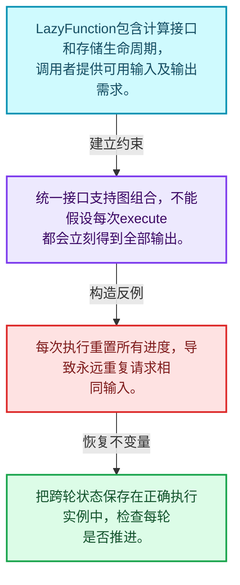
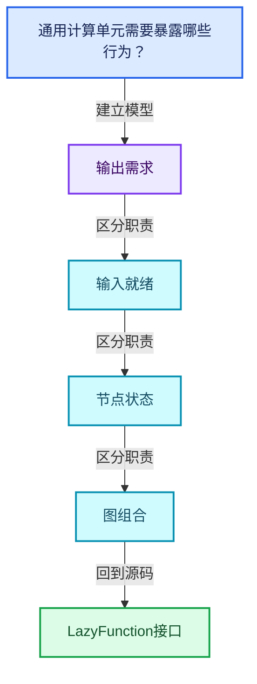
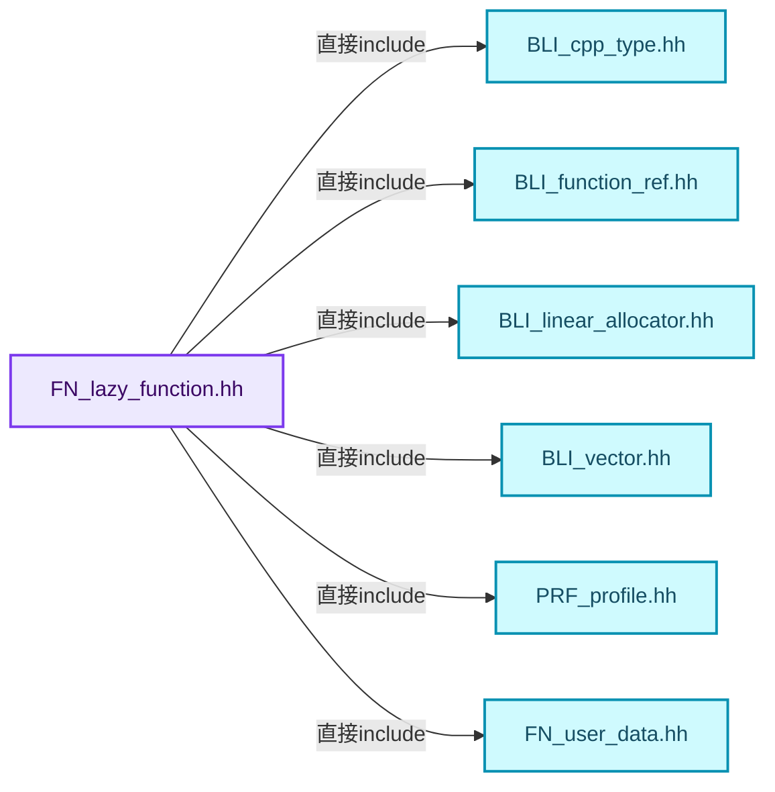
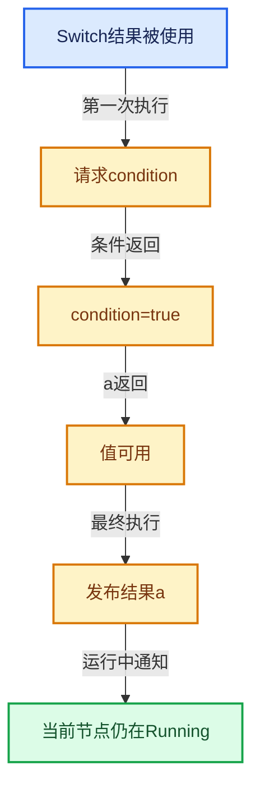

# 09-02 LazyFunction接口

[方向导航](README.md) · [总目录](../README.md) · [覆盖索引](../%E6%BA%90%E7%A0%81%E7%89%88%E6%9C%AC%E4%B8%8E%E8%A6%86%E7%9B%96%E7%B4%A2%E5%BC%95.md)

> 阅读顺序：问题与数据模型 → 语法与类型 → 源码逐行 → 调用线索 → 历史与取舍 → 推演和练习。

- 基准 HEAD：`cbda6b96c26c0dee3c3b5cbb93960c4ac06a6b30`。
- 记录日期：2026-10-14。
- 教学示例状态：正文中的推演不是本机性能实测；已运行练习见验收报告。

## 一、从问题到设计

通用计算单元需要暴露哪些行为？

接口包含输入输出描述、执行和存储生命周期；可组合要求调用约定不依赖具体几何节点。

本篇把语法、数据语义和系统取舍连接起来。需求与就绪是不同维度；状态只在有证据时推进，不能把未确定当作无需求。

### 本篇独立模型与设计推理

LazyFunction包含计算接口和存储生命周期，调用者提供可用输入及输出需求。

设计取舍：统一接口支持图组合，不能假设每次execute都会立刻得到全部输出。

最小反例：每次执行重置所有进度，导致永远重复请求相同输入。

推导与处理：把跨轮状态保存在正确执行实例中，检查每轮是否推进。



### 源码范围与相邻篇章

| 文件 | 本篇逐行范围 | 基准SHA-256 |
|---|---|---|
| [source/blender/functions/FN_lazy_function.hh](../../../../../source/blender/functions/FN_lazy_function.hh) | L241—L479 | `e9d3118bf1a4e17ce7ba95bb38f545c7288277b9b378378ed80291a2011dae5e` |
| [source/blender/functions/intern/lazy_function.cc](../../../../../source/blender/functions/intern/lazy_function.cc) | L1—L71 | `5151722fc7fdfd21794de8cdd82f657e6f6d85ef47e81913fd25f5adfd411d47` |

同一主讲文件可能分多篇覆盖；超出本篇范围的符号通过覆盖索引定位。空行与纯注释保留在源码摘录中，逐行表解释有效语句与语法边界；许可证头统一保留。

前篇：[按需执行模型](01-%E6%8C%89%E9%9C%80%E6%89%A7%E8%A1%8C%E6%A8%A1%E5%9E%8B.md).

后篇：[Params与ValueUsage](03-Params%E4%B8%8EValueUsage.md).

## 二、类型、数据与阅读地图



这是概念依赖图，边表示阅读关系，不声称是运行时调用顺序。

### 直接编译依赖



箭头只表示头文件包含关系；完整调用线索见后面的符号定位表。

## 三、关键词、语法与类型角色

### 模板 template

模板把类型或常量作为生成实现的参数。读声明时先列出类型参数、非类型参数和默认值，再看使用者实际实例化了什么。模板声明本身不意味着每种T都支持其全部成员。

具体检查：把T替换为int、string、只能移动的类型，分别检查每个被调用操作是否成立。

### 依赖名称 typename

typename既可引入类型模板参数，也可告诉编译器某个依赖名称是类型。它不创建运行时对象；解析期确认语法类别与实例化期检查具体类型是不同阶段。

具体检查：区分typename T::value_type和T::size()，前者标记类型，后者是表达式。

### 只读限定 const

const约束当前访问路径可做的修改。const指针、指向const的指针、const视图对象、const元素是不同位置的限定；其他别名可能仍可修改原对象。

具体检查：分别写T* const、const T*与const T* const，并画出不可修改的层次。

### 移动转换 std::move

std::move把表达式转换为可供移动重载选择的值类别，实际资源转移发生在被选中的构造或赋值中。对const对象move可能仍调用复制，对视图move也不会获得底层数据所有权。

具体检查：记录移动构造调用次数，不用变量名或std::move的出现次数替代测量。

### 完美转发 std::forward

std::forward在转发引用模板中恢复调用者原来的值类别。它依赖推导出的模板实参；无条件move会改变左值调用者的语义。

具体检查：对同一接口分别传入左值、临时对象和const左值，记录实际重载。

### 异常边界 try与catch

try定义异常传播的局部边界。失败路径需要销毁已经成功构造的部分并释放相应存储；未构造的对象不能被析构。

具体检查：在第k次构造失败，列出已经存在的对象集合与待释放缓冲。

### 显式静态转换 static_cast

static_cast表达编译期允许的转换，不会自动验证运行时真实类型、指针寿命或索引边界。由void指针恢复T指针时，调用者仍须保证实际存储中确有合法T对象。

具体检查：标出转换前后的类型以及正确性依据来自哪里。

### 运行时多态 virtual

虚调用根据实际动态类型选择实现；经基类指针销毁对象时通常需要相应虚析构契约。每元素虚调用和循环外一次分派有不同开销。

具体检查：找出虚接口的实现类和调用频率，再讨论是否值得去虚拟化。

### 构造与new表达式

普通new可能分配并构造；placement new在给定地址构造，存储由其他机制提供。失败回滚应区分两类责任。

具体检查：追踪地址来自哪里、构造何时成功、由谁析构、由谁释放。

### 内部断言 assert

断言表达开发者预期成立的内部契约，发布构建可能关闭。它不能替代对不可信输入的完整错误处理，也不保证后续操作被运行时保护。

具体检查：对每条断言构造违反条件的输入，区分调用者错误与应向用户报告的错误。

### 类型别名 using

类型别名为已有类型建立名字，不创建运行期对象。它常把模板内部使用的类型统一暴露给泛型调用者。

具体检查：展开别名直到基础类型，区分类型别名和变量声明。

## 四、真实源码与逐行讲解

源码块保持原行内容，原始行号由小节标题及逐行表给出。表中的调用定位是静态阅读辅助；重载、模板实例化、宏展开和虚调用需结合完整声明，不能仅凭词法出现证明动态调用。

### FN_lazy_function.hh：L241—L290

<!-- source:source/blender/functions/FN_lazy_function.hh:241:290 -->

```cpp
};

/**
 * A function that can compute outputs and request inputs lazily. For more details see the comment
 * at the top of the file.
 */
class LazyFunction {
 protected:
  const char *debug_name_ = "unknown";
  Vector<Input> inputs_;
  Vector<Output> outputs_;
  /**
   * Allow executing the function even if previously requested values are not yet available.
   */
  bool allow_missing_requested_inputs_ = false;

 public:
  virtual ~LazyFunction() = default;

  /**
   * Get a name of the function or an input or output. This is mainly used for debugging.
   * These are virtual functions because the names are often not used outside of debugging
   * workflows. This way the names are only generated when they are actually needed.
   */
  virtual std::string name() const;
  virtual std::string input_name(int index) const;
  virtual std::string output_name(int index) const;

  /**
   * Allocates storage for this function. The storage will be passed to every call to #execute.
   * If the function does not keep track of any state, this does not have to be implemented.
   */
  virtual void *init_storage(LinearAllocator<> &allocator) const;

  /**
   * Destruct the storage created in #init_storage.
   */
  virtual void destruct_storage(void *storage) const;

  /**
   * Calls `fn` with the input indices that the given `output_index` may depend on. By default
   * every output depends on every input.
   */
  virtual void possible_output_dependencies(int output_index,
                                            FunctionRef<void(Span<int>)> fn) const;

  /**
   * Inputs of the function.
   */
  Span<Input> inputs() const;
```

| 原始行 | 语义、约束与检查 |
|---|---|
| L241 | 结束当前语法单元。局部自动对象在离开其作用域时按规则销毁；这不等于所有被引用的外部数据也被释放。 |
| L247 | 声明或定义类型 `class LazyFunction`。结合继承、访问权限和成员布局确认接口与拥有关系；前向声明本身没有完整对象布局。 |
| L248 | 切换成员访问权限为 protected；它是编译期接口边界，不是线程同步或内存保护。 |
| L249 | 把右侧 `"unknown"` 用于初始化或更新左侧 `const char *debug_name_`。声明初始化与已有对象赋值应按上下文区分；有资源的类型会调用相应特殊成员。 |
| L250 | 声明成员、局部对象或完成语句 `Vector<Input> inputs_`。若为指针或引用，它本身不说明拥有；若为值对象，其构造析构由所在作用域或外层对象管理。 |
| L251 | 声明成员、局部对象或完成语句 `Vector<Output> outputs_`。若为指针或引用，它本身不说明拥有；若为值对象，其构造析构由所在作用域或外层对象管理。 |
| L255 | 把右侧 `false` 用于初始化或更新左侧 `bool allow_missing_requested_inputs_`。声明初始化与已有对象赋值应按上下文区分；有资源的类型会调用相应特殊成员。 |
| L257 | 切换成员访问权限为 public；它是编译期接口边界，不是线程同步或内存保护。 |
| L258 | 显式采用编译器生成的特殊成员行为：`virtual ~LazyFunction() = default;`。成员和基类的性质决定该操作是否可用、是否被删除及异常约定，不表示运行时给对象赋值为default。 |
| L265 | 声明接口 `virtual std::string name() const`，本行没有对应函数体；返回类型、参数限定和const/noexcept共同组成调用契约，实际行为需继续定位实现。 |
| L266 | 声明接口 `virtual std::string input_name(int index) const`，本行没有对应函数体；返回类型、参数限定和const/noexcept共同组成调用契约，实际行为需继续定位实现。 |
| L267 | 声明接口 `virtual std::string output_name(int index) const`，本行没有对应函数体；返回类型、参数限定和const/noexcept共同组成调用契约，实际行为需继续定位实现。 |
| L273 | 声明接口 `virtual void *init_storage(LinearAllocator<> &allocator) const`，本行没有对应函数体；返回类型、参数限定和const/noexcept共同组成调用契约，实际行为需继续定位实现。 |
| L278 | 声明接口 `virtual void destruct_storage(void *storage) const`，本行没有对应函数体；返回类型、参数限定和const/noexcept共同组成调用契约，实际行为需继续定位实现。 |
| L284 | 出现调用或函数声明 `possible_output_dependencies`，对应表达式为 `virtual void possible_output_dependencies(int output_index,`。参数求值、返回类型与重载需结合前后完整语句；静态文本引用不能证明动态目标。 |
| L285 | 声明接口 `FunctionRef<void(Span<int>)> fn) const`，本行没有对应函数体；返回类型、参数限定和const/noexcept共同组成调用契约，实际行为需继续定位实现。 |
| L290 | 声明接口 `Span<Input> inputs() const`，本行没有对应函数体；返回类型、参数限定和const/noexcept共同组成调用契约，实际行为需继续定位实现。 |

### FN_lazy_function.hh：L291—L339

<!-- source:source/blender/functions/FN_lazy_function.hh:291:339 -->

```cpp
  /**
   * Outputs of the function.
   */
  Span<Output> outputs() const;

  /**
   * During execution the function retrieves inputs and sets outputs in #params. For some
   * functions, this method is called more than once. After execution, the function either has
   * computed all required outputs or is waiting for more inputs.
   */
  void execute(Params &params, const Context &context) const;

  /**
   * Utility to check that the guarantee by #Input::usage is followed.
   */
  bool always_used_inputs_available(const Params &params) const;

  /**
   * If true, the function can be executed even when some requested inputs are not available yet.
   * This allows the function to make some progress and maybe to compute some outputs that are
   * passed into this function again (lazy-function graphs may contain cycles as long as there
   * aren't actually data dependencies).
   */
  bool allow_missing_requested_inputs() const
  {
    return allow_missing_requested_inputs_;
  }

 private:
  /**
   * Needs to be implemented by subclasses. This is separate from #execute so that additional
   * debugging logic can be implemented in #execute.
   */
  virtual void execute_impl(Params &params, const Context &context) const = 0;
};

/* -------------------------------------------------------------------- */
/** \name #LazyFunction Inline Methods
 * \{ */

inline Span<Input> LazyFunction::inputs() const
{
  return inputs_;
}

inline Span<Output> LazyFunction::outputs() const
{
  return outputs_;
}
```

| 原始行 | 语义、约束与检查 |
|---|---|
| L294 | 声明接口 `Span<Output> outputs() const`，本行没有对应函数体；返回类型、参数限定和const/noexcept共同组成调用契约，实际行为需继续定位实现。 |
| L301 | 声明接口 `void execute(Params &params, const Context &context) const`，本行没有对应函数体；返回类型、参数限定和const/noexcept共同组成调用契约，实际行为需继续定位实现。 |
| L306 | 声明接口 `bool always_used_inputs_available(const Params &params) const`，本行没有对应函数体；返回类型、参数限定和const/noexcept共同组成调用契约，实际行为需继续定位实现。 |
| L314 | 出现调用或函数声明 `allow_missing_requested_inputs`，对应表达式为 `bool allow_missing_requested_inputs() const`。参数求值、返回类型与重载需结合前后完整语句；静态文本引用不能证明动态目标。 |
| L315 | 连接上一行的声明或控制结构与其语句块；后续行在这个作用域中执行或声明。 |
| L316 | 返回表达式 `allow_missing_requested_inputs_`。 |
| L317 | 结束当前语法单元。局部自动对象在离开其作用域时按规则销毁；这不等于所有被引用的外部数据也被释放。 |
| L319 | 切换成员访问权限为 private；它是编译期接口边界，不是线程同步或内存保护。 |
| L324 | 纯虚接口声明：`virtual void execute_impl(Params &params, const Context &context) const = 0;`。等号零标记抽象接口，需要按继承约定提供覆写；不表示执行函数并把结果设为零。 |
| L325 | 结束当前语法单元。局部自动对象在离开其作用域时按规则销毁；这不等于所有被引用的外部数据也被释放。 |
| L331 | 出现调用或函数声明 `LazyFunction::inputs`，对应表达式为 `inline Span<Input> LazyFunction::inputs() const`。参数求值、返回类型与重载需结合前后完整语句；静态文本引用不能证明动态目标。 |
| L332 | 连接上一行的声明或控制结构与其语句块；后续行在这个作用域中执行或声明。 |
| L333 | 返回表达式 `inputs_`。 |
| L334 | 结束当前语法单元。局部自动对象在离开其作用域时按规则销毁；这不等于所有被引用的外部数据也被释放。 |
| L336 | 出现调用或函数声明 `LazyFunction::outputs`，对应表达式为 `inline Span<Output> LazyFunction::outputs() const`。参数求值、返回类型与重载需结合前后完整语句；静态文本引用不能证明动态目标。 |
| L337 | 连接上一行的声明或控制结构与其语句块；后续行在这个作用域中执行或声明。 |
| L338 | 返回表达式 `outputs_`。 |
| L339 | 结束当前语法单元。局部自动对象在离开其作用域时按规则销毁；这不等于所有被引用的外部数据也被释放。 |

### FN_lazy_function.hh：L340—L384

<!-- source:source/blender/functions/FN_lazy_function.hh:340:384 -->

```cpp

inline void LazyFunction::execute(Params &params, const Context &context) const
{
  PRF_scope_with_name("LazyFunction", ProfileCategory::Default);
  PRF_scope_set_dynamic_name("%s", debug_name_);
  BLI_assert(this->always_used_inputs_available(params));
  this->execute_impl(params, context);
}

/** \} */

/* -------------------------------------------------------------------- */
/** \name #Params Inline Methods
 * \{ */

inline Params::Params(const LazyFunction &fn,
                      [[maybe_unused]] bool allow_multi_threading_initially)
    : fn_(fn)
#ifdef FN_LAZY_FUNCTION_DEBUG_THREADS
      ,
      main_thread_id_(std::this_thread::get_id()),
      allow_multi_threading_(allow_multi_threading_initially)
#endif
{
}

inline void *Params::try_get_input_data_ptr(const int index) const
{
  BLI_assert(index >= 0 && index < fn_.inputs().size());
  return this->try_get_input_data_ptr_impl(index);
}

inline void *Params::try_get_input_data_ptr_or_request(const int index)
{
  BLI_assert(index >= 0 && index < fn_.inputs().size());
  this->assert_valid_thread();
  return this->try_get_input_data_ptr_or_request_impl(index);
}

inline void *Params::get_output_data_ptr(const int index)
{
  BLI_assert(index >= 0 && index < fn_.outputs().size());
  this->assert_valid_thread();
  return this->get_output_data_ptr_impl(index);
}
```

本段语义重点：

- `try_get_input`：尝试读取已可用输入；未就绪与合法空值应使用接口约定区分。

| 原始行 | 语义、约束与检查 |
|---|---|
| L341 | 出现调用或函数声明 `LazyFunction::execute`，对应表达式为 `inline void LazyFunction::execute(Params &params, const Context &context) const`。参数求值、返回类型与重载需结合前后完整语句；静态文本引用不能证明动态目标。 |
| L342 | 连接上一行的声明或控制结构与其语句块；后续行在这个作用域中执行或声明。 |
| L343 | 出现调用或函数声明 `PRF_scope_with_name`，对应表达式为 `PRF_scope_with_name("LazyFunction", ProfileCategory::Default);`。参数求值、返回类型与重载需结合前后完整语句；静态文本引用不能证明动态目标。 |
| L344 | 出现调用或函数声明 `PRF_scope_set_dynamic_name`，对应表达式为 `PRF_scope_set_dynamic_name("%s", debug_name_);`。参数求值、返回类型与重载需结合前后完整语句；静态文本引用不能证明动态目标。 |
| L345 | 断言约束 `BLI_assert(this->always_used_inputs_available(params));`。条件是后续访问的内部前置条件；发布构建可能不执行，不能把断言当作输入修复。 |
| L346 | 出现调用或函数声明 `execute_impl`，对应表达式为 `this->execute_impl(params, context);`。参数求值、返回类型与重载需结合前后完整语句；静态文本引用不能证明动态目标。 |
| L347 | 结束当前语法单元。局部自动对象在离开其作用域时按规则销毁；这不等于所有被引用的外部数据也被释放。 |
| L355 | 出现调用或函数声明 `Params::Params`，对应表达式为 `inline Params::Params(const LazyFunction &fn,`。参数求值、返回类型与重载需结合前后完整语句；静态文本引用不能证明动态目标。 |
| L356 | 本行是连续声明或表达式的一部分：`[[maybe_unused]] bool allow_multi_threading_initially)`。与本段前后行合读；逗号、括号和限定符决定它属于参数、初始化列表还是实际计算。 |
| L357 | 出现调用或函数声明 `fn_`，对应表达式为 `: fn_(fn)`。参数求值、返回类型与重载需结合前后完整语句；静态文本引用不能证明动态目标。 |
| L358 | 预处理阶段处理 #ifdef FN_LAZY_FUNCTION_DEBUG_THREADS。它决定哪些代码进入编译，不是运行时分支；阅读行为时必须结合实际构建宏。 |
| L359 | 本行是连续声明或表达式的一部分：`,`。与本段前后行合读；逗号、括号和限定符决定它属于参数、初始化列表还是实际计算。 |
| L360 | 出现调用或函数声明 `main_thread_id_`，对应表达式为 `main_thread_id_(std::this_thread::get_id()),`。参数求值、返回类型与重载需结合前后完整语句；静态文本引用不能证明动态目标。 |
| L361 | 出现调用或函数声明 `allow_multi_threading_`，对应表达式为 `allow_multi_threading_(allow_multi_threading_initially)`。参数求值、返回类型与重载需结合前后完整语句；静态文本引用不能证明动态目标。 |
| L362 | 预处理阶段处理 #endif。它决定哪些代码进入编译，不是运行时分支；阅读行为时必须结合实际构建宏。 |
| L363 | 连接上一行的声明或控制结构与其语句块；后续行在这个作用域中执行或声明。 |
| L364 | 结束当前语法单元。局部自动对象在离开其作用域时按规则销毁；这不等于所有被引用的外部数据也被释放。 |
| L366 | 出现调用或函数声明 `Params::try_get_input_data_ptr`，对应表达式为 `inline void *Params::try_get_input_data_ptr(const int index) const`。参数求值、返回类型与重载需结合前后完整语句；静态文本引用不能证明动态目标。 |
| L367 | 连接上一行的声明或控制结构与其语句块；后续行在这个作用域中执行或声明。 |
| L368 | 断言约束 `BLI_assert(index >= 0 && index < fn_.inputs().size());`。条件是后续访问的内部前置条件；发布构建可能不执行，不能把断言当作输入修复。 |
| L369 | 返回表达式 `this->try_get_input_data_ptr_impl(index)`。结合函数声明检查返回值是否借用原存储，借用值不会自动延长其寿命。 |
| L370 | 结束当前语法单元。局部自动对象在离开其作用域时按规则销毁；这不等于所有被引用的外部数据也被释放。 |
| L372 | 出现调用或函数声明 `Params::try_get_input_data_ptr_or_request`，对应表达式为 `inline void *Params::try_get_input_data_ptr_or_request(const int index)`。参数求值、返回类型与重载需结合前后完整语句；静态文本引用不能证明动态目标。 |
| L373 | 连接上一行的声明或控制结构与其语句块；后续行在这个作用域中执行或声明。 |
| L374 | 断言约束 `BLI_assert(index >= 0 && index < fn_.inputs().size());`。条件是后续访问的内部前置条件；发布构建可能不执行，不能把断言当作输入修复。 |
| L375 | 出现调用或函数声明 `assert_valid_thread`，对应表达式为 `this->assert_valid_thread();`。参数求值、返回类型与重载需结合前后完整语句；静态文本引用不能证明动态目标。 |
| L376 | 返回表达式 `this->try_get_input_data_ptr_or_request_impl(index)`。 |
| L377 | 结束当前语法单元。局部自动对象在离开其作用域时按规则销毁；这不等于所有被引用的外部数据也被释放。 |
| L379 | 出现调用或函数声明 `Params::get_output_data_ptr`，对应表达式为 `inline void *Params::get_output_data_ptr(const int index)`。参数求值、返回类型与重载需结合前后完整语句；静态文本引用不能证明动态目标。 |
| L380 | 连接上一行的声明或控制结构与其语句块；后续行在这个作用域中执行或声明。 |
| L381 | 断言约束 `BLI_assert(index >= 0 && index < fn_.outputs().size());`。条件是后续访问的内部前置条件；发布构建可能不执行，不能把断言当作输入修复。 |
| L382 | 出现调用或函数声明 `assert_valid_thread`，对应表达式为 `this->assert_valid_thread();`。参数求值、返回类型与重载需结合前后完整语句；静态文本引用不能证明动态目标。 |
| L383 | 返回表达式 `this->get_output_data_ptr_impl(index)`。 |
| L384 | 结束当前语法单元。局部自动对象在离开其作用域时按规则销毁；这不等于所有被引用的外部数据也被释放。 |

### FN_lazy_function.hh：L385—L432

<!-- source:source/blender/functions/FN_lazy_function.hh:385:432 -->

```cpp

inline void Params::output_set(const int index)
{
  BLI_assert(index >= 0 && index < fn_.outputs().size());
  this->assert_valid_thread();
  this->output_set_impl(index);
}

inline bool Params::output_was_set(const int index) const
{
  BLI_assert(index >= 0 && index < fn_.outputs().size());
  return this->output_was_set_impl(index);
}

inline ValueUsage Params::get_output_usage(const int index) const
{
  BLI_assert(index >= 0 && index < fn_.outputs().size());
  return this->get_output_usage_impl(index);
}

inline void Params::set_input_unused(const int index)
{
  BLI_assert(index >= 0 && index < fn_.inputs().size());
  this->assert_valid_thread();
  this->set_input_unused_impl(index);
}

template<typename T> inline T Params::extract_input(const int index)
{
  this->assert_valid_thread();
  void *data = this->try_get_input_data_ptr(index);
  BLI_assert(data != nullptr);
  T return_value = std::move(*static_cast<T *>(data));
  return return_value;
}

template<typename T> inline T &Params::get_input(const int index) const
{
  void *data = this->try_get_input_data_ptr(index);
  BLI_assert(data != nullptr);
  return *static_cast<T *>(data);
}

template<typename T> inline T *Params::try_get_input_data_ptr(const int index) const
{
  this->assert_valid_thread();
  return static_cast<T *>(this->try_get_input_data_ptr(index));
}
```

本段语义重点：

- `try_get_input`：尝试读取已可用输入；未就绪与合法空值应使用接口约定区分。
- `extract_input`：提取输入值，可能转移其资源；重复读取的合法性取决于接口契约。
- `get_output_usage`：读取输出需求，依据它决定是否请求额外输入。

| 原始行 | 语义、约束与检查 |
|---|---|
| L386 | 出现调用或函数声明 `Params::output_set`，对应表达式为 `inline void Params::output_set(const int index)`。参数求值、返回类型与重载需结合前后完整语句；静态文本引用不能证明动态目标。 |
| L387 | 连接上一行的声明或控制结构与其语句块；后续行在这个作用域中执行或声明。 |
| L388 | 断言约束 `BLI_assert(index >= 0 && index < fn_.outputs().size());`。条件是后续访问的内部前置条件；发布构建可能不执行，不能把断言当作输入修复。 |
| L389 | 出现调用或函数声明 `assert_valid_thread`，对应表达式为 `this->assert_valid_thread();`。参数求值、返回类型与重载需结合前后完整语句；静态文本引用不能证明动态目标。 |
| L390 | 出现调用或函数声明 `output_set_impl`，对应表达式为 `this->output_set_impl(index);`。参数求值、返回类型与重载需结合前后完整语句；静态文本引用不能证明动态目标。 |
| L391 | 结束当前语法单元。局部自动对象在离开其作用域时按规则销毁；这不等于所有被引用的外部数据也被释放。 |
| L393 | 出现调用或函数声明 `Params::output_was_set`，对应表达式为 `inline bool Params::output_was_set(const int index) const`。参数求值、返回类型与重载需结合前后完整语句；静态文本引用不能证明动态目标。 |
| L394 | 连接上一行的声明或控制结构与其语句块；后续行在这个作用域中执行或声明。 |
| L395 | 断言约束 `BLI_assert(index >= 0 && index < fn_.outputs().size());`。条件是后续访问的内部前置条件；发布构建可能不执行，不能把断言当作输入修复。 |
| L396 | 返回表达式 `this->output_was_set_impl(index)`。结合函数声明检查返回值是否借用原存储，借用值不会自动延长其寿命。 |
| L397 | 结束当前语法单元。局部自动对象在离开其作用域时按规则销毁；这不等于所有被引用的外部数据也被释放。 |
| L399 | 本行使用 `get_output_usage`：读取输出需求，依据它决定是否请求额外输入。 |
| L400 | 连接上一行的声明或控制结构与其语句块；后续行在这个作用域中执行或声明。 |
| L401 | 断言约束 `BLI_assert(index >= 0 && index < fn_.outputs().size());`。条件是后续访问的内部前置条件；发布构建可能不执行，不能把断言当作输入修复。 |
| L402 | 返回表达式 `this->get_output_usage_impl(index)`。结合函数声明检查返回值是否借用原存储，借用值不会自动延长其寿命。 |
| L403 | 结束当前语法单元。局部自动对象在离开其作用域时按规则销毁；这不等于所有被引用的外部数据也被释放。 |
| L405 | 出现调用或函数声明 `Params::set_input_unused`，对应表达式为 `inline void Params::set_input_unused(const int index)`。参数求值、返回类型与重载需结合前后完整语句；静态文本引用不能证明动态目标。 |
| L406 | 连接上一行的声明或控制结构与其语句块；后续行在这个作用域中执行或声明。 |
| L407 | 断言约束 `BLI_assert(index >= 0 && index < fn_.inputs().size());`。条件是后续访问的内部前置条件；发布构建可能不执行，不能把断言当作输入修复。 |
| L408 | 出现调用或函数声明 `assert_valid_thread`，对应表达式为 `this->assert_valid_thread();`。参数求值、返回类型与重载需结合前后完整语句；静态文本引用不能证明动态目标。 |
| L409 | 出现调用或函数声明 `set_input_unused_impl`，对应表达式为 `this->set_input_unused_impl(index);`。参数求值、返回类型与重载需结合前后完整语句；静态文本引用不能证明动态目标。 |
| L410 | 结束当前语法单元。局部自动对象在离开其作用域时按规则销毁；这不等于所有被引用的外部数据也被释放。 |
| L412 | 本行使用 `extract_input`：提取输入值，可能转移其资源；重复读取的合法性取决于接口契约。 |
| L413 | 连接上一行的声明或控制结构与其语句块；后续行在这个作用域中执行或声明。 |
| L414 | 出现调用或函数声明 `assert_valid_thread`，对应表达式为 `this->assert_valid_thread();`。参数求值、返回类型与重载需结合前后完整语句；静态文本引用不能证明动态目标。 |
| L415 | 把右侧 `this->try_get_input_data_ptr(index)` 用于初始化或更新左侧 `void *data`。声明初始化与已有对象赋值应按上下文区分；有资源的类型会调用相应特殊成员。 |
| L416 | 断言约束 `BLI_assert(data != nullptr);`。条件是后续访问的内部前置条件；发布构建可能不执行，不能把断言当作输入修复。 |
| L417 | 把右侧 `std::move(*static_cast<T *>(data))` 用于初始化或更新左侧 `T return_value`。声明初始化与已有对象赋值应按上下文区分；有资源的类型会调用相应特殊成员。 |
| L418 | 返回表达式 `return_value`。结合函数声明检查返回值是否借用原存储，借用值不会自动延长其寿命。 |
| L419 | 结束当前语法单元。局部自动对象在离开其作用域时按规则销毁；这不等于所有被引用的外部数据也被释放。 |
| L421 | 声明模板参数 `template<typename T> inline T &Params::get_input(const int index) const`。类型参数决定生成操作的类型，非类型参数可决定内嵌容量或编译期分支。 |
| L422 | 连接上一行的声明或控制结构与其语句块；后续行在这个作用域中执行或声明。 |
| L423 | 把右侧 `this->try_get_input_data_ptr(index)` 用于初始化或更新左侧 `void *data`。声明初始化与已有对象赋值应按上下文区分；有资源的类型会调用相应特殊成员。 |
| L424 | 断言约束 `BLI_assert(data != nullptr);`。条件是后续访问的内部前置条件；发布构建可能不执行，不能把断言当作输入修复。 |
| L425 | 返回表达式 `*static_cast<T *>(data)`。 |
| L426 | 结束当前语法单元。局部自动对象在离开其作用域时按规则销毁；这不等于所有被引用的外部数据也被释放。 |
| L428 | 声明模板参数 `template<typename T> inline T *Params::try_get_input_data_ptr(const int index) const`。类型参数决定生成操作的类型，非类型参数可决定内嵌容量或编译期分支。 |
| L429 | 连接上一行的声明或控制结构与其语句块；后续行在这个作用域中执行或声明。 |
| L430 | 出现调用或函数声明 `assert_valid_thread`，对应表达式为 `this->assert_valid_thread();`。参数求值、返回类型与重载需结合前后完整语句；静态文本引用不能证明动态目标。 |
| L431 | 返回表达式 `static_cast<T *>(this->try_get_input_data_ptr(index))`。 |
| L432 | 结束当前语法单元。局部自动对象在离开其作用域时按规则销毁；这不等于所有被引用的外部数据也被释放。 |

### FN_lazy_function.hh：L433—L479

<!-- source:source/blender/functions/FN_lazy_function.hh:433:479 -->

```cpp

template<typename T> inline T *Params::try_get_input_data_ptr_or_request(const int index)
{
  this->assert_valid_thread();
  return static_cast<T *>(this->try_get_input_data_ptr_or_request(index));
}

template<typename T> inline void Params::set_output(const int index, T &&value)
{
  using DecayT = std::decay_t<T>;
  this->assert_valid_thread();
  void *data = this->get_output_data_ptr(index);
  new (data) DecayT(std::forward<T>(value));
  this->output_set(index);
}

inline bool Params::try_enable_multi_threading()
{
  this->assert_valid_thread();
  const bool success = this->try_enable_multi_threading_impl();
#ifdef FN_LAZY_FUNCTION_DEBUG_THREADS
  if (success) {
    allow_multi_threading_ = true;
  }
#endif
  return success;
}

inline void Params::assert_valid_thread() const
{
#ifdef FN_LAZY_FUNCTION_DEBUG_THREADS
  if (allow_multi_threading_) {
    return;
  }
  if (main_thread_id_ != std::this_thread::get_id()) {
    BLI_assert_unreachable();
  }
#endif
}

/** \} */

}  // namespace fn::lazy_function

namespace lf = fn::lazy_function;

}  // namespace blender
```

本段语义重点：

- `set_output`：向输出位置发布值；输出是否已构造、是否已经设置由调用约定限制。
- `try_get_input`：尝试读取已可用输入；未就绪与合法空值应使用接口约定区分。

| 原始行 | 语义、约束与检查 |
|---|---|
| L434 | 声明模板参数 `template<typename T> inline T *Params::try_get_input_data_ptr_or_request(const int index)`。类型参数决定生成操作的类型，非类型参数可决定内嵌容量或编译期分支。 |
| L435 | 连接上一行的声明或控制结构与其语句块；后续行在这个作用域中执行或声明。 |
| L436 | 出现调用或函数声明 `assert_valid_thread`，对应表达式为 `this->assert_valid_thread();`。参数求值、返回类型与重载需结合前后完整语句；静态文本引用不能证明动态目标。 |
| L437 | 返回表达式 `static_cast<T *>(this->try_get_input_data_ptr_or_request(index))`。 |
| L438 | 结束当前语法单元。局部自动对象在离开其作用域时按规则销毁；这不等于所有被引用的外部数据也被释放。 |
| L440 | 本行使用 `set_output`：向输出位置发布值；输出是否已构造、是否已经设置由调用约定限制。 |
| L441 | 连接上一行的声明或控制结构与其语句块；后续行在这个作用域中执行或声明。 |
| L442 | 定义类型别名 `using DecayT = std::decay_t<T>`，为模板接口或内部实现统一命名；本行不分配该类型对象。 |
| L443 | 出现调用或函数声明 `assert_valid_thread`，对应表达式为 `this->assert_valid_thread();`。参数求值、返回类型与重载需结合前后完整语句；静态文本引用不能证明动态目标。 |
| L444 | 把右侧 `this->get_output_data_ptr(index)` 用于初始化或更新左侧 `void *data`。声明初始化与已有对象赋值应按上下文区分；有资源的类型会调用相应特殊成员。 |
| L445 | 出现调用或函数声明 `new`，对应表达式为 `new (data) DecayT(std::forward<T>(value));`。参数求值、返回类型与重载需结合前后完整语句；静态文本引用不能证明动态目标。 |
| L446 | 出现调用或函数声明 `output_set`，对应表达式为 `this->output_set(index);`。参数求值、返回类型与重载需结合前后完整语句；静态文本引用不能证明动态目标。 |
| L447 | 结束当前语法单元。局部自动对象在离开其作用域时按规则销毁；这不等于所有被引用的外部数据也被释放。 |
| L449 | 出现调用或函数声明 `Params::try_enable_multi_threading`，对应表达式为 `inline bool Params::try_enable_multi_threading()`。参数求值、返回类型与重载需结合前后完整语句；静态文本引用不能证明动态目标。 |
| L450 | 连接上一行的声明或控制结构与其语句块；后续行在这个作用域中执行或声明。 |
| L451 | 出现调用或函数声明 `assert_valid_thread`，对应表达式为 `this->assert_valid_thread();`。参数求值、返回类型与重载需结合前后完整语句；静态文本引用不能证明动态目标。 |
| L452 | 把右侧 `this->try_enable_multi_threading_impl()` 用于初始化或更新左侧 `const bool success`。声明初始化与已有对象赋值应按上下文区分；有资源的类型会调用相应特殊成员。 |
| L453 | 预处理阶段处理 #ifdef FN_LAZY_FUNCTION_DEBUG_THREADS。它决定哪些代码进入编译，不是运行时分支；阅读行为时必须结合实际构建宏。 |
| L454 | 判断 `success`，成立时进入本分支，否则继续后续路径。 |
| L455 | 把右侧 `true` 用于初始化或更新左侧 `allow_multi_threading_`。声明初始化与已有对象赋值应按上下文区分；有资源的类型会调用相应特殊成员。 |
| L456 | 结束当前语法单元。局部自动对象在离开其作用域时按规则销毁；这不等于所有被引用的外部数据也被释放。 |
| L457 | 预处理阶段处理 #endif。它决定哪些代码进入编译，不是运行时分支；阅读行为时必须结合实际构建宏。 |
| L458 | 返回表达式 `success`。 |
| L459 | 结束当前语法单元。局部自动对象在离开其作用域时按规则销毁；这不等于所有被引用的外部数据也被释放。 |
| L461 | 出现调用或函数声明 `Params::assert_valid_thread`，对应表达式为 `inline void Params::assert_valid_thread() const`。参数求值、返回类型与重载需结合前后完整语句；静态文本引用不能证明动态目标。 |
| L462 | 连接上一行的声明或控制结构与其语句块；后续行在这个作用域中执行或声明。 |
| L463 | 预处理阶段处理 #ifdef FN_LAZY_FUNCTION_DEBUG_THREADS。它决定哪些代码进入编译，不是运行时分支；阅读行为时必须结合实际构建宏。 |
| L464 | 判断 `allow_multi_threading_`，成立时进入本分支，否则继续后续路径。 |
| L465 | 结束当前函数，本路径不再执行后续语句；局部对象按作用域规则清理。 |
| L466 | 结束当前语法单元。局部自动对象在离开其作用域时按规则销毁；这不等于所有被引用的外部数据也被释放。 |
| L467 | 判断 `main_thread_id_ != std::this_thread::get_id()`，成立时进入本分支，否则继续后续路径。 |
| L468 | 断言约束 `BLI_assert_unreachable();`。条件是后续访问的内部前置条件；发布构建可能不执行，不能把断言当作输入修复。 |
| L469 | 结束当前语法单元。局部自动对象在离开其作用域时按规则销毁；这不等于所有被引用的外部数据也被释放。 |
| L470 | 预处理阶段处理 #endif。它决定哪些代码进入编译，不是运行时分支；阅读行为时必须结合实际构建宏。 |
| L471 | 结束当前语法单元。局部自动对象在离开其作用域时按规则销毁；这不等于所有被引用的外部数据也被释放。 |
| L475 | 结束当前语法单元。局部自动对象在离开其作用域时按规则销毁；这不等于所有被引用的外部数据也被释放。 |
| L477 | 把后续声明放入 lf = fn::lazy_function; 命名空间，影响名称查找和符号归属，不创建运行时对象。 |
| L479 | 结束当前语法单元。局部自动对象在离开其作用域时按规则销毁；这不等于所有被引用的外部数据也被释放。 |

### lazy_function.cc：L1—L48

<!-- source:source/blender/functions/intern/lazy_function.cc:1:48 -->

```cpp
/* SPDX-FileCopyrightText: 2023 Blender Authors
 *
 * SPDX-License-Identifier: GPL-2.0-or-later */

/** \file
 * \ingroup fn
 */

#include "FN_lazy_function.hh"

namespace blender::fn::lazy_function {

std::string LazyFunction::name() const
{
  return debug_name_;
}

std::string LazyFunction::input_name(int index) const
{
  return inputs_[index].debug_name;
}

std::string LazyFunction::output_name(int index) const
{
  return outputs_[index].debug_name;
}

void *LazyFunction::init_storage(LinearAllocator<> & /*allocator*/) const
{
  return nullptr;
}

void LazyFunction::destruct_storage(void *storage) const
{
  BLI_assert(storage == nullptr);
  UNUSED_VARS_NDEBUG(storage);
}

void LazyFunction::possible_output_dependencies(const int /*output_index*/,
                                                const FunctionRef<void(Span<int>)> fn) const
{
  /* The output depends on all inputs by default. */
  Vector<int, 16> indices(inputs_.size());
  for (const int i : inputs_.index_range()) {
    indices[i] = i;
  }
  fn(indices);
}
```

| 原始行 | 语义、约束与检查 |
|---|---|
| L9 | 引入编译依赖 "FN_lazy_function.hh"；这是声明可见性关系，不表示运行时一定调用该文件的所有接口。 |
| L11 | 把后续声明放入 blender::fn::lazy_function 命名空间，影响名称查找和符号归属，不创建运行时对象。 |
| L13 | 出现调用或函数声明 `LazyFunction::name`，对应表达式为 `std::string LazyFunction::name() const`。参数求值、返回类型与重载需结合前后完整语句；静态文本引用不能证明动态目标。 |
| L14 | 连接上一行的声明或控制结构与其语句块；后续行在这个作用域中执行或声明。 |
| L15 | 返回表达式 `debug_name_`。 |
| L16 | 结束当前语法单元。局部自动对象在离开其作用域时按规则销毁；这不等于所有被引用的外部数据也被释放。 |
| L18 | 出现调用或函数声明 `LazyFunction::input_name`，对应表达式为 `std::string LazyFunction::input_name(int index) const`。参数求值、返回类型与重载需结合前后完整语句；静态文本引用不能证明动态目标。 |
| L19 | 连接上一行的声明或控制结构与其语句块；后续行在这个作用域中执行或声明。 |
| L20 | 返回表达式 `inputs_[index].debug_name`。 |
| L21 | 结束当前语法单元。局部自动对象在离开其作用域时按规则销毁；这不等于所有被引用的外部数据也被释放。 |
| L23 | 出现调用或函数声明 `LazyFunction::output_name`，对应表达式为 `std::string LazyFunction::output_name(int index) const`。参数求值、返回类型与重载需结合前后完整语句；静态文本引用不能证明动态目标。 |
| L24 | 连接上一行的声明或控制结构与其语句块；后续行在这个作用域中执行或声明。 |
| L25 | 返回表达式 `outputs_[index].debug_name`。 |
| L26 | 结束当前语法单元。局部自动对象在离开其作用域时按规则销毁；这不等于所有被引用的外部数据也被释放。 |
| L28 | 出现调用或函数声明 `LazyFunction::init_storage`，对应表达式为 `void *LazyFunction::init_storage(LinearAllocator<> & ) const`。参数求值、返回类型与重载需结合前后完整语句；静态文本引用不能证明动态目标。 |
| L29 | 连接上一行的声明或控制结构与其语句块；后续行在这个作用域中执行或声明。 |
| L30 | 返回表达式 `nullptr`。 |
| L31 | 结束当前语法单元。局部自动对象在离开其作用域时按规则销毁；这不等于所有被引用的外部数据也被释放。 |
| L33 | 出现调用或函数声明 `LazyFunction::destruct_storage`，对应表达式为 `void LazyFunction::destruct_storage(void *storage) const`。参数求值、返回类型与重载需结合前后完整语句；静态文本引用不能证明动态目标。 |
| L34 | 连接上一行的声明或控制结构与其语句块；后续行在这个作用域中执行或声明。 |
| L35 | 断言约束 `BLI_assert(storage == nullptr);`。条件是后续访问的内部前置条件；发布构建可能不执行，不能把断言当作输入修复。 |
| L36 | 出现调用或函数声明 `UNUSED_VARS_NDEBUG`，对应表达式为 `UNUSED_VARS_NDEBUG(storage);`。参数求值、返回类型与重载需结合前后完整语句；静态文本引用不能证明动态目标。 |
| L37 | 结束当前语法单元。局部自动对象在离开其作用域时按规则销毁；这不等于所有被引用的外部数据也被释放。 |
| L39 | 出现调用或函数声明 `LazyFunction::possible_output_dependencies`，对应表达式为 `void LazyFunction::possible_output_dependencies(const int ,`。参数求值、返回类型与重载需结合前后完整语句；静态文本引用不能证明动态目标。 |
| L40 | 出现调用或函数声明 `void`，对应表达式为 `const FunctionRef<void(Span<int>)> fn) const`。参数求值、返回类型与重载需结合前后完整语句；静态文本引用不能证明动态目标。 |
| L41 | 连接上一行的声明或控制结构与其语句块；后续行在这个作用域中执行或声明。 |
| L43 | 出现调用或函数声明 `indices`，对应表达式为 `Vector<int, 16> indices(inputs_.size());`。参数求值、返回类型与重载需结合前后完整语句；静态文本引用不能证明动态目标。 |
| L44 | 按 `for (const int i : inputs_.index_range())` 指定的范围或条件重复执行。对照循环变量与真实元素编号；循环内调用成本乘以实际迭代次数。 |
| L45 | 把右侧 `i` 用于初始化或更新左侧 `indices[i]`。声明初始化与已有对象赋值应按上下文区分；有资源的类型会调用相应特殊成员。 |
| L46 | 结束当前语法单元。局部自动对象在离开其作用域时按规则销毁；这不等于所有被引用的外部数据也被释放。 |
| L47 | 出现调用或函数声明 `fn`，对应表达式为 `fn(indices);`。参数求值、返回类型与重载需结合前后完整语句；静态文本引用不能证明动态目标。 |
| L48 | 结束当前语法单元。局部自动对象在离开其作用域时按规则销毁；这不等于所有被引用的外部数据也被释放。 |

### lazy_function.cc：L49—L71

<!-- source:source/blender/functions/intern/lazy_function.cc:49:71 -->

```cpp

bool LazyFunction::always_used_inputs_available(const Params &params) const
{
  if (allow_missing_requested_inputs_) {
    return true;
  }
  for (const int i : inputs_.index_range()) {
    const Input &fn_input = inputs_[i];
    if (fn_input.usage == ValueUsage::Used) {
      if (params.try_get_input_data_ptr(i) == nullptr) {
        return false;
      }
    }
  }
  return true;
}

bool Params::try_enable_multi_threading_impl()
{
  return false;
}

}  // namespace blender::fn::lazy_function
```

本段语义重点：

- `try_get_input`：尝试读取已可用输入；未就绪与合法空值应使用接口约定区分。
- `usage`：值使用需求，Maybe、Used与Unused各有不同含义。

| 原始行 | 语义、约束与检查 |
|---|---|
| L50 | 出现调用或函数声明 `LazyFunction::always_used_inputs_available`，对应表达式为 `bool LazyFunction::always_used_inputs_available(const Params &params) const`。参数求值、返回类型与重载需结合前后完整语句；静态文本引用不能证明动态目标。 |
| L51 | 连接上一行的声明或控制结构与其语句块；后续行在这个作用域中执行或声明。 |
| L52 | 判断 `allow_missing_requested_inputs_`，成立时进入本分支，否则继续后续路径。 |
| L53 | 返回表达式 `true`。这是本路径的布尔结果，具体成功、存在或状态含义由函数接口规定。 |
| L54 | 结束当前语法单元。局部自动对象在离开其作用域时按规则销毁；这不等于所有被引用的外部数据也被释放。 |
| L55 | 按 `for (const int i : inputs_.index_range())` 指定的范围或条件重复执行。对照循环变量与真实元素编号；循环内调用成本乘以实际迭代次数。 |
| L56 | 把右侧 `inputs_[i]` 用于初始化或更新左侧 `const Input &fn_input`。声明初始化与已有对象赋值应按上下文区分；有资源的类型会调用相应特殊成员。 |
| L57 | 判断 `fn_input.usage == ValueUsage::Used`，成立时进入本分支，否则继续后续路径。此处处理需求状态；不要把未知需求直接当作不需要。 |
| L58 | 判断 `params.try_get_input_data_ptr(i) == nullptr`，成立时进入本分支，否则继续后续路径。这里区分空地址与可用地址，但非空本身仍不能证明对象存活。 |
| L59 | 返回表达式 `false`。这是本路径的布尔结果，具体成功、存在或状态含义由函数接口规定。 |
| L60 | 结束当前语法单元。局部自动对象在离开其作用域时按规则销毁；这不等于所有被引用的外部数据也被释放。 |
| L61 | 结束当前语法单元。局部自动对象在离开其作用域时按规则销毁；这不等于所有被引用的外部数据也被释放。 |
| L62 | 结束当前语法单元。局部自动对象在离开其作用域时按规则销毁；这不等于所有被引用的外部数据也被释放。 |
| L63 | 返回表达式 `true`。这是本路径的布尔结果，具体成功、存在或状态含义由函数接口规定。 |
| L64 | 结束当前语法单元。局部自动对象在离开其作用域时按规则销毁；这不等于所有被引用的外部数据也被释放。 |
| L66 | 出现调用或函数声明 `Params::try_enable_multi_threading_impl`，对应表达式为 `bool Params::try_enable_multi_threading_impl()`。参数求值、返回类型与重载需结合前后完整语句；静态文本引用不能证明动态目标。 |
| L67 | 连接上一行的声明或控制结构与其语句块；后续行在这个作用域中执行或声明。 |
| L68 | 返回表达式 `false`。这是本路径的布尔结果，具体成功、存在或状态含义由函数接口规定。 |
| L69 | 结束当前语法单元。局部自动对象在离开其作用域时按规则销毁；这不等于所有被引用的外部数据也被释放。 |
| L71 | 结束当前语法单元。局部自动对象在离开其作用域时按规则销毁；这不等于所有被引用的外部数据也被释放。 |

## 五、接口定位、调用线索与生命周期

### 本篇声明与实现入口

| 源码位置 | 实际声明片段 |
|---|---|
| [FN_lazy_function.hh:L247](../../../../../source/blender/functions/FN_lazy_function.hh#L247) | `class LazyFunction` |
| [FN_lazy_function.hh:L258](../../../../../source/blender/functions/FN_lazy_function.hh#L258) | `virtual ~LazyFunction() = default;` |
| [FN_lazy_function.hh:L265](../../../../../source/blender/functions/FN_lazy_function.hh#L265) | `virtual std::string name() const;` |
| [FN_lazy_function.hh:L266](../../../../../source/blender/functions/FN_lazy_function.hh#L266) | `virtual std::string input_name(int index) const;` |
| [FN_lazy_function.hh:L267](../../../../../source/blender/functions/FN_lazy_function.hh#L267) | `virtual std::string output_name(int index) const;` |
| [FN_lazy_function.hh:L273](../../../../../source/blender/functions/FN_lazy_function.hh#L273) | `virtual void *init_storage(LinearAllocator<> &allocator) const;` |
| [FN_lazy_function.hh:L278](../../../../../source/blender/functions/FN_lazy_function.hh#L278) | `virtual void destruct_storage(void *storage) const;` |
| [FN_lazy_function.hh:L284](../../../../../source/blender/functions/FN_lazy_function.hh#L284) | `virtual void possible_output_dependencies(int output_index,` |
| [FN_lazy_function.hh:L290](../../../../../source/blender/functions/FN_lazy_function.hh#L290) | `Span<Input> inputs() const;` |
| [FN_lazy_function.hh:L294](../../../../../source/blender/functions/FN_lazy_function.hh#L294) | `Span<Output> outputs() const;` |
| [FN_lazy_function.hh:L301](../../../../../source/blender/functions/FN_lazy_function.hh#L301) | `void execute(Params &params, const Context &context) const;` |
| [FN_lazy_function.hh:L306](../../../../../source/blender/functions/FN_lazy_function.hh#L306) | `bool always_used_inputs_available(const Params &params) const;` |
| [FN_lazy_function.hh:L314](../../../../../source/blender/functions/FN_lazy_function.hh#L314) | `bool allow_missing_requested_inputs() const` |
| [FN_lazy_function.hh:L324](../../../../../source/blender/functions/FN_lazy_function.hh#L324) | `virtual void execute_impl(Params &params, const Context &context) const = 0;` |
| [FN_lazy_function.hh:L331](../../../../../source/blender/functions/FN_lazy_function.hh#L331) | `inline Span<Input> LazyFunction::inputs() const` |
| [FN_lazy_function.hh:L336](../../../../../source/blender/functions/FN_lazy_function.hh#L336) | `inline Span<Output> LazyFunction::outputs() const` |
| [FN_lazy_function.hh:L341](../../../../../source/blender/functions/FN_lazy_function.hh#L341) | `inline void LazyFunction::execute(Params &params, const Context &context) const` |
| [FN_lazy_function.hh:L343](../../../../../source/blender/functions/FN_lazy_function.hh#L343) | `PRF_scope_with_name("LazyFunction", ProfileCategory::Default);` |
| [FN_lazy_function.hh:L344](../../../../../source/blender/functions/FN_lazy_function.hh#L344) | `PRF_scope_set_dynamic_name("%s", debug_name_);` |
| [FN_lazy_function.hh:L355](../../../../../source/blender/functions/FN_lazy_function.hh#L355) | `inline Params::Params(const LazyFunction &fn,` |
| [FN_lazy_function.hh:L357](../../../../../source/blender/functions/FN_lazy_function.hh#L357) | `: fn_(fn)` |
| [FN_lazy_function.hh:L366](../../../../../source/blender/functions/FN_lazy_function.hh#L366) | `inline void *Params::try_get_input_data_ptr(const int index) const` |
| [FN_lazy_function.hh:L372](../../../../../source/blender/functions/FN_lazy_function.hh#L372) | `inline void *Params::try_get_input_data_ptr_or_request(const int index)` |
| [FN_lazy_function.hh:L379](../../../../../source/blender/functions/FN_lazy_function.hh#L379) | `inline void *Params::get_output_data_ptr(const int index)` |
| [FN_lazy_function.hh:L386](../../../../../source/blender/functions/FN_lazy_function.hh#L386) | `inline void Params::output_set(const int index)` |
| [FN_lazy_function.hh:L393](../../../../../source/blender/functions/FN_lazy_function.hh#L393) | `inline bool Params::output_was_set(const int index) const` |
| [FN_lazy_function.hh:L399](../../../../../source/blender/functions/FN_lazy_function.hh#L399) | `inline ValueUsage Params::get_output_usage(const int index) const` |
| [FN_lazy_function.hh:L405](../../../../../source/blender/functions/FN_lazy_function.hh#L405) | `inline void Params::set_input_unused(const int index)` |
| [FN_lazy_function.hh:L412](../../../../../source/blender/functions/FN_lazy_function.hh#L412) | `template<typename T> inline T Params::extract_input(const int index)` |
| [FN_lazy_function.hh:L421](../../../../../source/blender/functions/FN_lazy_function.hh#L421) | `template<typename T> inline T &Params::get_input(const int index) const` |
| [FN_lazy_function.hh:L428](../../../../../source/blender/functions/FN_lazy_function.hh#L428) | `template<typename T> inline T *Params::try_get_input_data_ptr(const int index) const` |
| [FN_lazy_function.hh:L434](../../../../../source/blender/functions/FN_lazy_function.hh#L434) | `template<typename T> inline T *Params::try_get_input_data_ptr_or_request(const int index)` |
| [FN_lazy_function.hh:L440](../../../../../source/blender/functions/FN_lazy_function.hh#L440) | `template<typename T> inline void Params::set_output(const int index, T &&value)` |
| [FN_lazy_function.hh:L449](../../../../../source/blender/functions/FN_lazy_function.hh#L449) | `inline bool Params::try_enable_multi_threading()` |
| [FN_lazy_function.hh:L461](../../../../../source/blender/functions/FN_lazy_function.hh#L461) | `inline void Params::assert_valid_thread() const` |
| [lazy_function.cc:L13](../../../../../source/blender/functions/intern/lazy_function.cc#L13) | `std::string LazyFunction::name() const` |
| [lazy_function.cc:L18](../../../../../source/blender/functions/intern/lazy_function.cc#L18) | `std::string LazyFunction::input_name(int index) const` |
| [lazy_function.cc:L23](../../../../../source/blender/functions/intern/lazy_function.cc#L23) | `std::string LazyFunction::output_name(int index) const` |
| [lazy_function.cc:L28](../../../../../source/blender/functions/intern/lazy_function.cc#L28) | `void *LazyFunction::init_storage(LinearAllocator<> & /*allocator*/) const` |
| [lazy_function.cc:L33](../../../../../source/blender/functions/intern/lazy_function.cc#L33) | `void LazyFunction::destruct_storage(void *storage) const` |
| [lazy_function.cc:L36](../../../../../source/blender/functions/intern/lazy_function.cc#L36) | `UNUSED_VARS_NDEBUG(storage);` |
| [lazy_function.cc:L39](../../../../../source/blender/functions/intern/lazy_function.cc#L39) | `void LazyFunction::possible_output_dependencies(const int /*output_index*/,` |
| [lazy_function.cc:L50](../../../../../source/blender/functions/intern/lazy_function.cc#L50) | `bool LazyFunction::always_used_inputs_available(const Params &params) const` |
| [lazy_function.cc:L66](../../../../../source/blender/functions/intern/lazy_function.cc#L66) | `bool Params::try_enable_multi_threading_impl()` |

### 同名符号出现位置

以下表提供跨文件阅读入口，包含声明、调用或测试使用；没有经过完整C++名称解析，不把它命名为已证明的运行时调用图。

| 符号 | 位置 | 文本证据 |
|---|---|---|
| `name` | [BKE_attribute.hh:L409](../../../../../source/blender/blenkernel/BKE_attribute.hh#L409) | `: name(name), domain(domain), data_type(data_type), get_fn_(get_fn)` |
| `name` | [BKE_attribute_storage.hh:L91](../../../../../source/blender/blenkernel/BKE_attribute_storage.hh#L91) | `StringRefNull name() const;` |
| `name` | [BKE_attribute_storage.hh:L129](../../../../../source/blender/blenkernel/BKE_attribute_storage.hh#L129) | `return value->name();` |
| `input_name` | [FN_lazy_function_graph_executor.hh:L148](../../../../../source/blender/functions/FN_lazy_function_graph_executor.hh#L148) | `std::string input_name(int index) const override;` |
| `input_name` | [lazy_function.cc:L18](../../../../../source/blender/functions/intern/lazy_function.cc#L18) | `std::string LazyFunction::input_name(int index) const` |
| `input_name` | [lazy_function_graph.cc:L156](../../../../../source/blender/functions/intern/lazy_function_graph.cc#L156) | `return fn.input_name(index_in_node_);` |
| `output_name` | [FN_lazy_function_graph_executor.hh:L149](../../../../../source/blender/functions/FN_lazy_function_graph_executor.hh#L149) | `std::string output_name(int index) const override;` |
| `output_name` | [lazy_function.cc:L23](../../../../../source/blender/functions/intern/lazy_function.cc#L23) | `std::string LazyFunction::output_name(int index) const` |
| `output_name` | [lazy_function_graph.cc:L158](../../../../../source/blender/functions/intern/lazy_function_graph.cc#L158) | `return fn.output_name(index_in_node_);` |
| `init_storage` | [FN_lazy_function_execute.hh:L119](../../../../../source/blender/functions/FN_lazy_function_execute.hh#L119) | `Context context(fn.init_storage(allocator), user_data, local_user_data);` |
| `init_storage` | [FN_lazy_function_graph_executor.hh:L145](../../../../../source/blender/functions/FN_lazy_function_graph_executor.hh#L145) | `void *init_storage(LinearAllocator<> &allocator) const override;` |
| `init_storage` | [lazy_function.cc:L28](../../../../../source/blender/functions/intern/lazy_function.cc#L28) | `void *LazyFunction::init_storage(LinearAllocator<> & ) const` |
| `destruct_storage` | [FN_lazy_function_execute.hh:L123](../../../../../source/blender/functions/FN_lazy_function_execute.hh#L123) | `fn.destruct_storage(context.storage);` |
| `destruct_storage` | [FN_lazy_function_graph_executor.hh:L146](../../../../../source/blender/functions/FN_lazy_function_graph_executor.hh#L146) | `void destruct_storage(void *storage) const override;` |
| `destruct_storage` | [lazy_function.cc:L33](../../../../../source/blender/functions/intern/lazy_function.cc#L33) | `void LazyFunction::destruct_storage(void *storage) const` |
| `possible_output_dependencies` | [lazy_function.cc:L39](../../../../../source/blender/functions/intern/lazy_function.cc#L39) | `void LazyFunction::possible_output_dependencies(const int ,` |
| `possible_output_dependencies` | [FN_lazy_function_test.cc:L150](../../../../../source/blender/functions/tests/FN_lazy_function_test.cc#L150) | `void possible_output_dependencies(const int output_index,` |
| `possible_output_dependencies` | [geometry_nodes_lazy_function.cc:L4186](../../../../../source/blender/nodes/intern/geometry_nodes_lazy_function.cc#L4186) | `fn.possible_output_dependencies(` |
| `inputs` | [FN_field.hh:L413](../../../../../source/blender/functions/FN_field.hh#L413) | `Span<GField> inputs() const;` |
| `inputs` | [FN_field.hh:L654](../../../../../source/blender/functions/FN_field.hh#L654) | `inline Span<GField> FieldOperation::inputs() const` |
| `inputs` | [FN_lazy_function_execute.hh:L147](../../../../../source/blender/functions/FN_lazy_function_execute.hh#L147) | `BLI_assert(fn.inputs().size() == sizeof...(Inputs));` |
| `outputs` | [FN_lazy_function_execute.hh:L148](../../../../../source/blender/functions/FN_lazy_function_execute.hh#L148) | `BLI_assert(fn.outputs().size() == sizeof...(Outputs));` |
| `outputs` | [FN_lazy_function_graph.hh:L164](../../../../../source/blender/functions/FN_lazy_function_graph.hh#L164) | `Span<const OutputSocket *> outputs() const;` |
| `outputs` | [FN_lazy_function_graph.hh:L166](../../../../../source/blender/functions/FN_lazy_function_graph.hh#L166) | `Span<OutputSocket *> outputs();` |
| `execute` | [task_range.cc:L313](../../../../../source/blender/blenlib/intern/task_range.cc#L313) | `arena.execute(function);` |
| `execute` | [task_range.cc:L333](../../../../../source/blender/blenlib/intern/task_range.cc#L333) | `arena.execute(function);` |
| `execute` | [FN_lazy_function_execute.hh:L122](../../../../../source/blender/functions/FN_lazy_function_execute.hh#L122) | `fn.execute(params, context);` |
| `always_used_inputs_available` | [lazy_function.cc:L50](../../../../../source/blender/functions/intern/lazy_function.cc#L50) | `bool LazyFunction::always_used_inputs_available(const Params &params) const` |
| `allow_missing_requested_inputs` | [lazy_function_graph_executor_generic.hh:L924](../../../../../source/blender/functions/intern/lazy_function_graph_executor_generic.hh#L924) | `if (!fn.allow_missing_requested_inputs()) {` |
| `allow_missing_requested_inputs` | [lazy_function_graph_executor_generic.hh:L1242](../../../../../source/blender/functions/intern/lazy_function_graph_executor_generic.hh#L1242) | `.allow_missing_requested_inputs()))` |

### 生命周期推理图


这是审查生命周期的通用模型。具体类是否拥有数据由本篇成员、构造、析构和调用者一起证明；任何箭头都不自动代表shared_ptr。

## 六、把代码放进具体数据中推演

本方向的共同数值模型如下。本篇的专门检查是：实现常量与加法两个最小计算单元。

| 步骤 | 数据或状态 | 为什么需要这一步 |
|---|---|---|
| 请求输出 | Switch结果被使用 | 尚不知道取哪个数据分支 |
| 第一次执行 | 请求condition | 缺失输入时交回控制 |
| 条件返回 | condition=true | 只请求a |
| a返回 | 值可用 | b仍不需要执行 |
| 最终执行 | 发布结果a | 标记输出已计算 |
| 运行中通知 | 当前节点仍在Running | 转成需要再次调度而非并发重复执行 |



图是教学推演模型；精确分支与状态更新以本篇摘录及调用契约为准。

### 本篇独立练习与参考思路

实现常量与加法两个最小计算单元。

参考思路：接口包含输入输出描述、执行和存储生命周期；可组合要求调用约定不依赖具体几何节点。

将输入、预期结果和资源责任分成三张清单。先用最直接的实现给出可核对的答案，再替换成对应源码使用的表示；比较结果不变的条件，而不是只比较接口名字。

验收依据：未选分支不执行；输出不会被非法重复构造；同一节点不同时运行两次；副作用有明确执行依据。

## 七、复杂度、设计取舍与其他基础库

与拓扑一次求值、future和数据流调度比较：惰性函数允许执行过程中继续请求输入，同一个计算单元可分多次推进。

本篇的具体取舍：接口包含输入输出描述、执行和存储生命周期；可组合要求调用约定不依赖具体几何节点。

| 观察维度 | 从源码取得证据的方法 | 本篇要避免的误判 |
|---|---|---|
| 时间 | 对循环次数、分派次数和重建频率分别计数 | 看到单次常数操作就断定整个操作序列是常数成本 |
| 内存 | 区分对象本体、容量存储、间接资源和共享控制块 | 用sizeof代替总内存 |
| 安全 | 沿构造、失败回滚、销毁与失效逐路径检查 | 把断言或非空指针当作完整安全证明 |
| 并发 | 逐字段确认锁、发布顺序和借用寿命 | 把引用计数线程安全等同数据读写线程安全 |

相关一手资料：

- [C++公开工作草案](https://eel.is/c++draft/)：持续更新的工作草案；语言与标准库语义以相应章节为准。
- [oneTBB官方文档](https://uxlfoundation.github.io/oneTBB/)：在线入口；实现细节以实际依赖版本为准。

资料用于核对契约和进一步阅读；这里没有声称外部库与Blender实现相同，也没有把上游性能数字当作本机实测。

## 八、历史提交与设计演化

### 2022-09-13 · Jacques Lucke

[Geometry Nodes: new evaluation system](https://projects.blender.org/blender/blender/commit/4130f1e674f83fc3d53979d3061469af34e1f873)

完整哈希：`4130f1e674f83fc3d53979d3061469af34e1f873`。提交标题与作者日期来自本地Git对象。

提交说明原文（历史证据，不能直接作为当前API说明）：

```text
Geometry Nodes: new evaluation system

This refactors the geometry nodes evaluation system. No changes for the
user are expected. At a high level the goals are:
* Support using geometry nodes outside of the geometry nodes modifier.
* Support using the evaluator infrastructure for other purposes like field evaluation.
* Support more nodes, especially when many of them are disabled behind switch nodes.
* Support doing preprocessing on node groups.

For more details see T98492.

There are fairly detailed comments in the code, but here is a high level overview
for how it works now:
* There is a new "lazy-function" system. It is similar in spirit to the multi-function
  system but with different goals. Instead of optimizing throughput for highly
  parallelizable work, this system is designed to compute only the data that is actually
  necessary. What data is necessary can be determined dynamically during evaluation.
  Many lazy-functions can be composed in a graph to form a new lazy-function, which can
  again be used in a graph etc.
* Each geometry node group is converted into a lazy-function graph prior to evaluation.
  To evaluate geometry nodes, one then just has to evaluate that graph. Node groups are
  no longer inlined into their parents.

Next steps for the evaluation system is to reduce the use of threads in some situations
to avoid overhead. Many small node groups don't benefit from multi-threading at all.
This is much easier to do now because not everything has to be inlined in one huge
node tree anymore.

Differential Revision: https://developer.blender.org/D15914
```

阅读任务：先根据说明复述旧问题，提出一个自己的修复方案，再对照diff。结合本篇重点“通用计算单元需要暴露哪些行为？”判断方案改变的是表示、接口、生命周期还是调度。

## 九、反例、测试入口与掌握标准

仓库测试入口：

- [FN_lazy_function_test.cc](../../../../../source/blender/functions/tests/FN_lazy_function_test.cc)：阅读输入、断言与覆盖边界；本篇不把“存在测试”写成“本轮已运行”。

需要实际构造的反例：

- 空输入或没有结果需求：确认接口允许的空状态与不允许访问的操作。
- 边界位置和退化结构：把长度为1、末尾位置、重复值或深链代入真实分支。
- 生命周期结束或修改之后：检查保存的指针、引用、结果视图是否仍有效。
- 与本篇核心不变量相冲突的输入：实现常量与加法两个最小计算单元。

### 可运行的教学参考程序

[reference_exercises.cc](../_tools/reference_exercises.cc)包含独立于Blender的C++20参考检查：视图、简化SmallVector、异常回滚、哈希碰撞与删除、偏移数组、拓扑映射、共享缓存、表达式、惰性分支、闭包和暴力最近邻。

参考程序有意省略生产实现的完整能力。例如SmallVector禁止复制移动容器，不支持只能移动的元素，并禁止append参数别名到自身元素；TinyMap固定8槽，不提供增长。程序通过不能替代Blender实现测试。实际运行结果、编译器与命令见验收报告。

掌握标准：离开源码解释“通用计算单元需要暴露哪些行为？”；独立完成上述练习；能指出一个会破坏输出需求相关约束的最小反例，并用具体代码行说明检查或修复应放在哪里。
