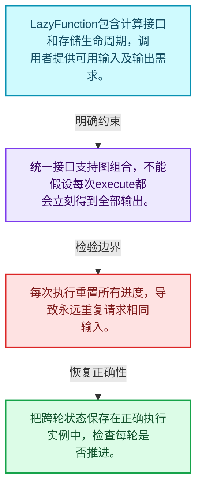
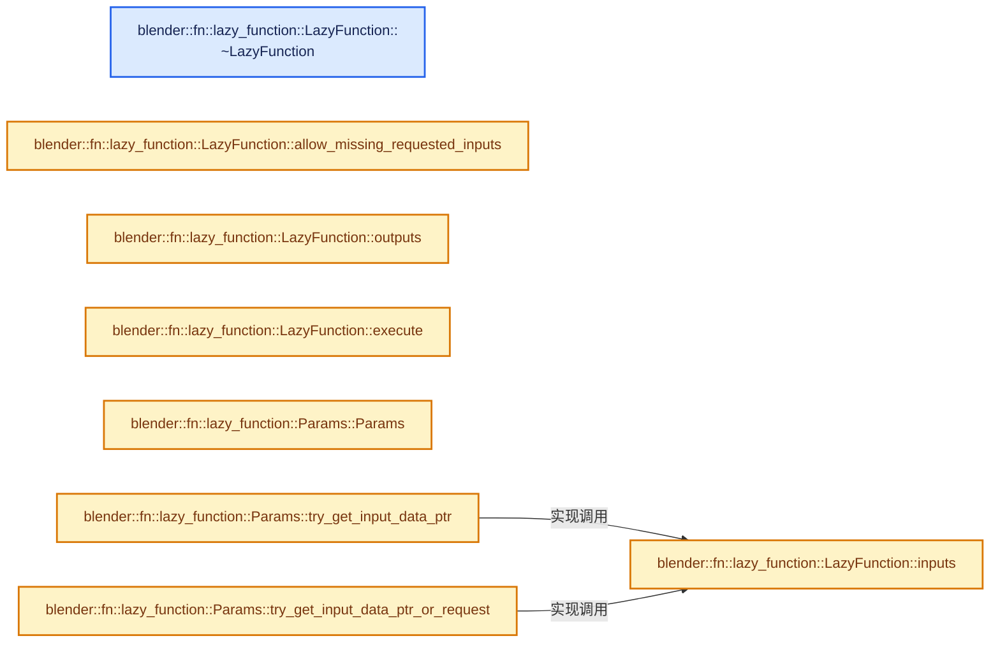
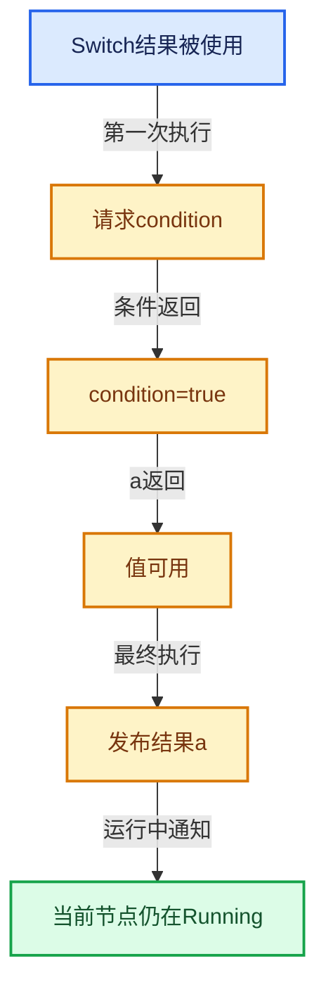

# 09-02 LazyFunction接口

[方向导航](README.md) · [总目录](../README.md) · [实现索引](../%E7%AC%A6%E5%8F%B7%E4%BE%9D%E8%B5%96%E4%B8%8E%E5%AE%9E%E7%8E%B0%E7%B4%A2%E5%BC%95.md)

## 从问题到实现

通用计算单元需要暴露哪些行为？

接口包含输入输出描述、执行和存储生命周期；可组合要求调用约定不依赖具体几何节点。

**数据模型**

LazyFunction包含计算接口和存储生命周期，调用者提供可用输入及输出需求。

**设计取舍**

统一接口支持图组合，不能假设每次execute都会立刻得到全部输出。

**最小反例**

每次执行重置所有进度，导致永远重复请求相同输入。

**推导**

把跨轮状态保存在正确执行实例中，检查每轮是否推进。

## 阅读地图与执行推演








图中的数值推演是本方向的教学模型；实际函数之间的调用边与概念分析边分别标注，不能把概念关系当作运行时调度顺序。

## 完整源码单元与就地讲解

中文讲解直接放在相关代码旁，复杂机制在代码下展开。原文折叠区保留基准行号；不需要在行号表和函数之间来回查找。类布局可分段展示，函数实现不按固定行数切开。

### 类型布局、声明与编译条件 · FN_lazy_function.hh L241—L257

<a id="t-634ad2034250"></a>

`LazyFunction`在这里声明的数据成员：

- `char debug_name_`
- `Vector<Input> inputs_`
- `Vector<Output> outputs_`
- `bool allow_missing_requested_inputs_`

<!-- annotated:1a503ae68942ce -->

```cpp
};

/**
 * A function that can compute outputs and request inputs lazily. For more details see the comment
 * at the top of the file.
 */
class LazyFunction {
 protected:
  const char *debug_name_ = "unknown";
  Vector<Input> inputs_;
  Vector<Output> outputs_;
  /**
   * Allow executing the function even if previously requested values are not yet available.
   */
  bool allow_missing_requested_inputs_ = false;

 public:
```

<details>
<summary>核对原始源码：source/blender/functions/FN_lazy_function.hh · L241—L257</summary>

<!-- original:1a503ae68942ce:source/blender/functions/FN_lazy_function.hh:241:257 -->

```cpp
};

/**
 * A function that can compute outputs and request inputs lazily. For more details see the comment
 * at the top of the file.
 */
class LazyFunction {
 protected:
  const char *debug_name_ = "unknown";
  Vector<Input> inputs_;
  Vector<Output> outputs_;
  /**
   * Allow executing the function even if previously requested values are not yet available.
   */
  bool allow_missing_requested_inputs_ = false;

 public:
```

</details>

<a id="f-9a1bcaa519fca623"></a>

### `blender::fn::lazy_function::LazyFunction::~LazyFunction`

实现位置：[source/blender/functions/FN_lazy_function.hh](../../../../../source/blender/functions/FN_lazy_function.hh) · L258—L258。

**教学注释版**

<!-- annotated:5b204e965c7e1d -->

```cpp
  virtual ~LazyFunction() = default;
```

<details>
<summary>核对原始源码：source/blender/functions/FN_lazy_function.hh · L258—L258</summary>

<!-- original:5b204e965c7e1d:source/blender/functions/FN_lazy_function.hh:258:258 -->

```cpp
  virtual ~LazyFunction() = default;
```

</details>

**继续追踪实现**

本实现没有需要继续展开的显式调用；检查返回表达式、对象转换和调用者前置条件。

### 类型布局、声明与编译条件 · FN_lazy_function.hh L259—L313

<!-- annotated:872a00a80120e4 -->

```cpp

  /**
   * Get a name of the function or an input or output. This is mainly used for debugging.
   * These are virtual functions because the names are often not used outside of debugging
   * workflows. This way the names are only generated when they are actually needed.
   */
  virtual std::string name() const;
  virtual std::string input_name(int index) const;
  virtual std::string output_name(int index) const;

  /**
   * Allocates storage for this function. The storage will be passed to every call to #execute.
   * If the function does not keep track of any state, this does not have to be implemented.
   */
  virtual void *init_storage(LinearAllocator<> &allocator) const;

  /**
   * Destruct the storage created in #init_storage.
   */
  virtual void destruct_storage(void *storage) const;

  /**
   * Calls `fn` with the input indices that the given `output_index` may depend on. By default
   * every output depends on every input.
   */
  virtual void possible_output_dependencies(int output_index,
                                            FunctionRef<void(Span<int>)> fn) const;

  /**
   * Inputs of the function.
   */
  Span<Input> inputs() const;
  /**
   * Outputs of the function.
   */
  Span<Output> outputs() const;

  /**
   * During execution the function retrieves inputs and sets outputs in #params. For some
   * functions, this method is called more than once. After execution, the function either has
   * computed all required outputs or is waiting for more inputs.
   */
  void execute(Params &params, const Context &context) const;

  /**
   * Utility to check that the guarantee by #Input::usage is followed.
   */
  bool always_used_inputs_available(const Params &params) const;

  /**
   * If true, the function can be executed even when some requested inputs are not available yet.
   * This allows the function to make some progress and maybe to compute some outputs that are
   * passed into this function again (lazy-function graphs may contain cycles as long as there
   * aren't actually data dependencies).
   */
```

<details>
<summary>核对原始源码：source/blender/functions/FN_lazy_function.hh · L259—L313</summary>

<!-- original:872a00a80120e4:source/blender/functions/FN_lazy_function.hh:259:313 -->

```cpp

  /**
   * Get a name of the function or an input or output. This is mainly used for debugging.
   * These are virtual functions because the names are often not used outside of debugging
   * workflows. This way the names are only generated when they are actually needed.
   */
  virtual std::string name() const;
  virtual std::string input_name(int index) const;
  virtual std::string output_name(int index) const;

  /**
   * Allocates storage for this function. The storage will be passed to every call to #execute.
   * If the function does not keep track of any state, this does not have to be implemented.
   */
  virtual void *init_storage(LinearAllocator<> &allocator) const;

  /**
   * Destruct the storage created in #init_storage.
   */
  virtual void destruct_storage(void *storage) const;

  /**
   * Calls `fn` with the input indices that the given `output_index` may depend on. By default
   * every output depends on every input.
   */
  virtual void possible_output_dependencies(int output_index,
                                            FunctionRef<void(Span<int>)> fn) const;

  /**
   * Inputs of the function.
   */
  Span<Input> inputs() const;
  /**
   * Outputs of the function.
   */
  Span<Output> outputs() const;

  /**
   * During execution the function retrieves inputs and sets outputs in #params. For some
   * functions, this method is called more than once. After execution, the function either has
   * computed all required outputs or is waiting for more inputs.
   */
  void execute(Params &params, const Context &context) const;

  /**
   * Utility to check that the guarantee by #Input::usage is followed.
   */
  bool always_used_inputs_available(const Params &params) const;

  /**
   * If true, the function can be executed even when some requested inputs are not available yet.
   * This allows the function to make some progress and maybe to compute some outputs that are
   * passed into this function again (lazy-function graphs may contain cycles as long as there
   * aren't actually data dependencies).
   */
```

</details>

<a id="f-cc624a0aba52e3c3"></a>

### `blender::fn::lazy_function::LazyFunction::allow_missing_requested_inputs`

实现位置：[source/blender/functions/FN_lazy_function.hh](../../../../../source/blender/functions/FN_lazy_function.hh) · L314—L317。

**教学注释版**

<!-- annotated:b3759b57e1d7f4 -->

```cpp
  bool allow_missing_requested_inputs() const
  {
    return allow_missing_requested_inputs_;
  }
```

<details>
<summary>核对原始源码：source/blender/functions/FN_lazy_function.hh · L314—L317</summary>

<!-- original:b3759b57e1d7f4:source/blender/functions/FN_lazy_function.hh:314:317 -->

```cpp
  bool allow_missing_requested_inputs() const
  {
    return allow_missing_requested_inputs_;
  }
```

</details>

**结果出口**

- `return allow_missing_requested_inputs_;`

**继续追踪实现**

本实现没有需要继续展开的显式调用；检查返回表达式、对象转换和调用者前置条件。

### 类型布局、声明与编译条件 · FN_lazy_function.hh L318—L330

<!-- annotated:646460e312a955 -->

```cpp

 private:
  /**
   * Needs to be implemented by subclasses. This is separate from #execute so that additional
   * debugging logic can be implemented in #execute.
   */
  virtual void execute_impl(Params &params, const Context &context) const = 0;
};

/* -------------------------------------------------------------------- */
/** \name #LazyFunction Inline Methods
 * \{ */

```

<details>
<summary>核对原始源码：source/blender/functions/FN_lazy_function.hh · L318—L330</summary>

<!-- original:646460e312a955:source/blender/functions/FN_lazy_function.hh:318:330 -->

```cpp

 private:
  /**
   * Needs to be implemented by subclasses. This is separate from #execute so that additional
   * debugging logic can be implemented in #execute.
   */
  virtual void execute_impl(Params &params, const Context &context) const = 0;
};

/* -------------------------------------------------------------------- */
/** \name #LazyFunction Inline Methods
 * \{ */

```

</details>

<a id="f-bdcd40e6f47d0ad9"></a>

### `blender::fn::lazy_function::LazyFunction::inputs`

实现位置：[source/blender/functions/FN_lazy_function.hh](../../../../../source/blender/functions/FN_lazy_function.hh) · L331—L334。

**教学注释版**

<!-- annotated:6111f3546cf947 -->

```cpp
inline Span<Input> LazyFunction::inputs() const
{
  return inputs_;
}
```

<details>
<summary>核对原始源码：source/blender/functions/FN_lazy_function.hh · L331—L334</summary>

<!-- original:6111f3546cf947:source/blender/functions/FN_lazy_function.hh:331:334 -->

```cpp
inline Span<Input> LazyFunction::inputs() const
{
  return inputs_;
}
```

</details>

**结果出口**

- `return inputs_;`

**继续追踪实现**

本实现没有需要继续展开的显式调用；检查返回表达式、对象转换和调用者前置条件。

<!-- annotated:c386fcf3af619d -->

```cpp

```

<details>
<summary>核对原始源码：source/blender/functions/FN_lazy_function.hh · L335—L335</summary>

<!-- original:c386fcf3af619d:source/blender/functions/FN_lazy_function.hh:335:335 -->

```cpp

```

</details>

<a id="f-8131802149321817"></a>

### `blender::fn::lazy_function::LazyFunction::outputs`

实现位置：[source/blender/functions/FN_lazy_function.hh](../../../../../source/blender/functions/FN_lazy_function.hh) · L336—L339。

**教学注释版**

<!-- annotated:9d3d95d97f70e4 -->

```cpp
inline Span<Output> LazyFunction::outputs() const
{
  return outputs_;
}
```

<details>
<summary>核对原始源码：source/blender/functions/FN_lazy_function.hh · L336—L339</summary>

<!-- original:9d3d95d97f70e4:source/blender/functions/FN_lazy_function.hh:336:339 -->

```cpp
inline Span<Output> LazyFunction::outputs() const
{
  return outputs_;
}
```

</details>

**结果出口**

- `return outputs_;`

**继续追踪实现**

本实现没有需要继续展开的显式调用；检查返回表达式、对象转换和调用者前置条件。

<!-- annotated:20a2a0f2733aa0 -->

```cpp

```

<details>
<summary>核对原始源码：source/blender/functions/FN_lazy_function.hh · L340—L340</summary>

<!-- original:20a2a0f2733aa0:source/blender/functions/FN_lazy_function.hh:340:340 -->

```cpp

```

</details>

<a id="f-1d443709054d33d8"></a>

### `blender::fn::lazy_function::LazyFunction::execute`

按已有输入和所需输出推进执行。

实现位置：[source/blender/functions/FN_lazy_function.hh](../../../../../source/blender/functions/FN_lazy_function.hh) · L341—L347。

接口参数：

- `Params &params`
- `const Context &context`

**教学注释版**

<!-- annotated:bc638105fe9b13 -->

```cpp
inline void LazyFunction::execute(Params &params, const Context &context) const
{
  PRF_scope_with_name("LazyFunction", ProfileCategory::Default);
  PRF_scope_set_dynamic_name("%s", debug_name_);
  BLI_assert(this->always_used_inputs_available(params));
  // [讲解] this->execute_impl：按已有输入和所需输出推进执行。
  this->execute_impl(params, context);
}
```

<details>
<summary>核对原始源码：source/blender/functions/FN_lazy_function.hh · L341—L347</summary>

<!-- original:bc638105fe9b13:source/blender/functions/FN_lazy_function.hh:341:347 -->

```cpp
inline void LazyFunction::execute(Params &params, const Context &context) const
{
  PRF_scope_with_name("LazyFunction", ProfileCategory::Default);
  PRF_scope_set_dynamic_name("%s", debug_name_);
  BLI_assert(this->always_used_inputs_available(params));
  this->execute_impl(params, context);
}
```

</details>

**接口与不变量**

一次执行可能只提出输入请求；不保证立即产生所有输出，也不应无条件重置跨轮状态。

**继续追踪实现**

- `PRF_scope_with_name` → [PRF_scope_with_name · L52](../05-%E5%87%A0%E4%BD%95%E5%AD%98%E5%82%A8%E4%B8%8E%E6%8B%93%E6%89%91%E6%98%A0%E5%B0%84/%E4%BE%9D%E8%B5%96-PRF_profile-5a3577.md#m-adc22c3a3f8c)；[PRF_scope_with_name · L91](../05-%E5%87%A0%E4%BD%95%E5%AD%98%E5%82%A8%E4%B8%8E%E6%8B%93%E6%89%91%E6%98%A0%E5%B0%84/%E4%BE%9D%E8%B5%96-PRF_profile-5a3577.md#m-3cbbaddb89c4)。宏定义由构建条件选择。
- `PRF_scope_set_dynamic_name` → [PRF_scope_set_dynamic_name · L55](../05-%E5%87%A0%E4%BD%95%E5%AD%98%E5%82%A8%E4%B8%8E%E6%8B%93%E6%89%91%E6%98%A0%E5%B0%84/%E4%BE%9D%E8%B5%96-PRF_profile-5a3577.md#m-27e2ed8a1ee1)；[PRF_scope_set_dynamic_name · L93](../05-%E5%87%A0%E4%BD%95%E5%AD%98%E5%82%A8%E4%B8%8E%E6%8B%93%E6%89%91%E6%98%A0%E5%B0%84/%E4%BE%9D%E8%B5%96-PRF_profile-5a3577.md#m-525677247e79)。宏定义由构建条件选择。
- `BLI_assert` → [BLI_assert · L48](../01-%E5%9F%BA%E7%A1%80%E5%AE%B9%E5%99%A8%E4%B8%8E%E7%8E%B0%E4%BB%A3CPP/%E4%BE%9D%E8%B5%96-BLI_assert-cc98e8.md#m-57a88495704d)；[BLI_assert · L63](../01-%E5%9F%BA%E7%A1%80%E5%AE%B9%E5%99%A8%E4%B8%8E%E7%8E%B0%E4%BB%A3CPP/%E4%BE%9D%E8%B5%96-BLI_assert-cc98e8.md#m-d07050020cb5)。宏定义由构建条件选择。
- `this->always_used_inputs_available` → [blender::fn::lazy_function::LazyFunction::always_used_inputs_available · L50](02-LazyFunction%E6%8E%A5%E5%8F%A3.md#f-68ec2a24506330a6)。
- `this->execute_impl` → [blender::fn::lazy_function::GraphExecutor::execute_impl · L68](10-%E6%99%AE%E9%80%9A%E8%8A%82%E7%82%B9%E4%B8%8E%E5%87%BD%E6%95%B0%E9%80%82%E9%85%8D.md#f-161c82696993ca52)。

### 类型布局、声明与编译条件 · FN_lazy_function.hh L348—L354

<!-- annotated:0131825aba84bb -->

```cpp

/** \} */

/* -------------------------------------------------------------------- */
/** \name #Params Inline Methods
 * \{ */

```

<details>
<summary>核对原始源码：source/blender/functions/FN_lazy_function.hh · L348—L354</summary>

<!-- original:0131825aba84bb:source/blender/functions/FN_lazy_function.hh:348:354 -->

```cpp

/** \} */

/* -------------------------------------------------------------------- */
/** \name #Params Inline Methods
 * \{ */

```

</details>

<a id="f-f9cf703e30a42b43"></a>

### `blender::fn::lazy_function::Params::Params`

实现位置：[source/blender/functions/FN_lazy_function.hh](../../../../../source/blender/functions/FN_lazy_function.hh) · L355—L364。

接口参数：

- `const LazyFunction &fn`
- `[[maybe_unused]] bool allow_multi_threading_initially`

**教学注释版**

<!-- annotated:fdd2f3c7d90a7a -->

```cpp
inline Params::Params(const LazyFunction &fn,
                      [[maybe_unused]] bool allow_multi_threading_initially)
    : fn_(fn)
#ifdef FN_LAZY_FUNCTION_DEBUG_THREADS
      ,
      main_thread_id_(std::this_thread::get_id()),
      allow_multi_threading_(allow_multi_threading_initially)
#endif
{
}
```

<details>
<summary>核对原始源码：source/blender/functions/FN_lazy_function.hh · L355—L364</summary>

<!-- original:fdd2f3c7d90a7a:source/blender/functions/FN_lazy_function.hh:355:364 -->

```cpp
inline Params::Params(const LazyFunction &fn,
                      [[maybe_unused]] bool allow_multi_threading_initially)
    : fn_(fn)
#ifdef FN_LAZY_FUNCTION_DEBUG_THREADS
      ,
      main_thread_id_(std::this_thread::get_id()),
      allow_multi_threading_(allow_multi_threading_initially)
#endif
{
}
```

</details>

**继续追踪实现**

本实现没有需要继续展开的显式调用；检查返回表达式、对象转换和调用者前置条件。

<!-- annotated:4f11f0f1637903 -->

```cpp

```

<details>
<summary>核对原始源码：source/blender/functions/FN_lazy_function.hh · L365—L365</summary>

<!-- original:4f11f0f1637903:source/blender/functions/FN_lazy_function.hh:365:365 -->

```cpp

```

</details>

<a id="f-9dc147b3722ce6e6"></a>

### `blender::fn::lazy_function::Params::try_get_input_data_ptr`

实现位置：[source/blender/functions/FN_lazy_function.hh](../../../../../source/blender/functions/FN_lazy_function.hh) · L366—L370。

接口参数：

- `const int index`

**教学注释版**

<!-- annotated:30b35a255c9905 -->

```cpp
inline void *Params::try_get_input_data_ptr(const int index) const
{
  BLI_assert(index >= 0 && index < fn_.inputs().size());
  return this->try_get_input_data_ptr_impl(index);
}
```

<details>
<summary>核对原始源码：source/blender/functions/FN_lazy_function.hh · L366—L370</summary>

<!-- original:30b35a255c9905:source/blender/functions/FN_lazy_function.hh:366:370 -->

```cpp
inline void *Params::try_get_input_data_ptr(const int index) const
{
  BLI_assert(index >= 0 && index < fn_.inputs().size());
  return this->try_get_input_data_ptr_impl(index);
}
```

</details>

**结果出口**

- `return this->try_get_input_data_ptr_impl(index);`

**继续追踪实现**

- `BLI_assert` → [BLI_assert · L48](../01-%E5%9F%BA%E7%A1%80%E5%AE%B9%E5%99%A8%E4%B8%8E%E7%8E%B0%E4%BB%A3CPP/%E4%BE%9D%E8%B5%96-BLI_assert-cc98e8.md#m-57a88495704d)；[BLI_assert · L63](../01-%E5%9F%BA%E7%A1%80%E5%AE%B9%E5%99%A8%E4%B8%8E%E7%8E%B0%E4%BB%A3CPP/%E4%BE%9D%E8%B5%96-BLI_assert-cc98e8.md#m-d07050020cb5)。宏定义由构建条件选择。
- `fn_.inputs().size` → [调用协议](../%E6%A8%A1%E6%9D%BF%E5%AE%8F%E4%B8%8E%E5%8A%A8%E6%80%81%E5%88%86%E6%B4%BE%E5%8D%8F%E8%AE%AE.md)：接收对象类型依赖auto、返回值或模板实例；不按同名猜测目标。调用位置L368。
- `fn_.inputs` → [blender::fn::lazy_function::LazyFunction::inputs · L331](02-LazyFunction%E6%8E%A5%E5%8F%A3.md#f-bdcd40e6f47d0ad9)。
- `this->try_get_input_data_ptr_impl` → [blender::fn::lazy_function::BasicParams::try_get_input_data_ptr_impl · L32](03-Params%E4%B8%8EValueUsage.md#f-1422dd7ac14d9590)；[blender::fn::lazy_function::RemappedParams::try_get_input_data_ptr_impl · L95](03-Params%E4%B8%8EValueUsage.md#f-a44ad7e251b760d6)。同名重载需按实参类型选择。

<!-- annotated:1cf79030d829a2 -->

```cpp

```

<details>
<summary>核对原始源码：source/blender/functions/FN_lazy_function.hh · L371—L371</summary>

<!-- original:1cf79030d829a2:source/blender/functions/FN_lazy_function.hh:371:371 -->

```cpp

```

</details>

<a id="f-89de2295f5baa94f"></a>

### `blender::fn::lazy_function::Params::try_get_input_data_ptr_or_request`

实现位置：[source/blender/functions/FN_lazy_function.hh](../../../../../source/blender/functions/FN_lazy_function.hh) · L372—L377。

接口参数：

- `const int index`

**教学注释版**

<!-- annotated:0b4b24d8ae245e -->

```cpp
inline void *Params::try_get_input_data_ptr_or_request(const int index)
{
  BLI_assert(index >= 0 && index < fn_.inputs().size());
  this->assert_valid_thread();
  return this->try_get_input_data_ptr_or_request_impl(index);
}
```

<details>
<summary>核对原始源码：source/blender/functions/FN_lazy_function.hh · L372—L377</summary>

<!-- original:0b4b24d8ae245e:source/blender/functions/FN_lazy_function.hh:372:377 -->

```cpp
inline void *Params::try_get_input_data_ptr_or_request(const int index)
{
  BLI_assert(index >= 0 && index < fn_.inputs().size());
  this->assert_valid_thread();
  return this->try_get_input_data_ptr_or_request_impl(index);
}
```

</details>

**结果出口**

- `return this->try_get_input_data_ptr_or_request_impl(index);`

**继续追踪实现**

- `BLI_assert` → [BLI_assert · L48](../01-%E5%9F%BA%E7%A1%80%E5%AE%B9%E5%99%A8%E4%B8%8E%E7%8E%B0%E4%BB%A3CPP/%E4%BE%9D%E8%B5%96-BLI_assert-cc98e8.md#m-57a88495704d)；[BLI_assert · L63](../01-%E5%9F%BA%E7%A1%80%E5%AE%B9%E5%99%A8%E4%B8%8E%E7%8E%B0%E4%BB%A3CPP/%E4%BE%9D%E8%B5%96-BLI_assert-cc98e8.md#m-d07050020cb5)。宏定义由构建条件选择。
- `fn_.inputs().size` → [调用协议](../%E6%A8%A1%E6%9D%BF%E5%AE%8F%E4%B8%8E%E5%8A%A8%E6%80%81%E5%88%86%E6%B4%BE%E5%8D%8F%E8%AE%AE.md)：接收对象类型依赖auto、返回值或模板实例；不按同名猜测目标。调用位置L374。
- `fn_.inputs` → [blender::fn::lazy_function::LazyFunction::inputs · L331](02-LazyFunction%E6%8E%A5%E5%8F%A3.md#f-bdcd40e6f47d0ad9)。
- `this->assert_valid_thread` → [blender::fn::lazy_function::Params::assert_valid_thread · L461](02-LazyFunction%E6%8E%A5%E5%8F%A3.md#f-9848da8ca4109c9c)。
- `this->try_get_input_data_ptr_or_request_impl` → [blender::fn::lazy_function::BasicParams::try_get_input_data_ptr_or_request_impl · L37](03-Params%E4%B8%8EValueUsage.md#f-22d47a20a372fa8d)；[blender::fn::lazy_function::RemappedParams::try_get_input_data_ptr_or_request_impl · L100](03-Params%E4%B8%8EValueUsage.md#f-f03f4458bc818a1b)。同名重载需按实参类型选择。

<!-- annotated:0da1d86c7404fa -->

```cpp

```

<details>
<summary>核对原始源码：source/blender/functions/FN_lazy_function.hh · L378—L378</summary>

<!-- original:0da1d86c7404fa:source/blender/functions/FN_lazy_function.hh:378:378 -->

```cpp

```

</details>

<a id="f-e994bf059ecf6ba3"></a>

### `blender::fn::lazy_function::Params::get_output_data_ptr`

实现位置：[source/blender/functions/FN_lazy_function.hh](../../../../../source/blender/functions/FN_lazy_function.hh) · L379—L384。

接口参数：

- `const int index`

**教学注释版**

<!-- annotated:829667f68a2bb6 -->

```cpp
inline void *Params::get_output_data_ptr(const int index)
{
  BLI_assert(index >= 0 && index < fn_.outputs().size());
  this->assert_valid_thread();
  return this->get_output_data_ptr_impl(index);
}
```

<details>
<summary>核对原始源码：source/blender/functions/FN_lazy_function.hh · L379—L384</summary>

<!-- original:829667f68a2bb6:source/blender/functions/FN_lazy_function.hh:379:384 -->

```cpp
inline void *Params::get_output_data_ptr(const int index)
{
  BLI_assert(index >= 0 && index < fn_.outputs().size());
  this->assert_valid_thread();
  return this->get_output_data_ptr_impl(index);
}
```

</details>

**结果出口**

- `return this->get_output_data_ptr_impl(index);`

**继续追踪实现**

- `BLI_assert` → [BLI_assert · L48](../01-%E5%9F%BA%E7%A1%80%E5%AE%B9%E5%99%A8%E4%B8%8E%E7%8E%B0%E4%BB%A3CPP/%E4%BE%9D%E8%B5%96-BLI_assert-cc98e8.md#m-57a88495704d)；[BLI_assert · L63](../01-%E5%9F%BA%E7%A1%80%E5%AE%B9%E5%99%A8%E4%B8%8E%E7%8E%B0%E4%BB%A3CPP/%E4%BE%9D%E8%B5%96-BLI_assert-cc98e8.md#m-d07050020cb5)。宏定义由构建条件选择。
- `fn_.outputs().size` → [调用协议](../%E6%A8%A1%E6%9D%BF%E5%AE%8F%E4%B8%8E%E5%8A%A8%E6%80%81%E5%88%86%E6%B4%BE%E5%8D%8F%E8%AE%AE.md)：接收对象类型依赖auto、返回值或模板实例；不按同名猜测目标。调用位置L381。
- `fn_.outputs` → [blender::fn::lazy_function::LazyFunction::outputs · L336](02-LazyFunction%E6%8E%A5%E5%8F%A3.md#f-8131802149321817)。
- `this->assert_valid_thread` → [blender::fn::lazy_function::Params::assert_valid_thread · L461](02-LazyFunction%E6%8E%A5%E5%8F%A3.md#f-9848da8ca4109c9c)。
- `this->get_output_data_ptr_impl` → [blender::fn::lazy_function::BasicParams::get_output_data_ptr_impl · L46](03-Params%E4%B8%8EValueUsage.md#f-143832f4f24356bc)；[blender::fn::lazy_function::RemappedParams::get_output_data_ptr_impl · L105](03-Params%E4%B8%8EValueUsage.md#f-f6e6f74be370f1aa)。同名重载需按实参类型选择。

<!-- annotated:90d810f5f4ea56 -->

```cpp

```

<details>
<summary>核对原始源码：source/blender/functions/FN_lazy_function.hh · L385—L385</summary>

<!-- original:90d810f5f4ea56:source/blender/functions/FN_lazy_function.hh:385:385 -->

```cpp

```

</details>

<a id="f-ccb221ae62d438f5"></a>

### `blender::fn::lazy_function::Params::output_set`

实现位置：[source/blender/functions/FN_lazy_function.hh](../../../../../source/blender/functions/FN_lazy_function.hh) · L386—L391。

接口参数：

- `const int index`

**教学注释版**

<!-- annotated:2db1aeb7189567 -->

```cpp
inline void Params::output_set(const int index)
{
  BLI_assert(index >= 0 && index < fn_.outputs().size());
  this->assert_valid_thread();
  this->output_set_impl(index);
}
```

<details>
<summary>核对原始源码：source/blender/functions/FN_lazy_function.hh · L386—L391</summary>

<!-- original:2db1aeb7189567:source/blender/functions/FN_lazy_function.hh:386:391 -->

```cpp
inline void Params::output_set(const int index)
{
  BLI_assert(index >= 0 && index < fn_.outputs().size());
  this->assert_valid_thread();
  this->output_set_impl(index);
}
```

</details>

**继续追踪实现**

- `BLI_assert` → [BLI_assert · L48](../01-%E5%9F%BA%E7%A1%80%E5%AE%B9%E5%99%A8%E4%B8%8E%E7%8E%B0%E4%BB%A3CPP/%E4%BE%9D%E8%B5%96-BLI_assert-cc98e8.md#m-57a88495704d)；[BLI_assert · L63](../01-%E5%9F%BA%E7%A1%80%E5%AE%B9%E5%99%A8%E4%B8%8E%E7%8E%B0%E4%BB%A3CPP/%E4%BE%9D%E8%B5%96-BLI_assert-cc98e8.md#m-d07050020cb5)。宏定义由构建条件选择。
- `fn_.outputs().size` → [调用协议](../%E6%A8%A1%E6%9D%BF%E5%AE%8F%E4%B8%8E%E5%8A%A8%E6%80%81%E5%88%86%E6%B4%BE%E5%8D%8F%E8%AE%AE.md)：接收对象类型依赖auto、返回值或模板实例；不按同名猜测目标。调用位置L388。
- `fn_.outputs` → [blender::fn::lazy_function::LazyFunction::outputs · L336](02-LazyFunction%E6%8E%A5%E5%8F%A3.md#f-8131802149321817)。
- `this->assert_valid_thread` → [blender::fn::lazy_function::Params::assert_valid_thread · L461](02-LazyFunction%E6%8E%A5%E5%8F%A3.md#f-9848da8ca4109c9c)。
- `this->output_set_impl` → [blender::fn::lazy_function::BasicParams::output_set_impl · L51](03-Params%E4%B8%8EValueUsage.md#f-3a457b9afe1e2aef)；[blender::fn::lazy_function::RemappedParams::output_set_impl · L110](03-Params%E4%B8%8EValueUsage.md#f-798dba657e63240e)。同名重载需按实参类型选择。

<!-- annotated:a8092f3bd50a6a -->

```cpp

```

<details>
<summary>核对原始源码：source/blender/functions/FN_lazy_function.hh · L392—L392</summary>

<!-- original:a8092f3bd50a6a:source/blender/functions/FN_lazy_function.hh:392:392 -->

```cpp

```

</details>

<a id="f-aecdc506c9bbff3b"></a>

### `blender::fn::lazy_function::Params::output_was_set`

实现位置：[source/blender/functions/FN_lazy_function.hh](../../../../../source/blender/functions/FN_lazy_function.hh) · L393—L397。

接口参数：

- `const int index`

**教学注释版**

<!-- annotated:32952533e8bb70 -->

```cpp
inline bool Params::output_was_set(const int index) const
{
  BLI_assert(index >= 0 && index < fn_.outputs().size());
  return this->output_was_set_impl(index);
}
```

<details>
<summary>核对原始源码：source/blender/functions/FN_lazy_function.hh · L393—L397</summary>

<!-- original:32952533e8bb70:source/blender/functions/FN_lazy_function.hh:393:397 -->

```cpp
inline bool Params::output_was_set(const int index) const
{
  BLI_assert(index >= 0 && index < fn_.outputs().size());
  return this->output_was_set_impl(index);
}
```

</details>

**结果出口**

- `return this->output_was_set_impl(index);`

**继续追踪实现**

- `BLI_assert` → [BLI_assert · L48](../01-%E5%9F%BA%E7%A1%80%E5%AE%B9%E5%99%A8%E4%B8%8E%E7%8E%B0%E4%BB%A3CPP/%E4%BE%9D%E8%B5%96-BLI_assert-cc98e8.md#m-57a88495704d)；[BLI_assert · L63](../01-%E5%9F%BA%E7%A1%80%E5%AE%B9%E5%99%A8%E4%B8%8E%E7%8E%B0%E4%BB%A3CPP/%E4%BE%9D%E8%B5%96-BLI_assert-cc98e8.md#m-d07050020cb5)。宏定义由构建条件选择。
- `fn_.outputs().size` → [调用协议](../%E6%A8%A1%E6%9D%BF%E5%AE%8F%E4%B8%8E%E5%8A%A8%E6%80%81%E5%88%86%E6%B4%BE%E5%8D%8F%E8%AE%AE.md)：接收对象类型依赖auto、返回值或模板实例；不按同名猜测目标。调用位置L395。
- `fn_.outputs` → [blender::fn::lazy_function::LazyFunction::outputs · L336](02-LazyFunction%E6%8E%A5%E5%8F%A3.md#f-8131802149321817)。
- `this->output_was_set_impl` → [blender::fn::lazy_function::BasicParams::output_was_set_impl · L56](03-Params%E4%B8%8EValueUsage.md#f-ecc713de96899c1d)；[blender::fn::lazy_function::RemappedParams::output_was_set_impl · L115](03-Params%E4%B8%8EValueUsage.md#f-db78cc9177a7febd)。同名重载需按实参类型选择。

<!-- annotated:18fdf0dee81dc0 -->

```cpp

```

<details>
<summary>核对原始源码：source/blender/functions/FN_lazy_function.hh · L398—L398</summary>

<!-- original:18fdf0dee81dc0:source/blender/functions/FN_lazy_function.hh:398:398 -->

```cpp

```

</details>

<a id="f-bd2d3063532e6360"></a>

### `blender::fn::lazy_function::Params::get_output_usage`

实现位置：[source/blender/functions/FN_lazy_function.hh](../../../../../source/blender/functions/FN_lazy_function.hh) · L399—L403。

接口参数：

- `const int index`

**教学注释版**

<!-- annotated:d7199e8242ff9c -->

```cpp
inline ValueUsage Params::get_output_usage(const int index) const
{
  BLI_assert(index >= 0 && index < fn_.outputs().size());
  return this->get_output_usage_impl(index);
}
```

<details>
<summary>核对原始源码：source/blender/functions/FN_lazy_function.hh · L399—L403</summary>

<!-- original:d7199e8242ff9c:source/blender/functions/FN_lazy_function.hh:399:403 -->

```cpp
inline ValueUsage Params::get_output_usage(const int index) const
{
  BLI_assert(index >= 0 && index < fn_.outputs().size());
  return this->get_output_usage_impl(index);
}
```

</details>

**结果出口**

- `return this->get_output_usage_impl(index);`

**继续追踪实现**

- `BLI_assert` → [BLI_assert · L48](../01-%E5%9F%BA%E7%A1%80%E5%AE%B9%E5%99%A8%E4%B8%8E%E7%8E%B0%E4%BB%A3CPP/%E4%BE%9D%E8%B5%96-BLI_assert-cc98e8.md#m-57a88495704d)；[BLI_assert · L63](../01-%E5%9F%BA%E7%A1%80%E5%AE%B9%E5%99%A8%E4%B8%8E%E7%8E%B0%E4%BB%A3CPP/%E4%BE%9D%E8%B5%96-BLI_assert-cc98e8.md#m-d07050020cb5)。宏定义由构建条件选择。
- `fn_.outputs().size` → [调用协议](../%E6%A8%A1%E6%9D%BF%E5%AE%8F%E4%B8%8E%E5%8A%A8%E6%80%81%E5%88%86%E6%B4%BE%E5%8D%8F%E8%AE%AE.md)：接收对象类型依赖auto、返回值或模板实例；不按同名猜测目标。调用位置L401。
- `fn_.outputs` → [blender::fn::lazy_function::LazyFunction::outputs · L336](02-LazyFunction%E6%8E%A5%E5%8F%A3.md#f-8131802149321817)。
- `this->get_output_usage_impl` → [blender::fn::lazy_function::BasicParams::get_output_usage_impl · L61](03-Params%E4%B8%8EValueUsage.md#f-12bb4bf0c8b54c4d)；[blender::fn::lazy_function::RemappedParams::get_output_usage_impl · L120](03-Params%E4%B8%8EValueUsage.md#f-a13e246cbfe9d624)。同名重载需按实参类型选择。

<!-- annotated:2024ea6d274b9e -->

```cpp

```

<details>
<summary>核对原始源码：source/blender/functions/FN_lazy_function.hh · L404—L404</summary>

<!-- original:2024ea6d274b9e:source/blender/functions/FN_lazy_function.hh:404:404 -->

```cpp

```

</details>

<a id="f-0a0db77ebf68f7c8"></a>

### `blender::fn::lazy_function::Params::set_input_unused`

实现位置：[source/blender/functions/FN_lazy_function.hh](../../../../../source/blender/functions/FN_lazy_function.hh) · L405—L410。

接口参数：

- `const int index`

**教学注释版**

<!-- annotated:784d9701a9a0a6 -->

```cpp
inline void Params::set_input_unused(const int index)
{
  BLI_assert(index >= 0 && index < fn_.inputs().size());
  this->assert_valid_thread();
  this->set_input_unused_impl(index);
}
```

<details>
<summary>核对原始源码：source/blender/functions/FN_lazy_function.hh · L405—L410</summary>

<!-- original:784d9701a9a0a6:source/blender/functions/FN_lazy_function.hh:405:410 -->

```cpp
inline void Params::set_input_unused(const int index)
{
  BLI_assert(index >= 0 && index < fn_.inputs().size());
  this->assert_valid_thread();
  this->set_input_unused_impl(index);
}
```

</details>

**继续追踪实现**

- `BLI_assert` → [BLI_assert · L48](../01-%E5%9F%BA%E7%A1%80%E5%AE%B9%E5%99%A8%E4%B8%8E%E7%8E%B0%E4%BB%A3CPP/%E4%BE%9D%E8%B5%96-BLI_assert-cc98e8.md#m-57a88495704d)；[BLI_assert · L63](../01-%E5%9F%BA%E7%A1%80%E5%AE%B9%E5%99%A8%E4%B8%8E%E7%8E%B0%E4%BB%A3CPP/%E4%BE%9D%E8%B5%96-BLI_assert-cc98e8.md#m-d07050020cb5)。宏定义由构建条件选择。
- `fn_.inputs().size` → [调用协议](../%E6%A8%A1%E6%9D%BF%E5%AE%8F%E4%B8%8E%E5%8A%A8%E6%80%81%E5%88%86%E6%B4%BE%E5%8D%8F%E8%AE%AE.md)：接收对象类型依赖auto、返回值或模板实例；不按同名猜测目标。调用位置L407。
- `fn_.inputs` → [blender::fn::lazy_function::LazyFunction::inputs · L331](02-LazyFunction%E6%8E%A5%E5%8F%A3.md#f-bdcd40e6f47d0ad9)。
- `this->assert_valid_thread` → [blender::fn::lazy_function::Params::assert_valid_thread · L461](02-LazyFunction%E6%8E%A5%E5%8F%A3.md#f-9848da8ca4109c9c)。
- `this->set_input_unused_impl` → [blender::fn::lazy_function::BasicParams::set_input_unused_impl · L66](03-Params%E4%B8%8EValueUsage.md#f-c6697b764ff44fb0)；[blender::fn::lazy_function::RemappedParams::set_input_unused_impl · L125](03-Params%E4%B8%8EValueUsage.md#f-55f236aa7f49af91)。同名重载需按实参类型选择。

<!-- annotated:d1b64fe0eec2bb -->

```cpp

```

<details>
<summary>核对原始源码：source/blender/functions/FN_lazy_function.hh · L411—L411</summary>

<!-- original:d1b64fe0eec2bb:source/blender/functions/FN_lazy_function.hh:411:411 -->

```cpp

```

</details>

<a id="f-037bdbe54ffc8fdd"></a>

### `blender::fn::lazy_function::Params::extract_input`

实现位置：[source/blender/functions/FN_lazy_function.hh](../../../../../source/blender/functions/FN_lazy_function.hh) · L412—L419。

接口参数：

- `const int index`

**教学注释版**

<!-- annotated:f5d0e861fdd68d -->

```cpp
template<typename T> inline T Params::extract_input(const int index)
{
  this->assert_valid_thread();
  void *data = this->try_get_input_data_ptr(index);
  BLI_assert(data != nullptr);
  // [讲解] std::move：把表达式转换成可供移动重载选择的值类别；不保证真的移动，不结束源对象寿命，对const值可能选择复制。
  T return_value = std::move(*static_cast<T *>(data));
  return return_value;
}
```

<details>
<summary>核对原始源码：source/blender/functions/FN_lazy_function.hh · L412—L419</summary>

<!-- original:f5d0e861fdd68d:source/blender/functions/FN_lazy_function.hh:412:419 -->

```cpp
template<typename T> inline T Params::extract_input(const int index)
{
  this->assert_valid_thread();
  void *data = this->try_get_input_data_ptr(index);
  BLI_assert(data != nullptr);
  T return_value = std::move(*static_cast<T *>(data));
  return return_value;
}
```

</details>

**结果出口**

- `return return_value;`

**继续追踪实现**

- `this->assert_valid_thread` → [blender::fn::lazy_function::Params::assert_valid_thread · L461](02-LazyFunction%E6%8E%A5%E5%8F%A3.md#f-9848da8ca4109c9c)。
- `this->try_get_input_data_ptr` → [blender::fn::lazy_function::Params::try_get_input_data_ptr · L366](02-LazyFunction%E6%8E%A5%E5%8F%A3.md#f-9dc147b3722ce6e6)；[blender::fn::lazy_function::Params::try_get_input_data_ptr · L428](02-LazyFunction%E6%8E%A5%E5%8F%A3.md#f-3751fbc263e091cc)。同名重载需按实参类型选择。
- `BLI_assert` → [BLI_assert · L48](../01-%E5%9F%BA%E7%A1%80%E5%AE%B9%E5%99%A8%E4%B8%8E%E7%8E%B0%E4%BB%A3CPP/%E4%BE%9D%E8%B5%96-BLI_assert-cc98e8.md#m-57a88495704d)；[BLI_assert · L63](../01-%E5%9F%BA%E7%A1%80%E5%AE%B9%E5%99%A8%E4%B8%8E%E7%8E%B0%E4%BB%A3CPP/%E4%BE%9D%E8%B5%96-BLI_assert-cc98e8.md#m-d07050020cb5)。宏定义由构建条件选择。
- `std::move` → [外部契约](https://eel.is/c++draft/utility.forward)：把表达式转换成可供移动重载选择的值类别；不保证真的移动，不结束源对象寿命，对const值可能选择复制。

<!-- annotated:fa50c1a208df9b -->

```cpp

```

<details>
<summary>核对原始源码：source/blender/functions/FN_lazy_function.hh · L420—L420</summary>

<!-- original:fa50c1a208df9b:source/blender/functions/FN_lazy_function.hh:420:420 -->

```cpp

```

</details>

<a id="f-167a9263f8e9f932"></a>

### `blender::fn::lazy_function::Params::get_input`

实现位置：[source/blender/functions/FN_lazy_function.hh](../../../../../source/blender/functions/FN_lazy_function.hh) · L421—L426。

接口参数：

- `const int index`

**教学注释版**

<!-- annotated:ab4ff368ca1c2d -->

```cpp
template<typename T> inline T &Params::get_input(const int index) const
{
  void *data = this->try_get_input_data_ptr(index);
  BLI_assert(data != nullptr);
  return *static_cast<T *>(data);
}
```

<details>
<summary>核对原始源码：source/blender/functions/FN_lazy_function.hh · L421—L426</summary>

<!-- original:ab4ff368ca1c2d:source/blender/functions/FN_lazy_function.hh:421:426 -->

```cpp
template<typename T> inline T &Params::get_input(const int index) const
{
  void *data = this->try_get_input_data_ptr(index);
  BLI_assert(data != nullptr);
  return *static_cast<T *>(data);
}
```

</details>

**结果出口**

- `return *static_cast<T *>(data);`

**继续追踪实现**

- `this->try_get_input_data_ptr` → [blender::fn::lazy_function::Params::try_get_input_data_ptr · L366](02-LazyFunction%E6%8E%A5%E5%8F%A3.md#f-9dc147b3722ce6e6)；[blender::fn::lazy_function::Params::try_get_input_data_ptr · L428](02-LazyFunction%E6%8E%A5%E5%8F%A3.md#f-3751fbc263e091cc)。同名重载需按实参类型选择。
- `BLI_assert` → [BLI_assert · L48](../01-%E5%9F%BA%E7%A1%80%E5%AE%B9%E5%99%A8%E4%B8%8E%E7%8E%B0%E4%BB%A3CPP/%E4%BE%9D%E8%B5%96-BLI_assert-cc98e8.md#m-57a88495704d)；[BLI_assert · L63](../01-%E5%9F%BA%E7%A1%80%E5%AE%B9%E5%99%A8%E4%B8%8E%E7%8E%B0%E4%BB%A3CPP/%E4%BE%9D%E8%B5%96-BLI_assert-cc98e8.md#m-d07050020cb5)。宏定义由构建条件选择。

<!-- annotated:77c11921a4b954 -->

```cpp

```

<details>
<summary>核对原始源码：source/blender/functions/FN_lazy_function.hh · L427—L427</summary>

<!-- original:77c11921a4b954:source/blender/functions/FN_lazy_function.hh:427:427 -->

```cpp

```

</details>

<a id="f-3751fbc263e091cc"></a>

### `blender::fn::lazy_function::Params::try_get_input_data_ptr`

实现位置：[source/blender/functions/FN_lazy_function.hh](../../../../../source/blender/functions/FN_lazy_function.hh) · L428—L432。

接口参数：

- `const int index`

**教学注释版**

<!-- annotated:a294ba079feb49 -->

```cpp
template<typename T> inline T *Params::try_get_input_data_ptr(const int index) const
{
  this->assert_valid_thread();
  return static_cast<T *>(this->try_get_input_data_ptr(index));
}
```

<details>
<summary>核对原始源码：source/blender/functions/FN_lazy_function.hh · L428—L432</summary>

<!-- original:a294ba079feb49:source/blender/functions/FN_lazy_function.hh:428:432 -->

```cpp
template<typename T> inline T *Params::try_get_input_data_ptr(const int index) const
{
  this->assert_valid_thread();
  return static_cast<T *>(this->try_get_input_data_ptr(index));
}
```

</details>

**结果出口**

- `return static_cast<T *>(this->try_get_input_data_ptr(index));`

**继续追踪实现**

- `this->assert_valid_thread` → [blender::fn::lazy_function::Params::assert_valid_thread · L461](02-LazyFunction%E6%8E%A5%E5%8F%A3.md#f-9848da8ca4109c9c)。
- `this->try_get_input_data_ptr` → [blender::fn::lazy_function::Params::try_get_input_data_ptr · L366](02-LazyFunction%E6%8E%A5%E5%8F%A3.md#f-9dc147b3722ce6e6)；[blender::fn::lazy_function::Params::try_get_input_data_ptr · L428](02-LazyFunction%E6%8E%A5%E5%8F%A3.md#f-3751fbc263e091cc)。同名重载需按实参类型选择。

<!-- annotated:7ccc7b62310b97 -->

```cpp

```

<details>
<summary>核对原始源码：source/blender/functions/FN_lazy_function.hh · L433—L433</summary>

<!-- original:7ccc7b62310b97:source/blender/functions/FN_lazy_function.hh:433:433 -->

```cpp

```

</details>

<a id="f-97ba143c63061e47"></a>

### `blender::fn::lazy_function::Params::try_get_input_data_ptr_or_request`

实现位置：[source/blender/functions/FN_lazy_function.hh](../../../../../source/blender/functions/FN_lazy_function.hh) · L434—L438。

接口参数：

- `const int index`

**教学注释版**

<!-- annotated:002ed2f4325ab5 -->

```cpp
template<typename T> inline T *Params::try_get_input_data_ptr_or_request(const int index)
{
  this->assert_valid_thread();
  return static_cast<T *>(this->try_get_input_data_ptr_or_request(index));
}
```

<details>
<summary>核对原始源码：source/blender/functions/FN_lazy_function.hh · L434—L438</summary>

<!-- original:002ed2f4325ab5:source/blender/functions/FN_lazy_function.hh:434:438 -->

```cpp
template<typename T> inline T *Params::try_get_input_data_ptr_or_request(const int index)
{
  this->assert_valid_thread();
  return static_cast<T *>(this->try_get_input_data_ptr_or_request(index));
}
```

</details>

**结果出口**

- `return static_cast<T *>(this->try_get_input_data_ptr_or_request(index));`

**继续追踪实现**

- `this->assert_valid_thread` → [blender::fn::lazy_function::Params::assert_valid_thread · L461](02-LazyFunction%E6%8E%A5%E5%8F%A3.md#f-9848da8ca4109c9c)。
- `this->try_get_input_data_ptr_or_request` → [blender::fn::lazy_function::Params::try_get_input_data_ptr_or_request · L372](02-LazyFunction%E6%8E%A5%E5%8F%A3.md#f-89de2295f5baa94f)；[blender::fn::lazy_function::Params::try_get_input_data_ptr_or_request · L434](02-LazyFunction%E6%8E%A5%E5%8F%A3.md#f-97ba143c63061e47)。同名重载需按实参类型选择。

<!-- annotated:2dbaa9173f725f -->

```cpp

```

<details>
<summary>核对原始源码：source/blender/functions/FN_lazy_function.hh · L439—L439</summary>

<!-- original:2dbaa9173f725f:source/blender/functions/FN_lazy_function.hh:439:439 -->

```cpp

```

</details>

<a id="f-993589d688de575d"></a>

### `blender::fn::lazy_function::Params::set_output`

实现位置：[source/blender/functions/FN_lazy_function.hh](../../../../../source/blender/functions/FN_lazy_function.hh) · L440—L447。

接口参数：

- `const int index`
- `T &&value`

**教学注释版**

<!-- annotated:059a8e9d2bad4a -->

```cpp
template<typename T> inline void Params::set_output(const int index, T &&value)
{
  using DecayT = std::decay_t<T>;
  this->assert_valid_thread();
  void *data = this->get_output_data_ptr(index);
  // [讲解] std::forward<T>：在转发引用中恢复调用者传入的值类别；依赖推导类型，不能与无条件move互换。
  new (data) DecayT(std::forward<T>(value));
  this->output_set(index);
}
```

<details>
<summary>核对原始源码：source/blender/functions/FN_lazy_function.hh · L440—L447</summary>

<!-- original:059a8e9d2bad4a:source/blender/functions/FN_lazy_function.hh:440:447 -->

```cpp
template<typename T> inline void Params::set_output(const int index, T &&value)
{
  using DecayT = std::decay_t<T>;
  this->assert_valid_thread();
  void *data = this->get_output_data_ptr(index);
  new (data) DecayT(std::forward<T>(value));
  this->output_set(index);
}
```

</details>

**继续追踪实现**

- `this->assert_valid_thread` → [blender::fn::lazy_function::Params::assert_valid_thread · L461](02-LazyFunction%E6%8E%A5%E5%8F%A3.md#f-9848da8ca4109c9c)。
- `this->get_output_data_ptr` → [blender::fn::lazy_function::Params::get_output_data_ptr · L379](02-LazyFunction%E6%8E%A5%E5%8F%A3.md#f-e994bf059ecf6ba3)。
- `std::forward<T>` → [外部契约](https://eel.is/c++draft/utility.forward)：在转发引用中恢复调用者传入的值类别；依赖推导类型，不能与无条件move互换。
- `this->output_set` → [blender::fn::lazy_function::Params::output_set · L386](02-LazyFunction%E6%8E%A5%E5%8F%A3.md#f-ccb221ae62d438f5)。

<!-- annotated:7e094a4ad695ab -->

```cpp

```

<details>
<summary>核对原始源码：source/blender/functions/FN_lazy_function.hh · L448—L448</summary>

<!-- original:7e094a4ad695ab:source/blender/functions/FN_lazy_function.hh:448:448 -->

```cpp

```

</details>

<a id="f-1ceea5517dd77439"></a>

### `blender::fn::lazy_function::Params::try_enable_multi_threading`

实现位置：[source/blender/functions/FN_lazy_function.hh](../../../../../source/blender/functions/FN_lazy_function.hh) · L449—L459。

**教学注释版**

<!-- annotated:22cd8c2f92031e -->

```cpp
inline bool Params::try_enable_multi_threading()
{
  this->assert_valid_thread();
  const bool success = this->try_enable_multi_threading_impl();
#ifdef FN_LAZY_FUNCTION_DEBUG_THREADS
  if (success) {
    allow_multi_threading_ = true;
  }
#endif
  return success;
}
```

<details>
<summary>核对原始源码：source/blender/functions/FN_lazy_function.hh · L449—L459</summary>

<!-- original:22cd8c2f92031e:source/blender/functions/FN_lazy_function.hh:449:459 -->

```cpp
inline bool Params::try_enable_multi_threading()
{
  this->assert_valid_thread();
  const bool success = this->try_enable_multi_threading_impl();
#ifdef FN_LAZY_FUNCTION_DEBUG_THREADS
  if (success) {
    allow_multi_threading_ = true;
  }
#endif
  return success;
}
```

</details>

**沿实际写入检查状态**

- `allow_multi_threading_ = true;`

**结果出口**

- `return success;`

**继续追踪实现**

- `this->assert_valid_thread` → [blender::fn::lazy_function::Params::assert_valid_thread · L461](02-LazyFunction%E6%8E%A5%E5%8F%A3.md#f-9848da8ca4109c9c)。
- `this->try_enable_multi_threading_impl` → [blender::fn::lazy_function::Params::try_enable_multi_threading_impl · L66](02-LazyFunction%E6%8E%A5%E5%8F%A3.md#f-67fdc9655cbfdfc5)。

<!-- annotated:fdbe044377c217 -->

```cpp

```

<details>
<summary>核对原始源码：source/blender/functions/FN_lazy_function.hh · L460—L460</summary>

<!-- original:fdbe044377c217:source/blender/functions/FN_lazy_function.hh:460:460 -->

```cpp

```

</details>

<a id="f-9848da8ca4109c9c"></a>

### `blender::fn::lazy_function::Params::assert_valid_thread`

实现位置：[source/blender/functions/FN_lazy_function.hh](../../../../../source/blender/functions/FN_lazy_function.hh) · L461—L471。

**教学注释版**

<!-- annotated:fb9c2abedd0630 -->

```cpp
inline void Params::assert_valid_thread() const
{
#ifdef FN_LAZY_FUNCTION_DEBUG_THREADS
  if (allow_multi_threading_) {
    return;
  }
  if (main_thread_id_ != std::this_thread::get_id()) {
    BLI_assert_unreachable();
  }
#endif
}
```

<details>
<summary>核对原始源码：source/blender/functions/FN_lazy_function.hh · L461—L471</summary>

<!-- original:fb9c2abedd0630:source/blender/functions/FN_lazy_function.hh:461:471 -->

```cpp
inline void Params::assert_valid_thread() const
{
#ifdef FN_LAZY_FUNCTION_DEBUG_THREADS
  if (allow_multi_threading_) {
    return;
  }
  if (main_thread_id_ != std::this_thread::get_id()) {
    BLI_assert_unreachable();
  }
#endif
}
```

</details>

**继续追踪实现**

- `std::this_thread::get_id` → [外部契约](https://eel.is/c++draft/)：这个边界按实际表达式及所属类型核对参数、返回值、寿命与失败行为。这里提供接口入口，不声称已解释该第三方版本的内部实现。
- `BLI_assert_unreachable` → [BLI_assert_unreachable · L77](../01-%E5%9F%BA%E7%A1%80%E5%AE%B9%E5%99%A8%E4%B8%8E%E7%8E%B0%E4%BB%A3CPP/%E4%BE%9D%E8%B5%96-BLI_assert-cc98e8.md#m-7a2d91a67d8e)。宏定义由构建条件选择。

### 类型布局、声明与编译条件 · FN_lazy_function.hh L472—L479

<!-- annotated:b117623607f11f -->

```cpp

/** \} */

}  // namespace fn::lazy_function

namespace lf = fn::lazy_function;

}  // namespace blender
```

<details>
<summary>核对原始源码：source/blender/functions/FN_lazy_function.hh · L472—L479</summary>

<!-- original:b117623607f11f:source/blender/functions/FN_lazy_function.hh:472:479 -->

```cpp

/** \} */

}  // namespace fn::lazy_function

namespace lf = fn::lazy_function;

}  // namespace blender
```

</details>

### 类型布局、声明与编译条件 · lazy_function.cc L1—L12

<!-- annotated:fc53b01842ddc3 -->

```cpp
/* SPDX-FileCopyrightText: 2023 Blender Authors
 *
 * SPDX-License-Identifier: GPL-2.0-or-later */

/** \file
 * \ingroup fn
 */

#include "FN_lazy_function.hh"

namespace blender::fn::lazy_function {

```

<details>
<summary>核对原始源码：source/blender/functions/intern/lazy_function.cc · L1—L12</summary>

<!-- original:fc53b01842ddc3:source/blender/functions/intern/lazy_function.cc:1:12 -->

```cpp
/* SPDX-FileCopyrightText: 2023 Blender Authors
 *
 * SPDX-License-Identifier: GPL-2.0-or-later */

/** \file
 * \ingroup fn
 */

#include "FN_lazy_function.hh"

namespace blender::fn::lazy_function {

```

</details>

<a id="f-85edcdbb1b7dc03e"></a>

### `blender::fn::lazy_function::LazyFunction::name`

实现位置：[source/blender/functions/intern/lazy_function.cc](../../../../../source/blender/functions/intern/lazy_function.cc) · L13—L16。

**教学注释版**

<!-- annotated:3235d21d42e362 -->

```cpp
std::string LazyFunction::name() const
{
  return debug_name_;
}
```

<details>
<summary>核对原始源码：source/blender/functions/intern/lazy_function.cc · L13—L16</summary>

<!-- original:3235d21d42e362:source/blender/functions/intern/lazy_function.cc:13:16 -->

```cpp
std::string LazyFunction::name() const
{
  return debug_name_;
}
```

</details>

**结果出口**

- `return debug_name_;`

**继续追踪实现**

本实现没有需要继续展开的显式调用；检查返回表达式、对象转换和调用者前置条件。

<!-- annotated:aa56a37ef7b597 -->

```cpp

```

<details>
<summary>核对原始源码：source/blender/functions/intern/lazy_function.cc · L17—L17</summary>

<!-- original:aa56a37ef7b597:source/blender/functions/intern/lazy_function.cc:17:17 -->

```cpp

```

</details>

<a id="f-2ba456440c2ad06b"></a>

### `blender::fn::lazy_function::LazyFunction::input_name`

实现位置：[source/blender/functions/intern/lazy_function.cc](../../../../../source/blender/functions/intern/lazy_function.cc) · L18—L21。

接口参数：

- `int index`

**教学注释版**

<!-- annotated:e329f60e4688af -->

```cpp
std::string LazyFunction::input_name(int index) const
{
  return inputs_[index].debug_name;
}
```

<details>
<summary>核对原始源码：source/blender/functions/intern/lazy_function.cc · L18—L21</summary>

<!-- original:e329f60e4688af:source/blender/functions/intern/lazy_function.cc:18:21 -->

```cpp
std::string LazyFunction::input_name(int index) const
{
  return inputs_[index].debug_name;
}
```

</details>

**结果出口**

- `return inputs_[index].debug_name;`

**继续追踪实现**

本实现没有需要继续展开的显式调用；检查返回表达式、对象转换和调用者前置条件。

<!-- annotated:20e03004322c05 -->

```cpp

```

<details>
<summary>核对原始源码：source/blender/functions/intern/lazy_function.cc · L22—L22</summary>

<!-- original:20e03004322c05:source/blender/functions/intern/lazy_function.cc:22:22 -->

```cpp

```

</details>

<a id="f-a3307c7033377187"></a>

### `blender::fn::lazy_function::LazyFunction::output_name`

实现位置：[source/blender/functions/intern/lazy_function.cc](../../../../../source/blender/functions/intern/lazy_function.cc) · L23—L26。

接口参数：

- `int index`

**教学注释版**

<!-- annotated:513fb0fb1374a0 -->

```cpp
std::string LazyFunction::output_name(int index) const
{
  return outputs_[index].debug_name;
}
```

<details>
<summary>核对原始源码：source/blender/functions/intern/lazy_function.cc · L23—L26</summary>

<!-- original:513fb0fb1374a0:source/blender/functions/intern/lazy_function.cc:23:26 -->

```cpp
std::string LazyFunction::output_name(int index) const
{
  return outputs_[index].debug_name;
}
```

</details>

**结果出口**

- `return outputs_[index].debug_name;`

**继续追踪实现**

本实现没有需要继续展开的显式调用；检查返回表达式、对象转换和调用者前置条件。

<!-- annotated:cb24d4ef474a7e -->

```cpp

```

<details>
<summary>核对原始源码：source/blender/functions/intern/lazy_function.cc · L27—L27</summary>

<!-- original:cb24d4ef474a7e:source/blender/functions/intern/lazy_function.cc:27:27 -->

```cpp

```

</details>

<a id="f-bd7a0cc9756b5fb3"></a>

### `blender::fn::lazy_function::LazyFunction::init_storage`

建立或清理一次执行所需状态。

实现位置：[source/blender/functions/intern/lazy_function.cc](../../../../../source/blender/functions/intern/lazy_function.cc) · L28—L31。

接口参数：

- `LinearAllocator<> &`

**教学注释版**

<!-- annotated:5181d7c8a50c14 -->

```cpp
void *LazyFunction::init_storage(LinearAllocator<> & /*allocator*/) const
{
  return nullptr;
}
```

<details>
<summary>核对原始源码：source/blender/functions/intern/lazy_function.cc · L28—L31</summary>

<!-- original:5181d7c8a50c14:source/blender/functions/intern/lazy_function.cc:28:31 -->

```cpp
void *LazyFunction::init_storage(LinearAllocator<> & /*allocator*/) const
{
  return nullptr;
}
```

</details>

**接口与不变量**

图级预处理可复用，但不同执行实例的完成状态和输入值不能混用。

**结果出口**

- `return nullptr;`

**继续追踪实现**

本实现没有需要继续展开的显式调用；检查返回表达式、对象转换和调用者前置条件。

<!-- annotated:096959a238d434 -->

```cpp

```

<details>
<summary>核对原始源码：source/blender/functions/intern/lazy_function.cc · L32—L32</summary>

<!-- original:096959a238d434:source/blender/functions/intern/lazy_function.cc:32:32 -->

```cpp

```

</details>

<a id="f-5cbebb5d2dfbeff5"></a>

### `blender::fn::lazy_function::LazyFunction::destruct_storage`

建立或清理一次执行所需状态。

实现位置：[source/blender/functions/intern/lazy_function.cc](../../../../../source/blender/functions/intern/lazy_function.cc) · L33—L37。

接口参数：

- `void *storage`

**教学注释版**

<!-- annotated:09b8b02e9ee3be -->

```cpp
void LazyFunction::destruct_storage(void *storage) const
{
  BLI_assert(storage == nullptr);
  UNUSED_VARS_NDEBUG(storage);
}
```

<details>
<summary>核对原始源码：source/blender/functions/intern/lazy_function.cc · L33—L37</summary>

<!-- original:09b8b02e9ee3be:source/blender/functions/intern/lazy_function.cc:33:37 -->

```cpp
void LazyFunction::destruct_storage(void *storage) const
{
  BLI_assert(storage == nullptr);
  UNUSED_VARS_NDEBUG(storage);
}
```

</details>

**接口与不变量**

图级预处理可复用，但不同执行实例的完成状态和输入值不能混用。

**继续追踪实现**

- `BLI_assert` → [BLI_assert · L48](../01-%E5%9F%BA%E7%A1%80%E5%AE%B9%E5%99%A8%E4%B8%8E%E7%8E%B0%E4%BB%A3CPP/%E4%BE%9D%E8%B5%96-BLI_assert-cc98e8.md#m-57a88495704d)；[BLI_assert · L63](../01-%E5%9F%BA%E7%A1%80%E5%AE%B9%E5%99%A8%E4%B8%8E%E7%8E%B0%E4%BB%A3CPP/%E4%BE%9D%E8%B5%96-BLI_assert-cc98e8.md#m-d07050020cb5)。宏定义由构建条件选择。
- `UNUSED_VARS_NDEBUG` → [UNUSED_VARS_NDEBUG · L526](../01-%E5%9F%BA%E7%A1%80%E5%AE%B9%E5%99%A8%E4%B8%8E%E7%8E%B0%E4%BB%A3CPP/%E4%BE%9D%E8%B5%96-BLI_utildefines-293a0a.md#m-fea439f7d366)；[UNUSED_VARS_NDEBUG · L528](../01-%E5%9F%BA%E7%A1%80%E5%AE%B9%E5%99%A8%E4%B8%8E%E7%8E%B0%E4%BB%A3CPP/%E4%BE%9D%E8%B5%96-BLI_utildefines-293a0a.md#m-a8f8cfac06c0)。宏定义由构建条件选择。

<!-- annotated:9fd304929f3639 -->

```cpp

```

<details>
<summary>核对原始源码：source/blender/functions/intern/lazy_function.cc · L38—L38</summary>

<!-- original:9fd304929f3639:source/blender/functions/intern/lazy_function.cc:38:38 -->

```cpp

```

</details>

<a id="f-b9757aab4f5b7d75"></a>

### `blender::fn::lazy_function::LazyFunction::possible_output_dependencies`

实现位置：[source/blender/functions/intern/lazy_function.cc](../../../../../source/blender/functions/intern/lazy_function.cc) · L39—L48。

接口参数：

- `const int`
- `const FunctionRef<void(Span<int>)> fn`
- `Span<int>`

**教学注释版**

<!-- annotated:73b0c0b146140f -->

```cpp
void LazyFunction::possible_output_dependencies(const int /*output_index*/,
                                                const FunctionRef<void(Span<int>)> fn) const
{
  /* The output depends on all inputs by default. */
  Vector<int, 16> indices(inputs_.size());
  for (const int i : inputs_.index_range()) {
    indices[i] = i;
  }
  fn(indices);
}
```

<details>
<summary>核对原始源码：source/blender/functions/intern/lazy_function.cc · L39—L48</summary>

<!-- original:73b0c0b146140f:source/blender/functions/intern/lazy_function.cc:39:48 -->

```cpp
void LazyFunction::possible_output_dependencies(const int /*output_index*/,
                                                const FunctionRef<void(Span<int>)> fn) const
{
  /* The output depends on all inputs by default. */
  Vector<int, 16> indices(inputs_.size());
  for (const int i : inputs_.index_range()) {
    indices[i] = i;
  }
  fn(indices);
}
```

</details>

**沿实际写入检查状态**

- `indices[i] = i;`

**继续追踪实现**

- `inputs_.size` → [调用协议](../%E6%A8%A1%E6%9D%BF%E5%AE%8F%E4%B8%8E%E5%8A%A8%E6%80%81%E5%88%86%E6%B4%BE%E5%8D%8F%E8%AE%AE.md)：接收对象类型依赖auto、返回值或模板实例；不按同名猜测目标。调用位置L43。
- `inputs_.index_range` → [调用协议](../%E6%A8%A1%E6%9D%BF%E5%AE%8F%E4%B8%8E%E5%8A%A8%E6%80%81%E5%88%86%E6%B4%BE%E5%8D%8F%E8%AE%AE.md)：接收对象类型依赖auto、返回值或模板实例；不按同名猜测目标。调用位置L44。
- `fn` → [调用协议](../%E6%A8%A1%E6%9D%BF%E5%AE%8F%E4%B8%8E%E5%8A%A8%E6%80%81%E5%88%86%E6%B4%BE%E5%8D%8F%E8%AE%AE.md)：局部可调用对象，须结合其初始化与捕获环境。调用位置L47。

<!-- annotated:4add3dc0e3c4e6 -->

```cpp

```

<details>
<summary>核对原始源码：source/blender/functions/intern/lazy_function.cc · L49—L49</summary>

<!-- original:4add3dc0e3c4e6:source/blender/functions/intern/lazy_function.cc:49:49 -->

```cpp

```

</details>

<a id="f-68ec2a24506330a6"></a>

### `blender::fn::lazy_function::LazyFunction::always_used_inputs_available`

实现位置：[source/blender/functions/intern/lazy_function.cc](../../../../../source/blender/functions/intern/lazy_function.cc) · L50—L64。

接口参数：

- `const Params &params`

**教学注释版**

<!-- annotated:cc76e3913089e7 -->

```cpp
bool LazyFunction::always_used_inputs_available(const Params &params) const
{
  if (allow_missing_requested_inputs_) {
    return true;
  }
  for (const int i : inputs_.index_range()) {
    const Input &fn_input = inputs_[i];
    if (fn_input.usage == ValueUsage::Used) {
      if (params.try_get_input_data_ptr(i) == nullptr) {
        return false;
      }
    }
  }
  return true;
}
```

<details>
<summary>核对原始源码：source/blender/functions/intern/lazy_function.cc · L50—L64</summary>

<!-- original:cc76e3913089e7:source/blender/functions/intern/lazy_function.cc:50:64 -->

```cpp
bool LazyFunction::always_used_inputs_available(const Params &params) const
{
  if (allow_missing_requested_inputs_) {
    return true;
  }
  for (const int i : inputs_.index_range()) {
    const Input &fn_input = inputs_[i];
    if (fn_input.usage == ValueUsage::Used) {
      if (params.try_get_input_data_ptr(i) == nullptr) {
        return false;
      }
    }
  }
  return true;
}
```

</details>

**结果出口**

- `return true;`
- `return false;`

**继续追踪实现**

- `inputs_.index_range` → [调用协议](../%E6%A8%A1%E6%9D%BF%E5%AE%8F%E4%B8%8E%E5%8A%A8%E6%80%81%E5%88%86%E6%B4%BE%E5%8D%8F%E8%AE%AE.md)：接收对象类型依赖auto、返回值或模板实例；不按同名猜测目标。调用位置L55。
- `params.try_get_input_data_ptr` → [blender::fn::lazy_function::Params::try_get_input_data_ptr · L366](02-LazyFunction%E6%8E%A5%E5%8F%A3.md#f-9dc147b3722ce6e6)；[blender::fn::lazy_function::Params::try_get_input_data_ptr · L428](02-LazyFunction%E6%8E%A5%E5%8F%A3.md#f-3751fbc263e091cc)。同名重载需按实参类型选择。

<!-- annotated:6cdf7a822ac37d -->

```cpp

```

<details>
<summary>核对原始源码：source/blender/functions/intern/lazy_function.cc · L65—L65</summary>

<!-- original:6cdf7a822ac37d:source/blender/functions/intern/lazy_function.cc:65:65 -->

```cpp

```

</details>

<a id="f-67fdc9655cbfdfc5"></a>

### `blender::fn::lazy_function::Params::try_enable_multi_threading_impl`

实现位置：[source/blender/functions/intern/lazy_function.cc](../../../../../source/blender/functions/intern/lazy_function.cc) · L66—L69。

**教学注释版**

<!-- annotated:75ec57d6dacda0 -->

```cpp
bool Params::try_enable_multi_threading_impl()
{
  return false;
}
```

<details>
<summary>核对原始源码：source/blender/functions/intern/lazy_function.cc · L66—L69</summary>

<!-- original:75ec57d6dacda0:source/blender/functions/intern/lazy_function.cc:66:69 -->

```cpp
bool Params::try_enable_multi_threading_impl()
{
  return false;
}
```

</details>

**结果出口**

- `return false;`

**继续追踪实现**

本实现没有需要继续展开的显式调用；检查返回表达式、对象转换和调用者前置条件。

### 类型布局、声明与编译条件 · lazy_function.cc L70—L71

<!-- annotated:914e08b349f30c -->

```cpp

}  // namespace blender::fn::lazy_function
```

<details>
<summary>核对原始源码：source/blender/functions/intern/lazy_function.cc · L70—L71</summary>

<!-- original:914e08b349f30c:source/blender/functions/intern/lazy_function.cc:70:71 -->

```cpp

}  // namespace blender::fn::lazy_function
```

</details>

## 语法与相关类型

### 模板 template

模板把类型或常量作为生成实现的参数。读声明时先列出类型参数、非类型参数和默认值，再看使用者实际实例化了什么。模板声明本身不意味着每种T都支持其全部成员。

把T替换为int、string、只能移动的类型，分别检查每个被调用操作是否成立。

### 依赖名称 typename

typename既可引入类型模板参数，也可告诉编译器某个依赖名称是类型。它不创建运行时对象；解析期确认语法类别与实例化期检查具体类型是不同阶段。

区分typename T::value_type和T::size()，前者标记类型，后者是表达式。

### 只读限定 const

const约束当前访问路径可做的修改。const指针、指向const的指针、const视图对象、const元素是不同位置的限定；其他别名可能仍可修改原对象。

分别写T* const、const T*与const T* const，并画出不可修改的层次。

### 移动转换 std::move

std::move把表达式转换为可供移动重载选择的值类别，实际资源转移发生在被选中的构造或赋值中。对const对象move可能仍调用复制，对视图move也不会获得底层数据所有权。

记录移动构造调用次数，不用变量名或std::move的出现次数替代测量。

### 完美转发 std::forward

std::forward在转发引用模板中恢复调用者原来的值类别。它依赖推导出的模板实参；无条件move会改变左值调用者的语义。

对同一接口分别传入左值、临时对象和const左值，记录实际重载。

### 异常边界 try与catch

try定义异常传播的局部边界。失败路径需要销毁已经成功构造的部分并释放相应存储；未构造的对象不能被析构。

在第k次构造失败，列出已经存在的对象集合与待释放缓冲。

### 显式静态转换 static_cast

static_cast表达编译期允许的转换，不会自动验证运行时真实类型、指针寿命或索引边界。由void指针恢复T指针时，调用者仍须保证实际存储中确有合法T对象。

标出转换前后的类型以及正确性依据来自哪里。

### 运行时多态 virtual

虚调用根据实际动态类型选择实现；经基类指针销毁对象时通常需要相应虚析构契约。每元素虚调用和循环外一次分派有不同开销。

找出虚接口的实现类和调用频率，再讨论是否值得去虚拟化。

### 构造与new表达式

普通new可能分配并构造；placement new在给定地址构造，存储由其他机制提供。失败回滚应区分两类责任。

追踪地址来自哪里、构造何时成功、由谁析构、由谁释放。

### 内部断言 assert

断言表达开发者预期成立的内部契约，发布构建可能关闭。它不能替代对不可信输入的完整错误处理，也不保证后续操作被运行时保护。

对每条断言构造违反条件的输入，区分调用者错误与应向用户报告的错误。

### 类型别名 using

类型别名为已有类型建立名字，不创建运行期对象。它常把模板内部使用的类型统一暴露给泛型调用者。

展开别名直到基础类型，区分类型别名和变量声明。

## 实现练习与验证

实现常量与加法两个最小计算单元。

参考推理：把跨轮状态保存在正确执行实例中，检查每轮是否推进。

未选分支不执行；输出不会被非法重复构造；同一节点不同时运行两次；副作用有明确执行依据。

## 历史、跨库比较与证据

与拓扑一次求值、future和数据流调度比较：惰性函数允许执行过程中继续请求输入，同一个计算单元可分多次推进。

[历史提交索引](../%E5%8E%86%E5%8F%B2%E6%8F%90%E4%BA%A4%E4%B8%8E%E8%AE%BE%E8%AE%A1%E6%BC%94%E5%8C%96%E7%B4%A2%E5%BC%95.md) · [源码基准](../%E6%BA%90%E7%A0%81%E7%89%88%E6%9C%AC%E4%B8%8E%E8%A6%86%E7%9B%96%E7%B4%A2%E5%BC%95.md) · [验收报告](../%E9%AA%8C%E6%94%B6%E6%8A%A5%E5%91%8A.md)
