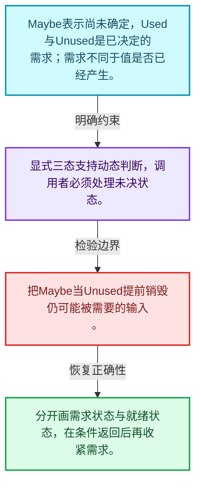
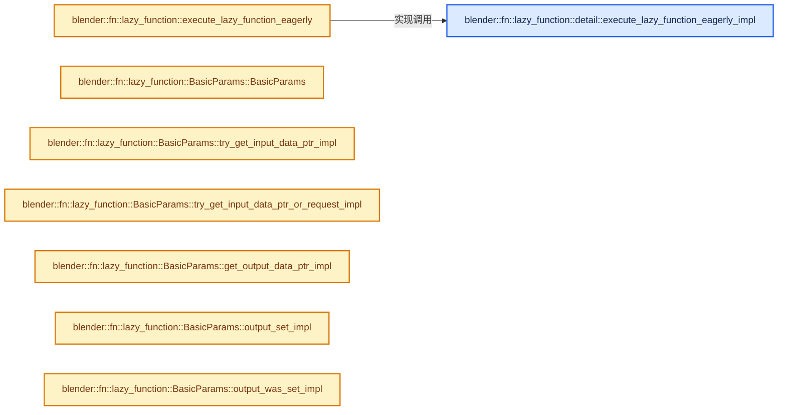
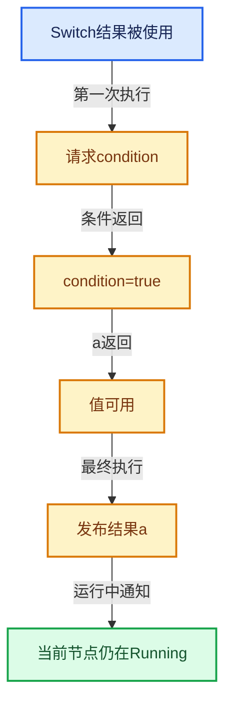

# 09-03 Params与ValueUsage

[方向导航](README.md) · [总目录](../README.md) · [实现索引](../%E7%AC%A6%E5%8F%B7%E4%BE%9D%E8%B5%96%E4%B8%8E%E5%AE%9E%E7%8E%B0%E7%B4%A2%E5%BC%95.md)

## 从问题到实现

未知、需要、不需要为什么是不同状态？

Maybe保留动态决定空间，Used要求提供结果，Unused允许避免或释放计算；未知不能当成不需要。

**数据模型**

Maybe表示尚未确定，Used与Unused是已决定的需求；需求不同于值是否已经产生。

**设计取舍**

显式三态支持动态判断，调用者必须处理未决状态。

**最小反例**

把Maybe当Unused提前销毁仍可能被需要的输入。

**推导**

分开画需求状态与就绪状态，在条件返回后再收紧需求。

## 阅读地图与执行推演








图中的数值推演是本方向的教学模型；实际函数之间的调用边与概念分析边分别标注，不能把概念关系当作运行时调度顺序。

## 完整源码单元与就地讲解

中文讲解直接放在相关代码旁，复杂机制在代码下展开。原文折叠区保留基准行号；不需要在行号表和函数之间来回查找。类布局可分段展示，函数实现不按固定行数切开。

### 类型布局、声明与编译条件 · FN_lazy_function_execute.hh L1—L81

<a id="t-a8550ce76221"></a>

`BasicParams`在这里声明的数据成员：

- `Span<GMutablePointer> inputs_`
- `Span<GMutablePointer> outputs_`
- `MutableSpan<std::optional<ValueUsage>> input_usages_`
- `Span<ValueUsage> output_usages_`
- `MutableSpan<bool> set_outputs_`
- `void try_get_input_data_ptr_impl`
- `void try_get_input_data_ptr_or_request_impl`
- `void get_output_data_ptr_impl`
- `void output_set_impl`
- `bool output_was_set_impl`
- `ValueUsage get_output_usage_impl`
- `void set_input_unused_impl`
- `bool try_enable_multi_threading_impl`

<a id="t-e3da4734eef4"></a>

`RemappedParams`在这里声明的数据成员：

- `Params base_params_`
- `Span<int> input_map_`
- `Span<int> output_map_`
- `bool multi_threading_enabled_`
- `void try_get_input_data_ptr_impl`
- `void try_get_input_data_ptr_or_request_impl`
- `void get_output_data_ptr_impl`
- `void output_set_impl`
- `bool output_was_set_impl`
- `ValueUsage get_output_usage_impl`
- `void set_input_unused_impl`
- `bool try_enable_multi_threading_impl`

<!-- annotated:b3caac32430dbb -->

```cpp
/* SPDX-FileCopyrightText: 2023 Blender Authors
 *
 * SPDX-License-Identifier: GPL-2.0-or-later */

#pragma once

/** \file
 * \ingroup fn
 *
 * This file contains common utilities for actually executing a lazy-function.
 */

#include "BLI_generic_pointer.hh"

#include "FN_lazy_function.hh"

namespace blender::fn::lazy_function {

/**
 * Most basic implementation of #Params. It does not actually implement any logic for how to
 * retrieve inputs or set outputs. Instead, code using #BasicParams has to implement that.
 */
class BasicParams : public Params {
 private:
  const Span<GMutablePointer> inputs_;
  const Span<GMutablePointer> outputs_;
  MutableSpan<std::optional<ValueUsage>> input_usages_;
  Span<ValueUsage> output_usages_;
  MutableSpan<bool> set_outputs_;

 public:
  BasicParams(const LazyFunction &fn,
              Span<GMutablePointer> inputs,
              Span<GMutablePointer> outputs,
              MutableSpan<std::optional<ValueUsage>> input_usages,
              Span<ValueUsage> output_usages,
              MutableSpan<bool> set_outputs);

  void *try_get_input_data_ptr_impl(const int index) const override;
  void *try_get_input_data_ptr_or_request_impl(const int index) override;
  void *get_output_data_ptr_impl(const int index) override;
  void output_set_impl(const int index) override;
  bool output_was_set_impl(const int index) const override;
  ValueUsage get_output_usage_impl(const int index) const override;
  void set_input_unused_impl(const int index) override;
  bool try_enable_multi_threading_impl() override;
};

/**
 * Wraps an existing #Params. This should be used when a lazy-function internally contains another
 * lazy-function that handles a subset or the inputs and outputs.
 */
class RemappedParams : public Params {
 private:
  Params &base_params_;
  Span<int> input_map_;
  Span<int> output_map_;
  bool &multi_threading_enabled_;

 public:
  RemappedParams(const LazyFunction &fn,
                 Params &base_params,
                 Span<int> input_map,
                 Span<int> output_map,
                 bool &multi_threading_enabled);

  void *try_get_input_data_ptr_impl(const int index) const override;
  void *try_get_input_data_ptr_or_request_impl(const int index) override;
  void *get_output_data_ptr_impl(const int index) override;
  void output_set_impl(const int index) override;
  bool output_was_set_impl(const int index) const override;
  ValueUsage get_output_usage_impl(const int index) const override;
  void set_input_unused_impl(const int index) override;
  bool try_enable_multi_threading_impl() override;
};

namespace detail {

/**
 * Utility to implement #execute_lazy_function_eagerly.
 */
```

<details>
<summary>核对原始源码：source/blender/functions/FN_lazy_function_execute.hh · L1—L81</summary>

<!-- original:b3caac32430dbb:source/blender/functions/FN_lazy_function_execute.hh:1:81 -->

```cpp
/* SPDX-FileCopyrightText: 2023 Blender Authors
 *
 * SPDX-License-Identifier: GPL-2.0-or-later */

#pragma once

/** \file
 * \ingroup fn
 *
 * This file contains common utilities for actually executing a lazy-function.
 */

#include "BLI_generic_pointer.hh"

#include "FN_lazy_function.hh"

namespace blender::fn::lazy_function {

/**
 * Most basic implementation of #Params. It does not actually implement any logic for how to
 * retrieve inputs or set outputs. Instead, code using #BasicParams has to implement that.
 */
class BasicParams : public Params {
 private:
  const Span<GMutablePointer> inputs_;
  const Span<GMutablePointer> outputs_;
  MutableSpan<std::optional<ValueUsage>> input_usages_;
  Span<ValueUsage> output_usages_;
  MutableSpan<bool> set_outputs_;

 public:
  BasicParams(const LazyFunction &fn,
              Span<GMutablePointer> inputs,
              Span<GMutablePointer> outputs,
              MutableSpan<std::optional<ValueUsage>> input_usages,
              Span<ValueUsage> output_usages,
              MutableSpan<bool> set_outputs);

  void *try_get_input_data_ptr_impl(const int index) const override;
  void *try_get_input_data_ptr_or_request_impl(const int index) override;
  void *get_output_data_ptr_impl(const int index) override;
  void output_set_impl(const int index) override;
  bool output_was_set_impl(const int index) const override;
  ValueUsage get_output_usage_impl(const int index) const override;
  void set_input_unused_impl(const int index) override;
  bool try_enable_multi_threading_impl() override;
};

/**
 * Wraps an existing #Params. This should be used when a lazy-function internally contains another
 * lazy-function that handles a subset or the inputs and outputs.
 */
class RemappedParams : public Params {
 private:
  Params &base_params_;
  Span<int> input_map_;
  Span<int> output_map_;
  bool &multi_threading_enabled_;

 public:
  RemappedParams(const LazyFunction &fn,
                 Params &base_params,
                 Span<int> input_map,
                 Span<int> output_map,
                 bool &multi_threading_enabled);

  void *try_get_input_data_ptr_impl(const int index) const override;
  void *try_get_input_data_ptr_or_request_impl(const int index) override;
  void *get_output_data_ptr_impl(const int index) override;
  void output_set_impl(const int index) override;
  bool output_was_set_impl(const int index) const override;
  ValueUsage get_output_usage_impl(const int index) const override;
  void set_input_unused_impl(const int index) override;
  bool try_enable_multi_threading_impl() override;
};

namespace detail {

/**
 * Utility to implement #execute_lazy_function_eagerly.
 */
```

</details>

<a id="f-5e63b4813811b2db"></a>

### `blender::fn::lazy_function::detail::execute_lazy_function_eagerly_impl`

实现位置：[source/blender/functions/FN_lazy_function_execute.hh](../../../../../source/blender/functions/FN_lazy_function_execute.hh) · L82—L127。

接口参数：

- `const LazyFunction &fn`
- `UserData *user_data`
- `LocalUserData *local_user_data`
- `std::tuple<Inputs...> &inputs`
- `std::tuple<Outputs *...> &outputs`
- `std::index_sequence<InIndices...>`
- `std::index_sequence<OutIndices...>`

**教学注释版**

<!-- annotated:3ac85620961f40 -->

```cpp
template<typename... Inputs, typename... Outputs, size_t... InIndices, size_t... OutIndices>
inline void execute_lazy_function_eagerly_impl(const LazyFunction &fn,
                                               UserData *user_data,
                                               LocalUserData *local_user_data,
                                               std::tuple<Inputs...> &inputs,
                                               std::tuple<Outputs *...> &outputs,
                                               std::index_sequence<InIndices...> /*in_indices*/,
                                               std::index_sequence<OutIndices...> /*out_indices*/)
{
  constexpr size_t InputsNum = sizeof...(Inputs);
  constexpr size_t OutputsNum = sizeof...(Outputs);
  std::array<GMutablePointer, InputsNum> input_pointers;
  std::array<GMutablePointer, OutputsNum> output_pointers;
  std::array<std::optional<ValueUsage>, InputsNum> input_usages;
  std::array<ValueUsage, OutputsNum> output_usages;
  std::array<bool, OutputsNum> set_outputs;
  (
      [&]() {
        constexpr size_t I = InIndices;
        /* Use `typedef` instead of `using` to work around a compiler bug. */
        using T = Inputs;
        const CPPType &type = CPPType::get<T>();
        input_pointers[I] = {type, &std::get<I>(inputs)};
      }(),
      ...);
  (
      [&]() {
        constexpr size_t I = OutIndices;
        /* Use `typedef` instead of `using` to work around a compiler bug. */
        using T = Outputs;
        const CPPType &type = CPPType::get<T>();
        output_pointers[I] = {type, std::get<I>(outputs)};
      }(),
      ...);
  output_usages.fill(ValueUsage::Used);
  set_outputs.fill(false);
  LinearAllocator<> allocator;
  // [讲解] fn.init_storage：建立或清理一次执行所需状态。
  Context context(fn.init_storage(allocator), user_data, local_user_data);
  BasicParams params{
      fn, input_pointers, output_pointers, input_usages, output_usages, set_outputs};
  // [讲解] fn.execute：按已有输入和所需输出推进执行。
  fn.execute(params, context);
  // [讲解] fn.destruct_storage：建立或清理一次执行所需状态。
  fn.destruct_storage(context.storage);

  /* Make sure all outputs have been computed. */
  BLI_assert(!Span<bool>(set_outputs).contains(false));
}
```

<details>
<summary>核对原始源码：source/blender/functions/FN_lazy_function_execute.hh · L82—L127</summary>

<!-- original:3ac85620961f40:source/blender/functions/FN_lazy_function_execute.hh:82:127 -->

```cpp
template<typename... Inputs, typename... Outputs, size_t... InIndices, size_t... OutIndices>
inline void execute_lazy_function_eagerly_impl(const LazyFunction &fn,
                                               UserData *user_data,
                                               LocalUserData *local_user_data,
                                               std::tuple<Inputs...> &inputs,
                                               std::tuple<Outputs *...> &outputs,
                                               std::index_sequence<InIndices...> /*in_indices*/,
                                               std::index_sequence<OutIndices...> /*out_indices*/)
{
  constexpr size_t InputsNum = sizeof...(Inputs);
  constexpr size_t OutputsNum = sizeof...(Outputs);
  std::array<GMutablePointer, InputsNum> input_pointers;
  std::array<GMutablePointer, OutputsNum> output_pointers;
  std::array<std::optional<ValueUsage>, InputsNum> input_usages;
  std::array<ValueUsage, OutputsNum> output_usages;
  std::array<bool, OutputsNum> set_outputs;
  (
      [&]() {
        constexpr size_t I = InIndices;
        /* Use `typedef` instead of `using` to work around a compiler bug. */
        using T = Inputs;
        const CPPType &type = CPPType::get<T>();
        input_pointers[I] = {type, &std::get<I>(inputs)};
      }(),
      ...);
  (
      [&]() {
        constexpr size_t I = OutIndices;
        /* Use `typedef` instead of `using` to work around a compiler bug. */
        using T = Outputs;
        const CPPType &type = CPPType::get<T>();
        output_pointers[I] = {type, std::get<I>(outputs)};
      }(),
      ...);
  output_usages.fill(ValueUsage::Used);
  set_outputs.fill(false);
  LinearAllocator<> allocator;
  Context context(fn.init_storage(allocator), user_data, local_user_data);
  BasicParams params{
      fn, input_pointers, output_pointers, input_usages, output_usages, set_outputs};
  fn.execute(params, context);
  fn.destruct_storage(context.storage);

  /* Make sure all outputs have been computed. */
  BLI_assert(!Span<bool>(set_outputs).contains(false));
}
```

</details>

**沿实际写入检查状态**

- `input_pointers[I] = {type, &std::get<I>(inputs)};`
- `output_pointers[I] = {type, std::get<I>(outputs)};`

**继续追踪实现**

- `[&]() { constexpr size_t I = InIndices; /* Use ˋtypedefˋ instead of ˋusingˋ to work around a compiler bug. */ using T = Inputs; const CPPType &type = CPPType::get<T>(); input_pointers[I] = {type, &std::get<I>(inputs)}; }` → [调用协议](../%E6%A8%A1%E6%9D%BF%E5%AE%8F%E4%B8%8E%E5%8A%A8%E6%80%81%E5%88%86%E6%B4%BE%E5%8D%8F%E8%AE%AE.md)：函数指针、局部可调用对象或未展开的宏；必须结合调用者环境。调用位置L99。
- `CPPType::get<T>` → [blender::CPPType::get · L481](../03-%E5%86%85%E5%AD%98%E5%88%86%E9%85%8D%E4%B8%8E%E8%BF%90%E8%A1%8C%E6%97%B6%E7%B1%BB%E5%9E%8B/08-CPPType%E6%9E%84%E9%80%A0%E4%B8%8E%E6%9E%90%E6%9E%84.md#f-0cc10a3783d6abdb)。
- `std::get<I>` → [外部契约](https://eel.is/c++draft/)：这个边界按实际表达式及所属类型核对参数、返回值、寿命与失败行为。这里提供接口入口，不声称已解释该第三方版本的内部实现。
- `[&]() { constexpr size_t I = OutIndices; /* Use ˋtypedefˋ instead of ˋusingˋ to work around a compiler bug. */ using T = Outputs; const CPPType &type = CPPType::get<T>(); output_pointers[I] = {type, std::get<I>(outputs)}; }` → [调用协议](../%E6%A8%A1%E6%9D%BF%E5%AE%8F%E4%B8%8E%E5%8A%A8%E6%80%81%E5%88%86%E6%B4%BE%E5%8D%8F%E8%AE%AE.md)：函数指针、局部可调用对象或未展开的宏；必须结合调用者环境。调用位置L108。
- `output_usages.fill` → [外部契约](https://eel.is/c++draft/)：这个边界按实际表达式及所属类型核对参数、返回值、寿命与失败行为。这里提供接口入口，不声称已解释该第三方版本的内部实现。
- `set_outputs.fill` → [外部契约](https://eel.is/c++draft/)：这个边界按实际表达式及所属类型核对参数、返回值、寿命与失败行为。这里提供接口入口，不声称已解释该第三方版本的内部实现。
- `fn.init_storage` → [blender::fn::lazy_function::LazyFunction::init_storage · L28](02-LazyFunction%E6%8E%A5%E5%8F%A3.md#f-bd7a0cc9756b5fb3)。
- `fn.execute` → [blender::fn::lazy_function::LazyFunction::execute · L341](02-LazyFunction%E6%8E%A5%E5%8F%A3.md#f-1d443709054d33d8)。
- `fn.destruct_storage` → [blender::fn::lazy_function::LazyFunction::destruct_storage · L33](02-LazyFunction%E6%8E%A5%E5%8F%A3.md#f-5cbebb5d2dfbeff5)。
- `BLI_assert` → [BLI_assert · L48](../01-%E5%9F%BA%E7%A1%80%E5%AE%B9%E5%99%A8%E4%B8%8E%E7%8E%B0%E4%BB%A3CPP/%E4%BE%9D%E8%B5%96-BLI_assert-cc98e8.md#m-57a88495704d)；[BLI_assert · L63](../01-%E5%9F%BA%E7%A1%80%E5%AE%B9%E5%99%A8%E4%B8%8E%E7%8E%B0%E4%BB%A3CPP/%E4%BE%9D%E8%B5%96-BLI_assert-cc98e8.md#m-d07050020cb5)。宏定义由构建条件选择。
- `Span<bool>(set_outputs).contains` → [调用协议](../%E6%A8%A1%E6%9D%BF%E5%AE%8F%E4%B8%8E%E5%8A%A8%E6%80%81%E5%88%86%E6%B4%BE%E5%8D%8F%E8%AE%AE.md)：接收对象类型依赖auto、返回值或模板实例；不按同名猜测目标。调用位置L126。
- `Span<bool>` → [blender::Span](../01-%E5%9F%BA%E7%A1%80%E5%AE%B9%E5%99%A8%E4%B8%8E%E7%8E%B0%E4%BB%A3CPP/%E4%BE%9D%E8%B5%96-BLI_span-6aa95f.md#t-8765a8e0c1d5)；[blender::Span](../01-%E5%9F%BA%E7%A1%80%E5%AE%B9%E5%99%A8%E4%B8%8E%E7%8E%B0%E4%BB%A3CPP/%E4%BE%9D%E8%B5%96-BLI_index_range-7d7cc5.md#t-86091874a1c0)；[blender::Span](../05-%E5%87%A0%E4%BD%95%E5%AD%98%E5%82%A8%E4%B8%8E%E6%8B%93%E6%89%91%E6%98%A0%E5%B0%84/%E4%BE%9D%E8%B5%96-DNA_pointcloud_types-cfb82c.md#t-112aa6ed842c)；[blender::Span](../05-%E5%87%A0%E4%BD%95%E5%AD%98%E5%82%A8%E4%B8%8E%E6%8B%93%E6%89%91%E6%98%A0%E5%B0%84/%E4%BE%9D%E8%B5%96-DNA_node_types-6708b9.md#t-49ec6fbb9b69)；[blender::Span](../05-%E5%87%A0%E4%BD%95%E5%AD%98%E5%82%A8%E4%B8%8E%E6%8B%93%E6%89%91%E6%98%A0%E5%B0%84/%E4%BE%9D%E8%B5%96-DNA_mesh_types-81f02e.md#t-184fd48fb638)；[blender::Span](../05-%E5%87%A0%E4%BD%95%E5%AD%98%E5%82%A8%E4%B8%8E%E6%8B%93%E6%89%91%E6%98%A0%E5%B0%84/%E4%BE%9D%E8%B5%96-DNA_anim_types-39c5d9.md#t-d841071994c2)；[blender::Span](../05-%E5%87%A0%E4%BD%95%E5%AD%98%E5%82%A8%E4%B8%8E%E6%8B%93%E6%89%91%E6%98%A0%E5%B0%84/%E4%BE%9D%E8%B5%96-RNA_path_fwd-79c989.md#t-4dbb08969e41)。

### 类型布局、声明与编译条件 · FN_lazy_function_execute.hh L128—L139

<!-- annotated:db706381f9e6bb -->

```cpp

}  // namespace detail

/**
 * In some cases (mainly for tests), the set of inputs and outputs for a lazy-function is known at
 * compile time and one just wants to compute the outputs based on the inputs, without any
 * laziness.
 *
 * This function does exactly that. It takes all inputs in a tuple and writes the outputs to points
 * provided in a second tuple. Since all inputs have to be provided, the lazy-function has to
 * compute all outputs.
 */
```

<details>
<summary>核对原始源码：source/blender/functions/FN_lazy_function_execute.hh · L128—L139</summary>

<!-- original:db706381f9e6bb:source/blender/functions/FN_lazy_function_execute.hh:128:139 -->

```cpp

}  // namespace detail

/**
 * In some cases (mainly for tests), the set of inputs and outputs for a lazy-function is known at
 * compile time and one just wants to compute the outputs based on the inputs, without any
 * laziness.
 *
 * This function does exactly that. It takes all inputs in a tuple and writes the outputs to points
 * provided in a second tuple. Since all inputs have to be provided, the lazy-function has to
 * compute all outputs.
 */
```

</details>

<a id="f-a47eee497bf34125"></a>

### `blender::fn::lazy_function::execute_lazy_function_eagerly`

实现位置：[source/blender/functions/FN_lazy_function_execute.hh](../../../../../source/blender/functions/FN_lazy_function_execute.hh) · L140—L156。

接口参数：

- `const LazyFunction &fn`
- `UserData *user_data`
- `LocalUserData *local_user_data`
- `std::tuple<Inputs...> inputs`
- `std::tuple<Outputs *...> outputs`

**教学注释版**

<!-- annotated:89809af539a575 -->

```cpp
template<typename... Inputs, typename... Outputs>
inline void execute_lazy_function_eagerly(const LazyFunction &fn,
                                          UserData *user_data,
                                          LocalUserData *local_user_data,
                                          std::tuple<Inputs...> inputs,
                                          std::tuple<Outputs *...> outputs)
{
  BLI_assert(fn.inputs().size() == sizeof...(Inputs));
  BLI_assert(fn.outputs().size() == sizeof...(Outputs));
  detail::execute_lazy_function_eagerly_impl(fn,
                                             user_data,
                                             local_user_data,
                                             inputs,
                                             outputs,
                                             std::make_index_sequence<sizeof...(Inputs)>(),
                                             std::make_index_sequence<sizeof...(Outputs)>());
}
```

<details>
<summary>核对原始源码：source/blender/functions/FN_lazy_function_execute.hh · L140—L156</summary>

<!-- original:89809af539a575:source/blender/functions/FN_lazy_function_execute.hh:140:156 -->

```cpp
template<typename... Inputs, typename... Outputs>
inline void execute_lazy_function_eagerly(const LazyFunction &fn,
                                          UserData *user_data,
                                          LocalUserData *local_user_data,
                                          std::tuple<Inputs...> inputs,
                                          std::tuple<Outputs *...> outputs)
{
  BLI_assert(fn.inputs().size() == sizeof...(Inputs));
  BLI_assert(fn.outputs().size() == sizeof...(Outputs));
  detail::execute_lazy_function_eagerly_impl(fn,
                                             user_data,
                                             local_user_data,
                                             inputs,
                                             outputs,
                                             std::make_index_sequence<sizeof...(Inputs)>(),
                                             std::make_index_sequence<sizeof...(Outputs)>());
}
```

</details>

**继续追踪实现**

- `BLI_assert` → [BLI_assert · L48](../01-%E5%9F%BA%E7%A1%80%E5%AE%B9%E5%99%A8%E4%B8%8E%E7%8E%B0%E4%BB%A3CPP/%E4%BE%9D%E8%B5%96-BLI_assert-cc98e8.md#m-57a88495704d)；[BLI_assert · L63](../01-%E5%9F%BA%E7%A1%80%E5%AE%B9%E5%99%A8%E4%B8%8E%E7%8E%B0%E4%BB%A3CPP/%E4%BE%9D%E8%B5%96-BLI_assert-cc98e8.md#m-d07050020cb5)。宏定义由构建条件选择。
- `fn.inputs().size` → [调用协议](../%E6%A8%A1%E6%9D%BF%E5%AE%8F%E4%B8%8E%E5%8A%A8%E6%80%81%E5%88%86%E6%B4%BE%E5%8D%8F%E8%AE%AE.md)：接收对象类型依赖auto、返回值或模板实例；不按同名猜测目标。调用位置L147。
- `fn.inputs` → [blender::fn::lazy_function::LazyFunction::inputs · L331](02-LazyFunction%E6%8E%A5%E5%8F%A3.md#f-bdcd40e6f47d0ad9)。
- `fn.outputs().size` → [调用协议](../%E6%A8%A1%E6%9D%BF%E5%AE%8F%E4%B8%8E%E5%8A%A8%E6%80%81%E5%88%86%E6%B4%BE%E5%8D%8F%E8%AE%AE.md)：接收对象类型依赖auto、返回值或模板实例；不按同名猜测目标。调用位置L148。
- `fn.outputs` → [blender::fn::lazy_function::LazyFunction::outputs · L336](02-LazyFunction%E6%8E%A5%E5%8F%A3.md#f-8131802149321817)。
- `detail::execute_lazy_function_eagerly_impl` → [blender::fn::lazy_function::detail::execute_lazy_function_eagerly_impl · L82](03-Params%E4%B8%8EValueUsage.md#f-5e63b4813811b2db)。
- `std::make_index_sequence<sizeof...(Inputs)>` → [外部契约](https://eel.is/c++draft/)：这个边界按实际表达式及所属类型核对参数、返回值、寿命与失败行为。这里提供接口入口，不声称已解释该第三方版本的内部实现。
- `std::make_index_sequence<sizeof...(Outputs)>` → [外部契约](https://eel.is/c++draft/)：这个边界按实际表达式及所属类型核对参数、返回值、寿命与失败行为。这里提供接口入口，不声称已解释该第三方版本的内部实现。

### 类型布局、声明与编译条件 · FN_lazy_function_execute.hh L157—L158

<!-- annotated:9c3643830061fb -->

```cpp

}  // namespace blender::fn::lazy_function
```

<details>
<summary>核对原始源码：source/blender/functions/FN_lazy_function_execute.hh · L157—L158</summary>

<!-- original:9c3643830061fb:source/blender/functions/FN_lazy_function_execute.hh:157:158 -->

```cpp

}  // namespace blender::fn::lazy_function
```

</details>

### 类型布局、声明与编译条件 · lazy_function_execute.cc L1—L16

<!-- annotated:70ffbd4e0be04b -->

```cpp
/* SPDX-FileCopyrightText: 2023 Blender Authors
 *
 * SPDX-License-Identifier: GPL-2.0-or-later */

/** \file
 * \ingroup fn
 */

#include "FN_lazy_function_execute.hh"

namespace blender::fn::lazy_function {

/* -------------------------------------------------------------------- */
/** \name BasicParams.
 * \{ */

```

<details>
<summary>核对原始源码：source/blender/functions/intern/lazy_function_execute.cc · L1—L16</summary>

<!-- original:70ffbd4e0be04b:source/blender/functions/intern/lazy_function_execute.cc:1:16 -->

```cpp
/* SPDX-FileCopyrightText: 2023 Blender Authors
 *
 * SPDX-License-Identifier: GPL-2.0-or-later */

/** \file
 * \ingroup fn
 */

#include "FN_lazy_function_execute.hh"

namespace blender::fn::lazy_function {

/* -------------------------------------------------------------------- */
/** \name BasicParams.
 * \{ */

```

</details>

<a id="f-089cca0eedfa4485"></a>

### `blender::fn::lazy_function::BasicParams::BasicParams`

实现位置：[source/blender/functions/intern/lazy_function_execute.cc](../../../../../source/blender/functions/intern/lazy_function_execute.cc) · L17—L30。

接口参数：

- `const LazyFunction &fn`
- `const Span<GMutablePointer> inputs`
- `const Span<GMutablePointer> outputs`
- `MutableSpan<std::optional<ValueUsage>> input_usages`
- `Span<ValueUsage> output_usages`
- `MutableSpan<bool> set_outputs`

**教学注释版**

<!-- annotated:8ca65337b3e6b9 -->

```cpp
BasicParams::BasicParams(const LazyFunction &fn,
                         const Span<GMutablePointer> inputs,
                         const Span<GMutablePointer> outputs,
                         MutableSpan<std::optional<ValueUsage>> input_usages,
                         Span<ValueUsage> output_usages,
                         MutableSpan<bool> set_outputs)
    : Params(fn, true),
      inputs_(inputs),
      outputs_(outputs),
      input_usages_(input_usages),
      output_usages_(output_usages),
      set_outputs_(set_outputs)
{
}
```

<details>
<summary>核对原始源码：source/blender/functions/intern/lazy_function_execute.cc · L17—L30</summary>

<!-- original:8ca65337b3e6b9:source/blender/functions/intern/lazy_function_execute.cc:17:30 -->

```cpp
BasicParams::BasicParams(const LazyFunction &fn,
                         const Span<GMutablePointer> inputs,
                         const Span<GMutablePointer> outputs,
                         MutableSpan<std::optional<ValueUsage>> input_usages,
                         Span<ValueUsage> output_usages,
                         MutableSpan<bool> set_outputs)
    : Params(fn, true),
      inputs_(inputs),
      outputs_(outputs),
      input_usages_(input_usages),
      output_usages_(output_usages),
      set_outputs_(set_outputs)
{
}
```

</details>

**继续追踪实现**

本实现没有需要继续展开的显式调用；检查返回表达式、对象转换和调用者前置条件。

<!-- annotated:29d617712c420e -->

```cpp

```

<details>
<summary>核对原始源码：source/blender/functions/intern/lazy_function_execute.cc · L31—L31</summary>

<!-- original:29d617712c420e:source/blender/functions/intern/lazy_function_execute.cc:31:31 -->

```cpp

```

</details>

<a id="f-1422dd7ac14d9590"></a>

### `blender::fn::lazy_function::BasicParams::try_get_input_data_ptr_impl`

实现位置：[source/blender/functions/intern/lazy_function_execute.cc](../../../../../source/blender/functions/intern/lazy_function_execute.cc) · L32—L35。

接口参数：

- `const int index`

**教学注释版**

<!-- annotated:716d284c2e738a -->

```cpp
void *BasicParams::try_get_input_data_ptr_impl(const int index) const
{
  return inputs_[index].get();
}
```

<details>
<summary>核对原始源码：source/blender/functions/intern/lazy_function_execute.cc · L32—L35</summary>

<!-- original:716d284c2e738a:source/blender/functions/intern/lazy_function_execute.cc:32:35 -->

```cpp
void *BasicParams::try_get_input_data_ptr_impl(const int index) const
{
  return inputs_[index].get();
}
```

</details>

**结果出口**

- `return inputs_[index].get();`

**继续追踪实现**

- `inputs_[index].get` → [调用协议](../%E6%A8%A1%E6%9D%BF%E5%AE%8F%E4%B8%8E%E5%8A%A8%E6%80%81%E5%88%86%E6%B4%BE%E5%8D%8F%E8%AE%AE.md)：接收对象类型依赖auto、返回值或模板实例；不按同名猜测目标。调用位置L34。

<!-- annotated:8a08a3f81e47b7 -->

```cpp

```

<details>
<summary>核对原始源码：source/blender/functions/intern/lazy_function_execute.cc · L36—L36</summary>

<!-- original:8a08a3f81e47b7:source/blender/functions/intern/lazy_function_execute.cc:36:36 -->

```cpp

```

</details>

<a id="f-22d47a20a372fa8d"></a>

### `blender::fn::lazy_function::BasicParams::try_get_input_data_ptr_or_request_impl`

实现位置：[source/blender/functions/intern/lazy_function_execute.cc](../../../../../source/blender/functions/intern/lazy_function_execute.cc) · L37—L44。

接口参数：

- `const int index`

**教学注释版**

<!-- annotated:d0e7914ec060d4 -->

```cpp
void *BasicParams::try_get_input_data_ptr_or_request_impl(const int index)
{
  void *value = inputs_[index].get();
  if (value == nullptr) {
    input_usages_[index] = ValueUsage::Used;
  }
  return value;
}
```

<details>
<summary>核对原始源码：source/blender/functions/intern/lazy_function_execute.cc · L37—L44</summary>

<!-- original:d0e7914ec060d4:source/blender/functions/intern/lazy_function_execute.cc:37:44 -->

```cpp
void *BasicParams::try_get_input_data_ptr_or_request_impl(const int index)
{
  void *value = inputs_[index].get();
  if (value == nullptr) {
    input_usages_[index] = ValueUsage::Used;
  }
  return value;
}
```

</details>

**沿实际写入检查状态**

- `input_usages_[index] = ValueUsage::Used;`

**结果出口**

- `return value;`

**继续追踪实现**

- `inputs_[index].get` → [调用协议](../%E6%A8%A1%E6%9D%BF%E5%AE%8F%E4%B8%8E%E5%8A%A8%E6%80%81%E5%88%86%E6%B4%BE%E5%8D%8F%E8%AE%AE.md)：接收对象类型依赖auto、返回值或模板实例；不按同名猜测目标。调用位置L39。

<!-- annotated:f7cf74629085f3 -->

```cpp

```

<details>
<summary>核对原始源码：source/blender/functions/intern/lazy_function_execute.cc · L45—L45</summary>

<!-- original:f7cf74629085f3:source/blender/functions/intern/lazy_function_execute.cc:45:45 -->

```cpp

```

</details>

<a id="f-143832f4f24356bc"></a>

### `blender::fn::lazy_function::BasicParams::get_output_data_ptr_impl`

实现位置：[source/blender/functions/intern/lazy_function_execute.cc](../../../../../source/blender/functions/intern/lazy_function_execute.cc) · L46—L49。

接口参数：

- `const int index`

**教学注释版**

<!-- annotated:8ec5fec856cc26 -->

```cpp
void *BasicParams::get_output_data_ptr_impl(const int index)
{
  return outputs_[index].get();
}
```

<details>
<summary>核对原始源码：source/blender/functions/intern/lazy_function_execute.cc · L46—L49</summary>

<!-- original:8ec5fec856cc26:source/blender/functions/intern/lazy_function_execute.cc:46:49 -->

```cpp
void *BasicParams::get_output_data_ptr_impl(const int index)
{
  return outputs_[index].get();
}
```

</details>

**结果出口**

- `return outputs_[index].get();`

**继续追踪实现**

- `outputs_[index].get` → [调用协议](../%E6%A8%A1%E6%9D%BF%E5%AE%8F%E4%B8%8E%E5%8A%A8%E6%80%81%E5%88%86%E6%B4%BE%E5%8D%8F%E8%AE%AE.md)：接收对象类型依赖auto、返回值或模板实例；不按同名猜测目标。调用位置L48。

<!-- annotated:ea560321ed6ff4 -->

```cpp

```

<details>
<summary>核对原始源码：source/blender/functions/intern/lazy_function_execute.cc · L50—L50</summary>

<!-- original:ea560321ed6ff4:source/blender/functions/intern/lazy_function_execute.cc:50:50 -->

```cpp

```

</details>

<a id="f-3a457b9afe1e2aef"></a>

### `blender::fn::lazy_function::BasicParams::output_set_impl`

实现位置：[source/blender/functions/intern/lazy_function_execute.cc](../../../../../source/blender/functions/intern/lazy_function_execute.cc) · L51—L54。

接口参数：

- `const int index`

**教学注释版**

<!-- annotated:d61e3068f86664 -->

```cpp
void BasicParams::output_set_impl(const int index)
{
  set_outputs_[index] = true;
}
```

<details>
<summary>核对原始源码：source/blender/functions/intern/lazy_function_execute.cc · L51—L54</summary>

<!-- original:d61e3068f86664:source/blender/functions/intern/lazy_function_execute.cc:51:54 -->

```cpp
void BasicParams::output_set_impl(const int index)
{
  set_outputs_[index] = true;
}
```

</details>

**沿实际写入检查状态**

- `set_outputs_[index] = true;`

**继续追踪实现**

本实现没有需要继续展开的显式调用；检查返回表达式、对象转换和调用者前置条件。

<!-- annotated:78e554f963d64f -->

```cpp

```

<details>
<summary>核对原始源码：source/blender/functions/intern/lazy_function_execute.cc · L55—L55</summary>

<!-- original:78e554f963d64f:source/blender/functions/intern/lazy_function_execute.cc:55:55 -->

```cpp

```

</details>

<a id="f-ecc713de96899c1d"></a>

### `blender::fn::lazy_function::BasicParams::output_was_set_impl`

实现位置：[source/blender/functions/intern/lazy_function_execute.cc](../../../../../source/blender/functions/intern/lazy_function_execute.cc) · L56—L59。

接口参数：

- `const int index`

**教学注释版**

<!-- annotated:596a91c0476517 -->

```cpp
bool BasicParams::output_was_set_impl(const int index) const
{
  return set_outputs_[index];
}
```

<details>
<summary>核对原始源码：source/blender/functions/intern/lazy_function_execute.cc · L56—L59</summary>

<!-- original:596a91c0476517:source/blender/functions/intern/lazy_function_execute.cc:56:59 -->

```cpp
bool BasicParams::output_was_set_impl(const int index) const
{
  return set_outputs_[index];
}
```

</details>

**结果出口**

- `return set_outputs_[index];`

**继续追踪实现**

本实现没有需要继续展开的显式调用；检查返回表达式、对象转换和调用者前置条件。

<!-- annotated:28fabfcad69109 -->

```cpp

```

<details>
<summary>核对原始源码：source/blender/functions/intern/lazy_function_execute.cc · L60—L60</summary>

<!-- original:28fabfcad69109:source/blender/functions/intern/lazy_function_execute.cc:60:60 -->

```cpp

```

</details>

<a id="f-12bb4bf0c8b54c4d"></a>

### `blender::fn::lazy_function::BasicParams::get_output_usage_impl`

实现位置：[source/blender/functions/intern/lazy_function_execute.cc](../../../../../source/blender/functions/intern/lazy_function_execute.cc) · L61—L64。

接口参数：

- `const int index`

**教学注释版**

<!-- annotated:3bd4dabbd28cb0 -->

```cpp
ValueUsage BasicParams::get_output_usage_impl(const int index) const
{
  return output_usages_[index];
}
```

<details>
<summary>核对原始源码：source/blender/functions/intern/lazy_function_execute.cc · L61—L64</summary>

<!-- original:3bd4dabbd28cb0:source/blender/functions/intern/lazy_function_execute.cc:61:64 -->

```cpp
ValueUsage BasicParams::get_output_usage_impl(const int index) const
{
  return output_usages_[index];
}
```

</details>

**结果出口**

- `return output_usages_[index];`

**继续追踪实现**

本实现没有需要继续展开的显式调用；检查返回表达式、对象转换和调用者前置条件。

<!-- annotated:0b556916f91fa5 -->

```cpp

```

<details>
<summary>核对原始源码：source/blender/functions/intern/lazy_function_execute.cc · L65—L65</summary>

<!-- original:0b556916f91fa5:source/blender/functions/intern/lazy_function_execute.cc:65:65 -->

```cpp

```

</details>

<a id="f-c6697b764ff44fb0"></a>

### `blender::fn::lazy_function::BasicParams::set_input_unused_impl`

实现位置：[source/blender/functions/intern/lazy_function_execute.cc](../../../../../source/blender/functions/intern/lazy_function_execute.cc) · L66—L69。

接口参数：

- `const int index`

**教学注释版**

<!-- annotated:89e59d594e3b4f -->

```cpp
void BasicParams::set_input_unused_impl(const int index)
{
  input_usages_[index] = ValueUsage::Unused;
}
```

<details>
<summary>核对原始源码：source/blender/functions/intern/lazy_function_execute.cc · L66—L69</summary>

<!-- original:89e59d594e3b4f:source/blender/functions/intern/lazy_function_execute.cc:66:69 -->

```cpp
void BasicParams::set_input_unused_impl(const int index)
{
  input_usages_[index] = ValueUsage::Unused;
}
```

</details>

**沿实际写入检查状态**

- `input_usages_[index] = ValueUsage::Unused;`

**继续追踪实现**

本实现没有需要继续展开的显式调用；检查返回表达式、对象转换和调用者前置条件。

<!-- annotated:1bcce891f7d398 -->

```cpp

```

<details>
<summary>核对原始源码：source/blender/functions/intern/lazy_function_execute.cc · L70—L70</summary>

<!-- original:1bcce891f7d398:source/blender/functions/intern/lazy_function_execute.cc:70:70 -->

```cpp

```

</details>

<a id="f-cbd4b141e735ac90"></a>

### `blender::fn::lazy_function::BasicParams::try_enable_multi_threading_impl`

实现位置：[source/blender/functions/intern/lazy_function_execute.cc](../../../../../source/blender/functions/intern/lazy_function_execute.cc) · L71—L74。

**教学注释版**

<!-- annotated:b8c6d80e5f8f57 -->

```cpp
bool BasicParams::try_enable_multi_threading_impl()
{
  return true;
}
```

<details>
<summary>核对原始源码：source/blender/functions/intern/lazy_function_execute.cc · L71—L74</summary>

<!-- original:b8c6d80e5f8f57:source/blender/functions/intern/lazy_function_execute.cc:71:74 -->

```cpp
bool BasicParams::try_enable_multi_threading_impl()
{
  return true;
}
```

</details>

**结果出口**

- `return true;`

**继续追踪实现**

本实现没有需要继续展开的显式调用；检查返回表达式、对象转换和调用者前置条件。

### 类型布局、声明与编译条件 · lazy_function_execute.cc L75—L81

<!-- annotated:d755bd9c76cb81 -->

```cpp

/** \} */

/* -------------------------------------------------------------------- */
/** \name RemappedParams.
 * \{ */

```

<details>
<summary>核对原始源码：source/blender/functions/intern/lazy_function_execute.cc · L75—L81</summary>

<!-- original:d755bd9c76cb81:source/blender/functions/intern/lazy_function_execute.cc:75:81 -->

```cpp

/** \} */

/* -------------------------------------------------------------------- */
/** \name RemappedParams.
 * \{ */

```

</details>

<a id="f-5e0c98fd75fd4b37"></a>

### `blender::fn::lazy_function::RemappedParams::RemappedParams`

实现位置：[source/blender/functions/intern/lazy_function_execute.cc](../../../../../source/blender/functions/intern/lazy_function_execute.cc) · L82—L93。

接口参数：

- `const LazyFunction &fn`
- `Params &base_params`
- `const Span<int> input_map`
- `const Span<int> output_map`
- `bool &multi_threading_enabled`

**教学注释版**

<!-- annotated:c02ba15ff7bc44 -->

```cpp
RemappedParams::RemappedParams(const LazyFunction &fn,
                               Params &base_params,
                               const Span<int> input_map,
                               const Span<int> output_map,
                               bool &multi_threading_enabled)
    : Params(fn, multi_threading_enabled),
      base_params_(base_params),
      input_map_(input_map),
      output_map_(output_map),
      multi_threading_enabled_(multi_threading_enabled)
{
}
```

<details>
<summary>核对原始源码：source/blender/functions/intern/lazy_function_execute.cc · L82—L93</summary>

<!-- original:c02ba15ff7bc44:source/blender/functions/intern/lazy_function_execute.cc:82:93 -->

```cpp
RemappedParams::RemappedParams(const LazyFunction &fn,
                               Params &base_params,
                               const Span<int> input_map,
                               const Span<int> output_map,
                               bool &multi_threading_enabled)
    : Params(fn, multi_threading_enabled),
      base_params_(base_params),
      input_map_(input_map),
      output_map_(output_map),
      multi_threading_enabled_(multi_threading_enabled)
{
}
```

</details>

**继续追踪实现**

本实现没有需要继续展开的显式调用；检查返回表达式、对象转换和调用者前置条件。

<!-- annotated:86080792e9edb1 -->

```cpp

```

<details>
<summary>核对原始源码：source/blender/functions/intern/lazy_function_execute.cc · L94—L94</summary>

<!-- original:86080792e9edb1:source/blender/functions/intern/lazy_function_execute.cc:94:94 -->

```cpp

```

</details>

<a id="f-a44ad7e251b760d6"></a>

### `blender::fn::lazy_function::RemappedParams::try_get_input_data_ptr_impl`

实现位置：[source/blender/functions/intern/lazy_function_execute.cc](../../../../../source/blender/functions/intern/lazy_function_execute.cc) · L95—L98。

接口参数：

- `const int index`

**教学注释版**

<!-- annotated:fb03d75528c4ec -->

```cpp
void *RemappedParams::try_get_input_data_ptr_impl(const int index) const
{
  return base_params_.try_get_input_data_ptr(input_map_[index]);
}
```

<details>
<summary>核对原始源码：source/blender/functions/intern/lazy_function_execute.cc · L95—L98</summary>

<!-- original:fb03d75528c4ec:source/blender/functions/intern/lazy_function_execute.cc:95:98 -->

```cpp
void *RemappedParams::try_get_input_data_ptr_impl(const int index) const
{
  return base_params_.try_get_input_data_ptr(input_map_[index]);
}
```

</details>

**结果出口**

- `return base_params_.try_get_input_data_ptr(input_map_[index]);`

**继续追踪实现**

- `base_params_.try_get_input_data_ptr` → [调用协议](../%E6%A8%A1%E6%9D%BF%E5%AE%8F%E4%B8%8E%E5%8A%A8%E6%80%81%E5%88%86%E6%B4%BE%E5%8D%8F%E8%AE%AE.md)：接收对象类型依赖auto、返回值或模板实例；不按同名猜测目标。调用位置L97。

<!-- annotated:974f61c996c76c -->

```cpp

```

<details>
<summary>核对原始源码：source/blender/functions/intern/lazy_function_execute.cc · L99—L99</summary>

<!-- original:974f61c996c76c:source/blender/functions/intern/lazy_function_execute.cc:99:99 -->

```cpp

```

</details>

<a id="f-f03f4458bc818a1b"></a>

### `blender::fn::lazy_function::RemappedParams::try_get_input_data_ptr_or_request_impl`

实现位置：[source/blender/functions/intern/lazy_function_execute.cc](../../../../../source/blender/functions/intern/lazy_function_execute.cc) · L100—L103。

接口参数：

- `const int index`

**教学注释版**

<!-- annotated:27b28a93a82415 -->

```cpp
void *RemappedParams::try_get_input_data_ptr_or_request_impl(const int index)
{
  return base_params_.try_get_input_data_ptr_or_request(input_map_[index]);
}
```

<details>
<summary>核对原始源码：source/blender/functions/intern/lazy_function_execute.cc · L100—L103</summary>

<!-- original:27b28a93a82415:source/blender/functions/intern/lazy_function_execute.cc:100:103 -->

```cpp
void *RemappedParams::try_get_input_data_ptr_or_request_impl(const int index)
{
  return base_params_.try_get_input_data_ptr_or_request(input_map_[index]);
}
```

</details>

**结果出口**

- `return base_params_.try_get_input_data_ptr_or_request(input_map_[index]);`

**继续追踪实现**

- `base_params_.try_get_input_data_ptr_or_request` → [调用协议](../%E6%A8%A1%E6%9D%BF%E5%AE%8F%E4%B8%8E%E5%8A%A8%E6%80%81%E5%88%86%E6%B4%BE%E5%8D%8F%E8%AE%AE.md)：接收对象类型依赖auto、返回值或模板实例；不按同名猜测目标。调用位置L102。

<!-- annotated:bc95c5b99cf600 -->

```cpp

```

<details>
<summary>核对原始源码：source/blender/functions/intern/lazy_function_execute.cc · L104—L104</summary>

<!-- original:bc95c5b99cf600:source/blender/functions/intern/lazy_function_execute.cc:104:104 -->

```cpp

```

</details>

<a id="f-f6e6f74be370f1aa"></a>

### `blender::fn::lazy_function::RemappedParams::get_output_data_ptr_impl`

实现位置：[source/blender/functions/intern/lazy_function_execute.cc](../../../../../source/blender/functions/intern/lazy_function_execute.cc) · L105—L108。

接口参数：

- `const int index`

**教学注释版**

<!-- annotated:ac6f20fcd4331b -->

```cpp
void *RemappedParams::get_output_data_ptr_impl(const int index)
{
  return base_params_.get_output_data_ptr(output_map_[index]);
}
```

<details>
<summary>核对原始源码：source/blender/functions/intern/lazy_function_execute.cc · L105—L108</summary>

<!-- original:ac6f20fcd4331b:source/blender/functions/intern/lazy_function_execute.cc:105:108 -->

```cpp
void *RemappedParams::get_output_data_ptr_impl(const int index)
{
  return base_params_.get_output_data_ptr(output_map_[index]);
}
```

</details>

**结果出口**

- `return base_params_.get_output_data_ptr(output_map_[index]);`

**继续追踪实现**

- `base_params_.get_output_data_ptr` → [调用协议](../%E6%A8%A1%E6%9D%BF%E5%AE%8F%E4%B8%8E%E5%8A%A8%E6%80%81%E5%88%86%E6%B4%BE%E5%8D%8F%E8%AE%AE.md)：接收对象类型依赖auto、返回值或模板实例；不按同名猜测目标。调用位置L107。

<!-- annotated:6cb70496f4dd17 -->

```cpp

```

<details>
<summary>核对原始源码：source/blender/functions/intern/lazy_function_execute.cc · L109—L109</summary>

<!-- original:6cb70496f4dd17:source/blender/functions/intern/lazy_function_execute.cc:109:109 -->

```cpp

```

</details>

<a id="f-798dba657e63240e"></a>

### `blender::fn::lazy_function::RemappedParams::output_set_impl`

实现位置：[source/blender/functions/intern/lazy_function_execute.cc](../../../../../source/blender/functions/intern/lazy_function_execute.cc) · L110—L113。

接口参数：

- `const int index`

**教学注释版**

<!-- annotated:f2077a4d590ef8 -->

```cpp
void RemappedParams::output_set_impl(const int index)
{
  base_params_.output_set(output_map_[index]);
}
```

<details>
<summary>核对原始源码：source/blender/functions/intern/lazy_function_execute.cc · L110—L113</summary>

<!-- original:f2077a4d590ef8:source/blender/functions/intern/lazy_function_execute.cc:110:113 -->

```cpp
void RemappedParams::output_set_impl(const int index)
{
  base_params_.output_set(output_map_[index]);
}
```

</details>

**继续追踪实现**

- `base_params_.output_set` → [调用协议](../%E6%A8%A1%E6%9D%BF%E5%AE%8F%E4%B8%8E%E5%8A%A8%E6%80%81%E5%88%86%E6%B4%BE%E5%8D%8F%E8%AE%AE.md)：接收对象类型依赖auto、返回值或模板实例；不按同名猜测目标。调用位置L112。

<!-- annotated:faa6c3ba4fe2a4 -->

```cpp

```

<details>
<summary>核对原始源码：source/blender/functions/intern/lazy_function_execute.cc · L114—L114</summary>

<!-- original:faa6c3ba4fe2a4:source/blender/functions/intern/lazy_function_execute.cc:114:114 -->

```cpp

```

</details>

<a id="f-db78cc9177a7febd"></a>

### `blender::fn::lazy_function::RemappedParams::output_was_set_impl`

实现位置：[source/blender/functions/intern/lazy_function_execute.cc](../../../../../source/blender/functions/intern/lazy_function_execute.cc) · L115—L118。

接口参数：

- `const int index`

**教学注释版**

<!-- annotated:33a5cad98968c7 -->

```cpp
bool RemappedParams::output_was_set_impl(const int index) const
{
  return base_params_.output_was_set(output_map_[index]);
}
```

<details>
<summary>核对原始源码：source/blender/functions/intern/lazy_function_execute.cc · L115—L118</summary>

<!-- original:33a5cad98968c7:source/blender/functions/intern/lazy_function_execute.cc:115:118 -->

```cpp
bool RemappedParams::output_was_set_impl(const int index) const
{
  return base_params_.output_was_set(output_map_[index]);
}
```

</details>

**结果出口**

- `return base_params_.output_was_set(output_map_[index]);`

**继续追踪实现**

- `base_params_.output_was_set` → [调用协议](../%E6%A8%A1%E6%9D%BF%E5%AE%8F%E4%B8%8E%E5%8A%A8%E6%80%81%E5%88%86%E6%B4%BE%E5%8D%8F%E8%AE%AE.md)：接收对象类型依赖auto、返回值或模板实例；不按同名猜测目标。调用位置L117。

<!-- annotated:fbc6ec27070014 -->

```cpp

```

<details>
<summary>核对原始源码：source/blender/functions/intern/lazy_function_execute.cc · L119—L119</summary>

<!-- original:fbc6ec27070014:source/blender/functions/intern/lazy_function_execute.cc:119:119 -->

```cpp

```

</details>

<a id="f-a13e246cbfe9d624"></a>

### `blender::fn::lazy_function::RemappedParams::get_output_usage_impl`

实现位置：[source/blender/functions/intern/lazy_function_execute.cc](../../../../../source/blender/functions/intern/lazy_function_execute.cc) · L120—L123。

接口参数：

- `const int index`

**教学注释版**

<!-- annotated:136753e3d57af5 -->

```cpp
lf::ValueUsage RemappedParams::get_output_usage_impl(const int index) const
{
  return base_params_.get_output_usage(output_map_[index]);
}
```

<details>
<summary>核对原始源码：source/blender/functions/intern/lazy_function_execute.cc · L120—L123</summary>

<!-- original:136753e3d57af5:source/blender/functions/intern/lazy_function_execute.cc:120:123 -->

```cpp
lf::ValueUsage RemappedParams::get_output_usage_impl(const int index) const
{
  return base_params_.get_output_usage(output_map_[index]);
}
```

</details>

**结果出口**

- `return base_params_.get_output_usage(output_map_[index]);`

**继续追踪实现**

- `base_params_.get_output_usage` → [调用协议](../%E6%A8%A1%E6%9D%BF%E5%AE%8F%E4%B8%8E%E5%8A%A8%E6%80%81%E5%88%86%E6%B4%BE%E5%8D%8F%E8%AE%AE.md)：接收对象类型依赖auto、返回值或模板实例；不按同名猜测目标。调用位置L122。

<!-- annotated:36a1bd7f533195 -->

```cpp

```

<details>
<summary>核对原始源码：source/blender/functions/intern/lazy_function_execute.cc · L124—L124</summary>

<!-- original:36a1bd7f533195:source/blender/functions/intern/lazy_function_execute.cc:124:124 -->

```cpp

```

</details>

<a id="f-55f236aa7f49af91"></a>

### `blender::fn::lazy_function::RemappedParams::set_input_unused_impl`

实现位置：[source/blender/functions/intern/lazy_function_execute.cc](../../../../../source/blender/functions/intern/lazy_function_execute.cc) · L125—L128。

接口参数：

- `const int index`

**教学注释版**

<!-- annotated:3107ae031cb6ae -->

```cpp
void RemappedParams::set_input_unused_impl(const int index)
{
  base_params_.set_input_unused(input_map_[index]);
}
```

<details>
<summary>核对原始源码：source/blender/functions/intern/lazy_function_execute.cc · L125—L128</summary>

<!-- original:3107ae031cb6ae:source/blender/functions/intern/lazy_function_execute.cc:125:128 -->

```cpp
void RemappedParams::set_input_unused_impl(const int index)
{
  base_params_.set_input_unused(input_map_[index]);
}
```

</details>

**继续追踪实现**

- `base_params_.set_input_unused` → [调用协议](../%E6%A8%A1%E6%9D%BF%E5%AE%8F%E4%B8%8E%E5%8A%A8%E6%80%81%E5%88%86%E6%B4%BE%E5%8D%8F%E8%AE%AE.md)：接收对象类型依赖auto、返回值或模板实例；不按同名猜测目标。调用位置L127。

<!-- annotated:0483d4c538ba1e -->

```cpp

```

<details>
<summary>核对原始源码：source/blender/functions/intern/lazy_function_execute.cc · L129—L129</summary>

<!-- original:0483d4c538ba1e:source/blender/functions/intern/lazy_function_execute.cc:129:129 -->

```cpp

```

</details>

<a id="f-e9a21bdd9a79aa2e"></a>

### `blender::fn::lazy_function::RemappedParams::try_enable_multi_threading_impl`

实现位置：[source/blender/functions/intern/lazy_function_execute.cc](../../../../../source/blender/functions/intern/lazy_function_execute.cc) · L130—L140。

**教学注释版**

<!-- annotated:83be5ae369de21 -->

```cpp
bool RemappedParams::try_enable_multi_threading_impl()
{
  if (multi_threading_enabled_) {
    return true;
  }
  if (base_params_.try_enable_multi_threading()) {
    multi_threading_enabled_ = true;
    return true;
  }
  return false;
}
```

<details>
<summary>核对原始源码：source/blender/functions/intern/lazy_function_execute.cc · L130—L140</summary>

<!-- original:83be5ae369de21:source/blender/functions/intern/lazy_function_execute.cc:130:140 -->

```cpp
bool RemappedParams::try_enable_multi_threading_impl()
{
  if (multi_threading_enabled_) {
    return true;
  }
  if (base_params_.try_enable_multi_threading()) {
    multi_threading_enabled_ = true;
    return true;
  }
  return false;
}
```

</details>

**沿实际写入检查状态**

- `multi_threading_enabled_ = true;`

**结果出口**

- `return true;`
- `return false;`

**继续追踪实现**

- `base_params_.try_enable_multi_threading` → [调用协议](../%E6%A8%A1%E6%9D%BF%E5%AE%8F%E4%B8%8E%E5%8A%A8%E6%80%81%E5%88%86%E6%B4%BE%E5%8D%8F%E8%AE%AE.md)：接收对象类型依赖auto、返回值或模板实例；不按同名猜测目标。调用位置L135。

### 类型布局、声明与编译条件 · lazy_function_execute.cc L141—L144

<!-- annotated:7ae7436f661ed7 -->

```cpp

/** \} */

}  // namespace blender::fn::lazy_function
```

<details>
<summary>核对原始源码：source/blender/functions/intern/lazy_function_execute.cc · L141—L144</summary>

<!-- original:7ae7436f661ed7:source/blender/functions/intern/lazy_function_execute.cc:141:144 -->

```cpp

/** \} */

}  // namespace blender::fn::lazy_function
```

</details>

## 语法与相关类型

### 模板 template

模板把类型或常量作为生成实现的参数。读声明时先列出类型参数、非类型参数和默认值，再看使用者实际实例化了什么。模板声明本身不意味着每种T都支持其全部成员。

把T替换为int、string、只能移动的类型，分别检查每个被调用操作是否成立。

### 依赖名称 typename

typename既可引入类型模板参数，也可告诉编译器某个依赖名称是类型。它不创建运行时对象；解析期确认语法类别与实例化期检查具体类型是不同阶段。

区分typename T::value_type和T::size()，前者标记类型，后者是表达式。

### 常量求值 constexpr

constexpr声明允许相应实体参与常量求值，但constexpr函数仍可以在运行时执行。是否常量求值由调用场景和表达式合法性共同决定。

比较constexpr变量初始化和从运行时输入调用同一函数。

### 只读限定 const

const约束当前访问路径可做的修改。const指针、指向const的指针、const视图对象、const元素是不同位置的限定；其他别名可能仍可修改原对象。

分别写T* const、const T*与const T* const，并画出不可修改的层次。

### 异常边界 try与catch

try定义异常传播的局部边界。失败路径需要销毁已经成功构造的部分并释放相应存储；未构造的对象不能被析构。

在第k次构造失败，列出已经存在的对象集合与待释放缓冲。

### 覆写检查 override

override要求函数确实覆盖基类虚函数，可捕获参数类型和const限定不匹配。它不改变基类规定的生命周期或线程约束。

故意改变一个参数或const，观察编译器如何拒绝误写的新函数。

### 可选值 optional

optional把不存在与存在的T区分开，T的构造和析构跟随engaged状态变化。访问前应由has_value或条件分支证明存在。

把空Field状态与合法常量零区分，不能用某个普通值代替不存在。

### 对象表示 sizeof

sizeof给出对象表示大小，不是其引用的所有堆内存总量。sizeof视图很小并不说明底层数组很小。

分别统计容器对象、容量字节和元素拥有的间接资源。

### 内部断言 assert

断言表达开发者预期成立的内部契约，发布构建可能关闭。它不能替代对不可信输入的完整错误处理，也不保证后续操作被运行时保护。

对每条断言构造违反条件的输入，区分调用者错误与应向用户报告的错误。

### 类型别名 using

类型别名为已有类型建立名字，不创建运行期对象。它常把模板内部使用的类型统一暴露给泛型调用者。

展开别名直到基础类型，区分类型别名和变量声明。

## 实现练习与验证

推演条件未知到已知时Switch请求集合的变化。

参考推理：分开画需求状态与就绪状态，在条件返回后再收紧需求。

未选分支不执行；输出不会被非法重复构造；同一节点不同时运行两次；副作用有明确执行依据。

## 历史、跨库比较与证据

与拓扑一次求值、future和数据流调度比较：惰性函数允许执行过程中继续请求输入，同一个计算单元可分多次推进。

[历史提交索引](../%E5%8E%86%E5%8F%B2%E6%8F%90%E4%BA%A4%E4%B8%8E%E8%AE%BE%E8%AE%A1%E6%BC%94%E5%8C%96%E7%B4%A2%E5%BC%95.md) · [源码基准](../%E6%BA%90%E7%A0%81%E7%89%88%E6%9C%AC%E4%B8%8E%E8%A6%86%E7%9B%96%E7%B4%A2%E5%BC%95.md) · [验收报告](../%E9%AA%8C%E6%94%B6%E6%8A%A5%E5%91%8A.md)
