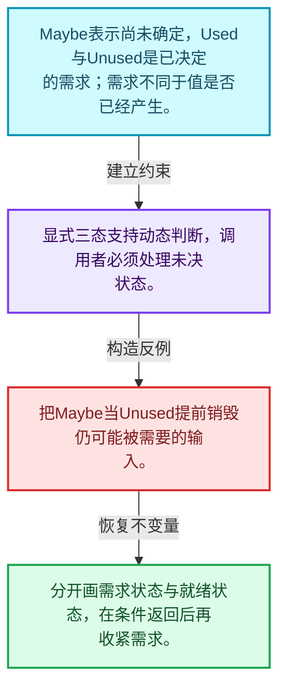
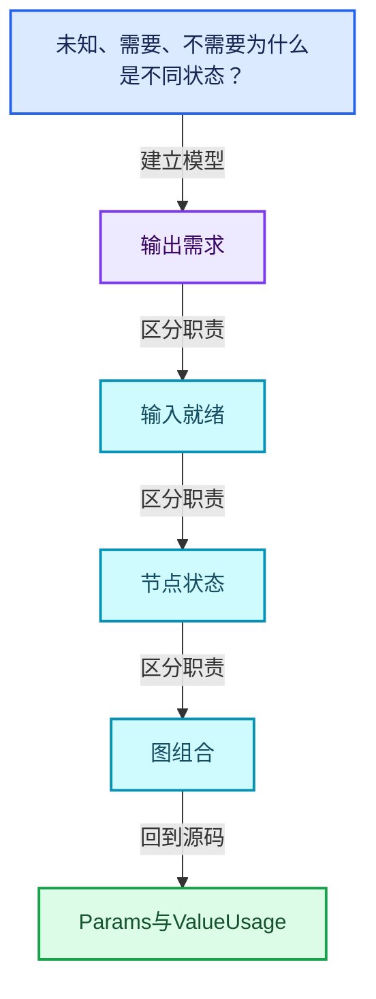
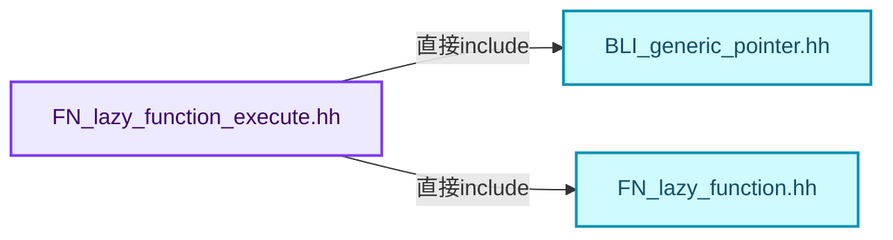
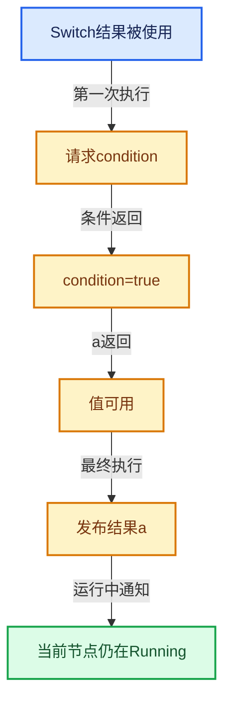

# 09-03 Params与ValueUsage

[方向导航](README.md) · [总目录](../README.md) · [覆盖索引](../%E6%BA%90%E7%A0%81%E7%89%88%E6%9C%AC%E4%B8%8E%E8%A6%86%E7%9B%96%E7%B4%A2%E5%BC%95.md)

> 阅读顺序：问题与数据模型 → 语法与类型 → 源码逐行 → 调用线索 → 历史与取舍 → 推演和练习。

- 基准 HEAD：`cbda6b96c26c0dee3c3b5cbb93960c4ac06a6b30`。
- 记录日期：2026-10-14。
- 教学示例状态：正文中的推演不是本机性能实测；已运行练习见验收报告。

## 一、从问题到设计

未知、需要、不需要为什么是不同状态？

Maybe保留动态决定空间，Used要求提供结果，Unused允许避免或释放计算；未知不能当成不需要。

本篇把语法、数据语义和系统取舍连接起来。需求与就绪是不同维度；状态只在有证据时推进，不能把未确定当作无需求。

### 本篇独立模型与设计推理

Maybe表示尚未确定，Used与Unused是已决定的需求；需求不同于值是否已经产生。

设计取舍：显式三态支持动态判断，调用者必须处理未决状态。

最小反例：把Maybe当Unused提前销毁仍可能被需要的输入。

推导与处理：分开画需求状态与就绪状态，在条件返回后再收紧需求。



### 源码范围与相邻篇章

| 文件 | 本篇逐行范围 | 基准SHA-256 |
|---|---|---|
| [source/blender/functions/FN_lazy_function_execute.hh](../../../../../source/blender/functions/FN_lazy_function_execute.hh) | L1—L158 | `ed53f9dd899fdc764e02c4f00e0fa78a8c34a44517791170ba9c87771f95c142` |
| [source/blender/functions/intern/lazy_function_execute.cc](../../../../../source/blender/functions/intern/lazy_function_execute.cc) | L1—L144 | `31a407fd451e8a290c056ea08227bafadbe48893c950105e11f67d90186b9c9a` |

同一主讲文件可能分多篇覆盖；超出本篇范围的符号通过覆盖索引定位。空行与纯注释保留在源码摘录中，逐行表解释有效语句与语法边界；许可证头统一保留。

前篇：[LazyFunction接口](02-LazyFunction%E6%8E%A5%E5%8F%A3.md).

后篇：[Context与执行状态](04-Context%E4%B8%8E%E6%89%A7%E8%A1%8C%E7%8A%B6%E6%80%81.md).

## 二、类型、数据与阅读地图



这是概念依赖图，边表示阅读关系，不声称是运行时调用顺序。

### 直接编译依赖



箭头只表示头文件包含关系；完整调用线索见后面的符号定位表。

## 三、关键词、语法与类型角色

### 模板 template

模板把类型或常量作为生成实现的参数。读声明时先列出类型参数、非类型参数和默认值，再看使用者实际实例化了什么。模板声明本身不意味着每种T都支持其全部成员。

具体检查：把T替换为int、string、只能移动的类型，分别检查每个被调用操作是否成立。

### 依赖名称 typename

typename既可引入类型模板参数，也可告诉编译器某个依赖名称是类型。它不创建运行时对象；解析期确认语法类别与实例化期检查具体类型是不同阶段。

具体检查：区分typename T::value_type和T::size()，前者标记类型，后者是表达式。

### 常量求值 constexpr

constexpr声明允许相应实体参与常量求值，但constexpr函数仍可以在运行时执行。是否常量求值由调用场景和表达式合法性共同决定。

具体检查：比较constexpr变量初始化和从运行时输入调用同一函数。

### 只读限定 const

const约束当前访问路径可做的修改。const指针、指向const的指针、const视图对象、const元素是不同位置的限定；其他别名可能仍可修改原对象。

具体检查：分别写T* const、const T*与const T* const，并画出不可修改的层次。

### 异常边界 try与catch

try定义异常传播的局部边界。失败路径需要销毁已经成功构造的部分并释放相应存储；未构造的对象不能被析构。

具体检查：在第k次构造失败，列出已经存在的对象集合与待释放缓冲。

### 覆写检查 override

override要求函数确实覆盖基类虚函数，可捕获参数类型和const限定不匹配。它不改变基类规定的生命周期或线程约束。

具体检查：故意改变一个参数或const，观察编译器如何拒绝误写的新函数。

### 可选值 optional

optional把不存在与存在的T区分开，T的构造和析构跟随engaged状态变化。访问前应由has_value或条件分支证明存在。

具体检查：把空Field状态与合法常量零区分，不能用某个普通值代替不存在。

### 对象表示 sizeof

sizeof给出对象表示大小，不是其引用的所有堆内存总量。sizeof视图很小并不说明底层数组很小。

具体检查：分别统计容器对象、容量字节和元素拥有的间接资源。

### 内部断言 assert

断言表达开发者预期成立的内部契约，发布构建可能关闭。它不能替代对不可信输入的完整错误处理，也不保证后续操作被运行时保护。

具体检查：对每条断言构造违反条件的输入，区分调用者错误与应向用户报告的错误。

### 类型别名 using

类型别名为已有类型建立名字，不创建运行期对象。它常把模板内部使用的类型统一暴露给泛型调用者。

具体检查：展开别名直到基础类型，区分类型别名和变量声明。

## 四、真实源码与逐行讲解

源码块保持原行内容，原始行号由小节标题及逐行表给出。表中的调用定位是静态阅读辅助；重载、模板实例化、宏展开和虚调用需结合完整声明，不能仅凭词法出现证明动态调用。

### FN_lazy_function_execute.hh：L1—L47

<!-- source:source/blender/functions/FN_lazy_function_execute.hh:1:47 -->

```cpp
/* SPDX-FileCopyrightText: 2023 Blender Authors
 *
 * SPDX-License-Identifier: GPL-2.0-or-later */

#pragma once

/** \file
 * \ingroup fn
 *
 * This file contains common utilities for actually executing a lazy-function.
 */

#include "BLI_generic_pointer.hh"

#include "FN_lazy_function.hh"

namespace blender::fn::lazy_function {

/**
 * Most basic implementation of #Params. It does not actually implement any logic for how to
 * retrieve inputs or set outputs. Instead, code using #BasicParams has to implement that.
 */
class BasicParams : public Params {
 private:
  const Span<GMutablePointer> inputs_;
  const Span<GMutablePointer> outputs_;
  MutableSpan<std::optional<ValueUsage>> input_usages_;
  Span<ValueUsage> output_usages_;
  MutableSpan<bool> set_outputs_;

 public:
  BasicParams(const LazyFunction &fn,
              Span<GMutablePointer> inputs,
              Span<GMutablePointer> outputs,
              MutableSpan<std::optional<ValueUsage>> input_usages,
              Span<ValueUsage> output_usages,
              MutableSpan<bool> set_outputs);

  void *try_get_input_data_ptr_impl(const int index) const override;
  void *try_get_input_data_ptr_or_request_impl(const int index) override;
  void *get_output_data_ptr_impl(const int index) override;
  void output_set_impl(const int index) override;
  bool output_was_set_impl(const int index) const override;
  ValueUsage get_output_usage_impl(const int index) const override;
  void set_input_unused_impl(const int index) override;
  bool try_enable_multi_threading_impl() override;
};
```

本段语义重点：

- `set_output`：向输出位置发布值；输出是否已构造、是否已经设置由调用约定限制。
- `try_get_input`：尝试读取已可用输入；未就绪与合法空值应使用接口约定区分。
- `get_output_usage`：读取输出需求，依据它决定是否请求额外输入。

| 原始行 | 语义、约束与检查 |
|---|---|
| L5 | 防止同一头文件在一个翻译单元中重复展开；不控制多个源文件之间的链接或对象寿命。 |
| L13 | 引入编译依赖 "BLI_generic_pointer.hh"；这是声明可见性关系，不表示运行时一定调用该文件的所有接口。 |
| L15 | 引入编译依赖 "FN_lazy_function.hh"；这是声明可见性关系，不表示运行时一定调用该文件的所有接口。 |
| L17 | 把后续声明放入 blender::fn::lazy_function 命名空间，影响名称查找和符号归属，不创建运行时对象。 |
| L23 | 声明或定义类型 `class BasicParams : public Params`。结合继承、访问权限和成员布局确认接口与拥有关系；前向声明本身没有完整对象布局。 |
| L24 | 切换成员访问权限为 private；它是编译期接口边界，不是线程同步或内存保护。 |
| L25 | 声明成员、局部对象或完成语句 `const Span<GMutablePointer> inputs_`。若为指针或引用，它本身不说明拥有；若为值对象，其构造析构由所在作用域或外层对象管理。 |
| L26 | 声明成员、局部对象或完成语句 `const Span<GMutablePointer> outputs_`。若为指针或引用，它本身不说明拥有；若为值对象，其构造析构由所在作用域或外层对象管理。 |
| L27 | 声明成员、局部对象或完成语句 `MutableSpan<std::optional<ValueUsage>> input_usages_`。若为指针或引用，它本身不说明拥有；若为值对象，其构造析构由所在作用域或外层对象管理。 |
| L28 | 声明成员、局部对象或完成语句 `Span<ValueUsage> output_usages_`。若为指针或引用，它本身不说明拥有；若为值对象，其构造析构由所在作用域或外层对象管理。 |
| L29 | 声明成员、局部对象或完成语句 `MutableSpan<bool> set_outputs_`。若为指针或引用，它本身不说明拥有；若为值对象，其构造析构由所在作用域或外层对象管理。 |
| L31 | 切换成员访问权限为 public；它是编译期接口边界，不是线程同步或内存保护。 |
| L32 | 出现调用或函数声明 `BasicParams`，对应表达式为 `BasicParams(const LazyFunction &fn,`。参数求值、返回类型与重载需结合前后完整语句；静态文本引用不能证明动态目标。 |
| L33 | 本行是连续声明或表达式的一部分：`Span<GMutablePointer> inputs,`。与本段前后行合读；逗号、括号和限定符决定它属于参数、初始化列表还是实际计算。 |
| L34 | 本行是连续声明或表达式的一部分：`Span<GMutablePointer> outputs,`。与本段前后行合读；逗号、括号和限定符决定它属于参数、初始化列表还是实际计算。 |
| L35 | 本行是连续声明或表达式的一部分：`MutableSpan<std::optional<ValueUsage>> input_usages,`。与本段前后行合读；逗号、括号和限定符决定它属于参数、初始化列表还是实际计算。 |
| L36 | 本行是连续声明或表达式的一部分：`Span<ValueUsage> output_usages,`。与本段前后行合读；逗号、括号和限定符决定它属于参数、初始化列表还是实际计算。 |
| L37 | 声明成员、局部对象或完成语句 `MutableSpan<bool> set_outputs)`。若为指针或引用，它本身不说明拥有；若为值对象，其构造析构由所在作用域或外层对象管理。 |
| L39 | 声明接口 `void *try_get_input_data_ptr_impl(const int index) const override`，本行没有对应函数体；返回类型、参数限定和const/noexcept共同组成调用契约，实际行为需继续定位实现。 |
| L40 | 声明接口 `void *try_get_input_data_ptr_or_request_impl(const int index) override`，本行没有对应函数体；返回类型、参数限定和const/noexcept共同组成调用契约，实际行为需继续定位实现。 |
| L41 | 声明接口 `void *get_output_data_ptr_impl(const int index) override`，本行没有对应函数体；返回类型、参数限定和const/noexcept共同组成调用契约，实际行为需继续定位实现。 |
| L42 | 声明接口 `void output_set_impl(const int index) override`，本行没有对应函数体；返回类型、参数限定和const/noexcept共同组成调用契约，实际行为需继续定位实现。 |
| L43 | 声明接口 `bool output_was_set_impl(const int index) const override`，本行没有对应函数体；返回类型、参数限定和const/noexcept共同组成调用契约，实际行为需继续定位实现。 |
| L44 | 声明接口 `ValueUsage get_output_usage_impl(const int index) const override`，本行没有对应函数体；返回类型、参数限定和const/noexcept共同组成调用契约，实际行为需继续定位实现。 |
| L45 | 声明接口 `void set_input_unused_impl(const int index) override`，本行没有对应函数体；返回类型、参数限定和const/noexcept共同组成调用契约，实际行为需继续定位实现。 |
| L46 | 声明接口 `bool try_enable_multi_threading_impl() override`，本行没有对应函数体；返回类型、参数限定和const/noexcept共同组成调用契约，实际行为需继续定位实现。 |
| L47 | 结束当前语法单元。局部自动对象在离开其作用域时按规则销毁；这不等于所有被引用的外部数据也被释放。 |

### FN_lazy_function_execute.hh：L48—L75

<!-- source:source/blender/functions/FN_lazy_function_execute.hh:48:75 -->

```cpp

/**
 * Wraps an existing #Params. This should be used when a lazy-function internally contains another
 * lazy-function that handles a subset or the inputs and outputs.
 */
class RemappedParams : public Params {
 private:
  Params &base_params_;
  Span<int> input_map_;
  Span<int> output_map_;
  bool &multi_threading_enabled_;

 public:
  RemappedParams(const LazyFunction &fn,
                 Params &base_params,
                 Span<int> input_map,
                 Span<int> output_map,
                 bool &multi_threading_enabled);

  void *try_get_input_data_ptr_impl(const int index) const override;
  void *try_get_input_data_ptr_or_request_impl(const int index) override;
  void *get_output_data_ptr_impl(const int index) override;
  void output_set_impl(const int index) override;
  bool output_was_set_impl(const int index) const override;
  ValueUsage get_output_usage_impl(const int index) const override;
  void set_input_unused_impl(const int index) override;
  bool try_enable_multi_threading_impl() override;
};
```

本段语义重点：

- `try_get_input`：尝试读取已可用输入；未就绪与合法空值应使用接口约定区分。
- `get_output_usage`：读取输出需求，依据它决定是否请求额外输入。

| 原始行 | 语义、约束与检查 |
|---|---|
| L53 | 声明或定义类型 `class RemappedParams : public Params`。结合继承、访问权限和成员布局确认接口与拥有关系；前向声明本身没有完整对象布局。 |
| L54 | 切换成员访问权限为 private；它是编译期接口边界，不是线程同步或内存保护。 |
| L55 | 声明成员、局部对象或完成语句 `Params &base_params_`。若为指针或引用，它本身不说明拥有；若为值对象，其构造析构由所在作用域或外层对象管理。 |
| L56 | 声明成员、局部对象或完成语句 `Span<int> input_map_`。若为指针或引用，它本身不说明拥有；若为值对象，其构造析构由所在作用域或外层对象管理。 |
| L57 | 声明成员、局部对象或完成语句 `Span<int> output_map_`。若为指针或引用，它本身不说明拥有；若为值对象，其构造析构由所在作用域或外层对象管理。 |
| L58 | 声明成员、局部对象或完成语句 `bool &multi_threading_enabled_`。若为指针或引用，它本身不说明拥有；若为值对象，其构造析构由所在作用域或外层对象管理。 |
| L60 | 切换成员访问权限为 public；它是编译期接口边界，不是线程同步或内存保护。 |
| L61 | 出现调用或函数声明 `RemappedParams`，对应表达式为 `RemappedParams(const LazyFunction &fn,`。参数求值、返回类型与重载需结合前后完整语句；静态文本引用不能证明动态目标。 |
| L62 | 本行是连续声明或表达式的一部分：`Params &base_params,`。与本段前后行合读；逗号、括号和限定符决定它属于参数、初始化列表还是实际计算。 |
| L63 | 本行是连续声明或表达式的一部分：`Span<int> input_map,`。与本段前后行合读；逗号、括号和限定符决定它属于参数、初始化列表还是实际计算。 |
| L64 | 本行是连续声明或表达式的一部分：`Span<int> output_map,`。与本段前后行合读；逗号、括号和限定符决定它属于参数、初始化列表还是实际计算。 |
| L65 | 声明成员、局部对象或完成语句 `bool &multi_threading_enabled)`。若为指针或引用，它本身不说明拥有；若为值对象，其构造析构由所在作用域或外层对象管理。 |
| L67 | 声明接口 `void *try_get_input_data_ptr_impl(const int index) const override`，本行没有对应函数体；返回类型、参数限定和const/noexcept共同组成调用契约，实际行为需继续定位实现。 |
| L68 | 声明接口 `void *try_get_input_data_ptr_or_request_impl(const int index) override`，本行没有对应函数体；返回类型、参数限定和const/noexcept共同组成调用契约，实际行为需继续定位实现。 |
| L69 | 声明接口 `void *get_output_data_ptr_impl(const int index) override`，本行没有对应函数体；返回类型、参数限定和const/noexcept共同组成调用契约，实际行为需继续定位实现。 |
| L70 | 声明接口 `void output_set_impl(const int index) override`，本行没有对应函数体；返回类型、参数限定和const/noexcept共同组成调用契约，实际行为需继续定位实现。 |
| L71 | 声明接口 `bool output_was_set_impl(const int index) const override`，本行没有对应函数体；返回类型、参数限定和const/noexcept共同组成调用契约，实际行为需继续定位实现。 |
| L72 | 声明接口 `ValueUsage get_output_usage_impl(const int index) const override`，本行没有对应函数体；返回类型、参数限定和const/noexcept共同组成调用契约，实际行为需继续定位实现。 |
| L73 | 声明接口 `void set_input_unused_impl(const int index) override`，本行没有对应函数体；返回类型、参数限定和const/noexcept共同组成调用契约，实际行为需继续定位实现。 |
| L74 | 声明接口 `bool try_enable_multi_threading_impl() override`，本行没有对应函数体；返回类型、参数限定和const/noexcept共同组成调用契约，实际行为需继续定位实现。 |
| L75 | 结束当前语法单元。局部自动对象在离开其作用域时按规则销毁；这不等于所有被引用的外部数据也被释放。 |

### FN_lazy_function_execute.hh：L76—L127

<!-- source:source/blender/functions/FN_lazy_function_execute.hh:76:127 -->

```cpp

namespace detail {

/**
 * Utility to implement #execute_lazy_function_eagerly.
 */
template<typename... Inputs, typename... Outputs, size_t... InIndices, size_t... OutIndices>
inline void execute_lazy_function_eagerly_impl(const LazyFunction &fn,
                                               UserData *user_data,
                                               LocalUserData *local_user_data,
                                               std::tuple<Inputs...> &inputs,
                                               std::tuple<Outputs *...> &outputs,
                                               std::index_sequence<InIndices...> /*in_indices*/,
                                               std::index_sequence<OutIndices...> /*out_indices*/)
{
  constexpr size_t InputsNum = sizeof...(Inputs);
  constexpr size_t OutputsNum = sizeof...(Outputs);
  std::array<GMutablePointer, InputsNum> input_pointers;
  std::array<GMutablePointer, OutputsNum> output_pointers;
  std::array<std::optional<ValueUsage>, InputsNum> input_usages;
  std::array<ValueUsage, OutputsNum> output_usages;
  std::array<bool, OutputsNum> set_outputs;
  (
      [&]() {
        constexpr size_t I = InIndices;
        /* Use `typedef` instead of `using` to work around a compiler bug. */
        using T = Inputs;
        const CPPType &type = CPPType::get<T>();
        input_pointers[I] = {type, &std::get<I>(inputs)};
      }(),
      ...);
  (
      [&]() {
        constexpr size_t I = OutIndices;
        /* Use `typedef` instead of `using` to work around a compiler bug. */
        using T = Outputs;
        const CPPType &type = CPPType::get<T>();
        output_pointers[I] = {type, std::get<I>(outputs)};
      }(),
      ...);
  output_usages.fill(ValueUsage::Used);
  set_outputs.fill(false);
  LinearAllocator<> allocator;
  Context context(fn.init_storage(allocator), user_data, local_user_data);
  BasicParams params{
      fn, input_pointers, output_pointers, input_usages, output_usages, set_outputs};
  fn.execute(params, context);
  fn.destruct_storage(context.storage);

  /* Make sure all outputs have been computed. */
  BLI_assert(!Span<bool>(set_outputs).contains(false));
}
```

本段语义重点：

- `set_output`：向输出位置发布值；输出是否已构造、是否已经设置由调用约定限制。

| 原始行 | 语义、约束与检查 |
|---|---|
| L77 | 把后续声明放入 detail 命名空间，影响名称查找和符号归属，不创建运行时对象。 |
| L82 | 声明模板参数 `template<typename... Inputs, typename... Outputs, size_t... InIndices, size_t... OutIndices>`。类型参数决定生成操作的类型，非类型参数可决定内嵌容量或编译期分支。 |
| L83 | 出现调用或函数声明 `execute_lazy_function_eagerly_impl`，对应表达式为 `inline void execute_lazy_function_eagerly_impl(const LazyFunction &fn,`。参数求值、返回类型与重载需结合前后完整语句；静态文本引用不能证明动态目标。 |
| L84 | 本行是连续声明或表达式的一部分：`UserData *user_data,`。与本段前后行合读；逗号、括号和限定符决定它属于参数、初始化列表还是实际计算。 |
| L85 | 本行是连续声明或表达式的一部分：`LocalUserData *local_user_data,`。与本段前后行合读；逗号、括号和限定符决定它属于参数、初始化列表还是实际计算。 |
| L86 | 本行是连续声明或表达式的一部分：`std::tuple<Inputs...> &inputs,`。与本段前后行合读；逗号、括号和限定符决定它属于参数、初始化列表还是实际计算。 |
| L87 | 本行是连续声明或表达式的一部分：`std::tuple<Outputs *...> &outputs,`。与本段前后行合读；逗号、括号和限定符决定它属于参数、初始化列表还是实际计算。 |
| L88 | 本行是连续声明或表达式的一部分：`std::index_sequence<InIndices...> ,`。与本段前后行合读；逗号、括号和限定符决定它属于参数、初始化列表还是实际计算。 |
| L89 | 本行是连续声明或表达式的一部分：`std::index_sequence<OutIndices...> )`。与本段前后行合读；逗号、括号和限定符决定它属于参数、初始化列表还是实际计算。 |
| L90 | 连接上一行的声明或控制结构与其语句块；后续行在这个作用域中执行或声明。 |
| L91 | 把右侧 `sizeof...(Inputs)` 用于初始化或更新左侧 `constexpr size_t InputsNum`。声明初始化与已有对象赋值应按上下文区分；有资源的类型会调用相应特殊成员。 |
| L92 | 把右侧 `sizeof...(Outputs)` 用于初始化或更新左侧 `constexpr size_t OutputsNum`。声明初始化与已有对象赋值应按上下文区分；有资源的类型会调用相应特殊成员。 |
| L93 | 声明成员、局部对象或完成语句 `std::array<GMutablePointer, InputsNum> input_pointers`。若为指针或引用，它本身不说明拥有；若为值对象，其构造析构由所在作用域或外层对象管理。 |
| L94 | 声明成员、局部对象或完成语句 `std::array<GMutablePointer, OutputsNum> output_pointers`。若为指针或引用，它本身不说明拥有；若为值对象，其构造析构由所在作用域或外层对象管理。 |
| L95 | 声明成员、局部对象或完成语句 `std::array<std::optional<ValueUsage>, InputsNum> input_usages`。若为指针或引用，它本身不说明拥有；若为值对象，其构造析构由所在作用域或外层对象管理。 |
| L96 | 声明成员、局部对象或完成语句 `std::array<ValueUsage, OutputsNum> output_usages`。若为指针或引用，它本身不说明拥有；若为值对象，其构造析构由所在作用域或外层对象管理。 |
| L97 | 声明成员、局部对象或完成语句 `std::array<bool, OutputsNum> set_outputs`。若为指针或引用，它本身不说明拥有；若为值对象，其构造析构由所在作用域或外层对象管理。 |
| L98 | 本行是连续声明或表达式的一部分：`(`。与本段前后行合读；逗号、括号和限定符决定它属于参数、初始化列表还是实际计算。 |
| L99 | 本行是连续声明或表达式的一部分：`[&]() {`。与本段前后行合读；逗号、括号和限定符决定它属于参数、初始化列表还是实际计算。 |
| L100 | 把右侧 `InIndices` 用于初始化或更新左侧 `constexpr size_t I`。声明初始化与已有对象赋值应按上下文区分；有资源的类型会调用相应特殊成员。 |
| L102 | 定义类型别名 `using T = Inputs`，为模板接口或内部实现统一命名；本行不分配该类型对象。 |
| L103 | 把右侧 `CPPType::get<T>()` 用于初始化或更新左侧 `const CPPType &type`。声明初始化与已有对象赋值应按上下文区分；有资源的类型会调用相应特殊成员。 |
| L104 | 把右侧 `{type, &std::get<I>(inputs)}` 用于初始化或更新左侧 `input_pointers[I]`。声明初始化与已有对象赋值应按上下文区分；有资源的类型会调用相应特殊成员。 |
| L105 | 本行是连续声明或表达式的一部分：`}(),`。与本段前后行合读；逗号、括号和限定符决定它属于参数、初始化列表还是实际计算。 |
| L106 | 声明成员、局部对象或完成语句 `...)`。若为指针或引用，它本身不说明拥有；若为值对象，其构造析构由所在作用域或外层对象管理。 |
| L107 | 本行是连续声明或表达式的一部分：`(`。与本段前后行合读；逗号、括号和限定符决定它属于参数、初始化列表还是实际计算。 |
| L108 | 本行是连续声明或表达式的一部分：`[&]() {`。与本段前后行合读；逗号、括号和限定符决定它属于参数、初始化列表还是实际计算。 |
| L109 | 把右侧 `OutIndices` 用于初始化或更新左侧 `constexpr size_t I`。声明初始化与已有对象赋值应按上下文区分；有资源的类型会调用相应特殊成员。 |
| L111 | 定义类型别名 `using T = Outputs`，为模板接口或内部实现统一命名；本行不分配该类型对象。 |
| L112 | 把右侧 `CPPType::get<T>()` 用于初始化或更新左侧 `const CPPType &type`。声明初始化与已有对象赋值应按上下文区分；有资源的类型会调用相应特殊成员。 |
| L113 | 把右侧 `{type, std::get<I>(outputs)}` 用于初始化或更新左侧 `output_pointers[I]`。声明初始化与已有对象赋值应按上下文区分；有资源的类型会调用相应特殊成员。 |
| L114 | 本行是连续声明或表达式的一部分：`}(),`。与本段前后行合读；逗号、括号和限定符决定它属于参数、初始化列表还是实际计算。 |
| L115 | 声明成员、局部对象或完成语句 `...)`。若为指针或引用，它本身不说明拥有；若为值对象，其构造析构由所在作用域或外层对象管理。 |
| L116 | 出现调用或函数声明 `fill`，对应表达式为 `output_usages.fill(ValueUsage::Used);`。参数求值、返回类型与重载需结合前后完整语句；静态文本引用不能证明动态目标。 |
| L117 | 出现调用或函数声明 `fill`，对应表达式为 `set_outputs.fill(false);`。参数求值、返回类型与重载需结合前后完整语句；静态文本引用不能证明动态目标。 |
| L118 | 声明成员、局部对象或完成语句 `LinearAllocator<> allocator`。若为指针或引用，它本身不说明拥有；若为值对象，其构造析构由所在作用域或外层对象管理。 |
| L119 | 出现调用或函数声明 `context`，对应表达式为 `Context context(fn.init_storage(allocator), user_data, local_user_data);`。参数求值、返回类型与重载需结合前后完整语句；静态文本引用不能证明动态目标。 |
| L120 | 本行是连续声明或表达式的一部分：`BasicParams params{`。与本段前后行合读；逗号、括号和限定符决定它属于参数、初始化列表还是实际计算。 |
| L121 | 声明成员、局部对象或完成语句 `fn, input_pointers, output_pointers, input_usages, output_usages, set_outputs}`。若为指针或引用，它本身不说明拥有；若为值对象，其构造析构由所在作用域或外层对象管理。 |
| L122 | 出现调用或函数声明 `execute`，对应表达式为 `fn.execute(params, context);`。参数求值、返回类型与重载需结合前后完整语句；静态文本引用不能证明动态目标。 |
| L123 | 出现调用或函数声明 `destruct_storage`，对应表达式为 `fn.destruct_storage(context.storage);`。参数求值、返回类型与重载需结合前后完整语句；静态文本引用不能证明动态目标。 |
| L126 | 断言约束 `BLI_assert(!Span<bool>(set_outputs).contains(false));`。条件是后续访问的内部前置条件；发布构建可能不执行，不能把断言当作输入修复。 |
| L127 | 结束当前语法单元。局部自动对象在离开其作用域时按规则销毁；这不等于所有被引用的外部数据也被释放。 |

### FN_lazy_function_execute.hh：L128—L158

<!-- source:source/blender/functions/FN_lazy_function_execute.hh:128:158 -->

```cpp

}  // namespace detail

/**
 * In some cases (mainly for tests), the set of inputs and outputs for a lazy-function is known at
 * compile time and one just wants to compute the outputs based on the inputs, without any
 * laziness.
 *
 * This function does exactly that. It takes all inputs in a tuple and writes the outputs to points
 * provided in a second tuple. Since all inputs have to be provided, the lazy-function has to
 * compute all outputs.
 */
template<typename... Inputs, typename... Outputs>
inline void execute_lazy_function_eagerly(const LazyFunction &fn,
                                          UserData *user_data,
                                          LocalUserData *local_user_data,
                                          std::tuple<Inputs...> inputs,
                                          std::tuple<Outputs *...> outputs)
{
  BLI_assert(fn.inputs().size() == sizeof...(Inputs));
  BLI_assert(fn.outputs().size() == sizeof...(Outputs));
  detail::execute_lazy_function_eagerly_impl(fn,
                                             user_data,
                                             local_user_data,
                                             inputs,
                                             outputs,
                                             std::make_index_sequence<sizeof...(Inputs)>(),
                                             std::make_index_sequence<sizeof...(Outputs)>());
}

}  // namespace blender::fn::lazy_function
```

| 原始行 | 语义、约束与检查 |
|---|---|
| L129 | 结束当前语法单元。局部自动对象在离开其作用域时按规则销毁；这不等于所有被引用的外部数据也被释放。 |
| L140 | 声明模板参数 `template<typename... Inputs, typename... Outputs>`。类型参数决定生成操作的类型，非类型参数可决定内嵌容量或编译期分支。 |
| L141 | 出现调用或函数声明 `execute_lazy_function_eagerly`，对应表达式为 `inline void execute_lazy_function_eagerly(const LazyFunction &fn,`。参数求值、返回类型与重载需结合前后完整语句；静态文本引用不能证明动态目标。 |
| L142 | 本行是连续声明或表达式的一部分：`UserData *user_data,`。与本段前后行合读；逗号、括号和限定符决定它属于参数、初始化列表还是实际计算。 |
| L143 | 本行是连续声明或表达式的一部分：`LocalUserData *local_user_data,`。与本段前后行合读；逗号、括号和限定符决定它属于参数、初始化列表还是实际计算。 |
| L144 | 本行是连续声明或表达式的一部分：`std::tuple<Inputs...> inputs,`。与本段前后行合读；逗号、括号和限定符决定它属于参数、初始化列表还是实际计算。 |
| L145 | 本行是连续声明或表达式的一部分：`std::tuple<Outputs *...> outputs)`。与本段前后行合读；逗号、括号和限定符决定它属于参数、初始化列表还是实际计算。 |
| L146 | 连接上一行的声明或控制结构与其语句块；后续行在这个作用域中执行或声明。 |
| L147 | 断言约束 `BLI_assert(fn.inputs().size() == sizeof...(Inputs));`。条件是后续访问的内部前置条件；发布构建可能不执行，不能把断言当作输入修复。 |
| L148 | 断言约束 `BLI_assert(fn.outputs().size() == sizeof...(Outputs));`。条件是后续访问的内部前置条件；发布构建可能不执行，不能把断言当作输入修复。 |
| L149 | 出现调用或函数声明 `detail::execute_lazy_function_eagerly_impl`，对应表达式为 `detail::execute_lazy_function_eagerly_impl(fn,`。参数求值、返回类型与重载需结合前后完整语句；静态文本引用不能证明动态目标。 |
| L150 | 本行是连续声明或表达式的一部分：`user_data,`。与本段前后行合读；逗号、括号和限定符决定它属于参数、初始化列表还是实际计算。 |
| L151 | 本行是连续声明或表达式的一部分：`local_user_data,`。与本段前后行合读；逗号、括号和限定符决定它属于参数、初始化列表还是实际计算。 |
| L152 | 本行是连续声明或表达式的一部分：`inputs,`。与本段前后行合读；逗号、括号和限定符决定它属于参数、初始化列表还是实际计算。 |
| L153 | 本行是连续声明或表达式的一部分：`outputs,`。与本段前后行合读；逗号、括号和限定符决定它属于参数、初始化列表还是实际计算。 |
| L154 | 出现调用或函数声明 `std::make_index_sequence`，对应表达式为 `std::make_index_sequence<sizeof...(Inputs)>(),`。参数求值、返回类型与重载需结合前后完整语句；静态文本引用不能证明动态目标。 |
| L155 | 出现调用或函数声明 `std::make_index_sequence`，对应表达式为 `std::make_index_sequence<sizeof...(Outputs)>());`。参数求值、返回类型与重载需结合前后完整语句；静态文本引用不能证明动态目标。 |
| L156 | 结束当前语法单元。局部自动对象在离开其作用域时按规则销毁；这不等于所有被引用的外部数据也被释放。 |
| L158 | 结束当前语法单元。局部自动对象在离开其作用域时按规则销毁；这不等于所有被引用的外部数据也被释放。 |

### lazy_function_execute.cc：L1—L49

<!-- source:source/blender/functions/intern/lazy_function_execute.cc:1:49 -->

```cpp
/* SPDX-FileCopyrightText: 2023 Blender Authors
 *
 * SPDX-License-Identifier: GPL-2.0-or-later */

/** \file
 * \ingroup fn
 */

#include "FN_lazy_function_execute.hh"

namespace blender::fn::lazy_function {

/* -------------------------------------------------------------------- */
/** \name BasicParams.
 * \{ */

BasicParams::BasicParams(const LazyFunction &fn,
                         const Span<GMutablePointer> inputs,
                         const Span<GMutablePointer> outputs,
                         MutableSpan<std::optional<ValueUsage>> input_usages,
                         Span<ValueUsage> output_usages,
                         MutableSpan<bool> set_outputs)
    : Params(fn, true),
      inputs_(inputs),
      outputs_(outputs),
      input_usages_(input_usages),
      output_usages_(output_usages),
      set_outputs_(set_outputs)
{
}

void *BasicParams::try_get_input_data_ptr_impl(const int index) const
{
  return inputs_[index].get();
}

void *BasicParams::try_get_input_data_ptr_or_request_impl(const int index)
{
  void *value = inputs_[index].get();
  if (value == nullptr) {
    input_usages_[index] = ValueUsage::Used;
  }
  return value;
}

void *BasicParams::get_output_data_ptr_impl(const int index)
{
  return outputs_[index].get();
}
```

本段语义重点：

- `set_output`：向输出位置发布值；输出是否已构造、是否已经设置由调用约定限制。
- `try_get_input`：尝试读取已可用输入；未就绪与合法空值应使用接口约定区分。

| 原始行 | 语义、约束与检查 |
|---|---|
| L9 | 引入编译依赖 "FN_lazy_function_execute.hh"；这是声明可见性关系，不表示运行时一定调用该文件的所有接口。 |
| L11 | 把后续声明放入 blender::fn::lazy_function 命名空间，影响名称查找和符号归属，不创建运行时对象。 |
| L17 | 出现调用或函数声明 `BasicParams::BasicParams`，对应表达式为 `BasicParams::BasicParams(const LazyFunction &fn,`。参数求值、返回类型与重载需结合前后完整语句；静态文本引用不能证明动态目标。 |
| L18 | 本行是连续声明或表达式的一部分：`const Span<GMutablePointer> inputs,`。与本段前后行合读；逗号、括号和限定符决定它属于参数、初始化列表还是实际计算。 |
| L19 | 本行是连续声明或表达式的一部分：`const Span<GMutablePointer> outputs,`。与本段前后行合读；逗号、括号和限定符决定它属于参数、初始化列表还是实际计算。 |
| L20 | 本行是连续声明或表达式的一部分：`MutableSpan<std::optional<ValueUsage>> input_usages,`。与本段前后行合读；逗号、括号和限定符决定它属于参数、初始化列表还是实际计算。 |
| L21 | 本行是连续声明或表达式的一部分：`Span<ValueUsage> output_usages,`。与本段前后行合读；逗号、括号和限定符决定它属于参数、初始化列表还是实际计算。 |
| L22 | 本行是连续声明或表达式的一部分：`MutableSpan<bool> set_outputs)`。与本段前后行合读；逗号、括号和限定符决定它属于参数、初始化列表还是实际计算。 |
| L23 | 出现调用或函数声明 `Params`，对应表达式为 `: Params(fn, true),`。参数求值、返回类型与重载需结合前后完整语句；静态文本引用不能证明动态目标。 |
| L24 | 出现调用或函数声明 `inputs_`，对应表达式为 `inputs_(inputs),`。参数求值、返回类型与重载需结合前后完整语句；静态文本引用不能证明动态目标。 |
| L25 | 出现调用或函数声明 `outputs_`，对应表达式为 `outputs_(outputs),`。参数求值、返回类型与重载需结合前后完整语句；静态文本引用不能证明动态目标。 |
| L26 | 出现调用或函数声明 `input_usages_`，对应表达式为 `input_usages_(input_usages),`。参数求值、返回类型与重载需结合前后完整语句；静态文本引用不能证明动态目标。 |
| L27 | 出现调用或函数声明 `output_usages_`，对应表达式为 `output_usages_(output_usages),`。参数求值、返回类型与重载需结合前后完整语句；静态文本引用不能证明动态目标。 |
| L28 | 出现调用或函数声明 `set_outputs_`，对应表达式为 `set_outputs_(set_outputs)`。参数求值、返回类型与重载需结合前后完整语句；静态文本引用不能证明动态目标。 |
| L29 | 连接上一行的声明或控制结构与其语句块；后续行在这个作用域中执行或声明。 |
| L30 | 结束当前语法单元。局部自动对象在离开其作用域时按规则销毁；这不等于所有被引用的外部数据也被释放。 |
| L32 | 出现调用或函数声明 `BasicParams::try_get_input_data_ptr_impl`，对应表达式为 `void *BasicParams::try_get_input_data_ptr_impl(const int index) const`。参数求值、返回类型与重载需结合前后完整语句；静态文本引用不能证明动态目标。 |
| L33 | 连接上一行的声明或控制结构与其语句块；后续行在这个作用域中执行或声明。 |
| L34 | 返回表达式 `inputs_[index].get()`。 |
| L35 | 结束当前语法单元。局部自动对象在离开其作用域时按规则销毁；这不等于所有被引用的外部数据也被释放。 |
| L37 | 出现调用或函数声明 `BasicParams::try_get_input_data_ptr_or_request_impl`，对应表达式为 `void *BasicParams::try_get_input_data_ptr_or_request_impl(const int index)`。参数求值、返回类型与重载需结合前后完整语句；静态文本引用不能证明动态目标。 |
| L38 | 连接上一行的声明或控制结构与其语句块；后续行在这个作用域中执行或声明。 |
| L39 | 把右侧 `inputs_[index].get()` 用于初始化或更新左侧 `void *value`。声明初始化与已有对象赋值应按上下文区分；有资源的类型会调用相应特殊成员。 |
| L40 | 判断 `value == nullptr`，成立时进入本分支，否则继续后续路径。这里区分空地址与可用地址，但非空本身仍不能证明对象存活。 |
| L41 | 把右侧 `ValueUsage::Used` 用于初始化或更新左侧 `input_usages_[index]`。声明初始化与已有对象赋值应按上下文区分；有资源的类型会调用相应特殊成员。 |
| L42 | 结束当前语法单元。局部自动对象在离开其作用域时按规则销毁；这不等于所有被引用的外部数据也被释放。 |
| L43 | 返回表达式 `value`。 |
| L44 | 结束当前语法单元。局部自动对象在离开其作用域时按规则销毁；这不等于所有被引用的外部数据也被释放。 |
| L46 | 出现调用或函数声明 `BasicParams::get_output_data_ptr_impl`，对应表达式为 `void *BasicParams::get_output_data_ptr_impl(const int index)`。参数求值、返回类型与重载需结合前后完整语句；静态文本引用不能证明动态目标。 |
| L47 | 连接上一行的声明或控制结构与其语句块；后续行在这个作用域中执行或声明。 |
| L48 | 返回表达式 `outputs_[index].get()`。 |
| L49 | 结束当前语法单元。局部自动对象在离开其作用域时按规则销毁；这不等于所有被引用的外部数据也被释放。 |

### lazy_function_execute.cc：L50—L98

<!-- source:source/blender/functions/intern/lazy_function_execute.cc:50:98 -->

```cpp

void BasicParams::output_set_impl(const int index)
{
  set_outputs_[index] = true;
}

bool BasicParams::output_was_set_impl(const int index) const
{
  return set_outputs_[index];
}

ValueUsage BasicParams::get_output_usage_impl(const int index) const
{
  return output_usages_[index];
}

void BasicParams::set_input_unused_impl(const int index)
{
  input_usages_[index] = ValueUsage::Unused;
}

bool BasicParams::try_enable_multi_threading_impl()
{
  return true;
}

/** \} */

/* -------------------------------------------------------------------- */
/** \name RemappedParams.
 * \{ */

RemappedParams::RemappedParams(const LazyFunction &fn,
                               Params &base_params,
                               const Span<int> input_map,
                               const Span<int> output_map,
                               bool &multi_threading_enabled)
    : Params(fn, multi_threading_enabled),
      base_params_(base_params),
      input_map_(input_map),
      output_map_(output_map),
      multi_threading_enabled_(multi_threading_enabled)
{
}

void *RemappedParams::try_get_input_data_ptr_impl(const int index) const
{
  return base_params_.try_get_input_data_ptr(input_map_[index]);
}
```

本段语义重点：

- `set_output`：向输出位置发布值；输出是否已构造、是否已经设置由调用约定限制。
- `try_get_input`：尝试读取已可用输入；未就绪与合法空值应使用接口约定区分。
- `get_output_usage`：读取输出需求，依据它决定是否请求额外输入。

| 原始行 | 语义、约束与检查 |
|---|---|
| L51 | 出现调用或函数声明 `BasicParams::output_set_impl`，对应表达式为 `void BasicParams::output_set_impl(const int index)`。参数求值、返回类型与重载需结合前后完整语句；静态文本引用不能证明动态目标。 |
| L52 | 连接上一行的声明或控制结构与其语句块；后续行在这个作用域中执行或声明。 |
| L53 | 把右侧 `true` 用于初始化或更新左侧 `set_outputs_[index]`。声明初始化与已有对象赋值应按上下文区分；有资源的类型会调用相应特殊成员。 |
| L54 | 结束当前语法单元。局部自动对象在离开其作用域时按规则销毁；这不等于所有被引用的外部数据也被释放。 |
| L56 | 出现调用或函数声明 `BasicParams::output_was_set_impl`，对应表达式为 `bool BasicParams::output_was_set_impl(const int index) const`。参数求值、返回类型与重载需结合前后完整语句；静态文本引用不能证明动态目标。 |
| L57 | 连接上一行的声明或控制结构与其语句块；后续行在这个作用域中执行或声明。 |
| L58 | 返回表达式 `set_outputs_[index]`。 |
| L59 | 结束当前语法单元。局部自动对象在离开其作用域时按规则销毁；这不等于所有被引用的外部数据也被释放。 |
| L61 | 出现调用或函数声明 `BasicParams::get_output_usage_impl`，对应表达式为 `ValueUsage BasicParams::get_output_usage_impl(const int index) const`。参数求值、返回类型与重载需结合前后完整语句；静态文本引用不能证明动态目标。 |
| L62 | 连接上一行的声明或控制结构与其语句块；后续行在这个作用域中执行或声明。 |
| L63 | 返回表达式 `output_usages_[index]`。 |
| L64 | 结束当前语法单元。局部自动对象在离开其作用域时按规则销毁；这不等于所有被引用的外部数据也被释放。 |
| L66 | 出现调用或函数声明 `BasicParams::set_input_unused_impl`，对应表达式为 `void BasicParams::set_input_unused_impl(const int index)`。参数求值、返回类型与重载需结合前后完整语句；静态文本引用不能证明动态目标。 |
| L67 | 连接上一行的声明或控制结构与其语句块；后续行在这个作用域中执行或声明。 |
| L68 | 把右侧 `ValueUsage::Unused` 用于初始化或更新左侧 `input_usages_[index]`。声明初始化与已有对象赋值应按上下文区分；有资源的类型会调用相应特殊成员。 |
| L69 | 结束当前语法单元。局部自动对象在离开其作用域时按规则销毁；这不等于所有被引用的外部数据也被释放。 |
| L71 | 出现调用或函数声明 `BasicParams::try_enable_multi_threading_impl`，对应表达式为 `bool BasicParams::try_enable_multi_threading_impl()`。参数求值、返回类型与重载需结合前后完整语句；静态文本引用不能证明动态目标。 |
| L72 | 连接上一行的声明或控制结构与其语句块；后续行在这个作用域中执行或声明。 |
| L73 | 返回表达式 `true`。这是本路径的布尔结果，具体成功、存在或状态含义由函数接口规定。 |
| L74 | 结束当前语法单元。局部自动对象在离开其作用域时按规则销毁；这不等于所有被引用的外部数据也被释放。 |
| L82 | 出现调用或函数声明 `RemappedParams::RemappedParams`，对应表达式为 `RemappedParams::RemappedParams(const LazyFunction &fn,`。参数求值、返回类型与重载需结合前后完整语句；静态文本引用不能证明动态目标。 |
| L83 | 本行是连续声明或表达式的一部分：`Params &base_params,`。与本段前后行合读；逗号、括号和限定符决定它属于参数、初始化列表还是实际计算。 |
| L84 | 本行是连续声明或表达式的一部分：`const Span<int> input_map,`。与本段前后行合读；逗号、括号和限定符决定它属于参数、初始化列表还是实际计算。 |
| L85 | 本行是连续声明或表达式的一部分：`const Span<int> output_map,`。与本段前后行合读；逗号、括号和限定符决定它属于参数、初始化列表还是实际计算。 |
| L86 | 本行是连续声明或表达式的一部分：`bool &multi_threading_enabled)`。与本段前后行合读；逗号、括号和限定符决定它属于参数、初始化列表还是实际计算。 |
| L87 | 出现调用或函数声明 `Params`，对应表达式为 `: Params(fn, multi_threading_enabled),`。参数求值、返回类型与重载需结合前后完整语句；静态文本引用不能证明动态目标。 |
| L88 | 出现调用或函数声明 `base_params_`，对应表达式为 `base_params_(base_params),`。参数求值、返回类型与重载需结合前后完整语句；静态文本引用不能证明动态目标。 |
| L89 | 出现调用或函数声明 `input_map_`，对应表达式为 `input_map_(input_map),`。参数求值、返回类型与重载需结合前后完整语句；静态文本引用不能证明动态目标。 |
| L90 | 出现调用或函数声明 `output_map_`，对应表达式为 `output_map_(output_map),`。参数求值、返回类型与重载需结合前后完整语句；静态文本引用不能证明动态目标。 |
| L91 | 出现调用或函数声明 `multi_threading_enabled_`，对应表达式为 `multi_threading_enabled_(multi_threading_enabled)`。参数求值、返回类型与重载需结合前后完整语句；静态文本引用不能证明动态目标。 |
| L92 | 连接上一行的声明或控制结构与其语句块；后续行在这个作用域中执行或声明。 |
| L93 | 结束当前语法单元。局部自动对象在离开其作用域时按规则销毁；这不等于所有被引用的外部数据也被释放。 |
| L95 | 出现调用或函数声明 `RemappedParams::try_get_input_data_ptr_impl`，对应表达式为 `void *RemappedParams::try_get_input_data_ptr_impl(const int index) const`。参数求值、返回类型与重载需结合前后完整语句；静态文本引用不能证明动态目标。 |
| L96 | 连接上一行的声明或控制结构与其语句块；后续行在这个作用域中执行或声明。 |
| L97 | 返回表达式 `base_params_.try_get_input_data_ptr(input_map_[index])`。 |
| L98 | 结束当前语法单元。局部自动对象在离开其作用域时按规则销毁；这不等于所有被引用的外部数据也被释放。 |

### lazy_function_execute.cc：L99—L144

<!-- source:source/blender/functions/intern/lazy_function_execute.cc:99:144 -->

```cpp

void *RemappedParams::try_get_input_data_ptr_or_request_impl(const int index)
{
  return base_params_.try_get_input_data_ptr_or_request(input_map_[index]);
}

void *RemappedParams::get_output_data_ptr_impl(const int index)
{
  return base_params_.get_output_data_ptr(output_map_[index]);
}

void RemappedParams::output_set_impl(const int index)
{
  base_params_.output_set(output_map_[index]);
}

bool RemappedParams::output_was_set_impl(const int index) const
{
  return base_params_.output_was_set(output_map_[index]);
}

lf::ValueUsage RemappedParams::get_output_usage_impl(const int index) const
{
  return base_params_.get_output_usage(output_map_[index]);
}

void RemappedParams::set_input_unused_impl(const int index)
{
  base_params_.set_input_unused(input_map_[index]);
}

bool RemappedParams::try_enable_multi_threading_impl()
{
  if (multi_threading_enabled_) {
    return true;
  }
  if (base_params_.try_enable_multi_threading()) {
    multi_threading_enabled_ = true;
    return true;
  }
  return false;
}

/** \} */

}  // namespace blender::fn::lazy_function
```

本段语义重点：

- `try_get_input`：尝试读取已可用输入；未就绪与合法空值应使用接口约定区分。
- `get_output_usage`：读取输出需求，依据它决定是否请求额外输入。

| 原始行 | 语义、约束与检查 |
|---|---|
| L100 | 出现调用或函数声明 `RemappedParams::try_get_input_data_ptr_or_request_impl`，对应表达式为 `void *RemappedParams::try_get_input_data_ptr_or_request_impl(const int index)`。参数求值、返回类型与重载需结合前后完整语句；静态文本引用不能证明动态目标。 |
| L101 | 连接上一行的声明或控制结构与其语句块；后续行在这个作用域中执行或声明。 |
| L102 | 返回表达式 `base_params_.try_get_input_data_ptr_or_request(input_map_[index])`。 |
| L103 | 结束当前语法单元。局部自动对象在离开其作用域时按规则销毁；这不等于所有被引用的外部数据也被释放。 |
| L105 | 出现调用或函数声明 `RemappedParams::get_output_data_ptr_impl`，对应表达式为 `void *RemappedParams::get_output_data_ptr_impl(const int index)`。参数求值、返回类型与重载需结合前后完整语句；静态文本引用不能证明动态目标。 |
| L106 | 连接上一行的声明或控制结构与其语句块；后续行在这个作用域中执行或声明。 |
| L107 | 返回表达式 `base_params_.get_output_data_ptr(output_map_[index])`。 |
| L108 | 结束当前语法单元。局部自动对象在离开其作用域时按规则销毁；这不等于所有被引用的外部数据也被释放。 |
| L110 | 出现调用或函数声明 `RemappedParams::output_set_impl`，对应表达式为 `void RemappedParams::output_set_impl(const int index)`。参数求值、返回类型与重载需结合前后完整语句；静态文本引用不能证明动态目标。 |
| L111 | 连接上一行的声明或控制结构与其语句块；后续行在这个作用域中执行或声明。 |
| L112 | 出现调用或函数声明 `output_set`，对应表达式为 `base_params_.output_set(output_map_[index]);`。参数求值、返回类型与重载需结合前后完整语句；静态文本引用不能证明动态目标。 |
| L113 | 结束当前语法单元。局部自动对象在离开其作用域时按规则销毁；这不等于所有被引用的外部数据也被释放。 |
| L115 | 出现调用或函数声明 `RemappedParams::output_was_set_impl`，对应表达式为 `bool RemappedParams::output_was_set_impl(const int index) const`。参数求值、返回类型与重载需结合前后完整语句；静态文本引用不能证明动态目标。 |
| L116 | 连接上一行的声明或控制结构与其语句块；后续行在这个作用域中执行或声明。 |
| L117 | 返回表达式 `base_params_.output_was_set(output_map_[index])`。 |
| L118 | 结束当前语法单元。局部自动对象在离开其作用域时按规则销毁；这不等于所有被引用的外部数据也被释放。 |
| L120 | 出现调用或函数声明 `RemappedParams::get_output_usage_impl`，对应表达式为 `lf::ValueUsage RemappedParams::get_output_usage_impl(const int index) const`。参数求值、返回类型与重载需结合前后完整语句；静态文本引用不能证明动态目标。 |
| L121 | 连接上一行的声明或控制结构与其语句块；后续行在这个作用域中执行或声明。 |
| L122 | 本行使用 `get_output_usage`：读取输出需求，依据它决定是否请求额外输入。 |
| L123 | 结束当前语法单元。局部自动对象在离开其作用域时按规则销毁；这不等于所有被引用的外部数据也被释放。 |
| L125 | 出现调用或函数声明 `RemappedParams::set_input_unused_impl`，对应表达式为 `void RemappedParams::set_input_unused_impl(const int index)`。参数求值、返回类型与重载需结合前后完整语句；静态文本引用不能证明动态目标。 |
| L126 | 连接上一行的声明或控制结构与其语句块；后续行在这个作用域中执行或声明。 |
| L127 | 出现调用或函数声明 `set_input_unused`，对应表达式为 `base_params_.set_input_unused(input_map_[index]);`。参数求值、返回类型与重载需结合前后完整语句；静态文本引用不能证明动态目标。 |
| L128 | 结束当前语法单元。局部自动对象在离开其作用域时按规则销毁；这不等于所有被引用的外部数据也被释放。 |
| L130 | 出现调用或函数声明 `RemappedParams::try_enable_multi_threading_impl`，对应表达式为 `bool RemappedParams::try_enable_multi_threading_impl()`。参数求值、返回类型与重载需结合前后完整语句；静态文本引用不能证明动态目标。 |
| L131 | 连接上一行的声明或控制结构与其语句块；后续行在这个作用域中执行或声明。 |
| L132 | 判断 `multi_threading_enabled_`，成立时进入本分支，否则继续后续路径。 |
| L133 | 返回表达式 `true`。这是本路径的布尔结果，具体成功、存在或状态含义由函数接口规定。 |
| L134 | 结束当前语法单元。局部自动对象在离开其作用域时按规则销毁；这不等于所有被引用的外部数据也被释放。 |
| L135 | 判断 `base_params_.try_enable_multi_threading()`，成立时进入本分支，否则继续后续路径。 |
| L136 | 把右侧 `true` 用于初始化或更新左侧 `multi_threading_enabled_`。声明初始化与已有对象赋值应按上下文区分；有资源的类型会调用相应特殊成员。 |
| L137 | 返回表达式 `true`。这是本路径的布尔结果，具体成功、存在或状态含义由函数接口规定。 |
| L138 | 结束当前语法单元。局部自动对象在离开其作用域时按规则销毁；这不等于所有被引用的外部数据也被释放。 |
| L139 | 返回表达式 `false`。这是本路径的布尔结果，具体成功、存在或状态含义由函数接口规定。 |
| L140 | 结束当前语法单元。局部自动对象在离开其作用域时按规则销毁；这不等于所有被引用的外部数据也被释放。 |
| L144 | 结束当前语法单元。局部自动对象在离开其作用域时按规则销毁；这不等于所有被引用的外部数据也被释放。 |

## 五、接口定位、调用线索与生命周期

### 本篇声明与实现入口

| 源码位置 | 实际声明片段 |
|---|---|
| [FN_lazy_function_execute.hh:L23](../../../../../source/blender/functions/FN_lazy_function_execute.hh#L23) | `class BasicParams : public Params` |
| [FN_lazy_function_execute.hh:L32](../../../../../source/blender/functions/FN_lazy_function_execute.hh#L32) | `BasicParams(const LazyFunction &fn,` |
| [FN_lazy_function_execute.hh:L39](../../../../../source/blender/functions/FN_lazy_function_execute.hh#L39) | `void *try_get_input_data_ptr_impl(const int index) const override;` |
| [FN_lazy_function_execute.hh:L40](../../../../../source/blender/functions/FN_lazy_function_execute.hh#L40) | `void *try_get_input_data_ptr_or_request_impl(const int index) override;` |
| [FN_lazy_function_execute.hh:L41](../../../../../source/blender/functions/FN_lazy_function_execute.hh#L41) | `void *get_output_data_ptr_impl(const int index) override;` |
| [FN_lazy_function_execute.hh:L42](../../../../../source/blender/functions/FN_lazy_function_execute.hh#L42) | `void output_set_impl(const int index) override;` |
| [FN_lazy_function_execute.hh:L43](../../../../../source/blender/functions/FN_lazy_function_execute.hh#L43) | `bool output_was_set_impl(const int index) const override;` |
| [FN_lazy_function_execute.hh:L44](../../../../../source/blender/functions/FN_lazy_function_execute.hh#L44) | `ValueUsage get_output_usage_impl(const int index) const override;` |
| [FN_lazy_function_execute.hh:L45](../../../../../source/blender/functions/FN_lazy_function_execute.hh#L45) | `void set_input_unused_impl(const int index) override;` |
| [FN_lazy_function_execute.hh:L46](../../../../../source/blender/functions/FN_lazy_function_execute.hh#L46) | `bool try_enable_multi_threading_impl() override;` |
| [FN_lazy_function_execute.hh:L53](../../../../../source/blender/functions/FN_lazy_function_execute.hh#L53) | `class RemappedParams : public Params` |
| [FN_lazy_function_execute.hh:L61](../../../../../source/blender/functions/FN_lazy_function_execute.hh#L61) | `RemappedParams(const LazyFunction &fn,` |
| [FN_lazy_function_execute.hh:L67](../../../../../source/blender/functions/FN_lazy_function_execute.hh#L67) | `void *try_get_input_data_ptr_impl(const int index) const override;` |
| [FN_lazy_function_execute.hh:L68](../../../../../source/blender/functions/FN_lazy_function_execute.hh#L68) | `void *try_get_input_data_ptr_or_request_impl(const int index) override;` |
| [FN_lazy_function_execute.hh:L69](../../../../../source/blender/functions/FN_lazy_function_execute.hh#L69) | `void *get_output_data_ptr_impl(const int index) override;` |
| [FN_lazy_function_execute.hh:L70](../../../../../source/blender/functions/FN_lazy_function_execute.hh#L70) | `void output_set_impl(const int index) override;` |
| [FN_lazy_function_execute.hh:L71](../../../../../source/blender/functions/FN_lazy_function_execute.hh#L71) | `bool output_was_set_impl(const int index) const override;` |
| [FN_lazy_function_execute.hh:L72](../../../../../source/blender/functions/FN_lazy_function_execute.hh#L72) | `ValueUsage get_output_usage_impl(const int index) const override;` |
| [FN_lazy_function_execute.hh:L73](../../../../../source/blender/functions/FN_lazy_function_execute.hh#L73) | `void set_input_unused_impl(const int index) override;` |
| [FN_lazy_function_execute.hh:L74](../../../../../source/blender/functions/FN_lazy_function_execute.hh#L74) | `bool try_enable_multi_threading_impl() override;` |
| [FN_lazy_function_execute.hh:L83](../../../../../source/blender/functions/FN_lazy_function_execute.hh#L83) | `inline void execute_lazy_function_eagerly_impl(const LazyFunction &fn,` |
| [FN_lazy_function_execute.hh:L119](../../../../../source/blender/functions/FN_lazy_function_execute.hh#L119) | `Context context(fn.init_storage(allocator), user_data, local_user_data);` |
| [FN_lazy_function_execute.hh:L141](../../../../../source/blender/functions/FN_lazy_function_execute.hh#L141) | `inline void execute_lazy_function_eagerly(const LazyFunction &fn,` |
| [lazy_function_execute.cc:L23](../../../../../source/blender/functions/intern/lazy_function_execute.cc#L23) | `: Params(fn, true),` |
| [lazy_function_execute.cc:L32](../../../../../source/blender/functions/intern/lazy_function_execute.cc#L32) | `void *BasicParams::try_get_input_data_ptr_impl(const int index) const` |
| [lazy_function_execute.cc:L37](../../../../../source/blender/functions/intern/lazy_function_execute.cc#L37) | `void *BasicParams::try_get_input_data_ptr_or_request_impl(const int index)` |
| [lazy_function_execute.cc:L46](../../../../../source/blender/functions/intern/lazy_function_execute.cc#L46) | `void *BasicParams::get_output_data_ptr_impl(const int index)` |
| [lazy_function_execute.cc:L51](../../../../../source/blender/functions/intern/lazy_function_execute.cc#L51) | `void BasicParams::output_set_impl(const int index)` |
| [lazy_function_execute.cc:L56](../../../../../source/blender/functions/intern/lazy_function_execute.cc#L56) | `bool BasicParams::output_was_set_impl(const int index) const` |
| [lazy_function_execute.cc:L61](../../../../../source/blender/functions/intern/lazy_function_execute.cc#L61) | `ValueUsage BasicParams::get_output_usage_impl(const int index) const` |
| [lazy_function_execute.cc:L66](../../../../../source/blender/functions/intern/lazy_function_execute.cc#L66) | `void BasicParams::set_input_unused_impl(const int index)` |
| [lazy_function_execute.cc:L71](../../../../../source/blender/functions/intern/lazy_function_execute.cc#L71) | `bool BasicParams::try_enable_multi_threading_impl()` |
| [lazy_function_execute.cc:L87](../../../../../source/blender/functions/intern/lazy_function_execute.cc#L87) | `: Params(fn, multi_threading_enabled),` |
| [lazy_function_execute.cc:L95](../../../../../source/blender/functions/intern/lazy_function_execute.cc#L95) | `void *RemappedParams::try_get_input_data_ptr_impl(const int index) const` |
| [lazy_function_execute.cc:L100](../../../../../source/blender/functions/intern/lazy_function_execute.cc#L100) | `void *RemappedParams::try_get_input_data_ptr_or_request_impl(const int index)` |
| [lazy_function_execute.cc:L105](../../../../../source/blender/functions/intern/lazy_function_execute.cc#L105) | `void *RemappedParams::get_output_data_ptr_impl(const int index)` |
| [lazy_function_execute.cc:L110](../../../../../source/blender/functions/intern/lazy_function_execute.cc#L110) | `void RemappedParams::output_set_impl(const int index)` |
| [lazy_function_execute.cc:L115](../../../../../source/blender/functions/intern/lazy_function_execute.cc#L115) | `bool RemappedParams::output_was_set_impl(const int index) const` |
| [lazy_function_execute.cc:L120](../../../../../source/blender/functions/intern/lazy_function_execute.cc#L120) | `lf::ValueUsage RemappedParams::get_output_usage_impl(const int index) const` |
| [lazy_function_execute.cc:L125](../../../../../source/blender/functions/intern/lazy_function_execute.cc#L125) | `void RemappedParams::set_input_unused_impl(const int index)` |
| [lazy_function_execute.cc:L130](../../../../../source/blender/functions/intern/lazy_function_execute.cc#L130) | `bool RemappedParams::try_enable_multi_threading_impl()` |

### 同名符号出现位置

以下表提供跨文件阅读入口，包含声明、调用或测试使用；没有经过完整C++名称解析，不把它命名为已证明的运行时调用图。

| 符号 | 位置 | 文本证据 |
|---|---|---|
| `BasicParams` | [lazy_function_execute.cc:L17](../../../../../source/blender/functions/intern/lazy_function_execute.cc#L17) | `BasicParams::BasicParams(const LazyFunction &fn,` |
| `try_get_input_data_ptr_impl` | [FN_lazy_function.hh:L189](../../../../../source/blender/functions/FN_lazy_function.hh#L189) | `virtual void *try_get_input_data_ptr_impl(int index) const = 0;` |
| `try_get_input_data_ptr_impl` | [FN_lazy_function.hh:L369](../../../../../source/blender/functions/FN_lazy_function.hh#L369) | `return this->try_get_input_data_ptr_impl(index);` |
| `try_get_input_data_ptr_impl` | [lazy_function_execute.cc:L32](../../../../../source/blender/functions/intern/lazy_function_execute.cc#L32) | `void *BasicParams::try_get_input_data_ptr_impl(const int index) const` |
| `try_get_input_data_ptr_or_request_impl` | [FN_lazy_function.hh:L190](../../../../../source/blender/functions/FN_lazy_function.hh#L190) | `virtual void *try_get_input_data_ptr_or_request_impl(int index) = 0;` |
| `try_get_input_data_ptr_or_request_impl` | [FN_lazy_function.hh:L376](../../../../../source/blender/functions/FN_lazy_function.hh#L376) | `return this->try_get_input_data_ptr_or_request_impl(index);` |
| `try_get_input_data_ptr_or_request_impl` | [lazy_function_execute.cc:L37](../../../../../source/blender/functions/intern/lazy_function_execute.cc#L37) | `void *BasicParams::try_get_input_data_ptr_or_request_impl(const int index)` |
| `get_output_data_ptr_impl` | [FN_lazy_function.hh:L191](../../../../../source/blender/functions/FN_lazy_function.hh#L191) | `virtual void *get_output_data_ptr_impl(int index) = 0;` |
| `get_output_data_ptr_impl` | [FN_lazy_function.hh:L383](../../../../../source/blender/functions/FN_lazy_function.hh#L383) | `return this->get_output_data_ptr_impl(index);` |
| `get_output_data_ptr_impl` | [lazy_function_execute.cc:L46](../../../../../source/blender/functions/intern/lazy_function_execute.cc#L46) | `void *BasicParams::get_output_data_ptr_impl(const int index)` |
| `output_set_impl` | [FN_lazy_function.hh:L192](../../../../../source/blender/functions/FN_lazy_function.hh#L192) | `virtual void output_set_impl(int index) = 0;` |
| `output_set_impl` | [FN_lazy_function.hh:L390](../../../../../source/blender/functions/FN_lazy_function.hh#L390) | `this->output_set_impl(index);` |
| `output_set_impl` | [lazy_function_execute.cc:L51](../../../../../source/blender/functions/intern/lazy_function_execute.cc#L51) | `void BasicParams::output_set_impl(const int index)` |
| `output_was_set_impl` | [FN_lazy_function.hh:L193](../../../../../source/blender/functions/FN_lazy_function.hh#L193) | `virtual bool output_was_set_impl(int index) const = 0;` |
| `output_was_set_impl` | [FN_lazy_function.hh:L396](../../../../../source/blender/functions/FN_lazy_function.hh#L396) | `return this->output_was_set_impl(index);` |
| `output_was_set_impl` | [lazy_function_execute.cc:L56](../../../../../source/blender/functions/intern/lazy_function_execute.cc#L56) | `bool BasicParams::output_was_set_impl(const int index) const` |
| `get_output_usage_impl` | [FN_lazy_function.hh:L194](../../../../../source/blender/functions/FN_lazy_function.hh#L194) | `virtual ValueUsage get_output_usage_impl(int index) const = 0;` |
| `get_output_usage_impl` | [FN_lazy_function.hh:L402](../../../../../source/blender/functions/FN_lazy_function.hh#L402) | `return this->get_output_usage_impl(index);` |
| `get_output_usage_impl` | [lazy_function_execute.cc:L61](../../../../../source/blender/functions/intern/lazy_function_execute.cc#L61) | `ValueUsage BasicParams::get_output_usage_impl(const int index) const` |
| `set_input_unused_impl` | [FN_lazy_function.hh:L195](../../../../../source/blender/functions/FN_lazy_function.hh#L195) | `virtual void set_input_unused_impl(int index) = 0;` |
| `set_input_unused_impl` | [FN_lazy_function.hh:L409](../../../../../source/blender/functions/FN_lazy_function.hh#L409) | `this->set_input_unused_impl(index);` |
| `set_input_unused_impl` | [lazy_function_execute.cc:L66](../../../../../source/blender/functions/intern/lazy_function_execute.cc#L66) | `void BasicParams::set_input_unused_impl(const int index)` |
| `try_enable_multi_threading_impl` | [FN_lazy_function.hh:L196](../../../../../source/blender/functions/FN_lazy_function.hh#L196) | `virtual bool try_enable_multi_threading_impl();` |
| `try_enable_multi_threading_impl` | [FN_lazy_function.hh:L452](../../../../../source/blender/functions/FN_lazy_function.hh#L452) | `const bool success = this->try_enable_multi_threading_impl();` |
| `try_enable_multi_threading_impl` | [lazy_function.cc:L66](../../../../../source/blender/functions/intern/lazy_function.cc#L66) | `bool Params::try_enable_multi_threading_impl()` |
| `RemappedParams` | [lazy_function_execute.cc:L82](../../../../../source/blender/functions/intern/lazy_function_execute.cc#L82) | `RemappedParams::RemappedParams(const LazyFunction &fn,` |
| `context` | [node_geo_set_position.cc:L110](../../../../../source/blender/nodes/geometry/nodes/node_geo_set_position.cc#L110) | `const bke::InstancesFieldContext context(instances);` |
| `execute_lazy_function_eagerly` | [FN_lazy_function_test.cc:L80](../../../../../source/blender/functions/tests/FN_lazy_function_test.cc#L80) | `execute_lazy_function_eagerly(` |
| `execute_lazy_function_eagerly` | [FN_lazy_function_test.cc:L115](../../../../../source/blender/functions/tests/FN_lazy_function_test.cc#L115) | `execute_lazy_function_eagerly(` |
| `execute_lazy_function_eagerly` | [FN_lazy_function_test.cc:L179](../../../../../source/blender/functions/tests/FN_lazy_function_test.cc#L179) | `execute_lazy_function_eagerly(` |

### 生命周期推理图


这是审查生命周期的通用模型。具体类是否拥有数据由本篇成员、构造、析构和调用者一起证明；任何箭头都不自动代表shared_ptr。

## 六、把代码放进具体数据中推演

本方向的共同数值模型如下。本篇的专门检查是：推演条件未知到已知时Switch请求集合的变化。

| 步骤 | 数据或状态 | 为什么需要这一步 |
|---|---|---|
| 请求输出 | Switch结果被使用 | 尚不知道取哪个数据分支 |
| 第一次执行 | 请求condition | 缺失输入时交回控制 |
| 条件返回 | condition=true | 只请求a |
| a返回 | 值可用 | b仍不需要执行 |
| 最终执行 | 发布结果a | 标记输出已计算 |
| 运行中通知 | 当前节点仍在Running | 转成需要再次调度而非并发重复执行 |



图是教学推演模型；精确分支与状态更新以本篇摘录及调用契约为准。

### 本篇独立练习与参考思路

推演条件未知到已知时Switch请求集合的变化。

参考思路：Maybe保留动态决定空间，Used要求提供结果，Unused允许避免或释放计算；未知不能当成不需要。

将输入、预期结果和资源责任分成三张清单。先用最直接的实现给出可核对的答案，再替换成对应源码使用的表示；比较结果不变的条件，而不是只比较接口名字。

验收依据：未选分支不执行；输出不会被非法重复构造；同一节点不同时运行两次；副作用有明确执行依据。

## 七、复杂度、设计取舍与其他基础库

与拓扑一次求值、future和数据流调度比较：惰性函数允许执行过程中继续请求输入，同一个计算单元可分多次推进。

本篇的具体取舍：Maybe保留动态决定空间，Used要求提供结果，Unused允许避免或释放计算；未知不能当成不需要。

| 观察维度 | 从源码取得证据的方法 | 本篇要避免的误判 |
|---|---|---|
| 时间 | 对循环次数、分派次数和重建频率分别计数 | 看到单次常数操作就断定整个操作序列是常数成本 |
| 内存 | 区分对象本体、容量存储、间接资源和共享控制块 | 用sizeof代替总内存 |
| 安全 | 沿构造、失败回滚、销毁与失效逐路径检查 | 把断言或非空指针当作完整安全证明 |
| 并发 | 逐字段确认锁、发布顺序和借用寿命 | 把引用计数线程安全等同数据读写线程安全 |

相关一手资料：

- [C++公开工作草案](https://eel.is/c++draft/)：持续更新的工作草案；语言与标准库语义以相应章节为准。
- [oneTBB官方文档](https://uxlfoundation.github.io/oneTBB/)：在线入口；实现细节以实际依赖版本为准。

资料用于核对契约和进一步阅读；这里没有声称外部库与Blender实现相同，也没有把上游性能数字当作本机实测。

## 八、历史提交与设计演化

### 2022-09-13 · Jacques Lucke

[Geometry Nodes: new evaluation system](https://projects.blender.org/blender/blender/commit/4130f1e674f83fc3d53979d3061469af34e1f873)

完整哈希：`4130f1e674f83fc3d53979d3061469af34e1f873`。提交标题与作者日期来自本地Git对象。

提交说明原文（历史证据，不能直接作为当前API说明）：

```text
Geometry Nodes: new evaluation system

This refactors the geometry nodes evaluation system. No changes for the
user are expected. At a high level the goals are:
* Support using geometry nodes outside of the geometry nodes modifier.
* Support using the evaluator infrastructure for other purposes like field evaluation.
* Support more nodes, especially when many of them are disabled behind switch nodes.
* Support doing preprocessing on node groups.

For more details see T98492.

There are fairly detailed comments in the code, but here is a high level overview
for how it works now:
* There is a new "lazy-function" system. It is similar in spirit to the multi-function
  system but with different goals. Instead of optimizing throughput for highly
  parallelizable work, this system is designed to compute only the data that is actually
  necessary. What data is necessary can be determined dynamically during evaluation.
  Many lazy-functions can be composed in a graph to form a new lazy-function, which can
  again be used in a graph etc.
* Each geometry node group is converted into a lazy-function graph prior to evaluation.
  To evaluate geometry nodes, one then just has to evaluate that graph. Node groups are
  no longer inlined into their parents.

Next steps for the evaluation system is to reduce the use of threads in some situations
to avoid overhead. Many small node groups don't benefit from multi-threading at all.
This is much easier to do now because not everything has to be inlined in one huge
node tree anymore.

Differential Revision: https://developer.blender.org/D15914
```

阅读任务：先根据说明复述旧问题，提出一个自己的修复方案，再对照diff。结合本篇重点“未知、需要、不需要为什么是不同状态？”判断方案改变的是表示、接口、生命周期还是调度。

## 九、反例、测试入口与掌握标准

需要实际构造的反例：

- 空输入或没有结果需求：确认接口允许的空状态与不允许访问的操作。
- 边界位置和退化结构：把长度为1、末尾位置、重复值或深链代入真实分支。
- 生命周期结束或修改之后：检查保存的指针、引用、结果视图是否仍有效。
- 与本篇核心不变量相冲突的输入：推演条件未知到已知时Switch请求集合的变化。

### 可运行的教学参考程序

[reference_exercises.cc](../_tools/reference_exercises.cc)包含独立于Blender的C++20参考检查：视图、简化SmallVector、异常回滚、哈希碰撞与删除、偏移数组、拓扑映射、共享缓存、表达式、惰性分支、闭包和暴力最近邻。

参考程序有意省略生产实现的完整能力。例如SmallVector禁止复制移动容器，不支持只能移动的元素，并禁止append参数别名到自身元素；TinyMap固定8槽，不提供增长。程序通过不能替代Blender实现测试。实际运行结果、编译器与命令见验收报告。

掌握标准：离开源码解释“未知、需要、不需要为什么是不同状态？”；独立完成上述练习；能指出一个会破坏输出需求相关约束的最小反例，并用具体代码行说明检查或修复应放在哪里。
