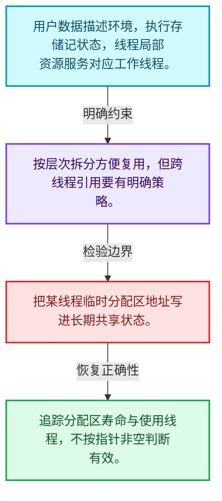
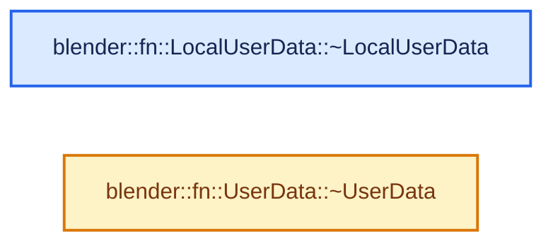
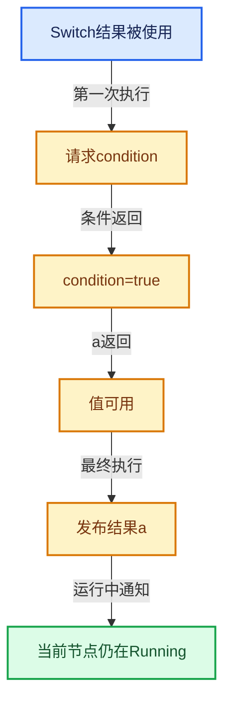

# 09-04 Context与执行状态

[方向导航](README.md) · [总目录](../README.md) · [实现索引](../00-课程指南/02-源码与提交索引/符号依赖与实现索引.md)

## 从问题到实现

调用上下文与持久执行存储怎样分开？

用户数据表达环境，执行存储记住计算进度；跨线程数据要区分共享与线程局部。

**数据模型**

用户数据描述环境，执行存储记状态，线程局部资源服务对应工作线程。

**设计取舍**

按层次拆分方便复用，但跨线程引用要有明确策略。

**最小反例**

把某线程临时分配区地址写进长期共享状态。

**推导**

追踪分配区寿命与使用线程，不按指针非空判断有效。

## 阅读地图与执行推演








图中的数值推演是本方向的教学模型；实际函数之间的调用边与概念分析边分别标注，不能把概念关系当作运行时调度顺序。

## 完整源码单元与就地讲解

中文讲解直接放在相关代码旁，复杂机制在代码下展开。原文折叠区保留基准行号；不需要在行号表和函数之间来回查找。类布局可分段展示，函数实现不按固定行数切开。

### 类型布局、声明与编译条件 · BLI_lazy_threading.hh L1—L96

<a id="t-71ab9678fd2a"></a>

<a id="t-e7192d78ad7b"></a>

<!-- annotated:0a3dba5e3dce04 -->

```cpp
/* SPDX-FileCopyrightText: 2023 Blender Authors
 *
 * SPDX-License-Identifier: GPL-2.0-or-later */

#pragma once

/** \file
 * \ingroup bli
 *
 * The goal of "lazy threading" is to avoid using threads unless one can reasonably assume that it
 * is worth distributing work over multiple threads. Using threads can lead to worse overall
 * performance by introducing inter-thread communication overhead. Keeping all work on a single
 * thread reduces this overhead to zero and also makes better use of the CPU cache.
 *
 * Functions like #parallel_for also solve this to some degree by using a "grain size". When the
 * number of individual tasks is too small, no multi-threading is used. This works very well when
 * there are many homogeneous tasks that can be expected to take approximately the same time.
 *
 * The situation becomes more difficult when:
 * - The individual tasks are not homogeneous, i.e. they take different amounts of time to compute.
 * - It is practically impossible to guess how long each task will take in advance.
 *
 * Given those constraints, a single grain size cannot be determined. One could just schedule all
 * tasks individually but that would create a lot of overhead when the tasks happen to be very
 * small. While TBB will keep all tasks on a single thread if the other threads are busy, if they
 * are idle they will start stealing the work even if that's not beneficial for overall
 * performance.
 *
 * This file provides a simple API that allows a task scheduler to properly handle tasks whose size
 * is not known in advance. The key idea is this:
 *
 * > By default, all work stays on a single thread. If an individual task notices that it is about
 * > start a computation that will take a while, it notifies the task scheduler further up on the
 * > stack. The scheduler then allows other threads to take over other tasks that were originally
 * > meant for the current thread.
 *
 * This way, when all tasks are small, no threading overhead has to be paid for. Whenever there is
 * a task that keeps the current thread busy for a while, the other tasks are moved to a separate
 * thread so that they can be executed without waiting for the long computation to finish.
 *
 * Consequently, the earlier a task knows during it execution that it will take a while, the
 * better. That's because if it is blocking anyway, it's more efficient to move the other tasks to
 * another thread earlier.
 *
 * To make this work, three things have to be solved:
 * 1. The task scheduler has to be able to start single-threaded and become multi-threaded after
 *    tasks have started executing. This has to be solved in the specific task scheduler.
 * 2. There has to be a way for the currently running task to tell the task scheduler that it is
 *    about to perform a computation that will take a while and that it would be reasonable to move
 *    other tasks to other threads. This part is implemented in the API provided by this file.
 * 3. Individual tasks have to decide when a computation is long enough to justify talking to the
 *    scheduler. This is always based on heuristics that have to be fine tuned over time. One could
 *    assume that this means adding new work-size checks to many parts in Blender, but that's
 *    actually not necessary, because these checks exist already in the form of grain sizes passed
 *    to e.g. #parallel_for. The assumption here is that when the task thinks the current work load
 *    is big enough to justify using threads, it's also big enough to justify using another thread
 *    for waiting tasks on the current thread.
 */

#include "BLI_function_ref.hh"

namespace blender::lazy_threading {

/**
 * Tell task schedulers on the current thread that it is about to start a long computation
 * and that other waiting tasks should better be moved to another thread if possible.
 */
void send_hint();

/**
 * Used by the task scheduler to receive hints from current tasks that they will take a while.
 * This should only be allocated on the stack.
 */
class HintReceiver {
 public:
  /**
   * The passed in function is called when a task signals that it will take a while.
   * \note The function has to stay alive after the call to the constructor. So one must not pass a
   * lambda directly into this constructor but store it in a separate variable on the stack first.
   */
  HintReceiver(FunctionRef<void()> fn);
  ~HintReceiver();
};

/**
 * Used to make sure that lazy-threading hints don't propagate through task isolation. This is
 * necessary to avoid deadlocks when isolated regions are used together with e.g. task pools. For
 * more info see the comment on #BLI_task_isolate.
 */
class ReceiverIsolation {
 public:
  ReceiverIsolation();
  ~ReceiverIsolation();
};

}  // namespace blender::lazy_threading
```

<details>
<summary>核对原始源码：source/blender/blenlib/BLI_lazy_threading.hh · L1—L96</summary>

<!-- original:0a3dba5e3dce04:source/blender/blenlib/BLI_lazy_threading.hh:1:96 -->

```cpp
/* SPDX-FileCopyrightText: 2023 Blender Authors
 *
 * SPDX-License-Identifier: GPL-2.0-or-later */

#pragma once

/** \file
 * \ingroup bli
 *
 * The goal of "lazy threading" is to avoid using threads unless one can reasonably assume that it
 * is worth distributing work over multiple threads. Using threads can lead to worse overall
 * performance by introducing inter-thread communication overhead. Keeping all work on a single
 * thread reduces this overhead to zero and also makes better use of the CPU cache.
 *
 * Functions like #parallel_for also solve this to some degree by using a "grain size". When the
 * number of individual tasks is too small, no multi-threading is used. This works very well when
 * there are many homogeneous tasks that can be expected to take approximately the same time.
 *
 * The situation becomes more difficult when:
 * - The individual tasks are not homogeneous, i.e. they take different amounts of time to compute.
 * - It is practically impossible to guess how long each task will take in advance.
 *
 * Given those constraints, a single grain size cannot be determined. One could just schedule all
 * tasks individually but that would create a lot of overhead when the tasks happen to be very
 * small. While TBB will keep all tasks on a single thread if the other threads are busy, if they
 * are idle they will start stealing the work even if that's not beneficial for overall
 * performance.
 *
 * This file provides a simple API that allows a task scheduler to properly handle tasks whose size
 * is not known in advance. The key idea is this:
 *
 * > By default, all work stays on a single thread. If an individual task notices that it is about
 * > start a computation that will take a while, it notifies the task scheduler further up on the
 * > stack. The scheduler then allows other threads to take over other tasks that were originally
 * > meant for the current thread.
 *
 * This way, when all tasks are small, no threading overhead has to be paid for. Whenever there is
 * a task that keeps the current thread busy for a while, the other tasks are moved to a separate
 * thread so that they can be executed without waiting for the long computation to finish.
 *
 * Consequently, the earlier a task knows during it execution that it will take a while, the
 * better. That's because if it is blocking anyway, it's more efficient to move the other tasks to
 * another thread earlier.
 *
 * To make this work, three things have to be solved:
 * 1. The task scheduler has to be able to start single-threaded and become multi-threaded after
 *    tasks have started executing. This has to be solved in the specific task scheduler.
 * 2. There has to be a way for the currently running task to tell the task scheduler that it is
 *    about to perform a computation that will take a while and that it would be reasonable to move
 *    other tasks to other threads. This part is implemented in the API provided by this file.
 * 3. Individual tasks have to decide when a computation is long enough to justify talking to the
 *    scheduler. This is always based on heuristics that have to be fine tuned over time. One could
 *    assume that this means adding new work-size checks to many parts in Blender, but that's
 *    actually not necessary, because these checks exist already in the form of grain sizes passed
 *    to e.g. #parallel_for. The assumption here is that when the task thinks the current work load
 *    is big enough to justify using threads, it's also big enough to justify using another thread
 *    for waiting tasks on the current thread.
 */

#include "BLI_function_ref.hh"

namespace blender::lazy_threading {

/**
 * Tell task schedulers on the current thread that it is about to start a long computation
 * and that other waiting tasks should better be moved to another thread if possible.
 */
void send_hint();

/**
 * Used by the task scheduler to receive hints from current tasks that they will take a while.
 * This should only be allocated on the stack.
 */
class HintReceiver {
 public:
  /**
   * The passed in function is called when a task signals that it will take a while.
   * \note The function has to stay alive after the call to the constructor. So one must not pass a
   * lambda directly into this constructor but store it in a separate variable on the stack first.
   */
  HintReceiver(FunctionRef<void()> fn);
  ~HintReceiver();
};

/**
 * Used to make sure that lazy-threading hints don't propagate through task isolation. This is
 * necessary to avoid deadlocks when isolated regions are used together with e.g. task pools. For
 * more info see the comment on #BLI_task_isolate.
 */
class ReceiverIsolation {
 public:
  ReceiverIsolation();
  ~ReceiverIsolation();
};

}  // namespace blender::lazy_threading
```

</details>

### 类型布局、声明与编译条件 · FN_user_data.hh L1—L21

<a id="t-8063bc43d06f"></a>

<!-- annotated:5a0859f1e2703b -->

```cpp
/* SPDX-FileCopyrightText: 2025 Blender Authors
 *
 * SPDX-License-Identifier: GPL-2.0-or-later */

/** \file
 * \ingroup fn
 */

#pragma once

#include "BLI_linear_allocator.hh"

namespace blender::fn {

/**
 * Extension of #UserData that is thread-local. This avoids accessing e.g.
 * `EnumerableThreadSpecific.local()` in every nested lazy-function because the thread local
 * data is passed in by the caller.
 */
class LocalUserData {
 public:
```

<details>
<summary>核对原始源码：source/blender/functions/FN_user_data.hh · L1—L21</summary>

<!-- original:5a0859f1e2703b:source/blender/functions/FN_user_data.hh:1:21 -->

```cpp
/* SPDX-FileCopyrightText: 2025 Blender Authors
 *
 * SPDX-License-Identifier: GPL-2.0-or-later */

/** \file
 * \ingroup fn
 */

#pragma once

#include "BLI_linear_allocator.hh"

namespace blender::fn {

/**
 * Extension of #UserData that is thread-local. This avoids accessing e.g.
 * `EnumerableThreadSpecific.local()` in every nested lazy-function because the thread local
 * data is passed in by the caller.
 */
class LocalUserData {
 public:
```

</details>

<a id="f-d38e7f36a44a3392"></a>

### `blender::fn::LocalUserData::~LocalUserData`

实现位置：[source/blender/functions/FN_user_data.hh](../../../../../source/blender/functions/FN_user_data.hh) · L22—L22。

**教学注释版**

<!-- annotated:639230bb044f2b -->

```cpp
  virtual ~LocalUserData() = default;
```

<details>
<summary>核对原始源码：source/blender/functions/FN_user_data.hh · L22—L22</summary>

<!-- original:639230bb044f2b:source/blender/functions/FN_user_data.hh:22:22 -->

```cpp
  virtual ~LocalUserData() = default;
```

</details>

**继续追踪实现**

本实现没有需要继续展开的显式调用；检查返回表达式、对象转换和调用者前置条件。

### 类型布局、声明与编译条件 · FN_user_data.hh L23—L33

<a id="t-868d4b5c1957"></a>

<!-- annotated:54ea60dac5d848 -->

```cpp
};

/**
 * This allows passing arbitrary data into a function. For that, #UserData has to be subclassed.
 * This mainly exists because it's more type safe than passing a `void *` with no type information
 * attached.
 *
 * Some lazy-functions may expect to find a certain type of user data when executed.
 */
class UserData {
 public:
```

<details>
<summary>核对原始源码：source/blender/functions/FN_user_data.hh · L23—L33</summary>

<!-- original:54ea60dac5d848:source/blender/functions/FN_user_data.hh:23:33 -->

```cpp
};

/**
 * This allows passing arbitrary data into a function. For that, #UserData has to be subclassed.
 * This mainly exists because it's more type safe than passing a `void *` with no type information
 * attached.
 *
 * Some lazy-functions may expect to find a certain type of user data when executed.
 */
class UserData {
 public:
```

</details>

<a id="f-2f51f20fbfd27d67"></a>

### `blender::fn::UserData::~UserData`

实现位置：[source/blender/functions/FN_user_data.hh](../../../../../source/blender/functions/FN_user_data.hh) · L34—L34。

**教学注释版**

<!-- annotated:1fdfd786f87b54 -->

```cpp
  virtual ~UserData() = default;
```

<details>
<summary>核对原始源码：source/blender/functions/FN_user_data.hh · L34—L34</summary>

<!-- original:1fdfd786f87b54:source/blender/functions/FN_user_data.hh:34:34 -->

```cpp
  virtual ~UserData() = default;
```

</details>

**继续追踪实现**

本实现没有需要继续展开的显式调用；检查返回表达式、对象转换和调用者前置条件。

### 类型布局、声明与编译条件 · FN_user_data.hh L35—L42

<!-- annotated:e753b2da5372a1 -->

```cpp

  /**
   * Get thread local data for this user-data and the current thread.
   */
  virtual destruct_ptr<LocalUserData> get_local(LinearAllocator<> &allocator);
};

}  // namespace blender::fn
```

<details>
<summary>核对原始源码：source/blender/functions/FN_user_data.hh · L35—L42</summary>

<!-- original:e753b2da5372a1:source/blender/functions/FN_user_data.hh:35:42 -->

```cpp

  /**
   * Get thread local data for this user-data and the current thread.
   */
  virtual destruct_ptr<LocalUserData> get_local(LinearAllocator<> &allocator);
};

}  // namespace blender::fn
```

</details>

## 语法与相关类型

### 只读限定 const

const约束当前访问路径可做的修改。const指针、指向const的指针、const视图对象、const元素是不同位置的限定；其他别名可能仍可修改原对象。

分别写T* const、const T*与const T* const，并画出不可修改的层次。

### 运行时多态 virtual

虚调用根据实际动态类型选择实现；经基类指针销毁对象时通常需要相应虚析构契约。每元素虚调用和循环外一次分派有不同开销。

找出虚接口的实现类和调用频率，再讨论是否值得去虚拟化。

### 构造与new表达式

普通new可能分配并构造；placement new在给定地址构造，存储由其他机制提供。失败回滚应区分两类责任。

追踪地址来自哪里、构造何时成功、由谁析构、由谁释放。

### 类型别名 using

类型别名为已有类型建立名字，不创建运行期对象。它常把模板内部使用的类型统一暴露给泛型调用者。

展开别名直到基础类型，区分类型别名和变量声明。

## 实现练习与验证

画出同一图两个独立执行实例的共享部分和独立部分。

参考推理：追踪分配区寿命与使用线程，不按指针非空判断有效。

未选分支不执行；输出不会被非法重复构造；同一节点不同时运行两次；副作用有明确执行依据。

## 历史、跨库比较与证据

与拓扑一次求值、future和数据流调度比较：惰性函数允许执行过程中继续请求输入，同一个计算单元可分多次推进。

[历史提交索引](../00-课程指南/02-源码与提交索引/历史提交与设计演化索引.md) · [源码基准](../00-课程指南/02-源码与提交索引/源码版本与覆盖索引.md) · [验收报告](../00-课程指南/03-验收报告/验收报告.md)
