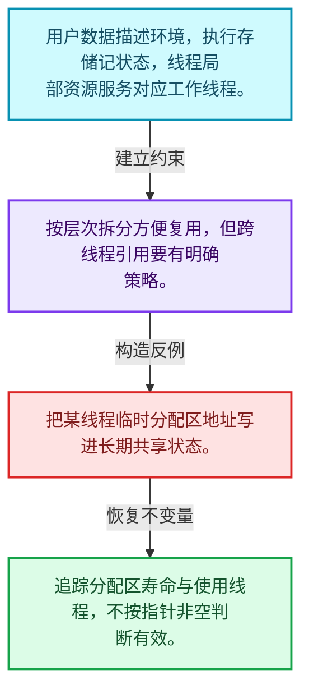
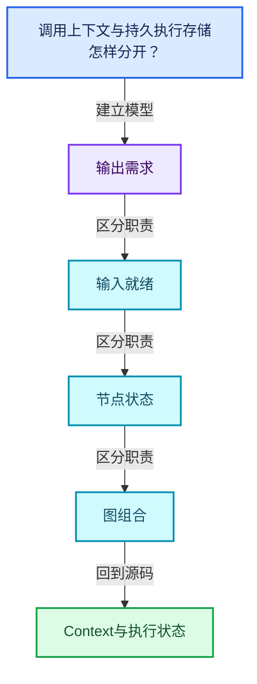
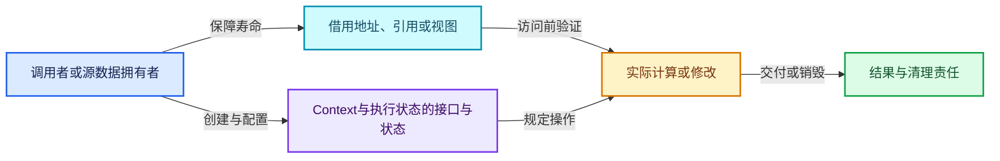
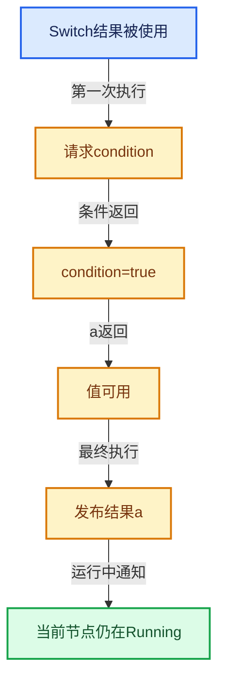

# 09-04 Context与执行状态

[方向导航](README.md) · [总目录](../README.md) · [覆盖索引](../%E6%BA%90%E7%A0%81%E7%89%88%E6%9C%AC%E4%B8%8E%E8%A6%86%E7%9B%96%E7%B4%A2%E5%BC%95.md)

> 阅读顺序：问题与数据模型 → 语法与类型 → 源码逐行 → 调用线索 → 历史与取舍 → 推演和练习。

- 基准 HEAD：`cbda6b96c26c0dee3c3b5cbb93960c4ac06a6b30`。
- 记录日期：2026-10-14。
- 教学示例状态：正文中的推演不是本机性能实测；已运行练习见验收报告。

## 一、从问题到设计

调用上下文与持久执行存储怎样分开？

用户数据表达环境，执行存储记住计算进度；跨线程数据要区分共享与线程局部。

本篇把语法、数据语义和系统取舍连接起来。需求与就绪是不同维度；状态只在有证据时推进，不能把未确定当作无需求。

### 本篇独立模型与设计推理

用户数据描述环境，执行存储记状态，线程局部资源服务对应工作线程。

设计取舍：按层次拆分方便复用，但跨线程引用要有明确策略。

最小反例：把某线程临时分配区地址写进长期共享状态。

推导与处理：追踪分配区寿命与使用线程，不按指针非空判断有效。



### 源码范围与相邻篇章

| 文件 | 本篇逐行范围 | 基准SHA-256 |
|---|---|---|
| [source/blender/functions/FN_user_data.hh](../../../../../source/blender/functions/FN_user_data.hh) | L1—L42 | `a70f0fe4f7502103cf249420864329bc413220704fef7e662122932d8516f3a9` |
| [source/blender/blenlib/BLI_lazy_threading.hh](../../../../../source/blender/blenlib/BLI_lazy_threading.hh) | L1—L96 | `78472a10a6c8335fada107e1e100791e7c4a6a0c4561be3162aea47593327385` |

同一主讲文件可能分多篇覆盖；超出本篇范围的符号通过覆盖索引定位。空行与纯注释保留在源码摘录中，逐行表解释有效语句与语法边界；许可证头统一保留。

前篇：[Params与ValueUsage](03-Params%E4%B8%8EValueUsage.md).

后篇：[Graph与Socket](05-Graph%E4%B8%8ESocket.md).

## 二、类型、数据与阅读地图



这是概念依赖图，边表示阅读关系，不声称是运行时调用顺序。

### 直接编译依赖


箭头只表示头文件包含关系；完整调用线索见后面的符号定位表。

## 三、关键词、语法与类型角色

### 只读限定 const

const约束当前访问路径可做的修改。const指针、指向const的指针、const视图对象、const元素是不同位置的限定；其他别名可能仍可修改原对象。

具体检查：分别写T* const、const T*与const T* const，并画出不可修改的层次。

### 运行时多态 virtual

虚调用根据实际动态类型选择实现；经基类指针销毁对象时通常需要相应虚析构契约。每元素虚调用和循环外一次分派有不同开销。

具体检查：找出虚接口的实现类和调用频率，再讨论是否值得去虚拟化。

### 构造与new表达式

普通new可能分配并构造；placement new在给定地址构造，存储由其他机制提供。失败回滚应区分两类责任。

具体检查：追踪地址来自哪里、构造何时成功、由谁析构、由谁释放。

### 类型别名 using

类型别名为已有类型建立名字，不创建运行期对象。它常把模板内部使用的类型统一暴露给泛型调用者。

具体检查：展开别名直到基础类型，区分类型别名和变量声明。

## 四、真实源码与逐行讲解

源码块保持原行内容，原始行号由小节标题及逐行表给出。表中的调用定位是静态阅读辅助；重载、模板实例化、宏展开和虚调用需结合完整声明，不能仅凭词法出现证明动态调用。

### FN_user_data.hh：L1—L42

<!-- source:source/blender/functions/FN_user_data.hh:1:42 -->

```cpp
/* SPDX-FileCopyrightText: 2025 Blender Authors
 *
 * SPDX-License-Identifier: GPL-2.0-or-later */

/** \file
 * \ingroup fn
 */

#pragma once

#include "BLI_linear_allocator.hh"

namespace blender::fn {

/**
 * Extension of #UserData that is thread-local. This avoids accessing e.g.
 * `EnumerableThreadSpecific.local()` in every nested lazy-function because the thread local
 * data is passed in by the caller.
 */
class LocalUserData {
 public:
  virtual ~LocalUserData() = default;
};

/**
 * This allows passing arbitrary data into a function. For that, #UserData has to be subclassed.
 * This mainly exists because it's more type safe than passing a `void *` with no type information
 * attached.
 *
 * Some lazy-functions may expect to find a certain type of user data when executed.
 */
class UserData {
 public:
  virtual ~UserData() = default;

  /**
   * Get thread local data for this user-data and the current thread.
   */
  virtual destruct_ptr<LocalUserData> get_local(LinearAllocator<> &allocator);
};

}  // namespace blender::fn
```

| 原始行 | 语义、约束与检查 |
|---|---|
| L9 | 防止同一头文件在一个翻译单元中重复展开；不控制多个源文件之间的链接或对象寿命。 |
| L11 | 引入编译依赖 "BLI_linear_allocator.hh"；这是声明可见性关系，不表示运行时一定调用该文件的所有接口。 |
| L13 | 把后续声明放入 blender::fn 命名空间，影响名称查找和符号归属，不创建运行时对象。 |
| L20 | 声明或定义类型 `class LocalUserData`。结合继承、访问权限和成员布局确认接口与拥有关系；前向声明本身没有完整对象布局。 |
| L21 | 切换成员访问权限为 public；它是编译期接口边界，不是线程同步或内存保护。 |
| L22 | 显式采用编译器生成的特殊成员行为：`virtual ~LocalUserData() = default;`。成员和基类的性质决定该操作是否可用、是否被删除及异常约定，不表示运行时给对象赋值为default。 |
| L23 | 结束当前语法单元。局部自动对象在离开其作用域时按规则销毁；这不等于所有被引用的外部数据也被释放。 |
| L32 | 声明或定义类型 `class UserData`。结合继承、访问权限和成员布局确认接口与拥有关系；前向声明本身没有完整对象布局。 |
| L33 | 切换成员访问权限为 public；它是编译期接口边界，不是线程同步或内存保护。 |
| L34 | 显式采用编译器生成的特殊成员行为：`virtual ~UserData() = default;`。成员和基类的性质决定该操作是否可用、是否被删除及异常约定，不表示运行时给对象赋值为default。 |
| L39 | 声明接口 `virtual destruct_ptr<LocalUserData> get_local(LinearAllocator<> &allocator)`，本行没有对应函数体；返回类型、参数限定和const/noexcept共同组成调用契约，实际行为需继续定位实现。 |
| L40 | 结束当前语法单元。局部自动对象在离开其作用域时按规则销毁；这不等于所有被引用的外部数据也被释放。 |
| L42 | 结束当前语法单元。局部自动对象在离开其作用域时按规则销毁；这不等于所有被引用的外部数据也被释放。 |

### BLI_lazy_threading.hh：L1—L60

<!-- source:source/blender/blenlib/BLI_lazy_threading.hh:1:60 -->

```cpp
/* SPDX-FileCopyrightText: 2023 Blender Authors
 *
 * SPDX-License-Identifier: GPL-2.0-or-later */

#pragma once

/** \file
 * \ingroup bli
 *
 * The goal of "lazy threading" is to avoid using threads unless one can reasonably assume that it
 * is worth distributing work over multiple threads. Using threads can lead to worse overall
 * performance by introducing inter-thread communication overhead. Keeping all work on a single
 * thread reduces this overhead to zero and also makes better use of the CPU cache.
 *
 * Functions like #parallel_for also solve this to some degree by using a "grain size". When the
 * number of individual tasks is too small, no multi-threading is used. This works very well when
 * there are many homogeneous tasks that can be expected to take approximately the same time.
 *
 * The situation becomes more difficult when:
 * - The individual tasks are not homogeneous, i.e. they take different amounts of time to compute.
 * - It is practically impossible to guess how long each task will take in advance.
 *
 * Given those constraints, a single grain size cannot be determined. One could just schedule all
 * tasks individually but that would create a lot of overhead when the tasks happen to be very
 * small. While TBB will keep all tasks on a single thread if the other threads are busy, if they
 * are idle they will start stealing the work even if that's not beneficial for overall
 * performance.
 *
 * This file provides a simple API that allows a task scheduler to properly handle tasks whose size
 * is not known in advance. The key idea is this:
 *
 * > By default, all work stays on a single thread. If an individual task notices that it is about
 * > start a computation that will take a while, it notifies the task scheduler further up on the
 * > stack. The scheduler then allows other threads to take over other tasks that were originally
 * > meant for the current thread.
 *
 * This way, when all tasks are small, no threading overhead has to be paid for. Whenever there is
 * a task that keeps the current thread busy for a while, the other tasks are moved to a separate
 * thread so that they can be executed without waiting for the long computation to finish.
 *
 * Consequently, the earlier a task knows during it execution that it will take a while, the
 * better. That's because if it is blocking anyway, it's more efficient to move the other tasks to
 * another thread earlier.
 *
 * To make this work, three things have to be solved:
 * 1. The task scheduler has to be able to start single-threaded and become multi-threaded after
 *    tasks have started executing. This has to be solved in the specific task scheduler.
 * 2. There has to be a way for the currently running task to tell the task scheduler that it is
 *    about to perform a computation that will take a while and that it would be reasonable to move
 *    other tasks to other threads. This part is implemented in the API provided by this file.
 * 3. Individual tasks have to decide when a computation is long enough to justify talking to the
 *    scheduler. This is always based on heuristics that have to be fine tuned over time. One could
 *    assume that this means adding new work-size checks to many parts in Blender, but that's
 *    actually not necessary, because these checks exist already in the form of grain sizes passed
 *    to e.g. #parallel_for. The assumption here is that when the task thinks the current work load
 *    is big enough to justify using threads, it's also big enough to justify using another thread
 *    for waiting tasks on the current thread.
 */

#include "BLI_function_ref.hh"
```

| 原始行 | 语义、约束与检查 |
|---|---|
| L5 | 防止同一头文件在一个翻译单元中重复展开；不控制多个源文件之间的链接或对象寿命。 |
| L60 | 引入编译依赖 "BLI_function_ref.hh"；这是声明可见性关系，不表示运行时一定调用该文件的所有接口。 |

### BLI_lazy_threading.hh：L61—L96

<!-- source:source/blender/blenlib/BLI_lazy_threading.hh:61:96 -->

```cpp

namespace blender::lazy_threading {

/**
 * Tell task schedulers on the current thread that it is about to start a long computation
 * and that other waiting tasks should better be moved to another thread if possible.
 */
void send_hint();

/**
 * Used by the task scheduler to receive hints from current tasks that they will take a while.
 * This should only be allocated on the stack.
 */
class HintReceiver {
 public:
  /**
   * The passed in function is called when a task signals that it will take a while.
   * \note The function has to stay alive after the call to the constructor. So one must not pass a
   * lambda directly into this constructor but store it in a separate variable on the stack first.
   */
  HintReceiver(FunctionRef<void()> fn);
  ~HintReceiver();
};

/**
 * Used to make sure that lazy-threading hints don't propagate through task isolation. This is
 * necessary to avoid deadlocks when isolated regions are used together with e.g. task pools. For
 * more info see the comment on #BLI_task_isolate.
 */
class ReceiverIsolation {
 public:
  ReceiverIsolation();
  ~ReceiverIsolation();
};

}  // namespace blender::lazy_threading
```

| 原始行 | 语义、约束与检查 |
|---|---|
| L62 | 把后续声明放入 blender::lazy_threading 命名空间，影响名称查找和符号归属，不创建运行时对象。 |
| L68 | 声明接口 `void send_hint()`，本行没有对应函数体；返回类型、参数限定和const/noexcept共同组成调用契约，实际行为需继续定位实现。 |
| L74 | 声明或定义类型 `class HintReceiver`。结合继承、访问权限和成员布局确认接口与拥有关系；前向声明本身没有完整对象布局。 |
| L75 | 切换成员访问权限为 public；它是编译期接口边界，不是线程同步或内存保护。 |
| L81 | 出现调用或函数声明 `HintReceiver`，对应表达式为 `HintReceiver(FunctionRef<void()> fn);`。参数求值、返回类型与重载需结合前后完整语句；静态文本引用不能证明动态目标。 |
| L82 | 涉及析构接口或显式析构：`~HintReceiver();`。检查目标对象已成功构造，且资源不会在另一条清理路径再次销毁。 |
| L83 | 结束当前语法单元。局部自动对象在离开其作用域时按规则销毁；这不等于所有被引用的外部数据也被释放。 |
| L90 | 声明或定义类型 `class ReceiverIsolation`。结合继承、访问权限和成员布局确认接口与拥有关系；前向声明本身没有完整对象布局。 |
| L91 | 切换成员访问权限为 public；它是编译期接口边界，不是线程同步或内存保护。 |
| L92 | 出现调用或函数声明 `ReceiverIsolation`，对应表达式为 `ReceiverIsolation();`。参数求值、返回类型与重载需结合前后完整语句；静态文本引用不能证明动态目标。 |
| L93 | 涉及析构接口或显式析构：`~ReceiverIsolation();`。检查目标对象已成功构造，且资源不会在另一条清理路径再次销毁。 |
| L94 | 结束当前语法单元。局部自动对象在离开其作用域时按规则销毁；这不等于所有被引用的外部数据也被释放。 |
| L96 | 结束当前语法单元。局部自动对象在离开其作用域时按规则销毁；这不等于所有被引用的外部数据也被释放。 |

## 五、接口定位、调用线索与生命周期

### 本篇声明与实现入口

| 源码位置 | 实际声明片段 |
|---|---|
| [FN_user_data.hh:L20](../../../../../source/blender/functions/FN_user_data.hh#L20) | `class LocalUserData` |
| [FN_user_data.hh:L22](../../../../../source/blender/functions/FN_user_data.hh#L22) | `virtual ~LocalUserData() = default;` |
| [FN_user_data.hh:L32](../../../../../source/blender/functions/FN_user_data.hh#L32) | `class UserData` |
| [FN_user_data.hh:L34](../../../../../source/blender/functions/FN_user_data.hh#L34) | `virtual ~UserData() = default;` |
| [FN_user_data.hh:L39](../../../../../source/blender/functions/FN_user_data.hh#L39) | `virtual destruct_ptr<LocalUserData> get_local(LinearAllocator<> &allocator);` |
| [BLI_lazy_threading.hh:L68](../../../../../source/blender/blenlib/BLI_lazy_threading.hh#L68) | `void send_hint();` |
| [BLI_lazy_threading.hh:L74](../../../../../source/blender/blenlib/BLI_lazy_threading.hh#L74) | `class HintReceiver` |
| [BLI_lazy_threading.hh:L81](../../../../../source/blender/blenlib/BLI_lazy_threading.hh#L81) | `HintReceiver(FunctionRef<void()> fn);` |
| [BLI_lazy_threading.hh:L90](../../../../../source/blender/blenlib/BLI_lazy_threading.hh#L90) | `class ReceiverIsolation` |
| [BLI_lazy_threading.hh:L92](../../../../../source/blender/blenlib/BLI_lazy_threading.hh#L92) | `ReceiverIsolation();` |

### 同名符号出现位置

以下表提供跨文件阅读入口，包含声明、调用或测试使用；没有经过完整C++名称解析，不把它命名为已证明的运行时调用图。

| 符号 | 位置 | 文本证据 |
|---|---|---|
| `get_local` | [lazy_function_graph_executor_generic.hh:L1343](../../../../../source/blender/functions/intern/lazy_function_graph_executor_generic.hh#L1343) | `local_storage.local_user_data = context_->user_data->get_local(local_storage.allocator);` |
| `get_local` | [NOD_geometry_nodes_lazy_function.hh:L290](../../../../../source/blender/nodes/NOD_geometry_nodes_lazy_function.hh#L290) | `destruct_ptr<fn::LocalUserData> get_local(LinearAllocator<> &allocator) override;` |
| `get_local` | [geometry_nodes_lazy_function.cc:L4344](../../../../../source/blender/nodes/intern/geometry_nodes_lazy_function.cc#L4344) | `destruct_ptr<fn::LocalUserData> GeoNodesUserData::get_local(LinearAllocator<> &allocator)` |
| `send_hint` | [BLI_task.hh:L135](../../../../../source/blender/blenlib/BLI_task.hh#L135) | `lazy_threading::send_hint();` |
| `send_hint` | [BLI_task.hh:L178](../../../../../source/blender/blenlib/BLI_task.hh#L178) | `lazy_threading::send_hint();` |
| `send_hint` | [BLI_task.hh:L215](../../../../../source/blender/blenlib/BLI_task.hh#L215) | `lazy_threading::send_hint();` |

### 生命周期推理图



这是审查生命周期的通用模型。具体类是否拥有数据由本篇成员、构造、析构和调用者一起证明；任何箭头都不自动代表shared_ptr。

## 六、把代码放进具体数据中推演

本方向的共同数值模型如下。本篇的专门检查是：画出同一图两个独立执行实例的共享部分和独立部分。

| 步骤 | 数据或状态 | 为什么需要这一步 |
|---|---|---|
| 请求输出 | Switch结果被使用 | 尚不知道取哪个数据分支 |
| 第一次执行 | 请求condition | 缺失输入时交回控制 |
| 条件返回 | condition=true | 只请求a |
| a返回 | 值可用 | b仍不需要执行 |
| 最终执行 | 发布结果a | 标记输出已计算 |
| 运行中通知 | 当前节点仍在Running | 转成需要再次调度而非并发重复执行 |



图是教学推演模型；精确分支与状态更新以本篇摘录及调用契约为准。

### 本篇独立练习与参考思路

画出同一图两个独立执行实例的共享部分和独立部分。

参考思路：用户数据表达环境，执行存储记住计算进度；跨线程数据要区分共享与线程局部。

将输入、预期结果和资源责任分成三张清单。先用最直接的实现给出可核对的答案，再替换成对应源码使用的表示；比较结果不变的条件，而不是只比较接口名字。

验收依据：未选分支不执行；输出不会被非法重复构造；同一节点不同时运行两次；副作用有明确执行依据。

## 七、复杂度、设计取舍与其他基础库

与拓扑一次求值、future和数据流调度比较：惰性函数允许执行过程中继续请求输入，同一个计算单元可分多次推进。

本篇的具体取舍：用户数据表达环境，执行存储记住计算进度；跨线程数据要区分共享与线程局部。

| 观察维度 | 从源码取得证据的方法 | 本篇要避免的误判 |
|---|---|---|
| 时间 | 对循环次数、分派次数和重建频率分别计数 | 看到单次常数操作就断定整个操作序列是常数成本 |
| 内存 | 区分对象本体、容量存储、间接资源和共享控制块 | 用sizeof代替总内存 |
| 安全 | 沿构造、失败回滚、销毁与失效逐路径检查 | 把断言或非空指针当作完整安全证明 |
| 并发 | 逐字段确认锁、发布顺序和借用寿命 | 把引用计数线程安全等同数据读写线程安全 |

相关一手资料：

- [C++公开工作草案](https://eel.is/c++draft/)：持续更新的工作草案；语言与标准库语义以相应章节为准。
- [oneTBB官方文档](https://uxlfoundation.github.io/oneTBB/)：在线入口；实现细节以实际依赖版本为准。

资料用于核对契约和进一步阅读；这里没有声称外部库与Blender实现相同，也没有把上游性能数字当作本机实测。

## 八、历史提交与设计演化

本篇主要讲当前接口或辅助实现，方向导航给出相关架构演化提交；没有把不涉及本篇文件的提交硬写成该实现的引入证据。

## 九、反例、测试入口与掌握标准

需要实际构造的反例：

- 空输入或没有结果需求：确认接口允许的空状态与不允许访问的操作。
- 边界位置和退化结构：把长度为1、末尾位置、重复值或深链代入真实分支。
- 生命周期结束或修改之后：检查保存的指针、引用、结果视图是否仍有效。
- 与本篇核心不变量相冲突的输入：画出同一图两个独立执行实例的共享部分和独立部分。

### 可运行的教学参考程序

[reference_exercises.cc](../_tools/reference_exercises.cc)包含独立于Blender的C++20参考检查：视图、简化SmallVector、异常回滚、哈希碰撞与删除、偏移数组、拓扑映射、共享缓存、表达式、惰性分支、闭包和暴力最近邻。

参考程序有意省略生产实现的完整能力。例如SmallVector禁止复制移动容器，不支持只能移动的元素，并禁止append参数别名到自身元素；TinyMap固定8槽，不提供增长。程序通过不能替代Blender实现测试。实际运行结果、编译器与命令见验收报告。

掌握标准：离开源码解释“调用上下文与持久执行存储怎样分开？”；独立完成上述练习；能指出一个会破坏输出需求相关约束的最小反例，并用具体代码行说明检查或修复应放在哪里。
