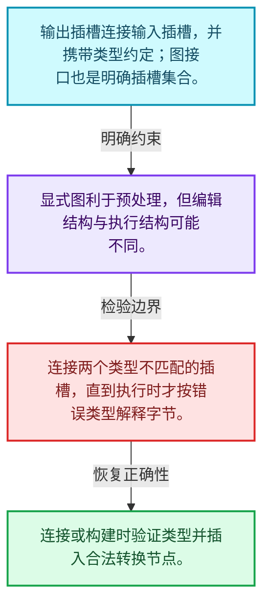
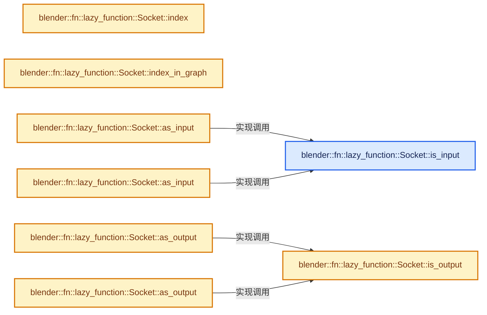
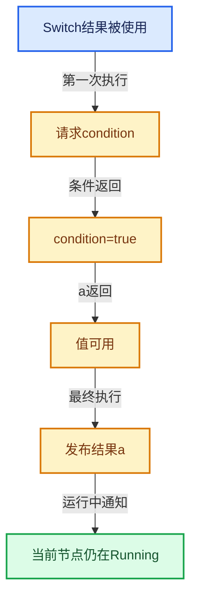

# 09-05 Graph与Socket

[方向导航](README.md) · [总目录](../README.md) · [实现索引](../00-课程指南/02-源码与提交索引/符号依赖与实现索引.md)

## 从问题到实现

连接关系怎样组合计算单元？

插槽有方向、类型和节点归属，图接口也可成为另一层图的输入输出；连接合法性不是指针非空即可。

**数据模型**

输出插槽连接输入插槽，并携带类型约定；图接口也是明确插槽集合。

**设计取舍**

显式图利于预处理，但编辑结构与执行结构可能不同。

**最小反例**

连接两个类型不匹配的插槽，直到执行时才按错误类型解释字节。

**推导**

连接或构建时验证类型并插入合法转换节点。

## 阅读地图与执行推演








图中的数值推演是本方向的教学模型；实际函数之间的调用边与概念分析边分别标注，不能把概念关系当作运行时调度顺序。

## 完整源码单元与就地讲解

中文讲解直接放在相关代码旁，复杂机制在代码下展开。原文折叠区保留基准行号；不需要在行号表和函数之间来回查找。类布局可分段展示，函数实现不按固定行数切开。

### 类型布局、声明与编译条件 · FN_lazy_function_graph.hh L1—L319

<a id="t-98d838a9a5ca"></a>

<a id="t-af4a9cc74c3b"></a>

`Socket`在这里声明的数据成员：

- `Node node_`
- `CPPType type_`
- `bool is_input_`
- `int index_in_node_`
- `int index_in_graph_`
- `bool is_input`
- `bool is_output`
- `int index`
- `int index_in_graph`
- `InputSocket as_input`
- `OutputSocket as_output`
- `InputSocket as_input`
- `OutputSocket as_output`
- `Node node`
- `Node node`
- `CPPType type`
- `std::string name`
- `std::string detailed_name`

<a id="t-c91d00e7f37b"></a>

`InputSocket`在这里声明的数据成员：

- `OutputSocket origin_`
- `void default_value_`
- `OutputSocket origin`
- `OutputSocket origin`
- `void default_value`
- `void set_default_value`

<a id="t-d375c63562bc"></a>

`OutputSocket`在这里声明的数据成员：

- `Vector<InputSocket *> targets_`
- `Span<InputSocket *> targets`
- `Span<const InputSocket *> targets`

<a id="t-474ff370bc7f"></a>

`Node`在这里声明的数据成员：

- `LazyFunction fn_`
- `Span<InputSocket *> inputs_`
- `Span<OutputSocket *> outputs_`
- `int index_in_graph_`
- `bool is_interface`
- `bool is_function`
- `int index_in_graph`
- `Span<const InputSocket *> inputs`
- `Span<const OutputSocket *> outputs`
- `Span<InputSocket *> inputs`
- `Span<OutputSocket *> outputs`
- `InputSocket input`
- `OutputSocket output`
- `InputSocket input`
- `OutputSocket output`
- `std::string name`

<a id="t-d1eda753e632"></a>

`Graph`在这里声明的数据成员：

- `LinearAllocator<> allocator_`
- `StringRefNull name_`
- `Vector<Node *> nodes_`
- `InterfaceNode graph_input_node_`
- `InterfaceNode graph_output_node_`
- `Vector<GraphInputSocket *> graph_inputs_`
- `Vector<GraphOutputSocket *> graph_outputs_`
- `int socket_num_`
- `StringRefNull name`
- `Span<const Node *> nodes`
- `Span<Node *> nodes`
- `Span<const FunctionNode *> function_nodes`
- `Span<FunctionNode *> function_nodes`
- `Span<GraphInputSocket *> graph_inputs`
- `Span<GraphOutputSocket *> graph_outputs`
- `Span<const GraphInputSocket *> graph_inputs`
- `Span<const GraphOutputSocket *> graph_outputs`
- `FunctionNode add_function`
- `GraphInputSocket add_input`
- `GraphOutputSocket add_output`
- `void add_link`
- `void clear_origin`
- `void update_node_indices`
- `void update_socket_indices`
- `int socket_num`
- `bool node_indices_are_valid`
- `std::string to_dot`

<a id="t-7ab7b81c2d02"></a>

`Socket`在这里声明的数据成员：

- `Node node_`
- `CPPType type_`
- `bool is_input_`
- `int index_in_node_`
- `int index_in_graph_`
- `bool is_input`
- `bool is_output`
- `int index`
- `int index_in_graph`
- `InputSocket as_input`
- `OutputSocket as_output`
- `InputSocket as_input`
- `OutputSocket as_output`
- `Node node`
- `Node node`
- `CPPType type`
- `std::string name`
- `std::string detailed_name`

<a id="t-c560ffd740be"></a>

`InputSocket`在这里声明的数据成员：

- `OutputSocket origin_`
- `void default_value_`
- `OutputSocket origin`
- `OutputSocket origin`
- `void default_value`
- `void set_default_value`

<a id="t-c2af729cb446"></a>

`OutputSocket`在这里声明的数据成员：

- `Vector<InputSocket *> targets_`
- `Span<InputSocket *> targets`
- `Span<const InputSocket *> targets`

<a id="t-379b0e3a7d1a"></a>

`Node`在这里声明的数据成员：

- `LazyFunction fn_`
- `Span<InputSocket *> inputs_`
- `Span<OutputSocket *> outputs_`
- `int index_in_graph_`
- `bool is_interface`
- `bool is_function`
- `int index_in_graph`
- `Span<const InputSocket *> inputs`
- `Span<const OutputSocket *> outputs`
- `Span<InputSocket *> inputs`
- `Span<OutputSocket *> outputs`
- `InputSocket input`
- `OutputSocket output`
- `InputSocket input`
- `OutputSocket output`
- `std::string name`

<a id="t-f914006be7dd"></a>

`FunctionNode`在这里声明的数据成员：

- `LazyFunction function`

<a id="t-3c774dbfa467"></a>

`InterfaceNode`在这里声明的数据成员：

- `Vector<std::string> socket_names_`

<a id="t-9879fe19f7ea"></a>

`Graph`在这里声明的数据成员：

- `LinearAllocator<> allocator_`
- `StringRefNull name_`
- `Vector<Node *> nodes_`
- `InterfaceNode graph_input_node_`
- `InterfaceNode graph_output_node_`
- `Vector<GraphInputSocket *> graph_inputs_`
- `Vector<GraphOutputSocket *> graph_outputs_`
- `int socket_num_`
- `StringRefNull name`
- `Span<const Node *> nodes`
- `Span<Node *> nodes`
- `Span<const FunctionNode *> function_nodes`
- `Span<FunctionNode *> function_nodes`
- `Span<GraphInputSocket *> graph_inputs`
- `Span<GraphOutputSocket *> graph_outputs`
- `Span<const GraphInputSocket *> graph_inputs`
- `Span<const GraphOutputSocket *> graph_outputs`
- `FunctionNode add_function`
- `GraphInputSocket add_input`
- `GraphOutputSocket add_output`
- `void add_link`
- `void clear_origin`
- `void update_node_indices`
- `void update_socket_indices`
- `int socket_num`
- `bool node_indices_are_valid`
- `std::string to_dot`

<a id="t-4365c9604838"></a>

`ToDotOptions`在这里声明的数据成员：

- `std::string socket_name`
- `std::optional<std::string> socket_font_color`
- `void add_edge_attributes`

<!-- annotated:a535549ba78ac0 -->

```cpp
/* SPDX-FileCopyrightText: 2023 Blender Authors
 *
 * SPDX-License-Identifier: GPL-2.0-or-later */

#pragma once

/** \file
 * \ingroup fn
 *
 * This file contains a graph data structure that allows composing multiple lazy-functions into a
 * combined lazy-function.
 *
 * There are two types of nodes in the graph:
 * - #FunctionNode: Corresponds to a #LazyFunction. The inputs and outputs of the function become
 *   input and output sockets of the node.
 * - #InterfaceNode: Is used to indicate inputs and outputs of the entire graph. It can have an
 *   arbitrary number of sockets.
 */

#include "BLI_linear_allocator.hh"

#include "FN_lazy_function.hh"

namespace blender {

namespace dot_export {
class DirectedEdge;
}

namespace fn::lazy_function {

class Socket;
class InputSocket;
class OutputSocket;
class Node;
class Graph;

/**
 * A #Socket is the interface of a #Node. Every #Socket is either an #InputSocket or #OutputSocket.
 * Links can be created from output sockets to input sockets.
 */
class Socket : NonCopyable, NonMovable {
 protected:
  /**
   * The node the socket belongs to.
   */
  Node *node_;
  /**
   * Data type of the socket. Only sockets with the same type can be linked.
   */
  const CPPType *type_;
  /**
   * Indicates whether this is an #InputSocket or #OutputSocket.
   */
  bool is_input_;
  /**
   * Index of the socket. E.g. 0 for the first input and the first output socket.
   */
  int index_in_node_;
  /**
   * Index of the socket in the entire graph. Every socket has a different index.
   */
  int index_in_graph_;

  friend Graph;

 public:
  bool is_input() const;
  bool is_output() const;

  int index() const;
  int index_in_graph() const;

  InputSocket &as_input();
  OutputSocket &as_output();
  const InputSocket &as_input() const;
  const OutputSocket &as_output() const;

  const Node &node() const;
  Node &node();

  const CPPType &type() const;

  std::string name() const;
  std::string detailed_name() const;
};

class InputSocket : public Socket {
 private:
  /**
   * An input can have at most one link connected to it. The linked socket is the "origin" because
   * it's where the data is coming from. The type of the origin must be the same as the type of
   * this socket.
   */
  OutputSocket *origin_;
  /**
   * Can be null or a non-owning pointer to a value of the type of the socket. This value will be
   * used when the input is used but not linked.
   *
   * This is technically not needed, because one could just create a separate node that just
   * outputs the value, but that would have more overhead. Especially because it's commonly the
   * case that most inputs are unlinked.
   */
  const void *default_value_ = nullptr;

  friend Graph;

 public:
  OutputSocket *origin();
  const OutputSocket *origin() const;

  const void *default_value() const;
  void set_default_value(const void *value);
};

class OutputSocket : public Socket {
 private:
  /**
   * An output can be linked to an arbitrary number of inputs of the same type.
   */
  Vector<InputSocket *> targets_;

  friend Graph;

 public:
  Span<InputSocket *> targets();
  Span<const InputSocket *> targets() const;
};

/**
 * A #Node has input and output sockets. Every node is either a #FunctionNode or an #InterfaceNode.
 */
class Node : NonCopyable, NonMovable {
 protected:
  /**
   * The function this node corresponds to. If this is null, the node is an #InterfaceNode.
   * The function is not owned by this #Node nor by the #Graph.
   */
  const LazyFunction *fn_ = nullptr;
  /**
   * Input sockets of the node.
   */
  Span<InputSocket *> inputs_;
  /**
   * Output sockets of the node.
   */
  Span<OutputSocket *> outputs_;
  /**
   * An index that is set when calling #Graph::update_node_indices. This can be used to create
   * efficient mappings from nodes to other data using just an array instead of a hash map.
   *
   * This is technically not necessary but has better performance than always using hash maps.
   */
  int index_in_graph_ = -1;

  friend Graph;

 public:
  bool is_interface() const;
  bool is_function() const;
  int index_in_graph() const;

  Span<const InputSocket *> inputs() const;
  Span<const OutputSocket *> outputs() const;
  Span<InputSocket *> inputs();
  Span<OutputSocket *> outputs();

  const InputSocket &input(int index) const;
  const OutputSocket &output(int index) const;
  InputSocket &input(int index);
  OutputSocket &output(int index);

  std::string name() const;
};

/**
 * A #Node that corresponds to a specific #LazyFunction.
 */
class FunctionNode final : public Node {
 public:
  const LazyFunction &function() const;
};

/**
 * A #Node that does *not* correspond to a #LazyFunction. Instead it can be used to indicate inputs
 * and outputs of the entire graph. It can have an arbitrary number of inputs and outputs.
 */
class InterfaceNode final : public Node {
 private:
  friend Node;
  friend Socket;
  friend Graph;

  Vector<std::string> socket_names_;
};

/**
 * Interface input sockets are actually output sockets on the input node. This renaming makes the
 * code less confusing.
 */
using GraphInputSocket = OutputSocket;
using GraphOutputSocket = InputSocket;

/**
 * A container for an arbitrary number of nodes and links between their sockets.
 */
class Graph : NonCopyable, NonMovable {
 private:
  /**
   * Used to allocate nodes and sockets in the graph.
   */
  LinearAllocator<> allocator_;
  /**
   * Name of the graph for debugging purposes.
   */
  StringRefNull name_;
  /**
   * Contains all nodes in the graph so that it is efficient to iterate over them.
   * The first two nodes are the interface input and output nodes.
   */
  Vector<Node *> nodes_;

  InterfaceNode *graph_input_node_ = nullptr;
  InterfaceNode *graph_output_node_ = nullptr;

  Vector<GraphInputSocket *> graph_inputs_;
  Vector<GraphOutputSocket *> graph_outputs_;

  /**
   * Number of sockets in the graph. Can be used as array size when indexing using
   * `Socket::index_in_graph`.
   */
  int socket_num_ = 0;

 public:
  Graph(StringRef name = "unknown");
  ~Graph();

  StringRefNull name() const;

  /**
   * Get all nodes in the graph. The index in the span corresponds to #Node::index_in_graph.
   */
  Span<const Node *> nodes() const;
  Span<Node *> nodes();

  Span<const FunctionNode *> function_nodes() const;
  Span<FunctionNode *> function_nodes();

  Span<GraphInputSocket *> graph_inputs();
  Span<GraphOutputSocket *> graph_outputs();

  Span<const GraphInputSocket *> graph_inputs() const;
  Span<const GraphOutputSocket *> graph_outputs() const;

  /**
   * Add a new function node with sockets that match the passed in #LazyFunction.
   */
  FunctionNode &add_function(const LazyFunction &fn);

  /**
   * Add inputs and outputs to the graph.
   */
  GraphInputSocket &add_input(const CPPType &type, std::string name = "");
  GraphOutputSocket &add_output(const CPPType &type, std::string name = "");

  /**
   * Add a link between the two given sockets.
   * This has undefined behavior when the input is linked to something else already.
   */
  void add_link(OutputSocket &from, InputSocket &to);

  /**
   * If the socket is linked, remove the link.
   */
  void clear_origin(InputSocket &socket);

  /**
   * Make sure that #Node::index_in_graph is up to date.
   */
  void update_node_indices();
  /**
   * Make sure that #Socket::index_in_graph is up to date.
   */
  void update_socket_indices();

  /**
   * Number of sockets in the graph.
   */
  int socket_num() const;

  /**
   * Can be used to assert that #update_node_indices has been called.
   */
  bool node_indices_are_valid() const;

  /**
   * Optional configuration options for the dot graph generation. This allows creating
   * visualizations for specific purposes.
   */
  class ToDotOptions {
   public:
    virtual std::string socket_name(const Socket &socket) const;
    virtual std::optional<std::string> socket_font_color(const Socket &socket) const;
    virtual void add_edge_attributes(const OutputSocket &from,
                                     const InputSocket &to,
                                     dot_export::DirectedEdge &dot_edge) const;
  };

  /**
   * Utility to generate a dot graph string for the graph. This can be used for debugging.
   */
  std::string to_dot(const ToDotOptions &options = {}) const;
};

/* -------------------------------------------------------------------- */
/** \name #Socket Inline Methods
 * \{ */

```

<details>
<summary>核对原始源码：source/blender/functions/FN_lazy_function_graph.hh · L1—L319</summary>

<!-- original:a535549ba78ac0:source/blender/functions/FN_lazy_function_graph.hh:1:319 -->

```cpp
/* SPDX-FileCopyrightText: 2023 Blender Authors
 *
 * SPDX-License-Identifier: GPL-2.0-or-later */

#pragma once

/** \file
 * \ingroup fn
 *
 * This file contains a graph data structure that allows composing multiple lazy-functions into a
 * combined lazy-function.
 *
 * There are two types of nodes in the graph:
 * - #FunctionNode: Corresponds to a #LazyFunction. The inputs and outputs of the function become
 *   input and output sockets of the node.
 * - #InterfaceNode: Is used to indicate inputs and outputs of the entire graph. It can have an
 *   arbitrary number of sockets.
 */

#include "BLI_linear_allocator.hh"

#include "FN_lazy_function.hh"

namespace blender {

namespace dot_export {
class DirectedEdge;
}

namespace fn::lazy_function {

class Socket;
class InputSocket;
class OutputSocket;
class Node;
class Graph;

/**
 * A #Socket is the interface of a #Node. Every #Socket is either an #InputSocket or #OutputSocket.
 * Links can be created from output sockets to input sockets.
 */
class Socket : NonCopyable, NonMovable {
 protected:
  /**
   * The node the socket belongs to.
   */
  Node *node_;
  /**
   * Data type of the socket. Only sockets with the same type can be linked.
   */
  const CPPType *type_;
  /**
   * Indicates whether this is an #InputSocket or #OutputSocket.
   */
  bool is_input_;
  /**
   * Index of the socket. E.g. 0 for the first input and the first output socket.
   */
  int index_in_node_;
  /**
   * Index of the socket in the entire graph. Every socket has a different index.
   */
  int index_in_graph_;

  friend Graph;

 public:
  bool is_input() const;
  bool is_output() const;

  int index() const;
  int index_in_graph() const;

  InputSocket &as_input();
  OutputSocket &as_output();
  const InputSocket &as_input() const;
  const OutputSocket &as_output() const;

  const Node &node() const;
  Node &node();

  const CPPType &type() const;

  std::string name() const;
  std::string detailed_name() const;
};

class InputSocket : public Socket {
 private:
  /**
   * An input can have at most one link connected to it. The linked socket is the "origin" because
   * it's where the data is coming from. The type of the origin must be the same as the type of
   * this socket.
   */
  OutputSocket *origin_;
  /**
   * Can be null or a non-owning pointer to a value of the type of the socket. This value will be
   * used when the input is used but not linked.
   *
   * This is technically not needed, because one could just create a separate node that just
   * outputs the value, but that would have more overhead. Especially because it's commonly the
   * case that most inputs are unlinked.
   */
  const void *default_value_ = nullptr;

  friend Graph;

 public:
  OutputSocket *origin();
  const OutputSocket *origin() const;

  const void *default_value() const;
  void set_default_value(const void *value);
};

class OutputSocket : public Socket {
 private:
  /**
   * An output can be linked to an arbitrary number of inputs of the same type.
   */
  Vector<InputSocket *> targets_;

  friend Graph;

 public:
  Span<InputSocket *> targets();
  Span<const InputSocket *> targets() const;
};

/**
 * A #Node has input and output sockets. Every node is either a #FunctionNode or an #InterfaceNode.
 */
class Node : NonCopyable, NonMovable {
 protected:
  /**
   * The function this node corresponds to. If this is null, the node is an #InterfaceNode.
   * The function is not owned by this #Node nor by the #Graph.
   */
  const LazyFunction *fn_ = nullptr;
  /**
   * Input sockets of the node.
   */
  Span<InputSocket *> inputs_;
  /**
   * Output sockets of the node.
   */
  Span<OutputSocket *> outputs_;
  /**
   * An index that is set when calling #Graph::update_node_indices. This can be used to create
   * efficient mappings from nodes to other data using just an array instead of a hash map.
   *
   * This is technically not necessary but has better performance than always using hash maps.
   */
  int index_in_graph_ = -1;

  friend Graph;

 public:
  bool is_interface() const;
  bool is_function() const;
  int index_in_graph() const;

  Span<const InputSocket *> inputs() const;
  Span<const OutputSocket *> outputs() const;
  Span<InputSocket *> inputs();
  Span<OutputSocket *> outputs();

  const InputSocket &input(int index) const;
  const OutputSocket &output(int index) const;
  InputSocket &input(int index);
  OutputSocket &output(int index);

  std::string name() const;
};

/**
 * A #Node that corresponds to a specific #LazyFunction.
 */
class FunctionNode final : public Node {
 public:
  const LazyFunction &function() const;
};

/**
 * A #Node that does *not* correspond to a #LazyFunction. Instead it can be used to indicate inputs
 * and outputs of the entire graph. It can have an arbitrary number of inputs and outputs.
 */
class InterfaceNode final : public Node {
 private:
  friend Node;
  friend Socket;
  friend Graph;

  Vector<std::string> socket_names_;
};

/**
 * Interface input sockets are actually output sockets on the input node. This renaming makes the
 * code less confusing.
 */
using GraphInputSocket = OutputSocket;
using GraphOutputSocket = InputSocket;

/**
 * A container for an arbitrary number of nodes and links between their sockets.
 */
class Graph : NonCopyable, NonMovable {
 private:
  /**
   * Used to allocate nodes and sockets in the graph.
   */
  LinearAllocator<> allocator_;
  /**
   * Name of the graph for debugging purposes.
   */
  StringRefNull name_;
  /**
   * Contains all nodes in the graph so that it is efficient to iterate over them.
   * The first two nodes are the interface input and output nodes.
   */
  Vector<Node *> nodes_;

  InterfaceNode *graph_input_node_ = nullptr;
  InterfaceNode *graph_output_node_ = nullptr;

  Vector<GraphInputSocket *> graph_inputs_;
  Vector<GraphOutputSocket *> graph_outputs_;

  /**
   * Number of sockets in the graph. Can be used as array size when indexing using
   * `Socket::index_in_graph`.
   */
  int socket_num_ = 0;

 public:
  Graph(StringRef name = "unknown");
  ~Graph();

  StringRefNull name() const;

  /**
   * Get all nodes in the graph. The index in the span corresponds to #Node::index_in_graph.
   */
  Span<const Node *> nodes() const;
  Span<Node *> nodes();

  Span<const FunctionNode *> function_nodes() const;
  Span<FunctionNode *> function_nodes();

  Span<GraphInputSocket *> graph_inputs();
  Span<GraphOutputSocket *> graph_outputs();

  Span<const GraphInputSocket *> graph_inputs() const;
  Span<const GraphOutputSocket *> graph_outputs() const;

  /**
   * Add a new function node with sockets that match the passed in #LazyFunction.
   */
  FunctionNode &add_function(const LazyFunction &fn);

  /**
   * Add inputs and outputs to the graph.
   */
  GraphInputSocket &add_input(const CPPType &type, std::string name = "");
  GraphOutputSocket &add_output(const CPPType &type, std::string name = "");

  /**
   * Add a link between the two given sockets.
   * This has undefined behavior when the input is linked to something else already.
   */
  void add_link(OutputSocket &from, InputSocket &to);

  /**
   * If the socket is linked, remove the link.
   */
  void clear_origin(InputSocket &socket);

  /**
   * Make sure that #Node::index_in_graph is up to date.
   */
  void update_node_indices();
  /**
   * Make sure that #Socket::index_in_graph is up to date.
   */
  void update_socket_indices();

  /**
   * Number of sockets in the graph.
   */
  int socket_num() const;

  /**
   * Can be used to assert that #update_node_indices has been called.
   */
  bool node_indices_are_valid() const;

  /**
   * Optional configuration options for the dot graph generation. This allows creating
   * visualizations for specific purposes.
   */
  class ToDotOptions {
   public:
    virtual std::string socket_name(const Socket &socket) const;
    virtual std::optional<std::string> socket_font_color(const Socket &socket) const;
    virtual void add_edge_attributes(const OutputSocket &from,
                                     const InputSocket &to,
                                     dot_export::DirectedEdge &dot_edge) const;
  };

  /**
   * Utility to generate a dot graph string for the graph. This can be used for debugging.
   */
  std::string to_dot(const ToDotOptions &options = {}) const;
};

/* -------------------------------------------------------------------- */
/** \name #Socket Inline Methods
 * \{ */

```

</details>

<a id="f-5a9b6b8c0ecfc06f"></a>

### `blender::fn::lazy_function::Socket::is_input`

实现位置：[source/blender/functions/FN_lazy_function_graph.hh](../../../../../source/blender/functions/FN_lazy_function_graph.hh) · L320—L323。

**教学注释版**

<!-- annotated:7bdf6f7f71c635 -->

```cpp
inline bool Socket::is_input() const
{
  return is_input_;
}
```

<details>
<summary>核对原始源码：source/blender/functions/FN_lazy_function_graph.hh · L320—L323</summary>

<!-- original:7bdf6f7f71c635:source/blender/functions/FN_lazy_function_graph.hh:320:323 -->

```cpp
inline bool Socket::is_input() const
{
  return is_input_;
}
```

</details>

**结果出口**

- `return is_input_;`

**继续追踪实现**

本实现没有需要继续展开的显式调用；检查返回表达式、对象转换和调用者前置条件。

<!-- annotated:3e47853a156aef -->

```cpp

```

<details>
<summary>核对原始源码：source/blender/functions/FN_lazy_function_graph.hh · L324—L324</summary>

<!-- original:3e47853a156aef:source/blender/functions/FN_lazy_function_graph.hh:324:324 -->

```cpp

```

</details>

<a id="f-b540bc7496444762"></a>

### `blender::fn::lazy_function::Socket::is_output`

实现位置：[source/blender/functions/FN_lazy_function_graph.hh](../../../../../source/blender/functions/FN_lazy_function_graph.hh) · L325—L328。

**教学注释版**

<!-- annotated:9984a0f7ceea48 -->

```cpp
inline bool Socket::is_output() const
{
  return !is_input_;
}
```

<details>
<summary>核对原始源码：source/blender/functions/FN_lazy_function_graph.hh · L325—L328</summary>

<!-- original:9984a0f7ceea48:source/blender/functions/FN_lazy_function_graph.hh:325:328 -->

```cpp
inline bool Socket::is_output() const
{
  return !is_input_;
}
```

</details>

**结果出口**

- `return !is_input_;`

**继续追踪实现**

本实现没有需要继续展开的显式调用；检查返回表达式、对象转换和调用者前置条件。

<!-- annotated:e2a6a5d4619856 -->

```cpp

```

<details>
<summary>核对原始源码：source/blender/functions/FN_lazy_function_graph.hh · L329—L329</summary>

<!-- original:e2a6a5d4619856:source/blender/functions/FN_lazy_function_graph.hh:329:329 -->

```cpp

```

</details>

<a id="f-314b126d3d271869"></a>

### `blender::fn::lazy_function::Socket::index`

实现位置：[source/blender/functions/FN_lazy_function_graph.hh](../../../../../source/blender/functions/FN_lazy_function_graph.hh) · L330—L333。

**教学注释版**

<!-- annotated:a89e6d52bcccb7 -->

```cpp
inline int Socket::index() const
{
  return index_in_node_;
}
```

<details>
<summary>核对原始源码：source/blender/functions/FN_lazy_function_graph.hh · L330—L333</summary>

<!-- original:a89e6d52bcccb7:source/blender/functions/FN_lazy_function_graph.hh:330:333 -->

```cpp
inline int Socket::index() const
{
  return index_in_node_;
}
```

</details>

**结果出口**

- `return index_in_node_;`

**继续追踪实现**

本实现没有需要继续展开的显式调用；检查返回表达式、对象转换和调用者前置条件。

<!-- annotated:6e9f546aac674a -->

```cpp

```

<details>
<summary>核对原始源码：source/blender/functions/FN_lazy_function_graph.hh · L334—L334</summary>

<!-- original:6e9f546aac674a:source/blender/functions/FN_lazy_function_graph.hh:334:334 -->

```cpp

```

</details>

<a id="f-8b7965014cc012e2"></a>

### `blender::fn::lazy_function::Socket::index_in_graph`

实现位置：[source/blender/functions/FN_lazy_function_graph.hh](../../../../../source/blender/functions/FN_lazy_function_graph.hh) · L335—L338。

**教学注释版**

<!-- annotated:53a828e25707f2 -->

```cpp
inline int Socket::index_in_graph() const
{
  return index_in_graph_;
}
```

<details>
<summary>核对原始源码：source/blender/functions/FN_lazy_function_graph.hh · L335—L338</summary>

<!-- original:53a828e25707f2:source/blender/functions/FN_lazy_function_graph.hh:335:338 -->

```cpp
inline int Socket::index_in_graph() const
{
  return index_in_graph_;
}
```

</details>

**结果出口**

- `return index_in_graph_;`

**继续追踪实现**

本实现没有需要继续展开的显式调用；检查返回表达式、对象转换和调用者前置条件。

<!-- annotated:049f1798d93006 -->

```cpp

```

<details>
<summary>核对原始源码：source/blender/functions/FN_lazy_function_graph.hh · L339—L339</summary>

<!-- original:049f1798d93006:source/blender/functions/FN_lazy_function_graph.hh:339:339 -->

```cpp

```

</details>

<a id="f-cc08673bece64505"></a>

### `blender::fn::lazy_function::Socket::as_input`

实现位置：[source/blender/functions/FN_lazy_function_graph.hh](../../../../../source/blender/functions/FN_lazy_function_graph.hh) · L340—L344。

**教学注释版**

<!-- annotated:7a10af5ade2df1 -->

```cpp
inline InputSocket &Socket::as_input()
{
  BLI_assert(this->is_input());
  return *static_cast<InputSocket *>(this);
}
```

<details>
<summary>核对原始源码：source/blender/functions/FN_lazy_function_graph.hh · L340—L344</summary>

<!-- original:7a10af5ade2df1:source/blender/functions/FN_lazy_function_graph.hh:340:344 -->

```cpp
inline InputSocket &Socket::as_input()
{
  BLI_assert(this->is_input());
  return *static_cast<InputSocket *>(this);
}
```

</details>

**结果出口**

- `return *static_cast<InputSocket *>(this);`

**继续追踪实现**

- `BLI_assert` → [BLI_assert · L48](../90-实现依赖专题/01-BLI基础库/BLI_assert.hh.md#m-57a88495704d)；[BLI_assert · L63](../90-实现依赖专题/01-BLI基础库/BLI_assert.hh.md#m-d07050020cb5)。宏定义由构建条件选择。
- `this->is_input` → [blender::fn::lazy_function::Socket::is_input · L320](05-Graph与Socket.md#f-5a9b6b8c0ecfc06f)。

<!-- annotated:b0f93f1a996353 -->

```cpp

```

<details>
<summary>核对原始源码：source/blender/functions/FN_lazy_function_graph.hh · L345—L345</summary>

<!-- original:b0f93f1a996353:source/blender/functions/FN_lazy_function_graph.hh:345:345 -->

```cpp

```

</details>

<a id="f-4e6cbdc641848569"></a>

### `blender::fn::lazy_function::Socket::as_output`

实现位置：[source/blender/functions/FN_lazy_function_graph.hh](../../../../../source/blender/functions/FN_lazy_function_graph.hh) · L346—L350。

**教学注释版**

<!-- annotated:852b215ea8747d -->

```cpp
inline OutputSocket &Socket::as_output()
{
  BLI_assert(this->is_output());
  return *static_cast<OutputSocket *>(this);
}
```

<details>
<summary>核对原始源码：source/blender/functions/FN_lazy_function_graph.hh · L346—L350</summary>

<!-- original:852b215ea8747d:source/blender/functions/FN_lazy_function_graph.hh:346:350 -->

```cpp
inline OutputSocket &Socket::as_output()
{
  BLI_assert(this->is_output());
  return *static_cast<OutputSocket *>(this);
}
```

</details>

**结果出口**

- `return *static_cast<OutputSocket *>(this);`

**继续追踪实现**

- `BLI_assert` → [BLI_assert · L48](../90-实现依赖专题/01-BLI基础库/BLI_assert.hh.md#m-57a88495704d)；[BLI_assert · L63](../90-实现依赖专题/01-BLI基础库/BLI_assert.hh.md#m-d07050020cb5)。宏定义由构建条件选择。
- `this->is_output` → [blender::fn::lazy_function::Socket::is_output · L325](05-Graph与Socket.md#f-b540bc7496444762)。

<!-- annotated:36f34ab0a12035 -->

```cpp

```

<details>
<summary>核对原始源码：source/blender/functions/FN_lazy_function_graph.hh · L351—L351</summary>

<!-- original:36f34ab0a12035:source/blender/functions/FN_lazy_function_graph.hh:351:351 -->

```cpp

```

</details>

<a id="f-6bcfca3a6485796d"></a>

### `blender::fn::lazy_function::Socket::as_input`

实现位置：[source/blender/functions/FN_lazy_function_graph.hh](../../../../../source/blender/functions/FN_lazy_function_graph.hh) · L352—L356。

**教学注释版**

<!-- annotated:2f1074d827a2cc -->

```cpp
inline const InputSocket &Socket::as_input() const
{
  BLI_assert(this->is_input());
  return *static_cast<const InputSocket *>(this);
}
```

<details>
<summary>核对原始源码：source/blender/functions/FN_lazy_function_graph.hh · L352—L356</summary>

<!-- original:2f1074d827a2cc:source/blender/functions/FN_lazy_function_graph.hh:352:356 -->

```cpp
inline const InputSocket &Socket::as_input() const
{
  BLI_assert(this->is_input());
  return *static_cast<const InputSocket *>(this);
}
```

</details>

**结果出口**

- `return *static_cast<const InputSocket *>(this);`

**继续追踪实现**

- `BLI_assert` → [BLI_assert · L48](../90-实现依赖专题/01-BLI基础库/BLI_assert.hh.md#m-57a88495704d)；[BLI_assert · L63](../90-实现依赖专题/01-BLI基础库/BLI_assert.hh.md#m-d07050020cb5)。宏定义由构建条件选择。
- `this->is_input` → [blender::fn::lazy_function::Socket::is_input · L320](05-Graph与Socket.md#f-5a9b6b8c0ecfc06f)。

<!-- annotated:e64b06c61af3ce -->

```cpp

```

<details>
<summary>核对原始源码：source/blender/functions/FN_lazy_function_graph.hh · L357—L357</summary>

<!-- original:e64b06c61af3ce:source/blender/functions/FN_lazy_function_graph.hh:357:357 -->

```cpp

```

</details>

<a id="f-55e517e1af1588cd"></a>

### `blender::fn::lazy_function::Socket::as_output`

实现位置：[source/blender/functions/FN_lazy_function_graph.hh](../../../../../source/blender/functions/FN_lazy_function_graph.hh) · L358—L362。

**教学注释版**

<!-- annotated:b3f0752cdf9c63 -->

```cpp
inline const OutputSocket &Socket::as_output() const
{
  BLI_assert(this->is_output());
  return *static_cast<const OutputSocket *>(this);
}
```

<details>
<summary>核对原始源码：source/blender/functions/FN_lazy_function_graph.hh · L358—L362</summary>

<!-- original:b3f0752cdf9c63:source/blender/functions/FN_lazy_function_graph.hh:358:362 -->

```cpp
inline const OutputSocket &Socket::as_output() const
{
  BLI_assert(this->is_output());
  return *static_cast<const OutputSocket *>(this);
}
```

</details>

**结果出口**

- `return *static_cast<const OutputSocket *>(this);`

**继续追踪实现**

- `BLI_assert` → [BLI_assert · L48](../90-实现依赖专题/01-BLI基础库/BLI_assert.hh.md#m-57a88495704d)；[BLI_assert · L63](../90-实现依赖专题/01-BLI基础库/BLI_assert.hh.md#m-d07050020cb5)。宏定义由构建条件选择。
- `this->is_output` → [blender::fn::lazy_function::Socket::is_output · L325](05-Graph与Socket.md#f-b540bc7496444762)。

<!-- annotated:2b8dd2371b7cb1 -->

```cpp

```

<details>
<summary>核对原始源码：source/blender/functions/FN_lazy_function_graph.hh · L363—L363</summary>

<!-- original:2b8dd2371b7cb1:source/blender/functions/FN_lazy_function_graph.hh:363:363 -->

```cpp

```

</details>

<a id="f-4ab53625f9fdc45c"></a>

### `blender::fn::lazy_function::Socket::node`

实现位置：[source/blender/functions/FN_lazy_function_graph.hh](../../../../../source/blender/functions/FN_lazy_function_graph.hh) · L364—L367。

**教学注释版**

<!-- annotated:a49d7f7bb491ce -->

```cpp
inline const Node &Socket::node() const
{
  return *node_;
}
```

<details>
<summary>核对原始源码：source/blender/functions/FN_lazy_function_graph.hh · L364—L367</summary>

<!-- original:a49d7f7bb491ce:source/blender/functions/FN_lazy_function_graph.hh:364:367 -->

```cpp
inline const Node &Socket::node() const
{
  return *node_;
}
```

</details>

**结果出口**

- `return *node_;`

**继续追踪实现**

本实现没有需要继续展开的显式调用；检查返回表达式、对象转换和调用者前置条件。

<!-- annotated:cd18f7589c9138 -->

```cpp

```

<details>
<summary>核对原始源码：source/blender/functions/FN_lazy_function_graph.hh · L368—L368</summary>

<!-- original:cd18f7589c9138:source/blender/functions/FN_lazy_function_graph.hh:368:368 -->

```cpp

```

</details>

<a id="f-543435ebbbc41876"></a>

### `blender::fn::lazy_function::Socket::node`

实现位置：[source/blender/functions/FN_lazy_function_graph.hh](../../../../../source/blender/functions/FN_lazy_function_graph.hh) · L369—L372。

**教学注释版**

<!-- annotated:49ceb5f3d53afb -->

```cpp
inline Node &Socket::node()
{
  return *node_;
}
```

<details>
<summary>核对原始源码：source/blender/functions/FN_lazy_function_graph.hh · L369—L372</summary>

<!-- original:49ceb5f3d53afb:source/blender/functions/FN_lazy_function_graph.hh:369:372 -->

```cpp
inline Node &Socket::node()
{
  return *node_;
}
```

</details>

**结果出口**

- `return *node_;`

**继续追踪实现**

本实现没有需要继续展开的显式调用；检查返回表达式、对象转换和调用者前置条件。

<!-- annotated:86c281aa907d0b -->

```cpp

```

<details>
<summary>核对原始源码：source/blender/functions/FN_lazy_function_graph.hh · L373—L373</summary>

<!-- original:86c281aa907d0b:source/blender/functions/FN_lazy_function_graph.hh:373:373 -->

```cpp

```

</details>

<a id="f-cc2b98ba800ba7ff"></a>

### `blender::fn::lazy_function::Socket::type`

实现位置：[source/blender/functions/FN_lazy_function_graph.hh](../../../../../source/blender/functions/FN_lazy_function_graph.hh) · L374—L377。

**教学注释版**

<!-- annotated:603f1604280f6c -->

```cpp
inline const CPPType &Socket::type() const
{
  return *type_;
}
```

<details>
<summary>核对原始源码：source/blender/functions/FN_lazy_function_graph.hh · L374—L377</summary>

<!-- original:603f1604280f6c:source/blender/functions/FN_lazy_function_graph.hh:374:377 -->

```cpp
inline const CPPType &Socket::type() const
{
  return *type_;
}
```

</details>

**结果出口**

- `return *type_;`

**继续追踪实现**

本实现没有需要继续展开的显式调用；检查返回表达式、对象转换和调用者前置条件。

### 类型布局、声明与编译条件 · FN_lazy_function_graph.hh L378—L384

<!-- annotated:04d320e433daab -->

```cpp

/** \} */

/* -------------------------------------------------------------------- */
/** \name #InputSocket Inline Methods
 * \{ */

```

<details>
<summary>核对原始源码：source/blender/functions/FN_lazy_function_graph.hh · L378—L384</summary>

<!-- original:04d320e433daab:source/blender/functions/FN_lazy_function_graph.hh:378:384 -->

```cpp

/** \} */

/* -------------------------------------------------------------------- */
/** \name #InputSocket Inline Methods
 * \{ */

```

</details>

<a id="f-23e348d006791199"></a>

### `blender::fn::lazy_function::InputSocket::origin`

实现位置：[source/blender/functions/FN_lazy_function_graph.hh](../../../../../source/blender/functions/FN_lazy_function_graph.hh) · L385—L388。

**教学注释版**

<!-- annotated:88f21747667eab -->

```cpp
inline const OutputSocket *InputSocket::origin() const
{
  return origin_;
}
```

<details>
<summary>核对原始源码：source/blender/functions/FN_lazy_function_graph.hh · L385—L388</summary>

<!-- original:88f21747667eab:source/blender/functions/FN_lazy_function_graph.hh:385:388 -->

```cpp
inline const OutputSocket *InputSocket::origin() const
{
  return origin_;
}
```

</details>

**结果出口**

- `return origin_;`

**继续追踪实现**

本实现没有需要继续展开的显式调用；检查返回表达式、对象转换和调用者前置条件。

<!-- annotated:669d0675cb7a9f -->

```cpp

```

<details>
<summary>核对原始源码：source/blender/functions/FN_lazy_function_graph.hh · L389—L389</summary>

<!-- original:669d0675cb7a9f:source/blender/functions/FN_lazy_function_graph.hh:389:389 -->

```cpp

```

</details>

<a id="f-9a661684d09e4c1a"></a>

### `blender::fn::lazy_function::InputSocket::origin`

实现位置：[source/blender/functions/FN_lazy_function_graph.hh](../../../../../source/blender/functions/FN_lazy_function_graph.hh) · L390—L393。

**教学注释版**

<!-- annotated:1a2b0086ecbd80 -->

```cpp
inline OutputSocket *InputSocket::origin()
{
  return origin_;
}
```

<details>
<summary>核对原始源码：source/blender/functions/FN_lazy_function_graph.hh · L390—L393</summary>

<!-- original:1a2b0086ecbd80:source/blender/functions/FN_lazy_function_graph.hh:390:393 -->

```cpp
inline OutputSocket *InputSocket::origin()
{
  return origin_;
}
```

</details>

**结果出口**

- `return origin_;`

**继续追踪实现**

本实现没有需要继续展开的显式调用；检查返回表达式、对象转换和调用者前置条件。

<!-- annotated:4cba3c6cfd8774 -->

```cpp

```

<details>
<summary>核对原始源码：source/blender/functions/FN_lazy_function_graph.hh · L394—L394</summary>

<!-- original:4cba3c6cfd8774:source/blender/functions/FN_lazy_function_graph.hh:394:394 -->

```cpp

```

</details>

<a id="f-6c5dbaf6060edc39"></a>

### `blender::fn::lazy_function::InputSocket::default_value`

实现位置：[source/blender/functions/FN_lazy_function_graph.hh](../../../../../source/blender/functions/FN_lazy_function_graph.hh) · L395—L398。

**教学注释版**

<!-- annotated:272856097570ac -->

```cpp
inline const void *InputSocket::default_value() const
{
  return default_value_;
}
```

<details>
<summary>核对原始源码：source/blender/functions/FN_lazy_function_graph.hh · L395—L398</summary>

<!-- original:272856097570ac:source/blender/functions/FN_lazy_function_graph.hh:395:398 -->

```cpp
inline const void *InputSocket::default_value() const
{
  return default_value_;
}
```

</details>

**结果出口**

- `return default_value_;`

**继续追踪实现**

本实现没有需要继续展开的显式调用；检查返回表达式、对象转换和调用者前置条件。

<!-- annotated:f183ad1ebf0916 -->

```cpp

```

<details>
<summary>核对原始源码：source/blender/functions/FN_lazy_function_graph.hh · L399—L399</summary>

<!-- original:f183ad1ebf0916:source/blender/functions/FN_lazy_function_graph.hh:399:399 -->

```cpp

```

</details>

<a id="f-4f92074b62d78dc7"></a>

### `blender::fn::lazy_function::InputSocket::set_default_value`

实现位置：[source/blender/functions/FN_lazy_function_graph.hh](../../../../../source/blender/functions/FN_lazy_function_graph.hh) · L400—L403。

接口参数：

- `const void *value`

**教学注释版**

<!-- annotated:1baf3f66c42401 -->

```cpp
inline void InputSocket::set_default_value(const void *value)
{
  default_value_ = value;
}
```

<details>
<summary>核对原始源码：source/blender/functions/FN_lazy_function_graph.hh · L400—L403</summary>

<!-- original:1baf3f66c42401:source/blender/functions/FN_lazy_function_graph.hh:400:403 -->

```cpp
inline void InputSocket::set_default_value(const void *value)
{
  default_value_ = value;
}
```

</details>

**沿实际写入检查状态**

- `default_value_ = value;`

**继续追踪实现**

本实现没有需要继续展开的显式调用；检查返回表达式、对象转换和调用者前置条件。

### 类型布局、声明与编译条件 · FN_lazy_function_graph.hh L404—L410

<!-- annotated:cd349cd44c23d0 -->

```cpp

/** \} */

/* -------------------------------------------------------------------- */
/** \name #OutputSocket Inline Methods
 * \{ */

```

<details>
<summary>核对原始源码：source/blender/functions/FN_lazy_function_graph.hh · L404—L410</summary>

<!-- original:cd349cd44c23d0:source/blender/functions/FN_lazy_function_graph.hh:404:410 -->

```cpp

/** \} */

/* -------------------------------------------------------------------- */
/** \name #OutputSocket Inline Methods
 * \{ */

```

</details>

<a id="f-43dff0996f77e0b5"></a>

### `blender::fn::lazy_function::OutputSocket::targets`

实现位置：[source/blender/functions/FN_lazy_function_graph.hh](../../../../../source/blender/functions/FN_lazy_function_graph.hh) · L411—L414。

**教学注释版**

<!-- annotated:a0b057f49a7328 -->

```cpp
inline Span<const InputSocket *> OutputSocket::targets() const
{
  return targets_;
}
```

<details>
<summary>核对原始源码：source/blender/functions/FN_lazy_function_graph.hh · L411—L414</summary>

<!-- original:a0b057f49a7328:source/blender/functions/FN_lazy_function_graph.hh:411:414 -->

```cpp
inline Span<const InputSocket *> OutputSocket::targets() const
{
  return targets_;
}
```

</details>

**结果出口**

- `return targets_;`

**继续追踪实现**

本实现没有需要继续展开的显式调用；检查返回表达式、对象转换和调用者前置条件。

<!-- annotated:a9813e9797d736 -->

```cpp

```

<details>
<summary>核对原始源码：source/blender/functions/FN_lazy_function_graph.hh · L415—L415</summary>

<!-- original:a9813e9797d736:source/blender/functions/FN_lazy_function_graph.hh:415:415 -->

```cpp

```

</details>

<a id="f-8a9f2a2113a28c18"></a>

### `blender::fn::lazy_function::OutputSocket::targets`

实现位置：[source/blender/functions/FN_lazy_function_graph.hh](../../../../../source/blender/functions/FN_lazy_function_graph.hh) · L416—L419。

**教学注释版**

<!-- annotated:54080a816fbbd3 -->

```cpp
inline Span<InputSocket *> OutputSocket::targets()
{
  return targets_;
}
```

<details>
<summary>核对原始源码：source/blender/functions/FN_lazy_function_graph.hh · L416—L419</summary>

<!-- original:54080a816fbbd3:source/blender/functions/FN_lazy_function_graph.hh:416:419 -->

```cpp
inline Span<InputSocket *> OutputSocket::targets()
{
  return targets_;
}
```

</details>

**结果出口**

- `return targets_;`

**继续追踪实现**

本实现没有需要继续展开的显式调用；检查返回表达式、对象转换和调用者前置条件。

### 类型布局、声明与编译条件 · FN_lazy_function_graph.hh L420—L426

<!-- annotated:ee6bd4bcb5d7a8 -->

```cpp

/** \} */

/* -------------------------------------------------------------------- */
/** \name #Node Inline Methods
 * \{ */

```

<details>
<summary>核对原始源码：source/blender/functions/FN_lazy_function_graph.hh · L420—L426</summary>

<!-- original:ee6bd4bcb5d7a8:source/blender/functions/FN_lazy_function_graph.hh:420:426 -->

```cpp

/** \} */

/* -------------------------------------------------------------------- */
/** \name #Node Inline Methods
 * \{ */

```

</details>

<a id="f-4076f01e8d26e7ea"></a>

### `blender::fn::lazy_function::Node::is_interface`

实现位置：[source/blender/functions/FN_lazy_function_graph.hh](../../../../../source/blender/functions/FN_lazy_function_graph.hh) · L427—L430。

**教学注释版**

<!-- annotated:badc53a440f59c -->

```cpp
inline bool Node::is_interface() const
{
  return fn_ == nullptr;
}
```

<details>
<summary>核对原始源码：source/blender/functions/FN_lazy_function_graph.hh · L427—L430</summary>

<!-- original:badc53a440f59c:source/blender/functions/FN_lazy_function_graph.hh:427:430 -->

```cpp
inline bool Node::is_interface() const
{
  return fn_ == nullptr;
}
```

</details>

**结果出口**

- `return fn_ == nullptr;`

**继续追踪实现**

本实现没有需要继续展开的显式调用；检查返回表达式、对象转换和调用者前置条件。

<!-- annotated:731b8176b106a8 -->

```cpp

```

<details>
<summary>核对原始源码：source/blender/functions/FN_lazy_function_graph.hh · L431—L431</summary>

<!-- original:731b8176b106a8:source/blender/functions/FN_lazy_function_graph.hh:431:431 -->

```cpp

```

</details>

<a id="f-50712b849447d57c"></a>

### `blender::fn::lazy_function::Node::is_function`

实现位置：[source/blender/functions/FN_lazy_function_graph.hh](../../../../../source/blender/functions/FN_lazy_function_graph.hh) · L432—L435。

**教学注释版**

<!-- annotated:4dd5dcdfc55051 -->

```cpp
inline bool Node::is_function() const
{
  return fn_ != nullptr;
}
```

<details>
<summary>核对原始源码：source/blender/functions/FN_lazy_function_graph.hh · L432—L435</summary>

<!-- original:4dd5dcdfc55051:source/blender/functions/FN_lazy_function_graph.hh:432:435 -->

```cpp
inline bool Node::is_function() const
{
  return fn_ != nullptr;
}
```

</details>

**结果出口**

- `return fn_ != nullptr;`

**继续追踪实现**

本实现没有需要继续展开的显式调用；检查返回表达式、对象转换和调用者前置条件。

<!-- annotated:c9713da060b1f9 -->

```cpp

```

<details>
<summary>核对原始源码：source/blender/functions/FN_lazy_function_graph.hh · L436—L436</summary>

<!-- original:c9713da060b1f9:source/blender/functions/FN_lazy_function_graph.hh:436:436 -->

```cpp

```

</details>

<a id="f-b56b38392c619b8a"></a>

### `blender::fn::lazy_function::Node::index_in_graph`

实现位置：[source/blender/functions/FN_lazy_function_graph.hh](../../../../../source/blender/functions/FN_lazy_function_graph.hh) · L437—L440。

**教学注释版**

<!-- annotated:63bb38584dbff8 -->

```cpp
inline int Node::index_in_graph() const
{
  return index_in_graph_;
}
```

<details>
<summary>核对原始源码：source/blender/functions/FN_lazy_function_graph.hh · L437—L440</summary>

<!-- original:63bb38584dbff8:source/blender/functions/FN_lazy_function_graph.hh:437:440 -->

```cpp
inline int Node::index_in_graph() const
{
  return index_in_graph_;
}
```

</details>

**结果出口**

- `return index_in_graph_;`

**继续追踪实现**

本实现没有需要继续展开的显式调用；检查返回表达式、对象转换和调用者前置条件。

<!-- annotated:d9de315ffc7bfa -->

```cpp

```

<details>
<summary>核对原始源码：source/blender/functions/FN_lazy_function_graph.hh · L441—L441</summary>

<!-- original:d9de315ffc7bfa:source/blender/functions/FN_lazy_function_graph.hh:441:441 -->

```cpp

```

</details>

<a id="f-604143d7125a2cb2"></a>

### `blender::fn::lazy_function::Node::inputs`

实现位置：[source/blender/functions/FN_lazy_function_graph.hh](../../../../../source/blender/functions/FN_lazy_function_graph.hh) · L442—L445。

**教学注释版**

<!-- annotated:02b459ede8c298 -->

```cpp
inline Span<const InputSocket *> Node::inputs() const
{
  return inputs_;
}
```

<details>
<summary>核对原始源码：source/blender/functions/FN_lazy_function_graph.hh · L442—L445</summary>

<!-- original:02b459ede8c298:source/blender/functions/FN_lazy_function_graph.hh:442:445 -->

```cpp
inline Span<const InputSocket *> Node::inputs() const
{
  return inputs_;
}
```

</details>

**结果出口**

- `return inputs_;`

**继续追踪实现**

本实现没有需要继续展开的显式调用；检查返回表达式、对象转换和调用者前置条件。

<!-- annotated:c33a8a186b48b0 -->

```cpp

```

<details>
<summary>核对原始源码：source/blender/functions/FN_lazy_function_graph.hh · L446—L446</summary>

<!-- original:c33a8a186b48b0:source/blender/functions/FN_lazy_function_graph.hh:446:446 -->

```cpp

```

</details>

<a id="f-cee362503c59dfa1"></a>

### `blender::fn::lazy_function::Node::outputs`

实现位置：[source/blender/functions/FN_lazy_function_graph.hh](../../../../../source/blender/functions/FN_lazy_function_graph.hh) · L447—L450。

**教学注释版**

<!-- annotated:f431cbbc39c95c -->

```cpp
inline Span<const OutputSocket *> Node::outputs() const
{
  return outputs_;
}
```

<details>
<summary>核对原始源码：source/blender/functions/FN_lazy_function_graph.hh · L447—L450</summary>

<!-- original:f431cbbc39c95c:source/blender/functions/FN_lazy_function_graph.hh:447:450 -->

```cpp
inline Span<const OutputSocket *> Node::outputs() const
{
  return outputs_;
}
```

</details>

**结果出口**

- `return outputs_;`

**继续追踪实现**

本实现没有需要继续展开的显式调用；检查返回表达式、对象转换和调用者前置条件。

<!-- annotated:f552d1d2304891 -->

```cpp

```

<details>
<summary>核对原始源码：source/blender/functions/FN_lazy_function_graph.hh · L451—L451</summary>

<!-- original:f552d1d2304891:source/blender/functions/FN_lazy_function_graph.hh:451:451 -->

```cpp

```

</details>

<a id="f-dc767e82586562b4"></a>

### `blender::fn::lazy_function::Node::inputs`

实现位置：[source/blender/functions/FN_lazy_function_graph.hh](../../../../../source/blender/functions/FN_lazy_function_graph.hh) · L452—L455。

**教学注释版**

<!-- annotated:c1af1f8ec011a6 -->

```cpp
inline Span<InputSocket *> Node::inputs()
{
  return inputs_;
}
```

<details>
<summary>核对原始源码：source/blender/functions/FN_lazy_function_graph.hh · L452—L455</summary>

<!-- original:c1af1f8ec011a6:source/blender/functions/FN_lazy_function_graph.hh:452:455 -->

```cpp
inline Span<InputSocket *> Node::inputs()
{
  return inputs_;
}
```

</details>

**结果出口**

- `return inputs_;`

**继续追踪实现**

本实现没有需要继续展开的显式调用；检查返回表达式、对象转换和调用者前置条件。

<!-- annotated:75465d3033c683 -->

```cpp

```

<details>
<summary>核对原始源码：source/blender/functions/FN_lazy_function_graph.hh · L456—L456</summary>

<!-- original:75465d3033c683:source/blender/functions/FN_lazy_function_graph.hh:456:456 -->

```cpp

```

</details>

<a id="f-1c358c925c50075c"></a>

### `blender::fn::lazy_function::Node::outputs`

实现位置：[source/blender/functions/FN_lazy_function_graph.hh](../../../../../source/blender/functions/FN_lazy_function_graph.hh) · L457—L460。

**教学注释版**

<!-- annotated:f5ddc572446c92 -->

```cpp
inline Span<OutputSocket *> Node::outputs()
{
  return outputs_;
}
```

<details>
<summary>核对原始源码：source/blender/functions/FN_lazy_function_graph.hh · L457—L460</summary>

<!-- original:f5ddc572446c92:source/blender/functions/FN_lazy_function_graph.hh:457:460 -->

```cpp
inline Span<OutputSocket *> Node::outputs()
{
  return outputs_;
}
```

</details>

**结果出口**

- `return outputs_;`

**继续追踪实现**

本实现没有需要继续展开的显式调用；检查返回表达式、对象转换和调用者前置条件。

<!-- annotated:5852f66a831299 -->

```cpp

```

<details>
<summary>核对原始源码：source/blender/functions/FN_lazy_function_graph.hh · L461—L461</summary>

<!-- original:5852f66a831299:source/blender/functions/FN_lazy_function_graph.hh:461:461 -->

```cpp

```

</details>

<a id="f-f55de52ad7d47ca2"></a>

### `blender::fn::lazy_function::Node::input`

实现位置：[source/blender/functions/FN_lazy_function_graph.hh](../../../../../source/blender/functions/FN_lazy_function_graph.hh) · L462—L465。

接口参数：

- `const int index`

**教学注释版**

<!-- annotated:2ca35ffa817721 -->

```cpp
inline const InputSocket &Node::input(const int index) const
{
  return *inputs_[index];
}
```

<details>
<summary>核对原始源码：source/blender/functions/FN_lazy_function_graph.hh · L462—L465</summary>

<!-- original:2ca35ffa817721:source/blender/functions/FN_lazy_function_graph.hh:462:465 -->

```cpp
inline const InputSocket &Node::input(const int index) const
{
  return *inputs_[index];
}
```

</details>

**结果出口**

- `return *inputs_[index];`

**继续追踪实现**

本实现没有需要继续展开的显式调用；检查返回表达式、对象转换和调用者前置条件。

<!-- annotated:d2716db971a1cc -->

```cpp

```

<details>
<summary>核对原始源码：source/blender/functions/FN_lazy_function_graph.hh · L466—L466</summary>

<!-- original:d2716db971a1cc:source/blender/functions/FN_lazy_function_graph.hh:466:466 -->

```cpp

```

</details>

<a id="f-2fecb4e83f57c39c"></a>

### `blender::fn::lazy_function::Node::output`

实现位置：[source/blender/functions/FN_lazy_function_graph.hh](../../../../../source/blender/functions/FN_lazy_function_graph.hh) · L467—L470。

接口参数：

- `const int index`

**教学注释版**

<!-- annotated:697de9db419a4e -->

```cpp
inline const OutputSocket &Node::output(const int index) const
{
  return *outputs_[index];
}
```

<details>
<summary>核对原始源码：source/blender/functions/FN_lazy_function_graph.hh · L467—L470</summary>

<!-- original:697de9db419a4e:source/blender/functions/FN_lazy_function_graph.hh:467:470 -->

```cpp
inline const OutputSocket &Node::output(const int index) const
{
  return *outputs_[index];
}
```

</details>

**结果出口**

- `return *outputs_[index];`

**继续追踪实现**

本实现没有需要继续展开的显式调用；检查返回表达式、对象转换和调用者前置条件。

<!-- annotated:110d966ce0f934 -->

```cpp

```

<details>
<summary>核对原始源码：source/blender/functions/FN_lazy_function_graph.hh · L471—L471</summary>

<!-- original:110d966ce0f934:source/blender/functions/FN_lazy_function_graph.hh:471:471 -->

```cpp

```

</details>

<a id="f-f8695f9c02e31f5f"></a>

### `blender::fn::lazy_function::Node::input`

实现位置：[source/blender/functions/FN_lazy_function_graph.hh](../../../../../source/blender/functions/FN_lazy_function_graph.hh) · L472—L475。

接口参数：

- `const int index`

**教学注释版**

<!-- annotated:5c513c9cd64263 -->

```cpp
inline InputSocket &Node::input(const int index)
{
  return *inputs_[index];
}
```

<details>
<summary>核对原始源码：source/blender/functions/FN_lazy_function_graph.hh · L472—L475</summary>

<!-- original:5c513c9cd64263:source/blender/functions/FN_lazy_function_graph.hh:472:475 -->

```cpp
inline InputSocket &Node::input(const int index)
{
  return *inputs_[index];
}
```

</details>

**结果出口**

- `return *inputs_[index];`

**继续追踪实现**

本实现没有需要继续展开的显式调用；检查返回表达式、对象转换和调用者前置条件。

<!-- annotated:84a8c1eaf13f59 -->

```cpp

```

<details>
<summary>核对原始源码：source/blender/functions/FN_lazy_function_graph.hh · L476—L476</summary>

<!-- original:84a8c1eaf13f59:source/blender/functions/FN_lazy_function_graph.hh:476:476 -->

```cpp

```

</details>

<a id="f-6688afdaa28f1ba7"></a>

### `blender::fn::lazy_function::Node::output`

实现位置：[source/blender/functions/FN_lazy_function_graph.hh](../../../../../source/blender/functions/FN_lazy_function_graph.hh) · L477—L480。

接口参数：

- `const int index`

**教学注释版**

<!-- annotated:325eaa762cbb50 -->

```cpp
inline OutputSocket &Node::output(const int index)
{
  return *outputs_[index];
}
```

<details>
<summary>核对原始源码：source/blender/functions/FN_lazy_function_graph.hh · L477—L480</summary>

<!-- original:325eaa762cbb50:source/blender/functions/FN_lazy_function_graph.hh:477:480 -->

```cpp
inline OutputSocket &Node::output(const int index)
{
  return *outputs_[index];
}
```

</details>

**结果出口**

- `return *outputs_[index];`

**继续追踪实现**

本实现没有需要继续展开的显式调用；检查返回表达式、对象转换和调用者前置条件。

### 类型布局、声明与编译条件 · FN_lazy_function_graph.hh L481—L487

<!-- annotated:8bc077c387e489 -->

```cpp

/** \} */

/* -------------------------------------------------------------------- */
/** \name #FunctionNode Inline Methods
 * \{ */

```

<details>
<summary>核对原始源码：source/blender/functions/FN_lazy_function_graph.hh · L481—L487</summary>

<!-- original:8bc077c387e489:source/blender/functions/FN_lazy_function_graph.hh:481:487 -->

```cpp

/** \} */

/* -------------------------------------------------------------------- */
/** \name #FunctionNode Inline Methods
 * \{ */

```

</details>

<a id="f-62523dd4ec1da97b"></a>

### `blender::fn::lazy_function::FunctionNode::function`

实现位置：[source/blender/functions/FN_lazy_function_graph.hh](../../../../../source/blender/functions/FN_lazy_function_graph.hh) · L488—L492。

**教学注释版**

<!-- annotated:15c8ba5ce10b79 -->

```cpp
inline const LazyFunction &FunctionNode::function() const
{
  BLI_assert(fn_ != nullptr);
  return *fn_;
}
```

<details>
<summary>核对原始源码：source/blender/functions/FN_lazy_function_graph.hh · L488—L492</summary>

<!-- original:15c8ba5ce10b79:source/blender/functions/FN_lazy_function_graph.hh:488:492 -->

```cpp
inline const LazyFunction &FunctionNode::function() const
{
  BLI_assert(fn_ != nullptr);
  return *fn_;
}
```

</details>

**结果出口**

- `return *fn_;`

**继续追踪实现**

- `BLI_assert` → [BLI_assert · L48](../90-实现依赖专题/01-BLI基础库/BLI_assert.hh.md#m-57a88495704d)；[BLI_assert · L63](../90-实现依赖专题/01-BLI基础库/BLI_assert.hh.md#m-d07050020cb5)。宏定义由构建条件选择。

### 类型布局、声明与编译条件 · FN_lazy_function_graph.hh L493—L499

<!-- annotated:4d387672956450 -->

```cpp

/** \} */

/* -------------------------------------------------------------------- */
/** \name #Graph Inline Methods
 * \{ */

```

<details>
<summary>核对原始源码：source/blender/functions/FN_lazy_function_graph.hh · L493—L499</summary>

<!-- original:4d387672956450:source/blender/functions/FN_lazy_function_graph.hh:493:499 -->

```cpp

/** \} */

/* -------------------------------------------------------------------- */
/** \name #Graph Inline Methods
 * \{ */

```

</details>

<a id="f-112b3e570400e7d8"></a>

### `blender::fn::lazy_function::Graph::name`

实现位置：[source/blender/functions/FN_lazy_function_graph.hh](../../../../../source/blender/functions/FN_lazy_function_graph.hh) · L500—L503。

**教学注释版**

<!-- annotated:fc9cc807331299 -->

```cpp
inline StringRefNull Graph::name() const
{
  return name_;
}
```

<details>
<summary>核对原始源码：source/blender/functions/FN_lazy_function_graph.hh · L500—L503</summary>

<!-- original:fc9cc807331299:source/blender/functions/FN_lazy_function_graph.hh:500:503 -->

```cpp
inline StringRefNull Graph::name() const
{
  return name_;
}
```

</details>

**结果出口**

- `return name_;`

**继续追踪实现**

本实现没有需要继续展开的显式调用；检查返回表达式、对象转换和调用者前置条件。

<!-- annotated:2ec5c2c500a124 -->

```cpp

```

<details>
<summary>核对原始源码：source/blender/functions/FN_lazy_function_graph.hh · L504—L504</summary>

<!-- original:2ec5c2c500a124:source/blender/functions/FN_lazy_function_graph.hh:504:504 -->

```cpp

```

</details>

<a id="f-3c0b68ce1dc2de00"></a>

### `blender::fn::lazy_function::Graph::nodes`

实现位置：[source/blender/functions/FN_lazy_function_graph.hh](../../../../../source/blender/functions/FN_lazy_function_graph.hh) · L505—L508。

**教学注释版**

<!-- annotated:4df391791e75e8 -->

```cpp
inline Span<const Node *> Graph::nodes() const
{
  return nodes_;
}
```

<details>
<summary>核对原始源码：source/blender/functions/FN_lazy_function_graph.hh · L505—L508</summary>

<!-- original:4df391791e75e8:source/blender/functions/FN_lazy_function_graph.hh:505:508 -->

```cpp
inline Span<const Node *> Graph::nodes() const
{
  return nodes_;
}
```

</details>

**结果出口**

- `return nodes_;`

**继续追踪实现**

本实现没有需要继续展开的显式调用；检查返回表达式、对象转换和调用者前置条件。

<!-- annotated:353e44132fe240 -->

```cpp

```

<details>
<summary>核对原始源码：source/blender/functions/FN_lazy_function_graph.hh · L509—L509</summary>

<!-- original:353e44132fe240:source/blender/functions/FN_lazy_function_graph.hh:509:509 -->

```cpp

```

</details>

<a id="f-72d8ec0a5e1310eb"></a>

### `blender::fn::lazy_function::Graph::nodes`

实现位置：[source/blender/functions/FN_lazy_function_graph.hh](../../../../../source/blender/functions/FN_lazy_function_graph.hh) · L510—L513。

**教学注释版**

<!-- annotated:03815357a68fbc -->

```cpp
inline Span<Node *> Graph::nodes()
{
  return nodes_;
}
```

<details>
<summary>核对原始源码：source/blender/functions/FN_lazy_function_graph.hh · L510—L513</summary>

<!-- original:03815357a68fbc:source/blender/functions/FN_lazy_function_graph.hh:510:513 -->

```cpp
inline Span<Node *> Graph::nodes()
{
  return nodes_;
}
```

</details>

**结果出口**

- `return nodes_;`

**继续追踪实现**

本实现没有需要继续展开的显式调用；检查返回表达式、对象转换和调用者前置条件。

<!-- annotated:9cb6262b7da9a5 -->

```cpp

```

<details>
<summary>核对原始源码：source/blender/functions/FN_lazy_function_graph.hh · L514—L514</summary>

<!-- original:9cb6262b7da9a5:source/blender/functions/FN_lazy_function_graph.hh:514:514 -->

```cpp

```

</details>

<a id="f-065ffd696a0bbcb8"></a>

### `blender::fn::lazy_function::Graph::function_nodes`

实现位置：[source/blender/functions/FN_lazy_function_graph.hh](../../../../../source/blender/functions/FN_lazy_function_graph.hh) · L515—L518。

**教学注释版**

<!-- annotated:c9abf58f1e4fab -->

```cpp
inline Span<const FunctionNode *> Graph::function_nodes() const
{
  // [讲解] nodes_.as_span：构造对当前有效元素区间的借用视图。
  return nodes_.as_span().drop_front(2).cast<const FunctionNode *>();
}
```

<details>
<summary>核对原始源码：source/blender/functions/FN_lazy_function_graph.hh · L515—L518</summary>

<!-- original:c9abf58f1e4fab:source/blender/functions/FN_lazy_function_graph.hh:515:518 -->

```cpp
inline Span<const FunctionNode *> Graph::function_nodes() const
{
  return nodes_.as_span().drop_front(2).cast<const FunctionNode *>();
}
```

</details>

**结果出口**

- `return nodes_.as_span().drop_front(2).cast<const FunctionNode *>();`

**继续追踪实现**

- `nodes_.as_span().drop_front(2).cast<const FunctionNode *>` → [调用协议](../00-课程指南/01-路线与规范/模板宏与动态分派协议.md)：接收对象类型依赖auto、返回值或模板实例；不按同名猜测目标。调用位置L517。
- `nodes_.as_span().drop_front` → [调用协议](../00-课程指南/01-路线与规范/模板宏与动态分派协议.md)：接收对象类型依赖auto、返回值或模板实例；不按同名猜测目标。调用位置L517。
- `nodes_.as_span` → [blender::Vector::as_span · L390](../01-基础容器与现代CPP/10-Vector扩容与增长.md#f-e2eed03cefcdd2ff)。

<!-- annotated:1cd0ec1db3d539 -->

```cpp

```

<details>
<summary>核对原始源码：source/blender/functions/FN_lazy_function_graph.hh · L519—L519</summary>

<!-- original:1cd0ec1db3d539:source/blender/functions/FN_lazy_function_graph.hh:519:519 -->

```cpp

```

</details>

<a id="f-534c197e071c34d8"></a>

### `blender::fn::lazy_function::Graph::function_nodes`

实现位置：[source/blender/functions/FN_lazy_function_graph.hh](../../../../../source/blender/functions/FN_lazy_function_graph.hh) · L520—L523。

**教学注释版**

<!-- annotated:aeca16ff3533e1 -->

```cpp
inline Span<FunctionNode *> Graph::function_nodes()
{
  // [讲解] nodes_.as_span：构造对当前有效元素区间的借用视图。
  return nodes_.as_span().drop_front(2).cast<FunctionNode *>();
}
```

<details>
<summary>核对原始源码：source/blender/functions/FN_lazy_function_graph.hh · L520—L523</summary>

<!-- original:aeca16ff3533e1:source/blender/functions/FN_lazy_function_graph.hh:520:523 -->

```cpp
inline Span<FunctionNode *> Graph::function_nodes()
{
  return nodes_.as_span().drop_front(2).cast<FunctionNode *>();
}
```

</details>

**结果出口**

- `return nodes_.as_span().drop_front(2).cast<FunctionNode *>();`

**继续追踪实现**

- `nodes_.as_span().drop_front(2).cast<FunctionNode *>` → [调用协议](../00-课程指南/01-路线与规范/模板宏与动态分派协议.md)：接收对象类型依赖auto、返回值或模板实例；不按同名猜测目标。调用位置L522。
- `nodes_.as_span().drop_front` → [调用协议](../00-课程指南/01-路线与规范/模板宏与动态分派协议.md)：接收对象类型依赖auto、返回值或模板实例；不按同名猜测目标。调用位置L522。
- `nodes_.as_span` → [blender::Vector::as_span · L390](../01-基础容器与现代CPP/10-Vector扩容与增长.md#f-e2eed03cefcdd2ff)。

<!-- annotated:56dff83afc9784 -->

```cpp

```

<details>
<summary>核对原始源码：source/blender/functions/FN_lazy_function_graph.hh · L524—L524</summary>

<!-- original:56dff83afc9784:source/blender/functions/FN_lazy_function_graph.hh:524:524 -->

```cpp

```

</details>

<a id="f-01b6daedba5dcd59"></a>

### `blender::fn::lazy_function::Graph::graph_inputs`

实现位置：[source/blender/functions/FN_lazy_function_graph.hh](../../../../../source/blender/functions/FN_lazy_function_graph.hh) · L525—L528。

**教学注释版**

<!-- annotated:445bae81f583d7 -->

```cpp
inline Span<GraphInputSocket *> Graph::graph_inputs()
{
  return graph_inputs_;
}
```

<details>
<summary>核对原始源码：source/blender/functions/FN_lazy_function_graph.hh · L525—L528</summary>

<!-- original:445bae81f583d7:source/blender/functions/FN_lazy_function_graph.hh:525:528 -->

```cpp
inline Span<GraphInputSocket *> Graph::graph_inputs()
{
  return graph_inputs_;
}
```

</details>

**结果出口**

- `return graph_inputs_;`

**继续追踪实现**

本实现没有需要继续展开的显式调用；检查返回表达式、对象转换和调用者前置条件。

<!-- annotated:24f3d04daa7a63 -->

```cpp

```

<details>
<summary>核对原始源码：source/blender/functions/FN_lazy_function_graph.hh · L529—L529</summary>

<!-- original:24f3d04daa7a63:source/blender/functions/FN_lazy_function_graph.hh:529:529 -->

```cpp

```

</details>

<a id="f-0a034695f080c026"></a>

### `blender::fn::lazy_function::Graph::graph_outputs`

实现位置：[source/blender/functions/FN_lazy_function_graph.hh](../../../../../source/blender/functions/FN_lazy_function_graph.hh) · L530—L533。

**教学注释版**

<!-- annotated:b724c5e8dc8ebf -->

```cpp
inline Span<GraphOutputSocket *> Graph::graph_outputs()
{
  return graph_outputs_;
}
```

<details>
<summary>核对原始源码：source/blender/functions/FN_lazy_function_graph.hh · L530—L533</summary>

<!-- original:b724c5e8dc8ebf:source/blender/functions/FN_lazy_function_graph.hh:530:533 -->

```cpp
inline Span<GraphOutputSocket *> Graph::graph_outputs()
{
  return graph_outputs_;
}
```

</details>

**结果出口**

- `return graph_outputs_;`

**继续追踪实现**

本实现没有需要继续展开的显式调用；检查返回表达式、对象转换和调用者前置条件。

<!-- annotated:f68394413ac38c -->

```cpp

```

<details>
<summary>核对原始源码：source/blender/functions/FN_lazy_function_graph.hh · L534—L534</summary>

<!-- original:f68394413ac38c:source/blender/functions/FN_lazy_function_graph.hh:534:534 -->

```cpp

```

</details>

<a id="f-cffc8e1e6e821321"></a>

### `blender::fn::lazy_function::Graph::graph_inputs`

实现位置：[source/blender/functions/FN_lazy_function_graph.hh](../../../../../source/blender/functions/FN_lazy_function_graph.hh) · L535—L538。

**教学注释版**

<!-- annotated:1ee5eb0b8f5507 -->

```cpp
inline Span<const GraphInputSocket *> Graph::graph_inputs() const
{
  return graph_inputs_;
}
```

<details>
<summary>核对原始源码：source/blender/functions/FN_lazy_function_graph.hh · L535—L538</summary>

<!-- original:1ee5eb0b8f5507:source/blender/functions/FN_lazy_function_graph.hh:535:538 -->

```cpp
inline Span<const GraphInputSocket *> Graph::graph_inputs() const
{
  return graph_inputs_;
}
```

</details>

**结果出口**

- `return graph_inputs_;`

**继续追踪实现**

本实现没有需要继续展开的显式调用；检查返回表达式、对象转换和调用者前置条件。

<!-- annotated:d5256de4616eba -->

```cpp

```

<details>
<summary>核对原始源码：source/blender/functions/FN_lazy_function_graph.hh · L539—L539</summary>

<!-- original:d5256de4616eba:source/blender/functions/FN_lazy_function_graph.hh:539:539 -->

```cpp

```

</details>

<a id="f-e61b0b133304261c"></a>

### `blender::fn::lazy_function::Graph::graph_outputs`

实现位置：[source/blender/functions/FN_lazy_function_graph.hh](../../../../../source/blender/functions/FN_lazy_function_graph.hh) · L540—L543。

**教学注释版**

<!-- annotated:3503ee6d2b79b1 -->

```cpp
inline Span<const GraphOutputSocket *> Graph::graph_outputs() const
{
  return graph_outputs_;
}
```

<details>
<summary>核对原始源码：source/blender/functions/FN_lazy_function_graph.hh · L540—L543</summary>

<!-- original:3503ee6d2b79b1:source/blender/functions/FN_lazy_function_graph.hh:540:543 -->

```cpp
inline Span<const GraphOutputSocket *> Graph::graph_outputs() const
{
  return graph_outputs_;
}
```

</details>

**结果出口**

- `return graph_outputs_;`

**继续追踪实现**

本实现没有需要继续展开的显式调用；检查返回表达式、对象转换和调用者前置条件。

<!-- annotated:20189a04268208 -->

```cpp

```

<details>
<summary>核对原始源码：source/blender/functions/FN_lazy_function_graph.hh · L544—L544</summary>

<!-- original:20189a04268208:source/blender/functions/FN_lazy_function_graph.hh:544:544 -->

```cpp

```

</details>

<a id="f-eac9a2034a190f4f"></a>

### `blender::fn::lazy_function::Graph::socket_num`

实现位置：[source/blender/functions/FN_lazy_function_graph.hh](../../../../../source/blender/functions/FN_lazy_function_graph.hh) · L545—L548。

**教学注释版**

<!-- annotated:71e416c83b0d02 -->

```cpp
inline int Graph::socket_num() const
{
  return socket_num_;
}
```

<details>
<summary>核对原始源码：source/blender/functions/FN_lazy_function_graph.hh · L545—L548</summary>

<!-- original:71e416c83b0d02:source/blender/functions/FN_lazy_function_graph.hh:545:548 -->

```cpp
inline int Graph::socket_num() const
{
  return socket_num_;
}
```

</details>

**结果出口**

- `return socket_num_;`

**继续追踪实现**

本实现没有需要继续展开的显式调用；检查返回表达式、对象转换和调用者前置条件。

### 类型布局、声明与编译条件 · FN_lazy_function_graph.hh L549—L554

<!-- annotated:79fa21e0755ed3 -->

```cpp

/** \} */

}  // namespace fn::lazy_function

}  // namespace blender
```

<details>
<summary>核对原始源码：source/blender/functions/FN_lazy_function_graph.hh · L549—L554</summary>

<!-- original:79fa21e0755ed3:source/blender/functions/FN_lazy_function_graph.hh:549:554 -->

```cpp

/** \} */

}  // namespace fn::lazy_function

}  // namespace blender
```

</details>

### 类型布局、声明与编译条件 · lazy_function_graph.cc L1—L16

<!-- annotated:d448fe3c544a87 -->

```cpp
/* SPDX-FileCopyrightText: 2023 Blender Authors
 *
 * SPDX-License-Identifier: GPL-2.0-or-later */

/** \file
 * \ingroup fn
 */

#include "BLI_dot_export.hh"

#include "FN_lazy_function_graph.hh"

#include <sstream>

namespace blender::fn::lazy_function {

```

<details>
<summary>核对原始源码：source/blender/functions/intern/lazy_function_graph.cc · L1—L16</summary>

<!-- original:d448fe3c544a87:source/blender/functions/intern/lazy_function_graph.cc:1:16 -->

```cpp
/* SPDX-FileCopyrightText: 2023 Blender Authors
 *
 * SPDX-License-Identifier: GPL-2.0-or-later */

/** \file
 * \ingroup fn
 */

#include "BLI_dot_export.hh"

#include "FN_lazy_function_graph.hh"

#include <sstream>

namespace blender::fn::lazy_function {

```

</details>

<a id="f-9b67ad184b555214"></a>

### `blender::fn::lazy_function::Graph::Graph`

实现位置：[source/blender/functions/intern/lazy_function_graph.cc](../../../../../source/blender/functions/intern/lazy_function_graph.cc) · L17—L24。

接口参数：

- `const StringRef name`

**教学注释版**

<!-- annotated:069b780baf848a -->

```cpp
Graph::Graph(const StringRef name)
{
  name_ = allocator_.copy_string(name);
  graph_input_node_ = allocator_.construct<InterfaceNode>().release();
  graph_output_node_ = allocator_.construct<InterfaceNode>().release();
  nodes_.append(graph_input_node_);
  nodes_.append(graph_output_node_);
}
```

<details>
<summary>核对原始源码：source/blender/functions/intern/lazy_function_graph.cc · L17—L24</summary>

<!-- original:069b780baf848a:source/blender/functions/intern/lazy_function_graph.cc:17:24 -->

```cpp
Graph::Graph(const StringRef name)
{
  name_ = allocator_.copy_string(name);
  graph_input_node_ = allocator_.construct<InterfaceNode>().release();
  graph_output_node_ = allocator_.construct<InterfaceNode>().release();
  nodes_.append(graph_input_node_);
  nodes_.append(graph_output_node_);
}
```

</details>

**沿实际写入检查状态**

- `name_ = allocator_.copy_string(name);`
- `graph_input_node_ = allocator_.construct<InterfaceNode>().release();`
- `graph_output_node_ = allocator_.construct<InterfaceNode>().release();`

**继续追踪实现**

- `allocator_.copy_string` → [调用协议](../00-课程指南/01-路线与规范/模板宏与动态分派协议.md)：接收对象类型依赖auto、返回值或模板实例；不按同名猜测目标。调用位置L19。
- `allocator_.construct<InterfaceNode>().release` → [调用协议](../00-课程指南/01-路线与规范/模板宏与动态分派协议.md)：接收对象类型依赖auto、返回值或模板实例；不按同名猜测目标。调用位置L20。
- `allocator_.construct<InterfaceNode>` → [调用协议](../00-课程指南/01-路线与规范/模板宏与动态分派协议.md)：接收对象类型依赖auto、返回值或模板实例；不按同名猜测目标。调用位置L20。
- `nodes_.append` → [调用协议](../00-课程指南/01-路线与规范/模板宏与动态分派协议.md)：接收对象类型依赖auto、返回值或模板实例；不按同名猜测目标。调用位置L22。

<!-- annotated:ddc44d139bc88a -->

```cpp

```

<details>
<summary>核对原始源码：source/blender/functions/intern/lazy_function_graph.cc · L25—L25</summary>

<!-- original:ddc44d139bc88a:source/blender/functions/intern/lazy_function_graph.cc:25:25 -->

```cpp

```

</details>

<a id="f-8f6c6ab879d6511d"></a>

### `blender::fn::lazy_function::Graph::~Graph`

实现位置：[source/blender/functions/intern/lazy_function_graph.cc](../../../../../source/blender/functions/intern/lazy_function_graph.cc) · L26—L46。

**教学注释版**

<!-- annotated:e65f05b1b6220e -->

```cpp
Graph::~Graph()
{
  for (FunctionNode *node : this->function_nodes()) {
    for (InputSocket *socket : node->inputs_) {
      std::destroy_at(socket);
    }
    for (OutputSocket *socket : node->outputs_) {
      std::destroy_at(socket);
    }
    std::destroy_at(node);
  }
  for (const InterfaceNode *node : {graph_input_node_, graph_output_node_}) {
    for (InputSocket *socket : node->inputs_) {
      std::destroy_at(socket);
    }
    for (OutputSocket *socket : node->outputs_) {
      std::destroy_at(socket);
    }
    std::destroy_at(node);
  }
}
```

<details>
<summary>核对原始源码：source/blender/functions/intern/lazy_function_graph.cc · L26—L46</summary>

<!-- original:e65f05b1b6220e:source/blender/functions/intern/lazy_function_graph.cc:26:46 -->

```cpp
Graph::~Graph()
{
  for (FunctionNode *node : this->function_nodes()) {
    for (InputSocket *socket : node->inputs_) {
      std::destroy_at(socket);
    }
    for (OutputSocket *socket : node->outputs_) {
      std::destroy_at(socket);
    }
    std::destroy_at(node);
  }
  for (const InterfaceNode *node : {graph_input_node_, graph_output_node_}) {
    for (InputSocket *socket : node->inputs_) {
      std::destroy_at(socket);
    }
    for (OutputSocket *socket : node->outputs_) {
      std::destroy_at(socket);
    }
    std::destroy_at(node);
  }
}
```

</details>

**继续追踪实现**

- `this->function_nodes` → [blender::fn::lazy_function::Graph::function_nodes · L515](05-Graph与Socket.md#f-065ffd696a0bbcb8)；[blender::fn::lazy_function::Graph::function_nodes · L520](05-Graph与Socket.md#f-534c197e071c34d8)。同名重载需按实参类型选择。
- `std::destroy_at` → [外部契约](https://eel.is/c++draft/)：这个边界按实际表达式及所属类型核对参数、返回值、寿命与失败行为。这里提供接口入口，不声称已解释该第三方版本的内部实现。

<!-- annotated:8d90e925c042ce -->

```cpp

```

<details>
<summary>核对原始源码：source/blender/functions/intern/lazy_function_graph.cc · L47—L47</summary>

<!-- original:8d90e925c042ce:source/blender/functions/intern/lazy_function_graph.cc:47:47 -->

```cpp

```

</details>

<a id="f-e3b1de312a10505f"></a>

### `blender::fn::lazy_function::Graph::add_function`

实现位置：[source/blender/functions/intern/lazy_function_graph.cc](../../../../../source/blender/functions/intern/lazy_function_graph.cc) · L48—L75。

接口参数：

- `const LazyFunction &fn`

**教学注释版**

<!-- annotated:24fc1a8ebdfbac -->

```cpp
FunctionNode &Graph::add_function(const LazyFunction &fn)
{
  const Span<Input> inputs = fn.inputs();
  const Span<Output> outputs = fn.outputs();

  FunctionNode &node = *allocator_.construct<FunctionNode>().release();
  node.fn_ = &fn;
  // [讲解] inputs.size：查询视图长度或生成对应有效索引区间。
  node.inputs_ = allocator_.construct_elements_and_pointer_array<InputSocket>(inputs.size());
  node.outputs_ = allocator_.construct_elements_and_pointer_array<OutputSocket>(outputs.size());

  // [讲解] inputs.index_range：查询视图长度或生成对应有效索引区间。
  for (const int i : inputs.index_range()) {
    InputSocket &socket = *node.inputs_[i];
    socket.index_in_node_ = i;
    socket.is_input_ = true;
    socket.node_ = &node;
    socket.type_ = inputs[i].type;
  }
  for (const int i : outputs.index_range()) {
    OutputSocket &socket = *node.outputs_[i];
    socket.index_in_node_ = i;
    socket.is_input_ = false;
    socket.node_ = &node;
    socket.type_ = outputs[i].type;
  }

  nodes_.append(&node);
  return node;
}
```

<details>
<summary>核对原始源码：source/blender/functions/intern/lazy_function_graph.cc · L48—L75</summary>

<!-- original:24fc1a8ebdfbac:source/blender/functions/intern/lazy_function_graph.cc:48:75 -->

```cpp
FunctionNode &Graph::add_function(const LazyFunction &fn)
{
  const Span<Input> inputs = fn.inputs();
  const Span<Output> outputs = fn.outputs();

  FunctionNode &node = *allocator_.construct<FunctionNode>().release();
  node.fn_ = &fn;
  node.inputs_ = allocator_.construct_elements_and_pointer_array<InputSocket>(inputs.size());
  node.outputs_ = allocator_.construct_elements_and_pointer_array<OutputSocket>(outputs.size());

  for (const int i : inputs.index_range()) {
    InputSocket &socket = *node.inputs_[i];
    socket.index_in_node_ = i;
    socket.is_input_ = true;
    socket.node_ = &node;
    socket.type_ = inputs[i].type;
  }
  for (const int i : outputs.index_range()) {
    OutputSocket &socket = *node.outputs_[i];
    socket.index_in_node_ = i;
    socket.is_input_ = false;
    socket.node_ = &node;
    socket.type_ = outputs[i].type;
  }

  nodes_.append(&node);
  return node;
}
```

</details>

**沿实际写入检查状态**

- `node.fn_ = &fn;`
- `node.inputs_ = allocator_.construct_elements_and_pointer_array<InputSocket>(inputs.size());`
- `node.outputs_ = allocator_.construct_elements_and_pointer_array<OutputSocket>(outputs.size());`
- `socket.index_in_node_ = i;`
- `socket.is_input_ = true;`
- `socket.node_ = &node;`
- `socket.type_ = inputs[i].type;`
- `socket.is_input_ = false;`
- `socket.type_ = outputs[i].type;`

**结果出口**

- `return node;`

**继续追踪实现**

- `fn.inputs` → [blender::fn::lazy_function::LazyFunction::inputs · L331](02-LazyFunction接口.md#f-bdcd40e6f47d0ad9)。
- `fn.outputs` → [blender::fn::lazy_function::LazyFunction::outputs · L336](02-LazyFunction接口.md#f-8131802149321817)。
- `allocator_.construct<FunctionNode>().release` → [调用协议](../00-课程指南/01-路线与规范/模板宏与动态分派协议.md)：接收对象类型依赖auto、返回值或模板实例；不按同名猜测目标。调用位置L53。
- `allocator_.construct<FunctionNode>` → [调用协议](../00-课程指南/01-路线与规范/模板宏与动态分派协议.md)：接收对象类型依赖auto、返回值或模板实例；不按同名猜测目标。调用位置L53。
- `allocator_.construct_elements_and_pointer_array<InputSocket>` → [调用协议](../00-课程指南/01-路线与规范/模板宏与动态分派协议.md)：接收对象类型依赖auto、返回值或模板实例；不按同名猜测目标。调用位置L55。
- `inputs.size` → [blender::Span::size · L256](../01-基础容器与现代CPP/05-Span只读连续视图.md#f-5f80fa006089c998)。
- `allocator_.construct_elements_and_pointer_array<OutputSocket>` → [调用协议](../00-课程指南/01-路线与规范/模板宏与动态分派协议.md)：接收对象类型依赖auto、返回值或模板实例；不按同名猜测目标。调用位置L56。
- `outputs.size` → [blender::Span::size · L256](../01-基础容器与现代CPP/05-Span只读连续视图.md#f-5f80fa006089c998)。
- `inputs.index_range` → [blender::Span::index_range · L405](../01-基础容器与现代CPP/05-Span只读连续视图.md#f-caaa9b06e13e53e0)。
- `outputs.index_range` → [blender::Span::index_range · L405](../01-基础容器与现代CPP/05-Span只读连续视图.md#f-caaa9b06e13e53e0)。
- `nodes_.append` → [调用协议](../00-课程指南/01-路线与规范/模板宏与动态分派协议.md)：接收对象类型依赖auto、返回值或模板实例；不按同名猜测目标。调用位置L73。

<!-- annotated:e1cfdfaf85c575 -->

```cpp

```

<details>
<summary>核对原始源码：source/blender/functions/intern/lazy_function_graph.cc · L76—L76</summary>

<!-- original:e1cfdfaf85c575:source/blender/functions/intern/lazy_function_graph.cc:76:76 -->

```cpp

```

</details>

<a id="f-5ba24059cb7509d1"></a>

### `blender::fn::lazy_function::Graph::add_input`

实现位置：[source/blender/functions/intern/lazy_function_graph.cc](../../../../../source/blender/functions/intern/lazy_function_graph.cc) · L77—L88。

接口参数：

- `const CPPType &type`
- `std::string name`

**教学注释版**

<!-- annotated:564c1edbd5a915 -->

```cpp
GraphInputSocket &Graph::add_input(const CPPType &type, std::string name)
{
  GraphInputSocket &socket = *allocator_.construct<GraphInputSocket>().release();
  socket.is_input_ = false;
  socket.node_ = graph_input_node_;
  socket.type_ = &type;
  socket.index_in_node_ = graph_inputs_.append_and_get_index(&socket);
  graph_input_node_->outputs_ = graph_inputs_;

  // [讲解] std::move：把表达式转换成可供移动重载选择的值类别；不保证真的移动，不结束源对象寿命，对const值可能选择复制。
  graph_input_node_->socket_names_.append(std::move(name));
  return socket;
}
```

<details>
<summary>核对原始源码：source/blender/functions/intern/lazy_function_graph.cc · L77—L88</summary>

<!-- original:564c1edbd5a915:source/blender/functions/intern/lazy_function_graph.cc:77:88 -->

```cpp
GraphInputSocket &Graph::add_input(const CPPType &type, std::string name)
{
  GraphInputSocket &socket = *allocator_.construct<GraphInputSocket>().release();
  socket.is_input_ = false;
  socket.node_ = graph_input_node_;
  socket.type_ = &type;
  socket.index_in_node_ = graph_inputs_.append_and_get_index(&socket);
  graph_input_node_->outputs_ = graph_inputs_;

  graph_input_node_->socket_names_.append(std::move(name));
  return socket;
}
```

</details>

**沿实际写入检查状态**

- `socket.is_input_ = false;`
- `socket.node_ = graph_input_node_;`
- `socket.type_ = &type;`
- `socket.index_in_node_ = graph_inputs_.append_and_get_index(&socket);`
- `graph_input_node_->outputs_ = graph_inputs_;`

**结果出口**

- `return socket;`

**继续追踪实现**

- `allocator_.construct<GraphInputSocket>().release` → [调用协议](../00-课程指南/01-路线与规范/模板宏与动态分派协议.md)：接收对象类型依赖auto、返回值或模板实例；不按同名猜测目标。调用位置L79。
- `allocator_.construct<GraphInputSocket>` → [调用协议](../00-课程指南/01-路线与规范/模板宏与动态分派协议.md)：接收对象类型依赖auto、返回值或模板实例；不按同名猜测目标。调用位置L79。
- `graph_inputs_.append_and_get_index` → [调用协议](../00-课程指南/01-路线与规范/模板宏与动态分派协议.md)：接收对象类型依赖auto、返回值或模板实例；不按同名猜测目标。调用位置L83。
- `graph_input_node_->socket_names_.append` → [调用协议](../00-课程指南/01-路线与规范/模板宏与动态分派协议.md)：接收对象类型依赖auto、返回值或模板实例；不按同名猜测目标。调用位置L86。
- `std::move` → [外部契约](https://eel.is/c++draft/utility.forward)：把表达式转换成可供移动重载选择的值类别；不保证真的移动，不结束源对象寿命，对const值可能选择复制。

<!-- annotated:4c901d6cbb1b18 -->

```cpp

```

<details>
<summary>核对原始源码：source/blender/functions/intern/lazy_function_graph.cc · L89—L89</summary>

<!-- original:4c901d6cbb1b18:source/blender/functions/intern/lazy_function_graph.cc:89:89 -->

```cpp

```

</details>

<a id="f-a3f7054aad76da4d"></a>

### `blender::fn::lazy_function::Graph::add_output`

实现位置：[source/blender/functions/intern/lazy_function_graph.cc](../../../../../source/blender/functions/intern/lazy_function_graph.cc) · L90—L101。

接口参数：

- `const CPPType &type`
- `std::string name`

**教学注释版**

<!-- annotated:50ee44c5ae7c89 -->

```cpp
GraphOutputSocket &Graph::add_output(const CPPType &type, std::string name)
{
  GraphOutputSocket &socket = *allocator_.construct<GraphOutputSocket>().release();
  socket.is_input_ = true;
  socket.node_ = graph_output_node_;
  socket.type_ = &type;
  socket.index_in_node_ = graph_outputs_.append_and_get_index(&socket);
  graph_output_node_->inputs_ = graph_outputs_;

  // [讲解] std::move：把表达式转换成可供移动重载选择的值类别；不保证真的移动，不结束源对象寿命，对const值可能选择复制。
  graph_output_node_->socket_names_.append(std::move(name));
  return socket;
}
```

<details>
<summary>核对原始源码：source/blender/functions/intern/lazy_function_graph.cc · L90—L101</summary>

<!-- original:50ee44c5ae7c89:source/blender/functions/intern/lazy_function_graph.cc:90:101 -->

```cpp
GraphOutputSocket &Graph::add_output(const CPPType &type, std::string name)
{
  GraphOutputSocket &socket = *allocator_.construct<GraphOutputSocket>().release();
  socket.is_input_ = true;
  socket.node_ = graph_output_node_;
  socket.type_ = &type;
  socket.index_in_node_ = graph_outputs_.append_and_get_index(&socket);
  graph_output_node_->inputs_ = graph_outputs_;

  graph_output_node_->socket_names_.append(std::move(name));
  return socket;
}
```

</details>

**沿实际写入检查状态**

- `socket.is_input_ = true;`
- `socket.node_ = graph_output_node_;`
- `socket.type_ = &type;`
- `socket.index_in_node_ = graph_outputs_.append_and_get_index(&socket);`
- `graph_output_node_->inputs_ = graph_outputs_;`

**结果出口**

- `return socket;`

**继续追踪实现**

- `allocator_.construct<GraphOutputSocket>().release` → [调用协议](../00-课程指南/01-路线与规范/模板宏与动态分派协议.md)：接收对象类型依赖auto、返回值或模板实例；不按同名猜测目标。调用位置L92。
- `allocator_.construct<GraphOutputSocket>` → [调用协议](../00-课程指南/01-路线与规范/模板宏与动态分派协议.md)：接收对象类型依赖auto、返回值或模板实例；不按同名猜测目标。调用位置L92。
- `graph_outputs_.append_and_get_index` → [调用协议](../00-课程指南/01-路线与规范/模板宏与动态分派协议.md)：接收对象类型依赖auto、返回值或模板实例；不按同名猜测目标。调用位置L96。
- `graph_output_node_->socket_names_.append` → [调用协议](../00-课程指南/01-路线与规范/模板宏与动态分派协议.md)：接收对象类型依赖auto、返回值或模板实例；不按同名猜测目标。调用位置L99。
- `std::move` → [外部契约](https://eel.is/c++draft/utility.forward)：把表达式转换成可供移动重载选择的值类别；不保证真的移动，不结束源对象寿命，对const值可能选择复制。

<!-- annotated:8b188ea23027a0 -->

```cpp

```

<details>
<summary>核对原始源码：source/blender/functions/intern/lazy_function_graph.cc · L102—L102</summary>

<!-- original:8b188ea23027a0:source/blender/functions/intern/lazy_function_graph.cc:102:102 -->

```cpp

```

</details>

<a id="f-9f7e86fc6fe42046"></a>

### `blender::fn::lazy_function::Graph::add_link`

实现位置：[source/blender/functions/intern/lazy_function_graph.cc](../../../../../source/blender/functions/intern/lazy_function_graph.cc) · L103—L109。

接口参数：

- `OutputSocket &from`
- `InputSocket &to`

**教学注释版**

<!-- annotated:1c211094e266e6 -->

```cpp
void Graph::add_link(OutputSocket &from, InputSocket &to)
{
  BLI_assert(to.origin_ == nullptr);
  BLI_assert(from.type_ == to.type_);
  to.origin_ = &from;
  from.targets_.append(&to);
}
```

<details>
<summary>核对原始源码：source/blender/functions/intern/lazy_function_graph.cc · L103—L109</summary>

<!-- original:1c211094e266e6:source/blender/functions/intern/lazy_function_graph.cc:103:109 -->

```cpp
void Graph::add_link(OutputSocket &from, InputSocket &to)
{
  BLI_assert(to.origin_ == nullptr);
  BLI_assert(from.type_ == to.type_);
  to.origin_ = &from;
  from.targets_.append(&to);
}
```

</details>

**沿实际写入检查状态**

- `to.origin_ = &from;`

**继续追踪实现**

- `BLI_assert` → [BLI_assert · L48](../90-实现依赖专题/01-BLI基础库/BLI_assert.hh.md#m-57a88495704d)；[BLI_assert · L63](../90-实现依赖专题/01-BLI基础库/BLI_assert.hh.md#m-d07050020cb5)。宏定义由构建条件选择。
- `from.targets_.append` → [调用协议](../00-课程指南/01-路线与规范/模板宏与动态分派协议.md)：接收对象类型依赖auto、返回值或模板实例；不按同名猜测目标。调用位置L108。

<!-- annotated:d2558c2a3df490 -->

```cpp

```

<details>
<summary>核对原始源码：source/blender/functions/intern/lazy_function_graph.cc · L110—L110</summary>

<!-- original:d2558c2a3df490:source/blender/functions/intern/lazy_function_graph.cc:110:110 -->

```cpp

```

</details>

<a id="f-e50e24e3517e8486"></a>

### `blender::fn::lazy_function::Graph::clear_origin`

实现位置：[source/blender/functions/intern/lazy_function_graph.cc](../../../../../source/blender/functions/intern/lazy_function_graph.cc) · L111—L117。

接口参数：

- `InputSocket &socket`

**教学注释版**

<!-- annotated:b5fa7e6ad48b8b -->

```cpp
void Graph::clear_origin(InputSocket &socket)
{
  if (socket.origin_ != nullptr) {
    socket.origin_->targets_.remove_first_occurrence_and_reorder(&socket);
    socket.origin_ = nullptr;
  }
}
```

<details>
<summary>核对原始源码：source/blender/functions/intern/lazy_function_graph.cc · L111—L117</summary>

<!-- original:b5fa7e6ad48b8b:source/blender/functions/intern/lazy_function_graph.cc:111:117 -->

```cpp
void Graph::clear_origin(InputSocket &socket)
{
  if (socket.origin_ != nullptr) {
    socket.origin_->targets_.remove_first_occurrence_and_reorder(&socket);
    socket.origin_ = nullptr;
  }
}
```

</details>

**沿实际写入检查状态**

- `socket.origin_ = nullptr;`

**继续追踪实现**

- `socket.origin_->targets_.remove_first_occurrence_and_reorder` → [调用协议](../00-课程指南/01-路线与规范/模板宏与动态分派协议.md)：接收对象类型依赖auto、返回值或模板实例；不按同名猜测目标。调用位置L114。

<!-- annotated:952025913a260d -->

```cpp

```

<details>
<summary>核对原始源码：source/blender/functions/intern/lazy_function_graph.cc · L118—L118</summary>

<!-- original:952025913a260d:source/blender/functions/intern/lazy_function_graph.cc:118:118 -->

```cpp

```

</details>

<a id="f-c4b2854250326c4e"></a>

### `blender::fn::lazy_function::Graph::update_node_indices`

实现位置：[source/blender/functions/intern/lazy_function_graph.cc](../../../../../source/blender/functions/intern/lazy_function_graph.cc) · L119—L124。

**教学注释版**

<!-- annotated:f609721a01c0c1 -->

```cpp
void Graph::update_node_indices()
{
  for (const int i : nodes_.index_range()) {
    nodes_[i]->index_in_graph_ = i;
  }
}
```

<details>
<summary>核对原始源码：source/blender/functions/intern/lazy_function_graph.cc · L119—L124</summary>

<!-- original:f609721a01c0c1:source/blender/functions/intern/lazy_function_graph.cc:119:124 -->

```cpp
void Graph::update_node_indices()
{
  for (const int i : nodes_.index_range()) {
    nodes_[i]->index_in_graph_ = i;
  }
}
```

</details>

**沿实际写入检查状态**

- `nodes_[i]->index_in_graph_ = i;`

**继续追踪实现**

- `nodes_.index_range` → [调用协议](../00-课程指南/01-路线与规范/模板宏与动态分派协议.md)：接收对象类型依赖auto、返回值或模板实例；不按同名猜测目标。调用位置L121。

<!-- annotated:d38b16cf62ab2e -->

```cpp

```

<details>
<summary>核对原始源码：source/blender/functions/intern/lazy_function_graph.cc · L125—L125</summary>

<!-- original:d38b16cf62ab2e:source/blender/functions/intern/lazy_function_graph.cc:125:125 -->

```cpp

```

</details>

<a id="f-be5815aff9d4e7a9"></a>

### `blender::fn::lazy_function::Graph::update_socket_indices`

实现位置：[source/blender/functions/intern/lazy_function_graph.cc](../../../../../source/blender/functions/intern/lazy_function_graph.cc) · L126—L138。

**教学注释版**

<!-- annotated:73fdc07e6da8cf -->

```cpp
void Graph::update_socket_indices()
{
  int socket_counter = 0;
  for (const int i : nodes_.index_range()) {
    for (InputSocket *socket : nodes_[i]->inputs()) {
      socket->index_in_graph_ = socket_counter++;
    }
    for (OutputSocket *socket : nodes_[i]->outputs()) {
      socket->index_in_graph_ = socket_counter++;
    }
  }
  socket_num_ = socket_counter;
}
```

<details>
<summary>核对原始源码：source/blender/functions/intern/lazy_function_graph.cc · L126—L138</summary>

<!-- original:73fdc07e6da8cf:source/blender/functions/intern/lazy_function_graph.cc:126:138 -->

```cpp
void Graph::update_socket_indices()
{
  int socket_counter = 0;
  for (const int i : nodes_.index_range()) {
    for (InputSocket *socket : nodes_[i]->inputs()) {
      socket->index_in_graph_ = socket_counter++;
    }
    for (OutputSocket *socket : nodes_[i]->outputs()) {
      socket->index_in_graph_ = socket_counter++;
    }
  }
  socket_num_ = socket_counter;
}
```

</details>

**沿实际写入检查状态**

- `socket->index_in_graph_ = socket_counter++;`
- `socket_num_ = socket_counter;`

**继续追踪实现**

- `nodes_.index_range` → [调用协议](../00-课程指南/01-路线与规范/模板宏与动态分派协议.md)：接收对象类型依赖auto、返回值或模板实例；不按同名猜测目标。调用位置L129。
- `nodes_[i]->inputs` → [调用协议](../00-课程指南/01-路线与规范/模板宏与动态分派协议.md)：接收对象类型依赖auto、返回值或模板实例；不按同名猜测目标。调用位置L130。
- `nodes_[i]->outputs` → [调用协议](../00-课程指南/01-路线与规范/模板宏与动态分派协议.md)：接收对象类型依赖auto、返回值或模板实例；不按同名猜测目标。调用位置L133。

<!-- annotated:728a1f9e067759 -->

```cpp

```

<details>
<summary>核对原始源码：source/blender/functions/intern/lazy_function_graph.cc · L139—L139</summary>

<!-- original:728a1f9e067759:source/blender/functions/intern/lazy_function_graph.cc:139:139 -->

```cpp

```

</details>

<a id="f-e1f5b9ce58d25c27"></a>

### `blender::fn::lazy_function::Graph::node_indices_are_valid`

实现位置：[source/blender/functions/intern/lazy_function_graph.cc](../../../../../source/blender/functions/intern/lazy_function_graph.cc) · L140—L148。

**教学注释版**

<!-- annotated:2e1ffeead98ea0 -->

```cpp
bool Graph::node_indices_are_valid() const
{
  for (const int i : nodes_.index_range()) {
    if (nodes_[i]->index_in_graph_ != i) {
      return false;
    }
  }
  return true;
}
```

<details>
<summary>核对原始源码：source/blender/functions/intern/lazy_function_graph.cc · L140—L148</summary>

<!-- original:2e1ffeead98ea0:source/blender/functions/intern/lazy_function_graph.cc:140:148 -->

```cpp
bool Graph::node_indices_are_valid() const
{
  for (const int i : nodes_.index_range()) {
    if (nodes_[i]->index_in_graph_ != i) {
      return false;
    }
  }
  return true;
}
```

</details>

**结果出口**

- `return false;`
- `return true;`

**继续追踪实现**

- `nodes_.index_range` → [调用协议](../00-课程指南/01-路线与规范/模板宏与动态分派协议.md)：接收对象类型依赖auto、返回值或模板实例；不按同名猜测目标。调用位置L142。

<!-- annotated:bb6461a89c6c7a -->

```cpp

```

<details>
<summary>核对原始源码：source/blender/functions/intern/lazy_function_graph.cc · L149—L149</summary>

<!-- original:bb6461a89c6c7a:source/blender/functions/intern/lazy_function_graph.cc:149:149 -->

```cpp

```

</details>

<a id="f-a01e7f5d2dcb5ce1"></a>

### `blender::fn::lazy_function::Socket::name`

实现位置：[source/blender/functions/intern/lazy_function_graph.cc](../../../../../source/blender/functions/intern/lazy_function_graph.cc) · L150—L162。

**教学注释版**

<!-- annotated:f5a6556e82eb2e -->

```cpp
std::string Socket::name() const
{
  if (node_->is_function()) {
    const FunctionNode &fn_node = static_cast<const FunctionNode &>(*node_);
    const LazyFunction &fn = fn_node.function();
    if (is_input_) {
      return fn.input_name(index_in_node_);
    }
    return fn.output_name(index_in_node_);
  }
  const InterfaceNode &interface_node = *static_cast<const InterfaceNode *>(node_);
  return interface_node.socket_names_[index_in_node_];
}
```

<details>
<summary>核对原始源码：source/blender/functions/intern/lazy_function_graph.cc · L150—L162</summary>

<!-- original:f5a6556e82eb2e:source/blender/functions/intern/lazy_function_graph.cc:150:162 -->

```cpp
std::string Socket::name() const
{
  if (node_->is_function()) {
    const FunctionNode &fn_node = static_cast<const FunctionNode &>(*node_);
    const LazyFunction &fn = fn_node.function();
    if (is_input_) {
      return fn.input_name(index_in_node_);
    }
    return fn.output_name(index_in_node_);
  }
  const InterfaceNode &interface_node = *static_cast<const InterfaceNode *>(node_);
  return interface_node.socket_names_[index_in_node_];
}
```

</details>

**结果出口**

- `return fn.input_name(index_in_node_);`
- `return fn.output_name(index_in_node_);`
- `return interface_node.socket_names_[index_in_node_];`

**继续追踪实现**

- `node_->is_function` → [调用协议](../00-课程指南/01-路线与规范/模板宏与动态分派协议.md)：接收对象类型依赖auto、返回值或模板实例；不按同名猜测目标。调用位置L152。
- `fn_node.function` → [blender::fn::lazy_function::FunctionNode::function · L488](05-Graph与Socket.md#f-62523dd4ec1da97b)。
- `fn.input_name` → [blender::fn::lazy_function::LazyFunction::input_name · L18](02-LazyFunction接口.md#f-2ba456440c2ad06b)。
- `fn.output_name` → [blender::fn::lazy_function::LazyFunction::output_name · L23](02-LazyFunction接口.md#f-a3307c7033377187)。

<!-- annotated:a28276704f43b9 -->

```cpp

```

<details>
<summary>核对原始源码：source/blender/functions/intern/lazy_function_graph.cc · L163—L163</summary>

<!-- original:a28276704f43b9:source/blender/functions/intern/lazy_function_graph.cc:163:163 -->

```cpp

```

</details>

<a id="f-990865c30bdf0421"></a>

### `blender::fn::lazy_function::Socket::detailed_name`

实现位置：[source/blender/functions/intern/lazy_function_graph.cc](../../../../../source/blender/functions/intern/lazy_function_graph.cc) · L164—L170。

**教学注释版**

<!-- annotated:dd28eb504ca06d -->

```cpp
std::string Socket::detailed_name() const
{
  std::stringstream ss;
  ss << node_->name() << ":" << (is_input_ ? "IN" : "OUT") << ":" << index_in_node_ << ":"
     << this->name();
  return ss.str();
}
```

<details>
<summary>核对原始源码：source/blender/functions/intern/lazy_function_graph.cc · L164—L170</summary>

<!-- original:dd28eb504ca06d:source/blender/functions/intern/lazy_function_graph.cc:164:170 -->

```cpp
std::string Socket::detailed_name() const
{
  std::stringstream ss;
  ss << node_->name() << ":" << (is_input_ ? "IN" : "OUT") << ":" << index_in_node_ << ":"
     << this->name();
  return ss.str();
}
```

</details>

**结果出口**

- `return ss.str();`

**继续追踪实现**

- `node_->name` → [调用协议](../00-课程指南/01-路线与规范/模板宏与动态分派协议.md)：接收对象类型依赖auto、返回值或模板实例；不按同名猜测目标。调用位置L167。
- `this->name` → [blender::fn::lazy_function::Socket::name · L150](05-Graph与Socket.md#f-a01e7f5d2dcb5ce1)。
- `ss.str` → [外部契约](https://eel.is/c++draft/)：这个边界按实际表达式及所属类型核对参数、返回值、寿命与失败行为。这里提供接口入口，不声称已解释该第三方版本的内部实现。

<!-- annotated:86e3aa08438063 -->

```cpp

```

<details>
<summary>核对原始源码：source/blender/functions/intern/lazy_function_graph.cc · L171—L171</summary>

<!-- original:86e3aa08438063:source/blender/functions/intern/lazy_function_graph.cc:171:171 -->

```cpp

```

</details>

<a id="f-73dc394ac56a5b7a"></a>

### `blender::fn::lazy_function::Node::name`

实现位置：[source/blender/functions/intern/lazy_function_graph.cc](../../../../../source/blender/functions/intern/lazy_function_graph.cc) · L172—L178。

**教学注释版**

<!-- annotated:5a35a91b248d1e -->

```cpp
std::string Node::name() const
{
  if (this->is_function()) {
    return fn_->name();
  }
  return "Interface";
}
```

<details>
<summary>核对原始源码：source/blender/functions/intern/lazy_function_graph.cc · L172—L178</summary>

<!-- original:5a35a91b248d1e:source/blender/functions/intern/lazy_function_graph.cc:172:178 -->

```cpp
std::string Node::name() const
{
  if (this->is_function()) {
    return fn_->name();
  }
  return "Interface";
}
```

</details>

**结果出口**

- `return fn_->name();`
- `return "Interface";`

**继续追踪实现**

- `this->is_function` → [blender::fn::lazy_function::Node::is_function · L432](05-Graph与Socket.md#f-50712b849447d57c)。
- `fn_->name` → [调用协议](../00-课程指南/01-路线与规范/模板宏与动态分派协议.md)：接收对象类型依赖auto、返回值或模板实例；不按同名猜测目标。调用位置L175。

<!-- annotated:f7696b6d720372 -->

```cpp

```

<details>
<summary>核对原始源码：source/blender/functions/intern/lazy_function_graph.cc · L179—L179</summary>

<!-- original:f7696b6d720372:source/blender/functions/intern/lazy_function_graph.cc:179:179 -->

```cpp

```

</details>

<a id="f-02f632bc0bf8db8e"></a>

### `blender::fn::lazy_function::Graph::ToDotOptions::socket_name`

实现位置：[source/blender/functions/intern/lazy_function_graph.cc](../../../../../source/blender/functions/intern/lazy_function_graph.cc) · L180—L183。

接口参数：

- `const Socket &socket`

**教学注释版**

<!-- annotated:78d294c3326d7f -->

```cpp
std::string Graph::ToDotOptions::socket_name(const Socket &socket) const
{
  return socket.name();
}
```

<details>
<summary>核对原始源码：source/blender/functions/intern/lazy_function_graph.cc · L180—L183</summary>

<!-- original:78d294c3326d7f:source/blender/functions/intern/lazy_function_graph.cc:180:183 -->

```cpp
std::string Graph::ToDotOptions::socket_name(const Socket &socket) const
{
  return socket.name();
}
```

</details>

**结果出口**

- `return socket.name();`

**继续追踪实现**

- `socket.name` → [blender::fn::lazy_function::Socket::name · L150](05-Graph与Socket.md#f-a01e7f5d2dcb5ce1)。

<!-- annotated:4691be7b618388 -->

```cpp

```

<details>
<summary>核对原始源码：source/blender/functions/intern/lazy_function_graph.cc · L184—L184</summary>

<!-- original:4691be7b618388:source/blender/functions/intern/lazy_function_graph.cc:184:184 -->

```cpp

```

</details>

<a id="f-247275e155ef31de"></a>

### `blender::fn::lazy_function::Graph::ToDotOptions::socket_font_color`

实现位置：[source/blender/functions/intern/lazy_function_graph.cc](../../../../../source/blender/functions/intern/lazy_function_graph.cc) · L185—L188。

接口参数：

- `const Socket &`

**教学注释版**

<!-- annotated:5a3656c4173b7b -->

```cpp
std::optional<std::string> Graph::ToDotOptions::socket_font_color(const Socket & /*socket*/) const
{
  return std::nullopt;
}
```

<details>
<summary>核对原始源码：source/blender/functions/intern/lazy_function_graph.cc · L185—L188</summary>

<!-- original:5a3656c4173b7b:source/blender/functions/intern/lazy_function_graph.cc:185:188 -->

```cpp
std::optional<std::string> Graph::ToDotOptions::socket_font_color(const Socket & /*socket*/) const
{
  return std::nullopt;
}
```

</details>

**结果出口**

- `return std::nullopt;`

**继续追踪实现**

本实现没有需要继续展开的显式调用；检查返回表达式、对象转换和调用者前置条件。

<!-- annotated:324d47719e7bd3 -->

```cpp

```

<details>
<summary>核对原始源码：source/blender/functions/intern/lazy_function_graph.cc · L189—L189</summary>

<!-- original:324d47719e7bd3:source/blender/functions/intern/lazy_function_graph.cc:189:189 -->

```cpp

```

</details>

<a id="f-a277abdf151018a8"></a>

### `blender::fn::lazy_function::Graph::ToDotOptions::add_edge_attributes`

实现位置：[source/blender/functions/intern/lazy_function_graph.cc](../../../../../source/blender/functions/intern/lazy_function_graph.cc) · L190—L194。

接口参数：

- `const OutputSocket &`
- `const InputSocket &`
- `dot_export::DirectedEdge &`

**教学注释版**

<!-- annotated:0fe817c0826fa7 -->

```cpp
void Graph::ToDotOptions::add_edge_attributes(const OutputSocket & /*from*/,
                                              const InputSocket & /*to*/,
                                              dot_export::DirectedEdge & /*dot_edge*/) const
{
}
```

<details>
<summary>核对原始源码：source/blender/functions/intern/lazy_function_graph.cc · L190—L194</summary>

<!-- original:0fe817c0826fa7:source/blender/functions/intern/lazy_function_graph.cc:190:194 -->

```cpp
void Graph::ToDotOptions::add_edge_attributes(const OutputSocket & /*from*/,
                                              const InputSocket & /*to*/,
                                              dot_export::DirectedEdge & /*dot_edge*/) const
{
}
```

</details>

**继续追踪实现**

本实现没有需要继续展开的显式调用；检查返回表达式、对象转换和调用者前置条件。

<!-- annotated:bc1753b64004eb -->

```cpp

```

<details>
<summary>核对原始源码：source/blender/functions/intern/lazy_function_graph.cc · L195—L195</summary>

<!-- original:bc1753b64004eb:source/blender/functions/intern/lazy_function_graph.cc:195:195 -->

```cpp

```

</details>

<a id="f-9edc6aed65c17d95"></a>

### `blender::fn::lazy_function::Graph::to_dot`

实现位置：[source/blender/functions/intern/lazy_function_graph.cc](../../../../../source/blender/functions/intern/lazy_function_graph.cc) · L196—L257。

接口参数：

- `const ToDotOptions &options`

**教学注释版**

<!-- annotated:f2b65d8b698ed9 -->

```cpp
std::string Graph::to_dot(const ToDotOptions &options) const
{
  dot_export::DirectedGraph digraph;
  digraph.set_rankdir(dot_export::Attr_rankdir::LeftToRight);

  Map<const Node *, dot_export::NodeWithSocketsRef> dot_nodes;

  for (const Node *node : nodes_) {
    dot_export::Node &dot_node = digraph.new_node("");
    if (node->is_interface()) {
      dot_node.set_background_color("lightblue");
    }
    else {
      dot_node.set_background_color("white");
    }

    dot_export::NodeWithSockets dot_node_with_sockets;
    dot_node_with_sockets.node_name = node->name();
    for (const InputSocket *socket : node->inputs()) {
      dot_export::NodeWithSockets::Input &dot_input = dot_node_with_sockets.add_input(
          options.socket_name(*socket));
      dot_input.fontcolor = options.socket_font_color(*socket);
    }
    for (const OutputSocket *socket : node->outputs()) {
      dot_export::NodeWithSockets::Output &dot_output = dot_node_with_sockets.add_output(
          options.socket_name(*socket));
      dot_output.fontcolor = options.socket_font_color(*socket);
    }

    // [讲解] dot_nodes.add_new：按哈希与相等关系加入键或键值。
    dot_nodes.add_new(node, dot_export::NodeWithSocketsRef(dot_node, dot_node_with_sockets));
  }

  for (const Node *node : nodes_) {
    for (const InputSocket *socket : node->inputs()) {
      // [讲解] dot_nodes.lookup：按键查找对应项。
      const dot_export::NodeWithSocketsRef &to_dot_node = dot_nodes.lookup(&socket->node());
      const dot_export::NodePort to_dot_port = to_dot_node.input(socket->index());

      if (const OutputSocket *origin = socket->origin()) {
        dot_export::NodeWithSocketsRef &from_dot_node = dot_nodes.lookup(&origin->node());
        dot_export::DirectedEdge &dot_edge = digraph.new_edge(
            from_dot_node.output(origin->index()), to_dot_port);
        options.add_edge_attributes(*origin, *socket, dot_edge);
      }
      else if (const void *default_value = socket->default_value()) {
        const CPPType &type = socket->type();
        std::string value_string;
        if (type.is_printable()) {
          value_string = type.to_string(default_value);
        }
        else {
          value_string = type.name();
        }
        dot_export::Node &default_value_dot_node = digraph.new_node(value_string);
        default_value_dot_node.set_shape(dot_export::Attr_shape::Ellipse);
        default_value_dot_node.attributes.set("color", "#00000055");
        digraph.new_edge(default_value_dot_node, to_dot_port);
      }
    }
  }

  return digraph.to_dot_string();
}
```

<details>
<summary>核对原始源码：source/blender/functions/intern/lazy_function_graph.cc · L196—L257</summary>

<!-- original:f2b65d8b698ed9:source/blender/functions/intern/lazy_function_graph.cc:196:257 -->

```cpp
std::string Graph::to_dot(const ToDotOptions &options) const
{
  dot_export::DirectedGraph digraph;
  digraph.set_rankdir(dot_export::Attr_rankdir::LeftToRight);

  Map<const Node *, dot_export::NodeWithSocketsRef> dot_nodes;

  for (const Node *node : nodes_) {
    dot_export::Node &dot_node = digraph.new_node("");
    if (node->is_interface()) {
      dot_node.set_background_color("lightblue");
    }
    else {
      dot_node.set_background_color("white");
    }

    dot_export::NodeWithSockets dot_node_with_sockets;
    dot_node_with_sockets.node_name = node->name();
    for (const InputSocket *socket : node->inputs()) {
      dot_export::NodeWithSockets::Input &dot_input = dot_node_with_sockets.add_input(
          options.socket_name(*socket));
      dot_input.fontcolor = options.socket_font_color(*socket);
    }
    for (const OutputSocket *socket : node->outputs()) {
      dot_export::NodeWithSockets::Output &dot_output = dot_node_with_sockets.add_output(
          options.socket_name(*socket));
      dot_output.fontcolor = options.socket_font_color(*socket);
    }

    dot_nodes.add_new(node, dot_export::NodeWithSocketsRef(dot_node, dot_node_with_sockets));
  }

  for (const Node *node : nodes_) {
    for (const InputSocket *socket : node->inputs()) {
      const dot_export::NodeWithSocketsRef &to_dot_node = dot_nodes.lookup(&socket->node());
      const dot_export::NodePort to_dot_port = to_dot_node.input(socket->index());

      if (const OutputSocket *origin = socket->origin()) {
        dot_export::NodeWithSocketsRef &from_dot_node = dot_nodes.lookup(&origin->node());
        dot_export::DirectedEdge &dot_edge = digraph.new_edge(
            from_dot_node.output(origin->index()), to_dot_port);
        options.add_edge_attributes(*origin, *socket, dot_edge);
      }
      else if (const void *default_value = socket->default_value()) {
        const CPPType &type = socket->type();
        std::string value_string;
        if (type.is_printable()) {
          value_string = type.to_string(default_value);
        }
        else {
          value_string = type.name();
        }
        dot_export::Node &default_value_dot_node = digraph.new_node(value_string);
        default_value_dot_node.set_shape(dot_export::Attr_shape::Ellipse);
        default_value_dot_node.attributes.set("color", "#00000055");
        digraph.new_edge(default_value_dot_node, to_dot_port);
      }
    }
  }

  return digraph.to_dot_string();
}
```

</details>

**沿实际写入检查状态**

- `dot_node_with_sockets.node_name = node->name();`
- `dot_input.fontcolor = options.socket_font_color(*socket);`
- `dot_output.fontcolor = options.socket_font_color(*socket);`
- `value_string = type.to_string(default_value);`
- `value_string = type.name();`

**结果出口**

- `return digraph.to_dot_string();`

**继续追踪实现**

- `digraph.set_rankdir` → [blender::dot_export::Graph::set_rankdir · L66](../90-实现依赖专题/01-BLI基础库/BLI_dot_export.hh.md#f-6a6a631a40d140f4)。
- `digraph.new_node` → [blender::dot_export::Graph::new_node · L21](../90-实现依赖专题/01-BLI基础库/intern/dot_export.cc.md#f-c18eecae7679bda3)。
- `node->is_interface` → [调用协议](../00-课程指南/01-路线与规范/模板宏与动态分派协议.md)：接收对象类型依赖auto、返回值或模板实例；不按同名猜测目标。调用位置L205。
- `dot_node.set_background_color` → [blender::dot_export::Node::set_background_color · L141](../90-实现依赖专题/01-BLI基础库/BLI_dot_export.hh.md#f-f263db014ae693f4)。
- `node->name` → [调用协议](../00-课程指南/01-路线与规范/模板宏与动态分派协议.md)：接收对象类型依赖auto、返回值或模板实例；不按同名猜测目标。调用位置L213。
- `node->inputs` → [调用协议](../00-课程指南/01-路线与规范/模板宏与动态分派协议.md)：接收对象类型依赖auto、返回值或模板实例；不按同名猜测目标。调用位置L214。
- `dot_node_with_sockets.add_input` → [blender::dot_export::NodeWithSockets::add_input · L248](../90-实现依赖专题/01-BLI基础库/BLI_dot_export.hh.md#f-7f7e4c71eb25b482)。
- `options.socket_name` → [blender::fn::lazy_function::Graph::ToDotOptions::socket_name · L180](05-Graph与Socket.md#f-02f632bc0bf8db8e)。
- `options.socket_font_color` → [blender::fn::lazy_function::Graph::ToDotOptions::socket_font_color · L185](05-Graph与Socket.md#f-247275e155ef31de)。
- `node->outputs` → [调用协议](../00-课程指南/01-路线与规范/模板宏与动态分派协议.md)：接收对象类型依赖auto、返回值或模板实例；不按同名猜测目标。调用位置L219。
- `dot_node_with_sockets.add_output` → [blender::dot_export::NodeWithSockets::add_output · L256](../90-实现依赖专题/01-BLI基础库/BLI_dot_export.hh.md#f-570a373a999226d4)。
- `dot_nodes.add_new` → [blender::Map::add_new · L265](../02-哈希表与关联数据结构/02-Map总体布局.md#f-521ff0865e8229d0)；[blender::Map::add_new · L269](../02-哈希表与关联数据结构/02-Map总体布局.md#f-d89cee0e3d2848a0)；[blender::Map::add_new · L273](../02-哈希表与关联数据结构/02-Map总体布局.md#f-c13142c32e703ebd)；[blender::Map::add_new · L277](../02-哈希表与关联数据结构/04-Map查找与键访问.md#f-da1e537f229db040)。同名重载需按实参类型选择。
- `dot_export::NodeWithSocketsRef` → [blender::dot_export::NodeWithSocketsRef::NodeWithSocketsRef · L274](../90-实现依赖专题/01-BLI基础库/intern/dot_export.cc.md#f-5746aba93e095c9b)。
- `dot_nodes.lookup` → [blender::Map::lookup · L545](../02-哈希表与关联数据结构/04-Map查找与键访问.md#f-f25ef95f1454656d)；[blender::Map::lookup · L549](../02-哈希表与关联数据结构/04-Map查找与键访问.md#f-742f9454fa7ea4b9)。同名重载需按实参类型选择。
- `socket->node` → [调用协议](../00-课程指南/01-路线与规范/模板宏与动态分派协议.md)：接收对象类型依赖auto、返回值或模板实例；不按同名猜测目标。调用位置L230。
- `to_dot_node.input` → [blender::dot_export::NodeWithSocketsRef::input · L277](../90-实现依赖专题/01-BLI基础库/BLI_dot_export.hh.md#f-3cf69014c53b1d21)。
- `socket->index` → [调用协议](../00-课程指南/01-路线与规范/模板宏与动态分派协议.md)：接收对象类型依赖auto、返回值或模板实例；不按同名猜测目标。调用位置L231。
- `socket->origin` → [调用协议](../00-课程指南/01-路线与规范/模板宏与动态分派协议.md)：接收对象类型依赖auto、返回值或模板实例；不按同名猜测目标。调用位置L233。
- `origin->node` → [blender::fn::lazy_function::Socket::node · L364](05-Graph与Socket.md#f-4ab53625f9fdc45c)；[blender::fn::lazy_function::Socket::node · L369](05-Graph与Socket.md#f-543435ebbbc41876)。同名重载需按实参类型选择。
- `digraph.new_edge` → [blender::dot_export::DirectedGraph::new_edge · L46](../90-实现依赖专题/01-BLI基础库/intern/dot_export.cc.md#f-b81e911705f8c06e)。
- `from_dot_node.output` → [blender::dot_export::NodeWithSocketsRef::output · L283](../90-实现依赖专题/01-BLI基础库/BLI_dot_export.hh.md#f-d5f4f4ee0c054131)。
- `origin->index` → [blender::fn::lazy_function::Socket::index · L330](05-Graph与Socket.md#f-314b126d3d271869)。
- `options.add_edge_attributes` → [blender::fn::lazy_function::Graph::ToDotOptions::add_edge_attributes · L190](05-Graph与Socket.md#f-a277abdf151018a8)。
- `socket->default_value` → [调用协议](../00-课程指南/01-路线与规范/模板宏与动态分派协议.md)：接收对象类型依赖auto、返回值或模板实例；不按同名猜测目标。调用位置L239。
- `socket->type` → [调用协议](../00-课程指南/01-路线与规范/模板宏与动态分派协议.md)：接收对象类型依赖auto、返回值或模板实例；不按同名猜测目标。调用位置L240。
- `type.is_printable` → [blender::CPPType::is_printable · L502](../03-内存分配与运行时类型/08-CPPType构造与析构.md#f-0fa397dd1eec40af)。
- `type.to_string` → [blender::CPPType::to_string · L15](../03-内存分配与运行时类型/10-运行时到静态类型分派.md#f-f4cb60810546b32d)。
- `type.name` → [blender::CPPType::name · L497](../03-内存分配与运行时类型/08-CPPType构造与析构.md#f-e5ab6239f7e97c8e)。
- `default_value_dot_node.set_shape` → [blender::dot_export::Node::set_shape · L135](../90-实现依赖专题/01-BLI基础库/BLI_dot_export.hh.md#f-d0136e44b0967099)。
- `default_value_dot_node.attributes.set` → [调用协议](../00-课程指南/01-路线与规范/模板宏与动态分派协议.md)：接收对象类型依赖auto、返回值或模板实例；不按同名猜测目标。调用位置L250。
- `digraph.to_dot_string` → [blender::dot_export::DirectedGraph::to_dot_string · L136](../90-实现依赖专题/01-BLI基础库/intern/dot_export.cc.md#f-e1fb2394550cdd6f)。

### 类型布局、声明与编译条件 · lazy_function_graph.cc L258—L259

<!-- annotated:06e29fe506070c -->

```cpp

}  // namespace blender::fn::lazy_function
```

<details>
<summary>核对原始源码：source/blender/functions/intern/lazy_function_graph.cc · L258—L259</summary>

<!-- original:06e29fe506070c:source/blender/functions/intern/lazy_function_graph.cc:258:259 -->

```cpp

}  // namespace blender::fn::lazy_function
```

</details>

## 语法与相关类型

### 只读限定 const

const约束当前访问路径可做的修改。const指针、指向const的指针、const视图对象、const元素是不同位置的限定；其他别名可能仍可修改原对象。

分别写T* const、const T*与const T* const，并画出不可修改的层次。

### 移动转换 std::move

std::move把表达式转换为可供移动重载选择的值类别，实际资源转移发生在被选中的构造或赋值中。对const对象move可能仍调用复制，对视图move也不会获得底层数据所有权。

记录移动构造调用次数，不用变量名或std::move的出现次数替代测量。

### 显式静态转换 static_cast

static_cast表达编译期允许的转换，不会自动验证运行时真实类型、指针寿命或索引边界。由void指针恢复T指针时，调用者仍须保证实际存储中确有合法T对象。

标出转换前后的类型以及正确性依据来自哪里。

### 运行时多态 virtual

虚调用根据实际动态类型选择实现；经基类指针销毁对象时通常需要相应虚析构契约。每元素虚调用和循环外一次分派有不同开销。

找出虚接口的实现类和调用频率，再讨论是否值得去虚拟化。

### 可选值 optional

optional把不存在与存在的T区分开，T的构造和析构跟随engaged状态变化。访问前应由has_value或条件分支证明存在。

把空Field状态与合法常量零区分，不能用某个普通值代替不存在。

### 构造与new表达式

普通new可能分配并构造；placement new在给定地址构造，存储由其他机制提供。失败回滚应区分两类责任。

追踪地址来自哪里、构造何时成功、由谁析构、由谁释放。

### 内部断言 assert

断言表达开发者预期成立的内部契约，发布构建可能关闭。它不能替代对不可信输入的完整错误处理，也不保证后续操作被运行时保护。

对每条断言构造违反条件的输入，区分调用者错误与应向用户报告的错误。

### 受控访问 friend

friend授予指定函数或类访问非公开成员的权限，并不意味着继承，也不自动扩展到友元的派生类。

解释执行器为何需要访问包装器的内部映射，同时检查边界是否仍清楚。

### 类型别名 using

类型别名为已有类型建立名字，不创建运行期对象。它常把模板内部使用的类型统一暴露给泛型调用者。

展开别名直到基础类型，区分类型别名和变量声明。

## 实现练习与验证

建立常量到加法图，故意连接不匹配类型并说明检查位置。

参考推理：连接或构建时验证类型并插入合法转换节点。

未选分支不执行；输出不会被非法重复构造；同一节点不同时运行两次；副作用有明确执行依据。

## 历史、跨库比较与证据

与拓扑一次求值、future和数据流调度比较：惰性函数允许执行过程中继续请求输入，同一个计算单元可分多次推进。

[历史提交索引](../00-课程指南/02-源码与提交索引/历史提交与设计演化索引.md) · [源码基准](../00-课程指南/02-源码与提交索引/源码版本与覆盖索引.md) · [验收报告](../00-课程指南/03-验收报告/验收报告.md)
