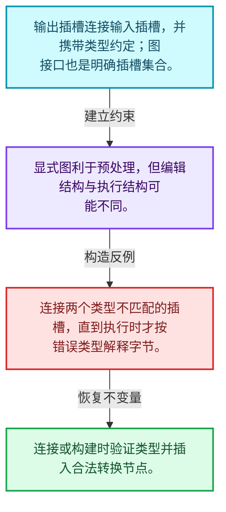
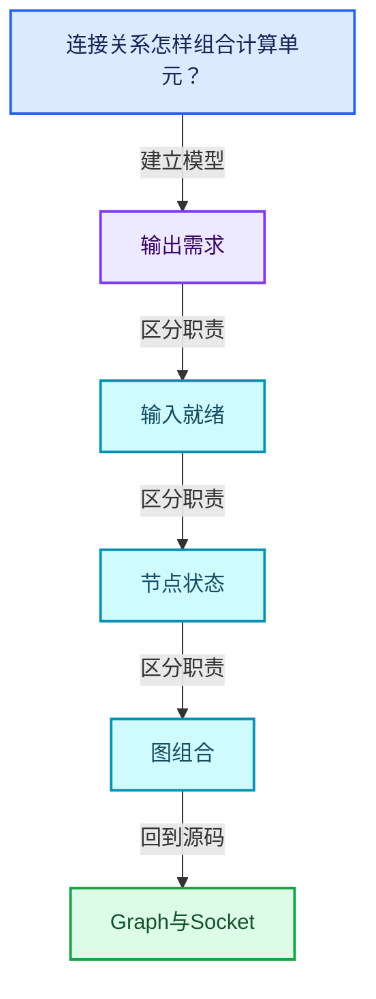
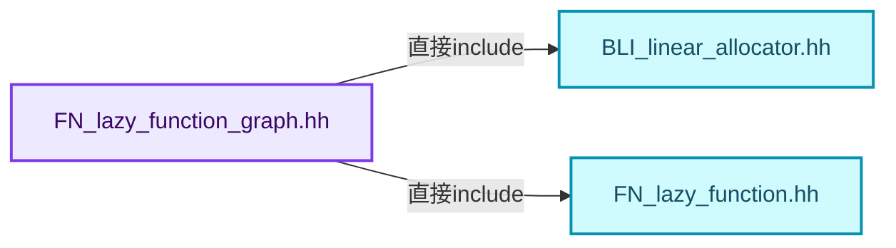
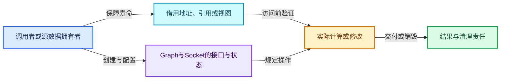
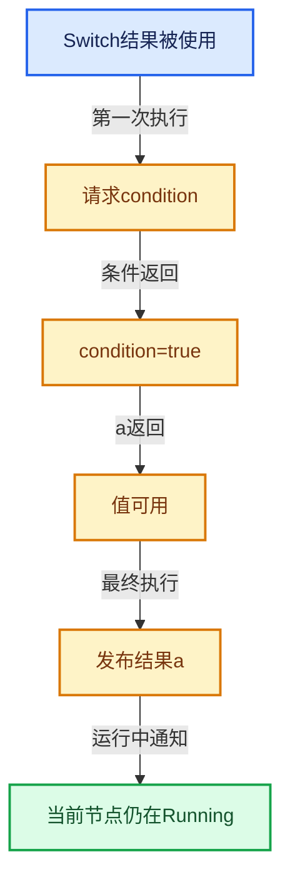

# 09-05 Graph与Socket

[方向导航](README.md) · [总目录](../README.md) · [覆盖索引](../%E6%BA%90%E7%A0%81%E7%89%88%E6%9C%AC%E4%B8%8E%E8%A6%86%E7%9B%96%E7%B4%A2%E5%BC%95.md)

> 阅读顺序：问题与数据模型 → 语法与类型 → 源码逐行 → 调用线索 → 历史与取舍 → 推演和练习。

- 基准 HEAD：`cbda6b96c26c0dee3c3b5cbb93960c4ac06a6b30`。
- 记录日期：2026-10-14。
- 教学示例状态：正文中的推演不是本机性能实测；已运行练习见验收报告。

## 一、从问题到设计

连接关系怎样组合计算单元？

插槽有方向、类型和节点归属，图接口也可成为另一层图的输入输出；连接合法性不是指针非空即可。

本篇把语法、数据语义和系统取舍连接起来。需求与就绪是不同维度；状态只在有证据时推进，不能把未确定当作无需求。

### 本篇独立模型与设计推理

输出插槽连接输入插槽，并携带类型约定；图接口也是明确插槽集合。

设计取舍：显式图利于预处理，但编辑结构与执行结构可能不同。

最小反例：连接两个类型不匹配的插槽，直到执行时才按错误类型解释字节。

推导与处理：连接或构建时验证类型并插入合法转换节点。



### 源码范围与相邻篇章

| 文件 | 本篇逐行范围 | 基准SHA-256 |
|---|---|---|
| [source/blender/functions/FN_lazy_function_graph.hh](../../../../../source/blender/functions/FN_lazy_function_graph.hh) | L1—L554 | `48e154958221afc7452bc9256048f2562a07b41cc6600b94b5b7b26105dcc69c` |
| [source/blender/functions/intern/lazy_function_graph.cc](../../../../../source/blender/functions/intern/lazy_function_graph.cc) | L1—L259 | `1282d72959043a1f2e7c83ea4b03690f119c3f45f61b6e7b1accf917f7b8d493` |

同一主讲文件可能分多篇覆盖；超出本篇范围的符号通过覆盖索引定位。空行与纯注释保留在源码摘录中，逐行表解释有效语句与语法边界；许可证头统一保留。

前篇：[Context与执行状态](04-Context%E4%B8%8E%E6%89%A7%E8%A1%8C%E7%8A%B6%E6%80%81.md).

后篇：[GraphExecutor对外接口](06-GraphExecutor%E5%AF%B9%E5%A4%96%E6%8E%A5%E5%8F%A3.md).

## 二、类型、数据与阅读地图



这是概念依赖图，边表示阅读关系，不声称是运行时调用顺序。

### 直接编译依赖



箭头只表示头文件包含关系；完整调用线索见后面的符号定位表。

## 三、关键词、语法与类型角色

### 只读限定 const

const约束当前访问路径可做的修改。const指针、指向const的指针、const视图对象、const元素是不同位置的限定；其他别名可能仍可修改原对象。

具体检查：分别写T* const、const T*与const T* const，并画出不可修改的层次。

### 移动转换 std::move

std::move把表达式转换为可供移动重载选择的值类别，实际资源转移发生在被选中的构造或赋值中。对const对象move可能仍调用复制，对视图move也不会获得底层数据所有权。

具体检查：记录移动构造调用次数，不用变量名或std::move的出现次数替代测量。

### 显式静态转换 static_cast

static_cast表达编译期允许的转换，不会自动验证运行时真实类型、指针寿命或索引边界。由void指针恢复T指针时，调用者仍须保证实际存储中确有合法T对象。

具体检查：标出转换前后的类型以及正确性依据来自哪里。

### 运行时多态 virtual

虚调用根据实际动态类型选择实现；经基类指针销毁对象时通常需要相应虚析构契约。每元素虚调用和循环外一次分派有不同开销。

具体检查：找出虚接口的实现类和调用频率，再讨论是否值得去虚拟化。

### 可选值 optional

optional把不存在与存在的T区分开，T的构造和析构跟随engaged状态变化。访问前应由has_value或条件分支证明存在。

具体检查：把空Field状态与合法常量零区分，不能用某个普通值代替不存在。

### 构造与new表达式

普通new可能分配并构造；placement new在给定地址构造，存储由其他机制提供。失败回滚应区分两类责任。

具体检查：追踪地址来自哪里、构造何时成功、由谁析构、由谁释放。

### 内部断言 assert

断言表达开发者预期成立的内部契约，发布构建可能关闭。它不能替代对不可信输入的完整错误处理，也不保证后续操作被运行时保护。

具体检查：对每条断言构造违反条件的输入，区分调用者错误与应向用户报告的错误。

### 受控访问 friend

friend授予指定函数或类访问非公开成员的权限，并不意味着继承，也不自动扩展到友元的派生类。

具体检查：解释执行器为何需要访问包装器的内部映射，同时检查边界是否仍清楚。

### 类型别名 using

类型别名为已有类型建立名字，不创建运行期对象。它常把模板内部使用的类型统一暴露给泛型调用者。

具体检查：展开别名直到基础类型，区分类型别名和变量声明。

## 四、真实源码与逐行讲解

源码块保持原行内容，原始行号由小节标题及逐行表给出。表中的调用定位是静态阅读辅助；重载、模板实例化、宏展开和虚调用需结合完整声明，不能仅凭词法出现证明动态调用。

### FN_lazy_function_graph.hh：L1—L47

<!-- source:source/blender/functions/FN_lazy_function_graph.hh:1:47 -->

```cpp
/* SPDX-FileCopyrightText: 2023 Blender Authors
 *
 * SPDX-License-Identifier: GPL-2.0-or-later */

#pragma once

/** \file
 * \ingroup fn
 *
 * This file contains a graph data structure that allows composing multiple lazy-functions into a
 * combined lazy-function.
 *
 * There are two types of nodes in the graph:
 * - #FunctionNode: Corresponds to a #LazyFunction. The inputs and outputs of the function become
 *   input and output sockets of the node.
 * - #InterfaceNode: Is used to indicate inputs and outputs of the entire graph. It can have an
 *   arbitrary number of sockets.
 */

#include "BLI_linear_allocator.hh"

#include "FN_lazy_function.hh"

namespace blender {

namespace dot_export {
class DirectedEdge;
}

namespace fn::lazy_function {

class Socket;
class InputSocket;
class OutputSocket;
class Node;
class Graph;

/**
 * A #Socket is the interface of a #Node. Every #Socket is either an #InputSocket or #OutputSocket.
 * Links can be created from output sockets to input sockets.
 */
class Socket : NonCopyable, NonMovable {
 protected:
  /**
   * The node the socket belongs to.
   */
  Node *node_;
```

| 原始行 | 语义、约束与检查 |
|---|---|
| L5 | 防止同一头文件在一个翻译单元中重复展开；不控制多个源文件之间的链接或对象寿命。 |
| L20 | 引入编译依赖 "BLI_linear_allocator.hh"；这是声明可见性关系，不表示运行时一定调用该文件的所有接口。 |
| L22 | 引入编译依赖 "FN_lazy_function.hh"；这是声明可见性关系，不表示运行时一定调用该文件的所有接口。 |
| L24 | 把后续声明放入 blender 命名空间，影响名称查找和符号归属，不创建运行时对象。 |
| L26 | 把后续声明放入 dot_export 命名空间，影响名称查找和符号归属，不创建运行时对象。 |
| L27 | 声明或定义类型 `class DirectedEdge`。结合继承、访问权限和成员布局确认接口与拥有关系；前向声明本身没有完整对象布局。 |
| L28 | 结束当前语法单元。局部自动对象在离开其作用域时按规则销毁；这不等于所有被引用的外部数据也被释放。 |
| L30 | 把后续声明放入 fn::lazy_function 命名空间，影响名称查找和符号归属，不创建运行时对象。 |
| L32 | 声明或定义类型 `class Socket`。结合继承、访问权限和成员布局确认接口与拥有关系；前向声明本身没有完整对象布局。 |
| L33 | 声明或定义类型 `class InputSocket`。结合继承、访问权限和成员布局确认接口与拥有关系；前向声明本身没有完整对象布局。 |
| L34 | 声明或定义类型 `class OutputSocket`。结合继承、访问权限和成员布局确认接口与拥有关系；前向声明本身没有完整对象布局。 |
| L35 | 声明或定义类型 `class Node`。结合继承、访问权限和成员布局确认接口与拥有关系；前向声明本身没有完整对象布局。 |
| L36 | 声明或定义类型 `class Graph`。结合继承、访问权限和成员布局确认接口与拥有关系；前向声明本身没有完整对象布局。 |
| L42 | 声明或定义类型 `class Socket : NonCopyable, NonMovable`。结合继承、访问权限和成员布局确认接口与拥有关系；前向声明本身没有完整对象布局。 |
| L43 | 切换成员访问权限为 protected；它是编译期接口边界，不是线程同步或内存保护。 |
| L47 | 声明成员、局部对象或完成语句 `Node *node_`。若为指针或引用，它本身不说明拥有；若为值对象，其构造析构由所在作用域或外层对象管理。 |

### FN_lazy_function_graph.hh：L48—L95

<!-- source:source/blender/functions/FN_lazy_function_graph.hh:48:95 -->

```cpp
  /**
   * Data type of the socket. Only sockets with the same type can be linked.
   */
  const CPPType *type_;
  /**
   * Indicates whether this is an #InputSocket or #OutputSocket.
   */
  bool is_input_;
  /**
   * Index of the socket. E.g. 0 for the first input and the first output socket.
   */
  int index_in_node_;
  /**
   * Index of the socket in the entire graph. Every socket has a different index.
   */
  int index_in_graph_;

  friend Graph;

 public:
  bool is_input() const;
  bool is_output() const;

  int index() const;
  int index_in_graph() const;

  InputSocket &as_input();
  OutputSocket &as_output();
  const InputSocket &as_input() const;
  const OutputSocket &as_output() const;

  const Node &node() const;
  Node &node();

  const CPPType &type() const;

  std::string name() const;
  std::string detailed_name() const;
};

class InputSocket : public Socket {
 private:
  /**
   * An input can have at most one link connected to it. The linked socket is the "origin" because
   * it's where the data is coming from. The type of the origin must be the same as the type of
   * this socket.
   */
  OutputSocket *origin_;
```

| 原始行 | 语义、约束与检查 |
|---|---|
| L51 | 声明成员、局部对象或完成语句 `const CPPType *type_`。若为指针或引用，它本身不说明拥有；若为值对象，其构造析构由所在作用域或外层对象管理。 |
| L55 | 声明成员、局部对象或完成语句 `bool is_input_`。若为指针或引用，它本身不说明拥有；若为值对象，其构造析构由所在作用域或外层对象管理。 |
| L59 | 声明成员、局部对象或完成语句 `int index_in_node_`。若为指针或引用，它本身不说明拥有；若为值对象，其构造析构由所在作用域或外层对象管理。 |
| L63 | 声明成员、局部对象或完成语句 `int index_in_graph_`。若为指针或引用，它本身不说明拥有；若为值对象，其构造析构由所在作用域或外层对象管理。 |
| L65 | 声明成员、局部对象或完成语句 `friend Graph`。若为指针或引用，它本身不说明拥有；若为值对象，其构造析构由所在作用域或外层对象管理。 |
| L67 | 切换成员访问权限为 public；它是编译期接口边界，不是线程同步或内存保护。 |
| L68 | 声明接口 `bool is_input() const`，本行没有对应函数体；返回类型、参数限定和const/noexcept共同组成调用契约，实际行为需继续定位实现。 |
| L69 | 声明接口 `bool is_output() const`，本行没有对应函数体；返回类型、参数限定和const/noexcept共同组成调用契约，实际行为需继续定位实现。 |
| L71 | 声明接口 `int index() const`，本行没有对应函数体；返回类型、参数限定和const/noexcept共同组成调用契约，实际行为需继续定位实现。 |
| L72 | 声明接口 `int index_in_graph() const`，本行没有对应函数体；返回类型、参数限定和const/noexcept共同组成调用契约，实际行为需继续定位实现。 |
| L74 | 出现调用或函数声明 `as_input`，对应表达式为 `InputSocket &as_input();`。参数求值、返回类型与重载需结合前后完整语句；静态文本引用不能证明动态目标。 |
| L75 | 出现调用或函数声明 `as_output`，对应表达式为 `OutputSocket &as_output();`。参数求值、返回类型与重载需结合前后完整语句；静态文本引用不能证明动态目标。 |
| L76 | 声明接口 `const InputSocket &as_input() const`，本行没有对应函数体；返回类型、参数限定和const/noexcept共同组成调用契约，实际行为需继续定位实现。 |
| L77 | 声明接口 `const OutputSocket &as_output() const`，本行没有对应函数体；返回类型、参数限定和const/noexcept共同组成调用契约，实际行为需继续定位实现。 |
| L79 | 声明接口 `const Node &node() const`，本行没有对应函数体；返回类型、参数限定和const/noexcept共同组成调用契约，实际行为需继续定位实现。 |
| L80 | 出现调用或函数声明 `node`，对应表达式为 `Node &node();`。参数求值、返回类型与重载需结合前后完整语句；静态文本引用不能证明动态目标。 |
| L82 | 声明接口 `const CPPType &type() const`，本行没有对应函数体；返回类型、参数限定和const/noexcept共同组成调用契约，实际行为需继续定位实现。 |
| L84 | 声明接口 `std::string name() const`，本行没有对应函数体；返回类型、参数限定和const/noexcept共同组成调用契约，实际行为需继续定位实现。 |
| L85 | 声明接口 `std::string detailed_name() const`，本行没有对应函数体；返回类型、参数限定和const/noexcept共同组成调用契约，实际行为需继续定位实现。 |
| L86 | 结束当前语法单元。局部自动对象在离开其作用域时按规则销毁；这不等于所有被引用的外部数据也被释放。 |
| L88 | 声明或定义类型 `class InputSocket : public Socket`。结合继承、访问权限和成员布局确认接口与拥有关系；前向声明本身没有完整对象布局。 |
| L89 | 切换成员访问权限为 private；它是编译期接口边界，不是线程同步或内存保护。 |
| L95 | 声明成员、局部对象或完成语句 `OutputSocket *origin_`。若为指针或引用，它本身不说明拥有；若为值对象，其构造析构由所在作用域或外层对象管理。 |

### FN_lazy_function_graph.hh：L96—L143

<!-- source:source/blender/functions/FN_lazy_function_graph.hh:96:143 -->

```cpp
  /**
   * Can be null or a non-owning pointer to a value of the type of the socket. This value will be
   * used when the input is used but not linked.
   *
   * This is technically not needed, because one could just create a separate node that just
   * outputs the value, but that would have more overhead. Especially because it's commonly the
   * case that most inputs are unlinked.
   */
  const void *default_value_ = nullptr;

  friend Graph;

 public:
  OutputSocket *origin();
  const OutputSocket *origin() const;

  const void *default_value() const;
  void set_default_value(const void *value);
};

class OutputSocket : public Socket {
 private:
  /**
   * An output can be linked to an arbitrary number of inputs of the same type.
   */
  Vector<InputSocket *> targets_;

  friend Graph;

 public:
  Span<InputSocket *> targets();
  Span<const InputSocket *> targets() const;
};

/**
 * A #Node has input and output sockets. Every node is either a #FunctionNode or an #InterfaceNode.
 */
class Node : NonCopyable, NonMovable {
 protected:
  /**
   * The function this node corresponds to. If this is null, the node is an #InterfaceNode.
   * The function is not owned by this #Node nor by the #Graph.
   */
  const LazyFunction *fn_ = nullptr;
  /**
   * Input sockets of the node.
   */
  Span<InputSocket *> inputs_;
```

| 原始行 | 语义、约束与检查 |
|---|---|
| L104 | 把右侧 `nullptr` 用于初始化或更新左侧 `const void *default_value_`。声明初始化与已有对象赋值应按上下文区分；有资源的类型会调用相应特殊成员。 |
| L106 | 声明成员、局部对象或完成语句 `friend Graph`。若为指针或引用，它本身不说明拥有；若为值对象，其构造析构由所在作用域或外层对象管理。 |
| L108 | 切换成员访问权限为 public；它是编译期接口边界，不是线程同步或内存保护。 |
| L109 | 出现调用或函数声明 `origin`，对应表达式为 `OutputSocket *origin();`。参数求值、返回类型与重载需结合前后完整语句；静态文本引用不能证明动态目标。 |
| L110 | 声明接口 `const OutputSocket *origin() const`，本行没有对应函数体；返回类型、参数限定和const/noexcept共同组成调用契约，实际行为需继续定位实现。 |
| L112 | 声明接口 `const void *default_value() const`，本行没有对应函数体；返回类型、参数限定和const/noexcept共同组成调用契约，实际行为需继续定位实现。 |
| L113 | 声明接口 `void set_default_value(const void *value)`，本行没有对应函数体；返回类型、参数限定和const/noexcept共同组成调用契约，实际行为需继续定位实现。 |
| L114 | 结束当前语法单元。局部自动对象在离开其作用域时按规则销毁；这不等于所有被引用的外部数据也被释放。 |
| L116 | 声明或定义类型 `class OutputSocket : public Socket`。结合继承、访问权限和成员布局确认接口与拥有关系；前向声明本身没有完整对象布局。 |
| L117 | 切换成员访问权限为 private；它是编译期接口边界，不是线程同步或内存保护。 |
| L121 | 声明成员、局部对象或完成语句 `Vector<InputSocket *> targets_`。若为指针或引用，它本身不说明拥有；若为值对象，其构造析构由所在作用域或外层对象管理。 |
| L123 | 声明成员、局部对象或完成语句 `friend Graph`。若为指针或引用，它本身不说明拥有；若为值对象，其构造析构由所在作用域或外层对象管理。 |
| L125 | 切换成员访问权限为 public；它是编译期接口边界，不是线程同步或内存保护。 |
| L126 | 出现调用或函数声明 `targets`，对应表达式为 `Span<InputSocket *> targets();`。参数求值、返回类型与重载需结合前后完整语句；静态文本引用不能证明动态目标。 |
| L127 | 声明接口 `Span<const InputSocket *> targets() const`，本行没有对应函数体；返回类型、参数限定和const/noexcept共同组成调用契约，实际行为需继续定位实现。 |
| L128 | 结束当前语法单元。局部自动对象在离开其作用域时按规则销毁；这不等于所有被引用的外部数据也被释放。 |
| L133 | 声明或定义类型 `class Node : NonCopyable, NonMovable`。结合继承、访问权限和成员布局确认接口与拥有关系；前向声明本身没有完整对象布局。 |
| L134 | 切换成员访问权限为 protected；它是编译期接口边界，不是线程同步或内存保护。 |
| L139 | 把右侧 `nullptr` 用于初始化或更新左侧 `const LazyFunction *fn_`。声明初始化与已有对象赋值应按上下文区分；有资源的类型会调用相应特殊成员。 |
| L143 | 声明成员、局部对象或完成语句 `Span<InputSocket *> inputs_`。若为指针或引用，它本身不说明拥有；若为值对象，其构造析构由所在作用域或外层对象管理。 |

### FN_lazy_function_graph.hh：L144—L191

<!-- source:source/blender/functions/FN_lazy_function_graph.hh:144:191 -->

```cpp
  /**
   * Output sockets of the node.
   */
  Span<OutputSocket *> outputs_;
  /**
   * An index that is set when calling #Graph::update_node_indices. This can be used to create
   * efficient mappings from nodes to other data using just an array instead of a hash map.
   *
   * This is technically not necessary but has better performance than always using hash maps.
   */
  int index_in_graph_ = -1;

  friend Graph;

 public:
  bool is_interface() const;
  bool is_function() const;
  int index_in_graph() const;

  Span<const InputSocket *> inputs() const;
  Span<const OutputSocket *> outputs() const;
  Span<InputSocket *> inputs();
  Span<OutputSocket *> outputs();

  const InputSocket &input(int index) const;
  const OutputSocket &output(int index) const;
  InputSocket &input(int index);
  OutputSocket &output(int index);

  std::string name() const;
};

/**
 * A #Node that corresponds to a specific #LazyFunction.
 */
class FunctionNode final : public Node {
 public:
  const LazyFunction &function() const;
};

/**
 * A #Node that does *not* correspond to a #LazyFunction. Instead it can be used to indicate inputs
 * and outputs of the entire graph. It can have an arbitrary number of inputs and outputs.
 */
class InterfaceNode final : public Node {
 private:
  friend Node;
  friend Socket;
```

| 原始行 | 语义、约束与检查 |
|---|---|
| L147 | 声明成员、局部对象或完成语句 `Span<OutputSocket *> outputs_`。若为指针或引用，它本身不说明拥有；若为值对象，其构造析构由所在作用域或外层对象管理。 |
| L154 | 把右侧 `-1` 用于初始化或更新左侧 `int index_in_graph_`。声明初始化与已有对象赋值应按上下文区分；有资源的类型会调用相应特殊成员。 |
| L156 | 声明成员、局部对象或完成语句 `friend Graph`。若为指针或引用，它本身不说明拥有；若为值对象，其构造析构由所在作用域或外层对象管理。 |
| L158 | 切换成员访问权限为 public；它是编译期接口边界，不是线程同步或内存保护。 |
| L159 | 声明接口 `bool is_interface() const`，本行没有对应函数体；返回类型、参数限定和const/noexcept共同组成调用契约，实际行为需继续定位实现。 |
| L160 | 声明接口 `bool is_function() const`，本行没有对应函数体；返回类型、参数限定和const/noexcept共同组成调用契约，实际行为需继续定位实现。 |
| L161 | 声明接口 `int index_in_graph() const`，本行没有对应函数体；返回类型、参数限定和const/noexcept共同组成调用契约，实际行为需继续定位实现。 |
| L163 | 声明接口 `Span<const InputSocket *> inputs() const`，本行没有对应函数体；返回类型、参数限定和const/noexcept共同组成调用契约，实际行为需继续定位实现。 |
| L164 | 声明接口 `Span<const OutputSocket *> outputs() const`，本行没有对应函数体；返回类型、参数限定和const/noexcept共同组成调用契约，实际行为需继续定位实现。 |
| L165 | 出现调用或函数声明 `inputs`，对应表达式为 `Span<InputSocket *> inputs();`。参数求值、返回类型与重载需结合前后完整语句；静态文本引用不能证明动态目标。 |
| L166 | 出现调用或函数声明 `outputs`，对应表达式为 `Span<OutputSocket *> outputs();`。参数求值、返回类型与重载需结合前后完整语句；静态文本引用不能证明动态目标。 |
| L168 | 声明接口 `const InputSocket &input(int index) const`，本行没有对应函数体；返回类型、参数限定和const/noexcept共同组成调用契约，实际行为需继续定位实现。 |
| L169 | 声明接口 `const OutputSocket &output(int index) const`，本行没有对应函数体；返回类型、参数限定和const/noexcept共同组成调用契约，实际行为需继续定位实现。 |
| L170 | 出现调用或函数声明 `input`，对应表达式为 `InputSocket &input(int index);`。参数求值、返回类型与重载需结合前后完整语句；静态文本引用不能证明动态目标。 |
| L171 | 出现调用或函数声明 `output`，对应表达式为 `OutputSocket &output(int index);`。参数求值、返回类型与重载需结合前后完整语句；静态文本引用不能证明动态目标。 |
| L173 | 声明接口 `std::string name() const`，本行没有对应函数体；返回类型、参数限定和const/noexcept共同组成调用契约，实际行为需继续定位实现。 |
| L174 | 结束当前语法单元。局部自动对象在离开其作用域时按规则销毁；这不等于所有被引用的外部数据也被释放。 |
| L179 | 声明或定义类型 `class FunctionNode final : public Node`。结合继承、访问权限和成员布局确认接口与拥有关系；前向声明本身没有完整对象布局。 |
| L180 | 切换成员访问权限为 public；它是编译期接口边界，不是线程同步或内存保护。 |
| L181 | 声明接口 `const LazyFunction &function() const`，本行没有对应函数体；返回类型、参数限定和const/noexcept共同组成调用契约，实际行为需继续定位实现。 |
| L182 | 结束当前语法单元。局部自动对象在离开其作用域时按规则销毁；这不等于所有被引用的外部数据也被释放。 |
| L188 | 声明或定义类型 `class InterfaceNode final : public Node`。结合继承、访问权限和成员布局确认接口与拥有关系；前向声明本身没有完整对象布局。 |
| L189 | 切换成员访问权限为 private；它是编译期接口边界，不是线程同步或内存保护。 |
| L190 | 声明成员、局部对象或完成语句 `friend Node`。若为指针或引用，它本身不说明拥有；若为值对象，其构造析构由所在作用域或外层对象管理。 |
| L191 | 声明成员、局部对象或完成语句 `friend Socket`。若为指针或引用，它本身不说明拥有；若为值对象，其构造析构由所在作用域或外层对象管理。 |

### FN_lazy_function_graph.hh：L192—L239

<!-- source:source/blender/functions/FN_lazy_function_graph.hh:192:239 -->

```cpp
  friend Graph;

  Vector<std::string> socket_names_;
};

/**
 * Interface input sockets are actually output sockets on the input node. This renaming makes the
 * code less confusing.
 */
using GraphInputSocket = OutputSocket;
using GraphOutputSocket = InputSocket;

/**
 * A container for an arbitrary number of nodes and links between their sockets.
 */
class Graph : NonCopyable, NonMovable {
 private:
  /**
   * Used to allocate nodes and sockets in the graph.
   */
  LinearAllocator<> allocator_;
  /**
   * Name of the graph for debugging purposes.
   */
  StringRefNull name_;
  /**
   * Contains all nodes in the graph so that it is efficient to iterate over them.
   * The first two nodes are the interface input and output nodes.
   */
  Vector<Node *> nodes_;

  InterfaceNode *graph_input_node_ = nullptr;
  InterfaceNode *graph_output_node_ = nullptr;

  Vector<GraphInputSocket *> graph_inputs_;
  Vector<GraphOutputSocket *> graph_outputs_;

  /**
   * Number of sockets in the graph. Can be used as array size when indexing using
   * `Socket::index_in_graph`.
   */
  int socket_num_ = 0;

 public:
  Graph(StringRef name = "unknown");
  ~Graph();

  StringRefNull name() const;
```

本段语义重点：

- `allocator_`：提供存储的分配策略对象，释放必须与分配策略匹配。
- `graph_inputs_`：图对外输入插槽列表，用于建立接口到图内部的对应。
- `graph_outputs_`：图对外输出插槽列表，决定外部请求结果的入口。

| 原始行 | 语义、约束与检查 |
|---|---|
| L192 | 声明成员、局部对象或完成语句 `friend Graph`。若为指针或引用，它本身不说明拥有；若为值对象，其构造析构由所在作用域或外层对象管理。 |
| L194 | 声明成员、局部对象或完成语句 `Vector<std::string> socket_names_`。若为指针或引用，它本身不说明拥有；若为值对象，其构造析构由所在作用域或外层对象管理。 |
| L195 | 结束当前语法单元。局部自动对象在离开其作用域时按规则销毁；这不等于所有被引用的外部数据也被释放。 |
| L201 | 定义类型别名 `using GraphInputSocket = OutputSocket`，为模板接口或内部实现统一命名；本行不分配该类型对象。 |
| L202 | 定义类型别名 `using GraphOutputSocket = InputSocket`，为模板接口或内部实现统一命名；本行不分配该类型对象。 |
| L207 | 声明或定义类型 `class Graph : NonCopyable, NonMovable`。结合继承、访问权限和成员布局确认接口与拥有关系；前向声明本身没有完整对象布局。 |
| L208 | 切换成员访问权限为 private；它是编译期接口边界，不是线程同步或内存保护。 |
| L212 | 本行涉及 `allocator_`：提供存储的分配策略对象，释放必须与分配策略匹配。按此语义解读 `LinearAllocator<> allocator_`，不要把地址、数量或状态混用。 |
| L216 | 声明成员、局部对象或完成语句 `StringRefNull name_`。若为指针或引用，它本身不说明拥有；若为值对象，其构造析构由所在作用域或外层对象管理。 |
| L221 | 声明成员、局部对象或完成语句 `Vector<Node *> nodes_`。若为指针或引用，它本身不说明拥有；若为值对象，其构造析构由所在作用域或外层对象管理。 |
| L223 | 把右侧 `nullptr` 用于初始化或更新左侧 `InterfaceNode *graph_input_node_`。声明初始化与已有对象赋值应按上下文区分；有资源的类型会调用相应特殊成员。 |
| L224 | 把右侧 `nullptr` 用于初始化或更新左侧 `InterfaceNode *graph_output_node_`。声明初始化与已有对象赋值应按上下文区分；有资源的类型会调用相应特殊成员。 |
| L226 | 本行涉及 `graph_inputs_`：图对外输入插槽列表，用于建立接口到图内部的对应。按此语义解读 `Vector<GraphInputSocket *> graph_inputs_`，不要把地址、数量或状态混用。 |
| L227 | 本行涉及 `graph_outputs_`：图对外输出插槽列表，决定外部请求结果的入口。按此语义解读 `Vector<GraphOutputSocket *> graph_outputs_`，不要把地址、数量或状态混用。 |
| L233 | 把右侧 `0` 用于初始化或更新左侧 `int socket_num_`。声明初始化与已有对象赋值应按上下文区分；有资源的类型会调用相应特殊成员。 |
| L235 | 切换成员访问权限为 public；它是编译期接口边界，不是线程同步或内存保护。 |
| L236 | 把右侧 `"unknown")` 用于初始化或更新左侧 `Graph(StringRef name`。声明初始化与已有对象赋值应按上下文区分；有资源的类型会调用相应特殊成员。 |
| L237 | 涉及析构接口或显式析构：`~Graph();`。检查目标对象已成功构造，且资源不会在另一条清理路径再次销毁。 |
| L239 | 声明接口 `StringRefNull name() const`，本行没有对应函数体；返回类型、参数限定和const/noexcept共同组成调用契约，实际行为需继续定位实现。 |

### FN_lazy_function_graph.hh：L240—L285

<!-- source:source/blender/functions/FN_lazy_function_graph.hh:240:285 -->

```cpp

  /**
   * Get all nodes in the graph. The index in the span corresponds to #Node::index_in_graph.
   */
  Span<const Node *> nodes() const;
  Span<Node *> nodes();

  Span<const FunctionNode *> function_nodes() const;
  Span<FunctionNode *> function_nodes();

  Span<GraphInputSocket *> graph_inputs();
  Span<GraphOutputSocket *> graph_outputs();

  Span<const GraphInputSocket *> graph_inputs() const;
  Span<const GraphOutputSocket *> graph_outputs() const;

  /**
   * Add a new function node with sockets that match the passed in #LazyFunction.
   */
  FunctionNode &add_function(const LazyFunction &fn);

  /**
   * Add inputs and outputs to the graph.
   */
  GraphInputSocket &add_input(const CPPType &type, std::string name = "");
  GraphOutputSocket &add_output(const CPPType &type, std::string name = "");

  /**
   * Add a link between the two given sockets.
   * This has undefined behavior when the input is linked to something else already.
   */
  void add_link(OutputSocket &from, InputSocket &to);

  /**
   * If the socket is linked, remove the link.
   */
  void clear_origin(InputSocket &socket);

  /**
   * Make sure that #Node::index_in_graph is up to date.
   */
  void update_node_indices();
  /**
   * Make sure that #Socket::index_in_graph is up to date.
   */
  void update_socket_indices();
```

| 原始行 | 语义、约束与检查 |
|---|---|
| L244 | 声明接口 `Span<const Node *> nodes() const`，本行没有对应函数体；返回类型、参数限定和const/noexcept共同组成调用契约，实际行为需继续定位实现。 |
| L245 | 出现调用或函数声明 `nodes`，对应表达式为 `Span<Node *> nodes();`。参数求值、返回类型与重载需结合前后完整语句；静态文本引用不能证明动态目标。 |
| L247 | 声明接口 `Span<const FunctionNode *> function_nodes() const`，本行没有对应函数体；返回类型、参数限定和const/noexcept共同组成调用契约，实际行为需继续定位实现。 |
| L248 | 出现调用或函数声明 `function_nodes`，对应表达式为 `Span<FunctionNode *> function_nodes();`。参数求值、返回类型与重载需结合前后完整语句；静态文本引用不能证明动态目标。 |
| L250 | 出现调用或函数声明 `graph_inputs`，对应表达式为 `Span<GraphInputSocket *> graph_inputs();`。参数求值、返回类型与重载需结合前后完整语句；静态文本引用不能证明动态目标。 |
| L251 | 出现调用或函数声明 `graph_outputs`，对应表达式为 `Span<GraphOutputSocket *> graph_outputs();`。参数求值、返回类型与重载需结合前后完整语句；静态文本引用不能证明动态目标。 |
| L253 | 声明接口 `Span<const GraphInputSocket *> graph_inputs() const`，本行没有对应函数体；返回类型、参数限定和const/noexcept共同组成调用契约，实际行为需继续定位实现。 |
| L254 | 声明接口 `Span<const GraphOutputSocket *> graph_outputs() const`，本行没有对应函数体；返回类型、参数限定和const/noexcept共同组成调用契约，实际行为需继续定位实现。 |
| L259 | 出现调用或函数声明 `add_function`，对应表达式为 `FunctionNode &add_function(const LazyFunction &fn);`。参数求值、返回类型与重载需结合前后完整语句；静态文本引用不能证明动态目标。 |
| L264 | 把右侧 `"")` 用于初始化或更新左侧 `GraphInputSocket &add_input(const CPPType &type, std::string name`。声明初始化与已有对象赋值应按上下文区分；有资源的类型会调用相应特殊成员。 |
| L265 | 把右侧 `"")` 用于初始化或更新左侧 `GraphOutputSocket &add_output(const CPPType &type, std::string name`。声明初始化与已有对象赋值应按上下文区分；有资源的类型会调用相应特殊成员。 |
| L271 | 声明接口 `void add_link(OutputSocket &from, InputSocket &to)`，本行没有对应函数体；返回类型、参数限定和const/noexcept共同组成调用契约，实际行为需继续定位实现。 |
| L276 | 声明接口 `void clear_origin(InputSocket &socket)`，本行没有对应函数体；返回类型、参数限定和const/noexcept共同组成调用契约，实际行为需继续定位实现。 |
| L281 | 声明接口 `void update_node_indices()`，本行没有对应函数体；返回类型、参数限定和const/noexcept共同组成调用契约，实际行为需继续定位实现。 |
| L285 | 声明接口 `void update_socket_indices()`，本行没有对应函数体；返回类型、参数限定和const/noexcept共同组成调用契约，实际行为需继续定位实现。 |

### FN_lazy_function_graph.hh：L286—L333

<!-- source:source/blender/functions/FN_lazy_function_graph.hh:286:333 -->

```cpp

  /**
   * Number of sockets in the graph.
   */
  int socket_num() const;

  /**
   * Can be used to assert that #update_node_indices has been called.
   */
  bool node_indices_are_valid() const;

  /**
   * Optional configuration options for the dot graph generation. This allows creating
   * visualizations for specific purposes.
   */
  class ToDotOptions {
   public:
    virtual std::string socket_name(const Socket &socket) const;
    virtual std::optional<std::string> socket_font_color(const Socket &socket) const;
    virtual void add_edge_attributes(const OutputSocket &from,
                                     const InputSocket &to,
                                     dot_export::DirectedEdge &dot_edge) const;
  };

  /**
   * Utility to generate a dot graph string for the graph. This can be used for debugging.
   */
  std::string to_dot(const ToDotOptions &options = {}) const;
};

/* -------------------------------------------------------------------- */
/** \name #Socket Inline Methods
 * \{ */

inline bool Socket::is_input() const
{
  return is_input_;
}

inline bool Socket::is_output() const
{
  return !is_input_;
}

inline int Socket::index() const
{
  return index_in_node_;
}
```

| 原始行 | 语义、约束与检查 |
|---|---|
| L290 | 声明接口 `int socket_num() const`，本行没有对应函数体；返回类型、参数限定和const/noexcept共同组成调用契约，实际行为需继续定位实现。 |
| L295 | 声明接口 `bool node_indices_are_valid() const`，本行没有对应函数体；返回类型、参数限定和const/noexcept共同组成调用契约，实际行为需继续定位实现。 |
| L301 | 声明或定义类型 `class ToDotOptions`。结合继承、访问权限和成员布局确认接口与拥有关系；前向声明本身没有完整对象布局。 |
| L302 | 切换成员访问权限为 public；它是编译期接口边界，不是线程同步或内存保护。 |
| L303 | 声明接口 `virtual std::string socket_name(const Socket &socket) const`，本行没有对应函数体；返回类型、参数限定和const/noexcept共同组成调用契约，实际行为需继续定位实现。 |
| L304 | 声明接口 `virtual std::optional<std::string> socket_font_color(const Socket &socket) const`，本行没有对应函数体；返回类型、参数限定和const/noexcept共同组成调用契约，实际行为需继续定位实现。 |
| L305 | 出现调用或函数声明 `add_edge_attributes`，对应表达式为 `virtual void add_edge_attributes(const OutputSocket &from,`。参数求值、返回类型与重载需结合前后完整语句；静态文本引用不能证明动态目标。 |
| L306 | 本行是连续声明或表达式的一部分：`const InputSocket &to,`。与本段前后行合读；逗号、括号和限定符决定它属于参数、初始化列表还是实际计算。 |
| L307 | 声明成员、局部对象或完成语句 `dot_export::DirectedEdge &dot_edge) const`。若为指针或引用，它本身不说明拥有；若为值对象，其构造析构由所在作用域或外层对象管理。 |
| L308 | 结束当前语法单元。局部自动对象在离开其作用域时按规则销毁；这不等于所有被引用的外部数据也被释放。 |
| L313 | 把右侧 `{}) const` 用于初始化或更新左侧 `std::string to_dot(const ToDotOptions &options`。声明初始化与已有对象赋值应按上下文区分；有资源的类型会调用相应特殊成员。 |
| L314 | 结束当前语法单元。局部自动对象在离开其作用域时按规则销毁；这不等于所有被引用的外部数据也被释放。 |
| L320 | 出现调用或函数声明 `Socket::is_input`，对应表达式为 `inline bool Socket::is_input() const`。参数求值、返回类型与重载需结合前后完整语句；静态文本引用不能证明动态目标。 |
| L321 | 连接上一行的声明或控制结构与其语句块；后续行在这个作用域中执行或声明。 |
| L322 | 返回表达式 `is_input_`。 |
| L323 | 结束当前语法单元。局部自动对象在离开其作用域时按规则销毁；这不等于所有被引用的外部数据也被释放。 |
| L325 | 出现调用或函数声明 `Socket::is_output`，对应表达式为 `inline bool Socket::is_output() const`。参数求值、返回类型与重载需结合前后完整语句；静态文本引用不能证明动态目标。 |
| L326 | 连接上一行的声明或控制结构与其语句块；后续行在这个作用域中执行或声明。 |
| L327 | 返回表达式 `!is_input_`。 |
| L328 | 结束当前语法单元。局部自动对象在离开其作用域时按规则销毁；这不等于所有被引用的外部数据也被释放。 |
| L330 | 出现调用或函数声明 `Socket::index`，对应表达式为 `inline int Socket::index() const`。参数求值、返回类型与重载需结合前后完整语句；静态文本引用不能证明动态目标。 |
| L331 | 连接上一行的声明或控制结构与其语句块；后续行在这个作用域中执行或声明。 |
| L332 | 返回表达式 `index_in_node_`。 |
| L333 | 结束当前语法单元。局部自动对象在离开其作用域时按规则销毁；这不等于所有被引用的外部数据也被释放。 |

### FN_lazy_function_graph.hh：L334—L377

<!-- source:source/blender/functions/FN_lazy_function_graph.hh:334:377 -->

```cpp

inline int Socket::index_in_graph() const
{
  return index_in_graph_;
}

inline InputSocket &Socket::as_input()
{
  BLI_assert(this->is_input());
  return *static_cast<InputSocket *>(this);
}

inline OutputSocket &Socket::as_output()
{
  BLI_assert(this->is_output());
  return *static_cast<OutputSocket *>(this);
}

inline const InputSocket &Socket::as_input() const
{
  BLI_assert(this->is_input());
  return *static_cast<const InputSocket *>(this);
}

inline const OutputSocket &Socket::as_output() const
{
  BLI_assert(this->is_output());
  return *static_cast<const OutputSocket *>(this);
}

inline const Node &Socket::node() const
{
  return *node_;
}

inline Node &Socket::node()
{
  return *node_;
}

inline const CPPType &Socket::type() const
{
  return *type_;
}
```

| 原始行 | 语义、约束与检查 |
|---|---|
| L335 | 出现调用或函数声明 `Socket::index_in_graph`，对应表达式为 `inline int Socket::index_in_graph() const`。参数求值、返回类型与重载需结合前后完整语句；静态文本引用不能证明动态目标。 |
| L336 | 连接上一行的声明或控制结构与其语句块；后续行在这个作用域中执行或声明。 |
| L337 | 返回表达式 `index_in_graph_`。 |
| L338 | 结束当前语法单元。局部自动对象在离开其作用域时按规则销毁；这不等于所有被引用的外部数据也被释放。 |
| L340 | 出现调用或函数声明 `Socket::as_input`，对应表达式为 `inline InputSocket &Socket::as_input()`。参数求值、返回类型与重载需结合前后完整语句；静态文本引用不能证明动态目标。 |
| L341 | 连接上一行的声明或控制结构与其语句块；后续行在这个作用域中执行或声明。 |
| L342 | 断言约束 `BLI_assert(this->is_input());`。条件是后续访问的内部前置条件；发布构建可能不执行，不能把断言当作输入修复。 |
| L343 | 返回表达式 `*static_cast<InputSocket *>(this)`。 |
| L344 | 结束当前语法单元。局部自动对象在离开其作用域时按规则销毁；这不等于所有被引用的外部数据也被释放。 |
| L346 | 出现调用或函数声明 `Socket::as_output`，对应表达式为 `inline OutputSocket &Socket::as_output()`。参数求值、返回类型与重载需结合前后完整语句；静态文本引用不能证明动态目标。 |
| L347 | 连接上一行的声明或控制结构与其语句块；后续行在这个作用域中执行或声明。 |
| L348 | 断言约束 `BLI_assert(this->is_output());`。条件是后续访问的内部前置条件；发布构建可能不执行，不能把断言当作输入修复。 |
| L349 | 返回表达式 `*static_cast<OutputSocket *>(this)`。 |
| L350 | 结束当前语法单元。局部自动对象在离开其作用域时按规则销毁；这不等于所有被引用的外部数据也被释放。 |
| L352 | 出现调用或函数声明 `Socket::as_input`，对应表达式为 `inline const InputSocket &Socket::as_input() const`。参数求值、返回类型与重载需结合前后完整语句；静态文本引用不能证明动态目标。 |
| L353 | 连接上一行的声明或控制结构与其语句块；后续行在这个作用域中执行或声明。 |
| L354 | 断言约束 `BLI_assert(this->is_input());`。条件是后续访问的内部前置条件；发布构建可能不执行，不能把断言当作输入修复。 |
| L355 | 返回表达式 `*static_cast<const InputSocket *>(this)`。 |
| L356 | 结束当前语法单元。局部自动对象在离开其作用域时按规则销毁；这不等于所有被引用的外部数据也被释放。 |
| L358 | 出现调用或函数声明 `Socket::as_output`，对应表达式为 `inline const OutputSocket &Socket::as_output() const`。参数求值、返回类型与重载需结合前后完整语句；静态文本引用不能证明动态目标。 |
| L359 | 连接上一行的声明或控制结构与其语句块；后续行在这个作用域中执行或声明。 |
| L360 | 断言约束 `BLI_assert(this->is_output());`。条件是后续访问的内部前置条件；发布构建可能不执行，不能把断言当作输入修复。 |
| L361 | 返回表达式 `*static_cast<const OutputSocket *>(this)`。 |
| L362 | 结束当前语法单元。局部自动对象在离开其作用域时按规则销毁；这不等于所有被引用的外部数据也被释放。 |
| L364 | 出现调用或函数声明 `Socket::node`，对应表达式为 `inline const Node &Socket::node() const`。参数求值、返回类型与重载需结合前后完整语句；静态文本引用不能证明动态目标。 |
| L365 | 连接上一行的声明或控制结构与其语句块；后续行在这个作用域中执行或声明。 |
| L366 | 返回表达式 `*node_`。 |
| L367 | 结束当前语法单元。局部自动对象在离开其作用域时按规则销毁；这不等于所有被引用的外部数据也被释放。 |
| L369 | 出现调用或函数声明 `Socket::node`，对应表达式为 `inline Node &Socket::node()`。参数求值、返回类型与重载需结合前后完整语句；静态文本引用不能证明动态目标。 |
| L370 | 连接上一行的声明或控制结构与其语句块；后续行在这个作用域中执行或声明。 |
| L371 | 返回表达式 `*node_`。 |
| L372 | 结束当前语法单元。局部自动对象在离开其作用域时按规则销毁；这不等于所有被引用的外部数据也被释放。 |
| L374 | 出现调用或函数声明 `Socket::type`，对应表达式为 `inline const CPPType &Socket::type() const`。参数求值、返回类型与重载需结合前后完整语句；静态文本引用不能证明动态目标。 |
| L375 | 连接上一行的声明或控制结构与其语句块；后续行在这个作用域中执行或声明。 |
| L376 | 返回表达式 `*type_`。 |
| L377 | 结束当前语法单元。局部自动对象在离开其作用域时按规则销毁；这不等于所有被引用的外部数据也被释放。 |

### FN_lazy_function_graph.hh：L378—L430

<!-- source:source/blender/functions/FN_lazy_function_graph.hh:378:430 -->

```cpp

/** \} */

/* -------------------------------------------------------------------- */
/** \name #InputSocket Inline Methods
 * \{ */

inline const OutputSocket *InputSocket::origin() const
{
  return origin_;
}

inline OutputSocket *InputSocket::origin()
{
  return origin_;
}

inline const void *InputSocket::default_value() const
{
  return default_value_;
}

inline void InputSocket::set_default_value(const void *value)
{
  default_value_ = value;
}

/** \} */

/* -------------------------------------------------------------------- */
/** \name #OutputSocket Inline Methods
 * \{ */

inline Span<const InputSocket *> OutputSocket::targets() const
{
  return targets_;
}

inline Span<InputSocket *> OutputSocket::targets()
{
  return targets_;
}

/** \} */

/* -------------------------------------------------------------------- */
/** \name #Node Inline Methods
 * \{ */

inline bool Node::is_interface() const
{
  return fn_ == nullptr;
}
```

| 原始行 | 语义、约束与检查 |
|---|---|
| L385 | 出现调用或函数声明 `InputSocket::origin`，对应表达式为 `inline const OutputSocket *InputSocket::origin() const`。参数求值、返回类型与重载需结合前后完整语句；静态文本引用不能证明动态目标。 |
| L386 | 连接上一行的声明或控制结构与其语句块；后续行在这个作用域中执行或声明。 |
| L387 | 返回表达式 `origin_`。 |
| L388 | 结束当前语法单元。局部自动对象在离开其作用域时按规则销毁；这不等于所有被引用的外部数据也被释放。 |
| L390 | 出现调用或函数声明 `InputSocket::origin`，对应表达式为 `inline OutputSocket *InputSocket::origin()`。参数求值、返回类型与重载需结合前后完整语句；静态文本引用不能证明动态目标。 |
| L391 | 连接上一行的声明或控制结构与其语句块；后续行在这个作用域中执行或声明。 |
| L392 | 返回表达式 `origin_`。 |
| L393 | 结束当前语法单元。局部自动对象在离开其作用域时按规则销毁；这不等于所有被引用的外部数据也被释放。 |
| L395 | 出现调用或函数声明 `InputSocket::default_value`，对应表达式为 `inline const void *InputSocket::default_value() const`。参数求值、返回类型与重载需结合前后完整语句；静态文本引用不能证明动态目标。 |
| L396 | 连接上一行的声明或控制结构与其语句块；后续行在这个作用域中执行或声明。 |
| L397 | 返回表达式 `default_value_`。 |
| L398 | 结束当前语法单元。局部自动对象在离开其作用域时按规则销毁；这不等于所有被引用的外部数据也被释放。 |
| L400 | 出现调用或函数声明 `InputSocket::set_default_value`，对应表达式为 `inline void InputSocket::set_default_value(const void *value)`。参数求值、返回类型与重载需结合前后完整语句；静态文本引用不能证明动态目标。 |
| L401 | 连接上一行的声明或控制结构与其语句块；后续行在这个作用域中执行或声明。 |
| L402 | 把右侧 `value` 用于初始化或更新左侧 `default_value_`。声明初始化与已有对象赋值应按上下文区分；有资源的类型会调用相应特殊成员。 |
| L403 | 结束当前语法单元。局部自动对象在离开其作用域时按规则销毁；这不等于所有被引用的外部数据也被释放。 |
| L411 | 出现调用或函数声明 `OutputSocket::targets`，对应表达式为 `inline Span<const InputSocket *> OutputSocket::targets() const`。参数求值、返回类型与重载需结合前后完整语句；静态文本引用不能证明动态目标。 |
| L412 | 连接上一行的声明或控制结构与其语句块；后续行在这个作用域中执行或声明。 |
| L413 | 返回表达式 `targets_`。 |
| L414 | 结束当前语法单元。局部自动对象在离开其作用域时按规则销毁；这不等于所有被引用的外部数据也被释放。 |
| L416 | 出现调用或函数声明 `OutputSocket::targets`，对应表达式为 `inline Span<InputSocket *> OutputSocket::targets()`。参数求值、返回类型与重载需结合前后完整语句；静态文本引用不能证明动态目标。 |
| L417 | 连接上一行的声明或控制结构与其语句块；后续行在这个作用域中执行或声明。 |
| L418 | 返回表达式 `targets_`。 |
| L419 | 结束当前语法单元。局部自动对象在离开其作用域时按规则销毁；这不等于所有被引用的外部数据也被释放。 |
| L427 | 出现调用或函数声明 `Node::is_interface`，对应表达式为 `inline bool Node::is_interface() const`。参数求值、返回类型与重载需结合前后完整语句；静态文本引用不能证明动态目标。 |
| L428 | 连接上一行的声明或控制结构与其语句块；后续行在这个作用域中执行或声明。 |
| L429 | 返回表达式 `fn_ == nullptr`。 |
| L430 | 结束当前语法单元。局部自动对象在离开其作用域时按规则销毁；这不等于所有被引用的外部数据也被释放。 |

### FN_lazy_function_graph.hh：L431—L480

<!-- source:source/blender/functions/FN_lazy_function_graph.hh:431:480 -->

```cpp

inline bool Node::is_function() const
{
  return fn_ != nullptr;
}

inline int Node::index_in_graph() const
{
  return index_in_graph_;
}

inline Span<const InputSocket *> Node::inputs() const
{
  return inputs_;
}

inline Span<const OutputSocket *> Node::outputs() const
{
  return outputs_;
}

inline Span<InputSocket *> Node::inputs()
{
  return inputs_;
}

inline Span<OutputSocket *> Node::outputs()
{
  return outputs_;
}

inline const InputSocket &Node::input(const int index) const
{
  return *inputs_[index];
}

inline const OutputSocket &Node::output(const int index) const
{
  return *outputs_[index];
}

inline InputSocket &Node::input(const int index)
{
  return *inputs_[index];
}

inline OutputSocket &Node::output(const int index)
{
  return *outputs_[index];
}
```

| 原始行 | 语义、约束与检查 |
|---|---|
| L432 | 出现调用或函数声明 `Node::is_function`，对应表达式为 `inline bool Node::is_function() const`。参数求值、返回类型与重载需结合前后完整语句；静态文本引用不能证明动态目标。 |
| L433 | 连接上一行的声明或控制结构与其语句块；后续行在这个作用域中执行或声明。 |
| L434 | 返回表达式 `fn_ != nullptr`。 |
| L435 | 结束当前语法单元。局部自动对象在离开其作用域时按规则销毁；这不等于所有被引用的外部数据也被释放。 |
| L437 | 出现调用或函数声明 `Node::index_in_graph`，对应表达式为 `inline int Node::index_in_graph() const`。参数求值、返回类型与重载需结合前后完整语句；静态文本引用不能证明动态目标。 |
| L438 | 连接上一行的声明或控制结构与其语句块；后续行在这个作用域中执行或声明。 |
| L439 | 返回表达式 `index_in_graph_`。 |
| L440 | 结束当前语法单元。局部自动对象在离开其作用域时按规则销毁；这不等于所有被引用的外部数据也被释放。 |
| L442 | 出现调用或函数声明 `Node::inputs`，对应表达式为 `inline Span<const InputSocket *> Node::inputs() const`。参数求值、返回类型与重载需结合前后完整语句；静态文本引用不能证明动态目标。 |
| L443 | 连接上一行的声明或控制结构与其语句块；后续行在这个作用域中执行或声明。 |
| L444 | 返回表达式 `inputs_`。 |
| L445 | 结束当前语法单元。局部自动对象在离开其作用域时按规则销毁；这不等于所有被引用的外部数据也被释放。 |
| L447 | 出现调用或函数声明 `Node::outputs`，对应表达式为 `inline Span<const OutputSocket *> Node::outputs() const`。参数求值、返回类型与重载需结合前后完整语句；静态文本引用不能证明动态目标。 |
| L448 | 连接上一行的声明或控制结构与其语句块；后续行在这个作用域中执行或声明。 |
| L449 | 返回表达式 `outputs_`。 |
| L450 | 结束当前语法单元。局部自动对象在离开其作用域时按规则销毁；这不等于所有被引用的外部数据也被释放。 |
| L452 | 出现调用或函数声明 `Node::inputs`，对应表达式为 `inline Span<InputSocket *> Node::inputs()`。参数求值、返回类型与重载需结合前后完整语句；静态文本引用不能证明动态目标。 |
| L453 | 连接上一行的声明或控制结构与其语句块；后续行在这个作用域中执行或声明。 |
| L454 | 返回表达式 `inputs_`。 |
| L455 | 结束当前语法单元。局部自动对象在离开其作用域时按规则销毁；这不等于所有被引用的外部数据也被释放。 |
| L457 | 出现调用或函数声明 `Node::outputs`，对应表达式为 `inline Span<OutputSocket *> Node::outputs()`。参数求值、返回类型与重载需结合前后完整语句；静态文本引用不能证明动态目标。 |
| L458 | 连接上一行的声明或控制结构与其语句块；后续行在这个作用域中执行或声明。 |
| L459 | 返回表达式 `outputs_`。 |
| L460 | 结束当前语法单元。局部自动对象在离开其作用域时按规则销毁；这不等于所有被引用的外部数据也被释放。 |
| L462 | 出现调用或函数声明 `Node::input`，对应表达式为 `inline const InputSocket &Node::input(const int index) const`。参数求值、返回类型与重载需结合前后完整语句；静态文本引用不能证明动态目标。 |
| L463 | 连接上一行的声明或控制结构与其语句块；后续行在这个作用域中执行或声明。 |
| L464 | 返回表达式 `*inputs_[index]`。 |
| L465 | 结束当前语法单元。局部自动对象在离开其作用域时按规则销毁；这不等于所有被引用的外部数据也被释放。 |
| L467 | 出现调用或函数声明 `Node::output`，对应表达式为 `inline const OutputSocket &Node::output(const int index) const`。参数求值、返回类型与重载需结合前后完整语句；静态文本引用不能证明动态目标。 |
| L468 | 连接上一行的声明或控制结构与其语句块；后续行在这个作用域中执行或声明。 |
| L469 | 返回表达式 `*outputs_[index]`。 |
| L470 | 结束当前语法单元。局部自动对象在离开其作用域时按规则销毁；这不等于所有被引用的外部数据也被释放。 |
| L472 | 出现调用或函数声明 `Node::input`，对应表达式为 `inline InputSocket &Node::input(const int index)`。参数求值、返回类型与重载需结合前后完整语句；静态文本引用不能证明动态目标。 |
| L473 | 连接上一行的声明或控制结构与其语句块；后续行在这个作用域中执行或声明。 |
| L474 | 返回表达式 `*inputs_[index]`。 |
| L475 | 结束当前语法单元。局部自动对象在离开其作用域时按规则销毁；这不等于所有被引用的外部数据也被释放。 |
| L477 | 出现调用或函数声明 `Node::output`，对应表达式为 `inline OutputSocket &Node::output(const int index)`。参数求值、返回类型与重载需结合前后完整语句；静态文本引用不能证明动态目标。 |
| L478 | 连接上一行的声明或控制结构与其语句块；后续行在这个作用域中执行或声明。 |
| L479 | 返回表达式 `*outputs_[index]`。 |
| L480 | 结束当前语法单元。局部自动对象在离开其作用域时按规则销毁；这不等于所有被引用的外部数据也被释放。 |

### FN_lazy_function_graph.hh：L481—L528

<!-- source:source/blender/functions/FN_lazy_function_graph.hh:481:528 -->

```cpp

/** \} */

/* -------------------------------------------------------------------- */
/** \name #FunctionNode Inline Methods
 * \{ */

inline const LazyFunction &FunctionNode::function() const
{
  BLI_assert(fn_ != nullptr);
  return *fn_;
}

/** \} */

/* -------------------------------------------------------------------- */
/** \name #Graph Inline Methods
 * \{ */

inline StringRefNull Graph::name() const
{
  return name_;
}

inline Span<const Node *> Graph::nodes() const
{
  return nodes_;
}

inline Span<Node *> Graph::nodes()
{
  return nodes_;
}

inline Span<const FunctionNode *> Graph::function_nodes() const
{
  return nodes_.as_span().drop_front(2).cast<const FunctionNode *>();
}

inline Span<FunctionNode *> Graph::function_nodes()
{
  return nodes_.as_span().drop_front(2).cast<FunctionNode *>();
}

inline Span<GraphInputSocket *> Graph::graph_inputs()
{
  return graph_inputs_;
}
```

本段语义重点：

- `graph_inputs_`：图对外输入插槽列表，用于建立接口到图内部的对应。

| 原始行 | 语义、约束与检查 |
|---|---|
| L488 | 出现调用或函数声明 `FunctionNode::function`，对应表达式为 `inline const LazyFunction &FunctionNode::function() const`。参数求值、返回类型与重载需结合前后完整语句；静态文本引用不能证明动态目标。 |
| L489 | 连接上一行的声明或控制结构与其语句块；后续行在这个作用域中执行或声明。 |
| L490 | 断言约束 `BLI_assert(fn_ != nullptr);`。条件是后续访问的内部前置条件；发布构建可能不执行，不能把断言当作输入修复。 |
| L491 | 返回表达式 `*fn_`。 |
| L492 | 结束当前语法单元。局部自动对象在离开其作用域时按规则销毁；这不等于所有被引用的外部数据也被释放。 |
| L500 | 出现调用或函数声明 `Graph::name`，对应表达式为 `inline StringRefNull Graph::name() const`。参数求值、返回类型与重载需结合前后完整语句；静态文本引用不能证明动态目标。 |
| L501 | 连接上一行的声明或控制结构与其语句块；后续行在这个作用域中执行或声明。 |
| L502 | 返回表达式 `name_`。 |
| L503 | 结束当前语法单元。局部自动对象在离开其作用域时按规则销毁；这不等于所有被引用的外部数据也被释放。 |
| L505 | 出现调用或函数声明 `Graph::nodes`，对应表达式为 `inline Span<const Node *> Graph::nodes() const`。参数求值、返回类型与重载需结合前后完整语句；静态文本引用不能证明动态目标。 |
| L506 | 连接上一行的声明或控制结构与其语句块；后续行在这个作用域中执行或声明。 |
| L507 | 返回表达式 `nodes_`。 |
| L508 | 结束当前语法单元。局部自动对象在离开其作用域时按规则销毁；这不等于所有被引用的外部数据也被释放。 |
| L510 | 出现调用或函数声明 `Graph::nodes`，对应表达式为 `inline Span<Node *> Graph::nodes()`。参数求值、返回类型与重载需结合前后完整语句；静态文本引用不能证明动态目标。 |
| L511 | 连接上一行的声明或控制结构与其语句块；后续行在这个作用域中执行或声明。 |
| L512 | 返回表达式 `nodes_`。 |
| L513 | 结束当前语法单元。局部自动对象在离开其作用域时按规则销毁；这不等于所有被引用的外部数据也被释放。 |
| L515 | 出现调用或函数声明 `Graph::function_nodes`，对应表达式为 `inline Span<const FunctionNode *> Graph::function_nodes() const`。参数求值、返回类型与重载需结合前后完整语句；静态文本引用不能证明动态目标。 |
| L516 | 连接上一行的声明或控制结构与其语句块；后续行在这个作用域中执行或声明。 |
| L517 | 返回表达式 `nodes_.as_span().drop_front(2).cast<const FunctionNode *>()`。 |
| L518 | 结束当前语法单元。局部自动对象在离开其作用域时按规则销毁；这不等于所有被引用的外部数据也被释放。 |
| L520 | 出现调用或函数声明 `Graph::function_nodes`，对应表达式为 `inline Span<FunctionNode *> Graph::function_nodes()`。参数求值、返回类型与重载需结合前后完整语句；静态文本引用不能证明动态目标。 |
| L521 | 连接上一行的声明或控制结构与其语句块；后续行在这个作用域中执行或声明。 |
| L522 | 返回表达式 `nodes_.as_span().drop_front(2).cast<FunctionNode *>()`。 |
| L523 | 结束当前语法单元。局部自动对象在离开其作用域时按规则销毁；这不等于所有被引用的外部数据也被释放。 |
| L525 | 出现调用或函数声明 `Graph::graph_inputs`，对应表达式为 `inline Span<GraphInputSocket *> Graph::graph_inputs()`。参数求值、返回类型与重载需结合前后完整语句；静态文本引用不能证明动态目标。 |
| L526 | 连接上一行的声明或控制结构与其语句块；后续行在这个作用域中执行或声明。 |
| L527 | 返回表达式 `graph_inputs_`。 |
| L528 | 结束当前语法单元。局部自动对象在离开其作用域时按规则销毁；这不等于所有被引用的外部数据也被释放。 |

### FN_lazy_function_graph.hh：L529—L554

<!-- source:source/blender/functions/FN_lazy_function_graph.hh:529:554 -->

```cpp

inline Span<GraphOutputSocket *> Graph::graph_outputs()
{
  return graph_outputs_;
}

inline Span<const GraphInputSocket *> Graph::graph_inputs() const
{
  return graph_inputs_;
}

inline Span<const GraphOutputSocket *> Graph::graph_outputs() const
{
  return graph_outputs_;
}

inline int Graph::socket_num() const
{
  return socket_num_;
}

/** \} */

}  // namespace fn::lazy_function

}  // namespace blender
```

本段语义重点：

- `graph_inputs_`：图对外输入插槽列表，用于建立接口到图内部的对应。
- `graph_outputs_`：图对外输出插槽列表，决定外部请求结果的入口。

| 原始行 | 语义、约束与检查 |
|---|---|
| L530 | 出现调用或函数声明 `Graph::graph_outputs`，对应表达式为 `inline Span<GraphOutputSocket *> Graph::graph_outputs()`。参数求值、返回类型与重载需结合前后完整语句；静态文本引用不能证明动态目标。 |
| L531 | 连接上一行的声明或控制结构与其语句块；后续行在这个作用域中执行或声明。 |
| L532 | 返回表达式 `graph_outputs_`。 |
| L533 | 结束当前语法单元。局部自动对象在离开其作用域时按规则销毁；这不等于所有被引用的外部数据也被释放。 |
| L535 | 出现调用或函数声明 `Graph::graph_inputs`，对应表达式为 `inline Span<const GraphInputSocket *> Graph::graph_inputs() const`。参数求值、返回类型与重载需结合前后完整语句；静态文本引用不能证明动态目标。 |
| L536 | 连接上一行的声明或控制结构与其语句块；后续行在这个作用域中执行或声明。 |
| L537 | 返回表达式 `graph_inputs_`。 |
| L538 | 结束当前语法单元。局部自动对象在离开其作用域时按规则销毁；这不等于所有被引用的外部数据也被释放。 |
| L540 | 出现调用或函数声明 `Graph::graph_outputs`，对应表达式为 `inline Span<const GraphOutputSocket *> Graph::graph_outputs() const`。参数求值、返回类型与重载需结合前后完整语句；静态文本引用不能证明动态目标。 |
| L541 | 连接上一行的声明或控制结构与其语句块；后续行在这个作用域中执行或声明。 |
| L542 | 返回表达式 `graph_outputs_`。 |
| L543 | 结束当前语法单元。局部自动对象在离开其作用域时按规则销毁；这不等于所有被引用的外部数据也被释放。 |
| L545 | 出现调用或函数声明 `Graph::socket_num`，对应表达式为 `inline int Graph::socket_num() const`。参数求值、返回类型与重载需结合前后完整语句；静态文本引用不能证明动态目标。 |
| L546 | 连接上一行的声明或控制结构与其语句块；后续行在这个作用域中执行或声明。 |
| L547 | 返回表达式 `socket_num_`。 |
| L548 | 结束当前语法单元。局部自动对象在离开其作用域时按规则销毁；这不等于所有被引用的外部数据也被释放。 |
| L552 | 结束当前语法单元。局部自动对象在离开其作用域时按规则销毁；这不等于所有被引用的外部数据也被释放。 |
| L554 | 结束当前语法单元。局部自动对象在离开其作用域时按规则销毁；这不等于所有被引用的外部数据也被释放。 |

### lazy_function_graph.cc：L1—L46

<!-- source:source/blender/functions/intern/lazy_function_graph.cc:1:46 -->

```cpp
/* SPDX-FileCopyrightText: 2023 Blender Authors
 *
 * SPDX-License-Identifier: GPL-2.0-or-later */

/** \file
 * \ingroup fn
 */

#include "BLI_dot_export.hh"

#include "FN_lazy_function_graph.hh"

#include <sstream>

namespace blender::fn::lazy_function {

Graph::Graph(const StringRef name)
{
  name_ = allocator_.copy_string(name);
  graph_input_node_ = allocator_.construct<InterfaceNode>().release();
  graph_output_node_ = allocator_.construct<InterfaceNode>().release();
  nodes_.append(graph_input_node_);
  nodes_.append(graph_output_node_);
}

Graph::~Graph()
{
  for (FunctionNode *node : this->function_nodes()) {
    for (InputSocket *socket : node->inputs_) {
      std::destroy_at(socket);
    }
    for (OutputSocket *socket : node->outputs_) {
      std::destroy_at(socket);
    }
    std::destroy_at(node);
  }
  for (const InterfaceNode *node : {graph_input_node_, graph_output_node_}) {
    for (InputSocket *socket : node->inputs_) {
      std::destroy_at(socket);
    }
    for (OutputSocket *socket : node->outputs_) {
      std::destroy_at(socket);
    }
    std::destroy_at(node);
  }
}
```

本段语义重点：

- `allocator_`：提供存储的分配策略对象，释放必须与分配策略匹配。

| 原始行 | 语义、约束与检查 |
|---|---|
| L9 | 引入编译依赖 "BLI_dot_export.hh"；这是声明可见性关系，不表示运行时一定调用该文件的所有接口。 |
| L11 | 引入编译依赖 "FN_lazy_function_graph.hh"；这是声明可见性关系，不表示运行时一定调用该文件的所有接口。 |
| L13 | 引入编译依赖 <sstream>；这是声明可见性关系，不表示运行时一定调用该文件的所有接口。 |
| L15 | 把后续声明放入 blender::fn::lazy_function 命名空间，影响名称查找和符号归属，不创建运行时对象。 |
| L17 | 出现调用或函数声明 `Graph::Graph`，对应表达式为 `Graph::Graph(const StringRef name)`。参数求值、返回类型与重载需结合前后完整语句；静态文本引用不能证明动态目标。 |
| L18 | 连接上一行的声明或控制结构与其语句块；后续行在这个作用域中执行或声明。 |
| L19 | 建立或更新 `allocator_`：提供存储的分配策略对象，释放必须与分配策略匹配。本行的具体值关系为 `name_ = allocator_.copy_string(name)`；对照更新前后相应范围或状态是否一致。 |
| L20 | 建立或更新 `allocator_`：提供存储的分配策略对象，释放必须与分配策略匹配。本行的具体值关系为 `graph_input_node_ = allocator_.construct<InterfaceNode>().release()`；对照更新前后相应范围或状态是否一致。 |
| L21 | 建立或更新 `allocator_`：提供存储的分配策略对象，释放必须与分配策略匹配。本行的具体值关系为 `graph_output_node_ = allocator_.construct<InterfaceNode>().release()`；对照更新前后相应范围或状态是否一致。 |
| L22 | 出现调用或函数声明 `append`，对应表达式为 `nodes_.append(graph_input_node_);`。参数求值、返回类型与重载需结合前后完整语句；静态文本引用不能证明动态目标。 |
| L23 | 出现调用或函数声明 `append`，对应表达式为 `nodes_.append(graph_output_node_);`。参数求值、返回类型与重载需结合前后完整语句；静态文本引用不能证明动态目标。 |
| L24 | 结束当前语法单元。局部自动对象在离开其作用域时按规则销毁；这不等于所有被引用的外部数据也被释放。 |
| L26 | 涉及析构接口或显式析构：`Graph::~Graph()`。检查目标对象已成功构造，且资源不会在另一条清理路径再次销毁。 |
| L27 | 连接上一行的声明或控制结构与其语句块；后续行在这个作用域中执行或声明。 |
| L28 | 按 `for (FunctionNode *node : this->function_nodes())` 指定的范围或条件重复执行。对照循环变量与真实元素编号；循环内调用成本乘以实际迭代次数。 |
| L29 | 按 `for (InputSocket *socket : node->inputs_)` 指定的范围或条件重复执行。对照循环变量与真实元素编号；循环内调用成本乘以实际迭代次数。 |
| L30 | 出现调用或函数声明 `std::destroy_at`，对应表达式为 `std::destroy_at(socket);`。参数求值、返回类型与重载需结合前后完整语句；静态文本引用不能证明动态目标。 |
| L31 | 结束当前语法单元。局部自动对象在离开其作用域时按规则销毁；这不等于所有被引用的外部数据也被释放。 |
| L32 | 按 `for (OutputSocket *socket : node->outputs_)` 指定的范围或条件重复执行。对照循环变量与真实元素编号；循环内调用成本乘以实际迭代次数。 |
| L33 | 出现调用或函数声明 `std::destroy_at`，对应表达式为 `std::destroy_at(socket);`。参数求值、返回类型与重载需结合前后完整语句；静态文本引用不能证明动态目标。 |
| L34 | 结束当前语法单元。局部自动对象在离开其作用域时按规则销毁；这不等于所有被引用的外部数据也被释放。 |
| L35 | 出现调用或函数声明 `std::destroy_at`，对应表达式为 `std::destroy_at(node);`。参数求值、返回类型与重载需结合前后完整语句；静态文本引用不能证明动态目标。 |
| L36 | 结束当前语法单元。局部自动对象在离开其作用域时按规则销毁；这不等于所有被引用的外部数据也被释放。 |
| L37 | 按 `for (const InterfaceNode *node : {graph_input_node_, graph_output_node_})` 指定的范围或条件重复执行。对照循环变量与真实元素编号；循环内调用成本乘以实际迭代次数。 |
| L38 | 按 `for (InputSocket *socket : node->inputs_)` 指定的范围或条件重复执行。对照循环变量与真实元素编号；循环内调用成本乘以实际迭代次数。 |
| L39 | 出现调用或函数声明 `std::destroy_at`，对应表达式为 `std::destroy_at(socket);`。参数求值、返回类型与重载需结合前后完整语句；静态文本引用不能证明动态目标。 |
| L40 | 结束当前语法单元。局部自动对象在离开其作用域时按规则销毁；这不等于所有被引用的外部数据也被释放。 |
| L41 | 按 `for (OutputSocket *socket : node->outputs_)` 指定的范围或条件重复执行。对照循环变量与真实元素编号；循环内调用成本乘以实际迭代次数。 |
| L42 | 出现调用或函数声明 `std::destroy_at`，对应表达式为 `std::destroy_at(socket);`。参数求值、返回类型与重载需结合前后完整语句；静态文本引用不能证明动态目标。 |
| L43 | 结束当前语法单元。局部自动对象在离开其作用域时按规则销毁；这不等于所有被引用的外部数据也被释放。 |
| L44 | 出现调用或函数声明 `std::destroy_at`，对应表达式为 `std::destroy_at(node);`。参数求值、返回类型与重载需结合前后完整语句；静态文本引用不能证明动态目标。 |
| L45 | 结束当前语法单元。局部自动对象在离开其作用域时按规则销毁；这不等于所有被引用的外部数据也被释放。 |
| L46 | 结束当前语法单元。局部自动对象在离开其作用域时按规则销毁；这不等于所有被引用的外部数据也被释放。 |

### lazy_function_graph.cc：L47—L88

<!-- source:source/blender/functions/intern/lazy_function_graph.cc:47:88 -->

```cpp

FunctionNode &Graph::add_function(const LazyFunction &fn)
{
  const Span<Input> inputs = fn.inputs();
  const Span<Output> outputs = fn.outputs();

  FunctionNode &node = *allocator_.construct<FunctionNode>().release();
  node.fn_ = &fn;
  node.inputs_ = allocator_.construct_elements_and_pointer_array<InputSocket>(inputs.size());
  node.outputs_ = allocator_.construct_elements_and_pointer_array<OutputSocket>(outputs.size());

  for (const int i : inputs.index_range()) {
    InputSocket &socket = *node.inputs_[i];
    socket.index_in_node_ = i;
    socket.is_input_ = true;
    socket.node_ = &node;
    socket.type_ = inputs[i].type;
  }
  for (const int i : outputs.index_range()) {
    OutputSocket &socket = *node.outputs_[i];
    socket.index_in_node_ = i;
    socket.is_input_ = false;
    socket.node_ = &node;
    socket.type_ = outputs[i].type;
  }

  nodes_.append(&node);
  return node;
}

GraphInputSocket &Graph::add_input(const CPPType &type, std::string name)
{
  GraphInputSocket &socket = *allocator_.construct<GraphInputSocket>().release();
  socket.is_input_ = false;
  socket.node_ = graph_input_node_;
  socket.type_ = &type;
  socket.index_in_node_ = graph_inputs_.append_and_get_index(&socket);
  graph_input_node_->outputs_ = graph_inputs_;

  graph_input_node_->socket_names_.append(std::move(name));
  return socket;
}
```

本段语义重点：

- `allocator_`：提供存储的分配策略对象，释放必须与分配策略匹配。
- `graph_inputs_`：图对外输入插槽列表，用于建立接口到图内部的对应。

| 原始行 | 语义、约束与检查 |
|---|---|
| L48 | 出现调用或函数声明 `Graph::add_function`，对应表达式为 `FunctionNode &Graph::add_function(const LazyFunction &fn)`。参数求值、返回类型与重载需结合前后完整语句；静态文本引用不能证明动态目标。 |
| L49 | 连接上一行的声明或控制结构与其语句块；后续行在这个作用域中执行或声明。 |
| L50 | 把右侧 `fn.inputs()` 用于初始化或更新左侧 `const Span<Input> inputs`。声明初始化与已有对象赋值应按上下文区分；有资源的类型会调用相应特殊成员。 |
| L51 | 把右侧 `fn.outputs()` 用于初始化或更新左侧 `const Span<Output> outputs`。声明初始化与已有对象赋值应按上下文区分；有资源的类型会调用相应特殊成员。 |
| L53 | 建立或更新 `allocator_`：提供存储的分配策略对象，释放必须与分配策略匹配。本行的具体值关系为 `FunctionNode &node = *allocator_.construct<FunctionNode>().release()`；对照更新前后相应范围或状态是否一致。 |
| L54 | 把右侧 `&fn` 用于初始化或更新左侧 `node.fn_`。声明初始化与已有对象赋值应按上下文区分；有资源的类型会调用相应特殊成员。 |
| L55 | 建立或更新 `allocator_`：提供存储的分配策略对象，释放必须与分配策略匹配。本行的具体值关系为 `node.inputs_ = allocator_.construct_elements_and_pointer_array<InputSocket>(inputs.size())`；对照更新前后相应范围或状态是否一致。 |
| L56 | 建立或更新 `allocator_`：提供存储的分配策略对象，释放必须与分配策略匹配。本行的具体值关系为 `node.outputs_ = allocator_.construct_elements_and_pointer_array<OutputSocket>(outputs.size())`；对照更新前后相应范围或状态是否一致。 |
| L58 | 按 `for (const int i : inputs.index_range())` 指定的范围或条件重复执行。对照循环变量与真实元素编号；循环内调用成本乘以实际迭代次数。 |
| L59 | 把右侧 `*node.inputs_[i]` 用于初始化或更新左侧 `InputSocket &socket`。声明初始化与已有对象赋值应按上下文区分；有资源的类型会调用相应特殊成员。 |
| L60 | 把右侧 `i` 用于初始化或更新左侧 `socket.index_in_node_`。声明初始化与已有对象赋值应按上下文区分；有资源的类型会调用相应特殊成员。 |
| L61 | 把右侧 `true` 用于初始化或更新左侧 `socket.is_input_`。声明初始化与已有对象赋值应按上下文区分；有资源的类型会调用相应特殊成员。 |
| L62 | 把右侧 `&node` 用于初始化或更新左侧 `socket.node_`。声明初始化与已有对象赋值应按上下文区分；有资源的类型会调用相应特殊成员。 |
| L63 | 把右侧 `inputs[i].type` 用于初始化或更新左侧 `socket.type_`。声明初始化与已有对象赋值应按上下文区分；有资源的类型会调用相应特殊成员。 |
| L64 | 结束当前语法单元。局部自动对象在离开其作用域时按规则销毁；这不等于所有被引用的外部数据也被释放。 |
| L65 | 按 `for (const int i : outputs.index_range())` 指定的范围或条件重复执行。对照循环变量与真实元素编号；循环内调用成本乘以实际迭代次数。 |
| L66 | 把右侧 `*node.outputs_[i]` 用于初始化或更新左侧 `OutputSocket &socket`。声明初始化与已有对象赋值应按上下文区分；有资源的类型会调用相应特殊成员。 |
| L67 | 把右侧 `i` 用于初始化或更新左侧 `socket.index_in_node_`。声明初始化与已有对象赋值应按上下文区分；有资源的类型会调用相应特殊成员。 |
| L68 | 把右侧 `false` 用于初始化或更新左侧 `socket.is_input_`。声明初始化与已有对象赋值应按上下文区分；有资源的类型会调用相应特殊成员。 |
| L69 | 把右侧 `&node` 用于初始化或更新左侧 `socket.node_`。声明初始化与已有对象赋值应按上下文区分；有资源的类型会调用相应特殊成员。 |
| L70 | 把右侧 `outputs[i].type` 用于初始化或更新左侧 `socket.type_`。声明初始化与已有对象赋值应按上下文区分；有资源的类型会调用相应特殊成员。 |
| L71 | 结束当前语法单元。局部自动对象在离开其作用域时按规则销毁；这不等于所有被引用的外部数据也被释放。 |
| L73 | 出现调用或函数声明 `append`，对应表达式为 `nodes_.append(&node);`。参数求值、返回类型与重载需结合前后完整语句；静态文本引用不能证明动态目标。 |
| L74 | 返回表达式 `node`。结合函数声明检查返回值是否借用原存储，借用值不会自动延长其寿命。 |
| L75 | 结束当前语法单元。局部自动对象在离开其作用域时按规则销毁；这不等于所有被引用的外部数据也被释放。 |
| L77 | 出现调用或函数声明 `Graph::add_input`，对应表达式为 `GraphInputSocket &Graph::add_input(const CPPType &type, std::string name)`。参数求值、返回类型与重载需结合前后完整语句；静态文本引用不能证明动态目标。 |
| L78 | 连接上一行的声明或控制结构与其语句块；后续行在这个作用域中执行或声明。 |
| L79 | 建立或更新 `allocator_`：提供存储的分配策略对象，释放必须与分配策略匹配。本行的具体值关系为 `GraphInputSocket &socket = *allocator_.construct<GraphInputSocket>().release()`；对照更新前后相应范围或状态是否一致。 |
| L80 | 把右侧 `false` 用于初始化或更新左侧 `socket.is_input_`。声明初始化与已有对象赋值应按上下文区分；有资源的类型会调用相应特殊成员。 |
| L81 | 把右侧 `graph_input_node_` 用于初始化或更新左侧 `socket.node_`。声明初始化与已有对象赋值应按上下文区分；有资源的类型会调用相应特殊成员。 |
| L82 | 把右侧 `&type` 用于初始化或更新左侧 `socket.type_`。声明初始化与已有对象赋值应按上下文区分；有资源的类型会调用相应特殊成员。 |
| L83 | 建立或更新 `graph_inputs_`：图对外输入插槽列表，用于建立接口到图内部的对应。本行的具体值关系为 `socket.index_in_node_ = graph_inputs_.append_and_get_index(&socket)`；对照更新前后相应范围或状态是否一致。 |
| L84 | 建立或更新 `graph_inputs_`：图对外输入插槽列表，用于建立接口到图内部的对应。本行的具体值关系为 `graph_input_node_->outputs_ = graph_inputs_`；对照更新前后相应范围或状态是否一致。 |
| L86 | 出现调用或函数声明 `append`，对应表达式为 `graph_input_node_->socket_names_.append(std::move(name));`。参数求值、返回类型与重载需结合前后完整语句；静态文本引用不能证明动态目标。 |
| L87 | 返回表达式 `socket`。 |
| L88 | 结束当前语法单元。局部自动对象在离开其作用域时按规则销毁；这不等于所有被引用的外部数据也被释放。 |

### lazy_function_graph.cc：L89—L138

<!-- source:source/blender/functions/intern/lazy_function_graph.cc:89:138 -->

```cpp

GraphOutputSocket &Graph::add_output(const CPPType &type, std::string name)
{
  GraphOutputSocket &socket = *allocator_.construct<GraphOutputSocket>().release();
  socket.is_input_ = true;
  socket.node_ = graph_output_node_;
  socket.type_ = &type;
  socket.index_in_node_ = graph_outputs_.append_and_get_index(&socket);
  graph_output_node_->inputs_ = graph_outputs_;

  graph_output_node_->socket_names_.append(std::move(name));
  return socket;
}

void Graph::add_link(OutputSocket &from, InputSocket &to)
{
  BLI_assert(to.origin_ == nullptr);
  BLI_assert(from.type_ == to.type_);
  to.origin_ = &from;
  from.targets_.append(&to);
}

void Graph::clear_origin(InputSocket &socket)
{
  if (socket.origin_ != nullptr) {
    socket.origin_->targets_.remove_first_occurrence_and_reorder(&socket);
    socket.origin_ = nullptr;
  }
}

void Graph::update_node_indices()
{
  for (const int i : nodes_.index_range()) {
    nodes_[i]->index_in_graph_ = i;
  }
}

void Graph::update_socket_indices()
{
  int socket_counter = 0;
  for (const int i : nodes_.index_range()) {
    for (InputSocket *socket : nodes_[i]->inputs()) {
      socket->index_in_graph_ = socket_counter++;
    }
    for (OutputSocket *socket : nodes_[i]->outputs()) {
      socket->index_in_graph_ = socket_counter++;
    }
  }
  socket_num_ = socket_counter;
}
```

本段语义重点：

- `allocator_`：提供存储的分配策略对象，释放必须与分配策略匹配。
- `graph_outputs_`：图对外输出插槽列表，决定外部请求结果的入口。

| 原始行 | 语义、约束与检查 |
|---|---|
| L90 | 出现调用或函数声明 `Graph::add_output`，对应表达式为 `GraphOutputSocket &Graph::add_output(const CPPType &type, std::string name)`。参数求值、返回类型与重载需结合前后完整语句；静态文本引用不能证明动态目标。 |
| L91 | 连接上一行的声明或控制结构与其语句块；后续行在这个作用域中执行或声明。 |
| L92 | 建立或更新 `allocator_`：提供存储的分配策略对象，释放必须与分配策略匹配。本行的具体值关系为 `GraphOutputSocket &socket = *allocator_.construct<GraphOutputSocket>().release()`；对照更新前后相应范围或状态是否一致。 |
| L93 | 把右侧 `true` 用于初始化或更新左侧 `socket.is_input_`。声明初始化与已有对象赋值应按上下文区分；有资源的类型会调用相应特殊成员。 |
| L94 | 把右侧 `graph_output_node_` 用于初始化或更新左侧 `socket.node_`。声明初始化与已有对象赋值应按上下文区分；有资源的类型会调用相应特殊成员。 |
| L95 | 把右侧 `&type` 用于初始化或更新左侧 `socket.type_`。声明初始化与已有对象赋值应按上下文区分；有资源的类型会调用相应特殊成员。 |
| L96 | 建立或更新 `graph_outputs_`：图对外输出插槽列表，决定外部请求结果的入口。本行的具体值关系为 `socket.index_in_node_ = graph_outputs_.append_and_get_index(&socket)`；对照更新前后相应范围或状态是否一致。 |
| L97 | 建立或更新 `graph_outputs_`：图对外输出插槽列表，决定外部请求结果的入口。本行的具体值关系为 `graph_output_node_->inputs_ = graph_outputs_`；对照更新前后相应范围或状态是否一致。 |
| L99 | 出现调用或函数声明 `append`，对应表达式为 `graph_output_node_->socket_names_.append(std::move(name));`。参数求值、返回类型与重载需结合前后完整语句；静态文本引用不能证明动态目标。 |
| L100 | 返回表达式 `socket`。 |
| L101 | 结束当前语法单元。局部自动对象在离开其作用域时按规则销毁；这不等于所有被引用的外部数据也被释放。 |
| L103 | 出现调用或函数声明 `Graph::add_link`，对应表达式为 `void Graph::add_link(OutputSocket &from, InputSocket &to)`。参数求值、返回类型与重载需结合前后完整语句；静态文本引用不能证明动态目标。 |
| L104 | 连接上一行的声明或控制结构与其语句块；后续行在这个作用域中执行或声明。 |
| L105 | 断言约束 `BLI_assert(to.origin_ == nullptr);`。条件是后续访问的内部前置条件；发布构建可能不执行，不能把断言当作输入修复。 |
| L106 | 断言约束 `BLI_assert(from.type_ == to.type_);`。条件是后续访问的内部前置条件；发布构建可能不执行，不能把断言当作输入修复。 |
| L107 | 把右侧 `&from` 用于初始化或更新左侧 `to.origin_`。声明初始化与已有对象赋值应按上下文区分；有资源的类型会调用相应特殊成员。 |
| L108 | 出现调用或函数声明 `append`，对应表达式为 `from.targets_.append(&to);`。参数求值、返回类型与重载需结合前后完整语句；静态文本引用不能证明动态目标。 |
| L109 | 结束当前语法单元。局部自动对象在离开其作用域时按规则销毁；这不等于所有被引用的外部数据也被释放。 |
| L111 | 出现调用或函数声明 `Graph::clear_origin`，对应表达式为 `void Graph::clear_origin(InputSocket &socket)`。参数求值、返回类型与重载需结合前后完整语句；静态文本引用不能证明动态目标。 |
| L112 | 连接上一行的声明或控制结构与其语句块；后续行在这个作用域中执行或声明。 |
| L113 | 判断 `socket.origin_ != nullptr`，成立时进入本分支，否则继续后续路径。这里区分空地址与可用地址，但非空本身仍不能证明对象存活。 |
| L114 | 出现调用或函数声明 `remove_first_occurrence_and_reorder`，对应表达式为 `socket.origin_->targets_.remove_first_occurrence_and_reorder(&socket);`。参数求值、返回类型与重载需结合前后完整语句；静态文本引用不能证明动态目标。 |
| L115 | 把右侧 `nullptr` 用于初始化或更新左侧 `socket.origin_`。声明初始化与已有对象赋值应按上下文区分；有资源的类型会调用相应特殊成员。 |
| L116 | 结束当前语法单元。局部自动对象在离开其作用域时按规则销毁；这不等于所有被引用的外部数据也被释放。 |
| L117 | 结束当前语法单元。局部自动对象在离开其作用域时按规则销毁；这不等于所有被引用的外部数据也被释放。 |
| L119 | 出现调用或函数声明 `Graph::update_node_indices`，对应表达式为 `void Graph::update_node_indices()`。参数求值、返回类型与重载需结合前后完整语句；静态文本引用不能证明动态目标。 |
| L120 | 连接上一行的声明或控制结构与其语句块；后续行在这个作用域中执行或声明。 |
| L121 | 按 `for (const int i : nodes_.index_range())` 指定的范围或条件重复执行。对照循环变量与真实元素编号；循环内调用成本乘以实际迭代次数。 |
| L122 | 把右侧 `i` 用于初始化或更新左侧 `nodes_[i]->index_in_graph_`。声明初始化与已有对象赋值应按上下文区分；有资源的类型会调用相应特殊成员。 |
| L123 | 结束当前语法单元。局部自动对象在离开其作用域时按规则销毁；这不等于所有被引用的外部数据也被释放。 |
| L124 | 结束当前语法单元。局部自动对象在离开其作用域时按规则销毁；这不等于所有被引用的外部数据也被释放。 |
| L126 | 出现调用或函数声明 `Graph::update_socket_indices`，对应表达式为 `void Graph::update_socket_indices()`。参数求值、返回类型与重载需结合前后完整语句；静态文本引用不能证明动态目标。 |
| L127 | 连接上一行的声明或控制结构与其语句块；后续行在这个作用域中执行或声明。 |
| L128 | 把右侧 `0` 用于初始化或更新左侧 `int socket_counter`。声明初始化与已有对象赋值应按上下文区分；有资源的类型会调用相应特殊成员。 |
| L129 | 按 `for (const int i : nodes_.index_range())` 指定的范围或条件重复执行。对照循环变量与真实元素编号；循环内调用成本乘以实际迭代次数。 |
| L130 | 按 `for (InputSocket *socket : nodes_[i]->inputs())` 指定的范围或条件重复执行。对照循环变量与真实元素编号；循环内调用成本乘以实际迭代次数。 |
| L131 | 把右侧 `socket_counter++` 用于初始化或更新左侧 `socket->index_in_graph_`。声明初始化与已有对象赋值应按上下文区分；有资源的类型会调用相应特殊成员。 |
| L132 | 结束当前语法单元。局部自动对象在离开其作用域时按规则销毁；这不等于所有被引用的外部数据也被释放。 |
| L133 | 按 `for (OutputSocket *socket : nodes_[i]->outputs())` 指定的范围或条件重复执行。对照循环变量与真实元素编号；循环内调用成本乘以实际迭代次数。 |
| L134 | 把右侧 `socket_counter++` 用于初始化或更新左侧 `socket->index_in_graph_`。声明初始化与已有对象赋值应按上下文区分；有资源的类型会调用相应特殊成员。 |
| L135 | 结束当前语法单元。局部自动对象在离开其作用域时按规则销毁；这不等于所有被引用的外部数据也被释放。 |
| L136 | 结束当前语法单元。局部自动对象在离开其作用域时按规则销毁；这不等于所有被引用的外部数据也被释放。 |
| L137 | 把右侧 `socket_counter` 用于初始化或更新左侧 `socket_num_`。声明初始化与已有对象赋值应按上下文区分；有资源的类型会调用相应特殊成员。 |
| L138 | 结束当前语法单元。局部自动对象在离开其作用域时按规则销毁；这不等于所有被引用的外部数据也被释放。 |

### lazy_function_graph.cc：L139—L188

<!-- source:source/blender/functions/intern/lazy_function_graph.cc:139:188 -->

```cpp

bool Graph::node_indices_are_valid() const
{
  for (const int i : nodes_.index_range()) {
    if (nodes_[i]->index_in_graph_ != i) {
      return false;
    }
  }
  return true;
}

std::string Socket::name() const
{
  if (node_->is_function()) {
    const FunctionNode &fn_node = static_cast<const FunctionNode &>(*node_);
    const LazyFunction &fn = fn_node.function();
    if (is_input_) {
      return fn.input_name(index_in_node_);
    }
    return fn.output_name(index_in_node_);
  }
  const InterfaceNode &interface_node = *static_cast<const InterfaceNode *>(node_);
  return interface_node.socket_names_[index_in_node_];
}

std::string Socket::detailed_name() const
{
  std::stringstream ss;
  ss << node_->name() << ":" << (is_input_ ? "IN" : "OUT") << ":" << index_in_node_ << ":"
     << this->name();
  return ss.str();
}

std::string Node::name() const
{
  if (this->is_function()) {
    return fn_->name();
  }
  return "Interface";
}

std::string Graph::ToDotOptions::socket_name(const Socket &socket) const
{
  return socket.name();
}

std::optional<std::string> Graph::ToDotOptions::socket_font_color(const Socket & /*socket*/) const
{
  return std::nullopt;
}
```

本段语义重点：

- 分支证据 `nodes_[i]->index_in_graph_ != i)`：分别推演条件成立与不成立，核对相同出口处的状态。
- 分支证据 `node_->is_function())`：分别推演条件成立与不成立，核对相同出口处的状态。

| 原始行 | 语义、约束与检查 |
|---|---|
| L140 | 出现调用或函数声明 `Graph::node_indices_are_valid`，对应表达式为 `bool Graph::node_indices_are_valid() const`。参数求值、返回类型与重载需结合前后完整语句；静态文本引用不能证明动态目标。 |
| L141 | 连接上一行的声明或控制结构与其语句块；后续行在这个作用域中执行或声明。 |
| L142 | 按 `for (const int i : nodes_.index_range())` 指定的范围或条件重复执行。对照循环变量与真实元素编号；循环内调用成本乘以实际迭代次数。 |
| L143 | 判断 `nodes_[i]->index_in_graph_ != i`，成立时进入本分支，否则继续后续路径。 |
| L144 | 返回表达式 `false`。这是本路径的布尔结果，具体成功、存在或状态含义由函数接口规定。 |
| L145 | 结束当前语法单元。局部自动对象在离开其作用域时按规则销毁；这不等于所有被引用的外部数据也被释放。 |
| L146 | 结束当前语法单元。局部自动对象在离开其作用域时按规则销毁；这不等于所有被引用的外部数据也被释放。 |
| L147 | 返回表达式 `true`。这是本路径的布尔结果，具体成功、存在或状态含义由函数接口规定。 |
| L148 | 结束当前语法单元。局部自动对象在离开其作用域时按规则销毁；这不等于所有被引用的外部数据也被释放。 |
| L150 | 出现调用或函数声明 `Socket::name`，对应表达式为 `std::string Socket::name() const`。参数求值、返回类型与重载需结合前后完整语句；静态文本引用不能证明动态目标。 |
| L151 | 连接上一行的声明或控制结构与其语句块；后续行在这个作用域中执行或声明。 |
| L152 | 判断 `node_->is_function()`，成立时进入本分支，否则继续后续路径。 |
| L153 | 把右侧 `static_cast<const FunctionNode &>(*node_)` 用于初始化或更新左侧 `const FunctionNode &fn_node`。声明初始化与已有对象赋值应按上下文区分；有资源的类型会调用相应特殊成员。 |
| L154 | 把右侧 `fn_node.function()` 用于初始化或更新左侧 `const LazyFunction &fn`。声明初始化与已有对象赋值应按上下文区分；有资源的类型会调用相应特殊成员。 |
| L155 | 判断 `is_input_`，成立时进入本分支，否则继续后续路径。 |
| L156 | 返回表达式 `fn.input_name(index_in_node_)`。 |
| L157 | 结束当前语法单元。局部自动对象在离开其作用域时按规则销毁；这不等于所有被引用的外部数据也被释放。 |
| L158 | 返回表达式 `fn.output_name(index_in_node_)`。 |
| L159 | 结束当前语法单元。局部自动对象在离开其作用域时按规则销毁；这不等于所有被引用的外部数据也被释放。 |
| L160 | 把右侧 `*static_cast<const InterfaceNode *>(node_)` 用于初始化或更新左侧 `const InterfaceNode &interface_node`。声明初始化与已有对象赋值应按上下文区分；有资源的类型会调用相应特殊成员。 |
| L161 | 返回表达式 `interface_node.socket_names_[index_in_node_]`。结合函数声明检查返回值是否借用原存储，借用值不会自动延长其寿命。 |
| L162 | 结束当前语法单元。局部自动对象在离开其作用域时按规则销毁；这不等于所有被引用的外部数据也被释放。 |
| L164 | 出现调用或函数声明 `Socket::detailed_name`，对应表达式为 `std::string Socket::detailed_name() const`。参数求值、返回类型与重载需结合前后完整语句；静态文本引用不能证明动态目标。 |
| L165 | 连接上一行的声明或控制结构与其语句块；后续行在这个作用域中执行或声明。 |
| L166 | 声明成员、局部对象或完成语句 `std::stringstream ss`。若为指针或引用，它本身不说明拥有；若为值对象，其构造析构由所在作用域或外层对象管理。 |
| L167 | 出现调用或函数声明 `name`，对应表达式为 `ss << node_->name() << ":" << (is_input_ ? "IN" : "OUT") << ":" << index_in_node_ << ":"`。参数求值、返回类型与重载需结合前后完整语句；静态文本引用不能证明动态目标。 |
| L168 | 出现调用或函数声明 `name`，对应表达式为 `<< this->name();`。参数求值、返回类型与重载需结合前后完整语句；静态文本引用不能证明动态目标。 |
| L169 | 返回表达式 `ss.str()`。 |
| L170 | 结束当前语法单元。局部自动对象在离开其作用域时按规则销毁；这不等于所有被引用的外部数据也被释放。 |
| L172 | 出现调用或函数声明 `Node::name`，对应表达式为 `std::string Node::name() const`。参数求值、返回类型与重载需结合前后完整语句；静态文本引用不能证明动态目标。 |
| L173 | 连接上一行的声明或控制结构与其语句块；后续行在这个作用域中执行或声明。 |
| L174 | 判断 `this->is_function()`，成立时进入本分支，否则继续后续路径。 |
| L175 | 返回表达式 `fn_->name()`。 |
| L176 | 结束当前语法单元。局部自动对象在离开其作用域时按规则销毁；这不等于所有被引用的外部数据也被释放。 |
| L177 | 返回表达式 `"Interface"`。 |
| L178 | 结束当前语法单元。局部自动对象在离开其作用域时按规则销毁；这不等于所有被引用的外部数据也被释放。 |
| L180 | 出现调用或函数声明 `Graph::ToDotOptions::socket_name`，对应表达式为 `std::string Graph::ToDotOptions::socket_name(const Socket &socket) const`。参数求值、返回类型与重载需结合前后完整语句；静态文本引用不能证明动态目标。 |
| L181 | 连接上一行的声明或控制结构与其语句块；后续行在这个作用域中执行或声明。 |
| L182 | 返回表达式 `socket.name()`。 |
| L183 | 结束当前语法单元。局部自动对象在离开其作用域时按规则销毁；这不等于所有被引用的外部数据也被释放。 |
| L185 | 出现调用或函数声明 `Graph::ToDotOptions::socket_font_color`，对应表达式为 `std::optional<std::string> Graph::ToDotOptions::socket_font_color(const Socket & ) const`。参数求值、返回类型与重载需结合前后完整语句；静态文本引用不能证明动态目标。 |
| L186 | 连接上一行的声明或控制结构与其语句块；后续行在这个作用域中执行或声明。 |
| L187 | 返回表达式 `std::nullopt`。 |
| L188 | 结束当前语法单元。局部自动对象在离开其作用域时按规则销毁；这不等于所有被引用的外部数据也被释放。 |

### lazy_function_graph.cc：L189—L257

<!-- source:source/blender/functions/intern/lazy_function_graph.cc:189:257 -->

```cpp

void Graph::ToDotOptions::add_edge_attributes(const OutputSocket & /*from*/,
                                              const InputSocket & /*to*/,
                                              dot_export::DirectedEdge & /*dot_edge*/) const
{
}

std::string Graph::to_dot(const ToDotOptions &options) const
{
  dot_export::DirectedGraph digraph;
  digraph.set_rankdir(dot_export::Attr_rankdir::LeftToRight);

  Map<const Node *, dot_export::NodeWithSocketsRef> dot_nodes;

  for (const Node *node : nodes_) {
    dot_export::Node &dot_node = digraph.new_node("");
    if (node->is_interface()) {
      dot_node.set_background_color("lightblue");
    }
    else {
      dot_node.set_background_color("white");
    }

    dot_export::NodeWithSockets dot_node_with_sockets;
    dot_node_with_sockets.node_name = node->name();
    for (const InputSocket *socket : node->inputs()) {
      dot_export::NodeWithSockets::Input &dot_input = dot_node_with_sockets.add_input(
          options.socket_name(*socket));
      dot_input.fontcolor = options.socket_font_color(*socket);
    }
    for (const OutputSocket *socket : node->outputs()) {
      dot_export::NodeWithSockets::Output &dot_output = dot_node_with_sockets.add_output(
          options.socket_name(*socket));
      dot_output.fontcolor = options.socket_font_color(*socket);
    }

    dot_nodes.add_new(node, dot_export::NodeWithSocketsRef(dot_node, dot_node_with_sockets));
  }

  for (const Node *node : nodes_) {
    for (const InputSocket *socket : node->inputs()) {
      const dot_export::NodeWithSocketsRef &to_dot_node = dot_nodes.lookup(&socket->node());
      const dot_export::NodePort to_dot_port = to_dot_node.input(socket->index());

      if (const OutputSocket *origin = socket->origin()) {
        dot_export::NodeWithSocketsRef &from_dot_node = dot_nodes.lookup(&origin->node());
        dot_export::DirectedEdge &dot_edge = digraph.new_edge(
            from_dot_node.output(origin->index()), to_dot_port);
        options.add_edge_attributes(*origin, *socket, dot_edge);
      }
      else if (const void *default_value = socket->default_value()) {
        const CPPType &type = socket->type();
        std::string value_string;
        if (type.is_printable()) {
          value_string = type.to_string(default_value);
        }
        else {
          value_string = type.name();
        }
        dot_export::Node &default_value_dot_node = digraph.new_node(value_string);
        default_value_dot_node.set_shape(dot_export::Attr_shape::Ellipse);
        default_value_dot_node.attributes.set("color", "#00000055");
        digraph.new_edge(default_value_dot_node, to_dot_port);
      }
    }
  }

  return digraph.to_dot_string();
}
```

本段语义重点：

- 分支证据 `node->is_interface())`：分别推演条件成立与不成立，核对相同出口处的状态。
- 分支证据 `const OutputSocket *origin = socket->origin())`：分别推演条件成立与不成立，核对相同出口处的状态。

| 原始行 | 语义、约束与检查 |
|---|---|
| L190 | 出现调用或函数声明 `Graph::ToDotOptions::add_edge_attributes`，对应表达式为 `void Graph::ToDotOptions::add_edge_attributes(const OutputSocket & ,`。参数求值、返回类型与重载需结合前后完整语句；静态文本引用不能证明动态目标。 |
| L191 | 本行是连续声明或表达式的一部分：`const InputSocket & ,`。与本段前后行合读；逗号、括号和限定符决定它属于参数、初始化列表还是实际计算。 |
| L192 | 本行是连续声明或表达式的一部分：`dot_export::DirectedEdge & ) const`。与本段前后行合读；逗号、括号和限定符决定它属于参数、初始化列表还是实际计算。 |
| L193 | 连接上一行的声明或控制结构与其语句块；后续行在这个作用域中执行或声明。 |
| L194 | 结束当前语法单元。局部自动对象在离开其作用域时按规则销毁；这不等于所有被引用的外部数据也被释放。 |
| L196 | 出现调用或函数声明 `Graph::to_dot`，对应表达式为 `std::string Graph::to_dot(const ToDotOptions &options) const`。参数求值、返回类型与重载需结合前后完整语句；静态文本引用不能证明动态目标。 |
| L197 | 连接上一行的声明或控制结构与其语句块；后续行在这个作用域中执行或声明。 |
| L198 | 声明成员、局部对象或完成语句 `dot_export::DirectedGraph digraph`。若为指针或引用，它本身不说明拥有；若为值对象，其构造析构由所在作用域或外层对象管理。 |
| L199 | 出现调用或函数声明 `set_rankdir`，对应表达式为 `digraph.set_rankdir(dot_export::Attr_rankdir::LeftToRight);`。参数求值、返回类型与重载需结合前后完整语句；静态文本引用不能证明动态目标。 |
| L201 | 声明成员、局部对象或完成语句 `Map<const Node *, dot_export::NodeWithSocketsRef> dot_nodes`。若为指针或引用，它本身不说明拥有；若为值对象，其构造析构由所在作用域或外层对象管理。 |
| L203 | 按 `for (const Node *node : nodes_)` 指定的范围或条件重复执行。对照循环变量与真实元素编号；循环内调用成本乘以实际迭代次数。 |
| L204 | 把右侧 `digraph.new_node("")` 用于初始化或更新左侧 `dot_export::Node &dot_node`。声明初始化与已有对象赋值应按上下文区分；有资源的类型会调用相应特殊成员。 |
| L205 | 判断 `node->is_interface()`，成立时进入本分支，否则继续后续路径。 |
| L206 | 出现调用或函数声明 `set_background_color`，对应表达式为 `dot_node.set_background_color("lightblue");`。参数求值、返回类型与重载需结合前后完整语句；静态文本引用不能证明动态目标。 |
| L207 | 结束当前语法单元。局部自动对象在离开其作用域时按规则销毁；这不等于所有被引用的外部数据也被释放。 |
| L208 | 处理前一条件不成立的互补路径。比较两条路径最后是否恢复同一不变量，以及是否产生不同的资源责任。 |
| L209 | 出现调用或函数声明 `set_background_color`，对应表达式为 `dot_node.set_background_color("white");`。参数求值、返回类型与重载需结合前后完整语句；静态文本引用不能证明动态目标。 |
| L210 | 结束当前语法单元。局部自动对象在离开其作用域时按规则销毁；这不等于所有被引用的外部数据也被释放。 |
| L212 | 声明成员、局部对象或完成语句 `dot_export::NodeWithSockets dot_node_with_sockets`。若为指针或引用，它本身不说明拥有；若为值对象，其构造析构由所在作用域或外层对象管理。 |
| L213 | 把右侧 `node->name()` 用于初始化或更新左侧 `dot_node_with_sockets.node_name`。声明初始化与已有对象赋值应按上下文区分；有资源的类型会调用相应特殊成员。 |
| L214 | 按 `for (const InputSocket *socket : node->inputs())` 指定的范围或条件重复执行。对照循环变量与真实元素编号；循环内调用成本乘以实际迭代次数。 |
| L215 | 把右侧 `dot_node_with_sockets.add_input(` 用于初始化或更新左侧 `dot_export::NodeWithSockets::Input &dot_input`。声明初始化与已有对象赋值应按上下文区分；有资源的类型会调用相应特殊成员。 |
| L216 | 出现调用或函数声明 `socket_name`，对应表达式为 `options.socket_name(*socket));`。参数求值、返回类型与重载需结合前后完整语句；静态文本引用不能证明动态目标。 |
| L217 | 把右侧 `options.socket_font_color(*socket)` 用于初始化或更新左侧 `dot_input.fontcolor`。声明初始化与已有对象赋值应按上下文区分；有资源的类型会调用相应特殊成员。 |
| L218 | 结束当前语法单元。局部自动对象在离开其作用域时按规则销毁；这不等于所有被引用的外部数据也被释放。 |
| L219 | 按 `for (const OutputSocket *socket : node->outputs())` 指定的范围或条件重复执行。对照循环变量与真实元素编号；循环内调用成本乘以实际迭代次数。 |
| L220 | 把右侧 `dot_node_with_sockets.add_output(` 用于初始化或更新左侧 `dot_export::NodeWithSockets::Output &dot_output`。声明初始化与已有对象赋值应按上下文区分；有资源的类型会调用相应特殊成员。 |
| L221 | 出现调用或函数声明 `socket_name`，对应表达式为 `options.socket_name(*socket));`。参数求值、返回类型与重载需结合前后完整语句；静态文本引用不能证明动态目标。 |
| L222 | 把右侧 `options.socket_font_color(*socket)` 用于初始化或更新左侧 `dot_output.fontcolor`。声明初始化与已有对象赋值应按上下文区分；有资源的类型会调用相应特殊成员。 |
| L223 | 结束当前语法单元。局部自动对象在离开其作用域时按规则销毁；这不等于所有被引用的外部数据也被释放。 |
| L225 | 出现调用或函数声明 `add_new`，对应表达式为 `dot_nodes.add_new(node, dot_export::NodeWithSocketsRef(dot_node, dot_node_with_sockets));`。参数求值、返回类型与重载需结合前后完整语句；静态文本引用不能证明动态目标。 |
| L226 | 结束当前语法单元。局部自动对象在离开其作用域时按规则销毁；这不等于所有被引用的外部数据也被释放。 |
| L228 | 按 `for (const Node *node : nodes_)` 指定的范围或条件重复执行。对照循环变量与真实元素编号；循环内调用成本乘以实际迭代次数。 |
| L229 | 按 `for (const InputSocket *socket : node->inputs())` 指定的范围或条件重复执行。对照循环变量与真实元素编号；循环内调用成本乘以实际迭代次数。 |
| L230 | 把右侧 `dot_nodes.lookup(&socket->node())` 用于初始化或更新左侧 `const dot_export::NodeWithSocketsRef &to_dot_node`。声明初始化与已有对象赋值应按上下文区分；有资源的类型会调用相应特殊成员。 |
| L231 | 把右侧 `to_dot_node.input(socket->index())` 用于初始化或更新左侧 `const dot_export::NodePort to_dot_port`。声明初始化与已有对象赋值应按上下文区分；有资源的类型会调用相应特殊成员。 |
| L233 | 判断 `const OutputSocket *origin = socket->origin()`，成立时进入本分支，否则继续后续路径。 |
| L234 | 把右侧 `dot_nodes.lookup(&origin->node())` 用于初始化或更新左侧 `dot_export::NodeWithSocketsRef &from_dot_node`。声明初始化与已有对象赋值应按上下文区分；有资源的类型会调用相应特殊成员。 |
| L235 | 把右侧 `digraph.new_edge(` 用于初始化或更新左侧 `dot_export::DirectedEdge &dot_edge`。声明初始化与已有对象赋值应按上下文区分；有资源的类型会调用相应特殊成员。 |
| L236 | 出现调用或函数声明 `output`，对应表达式为 `from_dot_node.output(origin->index()), to_dot_port);`。参数求值、返回类型与重载需结合前后完整语句；静态文本引用不能证明动态目标。 |
| L237 | 出现调用或函数声明 `add_edge_attributes`，对应表达式为 `options.add_edge_attributes(*origin, *socket, dot_edge);`。参数求值、返回类型与重载需结合前后完整语句；静态文本引用不能证明动态目标。 |
| L238 | 结束当前语法单元。局部自动对象在离开其作用域时按规则销毁；这不等于所有被引用的外部数据也被释放。 |
| L239 | 判断 `const void *default_value = socket->default_value()`，成立时进入本分支，否则继续后续路径。 |
| L240 | 把右侧 `socket->type()` 用于初始化或更新左侧 `const CPPType &type`。声明初始化与已有对象赋值应按上下文区分；有资源的类型会调用相应特殊成员。 |
| L241 | 声明成员、局部对象或完成语句 `std::string value_string`。若为指针或引用，它本身不说明拥有；若为值对象，其构造析构由所在作用域或外层对象管理。 |
| L242 | 判断 `type.is_printable()`，成立时进入本分支，否则继续后续路径。 |
| L243 | 把右侧 `type.to_string(default_value)` 用于初始化或更新左侧 `value_string`。声明初始化与已有对象赋值应按上下文区分；有资源的类型会调用相应特殊成员。 |
| L244 | 结束当前语法单元。局部自动对象在离开其作用域时按规则销毁；这不等于所有被引用的外部数据也被释放。 |
| L245 | 处理前一条件不成立的互补路径。比较两条路径最后是否恢复同一不变量，以及是否产生不同的资源责任。 |
| L246 | 把右侧 `type.name()` 用于初始化或更新左侧 `value_string`。声明初始化与已有对象赋值应按上下文区分；有资源的类型会调用相应特殊成员。 |
| L247 | 结束当前语法单元。局部自动对象在离开其作用域时按规则销毁；这不等于所有被引用的外部数据也被释放。 |
| L248 | 把右侧 `digraph.new_node(value_string)` 用于初始化或更新左侧 `dot_export::Node &default_value_dot_node`。声明初始化与已有对象赋值应按上下文区分；有资源的类型会调用相应特殊成员。 |
| L249 | 出现调用或函数声明 `set_shape`，对应表达式为 `default_value_dot_node.set_shape(dot_export::Attr_shape::Ellipse);`。参数求值、返回类型与重载需结合前后完整语句；静态文本引用不能证明动态目标。 |
| L250 | 出现调用或函数声明 `set`，对应表达式为 `default_value_dot_node.attributes.set("color", "#00000055");`。参数求值、返回类型与重载需结合前后完整语句；静态文本引用不能证明动态目标。 |
| L251 | 出现调用或函数声明 `new_edge`，对应表达式为 `digraph.new_edge(default_value_dot_node, to_dot_port);`。参数求值、返回类型与重载需结合前后完整语句；静态文本引用不能证明动态目标。 |
| L252 | 结束当前语法单元。局部自动对象在离开其作用域时按规则销毁；这不等于所有被引用的外部数据也被释放。 |
| L253 | 结束当前语法单元。局部自动对象在离开其作用域时按规则销毁；这不等于所有被引用的外部数据也被释放。 |
| L254 | 结束当前语法单元。局部自动对象在离开其作用域时按规则销毁；这不等于所有被引用的外部数据也被释放。 |
| L256 | 返回表达式 `digraph.to_dot_string()`。 |
| L257 | 结束当前语法单元。局部自动对象在离开其作用域时按规则销毁；这不等于所有被引用的外部数据也被释放。 |

### lazy_function_graph.cc：L258—L259

<!-- source:source/blender/functions/intern/lazy_function_graph.cc:258:259 -->

```cpp

}  // namespace blender::fn::lazy_function
```

| 原始行 | 语义、约束与检查 |
|---|---|
| L259 | 结束当前语法单元。局部自动对象在离开其作用域时按规则销毁；这不等于所有被引用的外部数据也被释放。 |

## 五、接口定位、调用线索与生命周期

### 本篇声明与实现入口

| 源码位置 | 实际声明片段 |
|---|---|
| [FN_lazy_function_graph.hh:L27](../../../../../source/blender/functions/FN_lazy_function_graph.hh#L27) | `class DirectedEdge;` |
| [FN_lazy_function_graph.hh:L32](../../../../../source/blender/functions/FN_lazy_function_graph.hh#L32) | `class Socket;` |
| [FN_lazy_function_graph.hh:L33](../../../../../source/blender/functions/FN_lazy_function_graph.hh#L33) | `class InputSocket;` |
| [FN_lazy_function_graph.hh:L34](../../../../../source/blender/functions/FN_lazy_function_graph.hh#L34) | `class OutputSocket;` |
| [FN_lazy_function_graph.hh:L35](../../../../../source/blender/functions/FN_lazy_function_graph.hh#L35) | `class Node;` |
| [FN_lazy_function_graph.hh:L36](../../../../../source/blender/functions/FN_lazy_function_graph.hh#L36) | `class Graph;` |
| [FN_lazy_function_graph.hh:L42](../../../../../source/blender/functions/FN_lazy_function_graph.hh#L42) | `class Socket : NonCopyable, NonMovable` |
| [FN_lazy_function_graph.hh:L68](../../../../../source/blender/functions/FN_lazy_function_graph.hh#L68) | `bool is_input() const;` |
| [FN_lazy_function_graph.hh:L69](../../../../../source/blender/functions/FN_lazy_function_graph.hh#L69) | `bool is_output() const;` |
| [FN_lazy_function_graph.hh:L71](../../../../../source/blender/functions/FN_lazy_function_graph.hh#L71) | `int index() const;` |
| [FN_lazy_function_graph.hh:L72](../../../../../source/blender/functions/FN_lazy_function_graph.hh#L72) | `int index_in_graph() const;` |
| [FN_lazy_function_graph.hh:L74](../../../../../source/blender/functions/FN_lazy_function_graph.hh#L74) | `InputSocket &as_input();` |
| [FN_lazy_function_graph.hh:L75](../../../../../source/blender/functions/FN_lazy_function_graph.hh#L75) | `OutputSocket &as_output();` |
| [FN_lazy_function_graph.hh:L76](../../../../../source/blender/functions/FN_lazy_function_graph.hh#L76) | `const InputSocket &as_input() const;` |
| [FN_lazy_function_graph.hh:L77](../../../../../source/blender/functions/FN_lazy_function_graph.hh#L77) | `const OutputSocket &as_output() const;` |
| [FN_lazy_function_graph.hh:L79](../../../../../source/blender/functions/FN_lazy_function_graph.hh#L79) | `const Node &node() const;` |
| [FN_lazy_function_graph.hh:L80](../../../../../source/blender/functions/FN_lazy_function_graph.hh#L80) | `Node &node();` |
| [FN_lazy_function_graph.hh:L82](../../../../../source/blender/functions/FN_lazy_function_graph.hh#L82) | `const CPPType &type() const;` |
| [FN_lazy_function_graph.hh:L84](../../../../../source/blender/functions/FN_lazy_function_graph.hh#L84) | `std::string name() const;` |
| [FN_lazy_function_graph.hh:L85](../../../../../source/blender/functions/FN_lazy_function_graph.hh#L85) | `std::string detailed_name() const;` |
| [FN_lazy_function_graph.hh:L88](../../../../../source/blender/functions/FN_lazy_function_graph.hh#L88) | `class InputSocket : public Socket` |
| [FN_lazy_function_graph.hh:L109](../../../../../source/blender/functions/FN_lazy_function_graph.hh#L109) | `OutputSocket *origin();` |
| [FN_lazy_function_graph.hh:L110](../../../../../source/blender/functions/FN_lazy_function_graph.hh#L110) | `const OutputSocket *origin() const;` |
| [FN_lazy_function_graph.hh:L112](../../../../../source/blender/functions/FN_lazy_function_graph.hh#L112) | `const void *default_value() const;` |
| [FN_lazy_function_graph.hh:L113](../../../../../source/blender/functions/FN_lazy_function_graph.hh#L113) | `void set_default_value(const void *value);` |
| [FN_lazy_function_graph.hh:L116](../../../../../source/blender/functions/FN_lazy_function_graph.hh#L116) | `class OutputSocket : public Socket` |
| [FN_lazy_function_graph.hh:L126](../../../../../source/blender/functions/FN_lazy_function_graph.hh#L126) | `Span<InputSocket *> targets();` |
| [FN_lazy_function_graph.hh:L127](../../../../../source/blender/functions/FN_lazy_function_graph.hh#L127) | `Span<const InputSocket *> targets() const;` |
| [FN_lazy_function_graph.hh:L133](../../../../../source/blender/functions/FN_lazy_function_graph.hh#L133) | `class Node : NonCopyable, NonMovable` |
| [FN_lazy_function_graph.hh:L159](../../../../../source/blender/functions/FN_lazy_function_graph.hh#L159) | `bool is_interface() const;` |
| [FN_lazy_function_graph.hh:L160](../../../../../source/blender/functions/FN_lazy_function_graph.hh#L160) | `bool is_function() const;` |
| [FN_lazy_function_graph.hh:L161](../../../../../source/blender/functions/FN_lazy_function_graph.hh#L161) | `int index_in_graph() const;` |
| [FN_lazy_function_graph.hh:L163](../../../../../source/blender/functions/FN_lazy_function_graph.hh#L163) | `Span<const InputSocket *> inputs() const;` |
| [FN_lazy_function_graph.hh:L164](../../../../../source/blender/functions/FN_lazy_function_graph.hh#L164) | `Span<const OutputSocket *> outputs() const;` |
| [FN_lazy_function_graph.hh:L165](../../../../../source/blender/functions/FN_lazy_function_graph.hh#L165) | `Span<InputSocket *> inputs();` |
| [FN_lazy_function_graph.hh:L166](../../../../../source/blender/functions/FN_lazy_function_graph.hh#L166) | `Span<OutputSocket *> outputs();` |
| [FN_lazy_function_graph.hh:L168](../../../../../source/blender/functions/FN_lazy_function_graph.hh#L168) | `const InputSocket &input(int index) const;` |
| [FN_lazy_function_graph.hh:L169](../../../../../source/blender/functions/FN_lazy_function_graph.hh#L169) | `const OutputSocket &output(int index) const;` |
| [FN_lazy_function_graph.hh:L170](../../../../../source/blender/functions/FN_lazy_function_graph.hh#L170) | `InputSocket &input(int index);` |
| [FN_lazy_function_graph.hh:L171](../../../../../source/blender/functions/FN_lazy_function_graph.hh#L171) | `OutputSocket &output(int index);` |
| [FN_lazy_function_graph.hh:L173](../../../../../source/blender/functions/FN_lazy_function_graph.hh#L173) | `std::string name() const;` |
| [FN_lazy_function_graph.hh:L179](../../../../../source/blender/functions/FN_lazy_function_graph.hh#L179) | `class FunctionNode final : public Node` |
| [FN_lazy_function_graph.hh:L181](../../../../../source/blender/functions/FN_lazy_function_graph.hh#L181) | `const LazyFunction &function() const;` |
| [FN_lazy_function_graph.hh:L188](../../../../../source/blender/functions/FN_lazy_function_graph.hh#L188) | `class InterfaceNode final : public Node` |
| [FN_lazy_function_graph.hh:L207](../../../../../source/blender/functions/FN_lazy_function_graph.hh#L207) | `class Graph : NonCopyable, NonMovable` |
| [FN_lazy_function_graph.hh:L236](../../../../../source/blender/functions/FN_lazy_function_graph.hh#L236) | `Graph(StringRef name = "unknown");` |
| [FN_lazy_function_graph.hh:L239](../../../../../source/blender/functions/FN_lazy_function_graph.hh#L239) | `StringRefNull name() const;` |
| [FN_lazy_function_graph.hh:L244](../../../../../source/blender/functions/FN_lazy_function_graph.hh#L244) | `Span<const Node *> nodes() const;` |
| [FN_lazy_function_graph.hh:L245](../../../../../source/blender/functions/FN_lazy_function_graph.hh#L245) | `Span<Node *> nodes();` |
| [FN_lazy_function_graph.hh:L247](../../../../../source/blender/functions/FN_lazy_function_graph.hh#L247) | `Span<const FunctionNode *> function_nodes() const;` |
| [FN_lazy_function_graph.hh:L248](../../../../../source/blender/functions/FN_lazy_function_graph.hh#L248) | `Span<FunctionNode *> function_nodes();` |
| [FN_lazy_function_graph.hh:L250](../../../../../source/blender/functions/FN_lazy_function_graph.hh#L250) | `Span<GraphInputSocket *> graph_inputs();` |
| [FN_lazy_function_graph.hh:L251](../../../../../source/blender/functions/FN_lazy_function_graph.hh#L251) | `Span<GraphOutputSocket *> graph_outputs();` |
| [FN_lazy_function_graph.hh:L253](../../../../../source/blender/functions/FN_lazy_function_graph.hh#L253) | `Span<const GraphInputSocket *> graph_inputs() const;` |
| [FN_lazy_function_graph.hh:L254](../../../../../source/blender/functions/FN_lazy_function_graph.hh#L254) | `Span<const GraphOutputSocket *> graph_outputs() const;` |
| [FN_lazy_function_graph.hh:L259](../../../../../source/blender/functions/FN_lazy_function_graph.hh#L259) | `FunctionNode &add_function(const LazyFunction &fn);` |
| [FN_lazy_function_graph.hh:L264](../../../../../source/blender/functions/FN_lazy_function_graph.hh#L264) | `GraphInputSocket &add_input(const CPPType &type, std::string name = "");` |
| [FN_lazy_function_graph.hh:L265](../../../../../source/blender/functions/FN_lazy_function_graph.hh#L265) | `GraphOutputSocket &add_output(const CPPType &type, std::string name = "");` |
| [FN_lazy_function_graph.hh:L271](../../../../../source/blender/functions/FN_lazy_function_graph.hh#L271) | `void add_link(OutputSocket &from, InputSocket &to);` |
| [FN_lazy_function_graph.hh:L276](../../../../../source/blender/functions/FN_lazy_function_graph.hh#L276) | `void clear_origin(InputSocket &socket);` |
| [FN_lazy_function_graph.hh:L281](../../../../../source/blender/functions/FN_lazy_function_graph.hh#L281) | `void update_node_indices();` |
| [FN_lazy_function_graph.hh:L285](../../../../../source/blender/functions/FN_lazy_function_graph.hh#L285) | `void update_socket_indices();` |
| [FN_lazy_function_graph.hh:L290](../../../../../source/blender/functions/FN_lazy_function_graph.hh#L290) | `int socket_num() const;` |
| [FN_lazy_function_graph.hh:L295](../../../../../source/blender/functions/FN_lazy_function_graph.hh#L295) | `bool node_indices_are_valid() const;` |
| [FN_lazy_function_graph.hh:L301](../../../../../source/blender/functions/FN_lazy_function_graph.hh#L301) | `class ToDotOptions` |
| [FN_lazy_function_graph.hh:L303](../../../../../source/blender/functions/FN_lazy_function_graph.hh#L303) | `virtual std::string socket_name(const Socket &socket) const;` |
| [FN_lazy_function_graph.hh:L304](../../../../../source/blender/functions/FN_lazy_function_graph.hh#L304) | `virtual std::optional<std::string> socket_font_color(const Socket &socket) const;` |
| [FN_lazy_function_graph.hh:L305](../../../../../source/blender/functions/FN_lazy_function_graph.hh#L305) | `virtual void add_edge_attributes(const OutputSocket &from,` |
| [FN_lazy_function_graph.hh:L313](../../../../../source/blender/functions/FN_lazy_function_graph.hh#L313) | `std::string to_dot(const ToDotOptions &options = {}) const;` |
| [FN_lazy_function_graph.hh:L320](../../../../../source/blender/functions/FN_lazy_function_graph.hh#L320) | `inline bool Socket::is_input() const` |
| [FN_lazy_function_graph.hh:L325](../../../../../source/blender/functions/FN_lazy_function_graph.hh#L325) | `inline bool Socket::is_output() const` |
| [FN_lazy_function_graph.hh:L330](../../../../../source/blender/functions/FN_lazy_function_graph.hh#L330) | `inline int Socket::index() const` |
| [FN_lazy_function_graph.hh:L335](../../../../../source/blender/functions/FN_lazy_function_graph.hh#L335) | `inline int Socket::index_in_graph() const` |
| [FN_lazy_function_graph.hh:L340](../../../../../source/blender/functions/FN_lazy_function_graph.hh#L340) | `inline InputSocket &Socket::as_input()` |
| [FN_lazy_function_graph.hh:L346](../../../../../source/blender/functions/FN_lazy_function_graph.hh#L346) | `inline OutputSocket &Socket::as_output()` |
| [FN_lazy_function_graph.hh:L352](../../../../../source/blender/functions/FN_lazy_function_graph.hh#L352) | `inline const InputSocket &Socket::as_input() const` |
| [FN_lazy_function_graph.hh:L358](../../../../../source/blender/functions/FN_lazy_function_graph.hh#L358) | `inline const OutputSocket &Socket::as_output() const` |
| [FN_lazy_function_graph.hh:L364](../../../../../source/blender/functions/FN_lazy_function_graph.hh#L364) | `inline const Node &Socket::node() const` |
| [FN_lazy_function_graph.hh:L369](../../../../../source/blender/functions/FN_lazy_function_graph.hh#L369) | `inline Node &Socket::node()` |
| [FN_lazy_function_graph.hh:L374](../../../../../source/blender/functions/FN_lazy_function_graph.hh#L374) | `inline const CPPType &Socket::type() const` |
| [FN_lazy_function_graph.hh:L385](../../../../../source/blender/functions/FN_lazy_function_graph.hh#L385) | `inline const OutputSocket *InputSocket::origin() const` |
| [FN_lazy_function_graph.hh:L390](../../../../../source/blender/functions/FN_lazy_function_graph.hh#L390) | `inline OutputSocket *InputSocket::origin()` |
| [FN_lazy_function_graph.hh:L395](../../../../../source/blender/functions/FN_lazy_function_graph.hh#L395) | `inline const void *InputSocket::default_value() const` |
| [FN_lazy_function_graph.hh:L400](../../../../../source/blender/functions/FN_lazy_function_graph.hh#L400) | `inline void InputSocket::set_default_value(const void *value)` |
| [FN_lazy_function_graph.hh:L411](../../../../../source/blender/functions/FN_lazy_function_graph.hh#L411) | `inline Span<const InputSocket *> OutputSocket::targets() const` |
| [FN_lazy_function_graph.hh:L416](../../../../../source/blender/functions/FN_lazy_function_graph.hh#L416) | `inline Span<InputSocket *> OutputSocket::targets()` |
| [FN_lazy_function_graph.hh:L427](../../../../../source/blender/functions/FN_lazy_function_graph.hh#L427) | `inline bool Node::is_interface() const` |
| [FN_lazy_function_graph.hh:L432](../../../../../source/blender/functions/FN_lazy_function_graph.hh#L432) | `inline bool Node::is_function() const` |
| [FN_lazy_function_graph.hh:L437](../../../../../source/blender/functions/FN_lazy_function_graph.hh#L437) | `inline int Node::index_in_graph() const` |
| [FN_lazy_function_graph.hh:L442](../../../../../source/blender/functions/FN_lazy_function_graph.hh#L442) | `inline Span<const InputSocket *> Node::inputs() const` |
| [FN_lazy_function_graph.hh:L447](../../../../../source/blender/functions/FN_lazy_function_graph.hh#L447) | `inline Span<const OutputSocket *> Node::outputs() const` |
| [FN_lazy_function_graph.hh:L452](../../../../../source/blender/functions/FN_lazy_function_graph.hh#L452) | `inline Span<InputSocket *> Node::inputs()` |
| [FN_lazy_function_graph.hh:L457](../../../../../source/blender/functions/FN_lazy_function_graph.hh#L457) | `inline Span<OutputSocket *> Node::outputs()` |
| [FN_lazy_function_graph.hh:L462](../../../../../source/blender/functions/FN_lazy_function_graph.hh#L462) | `inline const InputSocket &Node::input(const int index) const` |
| [FN_lazy_function_graph.hh:L467](../../../../../source/blender/functions/FN_lazy_function_graph.hh#L467) | `inline const OutputSocket &Node::output(const int index) const` |
| [FN_lazy_function_graph.hh:L472](../../../../../source/blender/functions/FN_lazy_function_graph.hh#L472) | `inline InputSocket &Node::input(const int index)` |
| [FN_lazy_function_graph.hh:L477](../../../../../source/blender/functions/FN_lazy_function_graph.hh#L477) | `inline OutputSocket &Node::output(const int index)` |
| [FN_lazy_function_graph.hh:L488](../../../../../source/blender/functions/FN_lazy_function_graph.hh#L488) | `inline const LazyFunction &FunctionNode::function() const` |
| [FN_lazy_function_graph.hh:L500](../../../../../source/blender/functions/FN_lazy_function_graph.hh#L500) | `inline StringRefNull Graph::name() const` |
| [FN_lazy_function_graph.hh:L505](../../../../../source/blender/functions/FN_lazy_function_graph.hh#L505) | `inline Span<const Node *> Graph::nodes() const` |
| [FN_lazy_function_graph.hh:L510](../../../../../source/blender/functions/FN_lazy_function_graph.hh#L510) | `inline Span<Node *> Graph::nodes()` |
| [FN_lazy_function_graph.hh:L515](../../../../../source/blender/functions/FN_lazy_function_graph.hh#L515) | `inline Span<const FunctionNode *> Graph::function_nodes() const` |
| [FN_lazy_function_graph.hh:L520](../../../../../source/blender/functions/FN_lazy_function_graph.hh#L520) | `inline Span<FunctionNode *> Graph::function_nodes()` |
| [FN_lazy_function_graph.hh:L525](../../../../../source/blender/functions/FN_lazy_function_graph.hh#L525) | `inline Span<GraphInputSocket *> Graph::graph_inputs()` |
| [FN_lazy_function_graph.hh:L530](../../../../../source/blender/functions/FN_lazy_function_graph.hh#L530) | `inline Span<GraphOutputSocket *> Graph::graph_outputs()` |
| [FN_lazy_function_graph.hh:L535](../../../../../source/blender/functions/FN_lazy_function_graph.hh#L535) | `inline Span<const GraphInputSocket *> Graph::graph_inputs() const` |
| [FN_lazy_function_graph.hh:L540](../../../../../source/blender/functions/FN_lazy_function_graph.hh#L540) | `inline Span<const GraphOutputSocket *> Graph::graph_outputs() const` |
| [FN_lazy_function_graph.hh:L545](../../../../../source/blender/functions/FN_lazy_function_graph.hh#L545) | `inline int Graph::socket_num() const` |
| [lazy_function_graph.cc:L48](../../../../../source/blender/functions/intern/lazy_function_graph.cc#L48) | `FunctionNode &Graph::add_function(const LazyFunction &fn)` |
| [lazy_function_graph.cc:L77](../../../../../source/blender/functions/intern/lazy_function_graph.cc#L77) | `GraphInputSocket &Graph::add_input(const CPPType &type, std::string name)` |
| [lazy_function_graph.cc:L90](../../../../../source/blender/functions/intern/lazy_function_graph.cc#L90) | `GraphOutputSocket &Graph::add_output(const CPPType &type, std::string name)` |
| [lazy_function_graph.cc:L103](../../../../../source/blender/functions/intern/lazy_function_graph.cc#L103) | `void Graph::add_link(OutputSocket &from, InputSocket &to)` |
| [lazy_function_graph.cc:L111](../../../../../source/blender/functions/intern/lazy_function_graph.cc#L111) | `void Graph::clear_origin(InputSocket &socket)` |
| [lazy_function_graph.cc:L119](../../../../../source/blender/functions/intern/lazy_function_graph.cc#L119) | `void Graph::update_node_indices()` |
| [lazy_function_graph.cc:L126](../../../../../source/blender/functions/intern/lazy_function_graph.cc#L126) | `void Graph::update_socket_indices()` |
| [lazy_function_graph.cc:L140](../../../../../source/blender/functions/intern/lazy_function_graph.cc#L140) | `bool Graph::node_indices_are_valid() const` |
| [lazy_function_graph.cc:L150](../../../../../source/blender/functions/intern/lazy_function_graph.cc#L150) | `std::string Socket::name() const` |
| [lazy_function_graph.cc:L164](../../../../../source/blender/functions/intern/lazy_function_graph.cc#L164) | `std::string Socket::detailed_name() const` |
| [lazy_function_graph.cc:L172](../../../../../source/blender/functions/intern/lazy_function_graph.cc#L172) | `std::string Node::name() const` |
| [lazy_function_graph.cc:L180](../../../../../source/blender/functions/intern/lazy_function_graph.cc#L180) | `std::string Graph::ToDotOptions::socket_name(const Socket &socket) const` |
| [lazy_function_graph.cc:L185](../../../../../source/blender/functions/intern/lazy_function_graph.cc#L185) | `std::optional<std::string> Graph::ToDotOptions::socket_font_color(const Socket & /*socket*/) const` |
| [lazy_function_graph.cc:L190](../../../../../source/blender/functions/intern/lazy_function_graph.cc#L190) | `void Graph::ToDotOptions::add_edge_attributes(const OutputSocket & /*from*/,` |
| [lazy_function_graph.cc:L196](../../../../../source/blender/functions/intern/lazy_function_graph.cc#L196) | `std::string Graph::to_dot(const ToDotOptions &options) const` |
| [lazy_function_graph.cc:L239](../../../../../source/blender/functions/intern/lazy_function_graph.cc#L239) | `else if (const void *default_value = socket->default_value())` |

### 同名符号出现位置

以下表提供跨文件阅读入口，包含声明、调用或测试使用；没有经过完整C++名称解析，不把它命名为已证明的运行时调用图。

| 符号 | 位置 | 文本证据 |
|---|---|---|
| `is_input` | [geometry_nodes_lazy_function.cc:L1847](../../../../../source/blender/nodes/intern/geometry_nodes_lazy_function.cc#L1847) | `if (bsocket->is_input() && bsocket->is_directly_linked()) {` |
| `is_input` | [geometry_nodes_lazy_function.cc:L4175](../../../../../source/blender/nodes/intern/geometry_nodes_lazy_function.cc#L4175) | `if (lf_inout_socket->is_input()) {` |
| `is_input` | [geometry_nodes_lazy_function.cc:L4217](../../../../../source/blender/nodes/intern/geometry_nodes_lazy_function.cc#L4217) | `if (lf_cycle_socket->is_input() &&` |
| `is_output` | [FN_multi_function_param_type.hh:L69](../../../../../source/blender/functions/FN_multi_function_param_type.hh#L69) | `bool is_output() const;` |
| `is_output` | [FN_multi_function_param_type.hh:L163](../../../../../source/blender/functions/FN_multi_function_param_type.hh#L163) | `inline bool ParamType::is_output() const` |
| `is_output` | [field.cc:L493](../../../../../source/blender/functions/intern/field.cc#L493) | `if (param_type.is_output()) {` |
| `index` | [BKE_attribute_storage.hh:L309](../../../../../source/blender/blenkernel/BKE_attribute_storage.hh#L309) | `return AttrStorageType(data_.index());` |
| `index` | [BKE_node_tree_reference_lifetimes.hh:L76](../../../../../source/blender/blenkernel/BKE_node_tree_reference_lifetimes.hh#L76) | `ReferenceSetInfo(ReferenceSetType type, const int index) : type(type), index(index)` |
| `index` | [node_tree_reference_lifetimes.cc:L171](../../../../../source/blender/blenkernel/intern/node_tree_reference_lifetimes.cc#L171) | `relations.available_relations.append({other_output->index(), socket->index()});` |
| `index_in_graph` | [lazy_function_graph_executor_generic.hh:L420](../../../../../source/blender/functions/intern/lazy_function_graph_executor_generic.hh#L420) | `const int node_index = node->index_in_graph();` |
| `index_in_graph` | [lazy_function_graph_executor_generic.hh:L534](../../../../../source/blender/functions/intern/lazy_function_graph_executor_generic.hh#L534) | `NodeState &node_state = *node_states_[node.index_in_graph()];` |
| `index_in_graph` | [lazy_function_graph_executor_generic.hh:L574](../../../../../source/blender/functions/intern/lazy_function_graph_executor_generic.hh#L574) | `const NodeState &node_state = *node_states_[node.index_in_graph()];` |
| `as_input` | [geometry_nodes_lazy_function.cc:L4176](../../../../../source/blender/nodes/intern/geometry_nodes_lazy_function.cc#L4176) | `lf::InputSocket &lf_input_socket = lf_inout_socket->as_input();` |
| `as_input` | [geometry_nodes_lazy_function.cc:L4218](../../../../../source/blender/nodes/intern/geometry_nodes_lazy_function.cc#L4218) | `socket_usage_inputs.contains(&lf_cycle_socket->as_input()))` |
| `as_input` | [geometry_nodes_lazy_function.cc:L4220](../../../../../source/blender/nodes/intern/geometry_nodes_lazy_function.cc#L4220) | `lf::InputSocket &lf_cycle_input_socket = lf_cycle_socket->as_input();` |
| `as_output` | [geometry_nodes_lazy_function.cc:L4182](../../../../../source/blender/nodes/intern/geometry_nodes_lazy_function.cc#L4182) | `lf::OutputSocket &lf_output_socket = lf_inout_socket->as_output();` |
| `node` | [deg_builder_relations.h:L363](../../../../../source/blender/depsgraph/intern/builder/deg_builder_relations.h#L363) | `: builder(builder), node(node), default_name(default_name)` |
| `node` | [lazy_function_graph.cc:L230](../../../../../source/blender/functions/intern/lazy_function_graph.cc#L230) | `const dot_export::NodeWithSocketsRef &to_dot_node = dot_nodes.lookup(&socket->node());` |
| `node` | [lazy_function_graph.cc:L234](../../../../../source/blender/functions/intern/lazy_function_graph.cc#L234) | `dot_export::NodeWithSocketsRef &from_dot_node = dot_nodes.lookup(&origin->node());` |
| `type` | [BKE_attribute.hh:L82](../../../../../source/blender/blenkernel/BKE_attribute.hh#L82) | `AttributeInit(const Type type) : type(type) {}` |
| `type` | [BKE_attribute.hh:L735](../../../../../source/blender/blenkernel/BKE_attribute.hh#L735) | `if (!attribute.varray.type().is<T>()) {` |
| `type` | [BKE_geometry_fields.hh:L193](../../../../../source/blender/blenkernel/BKE_geometry_fields.hh#L193) | `GeometryComponent::Type type() const` |
| `name` | [BKE_attribute.hh:L409](../../../../../source/blender/blenkernel/BKE_attribute.hh#L409) | `: name(name), domain(domain), data_type(data_type), get_fn_(get_fn)` |
| `name` | [BKE_attribute_storage.hh:L91](../../../../../source/blender/blenkernel/BKE_attribute_storage.hh#L91) | `StringRefNull name() const;` |
| `name` | [BKE_attribute_storage.hh:L129](../../../../../source/blender/blenkernel/BKE_attribute_storage.hh#L129) | `return value->name();` |
| `detailed_name` | [lazy_function_graph.cc:L164](../../../../../source/blender/functions/intern/lazy_function_graph.cc#L164) | `std::string Socket::detailed_name() const` |
| `origin` | [lazy_function_graph.cc:L233](../../../../../source/blender/functions/intern/lazy_function_graph.cc#L233) | `if (const OutputSocket *origin = socket->origin()) {` |
| `origin` | [lazy_function_graph_executor_generic.hh:L551](../../../../../source/blender/functions/intern/lazy_function_graph_executor_generic.hh#L551) | `if (socket.origin() != nullptr) {` |
| `origin` | [lazy_function_graph_executor_generic.hh:L618](../../../../../source/blender/functions/intern/lazy_function_graph_executor_generic.hh#L618) | `const OutputSocket *origin_socket = input_socket->origin();` |
| `default_value` | [geometry_fields.cc:L995](../../../../../source/blender/blenkernel/intern/geometry_fields.cc#L995) | `type.fill_construct_n(type.default_value(), buffer, domain_size);` |
| `default_value` | [BLI_cpp_type.hh:L406](../../../../../source/blender/blenlib/BLI_cpp_type.hh#L406) | `const void *default_value() const;` |
| `default_value` | [BLI_cpp_type.hh:L743](../../../../../source/blender/blenlib/BLI_cpp_type.hh#L743) | `inline const void *CPPType::default_value() const` |

### 生命周期推理图



这是审查生命周期的通用模型。具体类是否拥有数据由本篇成员、构造、析构和调用者一起证明；任何箭头都不自动代表shared_ptr。

## 六、把代码放进具体数据中推演

本方向的共同数值模型如下。本篇的专门检查是：建立常量到加法图，故意连接不匹配类型并说明检查位置。

| 步骤 | 数据或状态 | 为什么需要这一步 |
|---|---|---|
| 请求输出 | Switch结果被使用 | 尚不知道取哪个数据分支 |
| 第一次执行 | 请求condition | 缺失输入时交回控制 |
| 条件返回 | condition=true | 只请求a |
| a返回 | 值可用 | b仍不需要执行 |
| 最终执行 | 发布结果a | 标记输出已计算 |
| 运行中通知 | 当前节点仍在Running | 转成需要再次调度而非并发重复执行 |



图是教学推演模型；精确分支与状态更新以本篇摘录及调用契约为准。

### 本篇独立练习与参考思路

建立常量到加法图，故意连接不匹配类型并说明检查位置。

参考思路：插槽有方向、类型和节点归属，图接口也可成为另一层图的输入输出；连接合法性不是指针非空即可。

将输入、预期结果和资源责任分成三张清单。先用最直接的实现给出可核对的答案，再替换成对应源码使用的表示；比较结果不变的条件，而不是只比较接口名字。

验收依据：未选分支不执行；输出不会被非法重复构造；同一节点不同时运行两次；副作用有明确执行依据。

## 七、复杂度、设计取舍与其他基础库

与拓扑一次求值、future和数据流调度比较：惰性函数允许执行过程中继续请求输入，同一个计算单元可分多次推进。

本篇的具体取舍：插槽有方向、类型和节点归属，图接口也可成为另一层图的输入输出；连接合法性不是指针非空即可。

| 观察维度 | 从源码取得证据的方法 | 本篇要避免的误判 |
|---|---|---|
| 时间 | 对循环次数、分派次数和重建频率分别计数 | 看到单次常数操作就断定整个操作序列是常数成本 |
| 内存 | 区分对象本体、容量存储、间接资源和共享控制块 | 用sizeof代替总内存 |
| 安全 | 沿构造、失败回滚、销毁与失效逐路径检查 | 把断言或非空指针当作完整安全证明 |
| 并发 | 逐字段确认锁、发布顺序和借用寿命 | 把引用计数线程安全等同数据读写线程安全 |

相关一手资料：

- [C++公开工作草案](https://eel.is/c++draft/)：持续更新的工作草案；语言与标准库语义以相应章节为准。
- [oneTBB官方文档](https://uxlfoundation.github.io/oneTBB/)：在线入口；实现细节以实际依赖版本为准。

资料用于核对契约和进一步阅读；这里没有声称外部库与Blender实现相同，也没有把上游性能数字当作本机实测。

## 八、历史提交与设计演化

### 2022-09-13 · Jacques Lucke

[Geometry Nodes: new evaluation system](https://projects.blender.org/blender/blender/commit/4130f1e674f83fc3d53979d3061469af34e1f873)

完整哈希：`4130f1e674f83fc3d53979d3061469af34e1f873`。提交标题与作者日期来自本地Git对象。

提交说明原文（历史证据，不能直接作为当前API说明）：

```text
Geometry Nodes: new evaluation system

This refactors the geometry nodes evaluation system. No changes for the
user are expected. At a high level the goals are:
* Support using geometry nodes outside of the geometry nodes modifier.
* Support using the evaluator infrastructure for other purposes like field evaluation.
* Support more nodes, especially when many of them are disabled behind switch nodes.
* Support doing preprocessing on node groups.

For more details see T98492.

There are fairly detailed comments in the code, but here is a high level overview
for how it works now:
* There is a new "lazy-function" system. It is similar in spirit to the multi-function
  system but with different goals. Instead of optimizing throughput for highly
  parallelizable work, this system is designed to compute only the data that is actually
  necessary. What data is necessary can be determined dynamically during evaluation.
  Many lazy-functions can be composed in a graph to form a new lazy-function, which can
  again be used in a graph etc.
* Each geometry node group is converted into a lazy-function graph prior to evaluation.
  To evaluate geometry nodes, one then just has to evaluate that graph. Node groups are
  no longer inlined into their parents.

Next steps for the evaluation system is to reduce the use of threads in some situations
to avoid overhead. Many small node groups don't benefit from multi-threading at all.
This is much easier to do now because not everything has to be inlined in one huge
node tree anymore.

Differential Revision: https://developer.blender.org/D15914
```

阅读任务：先根据说明复述旧问题，提出一个自己的修复方案，再对照diff。结合本篇重点“连接关系怎样组合计算单元？”判断方案改变的是表示、接口、生命周期还是调度。

## 九、反例、测试入口与掌握标准

需要实际构造的反例：

- 空输入或没有结果需求：确认接口允许的空状态与不允许访问的操作。
- 边界位置和退化结构：把长度为1、末尾位置、重复值或深链代入真实分支。
- 生命周期结束或修改之后：检查保存的指针、引用、结果视图是否仍有效。
- 与本篇核心不变量相冲突的输入：建立常量到加法图，故意连接不匹配类型并说明检查位置。

### 可运行的教学参考程序

[reference_exercises.cc](../_tools/reference_exercises.cc)包含独立于Blender的C++20参考检查：视图、简化SmallVector、异常回滚、哈希碰撞与删除、偏移数组、拓扑映射、共享缓存、表达式、惰性分支、闭包和暴力最近邻。

参考程序有意省略生产实现的完整能力。例如SmallVector禁止复制移动容器，不支持只能移动的元素，并禁止append参数别名到自身元素；TinyMap固定8槽，不提供增长。程序通过不能替代Blender实现测试。实际运行结果、编译器与命令见验收报告。

掌握标准：离开源码解释“连接关系怎样组合计算单元？”；独立完成上述练习；能指出一个会破坏输出需求相关约束的最小反例，并用具体代码行说明检查或修复应放在哪里。
