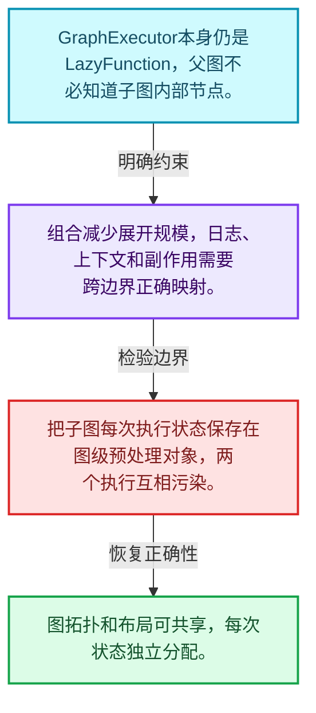
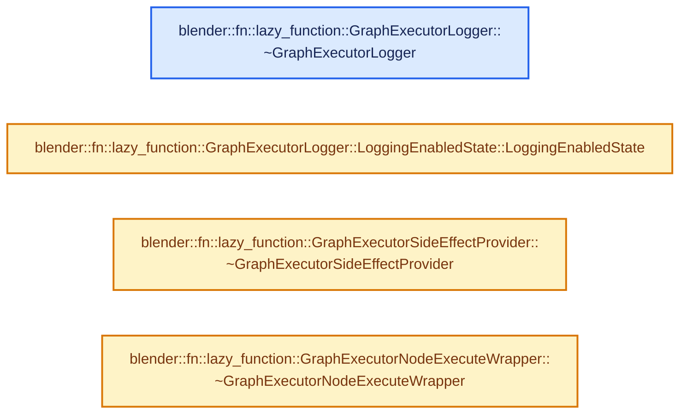
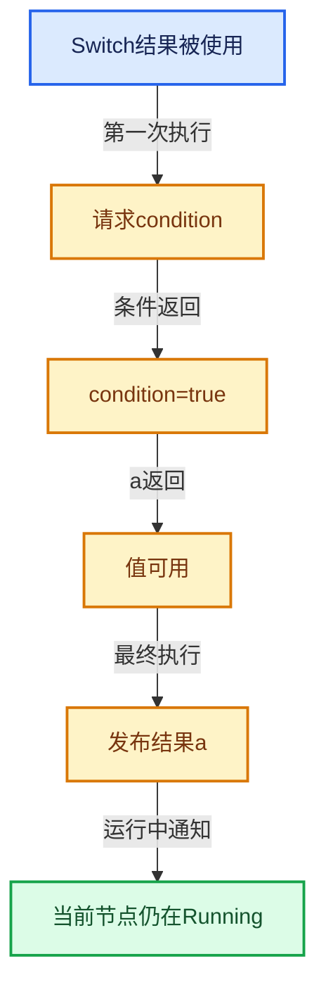

# 09-06 GraphExecutor对外接口

[方向导航](README.md) · [总目录](../README.md) · [实现索引](../00-课程指南/02-源码与提交索引/符号依赖与实现索引.md)

## 从问题到实现

怎样把图再次包装成LazyFunction？

GraphExecutor继承同一计算接口，实现图的组合；预处理数据与每次执行状态分开，日志和副作用策略由接口提供。

**数据模型**

GraphExecutor本身仍是LazyFunction，父图不必知道子图内部节点。

**设计取舍**

组合减少展开规模，日志、上下文和副作用需要跨边界正确映射。

**最小反例**

把子图每次执行状态保存在图级预处理对象，两个执行互相污染。

**推导**

图拓扑和布局可共享，每次状态独立分配。

## 阅读地图与执行推演








图中的数值推演是本方向的教学模型；实际函数之间的调用边与概念分析边分别标注，不能把概念关系当作运行时调度顺序。

## 完整源码单元与就地讲解

中文讲解直接放在相关代码旁，复杂机制在代码下展开。原文折叠区保留基准行号；不需要在行号表和函数之间来回查找。类布局可分段展示，函数实现不按固定行数切开。

### 类型布局、声明与编译条件 · FN_lazy_function_graph_executor.hh L1—L26

<a id="t-3fe8237934d5"></a>

<!-- annotated:502d6d11fc6d21 -->

```cpp
/* SPDX-FileCopyrightText: 2023 Blender Authors
 *
 * SPDX-License-Identifier: GPL-2.0-or-later */

#pragma once

/** \file
 * \ingroup fn
 *
 * This file provides means to create a #LazyFunction from #Graph (which could then e.g. be used in
 * another #Graph again).
 */

#include "BLI_generic_pointer.hh"
#include "BLI_vector.hh"

#include "FN_lazy_function_graph.hh"
#include "FN_lazy_function_graph_executor_generic.hh"

namespace blender::fn::lazy_function {

/**
 * Can be implemented to log values produced during graph evaluation.
 */
class GraphExecutorLogger {
 public:
```

<details>
<summary>核对原始源码：source/blender/functions/FN_lazy_function_graph_executor.hh · L1—L26</summary>

<!-- original:502d6d11fc6d21:source/blender/functions/FN_lazy_function_graph_executor.hh:1:26 -->

```cpp
/* SPDX-FileCopyrightText: 2023 Blender Authors
 *
 * SPDX-License-Identifier: GPL-2.0-or-later */

#pragma once

/** \file
 * \ingroup fn
 *
 * This file provides means to create a #LazyFunction from #Graph (which could then e.g. be used in
 * another #Graph again).
 */

#include "BLI_generic_pointer.hh"
#include "BLI_vector.hh"

#include "FN_lazy_function_graph.hh"
#include "FN_lazy_function_graph_executor_generic.hh"

namespace blender::fn::lazy_function {

/**
 * Can be implemented to log values produced during graph evaluation.
 */
class GraphExecutorLogger {
 public:
```

</details>

<a id="f-3b70218069091972"></a>

### `blender::fn::lazy_function::GraphExecutorLogger::~GraphExecutorLogger`

实现位置：[source/blender/functions/FN_lazy_function_graph_executor.hh](../../../../../source/blender/functions/FN_lazy_function_graph_executor.hh) · L27—L27。

**教学注释版**

<!-- annotated:005c1867222391 -->

```cpp
  virtual ~GraphExecutorLogger() = default;
```

<details>
<summary>核对原始源码：source/blender/functions/FN_lazy_function_graph_executor.hh · L27—L27</summary>

<!-- original:005c1867222391:source/blender/functions/FN_lazy_function_graph_executor.hh:27:27 -->

```cpp
  virtual ~GraphExecutorLogger() = default;
```

</details>

**继续追踪实现**

本实现没有需要继续展开的显式调用；检查返回表达式、对象转换和调用者前置条件。

### 类型布局、声明与编译条件 · FN_lazy_function_graph_executor.hh L28—L33

<a id="t-3c79078d79bd"></a>

`LoggingEnabledState`在这里声明的数据成员：

- `bool socket_values`
- `bool before_node_execute`
- `bool after_node_execute`

<!-- annotated:d9bd4487b23109 -->

```cpp

  struct LoggingEnabledState {
    bool socket_values = true;
    bool before_node_execute = true;
    bool after_node_execute = true;

```

<details>
<summary>核对原始源码：source/blender/functions/FN_lazy_function_graph_executor.hh · L28—L33</summary>

<!-- original:d9bd4487b23109:source/blender/functions/FN_lazy_function_graph_executor.hh:28:33 -->

```cpp

  struct LoggingEnabledState {
    bool socket_values = true;
    bool before_node_execute = true;
    bool after_node_execute = true;

```

</details>

<a id="f-413510b041b0bf88"></a>

### `blender::fn::lazy_function::GraphExecutorLogger::LoggingEnabledState::LoggingEnabledState`

实现位置：[source/blender/functions/FN_lazy_function_graph_executor.hh](../../../../../source/blender/functions/FN_lazy_function_graph_executor.hh) · L34—L37。

接口参数：

- `const bool enabled`

**教学注释版**

<!-- annotated:80c173239a0b79 -->

```cpp
    explicit LoggingEnabledState(const bool enabled)
        : socket_values(enabled), before_node_execute(enabled), after_node_execute(enabled)
    {
    }
```

<details>
<summary>核对原始源码：source/blender/functions/FN_lazy_function_graph_executor.hh · L34—L37</summary>

<!-- original:80c173239a0b79:source/blender/functions/FN_lazy_function_graph_executor.hh:34:37 -->

```cpp
    explicit LoggingEnabledState(const bool enabled)
        : socket_values(enabled), before_node_execute(enabled), after_node_execute(enabled)
    {
    }
```

</details>

**继续追踪实现**

本实现没有需要继续展开的显式调用；检查返回表达式、对象转换和调用者前置条件。

### 类型布局、声明与编译条件 · FN_lazy_function_graph_executor.hh L38—L68

<a id="t-7fe61ecc816e"></a>

<!-- annotated:532ab8265b0653 -->

```cpp
  };

  virtual LoggingEnabledState get_logging_enabled_state(const Context &context) const;

  virtual void log_socket_value(const Socket &socket,
                                GPointer value,
                                const Context &context) const;

  virtual void log_before_node_execute(const FunctionNode &node,
                                       const Params &params,
                                       const Context &context) const;

  virtual void log_after_node_execute(const FunctionNode &node,
                                      const Params &params,
                                      const Context &context) const;

  virtual void dump_when_outputs_are_missing(const FunctionNode &node,
                                             Span<const OutputSocket *> missing_sockets,
                                             const Context &context) const;
  virtual void dump_when_input_is_set_twice(const InputSocket &target_socket,
                                            const OutputSocket &from_socket,
                                            const Context &context) const;
};

/**
 * Has to be implemented when some of the nodes in the graph may have side effects. The
 * #GraphExecutor has to know about that to make sure that these nodes will be executed even though
 * their outputs are not needed.
 */
class GraphExecutorSideEffectProvider {
 public:
```

<details>
<summary>核对原始源码：source/blender/functions/FN_lazy_function_graph_executor.hh · L38—L68</summary>

<!-- original:532ab8265b0653:source/blender/functions/FN_lazy_function_graph_executor.hh:38:68 -->

```cpp
  };

  virtual LoggingEnabledState get_logging_enabled_state(const Context &context) const;

  virtual void log_socket_value(const Socket &socket,
                                GPointer value,
                                const Context &context) const;

  virtual void log_before_node_execute(const FunctionNode &node,
                                       const Params &params,
                                       const Context &context) const;

  virtual void log_after_node_execute(const FunctionNode &node,
                                      const Params &params,
                                      const Context &context) const;

  virtual void dump_when_outputs_are_missing(const FunctionNode &node,
                                             Span<const OutputSocket *> missing_sockets,
                                             const Context &context) const;
  virtual void dump_when_input_is_set_twice(const InputSocket &target_socket,
                                            const OutputSocket &from_socket,
                                            const Context &context) const;
};

/**
 * Has to be implemented when some of the nodes in the graph may have side effects. The
 * #GraphExecutor has to know about that to make sure that these nodes will be executed even though
 * their outputs are not needed.
 */
class GraphExecutorSideEffectProvider {
 public:
```

</details>

<a id="f-fdef0eac36919d85"></a>

### `blender::fn::lazy_function::GraphExecutorSideEffectProvider::~GraphExecutorSideEffectProvider`

实现位置：[source/blender/functions/FN_lazy_function_graph_executor.hh](../../../../../source/blender/functions/FN_lazy_function_graph_executor.hh) · L69—L69。

**教学注释版**

<!-- annotated:c223b093f00c59 -->

```cpp
  virtual ~GraphExecutorSideEffectProvider() = default;
```

<details>
<summary>核对原始源码：source/blender/functions/FN_lazy_function_graph_executor.hh · L69—L69</summary>

<!-- original:c223b093f00c59:source/blender/functions/FN_lazy_function_graph_executor.hh:69:69 -->

```cpp
  virtual ~GraphExecutorSideEffectProvider() = default;
```

</details>

**继续追踪实现**

本实现没有需要继续展开的显式调用；检查返回表达式、对象转换和调用者前置条件。

### 类型布局、声明与编译条件 · FN_lazy_function_graph_executor.hh L70—L79

<a id="t-0531c993f00d"></a>

<!-- annotated:40c65e1bb74337 -->

```cpp
  virtual Vector<const FunctionNode *> get_nodes_with_side_effects(const Context &context) const;
};

/**
 * Can be used to pass extra context into the execution of a function. The main alternative to this
 * is to create a wrapper `LazyFunction` for the `FunctionNode`s. Using this light weight wrapper
 * is preferable if possible.
 */
class GraphExecutorNodeExecuteWrapper {
 public:
```

<details>
<summary>核对原始源码：source/blender/functions/FN_lazy_function_graph_executor.hh · L70—L79</summary>

<!-- original:40c65e1bb74337:source/blender/functions/FN_lazy_function_graph_executor.hh:70:79 -->

```cpp
  virtual Vector<const FunctionNode *> get_nodes_with_side_effects(const Context &context) const;
};

/**
 * Can be used to pass extra context into the execution of a function. The main alternative to this
 * is to create a wrapper `LazyFunction` for the `FunctionNode`s. Using this light weight wrapper
 * is preferable if possible.
 */
class GraphExecutorNodeExecuteWrapper {
 public:
```

</details>

<a id="f-b7e18ecc12e9e43d"></a>

### `blender::fn::lazy_function::GraphExecutorNodeExecuteWrapper::~GraphExecutorNodeExecuteWrapper`

实现位置：[source/blender/functions/FN_lazy_function_graph_executor.hh](../../../../../source/blender/functions/FN_lazy_function_graph_executor.hh) · L80—L80。

**教学注释版**

<!-- annotated:abd1ed433bc824 -->

```cpp
  virtual ~GraphExecutorNodeExecuteWrapper() = default;
```

<details>
<summary>核对原始源码：source/blender/functions/FN_lazy_function_graph_executor.hh · L80—L80</summary>

<!-- original:abd1ed433bc824:source/blender/functions/FN_lazy_function_graph_executor.hh:80:80 -->

```cpp
  virtual ~GraphExecutorNodeExecuteWrapper() = default;
```

</details>

**继续追踪实现**

本实现没有需要继续展开的显式调用；检查返回表达式、对象转换和调用者前置条件。

### 类型布局、声明与编译条件 · FN_lazy_function_graph_executor.hh L81—L155

<a id="t-0e6d7fab148f"></a>

`GraphExecutor`在这里声明的数据成员：

- `Graph graph_`
- `Vector<const GraphInputSocket *> graph_inputs_`
- `Vector<const GraphOutputSocket *> graph_outputs_`
- `Array<int> graph_input_index_by_socket_index_`
- `Array<int> graph_output_index_by_socket_index_`
- `Logger logger_`
- `SideEffectProvider side_effect_provider_`
- `NodeExecuteWrapper node_execute_wrapper_`
- `generic_graph_executor::PreprocessData preprocess_data_`
- `void init_storage`
- `void destruct_storage`
- `std::string input_name`
- `std::string output_name`
- `void execute_impl`

<!-- annotated:4506abd0e06ffb -->

```cpp

  /**
   * Is expected to run `node.function().execute(params, context)` but might do some extra work,
   * like adjusting the context.
   */
  virtual void execute_node(const FunctionNode &node,
                            Params &params,
                            const Context &context) const = 0;
};

class GraphExecutor : public LazyFunction {
 public:
  using Logger = GraphExecutorLogger;
  using SideEffectProvider = GraphExecutorSideEffectProvider;
  using NodeExecuteWrapper = GraphExecutorNodeExecuteWrapper;
  using GenericExecutor = generic_graph_executor::GenericGraphExecutor;

 private:
  /**
   * The graph that is evaluated.
   */
  const Graph &graph_;
  /**
   * Input and output sockets of the entire graph.
   */
  Vector<const GraphInputSocket *> graph_inputs_;
  Vector<const GraphOutputSocket *> graph_outputs_;
  Array<int> graph_input_index_by_socket_index_;
  Array<int> graph_output_index_by_socket_index_;
  /**
   * Optional logger for events that happen during execution.
   */
  const Logger *logger_;
  /**
   * Optional side effect provider. It knows which nodes have side effects based on the context
   * during evaluation.
   */
  const SideEffectProvider *side_effect_provider_;
  /**
   * Optional wrapper for node execution functions.
   */
  const NodeExecuteWrapper *node_execute_wrapper_;

  /**
   * The graph executor implementation does some preprocessing for the graph. This only has to be
   * done once even if the graph is executed multiple times.
   */
  generic_graph_executor::PreprocessData preprocess_data_;

  friend GenericExecutor;

 public:
  GraphExecutor(const Graph &graph,
                const Logger *logger,
                const SideEffectProvider *side_effect_provider,
                const NodeExecuteWrapper *node_execute_wrapper);

  GraphExecutor(const Graph &graph,
                Vector<const GraphInputSocket *> graph_inputs,
                Vector<const GraphOutputSocket *> graph_outputs,
                const Logger *logger,
                const SideEffectProvider *side_effect_provider,
                const NodeExecuteWrapper *node_execute_wrapper);

  void *init_storage(LinearAllocator<> &allocator) const override;
  void destruct_storage(void *storage) const override;

  std::string input_name(int index) const override;
  std::string output_name(int index) const override;

 private:
  void execute_impl(Params &params, const Context &context) const override;
};

}  // namespace blender::fn::lazy_function
```

<details>
<summary>核对原始源码：source/blender/functions/FN_lazy_function_graph_executor.hh · L81—L155</summary>

<!-- original:4506abd0e06ffb:source/blender/functions/FN_lazy_function_graph_executor.hh:81:155 -->

```cpp

  /**
   * Is expected to run `node.function().execute(params, context)` but might do some extra work,
   * like adjusting the context.
   */
  virtual void execute_node(const FunctionNode &node,
                            Params &params,
                            const Context &context) const = 0;
};

class GraphExecutor : public LazyFunction {
 public:
  using Logger = GraphExecutorLogger;
  using SideEffectProvider = GraphExecutorSideEffectProvider;
  using NodeExecuteWrapper = GraphExecutorNodeExecuteWrapper;
  using GenericExecutor = generic_graph_executor::GenericGraphExecutor;

 private:
  /**
   * The graph that is evaluated.
   */
  const Graph &graph_;
  /**
   * Input and output sockets of the entire graph.
   */
  Vector<const GraphInputSocket *> graph_inputs_;
  Vector<const GraphOutputSocket *> graph_outputs_;
  Array<int> graph_input_index_by_socket_index_;
  Array<int> graph_output_index_by_socket_index_;
  /**
   * Optional logger for events that happen during execution.
   */
  const Logger *logger_;
  /**
   * Optional side effect provider. It knows which nodes have side effects based on the context
   * during evaluation.
   */
  const SideEffectProvider *side_effect_provider_;
  /**
   * Optional wrapper for node execution functions.
   */
  const NodeExecuteWrapper *node_execute_wrapper_;

  /**
   * The graph executor implementation does some preprocessing for the graph. This only has to be
   * done once even if the graph is executed multiple times.
   */
  generic_graph_executor::PreprocessData preprocess_data_;

  friend GenericExecutor;

 public:
  GraphExecutor(const Graph &graph,
                const Logger *logger,
                const SideEffectProvider *side_effect_provider,
                const NodeExecuteWrapper *node_execute_wrapper);

  GraphExecutor(const Graph &graph,
                Vector<const GraphInputSocket *> graph_inputs,
                Vector<const GraphOutputSocket *> graph_outputs,
                const Logger *logger,
                const SideEffectProvider *side_effect_provider,
                const NodeExecuteWrapper *node_execute_wrapper);

  void *init_storage(LinearAllocator<> &allocator) const override;
  void destruct_storage(void *storage) const override;

  std::string input_name(int index) const override;
  std::string output_name(int index) const override;

 private:
  void execute_impl(Params &params, const Context &context) const override;
};

}  // namespace blender::fn::lazy_function
```

</details>

### 类型布局、声明与编译条件 · FN_lazy_function_graph_executor_generic.hh L1—L29

<a id="t-e3826ea39624"></a>

<a id="t-9d427debeba6"></a>

`PreprocessData`在这里声明的数据成员：

- `int node_states_array_offset`
- `int loaded_inputs_array_offset`
- `Array<int> node_states_offsets`
- `int total_size`

<!-- annotated:e937ee45fe8887 -->

```cpp
/* SPDX-FileCopyrightText: 2026 Blender Authors
 *
 * SPDX-License-Identifier: GPL-2.0-or-later */

/** \file
 * \ingroup fn
 */

#pragma once

#include "BLI_array.hh"

namespace blender::fn::lazy_function::generic_graph_executor {

class GenericGraphExecutor;

/**
 * When a graph is executed, various things have to be allocated (e.g. the state of all nodes).
 * Instead of doing many small allocations, a single bigger allocation is done. This struct
 * contains the preprocessed offsets into that bigger buffer.
 */
struct PreprocessData {
  int node_states_array_offset;
  int loaded_inputs_array_offset;
  Array<int> node_states_offsets;
  int total_size;
};

}  // namespace blender::fn::lazy_function::generic_graph_executor
```

<details>
<summary>核对原始源码：source/blender/functions/FN_lazy_function_graph_executor_generic.hh · L1—L29</summary>

<!-- original:e937ee45fe8887:source/blender/functions/FN_lazy_function_graph_executor_generic.hh:1:29 -->

```cpp
/* SPDX-FileCopyrightText: 2026 Blender Authors
 *
 * SPDX-License-Identifier: GPL-2.0-or-later */

/** \file
 * \ingroup fn
 */

#pragma once

#include "BLI_array.hh"

namespace blender::fn::lazy_function::generic_graph_executor {

class GenericGraphExecutor;

/**
 * When a graph is executed, various things have to be allocated (e.g. the state of all nodes).
 * Instead of doing many small allocations, a single bigger allocation is done. This struct
 * contains the preprocessed offsets into that bigger buffer.
 */
struct PreprocessData {
  int node_states_array_offset;
  int loaded_inputs_array_offset;
  Array<int> node_states_offsets;
  int total_size;
};

}  // namespace blender::fn::lazy_function::generic_graph_executor
```

</details>

## 语法与相关类型

### 只读限定 const

const约束当前访问路径可做的修改。const指针、指向const的指针、const视图对象、const元素是不同位置的限定；其他别名可能仍可修改原对象。

分别写T* const、const T*与const T* const，并画出不可修改的层次。

### 运行时多态 virtual

虚调用根据实际动态类型选择实现；经基类指针销毁对象时通常需要相应虚析构契约。每元素虚调用和循环外一次分派有不同开销。

找出虚接口的实现类和调用频率，再讨论是否值得去虚拟化。

### 覆写检查 override

override要求函数确实覆盖基类虚函数，可捕获参数类型和const限定不匹配。它不改变基类规定的生命周期或线程约束。

故意改变一个参数或const，观察编译器如何拒绝误写的新函数。

### 受控访问 friend

friend授予指定函数或类访问非公开成员的权限，并不意味着继承，也不自动扩展到友元的派生类。

解释执行器为何需要访问包装器的内部映射，同时检查边界是否仍清楚。

### 类型别名 using

类型别名为已有类型建立名字，不创建运行期对象。它常把模板内部使用的类型统一暴露给泛型调用者。

展开别名直到基础类型，区分类型别名和变量声明。

## 实现练习与验证

把加法子图作为父图一个节点，列出调用边界。

参考推理：图拓扑和布局可共享，每次状态独立分配。

未选分支不执行；输出不会被非法重复构造；同一节点不同时运行两次；副作用有明确执行依据。

## 历史、跨库比较与证据

与拓扑一次求值、future和数据流调度比较：惰性函数允许执行过程中继续请求输入，同一个计算单元可分多次推进。

[历史提交索引](../00-课程指南/02-源码与提交索引/历史提交与设计演化索引.md) · [源码基准](../00-课程指南/02-源码与提交索引/源码版本与覆盖索引.md) · [验收报告](../00-课程指南/03-验收报告/验收报告.md)
