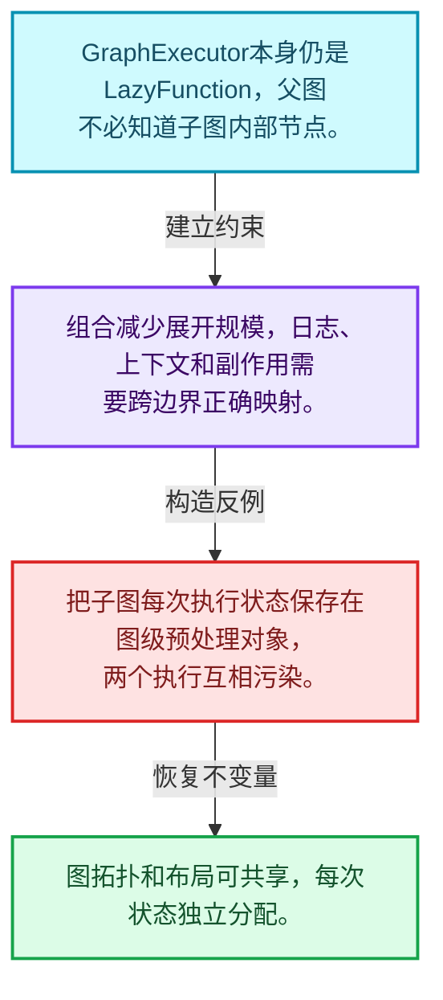
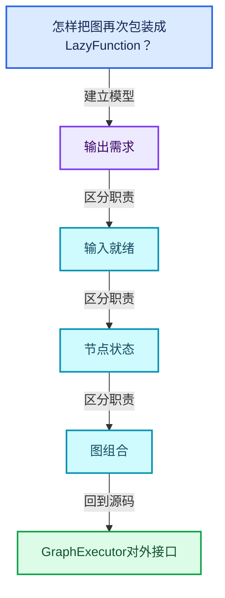
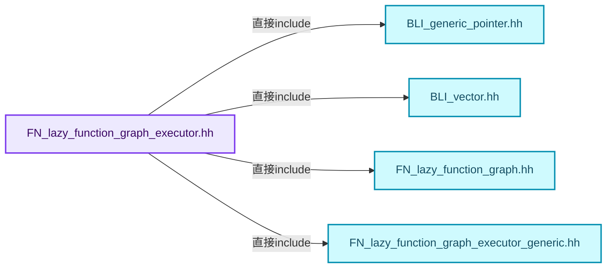
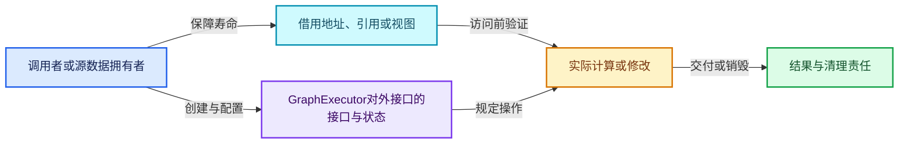
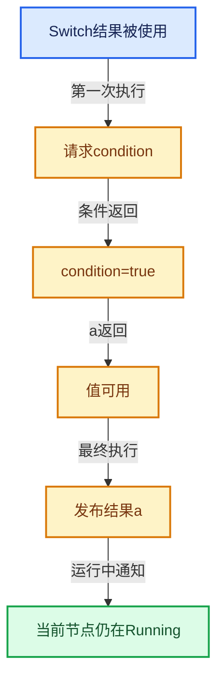

# 09-06 GraphExecutor对外接口

[方向导航](README.md) · [总目录](../README.md) · [覆盖索引](../%E6%BA%90%E7%A0%81%E7%89%88%E6%9C%AC%E4%B8%8E%E8%A6%86%E7%9B%96%E7%B4%A2%E5%BC%95.md)

> 阅读顺序：问题与数据模型 → 语法与类型 → 源码逐行 → 调用线索 → 历史与取舍 → 推演和练习。

- 基准 HEAD：`cbda6b96c26c0dee3c3b5cbb93960c4ac06a6b30`。
- 记录日期：2026-10-14。
- 教学示例状态：正文中的推演不是本机性能实测；已运行练习见验收报告。

## 一、从问题到设计

怎样把图再次包装成LazyFunction？

GraphExecutor继承同一计算接口，实现图的组合；预处理数据与每次执行状态分开，日志和副作用策略由接口提供。

本篇把语法、数据语义和系统取舍连接起来。需求与就绪是不同维度；状态只在有证据时推进，不能把未确定当作无需求。

### 本篇独立模型与设计推理

GraphExecutor本身仍是LazyFunction，父图不必知道子图内部节点。

设计取舍：组合减少展开规模，日志、上下文和副作用需要跨边界正确映射。

最小反例：把子图每次执行状态保存在图级预处理对象，两个执行互相污染。

推导与处理：图拓扑和布局可共享，每次状态独立分配。



### 源码范围与相邻篇章

| 文件 | 本篇逐行范围 | 基准SHA-256 |
|---|---|---|
| [source/blender/functions/FN_lazy_function_graph_executor.hh](../../../../../source/blender/functions/FN_lazy_function_graph_executor.hh) | L1—L155 | `0518b91c27b666082d0038876b44015c1e53f804060bf838ebae028c4ab826b1` |
| [source/blender/functions/FN_lazy_function_graph_executor_generic.hh](../../../../../source/blender/functions/FN_lazy_function_graph_executor_generic.hh) | L1—L29 | `7ec14807b9584bab2f8941e53acdd45cc6814b8be1713f1a0cf0fc35c9159022` |

同一主讲文件可能分多篇覆盖；超出本篇范围的符号通过覆盖索引定位。空行与纯注释保留在源码摘录中，逐行表解释有效语句与语法边界；许可证头统一保留。

前篇：[Graph与Socket](05-Graph%E4%B8%8ESocket.md).

后篇：[执行器内部状态](07-%E6%89%A7%E8%A1%8C%E5%99%A8%E5%86%85%E9%83%A8%E7%8A%B6%E6%80%81.md).

## 二、类型、数据与阅读地图



这是概念依赖图，边表示阅读关系，不声称是运行时调用顺序。

### 直接编译依赖



箭头只表示头文件包含关系；完整调用线索见后面的符号定位表。

## 三、关键词、语法与类型角色

### 只读限定 const

const约束当前访问路径可做的修改。const指针、指向const的指针、const视图对象、const元素是不同位置的限定；其他别名可能仍可修改原对象。

具体检查：分别写T* const、const T*与const T* const，并画出不可修改的层次。

### 运行时多态 virtual

虚调用根据实际动态类型选择实现；经基类指针销毁对象时通常需要相应虚析构契约。每元素虚调用和循环外一次分派有不同开销。

具体检查：找出虚接口的实现类和调用频率，再讨论是否值得去虚拟化。

### 覆写检查 override

override要求函数确实覆盖基类虚函数，可捕获参数类型和const限定不匹配。它不改变基类规定的生命周期或线程约束。

具体检查：故意改变一个参数或const，观察编译器如何拒绝误写的新函数。

### 受控访问 friend

friend授予指定函数或类访问非公开成员的权限，并不意味着继承，也不自动扩展到友元的派生类。

具体检查：解释执行器为何需要访问包装器的内部映射，同时检查边界是否仍清楚。

### 类型别名 using

类型别名为已有类型建立名字，不创建运行期对象。它常把模板内部使用的类型统一暴露给泛型调用者。

具体检查：展开别名直到基础类型，区分类型别名和变量声明。

### GraphExecutor如何实现图的组合

GraphExecutor继承LazyFunction，因此父图可以把完整子图当作一个计算单元。
graph_借用原图；graph_inputs_与graph_outputs_建立外部插槽与内部图接口的对应。
预处理布局只记录统一执行缓冲中各状态的偏移，与某一次执行的输入值和完成状态不同。
Logger、SideEffectProvider、NodeExecuteWrapper是三个独立策略，不应因为都参与执行就混成一个接口。

### 三个策略的区别

日志策略观察值和执行事件；副作用策略声明即使输出未使用也需要执行的节点。
执行包装策略在真实函数执行周围附加上下文处理。
把日志节点一律当副作用节点会改变需求语义，把副作用节点只按输出需求处理则会漏执行。
裸策略指针是否允许为空和调用前检查要逐处看实现；不能仅凭类型推断拥有关系。

### 预处理与每次执行

一个图可以多次执行，布局预处理可以复用。
每次执行仍需自己的状态存储，不能把完成标志放成所有并发执行共享的单个字段。
同一图的两个执行实例可以共享不可变拓扑，却不能不加区分地共享输入值和节点调度状态。

## 四、真实源码与逐行讲解

源码块保持原行内容，原始行号由小节标题及逐行表给出。表中的调用定位是静态阅读辅助；重载、模板实例化、宏展开和虚调用需结合完整声明，不能仅凭词法出现证明动态调用。

### FN_lazy_function_graph_executor.hh：L1—L48

<!-- source:source/blender/functions/FN_lazy_function_graph_executor.hh:1:48 -->

```cpp
/* SPDX-FileCopyrightText: 2023 Blender Authors
 *
 * SPDX-License-Identifier: GPL-2.0-or-later */

#pragma once

/** \file
 * \ingroup fn
 *
 * This file provides means to create a #LazyFunction from #Graph (which could then e.g. be used in
 * another #Graph again).
 */

#include "BLI_generic_pointer.hh"
#include "BLI_vector.hh"

#include "FN_lazy_function_graph.hh"
#include "FN_lazy_function_graph_executor_generic.hh"

namespace blender::fn::lazy_function {

/**
 * Can be implemented to log values produced during graph evaluation.
 */
class GraphExecutorLogger {
 public:
  virtual ~GraphExecutorLogger() = default;

  struct LoggingEnabledState {
    bool socket_values = true;
    bool before_node_execute = true;
    bool after_node_execute = true;

    explicit LoggingEnabledState(const bool enabled)
        : socket_values(enabled), before_node_execute(enabled), after_node_execute(enabled)
    {
    }
  };

  virtual LoggingEnabledState get_logging_enabled_state(const Context &context) const;

  virtual void log_socket_value(const Socket &socket,
                                GPointer value,
                                const Context &context) const;

  virtual void log_before_node_execute(const FunctionNode &node,
                                       const Params &params,
                                       const Context &context) const;
```

| 原始行 | 语义、约束与检查 |
|---|---|
| L5 | 防止同一头文件在一个翻译单元中重复展开；不控制多个源文件之间的链接或对象寿命。 |
| L14 | 引入编译依赖 "BLI_generic_pointer.hh"；这是声明可见性关系，不表示运行时一定调用该文件的所有接口。 |
| L15 | 引入编译依赖 "BLI_vector.hh"；这是声明可见性关系，不表示运行时一定调用该文件的所有接口。 |
| L17 | 引入编译依赖 "FN_lazy_function_graph.hh"；这是声明可见性关系，不表示运行时一定调用该文件的所有接口。 |
| L18 | 引入编译依赖 "FN_lazy_function_graph_executor_generic.hh"；这是声明可见性关系，不表示运行时一定调用该文件的所有接口。 |
| L20 | 把后续声明放入 blender::fn::lazy_function 命名空间，影响名称查找和符号归属，不创建运行时对象。 |
| L25 | 声明或定义类型 `class GraphExecutorLogger`。结合继承、访问权限和成员布局确认接口与拥有关系；前向声明本身没有完整对象布局。 |
| L26 | 切换成员访问权限为 public；它是编译期接口边界，不是线程同步或内存保护。 |
| L27 | 显式采用编译器生成的特殊成员行为：`virtual ~GraphExecutorLogger() = default;`。成员和基类的性质决定该操作是否可用、是否被删除及异常约定，不表示运行时给对象赋值为default。 |
| L29 | 声明或定义类型 `struct LoggingEnabledState`。结合继承、访问权限和成员布局确认接口与拥有关系；前向声明本身没有完整对象布局。 |
| L30 | 把右侧 `true` 用于初始化或更新左侧 `bool socket_values`。声明初始化与已有对象赋值应按上下文区分；有资源的类型会调用相应特殊成员。 |
| L31 | 把右侧 `true` 用于初始化或更新左侧 `bool before_node_execute`。声明初始化与已有对象赋值应按上下文区分；有资源的类型会调用相应特殊成员。 |
| L32 | 把右侧 `true` 用于初始化或更新左侧 `bool after_node_execute`。声明初始化与已有对象赋值应按上下文区分；有资源的类型会调用相应特殊成员。 |
| L34 | 出现调用或函数声明 `LoggingEnabledState`，对应表达式为 `explicit LoggingEnabledState(const bool enabled)`。参数求值、返回类型与重载需结合前后完整语句；静态文本引用不能证明动态目标。 |
| L35 | 出现调用或函数声明 `socket_values`，对应表达式为 `: socket_values(enabled), before_node_execute(enabled), after_node_execute(enabled)`。参数求值、返回类型与重载需结合前后完整语句；静态文本引用不能证明动态目标。 |
| L36 | 连接上一行的声明或控制结构与其语句块；后续行在这个作用域中执行或声明。 |
| L37 | 结束当前语法单元。局部自动对象在离开其作用域时按规则销毁；这不等于所有被引用的外部数据也被释放。 |
| L38 | 结束当前语法单元。局部自动对象在离开其作用域时按规则销毁；这不等于所有被引用的外部数据也被释放。 |
| L40 | 声明接口 `virtual LoggingEnabledState get_logging_enabled_state(const Context &context) const`，本行没有对应函数体；返回类型、参数限定和const/noexcept共同组成调用契约，实际行为需继续定位实现。 |
| L42 | 出现调用或函数声明 `log_socket_value`，对应表达式为 `virtual void log_socket_value(const Socket &socket,`。参数求值、返回类型与重载需结合前后完整语句；静态文本引用不能证明动态目标。 |
| L43 | 本行是连续声明或表达式的一部分：`GPointer value,`。与本段前后行合读；逗号、括号和限定符决定它属于参数、初始化列表还是实际计算。 |
| L44 | 声明成员、局部对象或完成语句 `const Context &context) const`。若为指针或引用，它本身不说明拥有；若为值对象，其构造析构由所在作用域或外层对象管理。 |
| L46 | 出现调用或函数声明 `log_before_node_execute`，对应表达式为 `virtual void log_before_node_execute(const FunctionNode &node,`。参数求值、返回类型与重载需结合前后完整语句；静态文本引用不能证明动态目标。 |
| L47 | 本行是连续声明或表达式的一部分：`const Params &params,`。与本段前后行合读；逗号、括号和限定符决定它属于参数、初始化列表还是实际计算。 |
| L48 | 声明成员、局部对象或完成语句 `const Context &context) const`。若为指针或引用，它本身不说明拥有；若为值对象，其构造析构由所在作用域或外层对象管理。 |

### FN_lazy_function_graph_executor.hh：L49—L96

<!-- source:source/blender/functions/FN_lazy_function_graph_executor.hh:49:96 -->

```cpp

  virtual void log_after_node_execute(const FunctionNode &node,
                                      const Params &params,
                                      const Context &context) const;

  virtual void dump_when_outputs_are_missing(const FunctionNode &node,
                                             Span<const OutputSocket *> missing_sockets,
                                             const Context &context) const;
  virtual void dump_when_input_is_set_twice(const InputSocket &target_socket,
                                            const OutputSocket &from_socket,
                                            const Context &context) const;
};

/**
 * Has to be implemented when some of the nodes in the graph may have side effects. The
 * #GraphExecutor has to know about that to make sure that these nodes will be executed even though
 * their outputs are not needed.
 */
class GraphExecutorSideEffectProvider {
 public:
  virtual ~GraphExecutorSideEffectProvider() = default;
  virtual Vector<const FunctionNode *> get_nodes_with_side_effects(const Context &context) const;
};

/**
 * Can be used to pass extra context into the execution of a function. The main alternative to this
 * is to create a wrapper `LazyFunction` for the `FunctionNode`s. Using this light weight wrapper
 * is preferable if possible.
 */
class GraphExecutorNodeExecuteWrapper {
 public:
  virtual ~GraphExecutorNodeExecuteWrapper() = default;

  /**
   * Is expected to run `node.function().execute(params, context)` but might do some extra work,
   * like adjusting the context.
   */
  virtual void execute_node(const FunctionNode &node,
                            Params &params,
                            const Context &context) const = 0;
};

class GraphExecutor : public LazyFunction {
 public:
  using Logger = GraphExecutorLogger;
  using SideEffectProvider = GraphExecutorSideEffectProvider;
  using NodeExecuteWrapper = GraphExecutorNodeExecuteWrapper;
  using GenericExecutor = generic_graph_executor::GenericGraphExecutor;
```

| 原始行 | 语义、约束与检查 |
|---|---|
| L50 | 出现调用或函数声明 `log_after_node_execute`，对应表达式为 `virtual void log_after_node_execute(const FunctionNode &node,`。参数求值、返回类型与重载需结合前后完整语句；静态文本引用不能证明动态目标。 |
| L51 | 本行是连续声明或表达式的一部分：`const Params &params,`。与本段前后行合读；逗号、括号和限定符决定它属于参数、初始化列表还是实际计算。 |
| L52 | 声明成员、局部对象或完成语句 `const Context &context) const`。若为指针或引用，它本身不说明拥有；若为值对象，其构造析构由所在作用域或外层对象管理。 |
| L54 | 出现调用或函数声明 `dump_when_outputs_are_missing`，对应表达式为 `virtual void dump_when_outputs_are_missing(const FunctionNode &node,`。参数求值、返回类型与重载需结合前后完整语句；静态文本引用不能证明动态目标。 |
| L55 | 本行是连续声明或表达式的一部分：`Span<const OutputSocket *> missing_sockets,`。与本段前后行合读；逗号、括号和限定符决定它属于参数、初始化列表还是实际计算。 |
| L56 | 声明成员、局部对象或完成语句 `const Context &context) const`。若为指针或引用，它本身不说明拥有；若为值对象，其构造析构由所在作用域或外层对象管理。 |
| L57 | 出现调用或函数声明 `dump_when_input_is_set_twice`，对应表达式为 `virtual void dump_when_input_is_set_twice(const InputSocket &target_socket,`。参数求值、返回类型与重载需结合前后完整语句；静态文本引用不能证明动态目标。 |
| L58 | 本行是连续声明或表达式的一部分：`const OutputSocket &from_socket,`。与本段前后行合读；逗号、括号和限定符决定它属于参数、初始化列表还是实际计算。 |
| L59 | 声明成员、局部对象或完成语句 `const Context &context) const`。若为指针或引用，它本身不说明拥有；若为值对象，其构造析构由所在作用域或外层对象管理。 |
| L60 | 结束当前语法单元。局部自动对象在离开其作用域时按规则销毁；这不等于所有被引用的外部数据也被释放。 |
| L67 | 声明或定义类型 `class GraphExecutorSideEffectProvider`。结合继承、访问权限和成员布局确认接口与拥有关系；前向声明本身没有完整对象布局。 |
| L68 | 切换成员访问权限为 public；它是编译期接口边界，不是线程同步或内存保护。 |
| L69 | 显式采用编译器生成的特殊成员行为：`virtual ~GraphExecutorSideEffectProvider() = default;`。成员和基类的性质决定该操作是否可用、是否被删除及异常约定，不表示运行时给对象赋值为default。 |
| L70 | 声明接口 `virtual Vector<const FunctionNode *> get_nodes_with_side_effects(const Context &context) const`，本行没有对应函数体；返回类型、参数限定和const/noexcept共同组成调用契约，实际行为需继续定位实现。 |
| L71 | 结束当前语法单元。局部自动对象在离开其作用域时按规则销毁；这不等于所有被引用的外部数据也被释放。 |
| L78 | 声明或定义类型 `class GraphExecutorNodeExecuteWrapper`。结合继承、访问权限和成员布局确认接口与拥有关系；前向声明本身没有完整对象布局。 |
| L79 | 切换成员访问权限为 public；它是编译期接口边界，不是线程同步或内存保护。 |
| L80 | 显式采用编译器生成的特殊成员行为：`virtual ~GraphExecutorNodeExecuteWrapper() = default;`。成员和基类的性质决定该操作是否可用、是否被删除及异常约定，不表示运行时给对象赋值为default。 |
| L86 | 出现调用或函数声明 `execute_node`，对应表达式为 `virtual void execute_node(const FunctionNode &node,`。参数求值、返回类型与重载需结合前后完整语句；静态文本引用不能证明动态目标。 |
| L87 | 本行是连续声明或表达式的一部分：`Params &params,`。与本段前后行合读；逗号、括号和限定符决定它属于参数、初始化列表还是实际计算。 |
| L88 | 把右侧 `0` 用于初始化或更新左侧 `const Context &context) const`。声明初始化与已有对象赋值应按上下文区分；有资源的类型会调用相应特殊成员。 |
| L89 | 结束当前语法单元。局部自动对象在离开其作用域时按规则销毁；这不等于所有被引用的外部数据也被释放。 |
| L91 | 声明或定义类型 `class GraphExecutor : public LazyFunction`。结合继承、访问权限和成员布局确认接口与拥有关系；前向声明本身没有完整对象布局。 |
| L92 | 切换成员访问权限为 public；它是编译期接口边界，不是线程同步或内存保护。 |
| L93 | 定义类型别名 `using Logger = GraphExecutorLogger`，为模板接口或内部实现统一命名；本行不分配该类型对象。 |
| L94 | 定义类型别名 `using SideEffectProvider = GraphExecutorSideEffectProvider`，为模板接口或内部实现统一命名；本行不分配该类型对象。 |
| L95 | 定义类型别名 `using NodeExecuteWrapper = GraphExecutorNodeExecuteWrapper`，为模板接口或内部实现统一命名；本行不分配该类型对象。 |
| L96 | 定义类型别名 `using GenericExecutor = generic_graph_executor::GenericGraphExecutor`，为模板接口或内部实现统一命名；本行不分配该类型对象。 |

### FN_lazy_function_graph_executor.hh：L97—L155

<!-- source:source/blender/functions/FN_lazy_function_graph_executor.hh:97:155 -->

```cpp

 private:
  /**
   * The graph that is evaluated.
   */
  const Graph &graph_;
  /**
   * Input and output sockets of the entire graph.
   */
  Vector<const GraphInputSocket *> graph_inputs_;
  Vector<const GraphOutputSocket *> graph_outputs_;
  Array<int> graph_input_index_by_socket_index_;
  Array<int> graph_output_index_by_socket_index_;
  /**
   * Optional logger for events that happen during execution.
   */
  const Logger *logger_;
  /**
   * Optional side effect provider. It knows which nodes have side effects based on the context
   * during evaluation.
   */
  const SideEffectProvider *side_effect_provider_;
  /**
   * Optional wrapper for node execution functions.
   */
  const NodeExecuteWrapper *node_execute_wrapper_;

  /**
   * The graph executor implementation does some preprocessing for the graph. This only has to be
   * done once even if the graph is executed multiple times.
   */
  generic_graph_executor::PreprocessData preprocess_data_;

  friend GenericExecutor;

 public:
  GraphExecutor(const Graph &graph,
                const Logger *logger,
                const SideEffectProvider *side_effect_provider,
                const NodeExecuteWrapper *node_execute_wrapper);

  GraphExecutor(const Graph &graph,
                Vector<const GraphInputSocket *> graph_inputs,
                Vector<const GraphOutputSocket *> graph_outputs,
                const Logger *logger,
                const SideEffectProvider *side_effect_provider,
                const NodeExecuteWrapper *node_execute_wrapper);

  void *init_storage(LinearAllocator<> &allocator) const override;
  void destruct_storage(void *storage) const override;

  std::string input_name(int index) const override;
  std::string output_name(int index) const override;

 private:
  void execute_impl(Params &params, const Context &context) const override;
};

}  // namespace blender::fn::lazy_function
```

本段语义重点：

- `graph_`：图结构字段；GraphExecutor以引用借用图，其存活不自动保证图存活，其他类按声明确认。
- `preprocess_data_`：图级预处理布局信息，与每次执行的状态缓冲不同。
- `graph_inputs_`：图对外输入插槽列表，用于建立接口到图内部的对应。
- `graph_outputs_`：图对外输出插槽列表，决定外部请求结果的入口。
- `logger_`：可选日志策略对象，通常为借用关系。

| 原始行 | 语义、约束与检查 |
|---|---|
| L98 | 切换成员访问权限为 private；它是编译期接口边界，不是线程同步或内存保护。 |
| L102 | 本行涉及 `graph_`：图结构字段；GraphExecutor以引用借用图，其存活不自动保证图存活，其他类按声明确认。按此语义解读 `const Graph &graph_`，不要把地址、数量或状态混用。 |
| L106 | 本行涉及 `graph_inputs_`：图对外输入插槽列表，用于建立接口到图内部的对应。按此语义解读 `Vector<const GraphInputSocket *> graph_inputs_`，不要把地址、数量或状态混用。 |
| L107 | 本行涉及 `graph_outputs_`：图对外输出插槽列表，决定外部请求结果的入口。按此语义解读 `Vector<const GraphOutputSocket *> graph_outputs_`，不要把地址、数量或状态混用。 |
| L108 | 声明成员、局部对象或完成语句 `Array<int> graph_input_index_by_socket_index_`。若为指针或引用，它本身不说明拥有；若为值对象，其构造析构由所在作用域或外层对象管理。 |
| L109 | 声明成员、局部对象或完成语句 `Array<int> graph_output_index_by_socket_index_`。若为指针或引用，它本身不说明拥有；若为值对象，其构造析构由所在作用域或外层对象管理。 |
| L113 | 本行涉及 `logger_`：可选日志策略对象，通常为借用关系。按此语义解读 `const Logger *logger_`，不要把地址、数量或状态混用。 |
| L118 | 本行涉及 `side_effect_provider_`：提供必须执行的副作用节点，补充纯输出需求分析。按此语义解读 `const SideEffectProvider *side_effect_provider_`，不要把地址、数量或状态混用。 |
| L122 | 本行涉及 `node_execute_wrapper_`：执行包装策略，可调整上下文但仍须调用真实节点逻辑。按此语义解读 `const NodeExecuteWrapper *node_execute_wrapper_`，不要把地址、数量或状态混用。 |
| L128 | 本行涉及 `preprocess_data_`：图级预处理布局信息，与每次执行的状态缓冲不同。按此语义解读 `generic_graph_executor::PreprocessData preprocess_data_`，不要把地址、数量或状态混用。 |
| L130 | 声明成员、局部对象或完成语句 `friend GenericExecutor`。若为指针或引用，它本身不说明拥有；若为值对象，其构造析构由所在作用域或外层对象管理。 |
| L132 | 切换成员访问权限为 public；它是编译期接口边界，不是线程同步或内存保护。 |
| L133 | 出现调用或函数声明 `GraphExecutor`，对应表达式为 `GraphExecutor(const Graph &graph,`。参数求值、返回类型与重载需结合前后完整语句；静态文本引用不能证明动态目标。 |
| L134 | 本行是连续声明或表达式的一部分：`const Logger *logger,`。与本段前后行合读；逗号、括号和限定符决定它属于参数、初始化列表还是实际计算。 |
| L135 | 本行是连续声明或表达式的一部分：`const SideEffectProvider *side_effect_provider,`。与本段前后行合读；逗号、括号和限定符决定它属于参数、初始化列表还是实际计算。 |
| L136 | 声明成员、局部对象或完成语句 `const NodeExecuteWrapper *node_execute_wrapper)`。若为指针或引用，它本身不说明拥有；若为值对象，其构造析构由所在作用域或外层对象管理。 |
| L138 | 出现调用或函数声明 `GraphExecutor`，对应表达式为 `GraphExecutor(const Graph &graph,`。参数求值、返回类型与重载需结合前后完整语句；静态文本引用不能证明动态目标。 |
| L139 | 本行是连续声明或表达式的一部分：`Vector<const GraphInputSocket *> graph_inputs,`。与本段前后行合读；逗号、括号和限定符决定它属于参数、初始化列表还是实际计算。 |
| L140 | 本行是连续声明或表达式的一部分：`Vector<const GraphOutputSocket *> graph_outputs,`。与本段前后行合读；逗号、括号和限定符决定它属于参数、初始化列表还是实际计算。 |
| L141 | 本行是连续声明或表达式的一部分：`const Logger *logger,`。与本段前后行合读；逗号、括号和限定符决定它属于参数、初始化列表还是实际计算。 |
| L142 | 本行是连续声明或表达式的一部分：`const SideEffectProvider *side_effect_provider,`。与本段前后行合读；逗号、括号和限定符决定它属于参数、初始化列表还是实际计算。 |
| L143 | 声明成员、局部对象或完成语句 `const NodeExecuteWrapper *node_execute_wrapper)`。若为指针或引用，它本身不说明拥有；若为值对象，其构造析构由所在作用域或外层对象管理。 |
| L145 | 声明接口 `void *init_storage(LinearAllocator<> &allocator) const override`，本行没有对应函数体；返回类型、参数限定和const/noexcept共同组成调用契约，实际行为需继续定位实现。 |
| L146 | 声明接口 `void destruct_storage(void *storage) const override`，本行没有对应函数体；返回类型、参数限定和const/noexcept共同组成调用契约，实际行为需继续定位实现。 |
| L148 | 声明接口 `std::string input_name(int index) const override`，本行没有对应函数体；返回类型、参数限定和const/noexcept共同组成调用契约，实际行为需继续定位实现。 |
| L149 | 声明接口 `std::string output_name(int index) const override`，本行没有对应函数体；返回类型、参数限定和const/noexcept共同组成调用契约，实际行为需继续定位实现。 |
| L151 | 切换成员访问权限为 private；它是编译期接口边界，不是线程同步或内存保护。 |
| L152 | 声明接口 `void execute_impl(Params &params, const Context &context) const override`，本行没有对应函数体；返回类型、参数限定和const/noexcept共同组成调用契约，实际行为需继续定位实现。 |
| L153 | 结束当前语法单元。局部自动对象在离开其作用域时按规则销毁；这不等于所有被引用的外部数据也被释放。 |
| L155 | 结束当前语法单元。局部自动对象在离开其作用域时按规则销毁；这不等于所有被引用的外部数据也被释放。 |

### FN_lazy_function_graph_executor_generic.hh：L1—L29

<!-- source:source/blender/functions/FN_lazy_function_graph_executor_generic.hh:1:29 -->

```cpp
/* SPDX-FileCopyrightText: 2026 Blender Authors
 *
 * SPDX-License-Identifier: GPL-2.0-or-later */

/** \file
 * \ingroup fn
 */

#pragma once

#include "BLI_array.hh"

namespace blender::fn::lazy_function::generic_graph_executor {

class GenericGraphExecutor;

/**
 * When a graph is executed, various things have to be allocated (e.g. the state of all nodes).
 * Instead of doing many small allocations, a single bigger allocation is done. This struct
 * contains the preprocessed offsets into that bigger buffer.
 */
struct PreprocessData {
  int node_states_array_offset;
  int loaded_inputs_array_offset;
  Array<int> node_states_offsets;
  int total_size;
};

}  // namespace blender::fn::lazy_function::generic_graph_executor
```

本段语义重点：

- `node_states_offsets`：各节点状态在统一缓冲中的偏移，需要与对齐及大小对应。
- `total_size`：布局所需总字节数或范围总量，具体单位由声明和使用决定。

| 原始行 | 语义、约束与检查 |
|---|---|
| L9 | 防止同一头文件在一个翻译单元中重复展开；不控制多个源文件之间的链接或对象寿命。 |
| L11 | 引入编译依赖 "BLI_array.hh"；这是声明可见性关系，不表示运行时一定调用该文件的所有接口。 |
| L13 | 把后续声明放入 blender::fn::lazy_function::generic_graph_executor 命名空间，影响名称查找和符号归属，不创建运行时对象。 |
| L15 | 声明或定义类型 `class GenericGraphExecutor`。结合继承、访问权限和成员布局确认接口与拥有关系；前向声明本身没有完整对象布局。 |
| L22 | 声明或定义类型 `struct PreprocessData`。结合继承、访问权限和成员布局确认接口与拥有关系；前向声明本身没有完整对象布局。 |
| L23 | 声明成员、局部对象或完成语句 `int node_states_array_offset`。若为指针或引用，它本身不说明拥有；若为值对象，其构造析构由所在作用域或外层对象管理。 |
| L24 | 声明成员、局部对象或完成语句 `int loaded_inputs_array_offset`。若为指针或引用，它本身不说明拥有；若为值对象，其构造析构由所在作用域或外层对象管理。 |
| L25 | 本行涉及 `node_states_offsets`：各节点状态在统一缓冲中的偏移，需要与对齐及大小对应。按此语义解读 `Array<int> node_states_offsets`，不要把地址、数量或状态混用。 |
| L26 | 本行涉及 `total_size`：布局所需总字节数或范围总量，具体单位由声明和使用决定。按此语义解读 `int total_size`，不要把地址、数量或状态混用。 |
| L27 | 结束当前语法单元。局部自动对象在离开其作用域时按规则销毁；这不等于所有被引用的外部数据也被释放。 |
| L29 | 结束当前语法单元。局部自动对象在离开其作用域时按规则销毁；这不等于所有被引用的外部数据也被释放。 |

## 五、接口定位、调用线索与生命周期

### 本篇声明与实现入口

| 源码位置 | 实际声明片段 |
|---|---|
| [FN_lazy_function_graph_executor.hh:L25](../../../../../source/blender/functions/FN_lazy_function_graph_executor.hh#L25) | `class GraphExecutorLogger` |
| [FN_lazy_function_graph_executor.hh:L27](../../../../../source/blender/functions/FN_lazy_function_graph_executor.hh#L27) | `virtual ~GraphExecutorLogger() = default;` |
| [FN_lazy_function_graph_executor.hh:L29](../../../../../source/blender/functions/FN_lazy_function_graph_executor.hh#L29) | `struct LoggingEnabledState` |
| [FN_lazy_function_graph_executor.hh:L34](../../../../../source/blender/functions/FN_lazy_function_graph_executor.hh#L34) | `explicit LoggingEnabledState(const bool enabled)` |
| [FN_lazy_function_graph_executor.hh:L35](../../../../../source/blender/functions/FN_lazy_function_graph_executor.hh#L35) | `: socket_values(enabled), before_node_execute(enabled), after_node_execute(enabled)` |
| [FN_lazy_function_graph_executor.hh:L40](../../../../../source/blender/functions/FN_lazy_function_graph_executor.hh#L40) | `virtual LoggingEnabledState get_logging_enabled_state(const Context &context) const;` |
| [FN_lazy_function_graph_executor.hh:L42](../../../../../source/blender/functions/FN_lazy_function_graph_executor.hh#L42) | `virtual void log_socket_value(const Socket &socket,` |
| [FN_lazy_function_graph_executor.hh:L46](../../../../../source/blender/functions/FN_lazy_function_graph_executor.hh#L46) | `virtual void log_before_node_execute(const FunctionNode &node,` |
| [FN_lazy_function_graph_executor.hh:L50](../../../../../source/blender/functions/FN_lazy_function_graph_executor.hh#L50) | `virtual void log_after_node_execute(const FunctionNode &node,` |
| [FN_lazy_function_graph_executor.hh:L54](../../../../../source/blender/functions/FN_lazy_function_graph_executor.hh#L54) | `virtual void dump_when_outputs_are_missing(const FunctionNode &node,` |
| [FN_lazy_function_graph_executor.hh:L57](../../../../../source/blender/functions/FN_lazy_function_graph_executor.hh#L57) | `virtual void dump_when_input_is_set_twice(const InputSocket &target_socket,` |
| [FN_lazy_function_graph_executor.hh:L67](../../../../../source/blender/functions/FN_lazy_function_graph_executor.hh#L67) | `class GraphExecutorSideEffectProvider` |
| [FN_lazy_function_graph_executor.hh:L69](../../../../../source/blender/functions/FN_lazy_function_graph_executor.hh#L69) | `virtual ~GraphExecutorSideEffectProvider() = default;` |
| [FN_lazy_function_graph_executor.hh:L70](../../../../../source/blender/functions/FN_lazy_function_graph_executor.hh#L70) | `virtual Vector<const FunctionNode *> get_nodes_with_side_effects(const Context &context) const;` |
| [FN_lazy_function_graph_executor.hh:L78](../../../../../source/blender/functions/FN_lazy_function_graph_executor.hh#L78) | `class GraphExecutorNodeExecuteWrapper` |
| [FN_lazy_function_graph_executor.hh:L80](../../../../../source/blender/functions/FN_lazy_function_graph_executor.hh#L80) | `virtual ~GraphExecutorNodeExecuteWrapper() = default;` |
| [FN_lazy_function_graph_executor.hh:L86](../../../../../source/blender/functions/FN_lazy_function_graph_executor.hh#L86) | `virtual void execute_node(const FunctionNode &node,` |
| [FN_lazy_function_graph_executor.hh:L91](../../../../../source/blender/functions/FN_lazy_function_graph_executor.hh#L91) | `class GraphExecutor : public LazyFunction` |
| [FN_lazy_function_graph_executor.hh:L133](../../../../../source/blender/functions/FN_lazy_function_graph_executor.hh#L133) | `GraphExecutor(const Graph &graph,` |
| [FN_lazy_function_graph_executor.hh:L138](../../../../../source/blender/functions/FN_lazy_function_graph_executor.hh#L138) | `GraphExecutor(const Graph &graph,` |
| [FN_lazy_function_graph_executor.hh:L145](../../../../../source/blender/functions/FN_lazy_function_graph_executor.hh#L145) | `void *init_storage(LinearAllocator<> &allocator) const override;` |
| [FN_lazy_function_graph_executor.hh:L146](../../../../../source/blender/functions/FN_lazy_function_graph_executor.hh#L146) | `void destruct_storage(void *storage) const override;` |
| [FN_lazy_function_graph_executor.hh:L148](../../../../../source/blender/functions/FN_lazy_function_graph_executor.hh#L148) | `std::string input_name(int index) const override;` |
| [FN_lazy_function_graph_executor.hh:L149](../../../../../source/blender/functions/FN_lazy_function_graph_executor.hh#L149) | `std::string output_name(int index) const override;` |
| [FN_lazy_function_graph_executor.hh:L152](../../../../../source/blender/functions/FN_lazy_function_graph_executor.hh#L152) | `void execute_impl(Params &params, const Context &context) const override;` |
| [FN_lazy_function_graph_executor_generic.hh:L15](../../../../../source/blender/functions/FN_lazy_function_graph_executor_generic.hh#L15) | `class GenericGraphExecutor;` |
| [FN_lazy_function_graph_executor_generic.hh:L22](../../../../../source/blender/functions/FN_lazy_function_graph_executor_generic.hh#L22) | `struct PreprocessData` |

### 同名符号出现位置

以下表提供跨文件阅读入口，包含声明、调用或测试使用；没有经过完整C++名称解析，不把它命名为已证明的运行时调用图。

| 符号 | 位置 | 文本证据 |
|---|---|---|
| `get_logging_enabled_state` | [lazy_function_graph_executor.cc:L97](../../../../../source/blender/functions/intern/lazy_function_graph_executor.cc#L97) | `GraphExecutorLogger::LoggingEnabledState GraphExecutorLogger::get_logging_enabled_state(` |
| `get_logging_enabled_state` | [lazy_function_graph_executor_generic.hh:L397](../../../../../source/blender/functions/intern/lazy_function_graph_executor_generic.hh#L397) | `logging_enabled_state_ = self_.logger_->get_logging_enabled_state(context);` |
| `get_logging_enabled_state` | [geometry_nodes_lazy_function.cc:L1814](../../../../../source/blender/nodes/intern/geometry_nodes_lazy_function.cc#L1814) | `LoggingEnabledState get_logging_enabled_state(const lf::Context &context) const override` |
| `log_socket_value` | [lazy_function_graph_executor.cc:L103](../../../../../source/blender/functions/intern/lazy_function_graph_executor.cc#L103) | `void GraphExecutorLogger::log_socket_value(const Socket &socket,` |
| `log_socket_value` | [lazy_function_graph_executor_generic.hh:L560](../../../../../source/blender/functions/intern/lazy_function_graph_executor_generic.hh#L560) | `self_.logger_->log_socket_value(socket, {type, default_value}, context);` |
| `log_socket_value` | [lazy_function_graph_executor_generic.hh:L950](../../../../../source/blender/functions/intern/lazy_function_graph_executor_generic.hh#L950) | `self_.logger_->log_socket_value(input_socket, {type, default_value}, local_context);` |
| `log_before_node_execute` | [lazy_function_graph_executor.cc:L110](../../../../../source/blender/functions/intern/lazy_function_graph_executor.cc#L110) | `void GraphExecutorLogger::log_before_node_execute(const FunctionNode &node,` |
| `log_before_node_execute` | [lazy_function_graph_executor_generic.hh:L1474](../../../../../source/blender/functions/intern/lazy_function_graph_executor_generic.hh#L1474) | `self_.logger_->log_before_node_execute(node, node_params, fn_context);` |
| `log_before_node_execute` | [geometry_nodes_lazy_function.cc:L1890](../../../../../source/blender/nodes/intern/geometry_nodes_lazy_function.cc#L1890) | `void log_before_node_execute(const lf::FunctionNode &node,` |
| `log_after_node_execute` | [lazy_function_graph_executor.cc:L117](../../../../../source/blender/functions/intern/lazy_function_graph_executor.cc#L117) | `void GraphExecutorLogger::log_after_node_execute(const FunctionNode &node,` |
| `log_after_node_execute` | [lazy_function_graph_executor_generic.hh:L1499](../../../../../source/blender/functions/intern/lazy_function_graph_executor_generic.hh#L1499) | `self_.logger_->log_after_node_execute(node, node_params, fn_context);` |
| `dump_when_outputs_are_missing` | [lazy_function_graph_executor.cc:L131](../../../../../source/blender/functions/intern/lazy_function_graph_executor.cc#L131) | `void GraphExecutorLogger::dump_when_outputs_are_missing(const FunctionNode &node,` |
| `dump_when_outputs_are_missing` | [lazy_function_graph_executor_generic.hh:L1008](../../../../../source/blender/functions/intern/lazy_function_graph_executor_generic.hh#L1008) | `self_.logger_->dump_when_outputs_are_missing(node, missing_outputs, context);` |
| `dump_when_outputs_are_missing` | [geometry_nodes_lazy_function.cc:L1860](../../../../../source/blender/nodes/intern/geometry_nodes_lazy_function.cc#L1860) | `void dump_when_outputs_are_missing(const lf::FunctionNode &node,` |
| `dump_when_input_is_set_twice` | [lazy_function_graph_executor.cc:L138](../../../../../source/blender/functions/intern/lazy_function_graph_executor.cc#L138) | `void GraphExecutorLogger::dump_when_input_is_set_twice(const InputSocket &target_socket,` |
| `dump_when_input_is_set_twice` | [lazy_function_graph_executor_generic.hh:L1173](../../../../../source/blender/functions/intern/lazy_function_graph_executor_generic.hh#L1173) | `self_.logger_->dump_when_input_is_set_twice(*target_socket, from_socket, local_context);` |
| `dump_when_input_is_set_twice` | [geometry_nodes_lazy_function.cc:L1875](../../../../../source/blender/nodes/intern/geometry_nodes_lazy_function.cc#L1875) | `void dump_when_input_is_set_twice(const lf::InputSocket &target_socket,` |
| `get_nodes_with_side_effects` | [lazy_function_graph_executor.cc:L124](../../../../../source/blender/functions/intern/lazy_function_graph_executor.cc#L124) | `Vector<const FunctionNode *> GraphExecutorSideEffectProvider::get_nodes_with_side_effects(` |
| `get_nodes_with_side_effects` | [lazy_function_graph_executor_generic.hh:L417](../../../../../source/blender/functions/intern/lazy_function_graph_executor_generic.hh#L417) | `side_effect_nodes = self_.side_effect_provider_->get_nodes_with_side_effects(context);` |
| `get_nodes_with_side_effects` | [FN_lazy_function_test.cc:L69](../../../../../source/blender/functions/tests/FN_lazy_function_test.cc#L69) | `Vector<const FunctionNode *> get_nodes_with_side_effects(` |
| `execute_node` | [lazy_function_graph_executor_generic.hh:L964](../../../../../source/blender/functions/intern/lazy_function_graph_executor_generic.hh#L964) | `this->execute_node(node, node_state, current_task, local_data);` |
| `execute_node` | [lazy_function_graph_executor_generic.hh:L1068](../../../../../source/blender/functions/intern/lazy_function_graph_executor_generic.hh#L1068) | `void execute_node(const FunctionNode &node,` |
| `execute_node` | [lazy_function_graph_executor_generic.hh:L1463](../../../../../source/blender/functions/intern/lazy_function_graph_executor_generic.hh#L1463) | `inline void GenericGraphExecutor::execute_node(const FunctionNode &node,` |
| `GraphExecutor` | [lazy_function_graph_executor.cc:L19](../../../../../source/blender/functions/intern/lazy_function_graph_executor.cc#L19) | `GraphExecutor::GraphExecutor(const Graph &graph,` |
| `GraphExecutor` | [lazy_function_graph_executor.cc:L23](../../../../../source/blender/functions/intern/lazy_function_graph_executor.cc#L23) | `: GraphExecutor(graph,` |
| `GraphExecutor` | [lazy_function_graph_executor.cc:L32](../../../../../source/blender/functions/intern/lazy_function_graph_executor.cc#L32) | `GraphExecutor::GraphExecutor(const Graph &graph,` |
| `init_storage` | [FN_lazy_function.hh:L273](../../../../../source/blender/functions/FN_lazy_function.hh#L273) | `virtual void *init_storage(LinearAllocator<> &allocator) const;` |
| `init_storage` | [FN_lazy_function_execute.hh:L119](../../../../../source/blender/functions/FN_lazy_function_execute.hh#L119) | `Context context(fn.init_storage(allocator), user_data, local_user_data);` |
| `init_storage` | [lazy_function.cc:L28](../../../../../source/blender/functions/intern/lazy_function.cc#L28) | `void *LazyFunction::init_storage(LinearAllocator<> & ) const` |
| `destruct_storage` | [FN_lazy_function.hh:L278](../../../../../source/blender/functions/FN_lazy_function.hh#L278) | `virtual void destruct_storage(void *storage) const;` |
| `destruct_storage` | [FN_lazy_function_execute.hh:L123](../../../../../source/blender/functions/FN_lazy_function_execute.hh#L123) | `fn.destruct_storage(context.storage);` |
| `destruct_storage` | [lazy_function.cc:L33](../../../../../source/blender/functions/intern/lazy_function.cc#L33) | `void LazyFunction::destruct_storage(void *storage) const` |

### 生命周期推理图



这是审查生命周期的通用模型。具体类是否拥有数据由本篇成员、构造、析构和调用者一起证明；任何箭头都不自动代表shared_ptr。

## 六、把代码放进具体数据中推演

本方向的共同数值模型如下。本篇的专门检查是：把加法子图作为父图一个节点，列出调用边界。

| 步骤 | 数据或状态 | 为什么需要这一步 |
|---|---|---|
| 请求输出 | Switch结果被使用 | 尚不知道取哪个数据分支 |
| 第一次执行 | 请求condition | 缺失输入时交回控制 |
| 条件返回 | condition=true | 只请求a |
| a返回 | 值可用 | b仍不需要执行 |
| 最终执行 | 发布结果a | 标记输出已计算 |
| 运行中通知 | 当前节点仍在Running | 转成需要再次调度而非并发重复执行 |



图是教学推演模型；精确分支与状态更新以本篇摘录及调用契约为准。

### 本篇独立练习与参考思路

把加法子图作为父图一个节点，列出调用边界。

参考思路：GraphExecutor继承同一计算接口，实现图的组合；预处理数据与每次执行状态分开，日志和副作用策略由接口提供。

将输入、预期结果和资源责任分成三张清单。先用最直接的实现给出可核对的答案，再替换成对应源码使用的表示；比较结果不变的条件，而不是只比较接口名字。

验收依据：未选分支不执行；输出不会被非法重复构造；同一节点不同时运行两次；副作用有明确执行依据。

## 七、复杂度、设计取舍与其他基础库

与拓扑一次求值、future和数据流调度比较：惰性函数允许执行过程中继续请求输入，同一个计算单元可分多次推进。

本篇的具体取舍：GraphExecutor继承同一计算接口，实现图的组合；预处理数据与每次执行状态分开，日志和副作用策略由接口提供。

| 观察维度 | 从源码取得证据的方法 | 本篇要避免的误判 |
|---|---|---|
| 时间 | 对循环次数、分派次数和重建频率分别计数 | 看到单次常数操作就断定整个操作序列是常数成本 |
| 内存 | 区分对象本体、容量存储、间接资源和共享控制块 | 用sizeof代替总内存 |
| 安全 | 沿构造、失败回滚、销毁与失效逐路径检查 | 把断言或非空指针当作完整安全证明 |
| 并发 | 逐字段确认锁、发布顺序和借用寿命 | 把引用计数线程安全等同数据读写线程安全 |

相关一手资料：

- [C++公开工作草案](https://eel.is/c++draft/)：持续更新的工作草案；语言与标准库语义以相应章节为准。
- [oneTBB官方文档](https://uxlfoundation.github.io/oneTBB/)：在线入口；实现细节以实际依赖版本为准。

资料用于核对契约和进一步阅读；这里没有声称外部库与Blender实现相同，也没有把上游性能数字当作本机实测。

## 八、历史提交与设计演化

### 2022-09-13 · Jacques Lucke

[Geometry Nodes: new evaluation system](https://projects.blender.org/blender/blender/commit/4130f1e674f83fc3d53979d3061469af34e1f873)

完整哈希：`4130f1e674f83fc3d53979d3061469af34e1f873`。提交标题与作者日期来自本地Git对象。

提交说明原文（历史证据，不能直接作为当前API说明）：

```text
Geometry Nodes: new evaluation system

This refactors the geometry nodes evaluation system. No changes for the
user are expected. At a high level the goals are:
* Support using geometry nodes outside of the geometry nodes modifier.
* Support using the evaluator infrastructure for other purposes like field evaluation.
* Support more nodes, especially when many of them are disabled behind switch nodes.
* Support doing preprocessing on node groups.

For more details see T98492.

There are fairly detailed comments in the code, but here is a high level overview
for how it works now:
* There is a new "lazy-function" system. It is similar in spirit to the multi-function
  system but with different goals. Instead of optimizing throughput for highly
  parallelizable work, this system is designed to compute only the data that is actually
  necessary. What data is necessary can be determined dynamically during evaluation.
  Many lazy-functions can be composed in a graph to form a new lazy-function, which can
  again be used in a graph etc.
* Each geometry node group is converted into a lazy-function graph prior to evaluation.
  To evaluate geometry nodes, one then just has to evaluate that graph. Node groups are
  no longer inlined into their parents.

Next steps for the evaluation system is to reduce the use of threads in some situations
to avoid overhead. Many small node groups don't benefit from multi-threading at all.
This is much easier to do now because not everything has to be inlined in one huge
node tree anymore.

Differential Revision: https://developer.blender.org/D15914
```

阅读任务：先根据说明复述旧问题，提出一个自己的修复方案，再对照diff。结合本篇重点“怎样把图再次包装成LazyFunction？”判断方案改变的是表示、接口、生命周期还是调度。

### 2026-03-12 · Jacques Lucke

[Refactor: Functions: extract graph executor implementation into separate file](https://projects.blender.org/blender/blender/commit/74ce7d338cff0f6cae4190883ef3799c44c182ee)

完整哈希：`74ce7d338cff0f6cae4190883ef3799c44c182ee`。提交标题与作者日期来自本地Git对象。

提交说明原文（历史证据，不能直接作为当前API说明）：

```text
Refactor: Functions: extract graph executor implementation into separate file

This extracts the core implementation of the lazy function graph executor into a
separate file. This is done in preparation for investigating alternative graph
executors which can be more optimal under certain circumstances at the cost of
e.g. not evaluating nodes in parallel.

Pull Request: https://projects.blender.org/blender/blender/pulls/155537
```

阅读任务：先根据说明复述旧问题，提出一个自己的修复方案，再对照diff。结合本篇重点“怎样把图再次包装成LazyFunction？”判断方案改变的是表示、接口、生命周期还是调度。

## 九、反例、测试入口与掌握标准

需要实际构造的反例：

- 空输入或没有结果需求：确认接口允许的空状态与不允许访问的操作。
- 边界位置和退化结构：把长度为1、末尾位置、重复值或深链代入真实分支。
- 生命周期结束或修改之后：检查保存的指针、引用、结果视图是否仍有效。
- 与本篇核心不变量相冲突的输入：把加法子图作为父图一个节点，列出调用边界。

### 可运行的教学参考程序

[reference_exercises.cc](../_tools/reference_exercises.cc)包含独立于Blender的C++20参考检查：视图、简化SmallVector、异常回滚、哈希碰撞与删除、偏移数组、拓扑映射、共享缓存、表达式、惰性分支、闭包和暴力最近邻。

参考程序有意省略生产实现的完整能力。例如SmallVector禁止复制移动容器，不支持只能移动的元素，并禁止append参数别名到自身元素；TinyMap固定8槽，不提供增长。程序通过不能替代Blender实现测试。实际运行结果、编译器与命令见验收报告。

掌握标准：离开源码解释“怎样把图再次包装成LazyFunction？”；独立完成上述练习；能指出一个会破坏输出需求相关约束的最小反例，并用具体代码行说明检查或修复应放在哪里。
