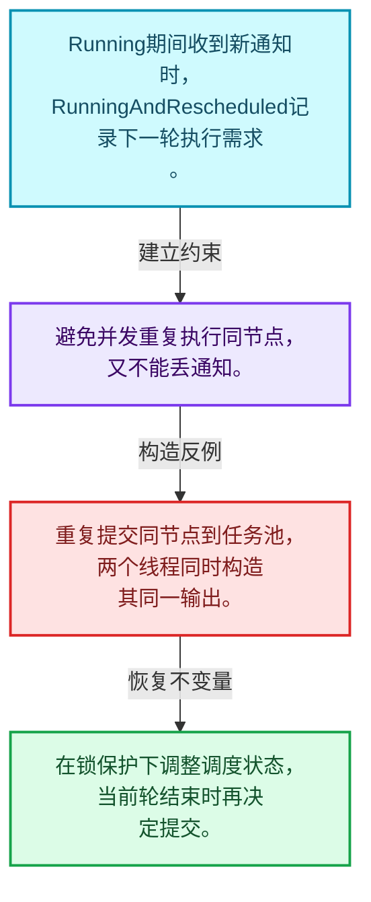
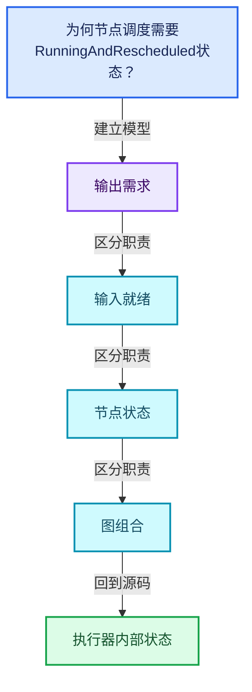
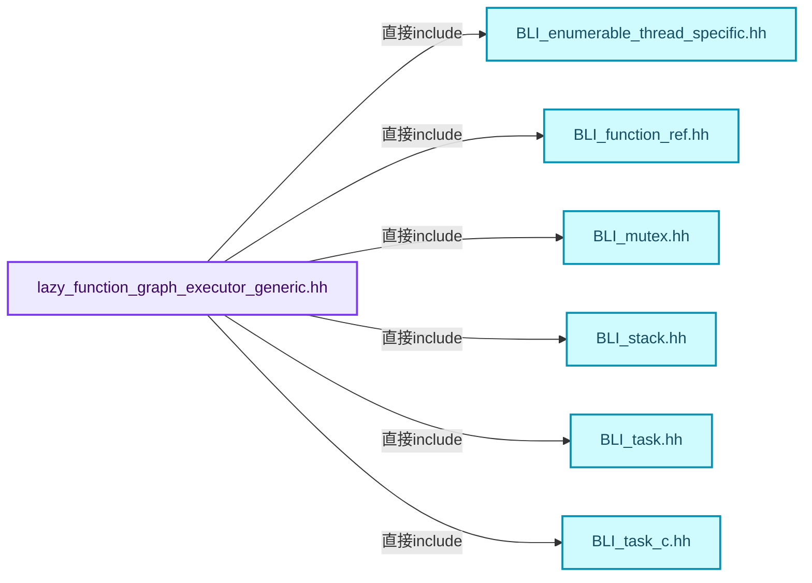
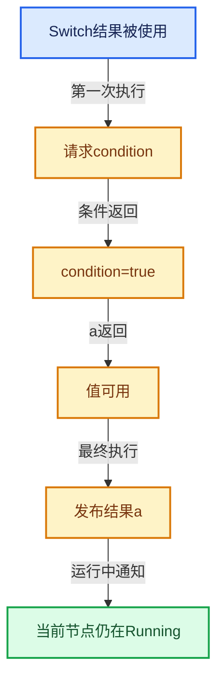

# 09-07 执行器内部状态

[方向导航](README.md) · [总目录](../README.md) · [覆盖索引](../%E6%BA%90%E7%A0%81%E7%89%88%E6%9C%AC%E4%B8%8E%E8%A6%86%E7%9B%96%E7%B4%A2%E5%BC%95.md)

> 阅读顺序：问题与数据模型 → 语法与类型 → 源码逐行 → 调用线索 → 历史与取舍 → 推演和练习。

- 基准 HEAD：`cbda6b96c26c0dee3c3b5cbb93960c4ac06a6b30`。
- 记录日期：2026-10-14。
- 教学示例状态：正文中的推演不是本机性能实测；已运行练习见验收报告。

## 一、从问题到设计

为何节点调度需要RunningAndRescheduled状态？

运行中的节点再次收到通知时不能并发重复执行；标记再次调度让它完成当前轮后继续推进。

本篇把语法、数据语义和系统取舍连接起来。需求与就绪是不同维度；状态只在有证据时推进，不能把未确定当作无需求。

### 本篇独立模型与设计推理

Running期间收到新通知时，RunningAndRescheduled记录下一轮执行需求。

设计取舍：避免并发重复执行同节点，又不能丢通知。

最小反例：重复提交同节点到任务池，两个线程同时构造其同一输出。

推导与处理：在锁保护下调整调度状态，当前轮结束时再决定提交。



### 源码范围与相邻篇章

| 文件 | 本篇逐行范围 | 基准SHA-256 |
|---|---|---|
| [source/blender/functions/intern/lazy_function_graph_executor_generic.hh](../../../../../source/blender/functions/intern/lazy_function_graph_executor_generic.hh) | L1—L744 | `b7743d14be8b678673777b7efb57162bf1356935c7bd6508f26c43b8759b4798` |

同一主讲文件可能分多篇覆盖；超出本篇范围的符号通过覆盖索引定位。空行与纯注释保留在源码摘录中，逐行表解释有效语句与语法边界；许可证头统一保留。

前篇：[GraphExecutor对外接口](06-GraphExecutor%E5%AF%B9%E5%A4%96%E6%8E%A5%E5%8F%A3.md).

后篇：[输入请求与调度](08-%E8%BE%93%E5%85%A5%E8%AF%B7%E6%B1%82%E4%B8%8E%E8%B0%83%E5%BA%A6.md).

## 二、类型、数据与阅读地图



这是概念依赖图，边表示阅读关系，不声称是运行时调用顺序。

### 直接编译依赖



箭头只表示头文件包含关系；完整调用线索见后面的符号定位表。

## 三、关键词、语法与类型角色

### 约束 requires

requires表达式或requires子句限制模板参与重载的条件。它提供编译期可用性检查，不是运行时if，不能指望输入到达程序后再被这一机制验证。

具体检查：构造满足和不满足约束的两个类型，观察候选被排除而不是在函数内返回错误。

### 只读限定 const

const约束当前访问路径可做的修改。const指针、指向const的指针、const视图对象、const元素是不同位置的限定；其他别名可能仍可修改原对象。

具体检查：分别写T* const、const T*与const T* const，并画出不可修改的层次。

### 异常边界 try与catch

try定义异常传播的局部边界。失败路径需要销毁已经成功构造的部分并释放相应存储；未构造的对象不能被析构。

具体检查：在第k次构造失败，列出已经存在的对象集合与待释放缓冲。

### 显式静态转换 static_cast

static_cast表达编译期允许的转换，不会自动验证运行时真实类型、指针寿命或索引边界。由void指针恢复T指针时，调用者仍须保证实际存储中确有合法T对象。

具体检查：标出转换前后的类型以及正确性依据来自哪里。

### 表示层转换 reinterpret_cast

reinterpret_cast不能自动开始任意对象的生命周期，也不能豁免对齐和别名规则。读这类代码需要追溯原始分配与实际构造操作。

具体检查：分别检查大小、对齐、生命周期和可访问类型，四项不能互相替代。

### 可选值 optional

optional把不存在与存在的T区分开，T的构造和析构跟随engaged状态变化。访问前应由has_value或条件分支证明存在。

具体检查：把空Field状态与合法常量零区分，不能用某个普通值代替不存在。

### 原子操作 atomic

原子性保护相应原子对象的访问；发布其他普通数据还要分析内存序。多个原子字段分别安全不等于复合不变量整体原子。

具体检查：画出写数据、发布ready与读ready、读数据的顺序关系。

### 对齐 alignof

alignof得到类型要求的地址对齐。分配足够字节后仍需把地址对齐到相应边界，内嵌缓冲也一样。

具体检查：对齐a为2的幂时可推导向上取整，但仍要考虑溢出与边界。

### 对象表示 sizeof

sizeof给出对象表示大小，不是其引用的所有堆内存总量。sizeof视图很小并不说明底层数组很小。

具体检查：分别统计容器对象、容量字节和元素拥有的间接资源。

### 构造与new表达式

普通new可能分配并构造；placement new在给定地址构造，存储由其他机制提供。失败回滚应区分两类责任。

具体检查：追踪地址来自哪里、构造何时成功、由谁析构、由谁释放。

### 内部断言 assert

断言表达开发者预期成立的内部契约，发布构建可能关闭。它不能替代对不可信输入的完整错误处理，也不保证后续操作被运行时保护。

具体检查：对每条断言构造违反条件的输入，区分调用者错误与应向用户报告的错误。

### 受控访问 friend

friend授予指定函数或类访问非公开成员的权限，并不意味着继承，也不自动扩展到友元的派生类。

具体检查：解释执行器为何需要访问包装器的内部映射，同时检查边界是否仍清楚。

### 独占拥有 unique_ptr

unique_ptr通过移动转移拥有关系，默认删除策略必须与资源来源匹配。get返回借用指针，release交出责任而不销毁。

具体检查：区分move、get、release和reset后谁负责销毁。

### 类型别名 using

类型别名为已有类型建立名字，不创建运行期对象。它常把模板内部使用的类型统一暴露给泛型调用者。

具体检查：展开别名直到基础类型，区分类型别名和变量声明。

### 枚举与状态模型 enum

枚举把有限状态命名；enum class避免许多隐式整数转换。状态机正确性还依赖允许的转移，不能只看有哪些枚举项。

具体检查：列出每个状态的进入条件和离开条件，检查终止状态是否仍可能被调度。

### RunningAndRescheduled解决的竞态

节点从Scheduled进入Running之后，仍可能收到使它需要继续推进的通知。
此时立即再提交一个相同节点任务，可能使两个线程同时执行同一节点。
状态转为RunningAndRescheduled表示“当前轮结束之后再执行”。
这与简单忽略通知不同：忽略会使刚刚就绪的输入永远不能触发下一步。
也与一直保持Scheduled不同：当前已经运行，调度队列与执行状态不能混淆。
检验时至少覆盖运行前通知、运行中通知、多个重复通知和完成后通知。

## 四、真实源码与逐行讲解

源码块保持原行内容，原始行号由小节标题及逐行表给出。表中的调用定位是静态阅读辅助；重载、模板实例化、宏展开和虚调用需结合完整声明，不能仅凭词法出现证明动态调用。

### lazy_function_graph_executor_generic.hh：L1—L48

<!-- source:source/blender/functions/intern/lazy_function_graph_executor_generic.hh:1:48 -->

```cpp
/* SPDX-FileCopyrightText: 2023 Blender Authors
 *
 * SPDX-License-Identifier: GPL-2.0-or-later */

/** \file
 * \ingroup fn
 *
 * This file implements the evaluation of a lazy-function graph. It's main objectives are:
 * - Only compute values that are actually used.
 * - Stay single threaded when nodes are executed quickly.
 * - Allow spreading the work over an arbitrary number of threads efficiently.
 *
 * This executor makes use of `FN_lazy_threading.hh` to enable multi-threading only when it seems
 * beneficial. It operates in two modes: single- and multi-threaded. The use of a task pool and
 * locks is avoided in single-threaded mode. Once multi-threading is enabled the executor starts
 * using both. It is not possible to switch back from multi-threaded to single-threaded mode.
 *
 * The multi-threading design implemented in this executor requires *no* main thread that
 * coordinates everything. Instead, one thread will trigger some initial work and then many threads
 * coordinate themselves in a distributed fashion. In an ideal situation, every thread ends up
 * processing a separate part of the graph which results in less communication overhead. The way
 * TBB schedules tasks helps with that: a thread will next process the task that it added to a task
 * pool just before.
 *
 * Communication between threads is synchronized by using a mutex in every node. When a thread
 * wants to access the state of a node, its mutex has to be locked first (with some documented
 * exceptions). The assumption here is that most nodes are only ever touched by a single thread and
 * therefore the lock contention is reduced the more nodes there are.
 *
 * Similar to how a #LazyFunction can be thought of as a state machine (see `FN_lazy_function.hh`),
 * each node can also be thought of as a state machine. The state of a node contains the evaluation
 * state of its inputs and outputs. Every time a node is executed, it has to advance its state in
 * some way (e.g. it requests a new input or computes a new output).
 *
 * When a node is executed it may send notifications to other nodes which may in turn schedule
 * those nodes. For example, when the current node has computed one of its outputs, then the
 * computed value is forwarded to all linked inputs, changing their node states in the process. If
 * this input was the last missing required input, the node will be scheduled that it is executed
 * next.
 *
 * When all tasks are completed, the executor gives back control to the caller which may later
 * provide new inputs to the graph which in turn leads to new nodes being scheduled and the process
 * starts again.
 */

#pragma once

#include <atomic>
```

| 原始行 | 语义、约束与检查 |
|---|---|
| L46 | 防止同一头文件在一个翻译单元中重复展开；不控制多个源文件之间的链接或对象寿命。 |
| L48 | 引入编译依赖 <atomic>；这是声明可见性关系，不表示运行时一定调用该文件的所有接口。 |

### lazy_function_graph_executor_generic.hh：L49—L93

<!-- source:source/blender/functions/intern/lazy_function_graph_executor_generic.hh:49:93 -->

```cpp

#include "BLI_enumerable_thread_specific.hh"
#include "BLI_function_ref.hh"
#include "BLI_mutex.hh"
#include "BLI_stack.hh"
#include "BLI_task.hh"
#include "BLI_task_c.hh"

#include "FN_lazy_function_graph_executor.hh"
#include "FN_lazy_function_graph_executor_generic.hh"

namespace blender::fn::lazy_function::generic_graph_executor {

enum class NodeScheduleState : uint8_t {
  /**
   * Default state of every node.
   */
  NotScheduled,
  /**
   * The node has been added to the task pool or is otherwise scheduled to be executed in the
   * future.
   */
  Scheduled,
  /**
   * The node is currently running.
   */
  Running,
  /**
   * The node is running and has been rescheduled while running. In this case the node run again.
   * This state exists, because we don't want to add the node to the task pool twice, because then
   * the node might run twice at the same time, which is not allowed. Instead, once the node is
   * done running, it will reschedule itself.
   */
  RunningAndRescheduled,
};

struct InputState {
  /**
   * Value of this input socket. By default, the value is empty. When other nodes are done
   * computing their outputs, the computed values will be forwarded to linked input sockets. The
   * value will then live here until it is found that it is not needed anymore.
   *
   * If #was_ready_for_execution is true, access does not require holding the node lock.
   */
  void *value = nullptr;
```

| 原始行 | 语义、约束与检查 |
|---|---|
| L50 | 引入编译依赖 "BLI_enumerable_thread_specific.hh"；这是声明可见性关系，不表示运行时一定调用该文件的所有接口。 |
| L51 | 引入编译依赖 "BLI_function_ref.hh"；这是声明可见性关系，不表示运行时一定调用该文件的所有接口。 |
| L52 | 引入编译依赖 "BLI_mutex.hh"；这是声明可见性关系，不表示运行时一定调用该文件的所有接口。 |
| L53 | 引入编译依赖 "BLI_stack.hh"；这是声明可见性关系，不表示运行时一定调用该文件的所有接口。 |
| L54 | 引入编译依赖 "BLI_task.hh"；这是声明可见性关系，不表示运行时一定调用该文件的所有接口。 |
| L55 | 引入编译依赖 "BLI_task_c.hh"；这是声明可见性关系，不表示运行时一定调用该文件的所有接口。 |
| L57 | 引入编译依赖 "FN_lazy_function_graph_executor.hh"；这是声明可见性关系，不表示运行时一定调用该文件的所有接口。 |
| L58 | 引入编译依赖 "FN_lazy_function_graph_executor_generic.hh"；这是声明可见性关系，不表示运行时一定调用该文件的所有接口。 |
| L60 | 把后续声明放入 blender::fn::lazy_function::generic_graph_executor 命名空间，影响名称查找和符号归属，不创建运行时对象。 |
| L62 | 声明或定义类型 `enum class NodeScheduleState : uint8_t`。结合继承、访问权限和成员布局确认接口与拥有关系；前向声明本身没有完整对象布局。 |
| L66 | 本行是连续声明或表达式的一部分：`NotScheduled,`。与本段前后行合读；逗号、括号和限定符决定它属于参数、初始化列表还是实际计算。 |
| L71 | 本行是连续声明或表达式的一部分：`Scheduled,`。与本段前后行合读；逗号、括号和限定符决定它属于参数、初始化列表还是实际计算。 |
| L75 | 本行是连续声明或表达式的一部分：`Running,`。与本段前后行合读；逗号、括号和限定符决定它属于参数、初始化列表还是实际计算。 |
| L82 | 本行是连续声明或表达式的一部分：`RunningAndRescheduled,`。与本段前后行合读；逗号、括号和限定符决定它属于参数、初始化列表还是实际计算。 |
| L83 | 结束当前语法单元。局部自动对象在离开其作用域时按规则销毁；这不等于所有被引用的外部数据也被释放。 |
| L85 | 声明或定义类型 `struct InputState`。结合继承、访问权限和成员布局确认接口与拥有关系；前向声明本身没有完整对象布局。 |
| L93 | 把右侧 `nullptr` 用于初始化或更新左侧 `void *value`。声明初始化与已有对象赋值应按上下文区分；有资源的类型会调用相应特殊成员。 |

### lazy_function_graph_executor_generic.hh：L94—L144

<!-- source:source/blender/functions/intern/lazy_function_graph_executor_generic.hh:94:144 -->

```cpp
  /**
   * How the node intends to use this input. By default, all inputs may be used. Based on which
   * outputs are used, a node can decide that an input will definitely be used or is never used.
   * This allows freeing values early and avoids unnecessary computations.
   */
  ValueUsage usage = ValueUsage::Maybe;
  /**
   * Set to true once #value is set and will stay true afterwards. Access during execution of a
   * node, does not require holding the node lock.
   */
  bool was_ready_for_execution = false;
};

struct OutputState {
  /**
   * Keeps track of how the output value is used. If a connected input becomes used, this output
   * has to become used as well. The output becomes unused when it is used by no input socket
   * anymore and it's not an output of the graph.
   */
  ValueUsage usage = ValueUsage::Maybe;
  /**
   * This is a copy of #usage that is done right before node execution starts. This is done so that
   * the node gets a consistent view of what outputs are used, even when this changes while the
   * node is running (the node might be reevaluated in that case). Access during execution of a
   * node, does not require holding the node lock.
   */
  ValueUsage usage_for_execution = ValueUsage::Maybe;
  /**
   * Is set to true once the output has been computed and then stays true. Access does not require
   * holding the node lock.
   */
  bool has_been_computed = false;
  /**
   * Number of linked sockets that might still use the value of this output.
   */
  int potential_target_sockets = 0;
  /**
   * Holds the output value for a short period of time while the node is initializing it and before
   * it's forwarded to input sockets. Access does not require holding the node lock.
   */
  void *value = nullptr;
};

struct NodeState {
  /**
   * States of the individual input and output sockets. One can index into these arrays without
   * locking. However, to access data inside, a lock is needed unless noted otherwise.
   * Those are not stored as #Span to reduce memory usage. The number of inputs and outputs is
   * stored on the node already.
   */
  InputState *inputs;
```

本段语义重点：

- `was_ready_for_execution`：输入是否已准备好并进入执行可读阶段的标记。
- `has_been_computed`：输出是否已经产生的单调完成标记。
- `usage_for_execution`：执行开始时取得的需求快照，与正在变化的需求区分。
- `usage`：值使用需求，Maybe、Used与Unused各有不同含义。

| 原始行 | 语义、约束与检查 |
|---|---|
| L99 | 建立或更新 `usage`：值使用需求，Maybe、Used与Unused各有不同含义。本行的具体值关系为 `ValueUsage usage = ValueUsage::Maybe`；对照更新前后相应范围或状态是否一致。 |
| L104 | 建立或更新 `was_ready_for_execution`：输入是否已准备好并进入执行可读阶段的标记。本行的具体值关系为 `bool was_ready_for_execution = false`；对照更新前后相应范围或状态是否一致。 |
| L105 | 结束当前语法单元。局部自动对象在离开其作用域时按规则销毁；这不等于所有被引用的外部数据也被释放。 |
| L107 | 声明或定义类型 `struct OutputState`。结合继承、访问权限和成员布局确认接口与拥有关系；前向声明本身没有完整对象布局。 |
| L113 | 建立或更新 `usage`：值使用需求，Maybe、Used与Unused各有不同含义。本行的具体值关系为 `ValueUsage usage = ValueUsage::Maybe`；对照更新前后相应范围或状态是否一致。 |
| L120 | 建立或更新 `usage_for_execution`：执行开始时取得的需求快照，与正在变化的需求区分。本行的具体值关系为 `ValueUsage usage_for_execution = ValueUsage::Maybe`；对照更新前后相应范围或状态是否一致。 |
| L125 | 建立或更新 `has_been_computed`：输出是否已经产生的单调完成标记。本行的具体值关系为 `bool has_been_computed = false`；对照更新前后相应范围或状态是否一致。 |
| L129 | 把右侧 `0` 用于初始化或更新左侧 `int potential_target_sockets`。声明初始化与已有对象赋值应按上下文区分；有资源的类型会调用相应特殊成员。 |
| L134 | 把右侧 `nullptr` 用于初始化或更新左侧 `void *value`。声明初始化与已有对象赋值应按上下文区分；有资源的类型会调用相应特殊成员。 |
| L135 | 结束当前语法单元。局部自动对象在离开其作用域时按规则销毁；这不等于所有被引用的外部数据也被释放。 |
| L137 | 声明或定义类型 `struct NodeState`。结合继承、访问权限和成员布局确认接口与拥有关系；前向声明本身没有完整对象布局。 |
| L144 | 声明成员、局部对象或完成语句 `InputState *inputs`。若为指针或引用，它本身不说明拥有；若为值对象，其构造析构由所在作用域或外层对象管理。 |

### lazy_function_graph_executor_generic.hh：L145—L191

<!-- source:source/blender/functions/intern/lazy_function_graph_executor_generic.hh:145:191 -->

```cpp
  OutputState *outputs;
  /**
   * Counts the number of inputs that still have to be provided to this node, until it should run
   * again. This is used as an optimization so that nodes are not scheduled unnecessarily in many
   * cases.
   */
  int missing_required_inputs = 0;
  /**
   * Needs to be locked when any data in this state is accessed that is not explicitly marked as
   * not needing the lock.
   */
  mutable Mutex mutex;
  /**
   * Is set to true once the node is done with its work, i.e. when all outputs that may be used
   * have been computed.
   */
  bool node_has_finished = false;
  /**
   * Set to true once the always required inputs have been requested.
   * This happens the first time the node is run.
   */
  bool always_used_inputs_requested = false;
  /**
   * Set to true when the storage and defaults have been initialized.
   * This happens the first time the node function is executed.
   */
  bool storage_and_defaults_initialized = false;
  /**
   * Nodes with side effects should always be executed when their required inputs have been
   * computed.
   */
  bool has_side_effects = false;
  /**
   * Whether this node has enabled multi-threading. If this is true, the node is allowed to call
   * methods on #Params from multiple threads.
   */
  bool enabled_multi_threading = false;
  /**
   * A node is always in one specific schedule state. This helps to ensure that the same node does
   * not run twice at the same time accidentally.
   */
  NodeScheduleState schedule_state = NodeScheduleState::NotScheduled;
  /**
   * Custom storage of the node.
   */
  void *storage = nullptr;
};
```

本段语义重点：

- `schedule_state`：节点是否待运行、正在运行或需要再次运行的调度状态。
- `mutex`：保护相关缓存或节点状态的同步对象，保护范围以调用点为准。

| 原始行 | 语义、约束与检查 |
|---|---|
| L145 | 声明成员、局部对象或完成语句 `OutputState *outputs`。若为指针或引用，它本身不说明拥有；若为值对象，其构造析构由所在作用域或外层对象管理。 |
| L151 | 把右侧 `0` 用于初始化或更新左侧 `int missing_required_inputs`。声明初始化与已有对象赋值应按上下文区分；有资源的类型会调用相应特殊成员。 |
| L156 | 本行涉及 `mutex`：保护相关缓存或节点状态的同步对象，保护范围以调用点为准。按此语义解读 `mutable Mutex mutex`，不要把地址、数量或状态混用。 |
| L161 | 把右侧 `false` 用于初始化或更新左侧 `bool node_has_finished`。声明初始化与已有对象赋值应按上下文区分；有资源的类型会调用相应特殊成员。 |
| L166 | 把右侧 `false` 用于初始化或更新左侧 `bool always_used_inputs_requested`。声明初始化与已有对象赋值应按上下文区分；有资源的类型会调用相应特殊成员。 |
| L171 | 把右侧 `false` 用于初始化或更新左侧 `bool storage_and_defaults_initialized`。声明初始化与已有对象赋值应按上下文区分；有资源的类型会调用相应特殊成员。 |
| L176 | 把右侧 `false` 用于初始化或更新左侧 `bool has_side_effects`。声明初始化与已有对象赋值应按上下文区分；有资源的类型会调用相应特殊成员。 |
| L181 | 把右侧 `false` 用于初始化或更新左侧 `bool enabled_multi_threading`。声明初始化与已有对象赋值应按上下文区分；有资源的类型会调用相应特殊成员。 |
| L186 | 建立或更新 `schedule_state`：节点是否待运行、正在运行或需要再次运行的调度状态。本行的具体值关系为 `NodeScheduleState schedule_state = NodeScheduleState::NotScheduled`；对照更新前后相应范围或状态是否一致。 |
| L190 | 把右侧 `nullptr` 用于初始化或更新左侧 `void *storage`。声明初始化与已有对象赋值应按上下文区分；有资源的类型会调用相应特殊成员。 |
| L191 | 结束当前语法单元。局部自动对象在离开其作用域时按规则销毁；这不等于所有被引用的外部数据也被释放。 |

### lazy_function_graph_executor_generic.hh：L192—L240

<!-- source:source/blender/functions/intern/lazy_function_graph_executor_generic.hh:192:240 -->

```cpp

/**
 * Utility class that wraps a node whose state is locked. Having this is a separate class is useful
 * because it allows methods to communicate that they expect the node to be locked.
 */
struct LockedNode {
  /**
   * This is the node that is currently locked.
   */
  const Node &node;
  NodeState &node_state;

  /**
   * Used to delay notifying (and therefore locking) other nodes until the current node is not
   * locked anymore. This might not be strictly necessary to avoid deadlocks in the current code,
   * but is a good measure to avoid accidentally adding a deadlock later on. By not locking more
   * than one node per thread at a time, deadlocks are avoided.
   *
   * The notifications will be send right after the node is not locked anymore.
   */
  Vector<const OutputSocket *> delayed_required_outputs;
  Vector<const OutputSocket *> delayed_unused_outputs;

  LockedNode(const Node &node, NodeState &node_state) : node(node), node_state(node_state) {}
};

class GenericGraphExecutor;
class GraphExecutorLFParams;

/**
 * Keeps track of nodes that are currently scheduled on a thread. A node can only be scheduled by
 * one thread at the same time.
 */
struct ScheduledNodes {
 private:
  /** Use two stacks of scheduled nodes for different priorities. */
  Vector<const FunctionNode *> priority_;
  Vector<const FunctionNode *> normal_;

 public:
  void schedule(const FunctionNode &node, const bool is_priority)
  {
    if (is_priority) {
      this->priority_.append(&node);
    }
    else {
      this->normal_.append(&node);
    }
  }
```

本段语义重点：

- 分支证据 `is_priority)`：分别推演条件成立与不成立，核对相同出口处的状态。

| 原始行 | 语义、约束与检查 |
|---|---|
| L197 | 声明或定义类型 `struct LockedNode`。结合继承、访问权限和成员布局确认接口与拥有关系；前向声明本身没有完整对象布局。 |
| L201 | 声明成员、局部对象或完成语句 `const Node &node`。若为指针或引用，它本身不说明拥有；若为值对象，其构造析构由所在作用域或外层对象管理。 |
| L202 | 声明成员、局部对象或完成语句 `NodeState &node_state`。若为指针或引用，它本身不说明拥有；若为值对象，其构造析构由所在作用域或外层对象管理。 |
| L212 | 声明成员、局部对象或完成语句 `Vector<const OutputSocket *> delayed_required_outputs`。若为指针或引用，它本身不说明拥有；若为值对象，其构造析构由所在作用域或外层对象管理。 |
| L213 | 声明成员、局部对象或完成语句 `Vector<const OutputSocket *> delayed_unused_outputs`。若为指针或引用，它本身不说明拥有；若为值对象，其构造析构由所在作用域或外层对象管理。 |
| L215 | 出现调用或函数声明 `LockedNode`，对应表达式为 `LockedNode(const Node &node, NodeState &node_state) : node(node), node_state(node_state) {}`。参数求值、返回类型与重载需结合前后完整语句；静态文本引用不能证明动态目标。 |
| L216 | 结束当前语法单元。局部自动对象在离开其作用域时按规则销毁；这不等于所有被引用的外部数据也被释放。 |
| L218 | 声明或定义类型 `class GenericGraphExecutor`。结合继承、访问权限和成员布局确认接口与拥有关系；前向声明本身没有完整对象布局。 |
| L219 | 声明或定义类型 `class GraphExecutorLFParams`。结合继承、访问权限和成员布局确认接口与拥有关系；前向声明本身没有完整对象布局。 |
| L225 | 声明或定义类型 `struct ScheduledNodes`。结合继承、访问权限和成员布局确认接口与拥有关系；前向声明本身没有完整对象布局。 |
| L226 | 切换成员访问权限为 private；它是编译期接口边界，不是线程同步或内存保护。 |
| L228 | 声明成员、局部对象或完成语句 `Vector<const FunctionNode *> priority_`。若为指针或引用，它本身不说明拥有；若为值对象，其构造析构由所在作用域或外层对象管理。 |
| L229 | 声明成员、局部对象或完成语句 `Vector<const FunctionNode *> normal_`。若为指针或引用，它本身不说明拥有；若为值对象，其构造析构由所在作用域或外层对象管理。 |
| L231 | 切换成员访问权限为 public；它是编译期接口边界，不是线程同步或内存保护。 |
| L232 | 出现调用或函数声明 `schedule`，对应表达式为 `void schedule(const FunctionNode &node, const bool is_priority)`。参数求值、返回类型与重载需结合前后完整语句；静态文本引用不能证明动态目标。 |
| L233 | 连接上一行的声明或控制结构与其语句块；后续行在这个作用域中执行或声明。 |
| L234 | 判断 `is_priority`，成立时进入本分支，否则继续后续路径。 |
| L235 | 出现调用或函数声明 `append`，对应表达式为 `this->priority_.append(&node);`。参数求值、返回类型与重载需结合前后完整语句；静态文本引用不能证明动态目标。 |
| L236 | 结束当前语法单元。局部自动对象在离开其作用域时按规则销毁；这不等于所有被引用的外部数据也被释放。 |
| L237 | 处理前一条件不成立的互补路径。比较两条路径最后是否恢复同一不变量，以及是否产生不同的资源责任。 |
| L238 | 出现调用或函数声明 `append`，对应表达式为 `this->normal_.append(&node);`。参数求值、返回类型与重载需结合前后完整语句；静态文本引用不能证明动态目标。 |
| L239 | 结束当前语法单元。局部自动对象在离开其作用域时按规则销毁；这不等于所有被引用的外部数据也被释放。 |
| L240 | 结束当前语法单元。局部自动对象在离开其作用域时按规则销毁；这不等于所有被引用的外部数据也被释放。 |

### lazy_function_graph_executor_generic.hh：L241—L286

<!-- source:source/blender/functions/intern/lazy_function_graph_executor_generic.hh:241:286 -->

```cpp

  const FunctionNode *pop_next_node()
  {
    if (!this->priority_.is_empty()) {
      return this->priority_.pop_last();
    }
    if (!this->normal_.is_empty()) {
      return this->normal_.pop_last();
    }
    return nullptr;
  }

  bool is_empty() const
  {
    return this->priority_.is_empty() && this->normal_.is_empty();
  }

  int64_t nodes_num() const
  {
    return priority_.size() + normal_.size();
  }

  /**
   * Split up the scheduled nodes into two groups that can be worked on in parallel.
   */
  void split_into(ScheduledNodes &other)
  {
    BLI_assert(this != &other);
    const int64_t priority_split = priority_.size() / 2;
    const int64_t normal_split = normal_.size() / 2;
    other.priority_.extend(priority_.as_span().drop_front(priority_split));
    other.normal_.extend(normal_.as_span().drop_front(normal_split));
    priority_.resize(priority_split);
    normal_.resize(normal_split);
  }
};

struct CurrentTask {
  /**
   * Mutex used to protect #scheduled_nodes when the executor uses multi-threading.
   */
  Mutex mutex;
  /**
   * Nodes that have been scheduled to execute next.
   */
  ScheduledNodes scheduled_nodes;
```

本段语义重点：

- `mutex`：保护相关缓存或节点状态的同步对象，保护范围以调用点为准。

| 原始行 | 语义、约束与检查 |
|---|---|
| L242 | 出现调用或函数声明 `pop_next_node`，对应表达式为 `const FunctionNode *pop_next_node()`。参数求值、返回类型与重载需结合前后完整语句；静态文本引用不能证明动态目标。 |
| L243 | 连接上一行的声明或控制结构与其语句块；后续行在这个作用域中执行或声明。 |
| L244 | 判断 `!this->priority_.is_empty()`，成立时进入本分支，否则继续后续路径。 |
| L245 | 返回表达式 `this->priority_.pop_last()`。 |
| L246 | 结束当前语法单元。局部自动对象在离开其作用域时按规则销毁；这不等于所有被引用的外部数据也被释放。 |
| L247 | 判断 `!this->normal_.is_empty()`，成立时进入本分支，否则继续后续路径。 |
| L248 | 返回表达式 `this->normal_.pop_last()`。 |
| L249 | 结束当前语法单元。局部自动对象在离开其作用域时按规则销毁；这不等于所有被引用的外部数据也被释放。 |
| L250 | 返回表达式 `nullptr`。 |
| L251 | 结束当前语法单元。局部自动对象在离开其作用域时按规则销毁；这不等于所有被引用的外部数据也被释放。 |
| L253 | 出现调用或函数声明 `is_empty`，对应表达式为 `bool is_empty() const`。参数求值、返回类型与重载需结合前后完整语句；静态文本引用不能证明动态目标。 |
| L254 | 连接上一行的声明或控制结构与其语句块；后续行在这个作用域中执行或声明。 |
| L255 | 返回表达式 `this->priority_.is_empty() && this->normal_.is_empty()`。 |
| L256 | 结束当前语法单元。局部自动对象在离开其作用域时按规则销毁；这不等于所有被引用的外部数据也被释放。 |
| L258 | 出现调用或函数声明 `nodes_num`，对应表达式为 `int64_t nodes_num() const`。参数求值、返回类型与重载需结合前后完整语句；静态文本引用不能证明动态目标。 |
| L259 | 连接上一行的声明或控制结构与其语句块；后续行在这个作用域中执行或声明。 |
| L260 | 返回表达式 `priority_.size() + normal_.size()`。 |
| L261 | 结束当前语法单元。局部自动对象在离开其作用域时按规则销毁；这不等于所有被引用的外部数据也被释放。 |
| L266 | 出现调用或函数声明 `split_into`，对应表达式为 `void split_into(ScheduledNodes &other)`。参数求值、返回类型与重载需结合前后完整语句；静态文本引用不能证明动态目标。 |
| L267 | 连接上一行的声明或控制结构与其语句块；后续行在这个作用域中执行或声明。 |
| L268 | 断言约束 `BLI_assert(this != &other);`。条件是后续访问的内部前置条件；发布构建可能不执行，不能把断言当作输入修复。 |
| L269 | 把右侧 `priority_.size() / 2` 用于初始化或更新左侧 `const int64_t priority_split`。声明初始化与已有对象赋值应按上下文区分；有资源的类型会调用相应特殊成员。 |
| L270 | 把右侧 `normal_.size() / 2` 用于初始化或更新左侧 `const int64_t normal_split`。声明初始化与已有对象赋值应按上下文区分；有资源的类型会调用相应特殊成员。 |
| L271 | 出现调用或函数声明 `extend`，对应表达式为 `other.priority_.extend(priority_.as_span().drop_front(priority_split));`。参数求值、返回类型与重载需结合前后完整语句；静态文本引用不能证明动态目标。 |
| L272 | 出现调用或函数声明 `extend`，对应表达式为 `other.normal_.extend(normal_.as_span().drop_front(normal_split));`。参数求值、返回类型与重载需结合前后完整语句；静态文本引用不能证明动态目标。 |
| L273 | 出现调用或函数声明 `resize`，对应表达式为 `priority_.resize(priority_split);`。参数求值、返回类型与重载需结合前后完整语句；静态文本引用不能证明动态目标。 |
| L274 | 出现调用或函数声明 `resize`，对应表达式为 `normal_.resize(normal_split);`。参数求值、返回类型与重载需结合前后完整语句；静态文本引用不能证明动态目标。 |
| L275 | 结束当前语法单元。局部自动对象在离开其作用域时按规则销毁；这不等于所有被引用的外部数据也被释放。 |
| L276 | 结束当前语法单元。局部自动对象在离开其作用域时按规则销毁；这不等于所有被引用的外部数据也被释放。 |
| L278 | 声明或定义类型 `struct CurrentTask`。结合继承、访问权限和成员布局确认接口与拥有关系；前向声明本身没有完整对象布局。 |
| L282 | 本行涉及 `mutex`：保护相关缓存或节点状态的同步对象，保护范围以调用点为准。按此语义解读 `Mutex mutex`，不要把地址、数量或状态混用。 |
| L286 | 声明成员、局部对象或完成语句 `ScheduledNodes scheduled_nodes`。若为指针或引用，它本身不说明拥有；若为值对象，其构造析构由所在作用域或外层对象管理。 |

### lazy_function_graph_executor_generic.hh：L287—L335

<!-- source:source/blender/functions/intern/lazy_function_graph_executor_generic.hh:287:335 -->

```cpp
  /**
   * Makes it cheaper to check if there are any scheduled nodes because it avoids locking the
   * mutex.
   */
  std::atomic<bool> has_scheduled_nodes = false;
};

class GenericGraphExecutor {
 private:
  const GraphExecutor &self_;
  /**
   * Remembers which inputs have been loaded from the caller already, to avoid loading them twice.
   * Atomics are used to make sure that every input is only retrieved once.
   */
  MutableSpan<std::atomic<uint8_t>> loaded_inputs_;
  /**
   * State of every node, indexed by #Node::index_in_graph.
   */
  MutableSpan<NodeState *> node_states_;
  /**
   * Parameters provided by the caller. This is always non-null, while a node is running.
   */
  Params *params_ = nullptr;
  const Context *context_ = nullptr;
  /**
   * Used to distribute work on separate nodes to separate threads.
   * If this is empty, the executor is in single threaded mode.
   */
  std::atomic<TaskPool *> task_pool_ = nullptr;
#ifdef FN_LAZY_FUNCTION_DEBUG_THREADS
  std::thread::id current_main_thread_;
#endif

  GraphExecutorLogger::LoggingEnabledState logging_enabled_state_{false};

  struct ThreadLocalStorage {
    /**
     * A separate linear allocator for every thread. We could potentially reuse some memory, but
     * that doesn't seem worth it yet.
     */
    LinearAllocator<> allocator;
    std::optional<destruct_ptr<LocalUserData>> local_user_data;
  };
  std::unique_ptr<threading::EnumerableThreadSpecific<ThreadLocalStorage>> thread_locals_;
  LinearAllocator<> main_allocator_;
  /**
   * Set to false when the first execution ends.
   */
  bool is_first_execution_ = true;
```

本段语义重点：

- `context_`：求值环境字段；FieldEvaluator以引用借用，其他类须按实际成员类型确认拥有关系。

| 原始行 | 语义、约束与检查 |
|---|---|
| L291 | 把右侧 `false` 用于初始化或更新左侧 `std::atomic<bool> has_scheduled_nodes`。声明初始化与已有对象赋值应按上下文区分；有资源的类型会调用相应特殊成员。 |
| L292 | 结束当前语法单元。局部自动对象在离开其作用域时按规则销毁；这不等于所有被引用的外部数据也被释放。 |
| L294 | 声明或定义类型 `class GenericGraphExecutor`。结合继承、访问权限和成员布局确认接口与拥有关系；前向声明本身没有完整对象布局。 |
| L295 | 切换成员访问权限为 private；它是编译期接口边界，不是线程同步或内存保护。 |
| L296 | 声明成员、局部对象或完成语句 `const GraphExecutor &self_`。若为指针或引用，它本身不说明拥有；若为值对象，其构造析构由所在作用域或外层对象管理。 |
| L301 | 声明成员、局部对象或完成语句 `MutableSpan<std::atomic<uint8_t>> loaded_inputs_`。若为指针或引用，它本身不说明拥有；若为值对象，其构造析构由所在作用域或外层对象管理。 |
| L305 | 声明成员、局部对象或完成语句 `MutableSpan<NodeState *> node_states_`。若为指针或引用，它本身不说明拥有；若为值对象，其构造析构由所在作用域或外层对象管理。 |
| L309 | 把右侧 `nullptr` 用于初始化或更新左侧 `Params *params_`。声明初始化与已有对象赋值应按上下文区分；有资源的类型会调用相应特殊成员。 |
| L310 | 建立或更新 `context_`：求值环境字段；FieldEvaluator以引用借用，其他类须按实际成员类型确认拥有关系。本行的具体值关系为 `const Context *context_ = nullptr`；对照更新前后相应范围或状态是否一致。 |
| L315 | 把右侧 `nullptr` 用于初始化或更新左侧 `std::atomic<TaskPool *> task_pool_`。声明初始化与已有对象赋值应按上下文区分；有资源的类型会调用相应特殊成员。 |
| L316 | 预处理阶段处理 #ifdef FN_LAZY_FUNCTION_DEBUG_THREADS。它决定哪些代码进入编译，不是运行时分支；阅读行为时必须结合实际构建宏。 |
| L317 | 声明成员、局部对象或完成语句 `std::thread::id current_main_thread_`。若为指针或引用，它本身不说明拥有；若为值对象，其构造析构由所在作用域或外层对象管理。 |
| L318 | 预处理阶段处理 #endif。它决定哪些代码进入编译，不是运行时分支；阅读行为时必须结合实际构建宏。 |
| L320 | 声明成员、局部对象或完成语句 `GraphExecutorLogger::LoggingEnabledState logging_enabled_state_{false}`。若为指针或引用，它本身不说明拥有；若为值对象，其构造析构由所在作用域或外层对象管理。 |
| L322 | 声明或定义类型 `struct ThreadLocalStorage`。结合继承、访问权限和成员布局确认接口与拥有关系；前向声明本身没有完整对象布局。 |
| L327 | 声明成员、局部对象或完成语句 `LinearAllocator<> allocator`。若为指针或引用，它本身不说明拥有；若为值对象，其构造析构由所在作用域或外层对象管理。 |
| L328 | 声明成员、局部对象或完成语句 `std::optional<destruct_ptr<LocalUserData>> local_user_data`。若为指针或引用，它本身不说明拥有；若为值对象，其构造析构由所在作用域或外层对象管理。 |
| L329 | 结束当前语法单元。局部自动对象在离开其作用域时按规则销毁；这不等于所有被引用的外部数据也被释放。 |
| L330 | 声明成员、局部对象或完成语句 `std::unique_ptr<threading::EnumerableThreadSpecific<ThreadLocalStorage>> thread_locals_`。若为指针或引用，它本身不说明拥有；若为值对象，其构造析构由所在作用域或外层对象管理。 |
| L331 | 声明成员、局部对象或完成语句 `LinearAllocator<> main_allocator_`。若为指针或引用，它本身不说明拥有；若为值对象，其构造析构由所在作用域或外层对象管理。 |
| L335 | 把右侧 `true` 用于初始化或更新左侧 `bool is_first_execution_`。声明初始化与已有对象赋值应按上下文区分；有资源的类型会调用相应特殊成员。 |

### lazy_function_graph_executor_generic.hh：L336—L369

<!-- source:source/blender/functions/intern/lazy_function_graph_executor_generic.hh:336:369 -->

```cpp

  friend GraphExecutorLFParams;

  /**
   * Data that is local to the current thread. It is passed around in many places to avoid
   * retrieving it too often which would be more costly. If this evaluator does not use
   * multi-threading, this may use the `main_allocator_` and the local user data passed in by the
   * caller.
   */
  struct LocalData {
    LinearAllocator<> *allocator;
    LocalUserData *local_user_data;
  };

 public:
  GenericGraphExecutor(const GraphExecutor &self) : self_(self)
  {
    /* The indices are necessary, because they are used as keys in #node_states_. */
    BLI_assert(self_.graph_.node_indices_are_valid());
  }

  ~GenericGraphExecutor()
  {
    if (TaskPool *task_pool = task_pool_.load()) {
      BLI_task_pool_free(task_pool);
    }
    threading::parallel_for(node_states_.index_range(), 1024, [&](const IndexRange range) {
      for (const int node_index : range) {
        const Node &node = *self_.graph_.nodes()[node_index];
        NodeState &node_state = *node_states_[node_index];
        this->destruct_node_state(node, node_state);
      }
    });
  }
```

本段语义重点：

- `destruct_n`：对已构造的元素区间执行析构；计数必须对应真实存活对象，释放原始内存是另一操作。
- `graph_`：图结构字段；GraphExecutor以引用借用图，其存活不自动保证图存活，其他类按声明确认。

| 原始行 | 语义、约束与检查 |
|---|---|
| L337 | 声明成员、局部对象或完成语句 `friend GraphExecutorLFParams`。若为指针或引用，它本身不说明拥有；若为值对象，其构造析构由所在作用域或外层对象管理。 |
| L345 | 声明或定义类型 `struct LocalData`。结合继承、访问权限和成员布局确认接口与拥有关系；前向声明本身没有完整对象布局。 |
| L346 | 声明成员、局部对象或完成语句 `LinearAllocator<> *allocator`。若为指针或引用，它本身不说明拥有；若为值对象，其构造析构由所在作用域或外层对象管理。 |
| L347 | 声明成员、局部对象或完成语句 `LocalUserData *local_user_data`。若为指针或引用，它本身不说明拥有；若为值对象，其构造析构由所在作用域或外层对象管理。 |
| L348 | 结束当前语法单元。局部自动对象在离开其作用域时按规则销毁；这不等于所有被引用的外部数据也被释放。 |
| L350 | 切换成员访问权限为 public；它是编译期接口边界，不是线程同步或内存保护。 |
| L351 | 出现调用或函数声明 `GenericGraphExecutor`，对应表达式为 `GenericGraphExecutor(const GraphExecutor &self) : self_(self)`。参数求值、返回类型与重载需结合前后完整语句；静态文本引用不能证明动态目标。 |
| L352 | 连接上一行的声明或控制结构与其语句块；后续行在这个作用域中执行或声明。 |
| L354 | 断言约束 `BLI_assert(self_.graph_.node_indices_are_valid());`。条件是后续访问的内部前置条件；发布构建可能不执行，不能把断言当作输入修复。 |
| L355 | 结束当前语法单元。局部自动对象在离开其作用域时按规则销毁；这不等于所有被引用的外部数据也被释放。 |
| L357 | 涉及析构接口或显式析构：`~GenericGraphExecutor()`。检查目标对象已成功构造，且资源不会在另一条清理路径再次销毁。 |
| L358 | 连接上一行的声明或控制结构与其语句块；后续行在这个作用域中执行或声明。 |
| L359 | 判断 `TaskPool *task_pool = task_pool_.load()`，成立时进入本分支，否则继续后续路径。 |
| L360 | 出现调用或函数声明 `BLI_task_pool_free`，对应表达式为 `BLI_task_pool_free(task_pool);`。参数求值、返回类型与重载需结合前后完整语句；静态文本引用不能证明动态目标。 |
| L361 | 结束当前语法单元。局部自动对象在离开其作用域时按规则销毁；这不等于所有被引用的外部数据也被释放。 |
| L362 | 出现调用或函数声明 `threading::parallel_for`，对应表达式为 `threading::parallel_for(node_states_.index_range(), 1024, [&](const IndexRange range) {`。参数求值、返回类型与重载需结合前后完整语句；静态文本引用不能证明动态目标。 |
| L363 | 按 `for (const int node_index : range)` 指定的范围或条件重复执行。对照循环变量与真实元素编号；循环内调用成本乘以实际迭代次数。 |
| L364 | 建立或更新 `graph_`：图结构字段；GraphExecutor以引用借用图，其存活不自动保证图存活，其他类按声明确认。本行的具体值关系为 `const Node &node = *self_.graph_.nodes()[node_index]`；对照更新前后相应范围或状态是否一致。 |
| L365 | 把右侧 `*node_states_[node_index]` 用于初始化或更新左侧 `NodeState &node_state`。声明初始化与已有对象赋值应按上下文区分；有资源的类型会调用相应特殊成员。 |
| L366 | 出现调用或函数声明 `destruct_node_state`，对应表达式为 `this->destruct_node_state(node, node_state);`。参数求值、返回类型与重载需结合前后完整语句；静态文本引用不能证明动态目标。 |
| L367 | 结束当前语法单元。局部自动对象在离开其作用域时按规则销毁；这不等于所有被引用的外部数据也被释放。 |
| L368 | 结束当前语法单元。局部自动对象在离开其作用域时按规则销毁；这不等于所有被引用的外部数据也被释放。 |
| L369 | 结束当前语法单元。局部自动对象在离开其作用域时按规则销毁；这不等于所有被引用的外部数据也被释放。 |

### lazy_function_graph_executor_generic.hh：L370—L438

<!-- source:source/blender/functions/intern/lazy_function_graph_executor_generic.hh:370:438 -->

```cpp

  /**
   * Main entry point to the execution of this graph.
   */
  void execute(Params &params, const Context &context)
  {
    params_ = &params;
    context_ = &context;
#ifdef FN_LAZY_FUNCTION_DEBUG_THREADS
    current_main_thread_ = std::this_thread::get_id();
#endif
    const auto deferred_func = [&]() {
      /* Make sure the pointers are not dangling, even when it shouldn't be accessed by anyone. */
      params_ = nullptr;
      context_ = nullptr;
      is_first_execution_ = false;
#ifdef FN_LAZY_FUNCTION_DEBUG_THREADS
      current_main_thread_ = {};
#endif
    };
    BLI_SCOPED_DEFER(deferred_func);

    const LocalData local_data = this->get_local_data();

    CurrentTask current_task;
    if (is_first_execution_) {
      if (self_.logger_) {
        logging_enabled_state_ = self_.logger_->get_logging_enabled_state(context);
      }

      /* Allocate a single large buffer instead of making many smaller allocations below. */
      char *buffer = static_cast<char *>(
          local_data.allocator->allocate(self_.preprocess_data_.total_size, alignof(void *)));
      this->initialize_node_states(buffer);

      loaded_inputs_ = MutableSpan{reinterpret_cast<std::atomic<uint8_t> *>(
                                       buffer + self_.preprocess_data_.loaded_inputs_array_offset),
                                   self_.graph_inputs_.size()};
      /* Initialize atomics to zero. */
      memset(static_cast<void *>(loaded_inputs_.data()), 0, loaded_inputs_.size() * sizeof(bool));

      this->set_always_unused_graph_inputs();
      this->set_defaulted_graph_outputs(local_data);

      /* Retrieve and tag side effect nodes. */
      Vector<const FunctionNode *> side_effect_nodes;
      if (self_.side_effect_provider_ != nullptr) {
        side_effect_nodes = self_.side_effect_provider_->get_nodes_with_side_effects(context);
        for (const FunctionNode *node : side_effect_nodes) {
          BLI_assert(self_.graph_.nodes().contains(node));
          const int node_index = node->index_in_graph();
          NodeState &node_state = *node_states_[node_index];
          node_state.has_side_effects = true;
        }
      }

      this->initialize_static_value_usages(side_effect_nodes);
      this->schedule_side_effect_nodes(side_effect_nodes, current_task, local_data);
    }

    this->schedule_for_new_output_usages(current_task, local_data);
    this->forward_newly_provided_inputs(current_task, local_data);

    this->run_task(current_task, local_data);

    if (TaskPool *task_pool = task_pool_.load()) {
      BLI_task_pool_work_and_wait(task_pool);
    }
  }
```

本段语义重点：

- `context_`：求值环境字段；FieldEvaluator以引用借用，其他类须按实际成员类型确认拥有关系。
- `graph_`：图结构字段；GraphExecutor以引用借用图，其存活不自动保证图存活，其他类按声明确认。
- `preprocess_data_`：图级预处理布局信息，与每次执行的状态缓冲不同。
- `graph_inputs_`：图对外输入插槽列表，用于建立接口到图内部的对应。
- `logger_`：可选日志策略对象，通常为借用关系。

| 原始行 | 语义、约束与检查 |
|---|---|
| L374 | 出现调用或函数声明 `execute`，对应表达式为 `void execute(Params &params, const Context &context)`。参数求值、返回类型与重载需结合前后完整语句；静态文本引用不能证明动态目标。 |
| L375 | 连接上一行的声明或控制结构与其语句块；后续行在这个作用域中执行或声明。 |
| L376 | 把右侧 `&params` 用于初始化或更新左侧 `params_`。声明初始化与已有对象赋值应按上下文区分；有资源的类型会调用相应特殊成员。 |
| L377 | 建立或更新 `context_`：求值环境字段；FieldEvaluator以引用借用，其他类须按实际成员类型确认拥有关系。本行的具体值关系为 `context_ = &context`；对照更新前后相应范围或状态是否一致。 |
| L378 | 预处理阶段处理 #ifdef FN_LAZY_FUNCTION_DEBUG_THREADS。它决定哪些代码进入编译，不是运行时分支；阅读行为时必须结合实际构建宏。 |
| L379 | 把右侧 `std::this_thread::get_id()` 用于初始化或更新左侧 `current_main_thread_`。声明初始化与已有对象赋值应按上下文区分；有资源的类型会调用相应特殊成员。 |
| L380 | 预处理阶段处理 #endif。它决定哪些代码进入编译，不是运行时分支；阅读行为时必须结合实际构建宏。 |
| L381 | 把右侧 `[&]() {` 用于初始化或更新左侧 `const auto deferred_func`。声明初始化与已有对象赋值应按上下文区分；有资源的类型会调用相应特殊成员。 |
| L383 | 把右侧 `nullptr` 用于初始化或更新左侧 `params_`。声明初始化与已有对象赋值应按上下文区分；有资源的类型会调用相应特殊成员。 |
| L384 | 建立或更新 `context_`：求值环境字段；FieldEvaluator以引用借用，其他类须按实际成员类型确认拥有关系。本行的具体值关系为 `context_ = nullptr`；对照更新前后相应范围或状态是否一致。 |
| L385 | 把右侧 `false` 用于初始化或更新左侧 `is_first_execution_`。声明初始化与已有对象赋值应按上下文区分；有资源的类型会调用相应特殊成员。 |
| L386 | 预处理阶段处理 #ifdef FN_LAZY_FUNCTION_DEBUG_THREADS。它决定哪些代码进入编译，不是运行时分支；阅读行为时必须结合实际构建宏。 |
| L387 | 把右侧 `{}` 用于初始化或更新左侧 `current_main_thread_`。声明初始化与已有对象赋值应按上下文区分；有资源的类型会调用相应特殊成员。 |
| L388 | 预处理阶段处理 #endif。它决定哪些代码进入编译，不是运行时分支；阅读行为时必须结合实际构建宏。 |
| L389 | 结束当前语法单元。局部自动对象在离开其作用域时按规则销毁；这不等于所有被引用的外部数据也被释放。 |
| L390 | 出现调用或函数声明 `BLI_SCOPED_DEFER`，对应表达式为 `BLI_SCOPED_DEFER(deferred_func);`。参数求值、返回类型与重载需结合前后完整语句；静态文本引用不能证明动态目标。 |
| L392 | 把右侧 `this->get_local_data()` 用于初始化或更新左侧 `const LocalData local_data`。声明初始化与已有对象赋值应按上下文区分；有资源的类型会调用相应特殊成员。 |
| L394 | 声明成员、局部对象或完成语句 `CurrentTask current_task`。若为指针或引用，它本身不说明拥有；若为值对象，其构造析构由所在作用域或外层对象管理。 |
| L395 | 判断 `is_first_execution_`，成立时进入本分支，否则继续后续路径。 |
| L396 | 判断 `self_.logger_`，成立时进入本分支，否则继续后续路径。 |
| L397 | 建立或更新 `logger_`：可选日志策略对象，通常为借用关系。本行的具体值关系为 `logging_enabled_state_ = self_.logger_->get_logging_enabled_state(context)`；对照更新前后相应范围或状态是否一致。 |
| L398 | 结束当前语法单元。局部自动对象在离开其作用域时按规则销毁；这不等于所有被引用的外部数据也被释放。 |
| L401 | 把右侧 `static_cast<char *>(` 用于初始化或更新左侧 `char *buffer`。声明初始化与已有对象赋值应按上下文区分；有资源的类型会调用相应特殊成员。 |
| L402 | 本行涉及 `preprocess_data_`：图级预处理布局信息，与每次执行的状态缓冲不同。按此语义解读 `local_data.allocator->allocate(self_.preprocess_data_.total_size, alignof(void *)))`，不要把地址、数量或状态混用。 |
| L403 | 出现调用或函数声明 `initialize_node_states`，对应表达式为 `this->initialize_node_states(buffer);`。参数求值、返回类型与重载需结合前后完整语句；静态文本引用不能证明动态目标。 |
| L405 | 把右侧 `MutableSpan{reinterpret_cast<std::atomic<uint8_t> *>(` 用于初始化或更新左侧 `loaded_inputs_`。声明初始化与已有对象赋值应按上下文区分；有资源的类型会调用相应特殊成员。 |
| L406 | 本行涉及 `preprocess_data_`：图级预处理布局信息，与每次执行的状态缓冲不同。按此语义解读 `buffer + self_.preprocess_data_.loaded_inputs_array_offset),`，不要把地址、数量或状态混用。 |
| L407 | 本行涉及 `graph_inputs_`：图对外输入插槽列表，用于建立接口到图内部的对应。按此语义解读 `self_.graph_inputs_.size()}`，不要把地址、数量或状态混用。 |
| L409 | 出现调用或函数声明 `memset`，对应表达式为 `memset(static_cast<void *>(loaded_inputs_.data()), 0, loaded_inputs_.size() * sizeof(bool));`。参数求值、返回类型与重载需结合前后完整语句；静态文本引用不能证明动态目标。 |
| L411 | 出现调用或函数声明 `set_always_unused_graph_inputs`，对应表达式为 `this->set_always_unused_graph_inputs();`。参数求值、返回类型与重载需结合前后完整语句；静态文本引用不能证明动态目标。 |
| L412 | 出现调用或函数声明 `set_defaulted_graph_outputs`，对应表达式为 `this->set_defaulted_graph_outputs(local_data);`。参数求值、返回类型与重载需结合前后完整语句；静态文本引用不能证明动态目标。 |
| L415 | 声明成员、局部对象或完成语句 `Vector<const FunctionNode *> side_effect_nodes`。若为指针或引用，它本身不说明拥有；若为值对象，其构造析构由所在作用域或外层对象管理。 |
| L416 | 判断 `self_.side_effect_provider_ != nullptr`，成立时进入本分支，否则继续后续路径。这里区分空地址与可用地址，但非空本身仍不能证明对象存活。 |
| L417 | 建立或更新 `side_effect_provider_`：提供必须执行的副作用节点，补充纯输出需求分析。本行的具体值关系为 `side_effect_nodes = self_.side_effect_provider_->get_nodes_with_side_effects(context)`；对照更新前后相应范围或状态是否一致。 |
| L418 | 按 `for (const FunctionNode *node : side_effect_nodes)` 指定的范围或条件重复执行。对照循环变量与真实元素编号；循环内调用成本乘以实际迭代次数。 |
| L419 | 断言约束 `BLI_assert(self_.graph_.nodes().contains(node));`。条件是后续访问的内部前置条件；发布构建可能不执行，不能把断言当作输入修复。 |
| L420 | 把右侧 `node->index_in_graph()` 用于初始化或更新左侧 `const int node_index`。声明初始化与已有对象赋值应按上下文区分；有资源的类型会调用相应特殊成员。 |
| L421 | 把右侧 `*node_states_[node_index]` 用于初始化或更新左侧 `NodeState &node_state`。声明初始化与已有对象赋值应按上下文区分；有资源的类型会调用相应特殊成员。 |
| L422 | 把右侧 `true` 用于初始化或更新左侧 `node_state.has_side_effects`。声明初始化与已有对象赋值应按上下文区分；有资源的类型会调用相应特殊成员。 |
| L423 | 结束当前语法单元。局部自动对象在离开其作用域时按规则销毁；这不等于所有被引用的外部数据也被释放。 |
| L424 | 结束当前语法单元。局部自动对象在离开其作用域时按规则销毁；这不等于所有被引用的外部数据也被释放。 |
| L426 | 出现调用或函数声明 `initialize_static_value_usages`，对应表达式为 `this->initialize_static_value_usages(side_effect_nodes);`。参数求值、返回类型与重载需结合前后完整语句；静态文本引用不能证明动态目标。 |
| L427 | 出现调用或函数声明 `schedule_side_effect_nodes`，对应表达式为 `this->schedule_side_effect_nodes(side_effect_nodes, current_task, local_data);`。参数求值、返回类型与重载需结合前后完整语句；静态文本引用不能证明动态目标。 |
| L428 | 结束当前语法单元。局部自动对象在离开其作用域时按规则销毁；这不等于所有被引用的外部数据也被释放。 |
| L430 | 出现调用或函数声明 `schedule_for_new_output_usages`，对应表达式为 `this->schedule_for_new_output_usages(current_task, local_data);`。参数求值、返回类型与重载需结合前后完整语句；静态文本引用不能证明动态目标。 |
| L431 | 出现调用或函数声明 `forward_newly_provided_inputs`，对应表达式为 `this->forward_newly_provided_inputs(current_task, local_data);`。参数求值、返回类型与重载需结合前后完整语句；静态文本引用不能证明动态目标。 |
| L433 | 出现调用或函数声明 `run_task`，对应表达式为 `this->run_task(current_task, local_data);`。参数求值、返回类型与重载需结合前后完整语句；静态文本引用不能证明动态目标。 |
| L435 | 判断 `TaskPool *task_pool = task_pool_.load()`，成立时进入本分支，否则继续后续路径。 |
| L436 | 出现调用或函数声明 `BLI_task_pool_work_and_wait`，对应表达式为 `BLI_task_pool_work_and_wait(task_pool);`。参数求值、返回类型与重载需结合前后完整语句；静态文本引用不能证明动态目标。 |
| L437 | 结束当前语法单元。局部自动对象在离开其作用域时按规则销毁；这不等于所有被引用的外部数据也被释放。 |
| L438 | 结束当前语法单元。局部自动对象在离开其作用域时按规则销毁；这不等于所有被引用的外部数据也被释放。 |

### lazy_function_graph_executor_generic.hh：L439—L501

<!-- source:source/blender/functions/intern/lazy_function_graph_executor_generic.hh:439:501 -->

```cpp

  static void preprocess_graph(GraphExecutor &self)
  {
    PreprocessData &r_data = self.preprocess_data_;

    /* Preprocess buffer offsets. */
    int offset = 0;
    const Span<const Node *> nodes = self.graph_.nodes();
    r_data.node_states_array_offset = offset;
    offset += sizeof(NodeState *) * nodes.size();
    r_data.loaded_inputs_array_offset = offset;
    offset += sizeof(std::atomic<uint8_t>) * self.graph_inputs_.size();
    /* Align offset. */
    offset = (offset + sizeof(void *) - 1) & ~(sizeof(void *) - 1);

    r_data.node_states_offsets.reinitialize(self.graph_.nodes().size());
    for (const int i : nodes.index_range()) {
      const Node &node = *nodes[i];
      r_data.node_states_offsets[i] = offset;
      offset += sizeof(NodeState);
      offset += sizeof(InputState) * node.inputs().size();
      offset += sizeof(OutputState) * node.outputs().size();
      /* Make sure we don't have to worry about alignment. */
      static_assert(sizeof(NodeState) % sizeof(void *) == 0);
      static_assert(sizeof(InputState) % sizeof(void *) == 0);
      static_assert(sizeof(OutputState) % sizeof(void *) == 0);
    }

    r_data.total_size = offset;
  }

 private:
  void initialize_node_states(char *buffer)
  {
    Span<const Node *> nodes = self_.graph_.nodes();
    node_states_ = MutableSpan{
        reinterpret_cast<NodeState **>(buffer + self_.preprocess_data_.node_states_array_offset),
        nodes.size()};

    threading::parallel_for(nodes.index_range(), 1024, [&](const IndexRange range) {
      for (const int i : range) {
        const Node &node = *nodes[i];
        char *memory = buffer + self_.preprocess_data_.node_states_offsets[i];

        /* Initialize node state. */
        NodeState *node_state = reinterpret_cast<NodeState *>(memory);
        memory += sizeof(NodeState);
        new (node_state) NodeState();

        /* Initialize socket states. */
        const int num_inputs = node.inputs().size();
        const int num_outputs = node.outputs().size();
        node_state->inputs = reinterpret_cast<InputState *>(memory);
        memory += sizeof(InputState) * num_inputs;
        node_state->outputs = reinterpret_cast<OutputState *>(memory);

        default_construct_n(node_state->inputs, num_inputs);
        default_construct_n(node_state->outputs, num_outputs);

        node_states_[i] = node_state;
      }
    });
  }
```

本段语义重点：

- `default_construct_n`：为目标区间建立默认构造对象；基本类型默认初始化未必给出可读取的零。
- `graph_`：图结构字段；GraphExecutor以引用借用图，其存活不自动保证图存活，其他类按声明确认。
- `preprocess_data_`：图级预处理布局信息，与每次执行的状态缓冲不同。
- `graph_inputs_`：图对外输入插槽列表，用于建立接口到图内部的对应。
- `node_states_offsets`：各节点状态在统一缓冲中的偏移，需要与对齐及大小对应。

| 原始行 | 语义、约束与检查 |
|---|---|
| L440 | 出现调用或函数声明 `preprocess_graph`，对应表达式为 `static void preprocess_graph(GraphExecutor &self)`。参数求值、返回类型与重载需结合前后完整语句；静态文本引用不能证明动态目标。 |
| L441 | 连接上一行的声明或控制结构与其语句块；后续行在这个作用域中执行或声明。 |
| L442 | 建立或更新 `preprocess_data_`：图级预处理布局信息，与每次执行的状态缓冲不同。本行的具体值关系为 `PreprocessData &r_data = self.preprocess_data_`；对照更新前后相应范围或状态是否一致。 |
| L445 | 把右侧 `0` 用于初始化或更新左侧 `int offset`。声明初始化与已有对象赋值应按上下文区分；有资源的类型会调用相应特殊成员。 |
| L446 | 建立或更新 `graph_`：图结构字段；GraphExecutor以引用借用图，其存活不自动保证图存活，其他类按声明确认。本行的具体值关系为 `const Span<const Node *> nodes = self.graph_.nodes()`；对照更新前后相应范围或状态是否一致。 |
| L447 | 把右侧 `offset` 用于初始化或更新左侧 `r_data.node_states_array_offset`。声明初始化与已有对象赋值应按上下文区分；有资源的类型会调用相应特殊成员。 |
| L448 | 复合更新 `offset += sizeof(NodeState *) * nodes.size()`：读取左侧现有值，与右侧按`+=`对应操作组合后写回。检查数值边界、位掩码或共享状态保护；它不是新对象的构造。 |
| L449 | 把右侧 `offset` 用于初始化或更新左侧 `r_data.loaded_inputs_array_offset`。声明初始化与已有对象赋值应按上下文区分；有资源的类型会调用相应特殊成员。 |
| L450 | 复合更新 `offset += sizeof(std::atomic<uint8_t>) * self.graph_inputs_.size()`：读取左侧现有值，与右侧按`+=`对应操作组合后写回。检查数值边界、位掩码或共享状态保护；它不是新对象的构造。 |
| L452 | 涉及析构接口或显式析构：`offset = (offset + sizeof(void *) - 1) & ~(sizeof(void *) - 1);`。检查目标对象已成功构造，且资源不会在另一条清理路径再次销毁。 |
| L454 | 本行涉及 `graph_`：图结构字段；GraphExecutor以引用借用图，其存活不自动保证图存活，其他类按声明确认。按此语义解读 `r_data.node_states_offsets.reinitialize(self.graph_.nodes().size())`，不要把地址、数量或状态混用。 |
| L455 | 按 `for (const int i : nodes.index_range())` 指定的范围或条件重复执行。对照循环变量与真实元素编号；循环内调用成本乘以实际迭代次数。 |
| L456 | 把右侧 `*nodes[i]` 用于初始化或更新左侧 `const Node &node`。声明初始化与已有对象赋值应按上下文区分；有资源的类型会调用相应特殊成员。 |
| L457 | 建立或更新 `node_states_offsets`：各节点状态在统一缓冲中的偏移，需要与对齐及大小对应。本行的具体值关系为 `r_data.node_states_offsets[i] = offset`；对照更新前后相应范围或状态是否一致。 |
| L458 | 复合更新 `offset += sizeof(NodeState)`：读取左侧现有值，与右侧按`+=`对应操作组合后写回。检查数值边界、位掩码或共享状态保护；它不是新对象的构造。 |
| L459 | 复合更新 `offset += sizeof(InputState) * node.inputs().size()`：读取左侧现有值，与右侧按`+=`对应操作组合后写回。检查数值边界、位掩码或共享状态保护；它不是新对象的构造。 |
| L460 | 复合更新 `offset += sizeof(OutputState) * node.outputs().size()`：读取左侧现有值，与右侧按`+=`对应操作组合后写回。检查数值边界、位掩码或共享状态保护；它不是新对象的构造。 |
| L462 | 在编译期检查 `static_assert(sizeof(NodeState) % sizeof(void *) == 0);`；条件失败导致编译错误，不存在运行时错误恢复路径。 |
| L463 | 在编译期检查 `static_assert(sizeof(InputState) % sizeof(void *) == 0);`；条件失败导致编译错误，不存在运行时错误恢复路径。 |
| L464 | 在编译期检查 `static_assert(sizeof(OutputState) % sizeof(void *) == 0);`；条件失败导致编译错误，不存在运行时错误恢复路径。 |
| L465 | 结束当前语法单元。局部自动对象在离开其作用域时按规则销毁；这不等于所有被引用的外部数据也被释放。 |
| L467 | 建立或更新 `total_size`：布局所需总字节数或范围总量，具体单位由声明和使用决定。本行的具体值关系为 `r_data.total_size = offset`；对照更新前后相应范围或状态是否一致。 |
| L468 | 结束当前语法单元。局部自动对象在离开其作用域时按规则销毁；这不等于所有被引用的外部数据也被释放。 |
| L470 | 切换成员访问权限为 private；它是编译期接口边界，不是线程同步或内存保护。 |
| L471 | 出现调用或函数声明 `initialize_node_states`，对应表达式为 `void initialize_node_states(char *buffer)`。参数求值、返回类型与重载需结合前后完整语句；静态文本引用不能证明动态目标。 |
| L472 | 连接上一行的声明或控制结构与其语句块；后续行在这个作用域中执行或声明。 |
| L473 | 建立或更新 `graph_`：图结构字段；GraphExecutor以引用借用图，其存活不自动保证图存活，其他类按声明确认。本行的具体值关系为 `Span<const Node *> nodes = self_.graph_.nodes()`；对照更新前后相应范围或状态是否一致。 |
| L474 | 把右侧 `MutableSpan{` 用于初始化或更新左侧 `node_states_`。声明初始化与已有对象赋值应按上下文区分；有资源的类型会调用相应特殊成员。 |
| L475 | 本行涉及 `preprocess_data_`：图级预处理布局信息，与每次执行的状态缓冲不同。按此语义解读 `reinterpret_cast<NodeState **>(buffer + self_.preprocess_data_.node_states_array_offset),`，不要把地址、数量或状态混用。 |
| L476 | 出现调用或函数声明 `size`，对应表达式为 `nodes.size()};`。参数求值、返回类型与重载需结合前后完整语句；静态文本引用不能证明动态目标。 |
| L478 | 出现调用或函数声明 `threading::parallel_for`，对应表达式为 `threading::parallel_for(nodes.index_range(), 1024, [&](const IndexRange range) {`。参数求值、返回类型与重载需结合前后完整语句；静态文本引用不能证明动态目标。 |
| L479 | 按 `for (const int i : range)` 指定的范围或条件重复执行。对照循环变量与真实元素编号；循环内调用成本乘以实际迭代次数。 |
| L480 | 把右侧 `*nodes[i]` 用于初始化或更新左侧 `const Node &node`。声明初始化与已有对象赋值应按上下文区分；有资源的类型会调用相应特殊成员。 |
| L481 | 建立或更新 `preprocess_data_`：图级预处理布局信息，与每次执行的状态缓冲不同。本行的具体值关系为 `char *memory = buffer + self_.preprocess_data_.node_states_offsets[i]`；对照更新前后相应范围或状态是否一致。 |
| L484 | 把右侧 `reinterpret_cast<NodeState *>(memory)` 用于初始化或更新左侧 `NodeState *node_state`。声明初始化与已有对象赋值应按上下文区分；有资源的类型会调用相应特殊成员。 |
| L485 | 复合更新 `memory += sizeof(NodeState)`：读取左侧现有值，与右侧按`+=`对应操作组合后写回。检查数值边界、位掩码或共享状态保护；它不是新对象的构造。 |
| L486 | 出现调用或函数声明 `new`，对应表达式为 `new (node_state) NodeState();`。参数求值、返回类型与重载需结合前后完整语句；静态文本引用不能证明动态目标。 |
| L489 | 把右侧 `node.inputs().size()` 用于初始化或更新左侧 `const int num_inputs`。声明初始化与已有对象赋值应按上下文区分；有资源的类型会调用相应特殊成员。 |
| L490 | 把右侧 `node.outputs().size()` 用于初始化或更新左侧 `const int num_outputs`。声明初始化与已有对象赋值应按上下文区分；有资源的类型会调用相应特殊成员。 |
| L491 | 把右侧 `reinterpret_cast<InputState *>(memory)` 用于初始化或更新左侧 `node_state->inputs`。声明初始化与已有对象赋值应按上下文区分；有资源的类型会调用相应特殊成员。 |
| L492 | 复合更新 `memory += sizeof(InputState) * num_inputs`：读取左侧现有值，与右侧按`+=`对应操作组合后写回。检查数值边界、位掩码或共享状态保护；它不是新对象的构造。 |
| L493 | 把右侧 `reinterpret_cast<OutputState *>(memory)` 用于初始化或更新左侧 `node_state->outputs`。声明初始化与已有对象赋值应按上下文区分；有资源的类型会调用相应特殊成员。 |
| L495 | 本行使用 `default_construct_n`：为目标区间建立默认构造对象；基本类型默认初始化未必给出可读取的零。 |
| L496 | 本行使用 `default_construct_n`：为目标区间建立默认构造对象；基本类型默认初始化未必给出可读取的零。 |
| L498 | 把右侧 `node_state` 用于初始化或更新左侧 `node_states_[i]`。声明初始化与已有对象赋值应按上下文区分；有资源的类型会调用相应特殊成员。 |
| L499 | 结束当前语法单元。局部自动对象在离开其作用域时按规则销毁；这不等于所有被引用的外部数据也被释放。 |
| L500 | 结束当前语法单元。局部自动对象在离开其作用域时按规则销毁；这不等于所有被引用的外部数据也被释放。 |
| L501 | 结束当前语法单元。局部自动对象在离开其作用域时按规则销毁；这不等于所有被引用的外部数据也被释放。 |

### lazy_function_graph_executor_generic.hh：L502—L545

<!-- source:source/blender/functions/intern/lazy_function_graph_executor_generic.hh:502:545 -->

```cpp

  void destruct_node_state(const Node &node, NodeState &node_state)
  {
    if (node.is_function()) {
      const LazyFunction &fn = static_cast<const FunctionNode &>(node).function();
      if (node_state.storage != nullptr) {
        fn.destruct_storage(node_state.storage);
      }
    }
    for (const int i : node.inputs().index_range()) {
      InputState &input_state = node_state.inputs[i];
      const InputSocket &input_socket = node.input(i);
      this->destruct_input_value_if_exists(input_state, input_socket.type());
    }
    std::destroy_at(&node_state);
  }

  /**
   * When the usage of output values changed, propagate that information backwards.
   */
  void schedule_for_new_output_usages(CurrentTask &current_task, const LocalData &local_data)
  {
    for (const int graph_output_index : self_.graph_outputs_.index_range()) {
      if (params_->output_was_set(graph_output_index)) {
        continue;
      }
      const ValueUsage output_usage = params_->get_output_usage(graph_output_index);
      if (output_usage == ValueUsage::Maybe) {
        continue;
      }
      const InputSocket &socket = *self_.graph_outputs_[graph_output_index];
      const Node &node = socket.node();
      NodeState &node_state = *node_states_[node.index_in_graph()];
      this->with_locked_node(
          node, node_state, current_task, local_data, [&](LockedNode &locked_node) {
            if (output_usage == ValueUsage::Used) {
              this->set_input_required(locked_node, socket);
            }
            else {
              this->set_input_unused(locked_node, socket);
            }
          });
    }
  }
```

本段语义重点：

- `destruct_n`：对已构造的元素区间执行析构；计数必须对应真实存活对象，释放原始内存是另一操作。
- `get_output_usage`：读取输出需求，依据它决定是否请求额外输入。
- `graph_outputs_`：图对外输出插槽列表，决定外部请求结果的入口。

| 原始行 | 语义、约束与检查 |
|---|---|
| L503 | 出现调用或函数声明 `destruct_node_state`，对应表达式为 `void destruct_node_state(const Node &node, NodeState &node_state)`。参数求值、返回类型与重载需结合前后完整语句；静态文本引用不能证明动态目标。 |
| L504 | 连接上一行的声明或控制结构与其语句块；后续行在这个作用域中执行或声明。 |
| L505 | 判断 `node.is_function()`，成立时进入本分支，否则继续后续路径。 |
| L506 | 把右侧 `static_cast<const FunctionNode &>(node).function()` 用于初始化或更新左侧 `const LazyFunction &fn`。声明初始化与已有对象赋值应按上下文区分；有资源的类型会调用相应特殊成员。 |
| L507 | 判断 `node_state.storage != nullptr`，成立时进入本分支，否则继续后续路径。这里区分空地址与可用地址，但非空本身仍不能证明对象存活。 |
| L508 | 出现调用或函数声明 `destruct_storage`，对应表达式为 `fn.destruct_storage(node_state.storage);`。参数求值、返回类型与重载需结合前后完整语句；静态文本引用不能证明动态目标。 |
| L509 | 结束当前语法单元。局部自动对象在离开其作用域时按规则销毁；这不等于所有被引用的外部数据也被释放。 |
| L510 | 结束当前语法单元。局部自动对象在离开其作用域时按规则销毁；这不等于所有被引用的外部数据也被释放。 |
| L511 | 按 `for (const int i : node.inputs().index_range())` 指定的范围或条件重复执行。对照循环变量与真实元素编号；循环内调用成本乘以实际迭代次数。 |
| L512 | 把右侧 `node_state.inputs[i]` 用于初始化或更新左侧 `InputState &input_state`。声明初始化与已有对象赋值应按上下文区分；有资源的类型会调用相应特殊成员。 |
| L513 | 把右侧 `node.input(i)` 用于初始化或更新左侧 `const InputSocket &input_socket`。声明初始化与已有对象赋值应按上下文区分；有资源的类型会调用相应特殊成员。 |
| L514 | 出现调用或函数声明 `destruct_input_value_if_exists`，对应表达式为 `this->destruct_input_value_if_exists(input_state, input_socket.type());`。参数求值、返回类型与重载需结合前后完整语句；静态文本引用不能证明动态目标。 |
| L515 | 结束当前语法单元。局部自动对象在离开其作用域时按规则销毁；这不等于所有被引用的外部数据也被释放。 |
| L516 | 出现调用或函数声明 `std::destroy_at`，对应表达式为 `std::destroy_at(&node_state);`。参数求值、返回类型与重载需结合前后完整语句；静态文本引用不能证明动态目标。 |
| L517 | 结束当前语法单元。局部自动对象在离开其作用域时按规则销毁；这不等于所有被引用的外部数据也被释放。 |
| L522 | 出现调用或函数声明 `schedule_for_new_output_usages`，对应表达式为 `void schedule_for_new_output_usages(CurrentTask &current_task, const LocalData &local_data)`。参数求值、返回类型与重载需结合前后完整语句；静态文本引用不能证明动态目标。 |
| L523 | 连接上一行的声明或控制结构与其语句块；后续行在这个作用域中执行或声明。 |
| L524 | 按 `for (const int graph_output_index : self_.graph_outputs_.index_range())` 指定的范围或条件重复执行。对照循环变量与真实元素编号；循环内调用成本乘以实际迭代次数。 |
| L525 | 判断 `params_->output_was_set(graph_output_index)`，成立时进入本分支，否则继续后续路径。 |
| L526 | 结束本轮循环并进入下一轮；核对本轮已经取得的资源是否由作用域或显式代码清理。 |
| L527 | 结束当前语法单元。局部自动对象在离开其作用域时按规则销毁；这不等于所有被引用的外部数据也被释放。 |
| L528 | 本行使用 `get_output_usage`：读取输出需求，依据它决定是否请求额外输入。 |
| L529 | 判断 `output_usage == ValueUsage::Maybe`，成立时进入本分支，否则继续后续路径。此处处理需求状态；不要把未知需求直接当作不需要。 |
| L530 | 结束本轮循环并进入下一轮；核对本轮已经取得的资源是否由作用域或显式代码清理。 |
| L531 | 结束当前语法单元。局部自动对象在离开其作用域时按规则销毁；这不等于所有被引用的外部数据也被释放。 |
| L532 | 建立或更新 `graph_outputs_`：图对外输出插槽列表，决定外部请求结果的入口。本行的具体值关系为 `const InputSocket &socket = *self_.graph_outputs_[graph_output_index]`；对照更新前后相应范围或状态是否一致。 |
| L533 | 把右侧 `socket.node()` 用于初始化或更新左侧 `const Node &node`。声明初始化与已有对象赋值应按上下文区分；有资源的类型会调用相应特殊成员。 |
| L534 | 把右侧 `*node_states_[node.index_in_graph()]` 用于初始化或更新左侧 `NodeState &node_state`。声明初始化与已有对象赋值应按上下文区分；有资源的类型会调用相应特殊成员。 |
| L535 | 出现调用或函数声明 `with_locked_node`，对应表达式为 `this->with_locked_node(`。参数求值、返回类型与重载需结合前后完整语句；静态文本引用不能证明动态目标。 |
| L536 | 本行是连续声明或表达式的一部分：`node, node_state, current_task, local_data, [&](LockedNode &locked_node) {`。与本段前后行合读；逗号、括号和限定符决定它属于参数、初始化列表还是实际计算。 |
| L537 | 判断 `output_usage == ValueUsage::Used`，成立时进入本分支，否则继续后续路径。此处处理需求状态；不要把未知需求直接当作不需要。 |
| L538 | 出现调用或函数声明 `set_input_required`，对应表达式为 `this->set_input_required(locked_node, socket);`。参数求值、返回类型与重载需结合前后完整语句；静态文本引用不能证明动态目标。 |
| L539 | 结束当前语法单元。局部自动对象在离开其作用域时按规则销毁；这不等于所有被引用的外部数据也被释放。 |
| L540 | 处理前一条件不成立的互补路径。比较两条路径最后是否恢复同一不变量，以及是否产生不同的资源责任。 |
| L541 | 出现调用或函数声明 `set_input_unused`，对应表达式为 `this->set_input_unused(locked_node, socket);`。参数求值、返回类型与重载需结合前后完整语句；静态文本引用不能证明动态目标。 |
| L542 | 结束当前语法单元。局部自动对象在离开其作用域时按规则销毁；这不等于所有被引用的外部数据也被释放。 |
| L543 | 结束当前语法单元。局部自动对象在离开其作用域时按规则销毁；这不等于所有被引用的外部数据也被释放。 |
| L544 | 结束当前语法单元。局部自动对象在离开其作用域时按规则销毁；这不等于所有被引用的外部数据也被释放。 |
| L545 | 结束当前语法单元。局部自动对象在离开其作用域时按规则销毁；这不等于所有被引用的外部数据也被释放。 |

### lazy_function_graph_executor_generic.hh：L546—L580

<!-- source:source/blender/functions/intern/lazy_function_graph_executor_generic.hh:546:580 -->

```cpp

  void set_defaulted_graph_outputs(const LocalData &local_data)
  {
    for (const int graph_output_index : self_.graph_outputs_.index_range()) {
      const InputSocket &socket = *self_.graph_outputs_[graph_output_index];
      if (socket.origin() != nullptr) {
        continue;
      }
      const CPPType &type = socket.type();
      const void *default_value = socket.default_value();
      BLI_assert(default_value != nullptr);

      if (logging_enabled_state_.socket_values) {
        const Context context{context_->storage, context_->user_data, local_data.local_user_data};
        self_.logger_->log_socket_value(socket, {type, default_value}, context);
      }

      void *output_ptr = params_->get_output_data_ptr(graph_output_index);
      type.copy_construct(default_value, output_ptr);
      params_->output_set(graph_output_index);
    }
  }

  void set_always_unused_graph_inputs()
  {
    for (const int i : self_.graph_inputs_.index_range()) {
      const OutputSocket &socket = *self_.graph_inputs_[i];
      const Node &node = socket.node();
      const NodeState &node_state = *node_states_[node.index_in_graph()];
      const OutputState &output_state = node_state.outputs[socket.index()];
      if (output_state.usage == ValueUsage::Unused) {
        params_->set_input_unused(i);
      }
    }
  }
```

本段语义重点：

- `context_`：求值环境字段；FieldEvaluator以引用借用，其他类须按实际成员类型确认拥有关系。
- `graph_inputs_`：图对外输入插槽列表，用于建立接口到图内部的对应。
- `graph_outputs_`：图对外输出插槽列表，决定外部请求结果的入口。
- `logger_`：可选日志策略对象，通常为借用关系。
- `usage`：值使用需求，Maybe、Used与Unused各有不同含义。

| 原始行 | 语义、约束与检查 |
|---|---|
| L547 | 出现调用或函数声明 `set_defaulted_graph_outputs`，对应表达式为 `void set_defaulted_graph_outputs(const LocalData &local_data)`。参数求值、返回类型与重载需结合前后完整语句；静态文本引用不能证明动态目标。 |
| L548 | 连接上一行的声明或控制结构与其语句块；后续行在这个作用域中执行或声明。 |
| L549 | 按 `for (const int graph_output_index : self_.graph_outputs_.index_range())` 指定的范围或条件重复执行。对照循环变量与真实元素编号；循环内调用成本乘以实际迭代次数。 |
| L550 | 建立或更新 `graph_outputs_`：图对外输出插槽列表，决定外部请求结果的入口。本行的具体值关系为 `const InputSocket &socket = *self_.graph_outputs_[graph_output_index]`；对照更新前后相应范围或状态是否一致。 |
| L551 | 判断 `socket.origin() != nullptr`，成立时进入本分支，否则继续后续路径。这里区分空地址与可用地址，但非空本身仍不能证明对象存活。 |
| L552 | 结束本轮循环并进入下一轮；核对本轮已经取得的资源是否由作用域或显式代码清理。 |
| L553 | 结束当前语法单元。局部自动对象在离开其作用域时按规则销毁；这不等于所有被引用的外部数据也被释放。 |
| L554 | 把右侧 `socket.type()` 用于初始化或更新左侧 `const CPPType &type`。声明初始化与已有对象赋值应按上下文区分；有资源的类型会调用相应特殊成员。 |
| L555 | 把右侧 `socket.default_value()` 用于初始化或更新左侧 `const void *default_value`。声明初始化与已有对象赋值应按上下文区分；有资源的类型会调用相应特殊成员。 |
| L556 | 断言约束 `BLI_assert(default_value != nullptr);`。条件是后续访问的内部前置条件；发布构建可能不执行，不能把断言当作输入修复。 |
| L558 | 判断 `logging_enabled_state_.socket_values`，成立时进入本分支，否则继续后续路径。 |
| L559 | 本行涉及 `context_`：求值环境字段；FieldEvaluator以引用借用，其他类须按实际成员类型确认拥有关系。按此语义解读 `const Context context{context_->storage, context_->user_data, local_data.local_user_data}`，不要把地址、数量或状态混用。 |
| L560 | 本行涉及 `logger_`：可选日志策略对象，通常为借用关系。按此语义解读 `self_.logger_->log_socket_value(socket, {type, default_value}, context)`，不要把地址、数量或状态混用。 |
| L561 | 结束当前语法单元。局部自动对象在离开其作用域时按规则销毁；这不等于所有被引用的外部数据也被释放。 |
| L563 | 把右侧 `params_->get_output_data_ptr(graph_output_index)` 用于初始化或更新左侧 `void *output_ptr`。声明初始化与已有对象赋值应按上下文区分；有资源的类型会调用相应特殊成员。 |
| L564 | 出现调用或函数声明 `copy_construct`，对应表达式为 `type.copy_construct(default_value, output_ptr);`。参数求值、返回类型与重载需结合前后完整语句；静态文本引用不能证明动态目标。 |
| L565 | 出现调用或函数声明 `output_set`，对应表达式为 `params_->output_set(graph_output_index);`。参数求值、返回类型与重载需结合前后完整语句；静态文本引用不能证明动态目标。 |
| L566 | 结束当前语法单元。局部自动对象在离开其作用域时按规则销毁；这不等于所有被引用的外部数据也被释放。 |
| L567 | 结束当前语法单元。局部自动对象在离开其作用域时按规则销毁；这不等于所有被引用的外部数据也被释放。 |
| L569 | 出现调用或函数声明 `set_always_unused_graph_inputs`，对应表达式为 `void set_always_unused_graph_inputs()`。参数求值、返回类型与重载需结合前后完整语句；静态文本引用不能证明动态目标。 |
| L570 | 连接上一行的声明或控制结构与其语句块；后续行在这个作用域中执行或声明。 |
| L571 | 按 `for (const int i : self_.graph_inputs_.index_range())` 指定的范围或条件重复执行。对照循环变量与真实元素编号；循环内调用成本乘以实际迭代次数。 |
| L572 | 建立或更新 `graph_inputs_`：图对外输入插槽列表，用于建立接口到图内部的对应。本行的具体值关系为 `const OutputSocket &socket = *self_.graph_inputs_[i]`；对照更新前后相应范围或状态是否一致。 |
| L573 | 把右侧 `socket.node()` 用于初始化或更新左侧 `const Node &node`。声明初始化与已有对象赋值应按上下文区分；有资源的类型会调用相应特殊成员。 |
| L574 | 把右侧 `*node_states_[node.index_in_graph()]` 用于初始化或更新左侧 `const NodeState &node_state`。声明初始化与已有对象赋值应按上下文区分；有资源的类型会调用相应特殊成员。 |
| L575 | 把右侧 `node_state.outputs[socket.index()]` 用于初始化或更新左侧 `const OutputState &output_state`。声明初始化与已有对象赋值应按上下文区分；有资源的类型会调用相应特殊成员。 |
| L576 | 判断 `output_state.usage == ValueUsage::Unused`，成立时进入本分支，否则继续后续路径。此处处理需求状态；不要把未知需求直接当作不需要。 |
| L577 | 出现调用或函数声明 `set_input_unused`，对应表达式为 `params_->set_input_unused(i);`。参数求值、返回类型与重载需结合前后完整语句；静态文本引用不能证明动态目标。 |
| L578 | 结束当前语法单元。局部自动对象在离开其作用域时按规则销毁；这不等于所有被引用的外部数据也被释放。 |
| L579 | 结束当前语法单元。局部自动对象在离开其作用域时按规则销毁；这不等于所有被引用的外部数据也被释放。 |
| L580 | 结束当前语法单元。局部自动对象在离开其作用域时按规则销毁；这不等于所有被引用的外部数据也被释放。 |

### lazy_function_graph_executor_generic.hh：L581—L660

<!-- source:source/blender/functions/intern/lazy_function_graph_executor_generic.hh:581:660 -->

```cpp

  /**
   * Determines which nodes might be executed and which are unreachable. The set of reachable nodes
   * can dynamically depend on the side effect nodes.
   *
   * Most importantly, this function initializes `InputState.usage` and
   * `OutputState.potential_target_sockets`.
   */
  void initialize_static_value_usages(const Span<const FunctionNode *> side_effect_nodes)
  {
    const Span<const Node *> all_nodes = self_.graph_.nodes();

    /* Used for a search through all nodes that outputs depend on. */
    Stack<const Node *> reachable_nodes_to_check;
    Array<bool> reachable_node_flags(all_nodes.size(), false);

    /* Graph outputs are always reachable. */
    for (const InputSocket *socket : self_.graph_outputs_) {
      const Node &node = socket->node();
      const int node_index = node.index_in_graph();
      if (!reachable_node_flags[node_index]) {
        reachable_node_flags[node_index] = true;
        reachable_nodes_to_check.push(&node);
      }
    }

    /* Side effect nodes are always reachable. */
    for (const FunctionNode *node : side_effect_nodes) {
      const int node_index = node->index_in_graph();
      reachable_node_flags[node_index] = true;
      reachable_nodes_to_check.push(node);
    }

    /* Tag every node that reachable nodes depend on using depth-first-search. */
    while (!reachable_nodes_to_check.is_empty()) {
      const Node &node = *reachable_nodes_to_check.pop();
      for (const InputSocket *input_socket : node.inputs()) {
        const OutputSocket *origin_socket = input_socket->origin();
        if (origin_socket != nullptr) {
          const Node &origin_node = origin_socket->node();
          const int origin_node_index = origin_node.index_in_graph();
          if (!reachable_node_flags[origin_node_index]) {
            reachable_node_flags[origin_node_index] = true;
            reachable_nodes_to_check.push(&origin_node);
          }
        }
      }
    }

    for (const int node_index : reachable_node_flags.index_range()) {
      const Node &node = *all_nodes[node_index];
      NodeState &node_state = *node_states_[node_index];
      const bool node_is_reachable = reachable_node_flags[node_index];
      if (node_is_reachable) {
        for (const int output_index : node.outputs().index_range()) {
          const OutputSocket &output_socket = node.output(output_index);
          OutputState &output_state = node_state.outputs[output_index];
          int use_count = 0;
          for (const InputSocket *target_socket : output_socket.targets()) {
            const Node &target_node = target_socket->node();
            const bool target_is_reachable = reachable_node_flags[target_node.index_in_graph()];
            /* Only count targets that are reachable. */
            if (target_is_reachable) {
              use_count++;
            }
          }
          output_state.potential_target_sockets = use_count;
          if (use_count == 0) {
            output_state.usage = ValueUsage::Unused;
          }
        }
      }
      else {
        /* Inputs of unreachable nodes are unused. */
        for (const int input_index : node.inputs().index_range()) {
          node_state.inputs[input_index].usage = ValueUsage::Unused;
        }
      }
    }
  }
```

本段语义重点：

- `graph_`：图结构字段；GraphExecutor以引用借用图，其存活不自动保证图存活，其他类按声明确认。
- `graph_outputs_`：图对外输出插槽列表，决定外部请求结果的入口。
- `usage`：值使用需求，Maybe、Used与Unused各有不同含义。

| 原始行 | 语义、约束与检查 |
|---|---|
| L589 | 出现调用或函数声明 `initialize_static_value_usages`，对应表达式为 `void initialize_static_value_usages(const Span<const FunctionNode *> side_effect_nodes)`。参数求值、返回类型与重载需结合前后完整语句；静态文本引用不能证明动态目标。 |
| L590 | 连接上一行的声明或控制结构与其语句块；后续行在这个作用域中执行或声明。 |
| L591 | 建立或更新 `graph_`：图结构字段；GraphExecutor以引用借用图，其存活不自动保证图存活，其他类按声明确认。本行的具体值关系为 `const Span<const Node *> all_nodes = self_.graph_.nodes()`；对照更新前后相应范围或状态是否一致。 |
| L594 | 声明成员、局部对象或完成语句 `Stack<const Node *> reachable_nodes_to_check`。若为指针或引用，它本身不说明拥有；若为值对象，其构造析构由所在作用域或外层对象管理。 |
| L595 | 出现调用或函数声明 `reachable_node_flags`，对应表达式为 `Array<bool> reachable_node_flags(all_nodes.size(), false);`。参数求值、返回类型与重载需结合前后完整语句；静态文本引用不能证明动态目标。 |
| L598 | 按 `for (const InputSocket *socket : self_.graph_outputs_)` 指定的范围或条件重复执行。对照循环变量与真实元素编号；循环内调用成本乘以实际迭代次数。 |
| L599 | 把右侧 `socket->node()` 用于初始化或更新左侧 `const Node &node`。声明初始化与已有对象赋值应按上下文区分；有资源的类型会调用相应特殊成员。 |
| L600 | 把右侧 `node.index_in_graph()` 用于初始化或更新左侧 `const int node_index`。声明初始化与已有对象赋值应按上下文区分；有资源的类型会调用相应特殊成员。 |
| L601 | 判断 `!reachable_node_flags[node_index]`，成立时进入本分支，否则继续后续路径。 |
| L602 | 把右侧 `true` 用于初始化或更新左侧 `reachable_node_flags[node_index]`。声明初始化与已有对象赋值应按上下文区分；有资源的类型会调用相应特殊成员。 |
| L603 | 出现调用或函数声明 `push`，对应表达式为 `reachable_nodes_to_check.push(&node);`。参数求值、返回类型与重载需结合前后完整语句；静态文本引用不能证明动态目标。 |
| L604 | 结束当前语法单元。局部自动对象在离开其作用域时按规则销毁；这不等于所有被引用的外部数据也被释放。 |
| L605 | 结束当前语法单元。局部自动对象在离开其作用域时按规则销毁；这不等于所有被引用的外部数据也被释放。 |
| L608 | 按 `for (const FunctionNode *node : side_effect_nodes)` 指定的范围或条件重复执行。对照循环变量与真实元素编号；循环内调用成本乘以实际迭代次数。 |
| L609 | 把右侧 `node->index_in_graph()` 用于初始化或更新左侧 `const int node_index`。声明初始化与已有对象赋值应按上下文区分；有资源的类型会调用相应特殊成员。 |
| L610 | 把右侧 `true` 用于初始化或更新左侧 `reachable_node_flags[node_index]`。声明初始化与已有对象赋值应按上下文区分；有资源的类型会调用相应特殊成员。 |
| L611 | 出现调用或函数声明 `push`，对应表达式为 `reachable_nodes_to_check.push(node);`。参数求值、返回类型与重载需结合前后完整语句；静态文本引用不能证明动态目标。 |
| L612 | 结束当前语法单元。局部自动对象在离开其作用域时按规则销毁；这不等于所有被引用的外部数据也被释放。 |
| L615 | 按 `while (!reachable_nodes_to_check.is_empty())` 指定的范围或条件重复执行。对照循环变量与真实元素编号；循环内调用成本乘以实际迭代次数。 |
| L616 | 把右侧 `*reachable_nodes_to_check.pop()` 用于初始化或更新左侧 `const Node &node`。声明初始化与已有对象赋值应按上下文区分；有资源的类型会调用相应特殊成员。 |
| L617 | 按 `for (const InputSocket *input_socket : node.inputs())` 指定的范围或条件重复执行。对照循环变量与真实元素编号；循环内调用成本乘以实际迭代次数。 |
| L618 | 把右侧 `input_socket->origin()` 用于初始化或更新左侧 `const OutputSocket *origin_socket`。声明初始化与已有对象赋值应按上下文区分；有资源的类型会调用相应特殊成员。 |
| L619 | 判断 `origin_socket != nullptr`，成立时进入本分支，否则继续后续路径。这里区分空地址与可用地址，但非空本身仍不能证明对象存活。 |
| L620 | 把右侧 `origin_socket->node()` 用于初始化或更新左侧 `const Node &origin_node`。声明初始化与已有对象赋值应按上下文区分；有资源的类型会调用相应特殊成员。 |
| L621 | 把右侧 `origin_node.index_in_graph()` 用于初始化或更新左侧 `const int origin_node_index`。声明初始化与已有对象赋值应按上下文区分；有资源的类型会调用相应特殊成员。 |
| L622 | 判断 `!reachable_node_flags[origin_node_index]`，成立时进入本分支，否则继续后续路径。 |
| L623 | 把右侧 `true` 用于初始化或更新左侧 `reachable_node_flags[origin_node_index]`。声明初始化与已有对象赋值应按上下文区分；有资源的类型会调用相应特殊成员。 |
| L624 | 出现调用或函数声明 `push`，对应表达式为 `reachable_nodes_to_check.push(&origin_node);`。参数求值、返回类型与重载需结合前后完整语句；静态文本引用不能证明动态目标。 |
| L625 | 结束当前语法单元。局部自动对象在离开其作用域时按规则销毁；这不等于所有被引用的外部数据也被释放。 |
| L626 | 结束当前语法单元。局部自动对象在离开其作用域时按规则销毁；这不等于所有被引用的外部数据也被释放。 |
| L627 | 结束当前语法单元。局部自动对象在离开其作用域时按规则销毁；这不等于所有被引用的外部数据也被释放。 |
| L628 | 结束当前语法单元。局部自动对象在离开其作用域时按规则销毁；这不等于所有被引用的外部数据也被释放。 |
| L630 | 按 `for (const int node_index : reachable_node_flags.index_range())` 指定的范围或条件重复执行。对照循环变量与真实元素编号；循环内调用成本乘以实际迭代次数。 |
| L631 | 把右侧 `*all_nodes[node_index]` 用于初始化或更新左侧 `const Node &node`。声明初始化与已有对象赋值应按上下文区分；有资源的类型会调用相应特殊成员。 |
| L632 | 把右侧 `*node_states_[node_index]` 用于初始化或更新左侧 `NodeState &node_state`。声明初始化与已有对象赋值应按上下文区分；有资源的类型会调用相应特殊成员。 |
| L633 | 把右侧 `reachable_node_flags[node_index]` 用于初始化或更新左侧 `const bool node_is_reachable`。声明初始化与已有对象赋值应按上下文区分；有资源的类型会调用相应特殊成员。 |
| L634 | 判断 `node_is_reachable`，成立时进入本分支，否则继续后续路径。 |
| L635 | 按 `for (const int output_index : node.outputs().index_range())` 指定的范围或条件重复执行。对照循环变量与真实元素编号；循环内调用成本乘以实际迭代次数。 |
| L636 | 把右侧 `node.output(output_index)` 用于初始化或更新左侧 `const OutputSocket &output_socket`。声明初始化与已有对象赋值应按上下文区分；有资源的类型会调用相应特殊成员。 |
| L637 | 把右侧 `node_state.outputs[output_index]` 用于初始化或更新左侧 `OutputState &output_state`。声明初始化与已有对象赋值应按上下文区分；有资源的类型会调用相应特殊成员。 |
| L638 | 把右侧 `0` 用于初始化或更新左侧 `int use_count`。声明初始化与已有对象赋值应按上下文区分；有资源的类型会调用相应特殊成员。 |
| L639 | 按 `for (const InputSocket *target_socket : output_socket.targets())` 指定的范围或条件重复执行。对照循环变量与真实元素编号；循环内调用成本乘以实际迭代次数。 |
| L640 | 把右侧 `target_socket->node()` 用于初始化或更新左侧 `const Node &target_node`。声明初始化与已有对象赋值应按上下文区分；有资源的类型会调用相应特殊成员。 |
| L641 | 把右侧 `reachable_node_flags[target_node.index_in_graph()]` 用于初始化或更新左侧 `const bool target_is_reachable`。声明初始化与已有对象赋值应按上下文区分；有资源的类型会调用相应特殊成员。 |
| L643 | 判断 `target_is_reachable`，成立时进入本分支，否则继续后续路径。 |
| L644 | 递增或递减现有状态：`use_count++;`。这改变计数或游标；检查边界、计数单位，以及并发访问是否有相应保护。 |
| L645 | 结束当前语法单元。局部自动对象在离开其作用域时按规则销毁；这不等于所有被引用的外部数据也被释放。 |
| L646 | 结束当前语法单元。局部自动对象在离开其作用域时按规则销毁；这不等于所有被引用的外部数据也被释放。 |
| L647 | 把右侧 `use_count` 用于初始化或更新左侧 `output_state.potential_target_sockets`。声明初始化与已有对象赋值应按上下文区分；有资源的类型会调用相应特殊成员。 |
| L648 | 判断 `use_count == 0`，成立时进入本分支，否则继续后续路径。 |
| L649 | 建立或更新 `usage`：值使用需求，Maybe、Used与Unused各有不同含义。本行的具体值关系为 `output_state.usage = ValueUsage::Unused`；对照更新前后相应范围或状态是否一致。 |
| L650 | 结束当前语法单元。局部自动对象在离开其作用域时按规则销毁；这不等于所有被引用的外部数据也被释放。 |
| L651 | 结束当前语法单元。局部自动对象在离开其作用域时按规则销毁；这不等于所有被引用的外部数据也被释放。 |
| L652 | 结束当前语法单元。局部自动对象在离开其作用域时按规则销毁；这不等于所有被引用的外部数据也被释放。 |
| L653 | 处理前一条件不成立的互补路径。比较两条路径最后是否恢复同一不变量，以及是否产生不同的资源责任。 |
| L655 | 按 `for (const int input_index : node.inputs().index_range())` 指定的范围或条件重复执行。对照循环变量与真实元素编号；循环内调用成本乘以实际迭代次数。 |
| L656 | 建立或更新 `usage`：值使用需求，Maybe、Used与Unused各有不同含义。本行的具体值关系为 `node_state.inputs[input_index].usage = ValueUsage::Unused`；对照更新前后相应范围或状态是否一致。 |
| L657 | 结束当前语法单元。局部自动对象在离开其作用域时按规则销毁；这不等于所有被引用的外部数据也被释放。 |
| L658 | 结束当前语法单元。局部自动对象在离开其作用域时按规则销毁；这不等于所有被引用的外部数据也被释放。 |
| L659 | 结束当前语法单元。局部自动对象在离开其作用域时按规则销毁；这不等于所有被引用的外部数据也被释放。 |
| L660 | 结束当前语法单元。局部自动对象在离开其作用域时按规则销毁；这不等于所有被引用的外部数据也被释放。 |

### lazy_function_graph_executor_generic.hh：L661—L704

<!-- source:source/blender/functions/intern/lazy_function_graph_executor_generic.hh:661:704 -->

```cpp

  void schedule_side_effect_nodes(const Span<const FunctionNode *> side_effect_nodes,
                                  CurrentTask &current_task,
                                  const LocalData &local_data)
  {
    for (const FunctionNode *node : side_effect_nodes) {
      NodeState &node_state = *node_states_[node->index_in_graph()];
      this->with_locked_node(
          *node, node_state, current_task, local_data, [&](LockedNode &locked_node) {
            this->schedule_node(locked_node, current_task, false);
          });
    }
  }

  void forward_newly_provided_inputs(CurrentTask &current_task, const LocalData &local_data)
  {
    for (const int graph_input_index : self_.graph_inputs_.index_range()) {
      std::atomic<uint8_t> &was_loaded = loaded_inputs_[graph_input_index];
      if (was_loaded.load()) {
        continue;
      }
      void *input_data = params_->try_get_input_data_ptr(graph_input_index);
      if (input_data == nullptr) {
        continue;
      }
      if (was_loaded.fetch_or(1)) {
        /* The value was forwarded before. */
        continue;
      }
      this->forward_newly_provided_input(current_task, local_data, graph_input_index, input_data);
    }
  }

  void forward_newly_provided_input(CurrentTask &current_task,
                                    const LocalData &local_data,
                                    const int graph_input_index,
                                    void *input_data)
  {
    const OutputSocket &socket = *self_.graph_inputs_[graph_input_index];
    const CPPType &type = socket.type();
    void *buffer = local_data.allocator->allocate(type);
    type.move_construct(input_data, buffer);
    this->forward_value_to_linked_inputs(socket, {type, buffer}, current_task, local_data);
  }
```

本段语义重点：

- `try_get_input`：尝试读取已可用输入；未就绪与合法空值应使用接口约定区分。
- `graph_inputs_`：图对外输入插槽列表，用于建立接口到图内部的对应。

| 原始行 | 语义、约束与检查 |
|---|---|
| L662 | 出现调用或函数声明 `schedule_side_effect_nodes`，对应表达式为 `void schedule_side_effect_nodes(const Span<const FunctionNode *> side_effect_nodes,`。参数求值、返回类型与重载需结合前后完整语句；静态文本引用不能证明动态目标。 |
| L663 | 本行是连续声明或表达式的一部分：`CurrentTask &current_task,`。与本段前后行合读；逗号、括号和限定符决定它属于参数、初始化列表还是实际计算。 |
| L664 | 本行是连续声明或表达式的一部分：`const LocalData &local_data)`。与本段前后行合读；逗号、括号和限定符决定它属于参数、初始化列表还是实际计算。 |
| L665 | 连接上一行的声明或控制结构与其语句块；后续行在这个作用域中执行或声明。 |
| L666 | 按 `for (const FunctionNode *node : side_effect_nodes)` 指定的范围或条件重复执行。对照循环变量与真实元素编号；循环内调用成本乘以实际迭代次数。 |
| L667 | 把右侧 `*node_states_[node->index_in_graph()]` 用于初始化或更新左侧 `NodeState &node_state`。声明初始化与已有对象赋值应按上下文区分；有资源的类型会调用相应特殊成员。 |
| L668 | 出现调用或函数声明 `with_locked_node`，对应表达式为 `this->with_locked_node(`。参数求值、返回类型与重载需结合前后完整语句；静态文本引用不能证明动态目标。 |
| L669 | 本行是连续声明或表达式的一部分：`*node, node_state, current_task, local_data, [&](LockedNode &locked_node) {`。与本段前后行合读；逗号、括号和限定符决定它属于参数、初始化列表还是实际计算。 |
| L670 | 出现调用或函数声明 `schedule_node`，对应表达式为 `this->schedule_node(locked_node, current_task, false);`。参数求值、返回类型与重载需结合前后完整语句；静态文本引用不能证明动态目标。 |
| L671 | 结束当前语法单元。局部自动对象在离开其作用域时按规则销毁；这不等于所有被引用的外部数据也被释放。 |
| L672 | 结束当前语法单元。局部自动对象在离开其作用域时按规则销毁；这不等于所有被引用的外部数据也被释放。 |
| L673 | 结束当前语法单元。局部自动对象在离开其作用域时按规则销毁；这不等于所有被引用的外部数据也被释放。 |
| L675 | 出现调用或函数声明 `forward_newly_provided_inputs`，对应表达式为 `void forward_newly_provided_inputs(CurrentTask &current_task, const LocalData &local_data)`。参数求值、返回类型与重载需结合前后完整语句；静态文本引用不能证明动态目标。 |
| L676 | 连接上一行的声明或控制结构与其语句块；后续行在这个作用域中执行或声明。 |
| L677 | 按 `for (const int graph_input_index : self_.graph_inputs_.index_range())` 指定的范围或条件重复执行。对照循环变量与真实元素编号；循环内调用成本乘以实际迭代次数。 |
| L678 | 把右侧 `loaded_inputs_[graph_input_index]` 用于初始化或更新左侧 `std::atomic<uint8_t> &was_loaded`。声明初始化与已有对象赋值应按上下文区分；有资源的类型会调用相应特殊成员。 |
| L679 | 判断 `was_loaded.load()`，成立时进入本分支，否则继续后续路径。 |
| L680 | 结束本轮循环并进入下一轮；核对本轮已经取得的资源是否由作用域或显式代码清理。 |
| L681 | 结束当前语法单元。局部自动对象在离开其作用域时按规则销毁；这不等于所有被引用的外部数据也被释放。 |
| L682 | 把右侧 `params_->try_get_input_data_ptr(graph_input_index)` 用于初始化或更新左侧 `void *input_data`。声明初始化与已有对象赋值应按上下文区分；有资源的类型会调用相应特殊成员。 |
| L683 | 判断 `input_data == nullptr`，成立时进入本分支，否则继续后续路径。这里区分空地址与可用地址，但非空本身仍不能证明对象存活。 |
| L684 | 结束本轮循环并进入下一轮；核对本轮已经取得的资源是否由作用域或显式代码清理。 |
| L685 | 结束当前语法单元。局部自动对象在离开其作用域时按规则销毁；这不等于所有被引用的外部数据也被释放。 |
| L686 | 判断 `was_loaded.fetch_or(1)`，成立时进入本分支，否则继续后续路径。 |
| L688 | 结束本轮循环并进入下一轮；核对本轮已经取得的资源是否由作用域或显式代码清理。 |
| L689 | 结束当前语法单元。局部自动对象在离开其作用域时按规则销毁；这不等于所有被引用的外部数据也被释放。 |
| L690 | 出现调用或函数声明 `forward_newly_provided_input`，对应表达式为 `this->forward_newly_provided_input(current_task, local_data, graph_input_index, input_data);`。参数求值、返回类型与重载需结合前后完整语句；静态文本引用不能证明动态目标。 |
| L691 | 结束当前语法单元。局部自动对象在离开其作用域时按规则销毁；这不等于所有被引用的外部数据也被释放。 |
| L692 | 结束当前语法单元。局部自动对象在离开其作用域时按规则销毁；这不等于所有被引用的外部数据也被释放。 |
| L694 | 出现调用或函数声明 `forward_newly_provided_input`，对应表达式为 `void forward_newly_provided_input(CurrentTask &current_task,`。参数求值、返回类型与重载需结合前后完整语句；静态文本引用不能证明动态目标。 |
| L695 | 本行是连续声明或表达式的一部分：`const LocalData &local_data,`。与本段前后行合读；逗号、括号和限定符决定它属于参数、初始化列表还是实际计算。 |
| L696 | 本行是连续声明或表达式的一部分：`const int graph_input_index,`。与本段前后行合读；逗号、括号和限定符决定它属于参数、初始化列表还是实际计算。 |
| L697 | 本行是连续声明或表达式的一部分：`void *input_data)`。与本段前后行合读；逗号、括号和限定符决定它属于参数、初始化列表还是实际计算。 |
| L698 | 连接上一行的声明或控制结构与其语句块；后续行在这个作用域中执行或声明。 |
| L699 | 建立或更新 `graph_inputs_`：图对外输入插槽列表，用于建立接口到图内部的对应。本行的具体值关系为 `const OutputSocket &socket = *self_.graph_inputs_[graph_input_index]`；对照更新前后相应范围或状态是否一致。 |
| L700 | 把右侧 `socket.type()` 用于初始化或更新左侧 `const CPPType &type`。声明初始化与已有对象赋值应按上下文区分；有资源的类型会调用相应特殊成员。 |
| L701 | 把右侧 `local_data.allocator->allocate(type)` 用于初始化或更新左侧 `void *buffer`。声明初始化与已有对象赋值应按上下文区分；有资源的类型会调用相应特殊成员。 |
| L702 | 出现调用或函数声明 `move_construct`，对应表达式为 `type.move_construct(input_data, buffer);`。参数求值、返回类型与重载需结合前后完整语句；静态文本引用不能证明动态目标。 |
| L703 | 出现调用或函数声明 `forward_value_to_linked_inputs`，对应表达式为 `this->forward_value_to_linked_inputs(socket, {type, buffer}, current_task, local_data);`。参数求值、返回类型与重载需结合前后完整语句；静态文本引用不能证明动态目标。 |
| L704 | 结束当前语法单元。局部自动对象在离开其作用域时按规则销毁；这不等于所有被引用的外部数据也被释放。 |

### lazy_function_graph_executor_generic.hh：L705—L744

<!-- source:source/blender/functions/intern/lazy_function_graph_executor_generic.hh:705:744 -->

```cpp

  void notify_output_required(const OutputSocket &socket,
                              CurrentTask &current_task,
                              const LocalData &local_data)
  {
    const Node &node = socket.node();
    const int index_in_node = socket.index();
    NodeState &node_state = *node_states_[node.index_in_graph()];
    OutputState &output_state = node_state.outputs[index_in_node];

    /* The notified output socket might be an input of the entire graph. In this case, notify the
     * caller that the input is required. */
    if (node.is_interface()) {
      const int graph_input_index = self_.graph_input_index_by_socket_index_[socket.index()];
      std::atomic<uint8_t> &was_loaded = loaded_inputs_[graph_input_index];
      if (was_loaded.load()) {
        return;
      }
      void *input_data = params_->try_get_input_data_ptr_or_request(graph_input_index);
      if (input_data == nullptr) {
        return;
      }
      if (was_loaded.fetch_or(1)) {
        /* The value was forwarded already. */
        return;
      }
      this->forward_newly_provided_input(current_task, local_data, graph_input_index, input_data);
      return;
    }

    BLI_assert(node.is_function());
    this->with_locked_node(
        node, node_state, current_task, local_data, [&](LockedNode &locked_node) {
          if (output_state.usage == ValueUsage::Used) {
            return;
          }
          output_state.usage = ValueUsage::Used;
          this->schedule_node(locked_node, current_task, false);
        });
  }
```

本段语义重点：

- `try_get_input`：尝试读取已可用输入；未就绪与合法空值应使用接口约定区分。
- `usage`：值使用需求，Maybe、Used与Unused各有不同含义。

| 原始行 | 语义、约束与检查 |
|---|---|
| L706 | 出现调用或函数声明 `notify_output_required`，对应表达式为 `void notify_output_required(const OutputSocket &socket,`。参数求值、返回类型与重载需结合前后完整语句；静态文本引用不能证明动态目标。 |
| L707 | 本行是连续声明或表达式的一部分：`CurrentTask &current_task,`。与本段前后行合读；逗号、括号和限定符决定它属于参数、初始化列表还是实际计算。 |
| L708 | 本行是连续声明或表达式的一部分：`const LocalData &local_data)`。与本段前后行合读；逗号、括号和限定符决定它属于参数、初始化列表还是实际计算。 |
| L709 | 连接上一行的声明或控制结构与其语句块；后续行在这个作用域中执行或声明。 |
| L710 | 把右侧 `socket.node()` 用于初始化或更新左侧 `const Node &node`。声明初始化与已有对象赋值应按上下文区分；有资源的类型会调用相应特殊成员。 |
| L711 | 把右侧 `socket.index()` 用于初始化或更新左侧 `const int index_in_node`。声明初始化与已有对象赋值应按上下文区分；有资源的类型会调用相应特殊成员。 |
| L712 | 把右侧 `*node_states_[node.index_in_graph()]` 用于初始化或更新左侧 `NodeState &node_state`。声明初始化与已有对象赋值应按上下文区分；有资源的类型会调用相应特殊成员。 |
| L713 | 把右侧 `node_state.outputs[index_in_node]` 用于初始化或更新左侧 `OutputState &output_state`。声明初始化与已有对象赋值应按上下文区分；有资源的类型会调用相应特殊成员。 |
| L717 | 判断 `node.is_interface()`，成立时进入本分支，否则继续后续路径。 |
| L718 | 把右侧 `self_.graph_input_index_by_socket_index_[socket.index()]` 用于初始化或更新左侧 `const int graph_input_index`。声明初始化与已有对象赋值应按上下文区分；有资源的类型会调用相应特殊成员。 |
| L719 | 把右侧 `loaded_inputs_[graph_input_index]` 用于初始化或更新左侧 `std::atomic<uint8_t> &was_loaded`。声明初始化与已有对象赋值应按上下文区分；有资源的类型会调用相应特殊成员。 |
| L720 | 判断 `was_loaded.load()`，成立时进入本分支，否则继续后续路径。 |
| L721 | 结束当前函数，本路径不再执行后续语句；局部对象按作用域规则清理。 |
| L722 | 结束当前语法单元。局部自动对象在离开其作用域时按规则销毁；这不等于所有被引用的外部数据也被释放。 |
| L723 | 把右侧 `params_->try_get_input_data_ptr_or_request(graph_input_index)` 用于初始化或更新左侧 `void *input_data`。声明初始化与已有对象赋值应按上下文区分；有资源的类型会调用相应特殊成员。 |
| L724 | 判断 `input_data == nullptr`，成立时进入本分支，否则继续后续路径。这里区分空地址与可用地址，但非空本身仍不能证明对象存活。 |
| L725 | 结束当前函数，本路径不再执行后续语句；局部对象按作用域规则清理。 |
| L726 | 结束当前语法单元。局部自动对象在离开其作用域时按规则销毁；这不等于所有被引用的外部数据也被释放。 |
| L727 | 判断 `was_loaded.fetch_or(1)`，成立时进入本分支，否则继续后续路径。 |
| L729 | 结束当前函数，本路径不再执行后续语句；局部对象按作用域规则清理。 |
| L730 | 结束当前语法单元。局部自动对象在离开其作用域时按规则销毁；这不等于所有被引用的外部数据也被释放。 |
| L731 | 出现调用或函数声明 `forward_newly_provided_input`，对应表达式为 `this->forward_newly_provided_input(current_task, local_data, graph_input_index, input_data);`。参数求值、返回类型与重载需结合前后完整语句；静态文本引用不能证明动态目标。 |
| L732 | 结束当前函数，本路径不再执行后续语句；局部对象按作用域规则清理。 |
| L733 | 结束当前语法单元。局部自动对象在离开其作用域时按规则销毁；这不等于所有被引用的外部数据也被释放。 |
| L735 | 断言约束 `BLI_assert(node.is_function());`。条件是后续访问的内部前置条件；发布构建可能不执行，不能把断言当作输入修复。 |
| L736 | 出现调用或函数声明 `with_locked_node`，对应表达式为 `this->with_locked_node(`。参数求值、返回类型与重载需结合前后完整语句；静态文本引用不能证明动态目标。 |
| L737 | 本行是连续声明或表达式的一部分：`node, node_state, current_task, local_data, [&](LockedNode &locked_node) {`。与本段前后行合读；逗号、括号和限定符决定它属于参数、初始化列表还是实际计算。 |
| L738 | 判断 `output_state.usage == ValueUsage::Used`，成立时进入本分支，否则继续后续路径。此处处理需求状态；不要把未知需求直接当作不需要。 |
| L739 | 结束当前函数，本路径不再执行后续语句；局部对象按作用域规则清理。 |
| L740 | 结束当前语法单元。局部自动对象在离开其作用域时按规则销毁；这不等于所有被引用的外部数据也被释放。 |
| L741 | 建立或更新 `usage`：值使用需求，Maybe、Used与Unused各有不同含义。本行的具体值关系为 `output_state.usage = ValueUsage::Used`；对照更新前后相应范围或状态是否一致。 |
| L742 | 出现调用或函数声明 `schedule_node`，对应表达式为 `this->schedule_node(locked_node, current_task, false);`。参数求值、返回类型与重载需结合前后完整语句；静态文本引用不能证明动态目标。 |
| L743 | 结束当前语法单元。局部自动对象在离开其作用域时按规则销毁；这不等于所有被引用的外部数据也被释放。 |
| L744 | 结束当前语法单元。局部自动对象在离开其作用域时按规则销毁；这不等于所有被引用的外部数据也被释放。 |

## 五、接口定位、调用线索与生命周期

### 本篇声明与实现入口

| 源码位置 | 实际声明片段 |
|---|---|
| [lazy_function_graph_executor_generic.hh:L62](../../../../../source/blender/functions/intern/lazy_function_graph_executor_generic.hh#L62) | `enum class NodeScheduleState : uint8_t` |
| [lazy_function_graph_executor_generic.hh:L85](../../../../../source/blender/functions/intern/lazy_function_graph_executor_generic.hh#L85) | `struct InputState` |
| [lazy_function_graph_executor_generic.hh:L107](../../../../../source/blender/functions/intern/lazy_function_graph_executor_generic.hh#L107) | `struct OutputState` |
| [lazy_function_graph_executor_generic.hh:L137](../../../../../source/blender/functions/intern/lazy_function_graph_executor_generic.hh#L137) | `struct NodeState` |
| [lazy_function_graph_executor_generic.hh:L197](../../../../../source/blender/functions/intern/lazy_function_graph_executor_generic.hh#L197) | `struct LockedNode` |
| [lazy_function_graph_executor_generic.hh:L215](../../../../../source/blender/functions/intern/lazy_function_graph_executor_generic.hh#L215) | `LockedNode(const Node &node, NodeState &node_state) : node(node), node_state(node_state) {}` |
| [lazy_function_graph_executor_generic.hh:L218](../../../../../source/blender/functions/intern/lazy_function_graph_executor_generic.hh#L218) | `class GenericGraphExecutor;` |
| [lazy_function_graph_executor_generic.hh:L219](../../../../../source/blender/functions/intern/lazy_function_graph_executor_generic.hh#L219) | `class GraphExecutorLFParams;` |
| [lazy_function_graph_executor_generic.hh:L225](../../../../../source/blender/functions/intern/lazy_function_graph_executor_generic.hh#L225) | `struct ScheduledNodes` |
| [lazy_function_graph_executor_generic.hh:L232](../../../../../source/blender/functions/intern/lazy_function_graph_executor_generic.hh#L232) | `void schedule(const FunctionNode &node, const bool is_priority)` |
| [lazy_function_graph_executor_generic.hh:L242](../../../../../source/blender/functions/intern/lazy_function_graph_executor_generic.hh#L242) | `const FunctionNode *pop_next_node()` |
| [lazy_function_graph_executor_generic.hh:L253](../../../../../source/blender/functions/intern/lazy_function_graph_executor_generic.hh#L253) | `bool is_empty() const` |
| [lazy_function_graph_executor_generic.hh:L258](../../../../../source/blender/functions/intern/lazy_function_graph_executor_generic.hh#L258) | `int64_t nodes_num() const` |
| [lazy_function_graph_executor_generic.hh:L266](../../../../../source/blender/functions/intern/lazy_function_graph_executor_generic.hh#L266) | `void split_into(ScheduledNodes &other)` |
| [lazy_function_graph_executor_generic.hh:L278](../../../../../source/blender/functions/intern/lazy_function_graph_executor_generic.hh#L278) | `struct CurrentTask` |
| [lazy_function_graph_executor_generic.hh:L294](../../../../../source/blender/functions/intern/lazy_function_graph_executor_generic.hh#L294) | `class GenericGraphExecutor` |
| [lazy_function_graph_executor_generic.hh:L322](../../../../../source/blender/functions/intern/lazy_function_graph_executor_generic.hh#L322) | `struct ThreadLocalStorage` |
| [lazy_function_graph_executor_generic.hh:L345](../../../../../source/blender/functions/intern/lazy_function_graph_executor_generic.hh#L345) | `struct LocalData` |
| [lazy_function_graph_executor_generic.hh:L351](../../../../../source/blender/functions/intern/lazy_function_graph_executor_generic.hh#L351) | `GenericGraphExecutor(const GraphExecutor &self) : self_(self)` |
| [lazy_function_graph_executor_generic.hh:L360](../../../../../source/blender/functions/intern/lazy_function_graph_executor_generic.hh#L360) | `BLI_task_pool_free(task_pool);` |
| [lazy_function_graph_executor_generic.hh:L374](../../../../../source/blender/functions/intern/lazy_function_graph_executor_generic.hh#L374) | `void execute(Params &params, const Context &context)` |
| [lazy_function_graph_executor_generic.hh:L390](../../../../../source/blender/functions/intern/lazy_function_graph_executor_generic.hh#L390) | `BLI_SCOPED_DEFER(deferred_func);` |
| [lazy_function_graph_executor_generic.hh:L436](../../../../../source/blender/functions/intern/lazy_function_graph_executor_generic.hh#L436) | `BLI_task_pool_work_and_wait(task_pool);` |
| [lazy_function_graph_executor_generic.hh:L440](../../../../../source/blender/functions/intern/lazy_function_graph_executor_generic.hh#L440) | `static void preprocess_graph(GraphExecutor &self)` |
| [lazy_function_graph_executor_generic.hh:L471](../../../../../source/blender/functions/intern/lazy_function_graph_executor_generic.hh#L471) | `void initialize_node_states(char *buffer)` |
| [lazy_function_graph_executor_generic.hh:L503](../../../../../source/blender/functions/intern/lazy_function_graph_executor_generic.hh#L503) | `void destruct_node_state(const Node &node, NodeState &node_state)` |
| [lazy_function_graph_executor_generic.hh:L522](../../../../../source/blender/functions/intern/lazy_function_graph_executor_generic.hh#L522) | `void schedule_for_new_output_usages(CurrentTask &current_task, const LocalData &local_data)` |
| [lazy_function_graph_executor_generic.hh:L547](../../../../../source/blender/functions/intern/lazy_function_graph_executor_generic.hh#L547) | `void set_defaulted_graph_outputs(const LocalData &local_data)` |
| [lazy_function_graph_executor_generic.hh:L569](../../../../../source/blender/functions/intern/lazy_function_graph_executor_generic.hh#L569) | `void set_always_unused_graph_inputs()` |
| [lazy_function_graph_executor_generic.hh:L589](../../../../../source/blender/functions/intern/lazy_function_graph_executor_generic.hh#L589) | `void initialize_static_value_usages(const Span<const FunctionNode *> side_effect_nodes)` |
| [lazy_function_graph_executor_generic.hh:L595](../../../../../source/blender/functions/intern/lazy_function_graph_executor_generic.hh#L595) | `Array<bool> reachable_node_flags(all_nodes.size(), false);` |
| [lazy_function_graph_executor_generic.hh:L662](../../../../../source/blender/functions/intern/lazy_function_graph_executor_generic.hh#L662) | `void schedule_side_effect_nodes(const Span<const FunctionNode *> side_effect_nodes,` |
| [lazy_function_graph_executor_generic.hh:L675](../../../../../source/blender/functions/intern/lazy_function_graph_executor_generic.hh#L675) | `void forward_newly_provided_inputs(CurrentTask &current_task, const LocalData &local_data)` |
| [lazy_function_graph_executor_generic.hh:L694](../../../../../source/blender/functions/intern/lazy_function_graph_executor_generic.hh#L694) | `void forward_newly_provided_input(CurrentTask &current_task,` |
| [lazy_function_graph_executor_generic.hh:L706](../../../../../source/blender/functions/intern/lazy_function_graph_executor_generic.hh#L706) | `void notify_output_required(const OutputSocket &socket,` |

### 同名符号出现位置

以下表提供跨文件阅读入口，包含声明、调用或测试使用；没有经过完整C++名称解析，不把它命名为已证明的运行时调用图。

| 符号 | 位置 | 文本证据 |
|---|---|---|
| `is_empty` | [BKE_attribute.hh:L780](../../../../../source/blender/blenkernel/BKE_attribute.hh#L780) | `if (name.is_empty()) {` |
| `is_empty` | [BKE_attribute.hh:L798](../../../../../source/blender/blenkernel/BKE_attribute.hh#L798) | `if (name.is_empty()) {` |
| `is_empty` | [BKE_curves.hh:L185](../../../../../source/blender/blenkernel/BKE_curves.hh#L185) | `bool is_empty() const;` |
| `BLI_task_pool_free` | [task_pool.cc:L441](../../../../../source/blender/blenlib/intern/task_pool.cc#L441) | `void BLI_task_pool_free(TaskPool *pool)` |
| `BLI_task_pool_free` | [deg_eval.cc:L496](../../../../../source/blender/depsgraph/intern/eval/deg_eval.cc#L496) | `BLI_task_pool_free(task_pool);` |
| `execute` | [task_range.cc:L313](../../../../../source/blender/blenlib/intern/task_range.cc#L313) | `arena.execute(function);` |
| `execute` | [task_range.cc:L333](../../../../../source/blender/blenlib/intern/task_range.cc#L333) | `arena.execute(function);` |
| `execute` | [FN_lazy_function.hh:L301](../../../../../source/blender/functions/FN_lazy_function.hh#L301) | `void execute(Params &params, const Context &context) const;` |
| `BLI_SCOPED_DEFER` | [geometry_fields.cc:L440](../../../../../source/blender/blenkernel/intern/geometry_fields.cc#L440) | `BLI_SCOPED_DEFER([&]() { cpp_type.destruct(value); });` |
| `BLI_SCOPED_DEFER` | [geometry_fields.cc:L796](../../../../../source/blender/blenkernel/intern/geometry_fields.cc#L796) | `BLI_SCOPED_DEFER([&]() { cpp_type.destruct(value); });` |
| `BLI_SCOPED_DEFER` | [BLI_memory_utils.hh:L367](../../../../../source/blender/blenlib/BLI_memory_utils.hh#L367) | `#define BLI_SCOPED_DEFER(function_to_defer) \` |
| `BLI_task_pool_work_and_wait` | [task_pool.cc:L455](../../../../../source/blender/blenlib/intern/task_pool.cc#L455) | `void BLI_task_pool_work_and_wait(TaskPool *pool)` |
| `BLI_task_pool_work_and_wait` | [deg_eval.cc:L361](../../../../../source/blender/depsgraph/intern/eval/deg_eval.cc#L361) | `BLI_task_pool_work_and_wait(task_pool);` |
| `preprocess_graph` | [lazy_function_graph_executor.cc:L65](../../../../../source/blender/functions/intern/lazy_function_graph_executor.cc#L65) | `GenericExecutor::preprocess_graph(*this);` |

### 生命周期推理图


这是审查生命周期的通用模型。具体类是否拥有数据由本篇成员、构造、析构和调用者一起证明；任何箭头都不自动代表shared_ptr。

## 六、把代码放进具体数据中推演

本方向的共同数值模型如下。本篇的专门检查是：推演运行期间上游再次通知的调度状态。

| 步骤 | 数据或状态 | 为什么需要这一步 |
|---|---|---|
| 请求输出 | Switch结果被使用 | 尚不知道取哪个数据分支 |
| 第一次执行 | 请求condition | 缺失输入时交回控制 |
| 条件返回 | condition=true | 只请求a |
| a返回 | 值可用 | b仍不需要执行 |
| 最终执行 | 发布结果a | 标记输出已计算 |
| 运行中通知 | 当前节点仍在Running | 转成需要再次调度而非并发重复执行 |



图是教学推演模型；精确分支与状态更新以本篇摘录及调用契约为准。

### 本篇独立练习与参考思路

推演运行期间上游再次通知的调度状态。

参考思路：运行中的节点再次收到通知时不能并发重复执行；标记再次调度让它完成当前轮后继续推进。

将输入、预期结果和资源责任分成三张清单。先用最直接的实现给出可核对的答案，再替换成对应源码使用的表示；比较结果不变的条件，而不是只比较接口名字。

验收依据：未选分支不执行；输出不会被非法重复构造；同一节点不同时运行两次；副作用有明确执行依据。

## 七、复杂度、设计取舍与其他基础库

与拓扑一次求值、future和数据流调度比较：惰性函数允许执行过程中继续请求输入，同一个计算单元可分多次推进。

本篇的具体取舍：运行中的节点再次收到通知时不能并发重复执行；标记再次调度让它完成当前轮后继续推进。

| 观察维度 | 从源码取得证据的方法 | 本篇要避免的误判 |
|---|---|---|
| 时间 | 对循环次数、分派次数和重建频率分别计数 | 看到单次常数操作就断定整个操作序列是常数成本 |
| 内存 | 区分对象本体、容量存储、间接资源和共享控制块 | 用sizeof代替总内存 |
| 安全 | 沿构造、失败回滚、销毁与失效逐路径检查 | 把断言或非空指针当作完整安全证明 |
| 并发 | 逐字段确认锁、发布顺序和借用寿命 | 把引用计数线程安全等同数据读写线程安全 |

相关一手资料：

- [C++公开工作草案](https://eel.is/c++draft/)：持续更新的工作草案；语言与标准库语义以相应章节为准。
- [oneTBB官方文档](https://uxlfoundation.github.io/oneTBB/)：在线入口；实现细节以实际依赖版本为准。

资料用于核对契约和进一步阅读；这里没有声称外部库与Blender实现相同，也没有把上游性能数字当作本机实测。

## 八、历史提交与设计演化

### 2026-03-12 · Jacques Lucke

[Refactor: Functions: extract graph executor implementation into separate file](https://projects.blender.org/blender/blender/commit/74ce7d338cff0f6cae4190883ef3799c44c182ee)

完整哈希：`74ce7d338cff0f6cae4190883ef3799c44c182ee`。提交标题与作者日期来自本地Git对象。

提交说明原文（历史证据，不能直接作为当前API说明）：

```text
Refactor: Functions: extract graph executor implementation into separate file

This extracts the core implementation of the lazy function graph executor into a
separate file. This is done in preparation for investigating alternative graph
executors which can be more optimal under certain circumstances at the cost of
e.g. not evaluating nodes in parallel.

Pull Request: https://projects.blender.org/blender/blender/pulls/155537
```

阅读任务：先根据说明复述旧问题，提出一个自己的修复方案，再对照diff。结合本篇重点“为何节点调度需要RunningAndRescheduled状态？”判断方案改变的是表示、接口、生命周期还是调度。

## 九、反例、测试入口与掌握标准

需要实际构造的反例：

- 空输入或没有结果需求：确认接口允许的空状态与不允许访问的操作。
- 边界位置和退化结构：把长度为1、末尾位置、重复值或深链代入真实分支。
- 生命周期结束或修改之后：检查保存的指针、引用、结果视图是否仍有效。
- 与本篇核心不变量相冲突的输入：推演运行期间上游再次通知的调度状态。

### 可运行的教学参考程序

[reference_exercises.cc](../_tools/reference_exercises.cc)包含独立于Blender的C++20参考检查：视图、简化SmallVector、异常回滚、哈希碰撞与删除、偏移数组、拓扑映射、共享缓存、表达式、惰性分支、闭包和暴力最近邻。

参考程序有意省略生产实现的完整能力。例如SmallVector禁止复制移动容器，不支持只能移动的元素，并禁止append参数别名到自身元素；TinyMap固定8槽，不提供增长。程序通过不能替代Blender实现测试。实际运行结果、编译器与命令见验收报告。

掌握标准：离开源码解释“为何节点调度需要RunningAndRescheduled状态？”；独立完成上述练习；能指出一个会破坏输出需求相关约束的最小反例，并用具体代码行说明检查或修复应放在哪里。
